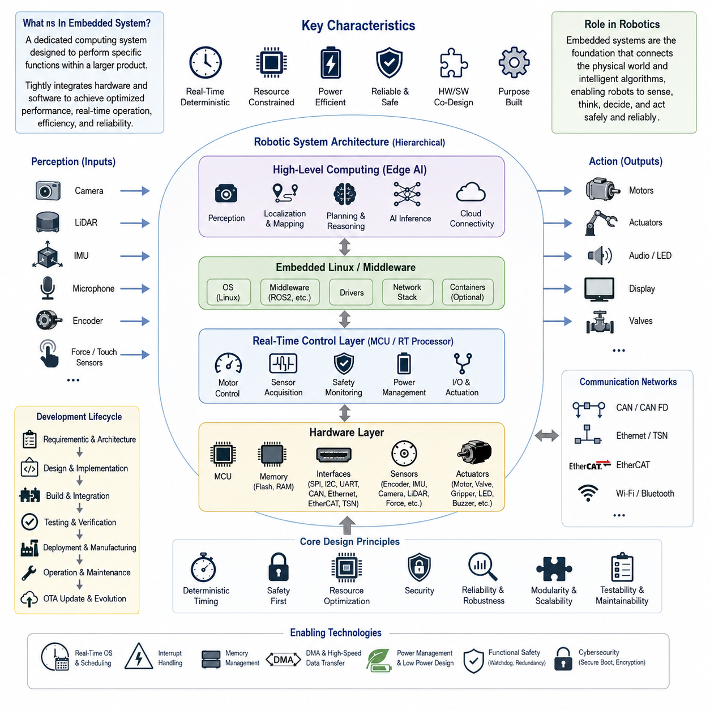
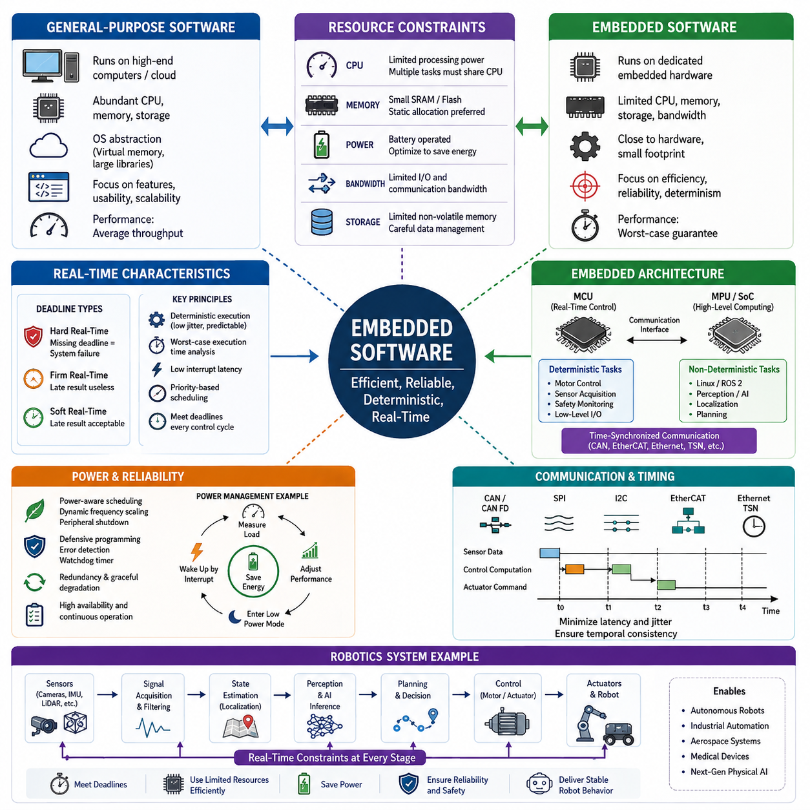
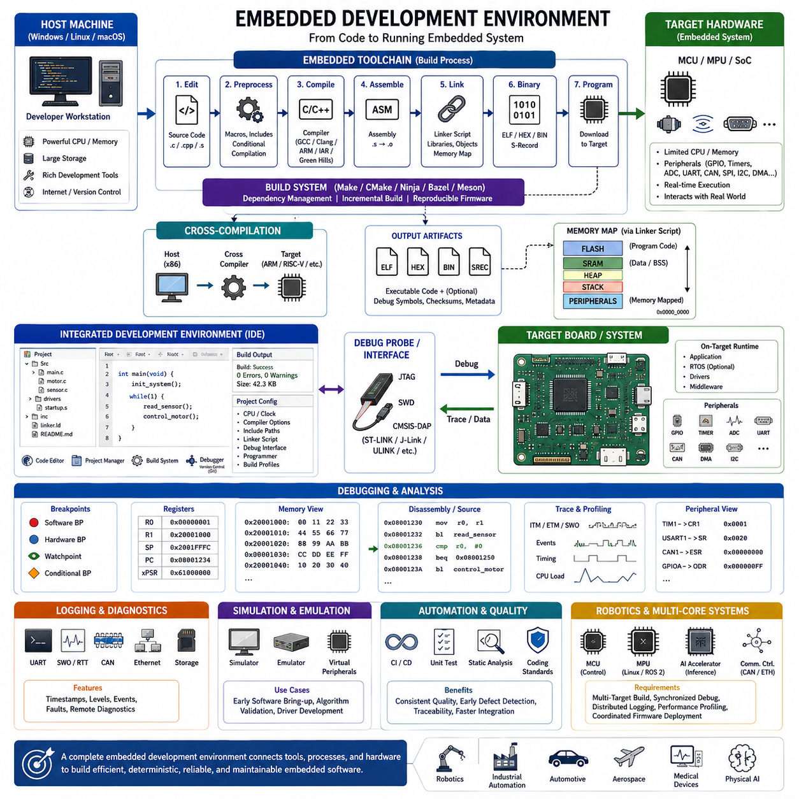
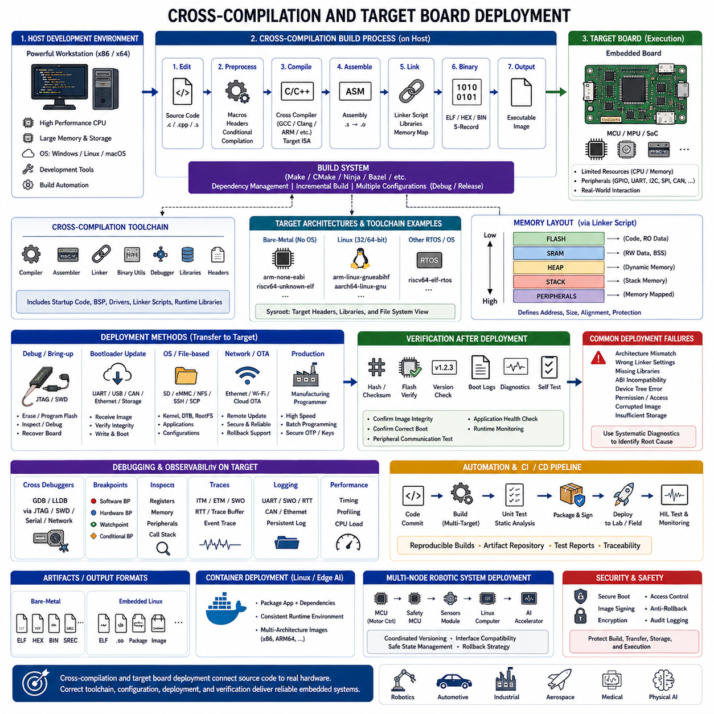
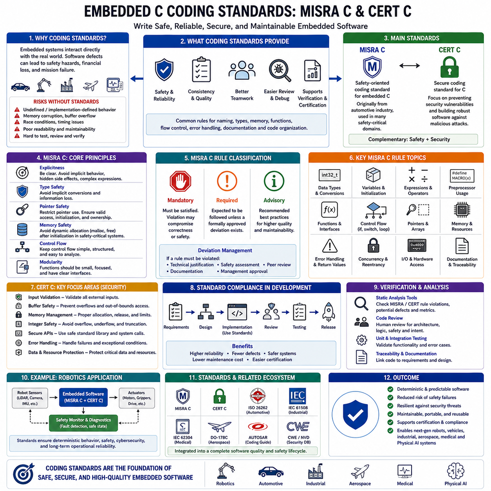
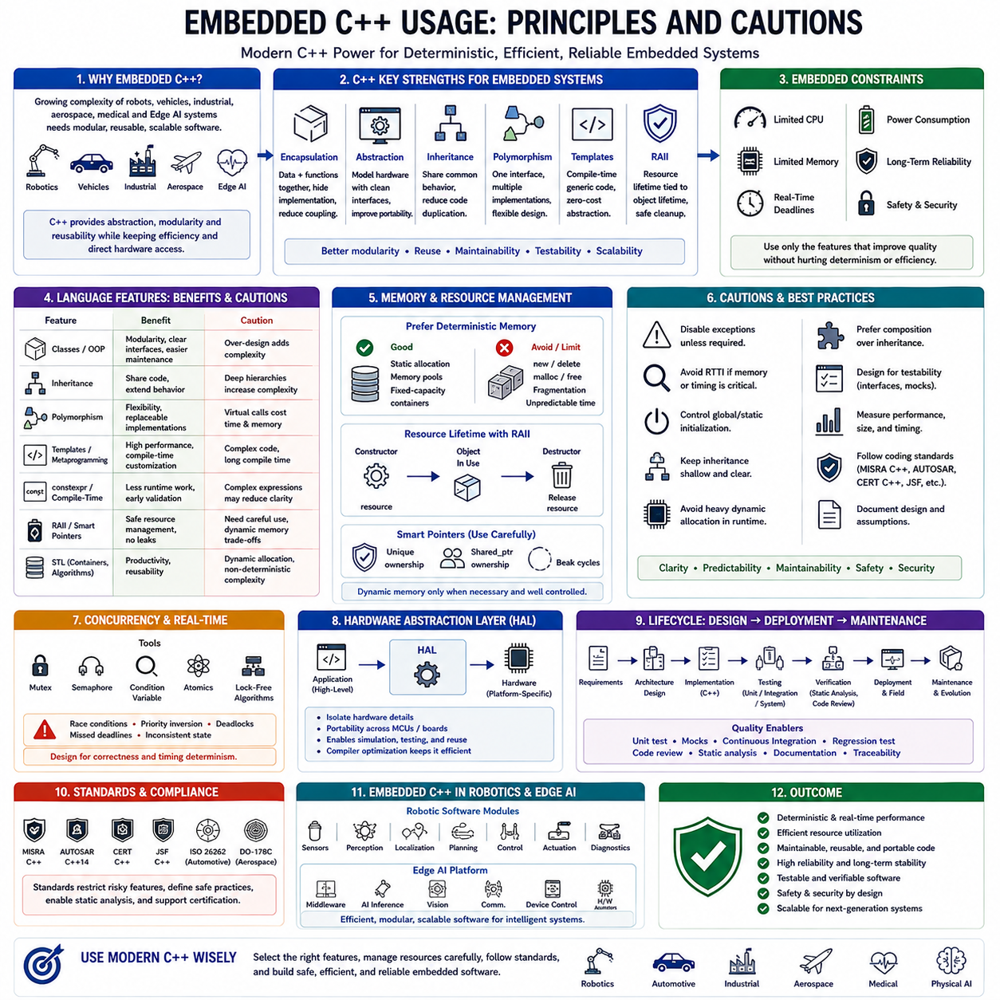
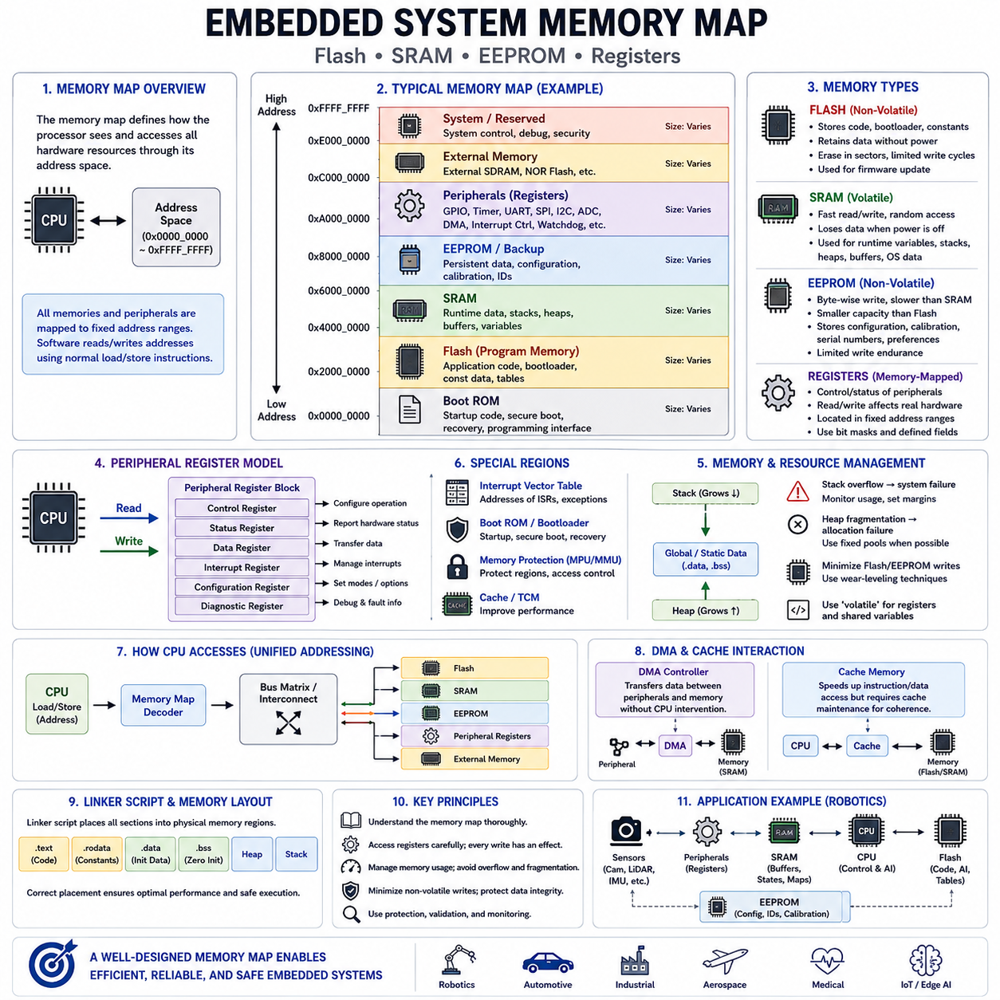
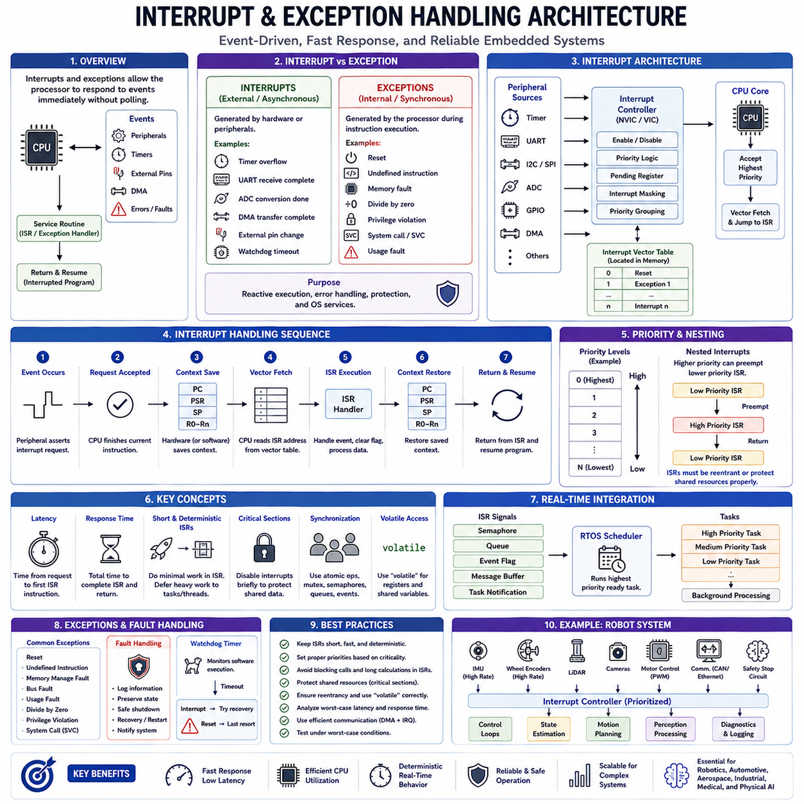
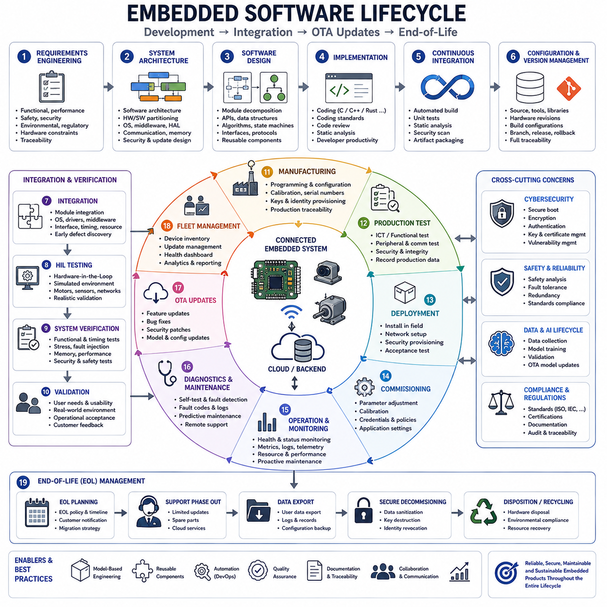
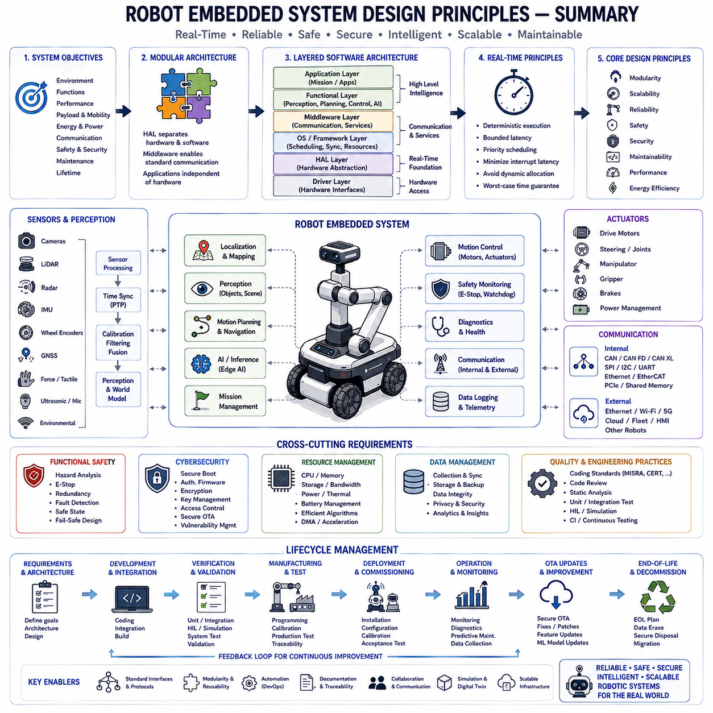

**Volume 02 Embedded Software Engineering**


# 01. Embedded Software Fundamentals

##  

## 01.01 Definition of Embedded Systems and Role in Robotics

{width="7.268055555555556in" height="7.268055555555556in"}

An embedded system is a dedicated computing system designed to perform one or more predefined functions within a larger electronic or mechanical product. Unlike general-purpose computers that execute a wide variety of applications, embedded systems are optimized for specific operational objectives, deterministic timing, energy efficiency, reliability, and hardware integration. They combine hardware and software into a tightly coupled platform where processors, memory, sensors, actuators, communication interfaces, and firmware operate as a unified system. Modern embedded systems are found in consumer electronics, industrial automation, automotive systems, medical devices, aerospace platforms, and increasingly in intelligent robotic systems that require continuous interaction with the physical world.

The defining characteristic of an embedded system is that its software is developed with full awareness of the underlying hardware architecture. Engineers must consider processor capabilities, memory capacity, peripheral interfaces, interrupt latency, power consumption, thermal constraints, and real-time execution requirements during every stage of development. Software is therefore designed not only to implement functional algorithms but also to maximize hardware utilization while maintaining deterministic behavior. This close relationship between software and hardware distinguishes embedded engineering from conventional desktop or cloud software development.

Robotics represents one of the most demanding application domains for embedded systems because robots continuously sense, compute, decide, and act in dynamic environments. Every robotic platform contains numerous embedded controllers responsible for executing low-level operations such as motor control, encoder acquisition, sensor synchronization, battery management, communication, safety monitoring, and actuator coordination. These controllers operate simultaneously with higher-level computing platforms running perception, localization, planning, and artificial intelligence algorithms. Together they form a hierarchical architecture where embedded systems provide the reliable physical foundation upon which intelligent robot behavior is built.

In a modern autonomous robot, embedded systems exist across multiple layers of computation. Microcontrollers typically manage deterministic control loops, safety functions, and hardware interfaces, while embedded processors execute operating systems, middleware, and application software. High-performance edge AI computers perform computationally intensive workloads such as computer vision, simultaneous localization and mapping, large neural network inference, and multimodal reasoning. These heterogeneous computing components communicate through buses and industrial networks including SPI, I2C, UART, CAN, CAN FD, Ethernet, EtherCAT, and Time-Sensitive Networking, enabling coordinated operation across the entire robotic platform.

Real-time responsiveness is one of the most critical requirements for robotic embedded systems. Motion controllers often execute servo loops at frequencies ranging from hundreds of hertz to several kilohertz, leaving only microseconds or milliseconds for sensing, computation, and command generation. Missing timing deadlines can degrade control performance, introduce instability, or even create hazardous operating conditions. Consequently, embedded software emphasizes deterministic execution, interrupt prioritization, predictable scheduling, bounded latency, and efficient resource management rather than maximizing raw computational throughput alone.

Resource constraints fundamentally shape embedded software architecture. Unlike desktop computers equipped with abundant memory and storage, embedded platforms frequently operate with limited Flash memory, SRAM, processor frequency, communication bandwidth, and electrical power. Software engineers therefore optimize memory allocation, reduce computational complexity, minimize unnecessary data movement, and carefully schedule concurrent tasks. Efficient firmware design extends battery life, improves thermal performance, reduces manufacturing cost, and increases long-term system reliability, all of which are essential for commercial robotic products.

Safety and reliability are equally important because embedded systems directly control physical hardware. A software defect may not simply terminate an application but could instead cause unintended robot motion, equipment damage, or injury to nearby operators. Embedded software therefore incorporates watchdog timers, redundancy, fault detection, health monitoring, diagnostic reporting, exception handling, and fail-safe state transitions. Industrial and safety-critical robots frequently follow structured development processes supported by standards that emphasize verification, traceability, defensive programming, and comprehensive validation throughout the product lifecycle.

Communication plays a central role in embedded robotic architectures. Individual controllers rarely operate independently; instead they exchange sensor measurements, control commands, diagnostic information, synchronization signals, and system health data with neighboring modules. Reliable communication protocols ensure consistent timing, low latency, fault tolerance, and interoperability between components produced by different manufacturers. As robotic systems become increasingly distributed, embedded communication infrastructure forms the backbone that connects sensing, control, perception, and cloud-based fleet management into a unified operational ecosystem.

The emergence of Artificial Intelligence has significantly expanded the responsibilities of embedded systems. Traditional firmware primarily executed deterministic algorithms with predefined behaviors, whereas modern embedded platforms increasingly host optimized neural network inference engines, hardware accelerators, and machine learning frameworks. AI-enabled embedded processors perform object detection, semantic segmentation, speech recognition, sensor fusion, predictive maintenance, anomaly detection, and adaptive control directly at the edge. Executing AI locally reduces communication latency, enhances privacy, improves robustness against network failures, and enables robots to react immediately to changing environmental conditions.

Robotic embedded systems are evolving toward heterogeneous computing architectures in which microcontrollers, real-time processors, embedded Linux computers, GPUs, NPUs, DSPs, and dedicated AI accelerators cooperate within a single platform. Time-critical control tasks remain on deterministic controllers, while computationally intensive perception and reasoning algorithms execute on more powerful processors. Middleware and standardized communication frameworks coordinate these heterogeneous resources, allowing robotic developers to balance performance, power consumption, scalability, maintainability, and system complexity without sacrificing deterministic control behavior.

The development lifecycle of embedded software extends well beyond firmware implementation. It includes hardware selection, architecture design, cross-compilation, debugging, hardware abstraction, integration testing, performance profiling, power optimization, security hardening, over-the-air update mechanisms, manufacturing validation, and long-term maintenance. Because robotic products often remain operational for many years, embedded software must support version management, backward compatibility, remote diagnostics, cybersecurity updates, and continuous feature enhancement throughout the entire operational lifetime of the robot.

As robotics advances toward autonomous machines, collaborative robots, humanoids, intelligent mobile platforms, and Physical AI systems, embedded technology will become even more essential. Future embedded systems will integrate real-time control, edge intelligence, functional safety, secure communication, energy-aware computing, and distributed autonomy into unified computing platforms capable of supporting increasingly sophisticated robotic behaviors. Rather than serving merely as low-level controllers, embedded systems are becoming the indispensable computational foundation that bridges physical hardware with intelligent software, enabling robots to perceive, reason, interact, and safely operate in complex real-world environments.

임베디드 시스템(Embedded System)은 더 큰 전자 또는 기계 시스템 내부에서 하나 이상의 특정 기능을 수행하도록 설계된 전용 컴퓨팅 시스템(Dedicated Computing System)이다. 다양한 응용 프로그램을 실행하도록 설계된 범용 컴퓨터(General-Purpose Computer)와 달리, 임베디드 시스템은 특정한 운영 목적, 결정론적 타이밍(Deterministic Timing), 에너지 효율(Energy Efficiency), 신뢰성(Reliability), 그리고 하드웨어 통합(Hardware Integration)에 최적화되어 있다. 이러한 시스템은 프로세서(Processor), 메모리(Memory), 센서(Sensor), 액추에이터(Actuator), 통신 인터페이스(Communication Interface), 그리고 펌웨어(Firmware)를 하나의 통합된 플랫폼으로 결합한다. 현대의 임베디드 시스템은 소비자 전자기기(Consumer Electronics), 산업 자동화(Industrial Automation), 자동차 시스템(Automotive Systems), 의료기기(Medical Devices), 항공우주(Aerospace), 그리고 물리적 환경과 지속적으로 상호작용하는 지능형 로봇 시스템(Intelligent Robotic Systems)에 이르기까지 다양한 분야에서 핵심 기술로 활용되고 있다.

임베디드 시스템의 가장 큰 특징은 소프트웨어가 하드웨어 아키텍처(Hardware Architecture)를 완전히 고려한 상태에서 개발된다는 점이다. 개발자는 프로세서 성능, 메모리 용량, 주변장치 인터페이스(Peripheral Interface), 인터럽트 지연시간(Interrupt Latency), 전력 소비(Power Consumption), 열 제약(Thermal Constraints), 그리고 실시간 실행 요구사항(Real-Time Execution Requirements)을 개발의 모든 단계에서 함께 고려해야 한다. 따라서 소프트웨어는 단순히 기능을 구현하는 것을 넘어 하드웨어 자원을 최대한 효율적으로 활용하면서도 결정론적 동작을 유지하도록 설계된다. 이러한 하드웨어와 소프트웨어의 긴밀한 결합은 임베디드 소프트웨어 공학(Embedded Software Engineering)을 일반적인 데스크톱(Desktop)이나 클라우드(Cloud) 소프트웨어 개발과 구별하는 가장 중요한 요소이다.

로봇공학(Robotics)은 임베디드 시스템이 가장 많이 활용되는 분야 중 하나이며 동시에 가장 높은 수준의 요구사항을 가진 응용 분야이다. 로봇은 끊임없이 주변 환경을 인식하고(Sense), 계산하며(Compute), 판단하고(Decide), 행동(Act)해야 하기 때문이다. 모든 로봇 플랫폼에는 모터 제어(Motor Control), 엔코더(Encoder) 데이터 수집, 센서 동기화(Sensor Synchronization), 배터리 관리(Battery Management), 통신(Communication), 안전 감시(Safety Monitoring), 그리고 액추에이터 협조 제어(Actuator Coordination)를 수행하는 다수의 임베디드 컨트롤러(Embedded Controller)가 존재한다. 이러한 컨트롤러는 인지(Perception), 위치 추정(Localization), 경로 계획(Planning), 그리고 인공지능(AI) 알고리즘을 실행하는 상위 컴퓨팅 플랫폼과 함께 동작하며, 계층형 아키텍처(Hierarchical Architecture)를 구성한다. 결국 임베디드 시스템은 로봇의 지능을 구현하는 기반이 되는 물리적 제어 계층을 담당한다.

현대의 자율주행 로봇(Autonomous Robot)은 여러 계층의 임베디드 컴퓨팅으로 구성된다. 마이크로컨트롤러(Microcontroller)는 결정론적인 제어 루프(Control Loop), 안전 기능(Safety Function), 그리고 하드웨어 인터페이스(Hardware Interface)를 담당하며, 임베디드 프로세서(Embedded Processor)는 운영체제(Operating System), 미들웨어(Middleware), 그리고 응용 소프트웨어(Application Software)를 실행한다. 고성능 엣지 AI 컴퓨터(Edge AI Computer)는 컴퓨터 비전(Computer Vision), 동시적 위치추정 및 지도작성(SLAM, Simultaneous Localization and Mapping), 대규모 신경망 추론(Large Neural Network Inference), 그리고 멀티모달 추론(Multimodal Reasoning)과 같은 계산량이 많은 작업을 수행한다. 이러한 이기종 컴퓨팅(Heterogeneous Computing) 구성요소들은 SPI, I2C, UART, CAN, CAN FD, Ethernet, EtherCAT, 그리고 시간 민감형 네트워킹(Time-Sensitive Networking, TSN)과 같은 다양한 통신 기술을 통해 연결되어 전체 로봇 시스템을 하나의 통합 플랫폼으로 동작하게 만든다.

실시간 응답성(Real-Time Responsiveness)은 로봇 임베디드 시스템에서 가장 중요한 요구사항 가운데 하나이다. 모터 제어기는 일반적으로 수백 헤르츠(Hertz)에서 수 킬로헤르츠(kHz)의 주기로 서보 루프(Servo Loop)를 실행하며, 센서 데이터를 수집하고 계산한 후 제어 명령을 생성하기까지 수 마이크로초(Microsecond)에서 수 밀리초(Millisecond) 이내의 시간이 주어진다. 이러한 시간 제약을 만족하지 못하면 제어 성능이 저하되거나 시스템이 불안정해질 수 있으며, 심한 경우 위험한 동작으로 이어질 수도 있다. 따라서 임베디드 소프트웨어는 단순히 높은 계산 성능을 추구하는 것이 아니라 결정론적인 실행, 인터럽트 우선순위(Interrupt Priority), 예측 가능한 스케줄링(Predictable Scheduling), 제한된 지연시간(Bounded Latency), 그리고 효율적인 자원 관리(Resource Management)를 중심으로 설계된다.

제한된 시스템 자원(Resource Constraints)은 임베디드 소프트웨어 아키텍처를 결정하는 핵심 요소이다. 데스크톱 컴퓨터와 달리 대부분의 임베디드 플랫폼은 플래시 메모리(Flash Memory), SRAM, 프로세서 성능, 통신 대역폭(Bandwidth), 그리고 전력 공급(Power Budget)이 매우 제한적이다. 따라서 개발자는 메모리 사용량을 최소화하고, 계산 복잡도를 줄이며, 불필요한 데이터 이동을 감소시키고, 여러 작업(Task)을 효율적으로 스케줄링해야 한다. 이러한 최적화는 배터리 수명을 연장하고, 발열을 줄이며, 제조 비용을 절감하고, 장기적인 시스템 신뢰성을 향상시키는 데 직접적으로 기여한다.

안전성(Safety)과 신뢰성(Reliability)은 임베디드 시스템이 실제 물리적 하드웨어를 직접 제어하기 때문에 매우 중요한 요소이다. 일반적인 응용 프로그램의 오류는 프로그램 종료에 그칠 수 있지만, 임베디드 소프트웨어의 오류는 예기치 않은 로봇의 움직임, 장비 손상, 또는 작업자의 안전사고로 이어질 수 있다. 따라서 임베디드 시스템은 워치독 타이머(Watchdog Timer), 이중화(Redundancy), 고장 감지(Fault Detection), 상태 감시(Health Monitoring), 진단 보고(Diagnostic Reporting), 예외 처리(Exception Handling), 그리고 안전 상태 전환(Fail-Safe State Transition)과 같은 다양한 안전 메커니즘을 포함한다. 또한 산업용 및 안전 필수 시스템(Safety-Critical System)은 검증(Verification), 추적성(Traceability), 방어적 프로그래밍(Defensive Programming), 그리고 철저한 검증 절차를 요구하는 국제 표준을 기반으로 개발되는 경우가 많다.

통신(Communication)은 현대 로봇 임베디드 아키텍처의 핵심 요소이다. 개별 컨트롤러는 독립적으로 동작하기보다 센서 데이터(Sensor Data), 제어 명령(Control Command), 진단 정보(Diagnostic Information), 동기화 신호(Synchronization Signal), 그리고 시스템 상태 정보를 지속적으로 교환한다. 신뢰성 높은 통신 프로토콜(Communication Protocol)은 일정한 타이밍, 낮은 지연시간(Low Latency), 고장 허용성(Fault Tolerance), 그리고 다양한 제조사의 장비 간 상호운용성(Interoperability)을 제공한다. 로봇 시스템이 점점 더 분산형 구조(Distributed Architecture)로 발전함에 따라 이러한 임베디드 통신 인프라는 센서, 제어기, 인지 시스템, 그리고 클라우드 기반 플릿 관리(Fleet Management)를 연결하는 핵심 기반 기술이 되고 있다.

인공지능(Artificial Intelligence)의 발전은 임베디드 시스템의 역할을 크게 확장시키고 있다. 기존의 펌웨어(Firmware)가 미리 정의된 알고리즘을 결정론적으로 실행하는 데 집중했다면, 현대의 임베디드 플랫폼은 최적화된 신경망 추론 엔진(Neural Network Inference Engine), AI 가속기(AI Accelerator), 그리고 머신러닝 프레임워크(Machine Learning Framework)를 직접 실행할 수 있다. 이를 통해 객체 검출(Object Detection), 의미론적 분할(Semantic Segmentation), 음성 인식(Speech Recognition), 센서 융합(Sensor Fusion), 예지보전(Predictive Maintenance), 이상 탐지(Anomaly Detection), 그리고 적응형 제어(Adaptive Control)를 엣지(Edge) 환경에서 실시간으로 수행할 수 있다. AI를 로컬에서 실행하면 통신 지연을 줄이고, 개인정보 보호를 강화하며, 네트워크 장애 상황에서도 안정적인 자율 동작을 유지할 수 있다.

현대의 로봇 임베디드 시스템은 이기종 컴퓨팅(Heterogeneous Computing) 아키텍처를 중심으로 발전하고 있다. 하나의 플랫폼 안에서 마이크로컨트롤러, 실시간 프로세서(Real-Time Processor), 임베디드 리눅스(Embedded Linux) 컴퓨터, GPU(Graphics Processing Unit), NPU(Neural Processing Unit), DSP(Digital Signal Processor), 그리고 AI 가속기가 서로 협력하여 동작한다. 시간 제약이 매우 엄격한 제어 작업은 결정론적인 컨트롤러가 담당하고, 계산량이 많은 인지와 추론 알고리즘은 고성능 프로세서가 수행한다. 미들웨어와 표준화된 통신 프레임워크는 이러한 다양한 컴퓨팅 자원을 통합적으로 관리하여 성능, 전력 효율, 확장성(Scalability), 유지보수성(Maintainability), 그리고 시스템 복잡도(System Complexity)의 균형을 유지하도록 지원한다.

임베디드 소프트웨어의 개발 생명주기(Development Lifecycle)는 단순한 펌웨어 구현을 넘어 매우 광범위한 과정을 포함한다. 하드웨어 선정(Hardware Selection), 시스템 아키텍처 설계(System Architecture Design), 크로스 컴파일(Cross Compilation), 디버깅(Debugging), 하드웨어 추상화(Hardware Abstraction), 통합 시험(Integration Testing), 성능 분석(Performance Profiling), 전력 최적화(Power Optimization), 보안 강화(Security Hardening), OTA(Over-the-Air) 업데이트(Update) 메커니즘 구축, 제조 검증(Manufacturing Validation), 그리고 장기 유지보수(Long-Term Maintenance)가 모두 개발 과정에 포함된다. 로봇 제품은 수년 동안 운영되는 경우가 많으므로 버전 관리(Version Management), 하위 호환성(Backward Compatibility), 원격 진단(Remote Diagnostics), 사이버 보안(Cybersecurity) 업데이트, 그리고 지속적인 기능 개선을 지원할 수 있도록 설계되어야 한다.

로봇공학이 자율 로봇(Autonomous Robot), 협동 로봇(Collaborative Robot), 휴머노이드(Humanoid), 지능형 이동 로봇(Intelligent Mobile Robot), 그리고 피지컬 AI(Physical AI) 시대로 발전함에 따라 임베디드 기술의 중요성은 더욱 커질 것이다. 미래의 임베디드 시스템은 실시간 제어(Real-Time Control), 엣지 AI(Edge AI), 기능 안전(Functional Safety), 보안 통신(Secure Communication), 에너지 효율 컴퓨팅(Energy-Aware Computing), 그리고 분산 자율성(Distributed Autonomy)을 하나의 통합 플랫폼으로 구현하게 될 것이다. 즉, 임베디드 시스템은 단순한 하드웨어 제어기를 넘어 물리적 하드웨어와 지능형 소프트웨어를 연결하는 핵심 컴퓨팅 기반으로 자리 잡으며, 미래의 로봇이 주변 환경을 인식하고, 추론하며, 안전하게 상호작용하고, 복잡한 현실 환경에서 자율적으로 동작할 수 있도록 만드는 가장 중요한 기반 기술이 될 것이다.

##  

## 01.02 Embedded vs General SW: Resource Constraints / Realtime

{width="7.268055555555556in" height="7.268055555555556in"}

Embedded software differs fundamentally from general-purpose software because it is designed to execute dedicated functions within hardware systems that possess strict limitations in computing resources, power consumption, memory capacity, and execution time. Unlike desktop or cloud applications that operate on relatively abundant hardware, embedded systems are tightly coupled with specific processors, peripherals, and physical devices. Every software component must therefore be designed with awareness of the hardware environment, ensuring that functionality, reliability, and efficiency remain balanced throughout the product lifecycle. This close integration between software and electronics makes embedded engineering a multidisciplinary field that combines computer science, electrical engineering, and real-time control.

General-purpose software typically prioritizes functionality, usability, portability, and scalability across diverse hardware platforms. Modern operating systems provide extensive abstraction layers that isolate applications from hardware details, allowing developers to focus primarily on business logic and user experience. Large memories, multi-core processors, virtual memory, and high-performance storage reduce the impact of inefficient implementations. As a result, software architectures can tolerate dynamic memory allocation, extensive libraries, garbage collection, and variable execution timing without significantly affecting overall system behavior.

Embedded software operates under fundamentally different assumptions. The processor frequency, available SRAM, Flash storage, communication bandwidth, and energy budget are predetermined by the hardware design and cannot easily be expanded after manufacturing. A microcontroller may provide only a few hundred kilobytes of RAM and several megabytes of Flash memory, requiring developers to optimize every variable, function, and communication buffer. Software complexity must therefore be carefully managed so that limited computational resources remain sufficient even under worst-case operating conditions.

Resource constraints extend beyond memory capacity alone. CPU utilization must remain predictable because embedded processors often execute multiple concurrent tasks including sensor acquisition, communication protocols, actuator control, diagnostic monitoring, and safety supervision. Excessive computational load can delay critical control loops and introduce instability into physical systems. Efficient algorithms, lightweight data structures, hardware acceleration, and careful scheduling are therefore essential design considerations rather than optional optimizations.

Memory management represents one of the most important differences between embedded and general software. Desktop operating systems rely heavily on virtual memory, paging, and dynamic allocation, whereas many embedded systems either prohibit or severely restrict dynamic memory usage after initialization. Memory fragmentation, allocation failures, and unpredictable allocation latency may eventually compromise long-term reliability. Consequently, embedded software frequently relies on static allocation, fixed-size memory pools, deterministic buffer management, and compile-time memory planning to guarantee stable operation throughout continuous execution.

Power consumption is another defining characteristic of embedded systems. Battery-powered robots, drones, wearable devices, industrial sensors, and IoT platforms must maximize operating time while maintaining required performance levels. Software directly influences power usage through processor utilization, peripheral activation, communication frequency, memory accesses, and sleep-state transitions. Effective embedded software therefore integrates power-aware scheduling, dynamic frequency scaling, peripheral shutdown strategies, interrupt-driven execution, and efficient communication protocols to extend battery life without sacrificing functionality.

Reliability requirements also distinguish embedded software from conventional applications. Consumer software may recover from occasional crashes through application restarts or operating system recovery mechanisms. In contrast, embedded software controlling industrial robots, medical equipment, vehicles, or aerospace systems may have no opportunity for immediate recovery because failures can directly affect physical safety, equipment integrity, or mission success. Consequently, defensive programming, fault detection, watchdog timers, exception handling, redundancy, and graceful degradation become integral architectural components from the earliest design stages.

Real-time behavior is perhaps the most important characteristic separating embedded software from general-purpose software. Real-time systems are evaluated not only by whether they produce correct results but also by whether those results are delivered within specified timing constraints. Missing a deadline may be equivalent to producing an incorrect result. For example, a motor controller that calculates the correct torque command several milliseconds too late can destabilize an entire robotic platform even though the numerical computation itself is accurate.

Real-time constraints are commonly classified into hard real-time, firm real-time, and soft real-time requirements. Hard real-time systems cannot tolerate missed deadlines because timing failures may produce catastrophic consequences such as equipment damage or safety hazards. Firm real-time systems lose the value of delayed computations, although occasional deadline misses may not immediately endanger the system. Soft real-time systems permit moderate timing variation while maintaining acceptable overall performance, making them suitable for multimedia processing, user interfaces, and certain perception workloads.

Deterministic execution forms the foundation of real-time embedded software. Determinism refers to the ability of a system to produce consistent execution timing under identical operating conditions. Rather than maximizing average performance, embedded developers prioritize minimizing timing variability, execution jitter, interrupt latency, scheduling uncertainty, and communication delays. Worst-case execution time analysis therefore becomes significantly more important than average-case performance benchmarks when validating embedded applications.

Interrupt mechanisms provide rapid responses to external events while minimizing unnecessary processor activity. Instead of continuously polling hardware devices, processors remain available for other tasks until peripherals generate interrupts requiring immediate attention. However, excessive interrupt nesting, lengthy interrupt service routines, or poorly prioritized interrupts can increase latency and reduce system predictability. Consequently, embedded software often performs only minimal processing inside interrupt handlers while delegating more extensive computations to scheduled tasks.

Task scheduling further differentiates embedded software from traditional desktop applications. Bare-metal firmware often relies on super loops, finite state machines, or cooperative scheduling to minimize overhead and maximize determinism. More sophisticated embedded systems employ Real-Time Operating Systems that provide priority-based preemptive scheduling, synchronization primitives, timers, and inter-task communication. Regardless of implementation strategy, scheduling decisions must guarantee that critical control functions always receive sufficient processor time before less important background activities.

Communication latency is equally important in embedded robotics. Sensor measurements, motor commands, safety signals, and diagnostic messages frequently travel through CAN, CAN FD, CAN XL, SPI, I2C, UART, EtherCAT, Ethernet, or Time-Sensitive Networking infrastructures. Each communication interface introduces finite transmission delays, buffering effects, arbitration mechanisms, and synchronization challenges. Embedded software must therefore coordinate communication timing with control cycles so that information remains temporally consistent across distributed controllers.

The increasing adoption of Embedded Linux and heterogeneous computing platforms has expanded embedded software capabilities while introducing additional design complexity. Modern robots often combine microcontrollers responsible for deterministic low-level control with high-performance processors executing Linux, ROS 2, AI inference, perception, localization, and planning algorithms. This hierarchical architecture separates strict real-time functions from computationally intensive workloads, allowing each processor to operate according to its own timing requirements while communicating through carefully designed interfaces.

Artificial intelligence introduces new challenges for embedded resource management. Deep neural networks demand substantial computational throughput, memory bandwidth, and energy consumption, often exceeding the capabilities of traditional microcontrollers. Edge AI platforms such as embedded GPUs and specialized neural processing units enable local inference while maintaining acceptable latency, yet developers must still optimize model size, quantization, batching strategies, and inference scheduling to satisfy both resource limitations and real-time constraints. Efficient integration of AI with deterministic control remains one of the defining engineering challenges of next-generation autonomous systems.

Robotic platforms illustrate the interaction between resource constraints and real-time requirements particularly well. Sensor acquisition, localization, obstacle detection, motion planning, actuator control, battery management, communication, diagnostics, and safety monitoring all execute simultaneously while competing for finite computational resources. Failure to allocate processor time appropriately may increase localization drift, delay obstacle avoidance, reduce control stability, or compromise safety mechanisms. Consequently, embedded robotic software architectures typically partition workloads according to timing criticality, processor capability, and communication latency.

Successful embedded software engineering therefore requires a fundamentally different mindset from conventional software development. Developers must simultaneously optimize functionality, computational efficiency, memory utilization, power consumption, timing predictability, reliability, maintainability, and hardware integration rather than maximizing application features alone. Understanding these tradeoffs enables engineers to design robust embedded platforms capable of supporting increasingly sophisticated autonomous robots, intelligent industrial equipment, medical devices, aerospace electronics, and future Physical AI systems operating safely within strict resource limitations and deterministic real-time constraints.

임베디드 소프트웨어(Embedded Software)는 제한된 컴퓨팅 자원(Computing Resources), 전력 소비(Power Consumption), 메모리 용량(Memory Capacity), 그리고 실행 시간(Execution Time)을 갖는 하드웨어 시스템 내부에서 특정 기능을 수행하도록 설계된다는 점에서 일반 소프트웨어(General-Purpose Software)와 근본적으로 다릅니다. 데스크톱이나 클라우드 환경처럼 풍부한 하드웨어 자원을 사용하는 응용 프로그램과 달리, 임베디드 시스템은 특정 프로세서, 주변장치(Peripheral), 그리고 물리적 장치와 밀접하게 결합되어 있습니다. 따라서 모든 소프트웨어 구성 요소는 하드웨어 환경을 고려하여 설계되어야 하며, 제품의 전체 수명 동안 기능성(Functionality), 신뢰성(Reliability), 그리고 효율성(Efficiency)을 동시에 유지해야 합니다. 이러한 소프트웨어와 전자 하드웨어 간의 긴밀한 통합은 임베디드 공학을 컴퓨터 과학(Computer Science), 전기전자공학(Electrical Engineering), 그리고 실시간 제어(Real-Time Control)가 융합된 학문으로 만듭니다.

일반 소프트웨어는 주로 기능성, 사용성(Usability), 이식성(Portability), 그리고 다양한 하드웨어 플랫폼에서의 확장성(Scalability)을 우선적으로 고려합니다. 현대 운영체제(Operating System)는 광범위한 추상화 계층(Abstraction Layer)을 제공하여 응용 프로그램이 하드웨어 세부 사항을 직접 다루지 않아도 되도록 합니다. 또한 대용량 메모리, 멀티코어 프로세서(Multi-Core Processor), 가상 메모리(Virtual Memory), 그리고 고성능 저장장치(Storage)가 제공되므로 다소 비효율적인 구현도 전체 시스템 성능에 큰 영향을 주지 않습니다. 이러한 이유로 동적 메모리 할당(Dynamic Memory Allocation), 대규모 라이브러리, 가비지 컬렉션(Garbage Collection), 그리고 실행 시간의 변동성도 일반적으로 허용됩니다.

반면 임베디드 소프트웨어는 전혀 다른 전제를 기반으로 설계됩니다. 프로세서 클럭 주파수, 사용 가능한 SRAM, 플래시 메모리(Flash Memory), 통신 대역폭(Bandwidth), 그리고 전력 예산(Power Budget)은 하드웨어 설계 단계에서 이미 결정되며 제품 출하 이후에는 쉽게 확장할 수 없습니다. 하나의 마이크로컨트롤러(Microcontroller)는 수백 킬로바이트 수준의 SRAM과 수 메가바이트의 플래시 메모리만 제공하는 경우가 많기 때문에, 개발자는 변수 하나와 함수 하나, 통신 버퍼(Buffer) 하나까지 모두 최적화해야 합니다. 따라서 최악의 운용 조건(Worst-Case Operating Condition)에서도 제한된 자원으로 안정적으로 동작하도록 소프트웨어 복잡도를 지속적으로 관리해야 합니다.

자원 제약(Resource Constraints)은 단순히 메모리 용량만을 의미하지 않습니다. 하나의 임베디드 프로세서는 센서 획득(Sensor Acquisition), 통신 프로토콜(Communication Protocol), 액추에이터 제어(Actuator Control), 진단 모니터링(Diagnostic Monitoring), 그리고 안전 감시(Safety Supervision)와 같은 여러 작업(Task)을 동시에 수행해야 합니다. 계산 부하(Computational Load)가 과도하게 증가하면 중요한 제어 루프(Control Loop)의 실행이 지연되어 실제 물리 시스템의 안정성이 저하될 수 있습니다. 따라서 효율적인 알고리즘(Algorithm), 경량 데이터 구조(Lightweight Data Structure), 하드웨어 가속(Hardware Acceleration), 그리고 신중한 작업 스케줄링(Task Scheduling)은 선택 사항이 아니라 필수 설계 요소가 됩니다.

메모리 관리(Memory Management)는 임베디드 소프트웨어와 일반 소프트웨어를 구분하는 가장 중요한 요소 가운데 하나입니다. 데스크톱 운영체제는 가상 메모리, 페이징(Paging), 그리고 동적 메모리 할당을 적극적으로 활용하지만, 많은 임베디드 시스템은 초기화 이후 동적 메모리 사용을 금지하거나 매우 제한적으로 허용합니다. 메모리 단편화(Memory Fragmentation), 메모리 할당 실패, 그리고 예측 불가능한 할당 지연은 장기간 운용 시 시스템 신뢰성을 크게 저하시킬 수 있기 때문입니다. 따라서 임베디드 소프트웨어는 정적 메모리 할당(Static Allocation), 고정 크기 메모리 풀(Fixed-Size Memory Pool), 결정론적 버퍼 관리(Deterministic Buffer Management), 그리고 컴파일 시점 메모리 계획(Compile-Time Memory Planning)을 활용하여 장시간 안정적인 동작을 보장합니다.

전력 소비(Power Consumption) 역시 임베디드 시스템을 정의하는 중요한 특성입니다. 배터리 기반 로봇(Robot), 드론(Drone), 웨어러블(Wearable), 산업용 센서, 그리고 사물인터넷(IoT) 플랫폼은 제한된 에너지로 가능한 한 긴 운용 시간을 확보해야 합니다. 소프트웨어는 프로세서 사용률, 주변장치 활성화, 통신 빈도, 메모리 접근, 그리고 절전 상태(Sleep State) 전환을 통해 전력 소비에 직접적인 영향을 미칩니다. 따라서 임베디드 소프트웨어는 전력 인지 스케줄링(Power-Aware Scheduling), 동적 주파수 조절(Dynamic Frequency Scaling), 주변장치 전원 차단, 인터럽트 기반 실행(Interrupt-Driven Execution), 그리고 효율적인 통신 프로토콜을 활용하여 기능을 유지하면서도 배터리 수명을 최대화합니다.

신뢰성(Reliability) 요구사항 역시 임베디드 소프트웨어를 일반 응용 프로그램과 구별하는 핵심 요소입니다. 일반 소비자용 소프트웨어는 오류가 발생하면 프로그램을 다시 실행하거나 운영체제를 재시작하여 복구할 수 있는 경우가 많습니다. 그러나 산업용 로봇, 의료기기, 자동차, 항공우주 시스템 등을 제어하는 임베디드 소프트웨어는 오류가 발생할 경우 사람의 안전, 장비의 손상, 또는 임무 실패로 직접 이어질 수 있으므로 동일한 방식의 복구가 불가능합니다. 따라서 방어적 프로그래밍(Defensive Programming), 오류 검출(Error Detection), 워치독 타이머(Watchdog Timer), 예외 처리(Exception Handling), 중복성(Redundancy), 그리고 점진적 기능 저하(Graceful Degradation)는 초기 설계 단계부터 반드시 포함되어야 하는 핵심 아키텍처 요소입니다.

실시간성(Real-Time)은 임베디드 소프트웨어와 일반 소프트웨어를 가장 명확하게 구분하는 특성입니다. 실시간 시스템은 올바른 결과를 계산하는 것뿐 아니라, 그 결과를 정해진 시간 제한(Time Constraint) 안에 제공하는 것이 필수입니다. 마감 시간(Deadline)을 초과하는 것은 잘못된 계산 결과를 내는 것과 동일하게 간주될 수 있습니다. 예를 들어 모터 제어기(Motor Controller)가 정확한 토크 명령(Torque Command)을 계산했더라도 몇 밀리초 늦게 출력한다면, 실제 로봇의 안정성이 무너질 수 있습니다.

실시간 요구사항은 일반적으로 하드 실시간(Hard Real-Time), 펌 실시간(Firm Real-Time), 그리고 소프트 실시간(Soft Real-Time)으로 구분됩니다. 하드 실시간 시스템은 마감 시간을 단 한 번이라도 놓치면 심각한 장비 손상이나 안전 사고를 초래할 수 있습니다. 펌 실시간 시스템은 마감 시간을 넘긴 결과는 더 이상 가치가 없지만, 드물게 발생하는 지연이 즉시 시스템 전체를 위험하게 만들지는 않습니다. 소프트 실시간 시스템은 일정 수준의 시간 지연을 허용하며, 멀티미디어 처리, 사용자 인터페이스(User Interface), 그리고 일부 인식(Perception) 시스템에 적합합니다.

결정론적 실행(Deterministic Execution)은 실시간 임베디드 소프트웨어의 핵심 기반입니다. 결정론성(Determinism)이란 동일한 조건에서 항상 예측 가능한 실행 시간을 유지하는 능력을 의미합니다. 따라서 임베디드 개발자는 평균 성능(Average Performance)을 높이는 것보다 실행 시간 변동성(Timing Variability), 지터(Jitter), 인터럽트 지연(Interrupt Latency), 스케줄링 불확실성(Scheduling Uncertainty), 그리고 통신 지연(Communication Delay)을 최소화하는 데 더 큰 비중을 둡니다. 이러한 이유로 최악 실행 시간 분석(Worst-Case Execution Time Analysis)은 평균 성능 벤치마크보다 훨씬 중요한 검증 기준이 됩니다.

인터럽트(Interrupt)는 외부 이벤트에 신속하게 대응하면서도 프로세서 자원을 효율적으로 활용하기 위한 핵심 메커니즘입니다. 프로세서는 지속적으로 하드웨어 상태를 확인(Polling)하는 대신 인터럽트가 발생할 때까지 다른 작업을 수행할 수 있습니다. 그러나 인터럽트 중첩(Interrupt Nesting)이 과도하거나 인터럽트 서비스 루틴(Interrupt Service Routine)이 지나치게 길어지면 전체 시스템의 응답 지연과 예측 불가능성이 증가합니다. 따라서 실제 임베디드 시스템에서는 인터럽트 내부에서는 최소한의 작업만 수행하고, 복잡한 처리는 우선순위가 관리되는 작업(Task)으로 넘기는 구조를 주로 사용합니다.

작업 스케줄링(Task Scheduling) 역시 임베디드 소프트웨어를 일반 데스크톱 응용 프로그램과 구분하는 중요한 요소입니다. 베어메탈 펌웨어(Bare-Metal Firmware)는 오버헤드를 최소화하기 위해 슈퍼 루프(Super Loop), 유한 상태 머신(Finite State Machine), 또는 협력형 스케줄링(Cooperative Scheduling)을 사용하는 경우가 많습니다. 보다 복잡한 시스템에서는 실시간 운영체제(Real-Time Operating System)가 우선순위 기반 선점형 스케줄링(Priority-Based Preemptive Scheduling), 동기화(Synchronization), 타이머(Timer), 그리고 작업 간 통신(Inter-Task Communication)을 제공합니다. 어떤 방식을 사용하든 가장 중요한 목표는 제어 루프와 같은 핵심 작업이 항상 필요한 시간 안에 실행되도록 보장하는 것입니다.

통신 지연(Communication Latency) 역시 로봇 임베디드 시스템에서 매우 중요한 요소입니다. 센서 데이터, 모터 명령, 안전 신호, 그리고 진단 정보는 CAN, CAN FD, CAN XL, SPI, I2C, UART, EtherCAT, Ethernet, 그리고 시간 민감 네트워킹(Time-Sensitive Networking, TSN) 등을 통해 전달됩니다. 각 통신 방식은 전송 지연, 버퍼링(Buffering), 버스 중재(Bus Arbitration), 그리고 시간 동기화 문제를 발생시킬 수 있습니다. 따라서 임베디드 소프트웨어는 이러한 통신 특성을 제어 주기(Control Cycle)와 정밀하게 맞추어 모든 제어기(Controller)가 시간적으로 일관된 데이터를 사용하도록 설계되어야 합니다.

최근에는 임베디드 리눅스(Embedded Linux)와 이기종 컴퓨팅(Heterogeneous Computing) 플랫폼이 널리 사용되면서 임베디드 소프트웨어의 기능이 크게 확장되었습니다. 현대 로봇은 일반적으로 마이크로컨트롤러가 모터 제어와 같은 결정론적 실시간 제어를 담당하고, 고성능 프로세서는 리눅스, ROS 2, 인공지능 추론(AI Inference), 인식, 위치추정(Localization), 그리고 경로 계획(Planning)을 수행합니다. 이러한 계층형 구조(Hierarchical Architecture)는 엄격한 실시간 작업과 대규모 계산 작업을 분리하여 각각의 특성에 최적화된 방식으로 동작하도록 합니다.

인공지능(AI)의 도입은 임베디드 자원 관리(Resource Management)에 새로운 도전 과제를 가져왔습니다. 심층신경망(Deep Neural Network)은 매우 높은 계산 성능, 메모리 대역폭, 그리고 전력 소비를 요구하므로 기존 마이크로컨트롤러만으로는 처리하기 어렵습니다. 이를 해결하기 위해 임베디드 GPU(Embedded GPU)와 신경망 처리 장치(Neural Processing Unit, NPU)가 널리 활용되고 있지만, 모델 크기(Model Size), 양자화(Quantization), 배치 처리(Batching), 그리고 추론 스케줄링(Inference Scheduling)을 최적화하여 제한된 자원 안에서도 실시간성을 만족시키는 것이 매우 중요한 설계 과제가 되고 있습니다.

로봇 플랫폼은 자원 제약과 실시간성이 동시에 요구되는 대표적인 사례입니다. 센서 획득, 위치추정, 장애물 인식, 경로 계획, 액추에이터 제어, 배터리 관리, 통신, 진단, 그리고 안전 모니터링이 모두 동시에 실행되며 하나의 제한된 프로세서 자원을 공유합니다. 프로세서 시간을 적절히 배분하지 못하면 위치추정 오차가 증가하고, 장애물 회피가 지연되며, 제어 안정성이 저하되고, 심지어 안전 기능까지 영향을 받을 수 있습니다. 따라서 현대 로봇의 임베디드 소프트웨어는 작업의 실시간 중요도, 프로세서 성능, 그리고 통신 지연을 기준으로 기능을 체계적으로 분할하여 설계합니다.

결국 성공적인 임베디드 소프트웨어 공학(Embedded Software Engineering)은 일반 소프트웨어 개발과는 전혀 다른 사고방식을 요구합니다. 개발자는 기능 구현뿐 아니라 계산 효율성(Computational Efficiency), 메모리 활용(Memory Utilization), 전력 소비(Power Consumption), 시간 예측 가능성(Timing Predictability), 신뢰성(Reliability), 유지보수성(Maintainability), 그리고 하드웨어 통합(Hardware Integration)을 동시에 최적화해야 합니다. 이러한 균형 잡힌 설계 능력은 미래의 자율 로봇(Autonomous Robot), 지능형 산업 장비(Intelligent Industrial Equipment), 의료기기(Medical Device), 항공우주 전자장치(Aerospace Electronics), 그리고 차세대 피지컬 AI(Physical AI) 시스템이 제한된 자원 안에서도 안전하고 결정론적으로 동작할 수 있도록 만드는 핵심 기반이 됩니다.

##  

## 01.03 Embedded Development Environment: Toolchain, IDE, Debugger

{width="7.268055555555556in" height="7.268055555555556in"}

An embedded development environment is a comprehensive ecosystem that enables engineers to design, implement, test, debug, optimize, and maintain software running on dedicated hardware platforms. Unlike general-purpose software development, embedded development targets microcontrollers, processors, and System-on-Chip devices with limited computational resources and direct hardware interaction. The development workflow therefore extends beyond writing source code to include hardware configuration, cross-compilation, firmware generation, flashing, hardware debugging, timing analysis, and system validation. A well-designed development environment improves productivity, software quality, maintainability, and long-term reliability while reducing integration risks throughout the product lifecycle.

The embedded software toolchain consists of multiple tightly integrated components that transform human-readable source code into executable machine instructions. The process typically begins with source code editing, followed by preprocessing, compilation, assembly, linking, binary generation, programming into the target device, execution, and debugging. Each stage contributes to producing deterministic and optimized firmware suitable for the constraints of embedded hardware. Because errors introduced during any stage may propagate throughout the development process, understanding the complete toolchain architecture is essential for diagnosing software failures and improving overall development efficiency.

The compiler is one of the most critical components of the embedded toolchain. Its primary responsibility is translating high-level programming languages such as C and C++ into processor-specific machine code while applying various optimization techniques. Embedded compilers must generate highly efficient executable code because processor speed, Flash memory, and SRAM capacity are often severely limited. Popular compiler families include GNU GCC, LLVM Clang, ARM Compiler, IAR Embedded Workbench Compiler, and Green Hills Compiler. Compiler optimization levels influence execution speed, memory usage, debugging capability, and code predictability, requiring developers to balance performance with maintainability throughout different stages of development.

Before compilation begins, the preprocessor performs macro expansion, conditional compilation, header inclusion, and symbolic replacement. Conditional compilation is particularly valuable in embedded projects because the same firmware often supports multiple hardware revisions, processor families, communication interfaces, or product variants. Compile-time configuration minimizes runtime overhead while allowing a single source code base to serve multiple embedded platforms. Proper use of preprocessing directives improves portability and reduces duplicated source code without sacrificing performance.

Following compilation, the assembler converts processor-specific assembly instructions into relocatable object files. While most embedded applications are primarily written in high-level languages, assembly language remains important for startup code, interrupt entry routines, context switching, bootloaders, hardware initialization, and performance-critical algorithms. Assembly programming provides complete control over processor registers and execution timing, making it indispensable for implementing deterministic low-level functions that cannot tolerate compiler-generated overhead.

The linker combines object files, startup libraries, runtime support packages, middleware components, and application modules into a final executable image. Unlike desktop software development, embedded linking requires precise placement of program sections into Flash memory, SRAM, external memory, or dedicated hardware regions. Linker scripts explicitly define memory maps, interrupt vector locations, stack allocation, heap configuration, initialization data, and peripheral register placement. Careful linker configuration directly affects system stability, startup behavior, and memory utilization.

Binary generation converts the linked executable into formats suitable for programming embedded devices. Depending on the programming tool and processor architecture, firmware may be generated as ELF, HEX, BIN, or Motorola S-record files. These binary formats contain executable instructions together with optional debugging symbols, memory addresses, checksums, and metadata. Production firmware often excludes debugging information to minimize storage requirements, while development builds retain extensive symbolic information for source-level debugging.

Cross-compilation is a defining characteristic of embedded software development. In most projects, software is compiled on a powerful host computer but executed on an entirely different target processor. The host environment may operate on Windows, Linux, or macOS, whereas the target device may use ARM Cortex-M, ARM Cortex-A, RISC-V, PowerPC, or proprietary embedded architectures. Cross-compilers generate executable code specifically optimized for the target instruction set while allowing developers to benefit from the computational resources and development tools available on modern workstations.

Integrated Development Environments provide a unified workspace that combines source code editing, project management, compilation, debugging, version control, build automation, and hardware programming. Modern IDEs significantly improve developer productivity by integrating multiple tools into a consistent graphical interface. Common embedded IDEs include STM32CubeIDE, Keil MDK, IAR Embedded Workbench, MPLAB X, SEGGER Embedded Studio, Eclipse CDT, Visual Studio Code with embedded extensions, and vendor-specific development environments. Although many professional teams increasingly adopt command-line build systems for continuous integration, graphical IDEs remain valuable for debugging and hardware exploration.

Project configuration within an IDE extends beyond compiler settings alone. Developers configure processor architecture, clock frequency, startup files, middleware packages, include directories, compiler optimization levels, linker scripts, debugging interfaces, programming tools, and build profiles. Many modern IDEs automatically generate initialization code for clocks, GPIO, communication peripherals, timers, DMA controllers, and interrupt configurations. This automation reduces repetitive work while maintaining consistency across multiple development teams.

Build systems coordinate the compilation process by determining source file dependencies, incremental compilation requirements, compiler options, linker settings, and output generation. Traditional embedded projects frequently employ Makefiles, whereas modern projects increasingly utilize CMake, Ninja, Bazel, or Meson to improve portability and maintainability. Automated build systems support reproducible firmware generation, simplify multi-platform development, and integrate naturally with continuous integration pipelines used in large-scale embedded software projects.

Debugging represents one of the most important phases of embedded software development because software executes directly on physical hardware interacting with real-world signals. Unlike desktop applications, embedded programs frequently control motors, sensors, communication buses, safety devices, and actuators whose behavior cannot be fully reproduced through simulation. Effective debugging therefore requires visibility into processor execution, memory contents, peripheral registers, communication interfaces, timing behavior, and external electrical signals simultaneously.

Hardware debugging is commonly performed using dedicated interfaces such as JTAG and Serial Wire Debug. These interfaces allow developers to halt processor execution, inspect registers, examine memory, modify variables, set hardware breakpoints, monitor peripheral states, and single-step through source code while the processor remains connected to the target board. Modern debugging probes including ST-LINK, J-Link, CMSIS-DAP, ULINK, and various vendor-specific adapters provide high-speed communication between the host development environment and the embedded processor.

Software breakpoints, hardware breakpoints, watchpoints, and conditional breakpoints each serve different debugging purposes. Software breakpoints temporarily modify program memory to interrupt execution, whereas hardware breakpoints utilize dedicated processor resources without altering Flash contents. Watchpoints automatically halt execution when specified memory locations change, making them particularly valuable for identifying memory corruption, unexpected variable modifications, and synchronization problems in concurrent systems. Conditional breakpoints further improve debugging efficiency by activating only under predefined execution conditions.

Real-time debugging introduces additional challenges because interrupting processor execution may itself change system behavior. Time-critical control loops, communication protocols, and sensor acquisition tasks often depend on uninterrupted execution. Developers therefore complement conventional debugging with non-intrusive techniques such as trace recording, instruction tracing, event logging, serial output, Real-Time Transfer, Embedded Trace Macrocell, Instrumentation Trace Macrocell, and hardware performance counters. These mechanisms provide detailed execution histories without significantly disturbing real-time operation.

Monitoring processor registers and peripheral registers is fundamental for understanding embedded system behavior. Developers routinely inspect general-purpose registers, stack pointers, program counters, interrupt status registers, clock configuration registers, communication controller registers, timer values, DMA states, and GPIO configurations. Register-level debugging often reveals hardware initialization errors, configuration mismatches, synchronization failures, or unexpected interrupt conditions that cannot easily be identified through application-level observation alone.

Memory inspection is equally important because embedded software frequently manipulates memory-mapped peripherals, communication buffers, stacks, heaps, and direct memory access regions. Debuggers allow engineers to visualize memory contents in hexadecimal, binary, decimal, floating-point, or symbolic formats. Memory inspection helps detect stack overflow, buffer overflow, invalid pointer dereferencing, memory corruption, and incorrect peripheral data transfers before such faults propagate into unpredictable system failures.

Logging mechanisms complement interactive debugging by preserving runtime information during long-duration testing. UART output, semihosting, SWO, RTT logging, CAN diagnostics, Ethernet telemetry, and persistent log storage provide continuous visibility into firmware execution without requiring processor interruption. Carefully designed logging frameworks support configurable verbosity levels, timestamp generation, event categorization, fault reporting, and remote diagnostics while minimizing processor overhead and communication bandwidth.

Simulation and emulation environments further improve development efficiency before physical hardware becomes available. Processor simulators execute firmware using software models of processor architectures, allowing developers to verify algorithms, initialization routines, and software logic. Hardware emulators extend this capability by reproducing processor timing and peripheral interactions more accurately. Although simulations cannot completely replace testing on actual hardware, they significantly reduce development time by identifying software defects early in the engineering process.

Modern embedded development increasingly incorporates continuous integration, automated testing, static analysis, code quality verification, and hardware-in-the-loop validation directly into the development environment. Source code repositories automatically trigger compilation, unit testing, static analysis, coding-standard verification, firmware packaging, and deployment to dedicated testing hardware. These automated workflows improve software consistency, accelerate defect detection, and reduce integration risks for large multidisciplinary engineering teams developing complex embedded products.

Robotics and intelligent edge computing systems place even greater demands on embedded development environments because multiple processors frequently execute heterogeneous software stacks simultaneously. A modern autonomous robot may include several microcontrollers responsible for motor control and safety, embedded Linux computers executing ROS 2 middleware, AI accelerators performing neural network inference, and distributed communication controllers connected through CAN, EtherCAT, Ethernet, and Time-Sensitive Networking. Development environments must therefore support multi-target compilation, synchronized debugging, distributed logging, performance profiling, and coordinated firmware deployment across the entire robotic platform.

Ultimately, an embedded development environment is far more than a collection of programming utilities. It forms the technological foundation that connects software engineering, hardware design, system integration, verification, optimization, and long-term maintenance into a unified engineering workflow. Engineers who fully understand the relationships between toolchains, compilers, IDEs, debuggers, build systems, and hardware interfaces are better equipped to develop efficient, deterministic, reliable, and maintainable embedded software capable of supporting next-generation autonomous robots, industrial automation systems, intelligent vehicles, aerospace platforms, medical devices, and future Physical AI applications.

임베디드 개발 환경(Embedded Development Environment)은 전용 하드웨어(Dedicated Hardware)에서 실행되는 소프트웨어를 설계, 구현, 시험, 디버깅(Debugging), 최적화, 유지보수하기 위한 종합적인 개발 생태계입니다. 일반 소프트웨어 개발과 달리 임베디드 개발은 제한된 자원을 가진 마이크로컨트롤러(Microcontroller), 프로세서(Processor), 그리고 시스템 온 칩(System-on-Chip, SoC)을 대상으로 수행됩니다. 따라서 개발 과정은 단순히 소스 코드를 작성하는 것에 그치지 않고, 하드웨어 구성(Hardware Configuration), 크로스 컴파일(Cross-Compilation), 펌웨어(Firmware) 생성, 장치 프로그래밍(Flashing), 하드웨어 디버깅, 타이밍 분석(Timing Analysis), 그리고 시스템 검증(System Validation)까지 포함합니다. 잘 설계된 개발 환경은 개발 생산성(Productivity), 소프트웨어 품질(Quality), 유지보수성(Maintainability), 그리고 장기적인 신뢰성(Reliability)을 향상시키며, 제품 생명주기(Product Lifecycle) 전반에 걸쳐 통합 위험을 줄여 줍니다.

임베디드 소프트웨어 툴체인(Toolchain)은 사람이 작성한 소스 코드를 실행 가능한 기계어(Machine Code)로 변환하기 위해 긴밀하게 연동되는 여러 구성 요소로 이루어져 있습니다. 일반적으로 개발 과정은 소스 코드 작성(Source Code Editing)으로 시작하여 전처리(Preprocessing), 컴파일(Compilation), 어셈블리(Assembly), 링킹(Linking), 바이너리(Binary) 생성, 대상 장치(Target Device) 프로그래밍, 실행(Execution), 그리고 디버깅(Debugging)으로 이어집니다. 각 단계는 제한된 하드웨어 자원에서 안정적이고 최적화된 펌웨어를 생성하는 데 중요한 역할을 수행합니다. 어느 한 단계에서 발생한 오류도 전체 개발 과정에 영향을 줄 수 있으므로, 툴체인의 전체 구조를 이해하는 것은 문제를 진단하고 개발 효율을 향상시키는 데 필수적입니다.

컴파일러(Compiler)는 임베디드 툴체인의 가장 중요한 구성 요소 가운데 하나입니다. 컴파일러는 C와 C++ 같은 고급 언어(High-Level Language)를 프로세서별 기계어로 변환하면서 다양한 최적화(Optimization)를 수행합니다. 임베디드 시스템은 프로세서 성능, 플래시 메모리(Flash Memory), 그리고 SRAM이 매우 제한적인 경우가 많기 때문에 컴파일러는 가능한 한 효율적인 실행 코드를 생성해야 합니다. 대표적인 컴파일러로는 GNU GCC, LLVM Clang, ARM Compiler, IAR Embedded Workbench Compiler, 그리고 Green Hills Compiler 등이 있습니다. 또한 컴파일 최적화 수준(Optimization Level)은 실행 속도, 메모리 사용량, 디버깅 편의성, 그리고 코드의 예측 가능성에 직접적인 영향을 미치므로 개발 단계에 따라 적절한 균형을 유지해야 합니다.

컴파일 이전에는 전처리기(Preprocessor)가 매크로(Macro) 확장, 조건부 컴파일(Conditional Compilation), 헤더 파일(Header File) 포함, 그리고 기호 치환(Symbolic Replacement)을 수행합니다. 조건부 컴파일은 하나의 펌웨어가 여러 하드웨어 버전(Hardware Revision), 프로세서 계열, 통신 인터페이스, 또는 제품 변형(Product Variant)을 동시에 지원해야 하는 임베디드 프로젝트에서 특히 유용합니다. 이러한 컴파일 시점 구성(Compile-Time Configuration)은 실행 중 오버헤드를 최소화하면서 하나의 소스 코드로 다양한 플랫폼을 지원할 수 있도록 해줍니다. 적절한 전처리 지시문(Preprocessing Directive)의 활용은 성능을 유지하면서도 이식성(Portability)을 높이고 중복 코드를 줄이는 데 큰 도움이 됩니다.

컴파일이 완료되면 어셈블러(Assembler)는 프로세서 전용 어셈블리 언어(Assembly Language)를 재배치 가능한 목적 파일(Object File)로 변환합니다. 대부분의 임베디드 소프트웨어는 C나 C++로 작성되지만, 시작 코드(Startup Code), 인터럽트 진입 루틴(Interrupt Entry Routine), 문맥 전환(Context Switching), 부트로더(Bootloader), 하드웨어 초기화(Hardware Initialization), 그리고 성능이 매우 중요한 알고리즘은 여전히 어셈블리 언어를 사용합니다. 어셈블리 언어는 프로세서 레지스터(Register)와 실행 시간을 완전히 제어할 수 있으므로 컴파일러 오버헤드를 허용할 수 없는 결정론적(Deterministic) 저수준 기능을 구현하는 데 필수적입니다.

링커(Linker)는 목적 파일, 시작 라이브러리(Startup Library), 런타임 지원(Runtime Support), 미들웨어(Middleware), 그리고 응용 프로그램 모듈(Application Module)을 하나의 최종 실행 파일(Executable Image)로 결합합니다. 일반 소프트웨어와 달리 임베디드 시스템에서는 프로그램 영역을 플래시 메모리, SRAM, 외부 메모리(External Memory), 또는 특정 하드웨어 영역에 정확하게 배치해야 합니다. 링커 스크립트(Linker Script)는 메모리 맵(Memory Map), 인터럽트 벡터(Interrupt Vector), 스택(Stack), 힙(Heap), 초기화 데이터, 그리고 주변장치 레지스터의 배치를 정의합니다. 이러한 링커 설정은 시스템의 안정성, 부팅 과정(Boot Sequence), 그리고 메모리 활용 효율에 직접적인 영향을 미칩니다.

바이너리 생성(Binary Generation)은 링크가 완료된 실행 파일을 실제 임베디드 장치에 다운로드할 수 있는 형식으로 변환하는 과정입니다. 프로세서와 프로그래밍 도구에 따라 ELF, HEX, BIN, 또는 Motorola S-record 형식이 사용됩니다. 이러한 바이너리 파일에는 실행 코드뿐 아니라 디버깅 심볼(Debugging Symbol), 메모리 주소, 체크섬(Checksum), 그리고 메타데이터(Metadata)가 포함될 수 있습니다. 제품 출하용 펌웨어는 저장 공간 절약을 위해 디버깅 정보를 제거하는 경우가 많으며, 개발용 빌드는 소스 수준 디버깅(Source-Level Debugging)을 위해 풍부한 심볼 정보를 유지합니다.

크로스 컴파일(Cross-Compilation)은 임베디드 소프트웨어 개발을 대표하는 특징입니다. 대부분의 프로젝트에서는 강력한 성능을 가진 호스트 컴퓨터(Host Computer)에서 소프트웨어를 컴파일하지만, 실제 실행은 전혀 다른 대상 프로세서(Target Processor)에서 이루어집니다. 호스트 환경은 Windows, Linux, 또는 macOS일 수 있으며, 대상 장치는 ARM Cortex-M, ARM Cortex-A, RISC-V, PowerPC, 또는 독자적인 임베디드 아키텍처를 사용할 수 있습니다. 크로스 컴파일러(Cross Compiler)는 대상 프로세서의 명령어 집합(Instruction Set)에 최적화된 실행 파일을 생성하면서도 개발자는 현대적인 워크스테이션의 높은 성능과 풍부한 개발 도구를 활용할 수 있도록 합니다.

통합 개발 환경(Integrated Development Environment, IDE)은 소스 코드 편집(Source Code Editing), 프로젝트 관리(Project Management), 컴파일, 디버깅, 버전 관리(Version Control), 빌드 자동화(Build Automation), 그리고 하드웨어 프로그래밍을 하나의 통합된 작업 공간으로 제공합니다. 현대 IDE는 다양한 개발 도구를 하나의 그래픽 사용자 인터페이스(Graphical User Interface)로 통합하여 개발 생산성을 크게 향상시킵니다. 대표적인 임베디드 IDE에는 STM32CubeIDE, Keil MDK, IAR Embedded Workbench, MPLAB X, SEGGER Embedded Studio, Eclipse CDT, Visual Studio Code와 임베디드 확장 기능, 그리고 반도체 제조사별 전용 개발 환경이 있습니다. 최근에는 명령행(Command-Line) 기반 빌드 시스템이 지속적 통합(Continuous Integration)에 널리 사용되고 있지만, IDE는 여전히 디버깅과 하드웨어 분석에서 중요한 역할을 수행합니다.

IDE의 프로젝트 설정(Project Configuration)은 단순히 컴파일러 옵션만을 의미하지 않습니다. 개발자는 프로세서 구조(Processor Architecture), 클럭 주파수(Clock Frequency), 시작 파일(Startup File), 미들웨어 패키지, 포함 디렉터리(Include Directory), 컴파일 최적화 수준, 링커 스크립트, 디버깅 인터페이스, 프로그래밍 장치, 그리고 빌드 프로파일(Build Profile)을 함께 설정합니다. 최신 IDE는 클럭, GPIO, 통신 인터페이스, 타이머(Timer), DMA, 그리고 인터럽트 설정을 자동으로 생성하는 기능을 제공하여 반복 작업을 줄이고 개발 팀 간의 일관성을 높여 줍니다.

빌드 시스템(Build System)은 소스 파일 간의 의존성(Dependency), 증분 컴파일(Incremental Compilation), 컴파일 옵션, 링커 설정, 그리고 출력 파일 생성을 자동으로 관리합니다. 전통적인 임베디드 프로젝트에서는 Makefile이 널리 사용되었지만, 최근에는 CMake, Ninja, Bazel, 그리고 Meson과 같은 빌드 시스템이 이식성과 유지보수성을 높이기 위해 많이 활용되고 있습니다. 자동화된 빌드 시스템은 재현 가능한 펌웨어 생성(Reproducible Firmware Generation)을 지원하며, 대규모 임베디드 프로젝트에서 지속적 통합 파이프라인과 자연스럽게 연동됩니다.

디버깅(Debugging)은 임베디드 소프트웨어 개발에서 가장 중요한 단계 가운데 하나입니다. 임베디드 소프트웨어는 실제 하드웨어와 상호작용하며 모터(Motor), 센서(Sensor), 통신 버스(Communication Bus), 안전 장치(Safety Device), 그리고 액추에이터(Actuator)를 직접 제어하기 때문에 일반 데스크톱 응용 프로그램과 달리 단순한 시뮬레이션만으로는 문제를 완전히 재현할 수 없습니다. 따라서 효과적인 디버깅을 위해서는 프로세서 실행 상태, 메모리 내용, 주변장치 레지스터, 통신 인터페이스, 실행 시간 특성, 그리고 외부 전기 신호를 동시에 관찰할 수 있어야 합니다.

하드웨어 디버깅(Hardware Debugging)은 일반적으로 JTAG와 SWD(Serial Wire Debug) 인터페이스를 사용하여 수행됩니다. 이러한 인터페이스를 이용하면 프로세서 실행을 중지(Halt)하고, 레지스터를 확인하며, 메모리를 조사하고, 변수 값을 수정하고, 하드웨어 브레이크포인트(Hardware Breakpoint)를 설정하며, 주변장치 상태를 모니터링하고, 소스 코드를 한 줄씩 실행(Single Step)할 수 있습니다. ST-LINK, J-Link, CMSIS-DAP, ULINK, 그리고 제조사 전용 디버그 프로브(Debug Probe)는 호스트 개발 환경과 임베디드 프로세서 사이의 고속 통신을 제공합니다.

소프트웨어 브레이크포인트(Software Breakpoint), 하드웨어 브레이크포인트(Hardware Breakpoint), 워치포인트(Watchpoint), 그리고 조건부 브레이크포인트(Conditional Breakpoint)는 각각 서로 다른 목적을 가지고 사용됩니다. 소프트웨어 브레이크포인트는 프로그램 메모리를 수정하여 실행을 중단시키는 반면, 하드웨어 브레이크포인트는 플래시 메모리를 변경하지 않고 프로세서 내부 자원을 이용합니다. 워치포인트는 특정 메모리 위치의 값이 변경될 때 자동으로 실행을 중단하므로 메모리 손상(Memory Corruption), 예상치 못한 변수 변경, 그리고 동시성 문제(Concurrency Issue)를 찾는 데 매우 효과적입니다. 조건부 브레이크포인트는 특정 조건이 만족될 때만 실행을 중단하여 디버깅 효율을 더욱 높여 줍니다.

실시간 디버깅(Real-Time Debugging)은 프로세서를 멈추는 행위 자체가 시스템 동작에 영향을 줄 수 있기 때문에 더욱 어려운 문제입니다. 시간에 민감한 제어 루프(Control Loop), 통신 프로토콜, 그리고 센서 획득 작업은 실행이 중단되면 정상적인 동작을 유지할 수 없습니다. 따라서 개발자는 일반적인 디버깅 외에도 트레이스 기록(Trace Recording), 명령어 추적(Instruction Tracing), 이벤트 로그(Event Logging), 직렬 출력(Serial Output), 실시간 전송(Real-Time Transfer, RTT), 임베디드 트레이스 매크로셀(Embedded Trace Macrocell, ETM), 계측 트레이스 매크로셀(Instrumentation Trace Macrocell, ITM), 그리고 하드웨어 성능 카운터(Hardware Performance Counter)와 같은 비침습적(Non-Intrusive) 기법을 함께 활용합니다.

프로세서 레지스터(Processor Register)와 주변장치 레지스터(Peripheral Register)를 모니터링하는 것은 임베디드 시스템의 동작을 이해하는 기본적인 방법입니다. 개발자는 범용 레지스터(General-Purpose Register), 스택 포인터(Stack Pointer), 프로그램 카운터(Program Counter), 인터럽트 상태 레지스터, 클럭 설정 레지스터, 통신 제어기 레지스터, 타이머 값, DMA 상태, 그리고 GPIO 설정 등을 지속적으로 확인합니다. 이러한 레지스터 수준의 디버깅은 하드웨어 초기화 오류, 설정 불일치(Configuration Mismatch), 동기화 실패, 또는 예상치 못한 인터럽트 상황을 발견하는 데 매우 효과적입니다.

메모리 검사(Memory Inspection) 역시 매우 중요합니다. 임베디드 소프트웨어는 메모리 매핑 주변장치(Memory-Mapped Peripheral), 통신 버퍼, 스택, 힙, 그리고 DMA 영역을 직접 다루는 경우가 많습니다. 디버거(Debugger)는 메모리 내용을 16진수(Hexadecimal), 2진수(Binary), 10진수(Decimal), 부동소수점(Floating Point), 또는 심볼(Symbolic) 형태로 확인할 수 있도록 지원합니다. 이를 통해 스택 오버플로(Stack Overflow), 버퍼 오버플로(Buffer Overflow), 잘못된 포인터 접근(Invalid Pointer Dereferencing), 메모리 손상, 그리고 주변장치 데이터 전송 오류를 조기에 발견할 수 있습니다.

로그 시스템(Logging Mechanism)은 장시간 시험 과정에서 인터랙티브 디버깅을 보완하는 중요한 역할을 수행합니다. UART 출력, 세미호스팅(Semihosting), SWO, RTT 로그, CAN 진단, Ethernet 원격 측정(Telemetry), 그리고 영구 로그 저장(Persistent Log Storage)은 프로세서를 멈추지 않고도 펌웨어 실행 상태를 지속적으로 확인할 수 있도록 합니다. 잘 설계된 로그 프레임워크(Logging Framework)는 로그 수준(Verbosity Level), 타임스탬프(Timestamp), 이벤트 분류(Event Categorization), 오류 보고(Fault Reporting), 그리고 원격 진단(Remote Diagnostics)을 지원하면서도 프로세서 부하와 통신 대역폭을 최소화합니다.

시뮬레이션(Simulation)과 에뮬레이션(Emulation) 환경은 실제 하드웨어가 준비되기 전에도 개발 효율을 크게 향상시킵니다. 프로세서 시뮬레이터(Processor Simulator)는 프로세서의 소프트웨어 모델을 이용하여 펌웨어를 실행하므로 알고리즘, 초기화 루틴, 그리고 소프트웨어 논리를 검증할 수 있습니다. 하드웨어 에뮬레이터(Hardware Emulator)는 프로세서의 실행 시간과 주변장치 동작까지 보다 정확하게 재현합니다. 물론 실제 하드웨어 시험을 완전히 대체할 수는 없지만, 개발 초기 단계에서 소프트웨어 결함을 빠르게 발견하여 전체 개발 기간을 크게 단축할 수 있습니다.

현대의 임베디드 개발 환경은 지속적 통합(Continuous Integration), 자동 시험(Automated Testing), 정적 분석(Static Analysis), 코드 품질 검증(Code Quality Verification), 그리고 하드웨어 인 더 루프(Hardware-in-the-Loop, HIL) 검증까지 하나의 개발 환경 안으로 통합하는 방향으로 발전하고 있습니다. 소스 코드 저장소(Source Code Repository)에 변경 사항이 등록되면 자동으로 컴파일, 단위 시험(Unit Test), 정적 분석, 코딩 규칙 검증(Coding Standard Verification), 펌웨어 패키징(Firmware Packaging), 그리고 시험 장비 배포(Test Hardware Deployment)가 수행됩니다. 이러한 자동화는 소프트웨어 품질의 일관성을 높이고 결함을 조기에 발견하여 대규모 임베디드 프로젝트의 통합 위험을 줄여 줍니다.

로봇(Robot)과 지능형 엣지 컴퓨팅(Intelligent Edge Computing) 시스템은 임베디드 개발 환경에 더욱 높은 수준의 기능을 요구합니다. 현대 자율 로봇은 여러 개의 마이크로컨트롤러가 모터 제어와 안전 기능을 수행하고, 임베디드 리눅스 컴퓨터는 ROS 2 미들웨어를 실행하며, AI 가속기(AI Accelerator)는 신경망 추론을 수행하고, CAN, EtherCAT, Ethernet, 그리고 TSN(Time-Sensitive Networking)을 통해 여러 통신 제어기가 동시에 동작합니다. 따라서 개발 환경은 다중 대상 컴파일(Multi-Target Compilation), 동기화된 디버깅(Synchronized Debugging), 분산 로그(Distributed Logging), 성능 프로파일링(Performance Profiling), 그리고 전체 로봇 시스템에 대한 통합 펌웨어 배포(Coordinated Firmware Deployment)를 지원해야 합니다.

결국 임베디드 개발 환경(Embedded Development Environment)은 단순한 프로그래밍 도구의 집합이 아니라 소프트웨어 공학(Software Engineering), 하드웨어 설계(Hardware Design), 시스템 통합(System Integration), 검증(Verification), 최적화(Optimization), 그리고 장기 유지보수(Long-Term Maintenance)를 하나의 통합된 엔지니어링 프로세스로 연결하는 핵심 기반입니다. 툴체인(Toolchain), 컴파일러(Compiler), IDE, 디버거(Debugger), 빌드 시스템(Build System), 그리고 하드웨어 인터페이스(Hardware Interface)의 상호 관계를 깊이 이해하는 개발자는 보다 효율적이고, 결정론적이며(Deterministic), 신뢰성이 높고(Reliable), 유지보수가 용이한 임베디드 소프트웨어를 개발할 수 있으며, 이는 차세대 자율 로봇(Autonomous Robot), 산업 자동화(Industrial Automation), 지능형 차량(Intelligent Vehicle), 항공우주 시스템(Aerospace System), 의료기기(Medical Device), 그리고 미래의 피지컬 AI(Physical AI) 시스템을 구현하는 핵심 기술 기반이 됩니다.

##  

## 01.04 Cross Compilation and Target Board Deployment

{width="7.268055555555556in" height="7.268055555555556in"}

Cross-compilation is the process of building software on one computer architecture so that it can execute on a different target architecture. In embedded development, the host computer usually provides abundant processing power, storage, development tools, and automation capabilities, while the target board uses a resource-constrained processor such as ARM Cortex-M, ARM Cortex-A, RISC-V, or another embedded architecture.

The host and target systems may differ in processor instruction set, operating system, word size, endianness, floating-point support, memory layout, and available libraries. Because of these differences, software compiled with the host computer's native compiler cannot normally execute on the target board. A dedicated cross-compiler must generate machine instructions that match the target processor and its application binary interface.

A cross-compilation toolchain typically contains a compiler, assembler, linker, binary utilities, debugger, runtime libraries, and target-specific header files. The toolchain may also include startup code, linker scripts, board support packages, device drivers, and system libraries. All components must be mutually compatible so that the generated firmware or executable follows the target platform's memory and calling conventions.

Toolchain naming often identifies the intended target architecture and runtime environment. Examples include arm-none-eabi for bare-metal ARM systems, aarch64-linux-gnu for 64-bit ARM Linux targets, and riscv64-unknown-elf for bare-metal RISC-V development. These prefixes help developers distinguish cross-compilation tools from native host tools and prevent accidental generation of incompatible binaries.

Bare-metal cross-compilation targets processors without a general-purpose operating system. The generated firmware includes startup routines, interrupt vector tables, hardware initialization, application code, and minimal runtime support. Because no operating system loads or relocates the program, the linker must place every code and data section at exact physical addresses defined by the target device's memory map.

Embedded Linux cross-compilation follows a different model because the target operating system provides a kernel, process loader, shared libraries, device interfaces, and filesystem services. Applications must be compiled against headers and libraries compatible with the target Linux distribution. A mismatch between the host toolchain's sysroot and the target root filesystem may cause linking errors or runtime failures after deployment.

The sysroot is a directory structure that represents the target platform's headers, libraries, and filesystem conventions on the host machine. During compilation and linking, the cross-compiler searches this environment instead of using the host computer's native libraries. Maintaining an accurate sysroot is essential for generating executables that match the target operating system, library versions, and processor architecture.

Compiler configuration must reflect the exact target processor and hardware capabilities. Options may specify the CPU core, instruction set mode, floating-point unit, hardware floating-point application binary interface, optimization level, alignment rules, and security extensions. Incorrect settings can produce illegal instructions, corrupted function calls, unstable floating-point behavior, or inefficient code that fails only under specific operating conditions.

Linker scripts define how program sections are placed into the target board's memory regions. They assign interrupt vectors, executable code, read-only constants, initialized data, uninitialized data, stack, heap, and special persistent areas to Flash, SRAM, external memory, or tightly coupled memory. Proper placement improves startup reliability, timing performance, memory protection, and overall resource utilization.

Startup code executes before the application's main function and prepares the processor for normal operation. It establishes the initial stack pointer, initializes data sections, clears uninitialized memory, configures low-level processor state, and transfers control to the runtime environment. On more complex platforms, early boot software may also initialize clocks, memory controllers, caches, security states, and secondary processor cores.

A board support package provides the software foundation required to operate a specific target board. It may contain clock configuration, pin assignments, peripheral initialization, memory definitions, interrupt mappings, low-level drivers, and operating system adaptation layers. Separating board-specific code from application logic improves portability and allows the same software architecture to support multiple hardware revisions.

The build system coordinates cross-compilation by selecting the correct compiler, target flags, source files, include paths, libraries, linker script, and output format. Make, CMake, Ninja, Bazel, and vendor-specific systems are commonly used. A well-designed build system supports repeatable builds, multiple target configurations, debug and release profiles, dependency tracking, and integration with automated verification pipelines.

CMake cross-compilation commonly relies on a toolchain file that identifies the target system, compiler paths, processor architecture, sysroot, and library search behavior. This approach separates target configuration from the main project description and improves reuse across development machines. It also reduces the risk of unintentionally mixing host libraries with target libraries during configuration and linking.

After linking, the generated executable is converted into a deployment format appropriate for the target board. Bare-metal systems commonly use ELF, HEX, BIN, or S-record files, while embedded Linux systems usually deploy ELF executables, shared libraries, packages, containers, kernel images, device trees, or complete filesystem images. Each artifact serves a different stage of programming, debugging, or production release.

Target board deployment transfers the generated software from the host development environment to the embedded device. Common methods include JTAG, SWD, USB device firmware upgrade, serial bootloaders, removable storage, Ethernet, secure copy, network file systems, over-the-air update services, and manufacturing programmers. The selected method depends on the processor, boot architecture, security policy, and development stage.

During early board bring-up, direct hardware programming interfaces provide the most reliable deployment path. JTAG and SWD probes can erase and program Flash memory, inspect processor state, verify memory contents, and recover boards with damaged application firmware. These interfaces are essential when the bootloader, operating system, network configuration, or higher-level update mechanism is not yet operational.

Bootloaders provide a more flexible deployment mechanism after basic hardware functionality has been established. A bootloader may receive firmware through UART, USB, CAN, Ethernet, or storage media, verify its integrity, write it into application memory, and start execution. Production bootloaders often add cryptographic signature verification, version checking, rollback protection, recovery modes, and dual-partition update support.

Embedded Linux boards frequently use a multi-stage deployment process involving boot firmware, kernel images, device tree files, root filesystems, application binaries, and service configuration. These components may be written to eMMC, SD card, NVMe storage, NAND Flash, or network storage. Deployment automation must preserve version compatibility between the kernel, drivers, libraries, and application software.

Verification after deployment confirms that the transferred image matches the intended build and operates correctly on the target board. Common checks include file hashes, Flash verification, firmware version reporting, boot logs, startup diagnostics, communication tests, peripheral self-tests, and application health monitoring. A successful programming operation does not guarantee that the software is functionally compatible with the hardware.

Remote deployment is widely used when embedded boards are installed inside robots, vehicles, industrial machines, or inaccessible field equipment. Network-based deployment tools can copy binaries, restart services, collect logs, and activate new software versions without physical access. However, remote deployment must include authentication, encryption, integrity checking, interruption recovery, and a safe rollback strategy.

Container-based deployment is increasingly used on embedded Linux and edge AI platforms. Containers package applications with their runtime dependencies, reducing differences between development, testing, and production environments. Nevertheless, containers still depend on the target kernel, processor architecture, device permissions, GPU runtime, and hardware drivers, so cross-built images must be validated on the actual platform.

Multi-architecture container systems allow development teams to build images for x86 hosts, ARM64 edge computers, and other processor families from a shared configuration. Build farms and continuous integration servers can automatically generate, test, sign, and publish target-specific images. This approach improves consistency across robot fleets while maintaining clear separation between architecture-dependent binary layers.

Debugging deployed software requires close coordination between host tools and the target board. Cross-debuggers such as GDB connect through JTAG, SWD, serial stubs, or network servers to inspect target execution. Symbol files must correspond exactly to the deployed binary; otherwise, source lines, variable values, stack traces, and breakpoint locations may be misleading or completely incorrect.

Deployment failures commonly result from architecture mismatches, incorrect linker settings, missing shared libraries, incompatible application binary interfaces, faulty device trees, permission errors, corrupted images, or insufficient storage. Structured diagnostic procedures should examine the build configuration, binary metadata, deployment log, boot sequence, dynamic loader output, kernel messages, and hardware status rather than assuming a single software defect.

Reproducibility is essential for reliable cross-compilation and deployment. The same source revision, toolchain version, configuration, and dependencies should produce an equivalent target image regardless of the developer's workstation. Containerized build environments, locked dependency versions, artifact repositories, build manifests, and software bills of materials help preserve traceability and support long-term maintenance.

Security must be integrated throughout the cross-compilation and deployment workflow. Toolchains and third-party libraries should come from trusted sources, build servers should protect signing credentials, and deployment artifacts should be signed and verified before execution. Secure boot, encrypted communication, access control, anti-rollback mechanisms, and audit logging reduce the risk of unauthorized firmware modification.

Continuous integration extends the workflow by automatically compiling software for multiple boards whenever source code changes. The pipeline can execute unit tests, static analysis, coding-standard checks, binary size analysis, vulnerability scanning, package generation, digital signing, and deployment to laboratory targets. Hardware-in-the-loop systems can then confirm that the image starts correctly and interacts with real peripherals.

Robotic systems often require coordinated deployment across many heterogeneous computing nodes. Motor controllers, safety microcontrollers, sensor modules, embedded Linux computers, and AI accelerators may each use different toolchains and update formats. A system-level deployment process must manage dependency order, interface compatibility, synchronized versions, rollback behavior, and safe operational states across the complete robot.

For example, a robot's microcontroller firmware may be cross-compiled as a bare-metal binary and programmed through SWD, while its ARM-based main computer receives Linux applications through secure network deployment. AI inference engines may be generated separately for a GPU accelerator, and communication configuration may be deployed to distributed controllers. All artifacts must remain compatible at the interface level.

A mature deployment architecture clearly separates development builds, test releases, release candidates, and production images. Each artifact should include version identifiers, build metadata, target board information, compatibility requirements, checksums, and release notes. This prevents software intended for one processor, board revision, or product configuration from being installed on an incompatible device.

Ultimately, cross-compilation and target board deployment form the bridge between embedded source code and real-world hardware operation. Success depends on precise control of the toolchain, processor configuration, memory layout, operating environment, deployment channel, and verification process. When these elements are engineered as one traceable workflow, teams can deliver reliable software to robots, vehicles, industrial controllers, medical devices, aerospace platforms, and future Physical AI systems.

크로스 컴파일(Cross-Compilation)은 하나의 컴퓨터 아키텍처(Computer Architecture)에서 소프트웨어를 빌드(Build)하여 다른 아키텍처를 사용하는 대상 시스템(Target System)에서 실행할 수 있도록 만드는 과정입니다. 임베디드 개발에서는 일반적으로 호스트 컴퓨터(Host Computer)가 충분한 연산 성능, 저장 공간, 개발 도구, 그리고 자동화 기능을 제공하는 반면, 대상 보드(Target Board)는 ARM Cortex-M, ARM Cortex-A, RISC-V와 같은 제한된 자원의 임베디드 프로세서를 사용합니다.

호스트 시스템과 대상 시스템은 프로세서 명령어 집합(Instruction Set), 운영체제(Operating System), 워드 크기(Word Size), 엔디언(Endianness), 부동소수점(Floating-Point) 지원, 메모리 구조(Memory Layout), 그리고 사용 가능한 라이브러리(Library) 등에서 서로 다를 수 있습니다. 이러한 차이 때문에 호스트 컴퓨터의 기본 컴파일러(Native Compiler)로 생성한 실행 파일은 대부분 대상 보드에서 실행될 수 없습니다. 따라서 대상 프로세서와 응용 프로그램 바이너리 인터페이스(Application Binary Interface, ABI)에 맞는 기계어를 생성하는 전용 크로스 컴파일러(Cross Compiler)가 반드시 필요합니다.

크로스 컴파일 툴체인(Cross-Compilation Toolchain)은 일반적으로 컴파일러(Compiler), 어셈블러(Assembler), 링커(Linker), 바이너리 유틸리티(Binary Utilities), 디버거(Debugger), 런타임 라이브러리(Runtime Library), 그리고 대상 플랫폼 전용 헤더 파일(Header File)로 구성됩니다. 또한 시작 코드(Startup Code), 링커 스크립트(Linker Script), 보드 지원 패키지(Board Support Package, BSP), 장치 드라이버(Device Driver), 그리고 시스템 라이브러리(System Library)가 포함되는 경우도 많습니다. 이들 모든 구성 요소는 상호 호환되어야 하며, 생성된 펌웨어(Firmware)나 실행 파일이 대상 플랫폼의 메모리 구조와 함수 호출 규약(Calling Convention)을 정확하게 따르도록 해야 합니다.

툴체인의 이름은 일반적으로 지원하는 대상 아키텍처와 실행 환경(Runtime Environment)을 나타냅니다. 예를 들어 arm-none-eabi는 베어메탈(Bare-Metal) ARM 시스템용, aarch64-linux-gnu는 64비트 ARM 리눅스(Linux) 시스템용, riscv64-unknown-elf는 베어메탈 RISC-V 시스템용 개발 환경을 의미합니다. 이러한 접두사는 크로스 컴파일 도구와 호스트 전용 개발 도구를 명확히 구분해 주며, 잘못된 바이너리가 생성되는 실수를 방지하는 데 도움이 됩니다.

베어메탈 크로스 컴파일(Bare-Metal Cross-Compilation)은 범용 운영체제 없이 동작하는 프로세서를 대상으로 수행됩니다. 생성된 펌웨어는 시작 루틴(Startup Routine), 인터럽트 벡터 테이블(Interrupt Vector Table), 하드웨어 초기화(Hardware Initialization), 응용 프로그램(Application Code), 그리고 최소한의 런타임 지원(Runtime Support)을 모두 포함합니다. 운영체제가 프로그램을 로딩하거나 재배치(Relocation)하지 않기 때문에 링커는 모든 코드와 데이터 영역을 대상 장치의 메모리 맵(Memory Map)에 정의된 정확한 물리 주소(Physical Address)에 배치해야 합니다.

임베디드 리눅스(Embedded Linux)의 크로스 컴파일은 조금 다른 방식으로 동작합니다. 대상 운영체제는 커널(Kernel), 프로세스 로더(Process Loader), 공유 라이브러리(Shared Library), 장치 인터페이스(Device Interface), 그리고 파일 시스템(File System) 서비스를 제공합니다. 따라서 응용 프로그램은 대상 리눅스 배포판(Linux Distribution)의 헤더 파일과 라이브러리를 기준으로 컴파일되어야 합니다. 만약 호스트 툴체인의 시스루트(Sysroot)와 대상 루트 파일 시스템(Root Filesystem)이 일치하지 않으면 링크 오류(Link Error)나 실행 시 오류(Runtime Failure)가 발생할 수 있습니다.

시스루트(Sysroot)는 호스트 컴퓨터 내부에서 대상 플랫폼의 헤더 파일, 라이브러리, 그리고 파일 시스템 구조를 재현한 디렉터리입니다. 컴파일과 링크 과정에서 크로스 컴파일러는 호스트의 기본 라이브러리가 아니라 이 시스루트를 참조합니다. 정확하게 관리된 시스루트는 대상 운영체제, 라이브러리 버전, 그리고 프로세서 아키텍처와 일치하는 실행 파일을 생성하기 위한 필수 요소입니다.

컴파일러 설정(Compiler Configuration)은 대상 프로세서와 하드웨어의 실제 기능을 정확하게 반영해야 합니다. CPU 코어(Core), 명령어 집합(Instruction Set), 부동소수점 연산 장치(Floating-Point Unit, FPU), 하드웨어 부동소수점 ABI, 최적화 수준(Optimization Level), 메모리 정렬(Alignment Rule), 그리고 보안 확장(Security Extension) 등을 설정할 수 있습니다. 이러한 설정이 잘못되면 지원되지 않는 명령어가 생성되거나 함수 호출이 손상되고, 부동소수점 계산이 불안정해지거나 특정 조건에서만 발생하는 오류가 발생할 수 있습니다.

링커 스크립트(Linker Script)는 프로그램의 각 영역을 대상 보드의 메모리 공간에 어떻게 배치할지를 정의합니다. 인터럽트 벡터, 실행 코드, 읽기 전용 데이터(Read-Only Data), 초기화 데이터(Initialized Data), 초기화되지 않은 데이터(Uninitialized Data), 스택(Stack), 힙(Heap), 그리고 영구 저장 영역(Persistent Area)을 플래시 메모리(Flash), SRAM, 외부 메모리(External Memory), 또는 TCM(Tightly Coupled Memory)에 배치합니다. 이러한 메모리 배치는 시스템 부팅 안정성, 실행 성능, 메모리 보호(Memory Protection), 그리고 자원 활용 효율을 크게 향상시킵니다.

시작 코드(Startup Code)는 응용 프로그램의 main() 함수가 실행되기 전에 수행되는 초기화 코드입니다. 이 코드는 초기 스택 포인터(Stack Pointer)를 설정하고, 데이터 영역을 초기화하며, 초기화되지 않은 메모리를 0으로 채우고, 프로세서의 기본 상태를 설정한 후 런타임 환경(Runtime Environment)으로 제어를 전달합니다. 보다 복잡한 시스템에서는 클럭(Clock), 메모리 컨트롤러(Memory Controller), 캐시(Cache), 보안 상태(Security State), 그리고 보조 프로세서(Secondary Processor Core)까지 초기화하는 역할을 수행하기도 합니다.

보드 지원 패키지(Board Support Package, BSP)는 특정 대상 보드를 동작시키기 위한 기본 소프트웨어 계층입니다. 일반적으로 클럭 설정, 핀 배치(Pin Assignment), 주변장치 초기화(Peripheral Initialization), 메모리 정의(Memory Definition), 인터럽트 매핑(Interrupt Mapping), 저수준 드라이버(Low-Level Driver), 그리고 운영체제 적응 계층(OS Adaptation Layer)을 포함합니다. 보드 의존적인 코드를 응용 프로그램으로부터 분리하면 소프트웨어 이식성(Portability)이 향상되고 동일한 소프트웨어 구조를 여러 하드웨어 버전에 적용할 수 있습니다.

빌드 시스템(Build System)은 적절한 컴파일러, 대상 옵션(Target Flag), 소스 파일(Source File), 포함 경로(Include Path), 라이브러리, 링커 스크립트, 그리고 출력 형식을 자동으로 선택하여 크로스 컴파일 과정을 관리합니다. Make, CMake, Ninja, Bazel, 그리고 제조사 전용 빌드 시스템이 널리 사용됩니다. 잘 설계된 빌드 시스템은 반복 가능한 빌드(Repeatable Build), 다중 대상 설정(Multiple Target Configuration), 디버그(Debug) 및 릴리스(Release) 프로파일, 의존성 관리(Dependency Tracking), 그리고 자동 검증 파이프라인과의 연동을 지원합니다.

CMake 기반 크로스 컴파일은 일반적으로 툴체인 파일(Toolchain File)을 사용하여 대상 시스템, 컴파일러 경로, 프로세서 아키텍처, 시스루트, 그리고 라이브러리 검색 방식을 정의합니다. 이러한 방식은 대상 환경 설정을 프로젝트 자체와 분리하여 여러 개발 환경에서 쉽게 재사용할 수 있도록 합니다. 또한 프로젝트 설정 과정에서 호스트 라이브러리와 대상 라이브러리가 혼합되는 문제를 예방할 수 있습니다.

링크가 완료되면 실행 파일은 대상 보드에 적합한 배포 형식(Deployment Format)으로 변환됩니다. 베어메탈 시스템에서는 ELF, HEX, BIN, 또는 S-record 형식이 일반적으로 사용되며, 임베디드 리눅스에서는 ELF 실행 파일, 공유 라이브러리, 패키지(Package), 컨테이너(Container), 커널 이미지(Kernel Image), 디바이스 트리(Device Tree), 또는 전체 파일 시스템 이미지(Filesystem Image)가 사용됩니다. 각각의 산출물(Artifact)은 프로그래밍, 디버깅, 또는 제품 배포 과정에서 서로 다른 목적을 가집니다.

대상 보드 배포(Target Board Deployment)는 생성된 소프트웨어를 호스트 개발 환경에서 임베디드 장치로 전송하는 과정입니다. 대표적인 방법으로는 JTAG, SWD, USB 장치 펌웨어 업그레이드(Device Firmware Upgrade), 시리얼 부트로더(Serial Bootloader), 이동식 저장장치(Removable Storage), Ethernet, SCP(Secure Copy), 네트워크 파일 시스템(Network File System), OTA(Over-the-Air) 업데이트, 그리고 생산용 프로그래머(Manufacturing Programmer)가 있습니다. 어떤 방식을 사용할지는 프로세서 구조, 부트 방식(Boot Architecture), 보안 정책(Security Policy), 그리고 개발 단계에 따라 달라집니다.

초기 보드 브링업(Board Bring-up) 단계에서는 직접적인 하드웨어 프로그래밍 인터페이스가 가장 안정적인 배포 방법입니다. JTAG와 SWD 디버그 프로브(Debug Probe)는 플래시 메모리를 지우고 프로그래밍하며, 프로세서 상태를 확인하고, 메모리를 검증하며, 손상된 응용 프로그램으로 인해 부팅하지 못하는 보드를 복구할 수 있습니다. 부트로더, 운영체제, 네트워크 환경이 아직 준비되지 않은 초기 개발 단계에서는 이러한 인터페이스가 필수적입니다.

기본적인 하드웨어가 동작하기 시작하면 부트로더(Bootloader)가 보다 유연한 배포 방식을 제공합니다. 부트로더는 UART, USB, CAN, Ethernet, 또는 저장장치를 통해 새로운 펌웨어를 수신하고, 무결성(Integrity)을 검증한 뒤 응용 프로그램 영역에 기록하고 실행을 시작합니다. 제품용 부트로더는 암호학적 서명(Cryptographic Signature) 검증, 버전 확인(Version Check), 롤백 방지(Anti-Rollback), 복구 모드(Recovery Mode), 그리고 이중 파티션(Dual Partition) 업데이트 등을 지원하는 경우가 많습니다.

임베디드 리눅스 보드는 일반적으로 부트 펌웨어(Boot Firmware), 커널 이미지, 디바이스 트리, 루트 파일 시스템, 응용 프로그램, 그리고 서비스 설정(Service Configuration)을 포함하는 다단계 배포 과정을 사용합니다. 이러한 구성 요소는 eMMC, SD 카드, NVMe 저장장치, NAND 플래시, 또는 네트워크 저장장치에 기록될 수 있습니다. 배포 자동화는 커널, 드라이버, 라이브러리, 그리고 응용 프로그램 간의 버전 호환성을 반드시 유지해야 합니다.

배포 후 검증(Post-Deployment Verification)은 전송된 이미지(Image)가 의도한 빌드와 정확히 일치하며 대상 보드에서 정상적으로 동작하는지를 확인하는 과정입니다. 일반적으로 파일 해시(Hash), 플래시 검증(Flash Verification), 펌웨어 버전 확인, 부팅 로그(Boot Log), 시작 진단(Startup Diagnostic), 통신 시험(Communication Test), 주변장치 자체 시험(Peripheral Self-Test), 그리고 응용 프로그램 상태 모니터링(Application Health Monitoring)을 수행합니다. 단순히 프로그래밍이 성공했다고 해서 실제 하드웨어에서 정상적으로 동작하는 것은 아닙니다.

원격 배포(Remote Deployment)는 임베디드 보드가 로봇(Robot), 차량(Vehicle), 산업 장비(Industrial Machine), 또는 접근하기 어려운 현장(Field Equipment)에 설치된 경우 널리 사용됩니다. 네트워크 기반 배포 도구는 바이너리를 복사하고, 서비스를 재시작하며, 로그를 수집하고, 새로운 소프트웨어 버전을 활성화할 수 있습니다. 그러나 이러한 원격 배포는 인증(Authentication), 암호화(Encryption), 무결성 검증, 전송 중단 복구, 그리고 안전한 롤백 전략(Safe Rollback Strategy)을 반드시 포함해야 합니다.

컨테이너(Container) 기반 배포는 최근 임베디드 리눅스와 엣지 AI(Edge AI) 플랫폼에서 점점 더 많이 활용되고 있습니다. 컨테이너는 응용 프로그램과 실행 환경(Runtime Dependency)을 함께 패키징하여 개발, 시험, 그리고 운영 환경 간의 차이를 줄여 줍니다. 그러나 컨테이너 역시 대상 커널, 프로세서 아키텍처, 장치 권한(Device Permission), GPU 런타임, 그리고 하드웨어 드라이버에 의존하므로 실제 플랫폼에서 충분한 검증이 필요합니다.

다중 아키텍처 컨테이너(Multi-Architecture Container)는 하나의 설정으로 x86 호스트, ARM64 엣지 컴퓨터, 그리고 다양한 프로세서 계열용 이미지를 동시에 생성할 수 있도록 지원합니다. 빌드 팜(Build Farm)과 지속적 통합 서버(Continuous Integration Server)는 대상별 이미지를 자동으로 생성하고, 시험하고, 서명(Signing)한 후 배포할 수 있습니다. 이러한 방식은 로봇 플릿(Robot Fleet) 전체에서 일관성을 유지하면서도 각 아키텍처별 바이너리를 명확하게 관리할 수 있도록 합니다.

배포된 소프트웨어의 디버깅(Debugging)은 호스트 개발 도구와 대상 보드 간의 긴밀한 협력이 필요합니다. GDB와 같은 크로스 디버거(Cross Debugger)는 JTAG, SWD, 시리얼 스텁(Serial Stub), 또는 네트워크 서버를 통해 대상 시스템과 연결되어 실행 상태를 조사합니다. 이때 심볼 파일(Symbol File)은 실제 배포된 바이너리와 정확히 일치해야 하며, 그렇지 않으면 소스 코드 위치, 변수 값, 스택 추적(Stack Trace), 그리고 브레이크포인트(Breakpoint)가 잘못 표시될 수 있습니다.

배포 실패(Deployment Failure)는 아키텍처 불일치(Architecture Mismatch), 잘못된 링커 설정(Linker Configuration), 공유 라이브러리 누락(Missing Shared Library), ABI 비호환성, 디바이스 트리 오류(Device Tree Error), 권한 문제(Permission Error), 손상된 이미지(Corrupted Image), 또는 저장 공간 부족 등 다양한 원인으로 발생할 수 있습니다. 이러한 문제를 해결하기 위해서는 단순히 소프트웨어만 의심하기보다 빌드 설정, 바이너리 메타데이터, 배포 로그, 부팅 과정, 동적 로더(Dynamic Loader), 커널 메시지(Kernel Message), 그리고 하드웨어 상태를 체계적으로 분석해야 합니다.

재현 가능성(Reproducibility)은 신뢰성 있는 크로스 컴파일과 배포를 위해 매우 중요합니다. 동일한 소스 코드 버전, 동일한 툴체인, 동일한 설정, 그리고 동일한 의존성을 사용한다면 어느 개발자의 컴퓨터에서 빌드하더라도 동일한 결과가 생성되어야 합니다. 이를 위해 컨테이너 기반 빌드 환경(Containerized Build Environment), 의존성 버전 고정(Locked Dependency Version), 아티팩트 저장소(Artifact Repository), 빌드 매니페스트(Build Manifest), 그리고 소프트웨어 자재 명세서(Software Bill of Materials, SBOM)가 널리 활용됩니다.

보안(Security)은 크로스 컴파일과 배포 과정 전체에 통합되어야 합니다. 툴체인과 외부 라이브러리는 신뢰할 수 있는 공급원(Trusted Source)에서 확보되어야 하며, 빌드 서버(Build Server)는 서명 키(Signing Key)를 안전하게 보호해야 합니다. 또한 모든 배포 파일은 실행 전에 반드시 서명(Signing)과 검증(Verification)을 거쳐야 합니다. 시큐어 부트(Secure Boot), 암호화 통신(Encrypted Communication), 접근 제어(Access Control), 롤백 방지(Anti-Rollback), 그리고 감사 로그(Audit Logging)는 승인되지 않은 펌웨어 변경을 방지하는 핵심 기술입니다.

지속적 통합(Continuous Integration)은 소스 코드가 변경될 때마다 여러 대상 보드를 위한 소프트웨어를 자동으로 컴파일하도록 전체 과정을 확장합니다. 파이프라인(Pipeline)은 단위 시험(Unit Test), 정적 분석(Static Analysis), 코딩 규칙 검사(Coding Standard Check), 바이너리 크기 분석(Binary Size Analysis), 취약점 분석(Vulnerability Scanning), 패키지 생성(Package Generation), 전자 서명(Digital Signing), 그리고 시험 장비로의 자동 배포를 수행할 수 있습니다. 이후 HIL(Hardware-in-the-Loop) 시스템을 이용하여 실제 하드웨어에서 이미지가 정상적으로 부팅되고 주변장치와 올바르게 동작하는지를 검증합니다.

로봇 시스템(Robotic System)은 여러 종류의 이기종 컴퓨팅(Heterogeneous Computing) 노드가 함께 동작하기 때문에 더욱 복잡한 배포 구조를 요구합니다. 모터 제어기(Motor Controller), 안전 마이크로컨트롤러(Safety Microcontroller), 센서 모듈(Sensor Module), 임베디드 리눅스 컴퓨터, 그리고 AI 가속기는 서로 다른 툴체인과 업데이트 형식을 사용할 수 있습니다. 따라서 전체 시스템 수준에서는 배포 순서(Deployment Order), 인터페이스 호환성(Interface Compatibility), 버전 동기화(Version Synchronization), 롤백 전략(Rollback Strategy), 그리고 안전 운용 상태(Safe Operational State)를 함께 관리해야 합니다.

예를 들어 하나의 로봇에서는 마이크로컨트롤러 펌웨어는 베어메탈 바이너리로 크로스 컴파일되어 SWD를 통해 다운로드되고, ARM 기반 메인 컴퓨터는 보안 네트워크 배포(Secure Network Deployment)를 통해 리눅스 응용 프로그램을 설치할 수 있습니다. 또한 AI 추론 엔진(AI Inference Engine)은 GPU 가속기용으로 별도 생성되며, 통신 설정은 분산 제어기(Distributed Controller)에 개별적으로 배포될 수 있습니다. 이처럼 모든 구성 요소는 인터페이스 수준에서 서로 완벽하게 호환되어야 합니다.

성숙한 배포 아키텍처(Deployment Architecture)는 개발용 빌드(Development Build), 시험 릴리스(Test Release), 릴리스 후보(Release Candidate), 그리고 제품용 이미지(Production Image)를 명확하게 구분합니다. 각각의 배포 파일에는 버전 식별자(Version Identifier), 빌드 메타데이터(Build Metadata), 대상 보드 정보(Target Board Information), 호환성 요구사항(Compatibility Requirement), 체크섬(Checksum), 그리고 릴리스 노트(Release Note)가 포함되어야 합니다. 이를 통해 특정 프로세서나 보드 버전용 소프트웨어가 잘못된 장치에 설치되는 문제를 예방할 수 있습니다.

궁극적으로 크로스 컴파일(Cross-Compilation)과 대상 보드 배포(Target Board Deployment)는 임베디드 소스 코드와 실제 하드웨어 실행 환경을 연결하는 핵심 다리 역할을 수행합니다. 성공적인 시스템 구축을 위해서는 툴체인(Toolchain), 프로세서 설정(Processor Configuration), 메모리 구조(Memory Layout), 운영 환경(Runtime Environment), 배포 채널(Deployment Channel), 그리고 검증 절차(Verification Process)를 하나의 통합된 워크플로우(Workflow)로 관리해야 합니다. 이러한 요소들이 체계적으로 설계되고 추적 가능하게 운영될 때 개발 조직은 로봇, 차량, 산업용 제어기, 의료기기, 항공우주 시스템, 그리고 미래의 피지컬 AI(Physical AI) 시스템에 신뢰성 높은 소프트웨어를 안정적으로 배포할 수 있습니다.

##  

## 01.05 Embedded C Coding Standards: MISRA C / CERT C

{width="7.268055555555556in" height="7.268055555555556in"}

Embedded C is the dominant programming language for resource-constrained embedded systems because it provides direct access to hardware while maintaining high execution efficiency and portability. However, the flexibility of the C language also introduces significant risks, including undefined behavior, implementation-dependent behavior, memory corruption, buffer overflows, race conditions, and unpredictable execution. In safety-critical applications such as automotive electronics, industrial automation, aerospace systems, medical devices, railway control, and autonomous robots, software defects can directly affect human safety and mission success. Consequently, embedded software development relies on well-defined coding standards that restrict unsafe language features and promote deterministic, maintainable, and verifiable software.

Coding standards provide a common set of programming rules that improve software quality throughout the entire development lifecycle. Rather than focusing solely on syntax correctness, coding standards define best practices for naming conventions, variable declarations, memory usage, function design, control structures, type conversions, error handling, documentation, and code organization. Consistent coding practices make software easier to review, debug, test, maintain, and extend while reducing misunderstandings among multidisciplinary engineering teams working on large embedded projects.

Embedded software frequently operates for months or years without interruption while interacting directly with sensors, actuators, communication networks, and safety mechanisms. A seemingly minor programming mistake such as an uninitialized variable, an unintended integer conversion, or an unchecked pointer may remain undetected during laboratory testing yet eventually trigger catastrophic failures in field operation. Coding standards therefore seek to eliminate classes of programming errors before software reaches deployment by defining rules that can be systematically verified through reviews and automated analysis.

MISRA C is one of the most widely adopted coding standards for embedded software development. Originally developed by the Motor Industry Software Reliability Association for automotive electronic systems, MISRA C has evolved into a general-purpose safety-oriented coding standard used across many industries. Although initially designed for automotive control units, its principles are now applied in robotics, aerospace, railway systems, industrial controllers, medical equipment, and other embedded platforms requiring high reliability and deterministic behavior.

The primary objective of MISRA C is not to introduce a new programming language but to define a safe subset of the C language. Many features permitted by the ISO C standard are either restricted or prohibited because they can lead to ambiguous interpretation, compiler-dependent behavior, or hidden software defects. By limiting the use of potentially dangerous language constructs, MISRA C reduces software complexity and improves consistency across development teams and compiler implementations.

MISRA C rules are generally categorized into mandatory rules, required rules, and advisory rules. Mandatory rules must always be satisfied because violating them may fundamentally compromise software correctness or safety. Required rules are expected to be followed unless a formally documented deviation has been approved through engineering review. Advisory rules represent recommended best practices that improve software quality even though occasional deviations may be acceptable under carefully justified circumstances.

One of the fundamental principles of MISRA C is explicitness. Programs should behave exactly as developers intend without relying on compiler assumptions or implicit language behavior. Implicit type conversions, ambiguous operator precedence, hidden side effects, and complex expressions are discouraged because they reduce code readability and increase the likelihood of subtle implementation errors. Software should express engineering intent clearly so that reviewers, static analysis tools, and future maintainers can interpret behavior consistently.

Type safety forms another major component of MISRA C. The C language automatically performs numerous implicit conversions between integer types, floating-point values, signed and unsigned variables, and enumerations. While these conversions simplify general programming, they may unexpectedly alter numerical values or comparison results in embedded systems. MISRA therefore encourages explicit casting only when justified and discourages conversions that may produce information loss, overflow, sign changes, or implementation-dependent behavior.

Pointer management receives extensive attention because incorrect pointer operations remain one of the leading causes of embedded software failures. Invalid pointer dereferencing, pointer arithmetic beyond valid object boundaries, misaligned memory access, aliasing problems, and unintended modification of shared memory can all introduce unpredictable system behavior. MISRA recommends restricting pointer manipulation whenever practical and encourages clear ownership, well-defined memory boundaries, and explicit initialization before pointer usage.

Dynamic memory allocation is another area where MISRA applies significant restrictions. Functions such as malloc(), calloc(), realloc(), and free() may introduce memory fragmentation, allocation failures, unpredictable execution time, and long-term reliability issues. Since many embedded systems operate continuously for extended periods without restarting, memory fragmentation may eventually exhaust available memory even when sufficient total memory remains. Consequently, many safety-critical embedded systems prohibit dynamic allocation after initialization and instead rely on static memory allocation or carefully managed memory pools.

Control flow should remain simple, deterministic, and easy to analyze. Deeply nested conditional statements, multiple exit points, unrestricted goto statements, and excessive recursion make software more difficult to verify and may increase worst-case execution time uncertainty. MISRA therefore encourages structured programming techniques that improve readability while simplifying testing, static analysis, and formal verification activities.

Loop behavior must also be predictable. Infinite loops without explicit termination conditions, complex loop counters, or hidden modifications inside loop bodies reduce software transparency and complicate timing analysis. Embedded software often depends upon deterministic execution schedules, making it essential that loop behavior remains understandable and verifiable under all operating conditions. Clearly defined loop limits also facilitate worst-case execution time analysis required by many real-time systems.

Function design principles emphasize simplicity, modularity, and clear interfaces. Functions should perform well-defined tasks, maintain limited complexity, minimize side effects, and avoid excessive parameter lists. Global variables should be minimized because they increase coupling between software components and complicate reasoning about program state. Instead, developers are encouraged to encapsulate functionality within modules that communicate through clearly documented interfaces.

Preprocessor usage must also be carefully controlled. Although macros provide flexibility and improve code reuse, poorly designed macros may introduce hidden side effects, unexpected operator precedence, multiple evaluations of arguments, and debugging difficulties. MISRA encourages the use of inline functions, typed constants, and strongly structured preprocessing directives whenever they improve clarity without sacrificing efficiency.

The use of compiler-specific extensions requires careful consideration. Embedded compilers often provide proprietary language extensions for hardware access, interrupt declaration, memory placement, or optimization control. While these features may improve performance or simplify hardware interaction, excessive reliance on compiler-specific functionality reduces software portability. Coding standards encourage isolating implementation-specific code within well-defined hardware abstraction layers whenever possible.

Error handling should be explicit and systematic rather than relying on implicit assumptions. Every function should clearly communicate success, failure, or exceptional conditions through documented return values or status mechanisms. Inputs received from sensors, communication interfaces, storage devices, or external systems should be validated before further processing. Defensive programming techniques help detect abnormal conditions early and prevent failures from propagating throughout the system.

Documentation requirements extend beyond comments explaining individual statements. Coding standards encourage meaningful identifiers, self-documenting program structure, interface specifications, design rationale, traceability to system requirements, and documented deviations from established rules. Well-structured documentation enables long-term maintenance, supports certification activities, and facilitates communication between software, hardware, testing, and safety engineering teams.

Static analysis has become an indispensable component of coding-standard compliance. Modern static analysis tools automatically inspect source code for violations of MISRA rules, potential runtime defects, dead code, unreachable branches, data flow anomalies, memory errors, and concurrency issues without executing the software. Automated analysis significantly improves defect detection while reducing the manual effort required for large embedded software projects.

CERT C represents another highly influential secure coding standard for the C programming language. Developed by the CERT Coordination Center, CERT C primarily focuses on preventing security vulnerabilities that may arise from unsafe programming practices. Whereas MISRA emphasizes safety, determinism, portability, and reliability, CERT C concentrates on robustness against malicious attacks, secure resource management, memory protection, input validation, integer safety, and secure handling of external data.

Although MISRA C and CERT C originate from different objectives, they complement each other in many embedded applications. Safety-critical systems increasingly require both functional safety and cybersecurity because connected embedded devices operate within larger industrial networks, cloud infrastructures, and autonomous robotic ecosystems. Applying both standards simultaneously enables software to achieve high reliability while reducing exposure to software vulnerabilities and cyber threats.

Many organizations integrate MISRA C, CERT C, ISO 26262, IEC 61508, IEC 62304, DO-178C, and other industry-specific standards into a unified software development process. Coding standards become part of a broader engineering framework that includes requirements management, architecture design, implementation, code review, static analysis, unit testing, integration testing, system validation, configuration management, and continuous integration. Compliance therefore extends beyond individual programming rules to encompass the entire software quality assurance lifecycle.

Deviation management is another important aspect of coding-standard implementation. Certain hardware-specific requirements or performance constraints may occasionally justify controlled violations of individual rules. Rather than allowing arbitrary exceptions, engineering organizations establish formal deviation procedures requiring technical justification, safety assessment, peer review, documentation, and management approval. This process preserves software integrity while accommodating legitimate engineering constraints.

Code reviews remain essential even when automated static analysis tools are extensively used. Human reviewers evaluate software architecture, algorithm correctness, maintainability, readability, requirement traceability, safety implications, and engineering intent that automated tools cannot fully understand. Combining peer reviews with automated compliance checking provides significantly higher defect detection capability than either technique alone.

Modern embedded software increasingly supports multicore processors, heterogeneous computing platforms, real-time operating systems, and AI accelerators. These technologies introduce additional complexity involving synchronization, shared memory access, task scheduling, cache coherence, and concurrent execution. Coding standards therefore continue evolving to address emerging software risks while preserving deterministic behavior across increasingly sophisticated embedded platforms.

Robotic systems provide an excellent example of why coding standards are indispensable. Autonomous robots simultaneously execute motion control, localization, perception, communication, diagnostics, safety monitoring, and artificial intelligence workloads while interacting continuously with the physical environment. A single software defect may compromise navigation accuracy, actuator stability, collision avoidance, or functional safety. Consistent application of MISRA C, CERT C, rigorous code reviews, and automated verification significantly reduces these risks and improves long-term operational reliability.

Ultimately, embedded C coding standards are not intended to restrict developer creativity but to establish disciplined engineering practices that consistently produce reliable software. By reducing ambiguity, eliminating hazardous language constructs, encouraging defensive programming, and supporting systematic verification, standards such as MISRA C and CERT C enable engineering teams to build maintainable, portable, deterministic, secure, and safety-critical embedded software suitable for next-generation robots, intelligent vehicles, industrial automation systems, aerospace platforms, medical devices, and future Physical AI technologies.

임베디드 C(Embedded C)는 하드웨어(Hardware)를 직접 제어할 수 있으면서도 높은 실행 효율성과 이식성(Portability)을 제공하기 때문에 자원이 제한된 임베디드 시스템에서 가장 널리 사용되는 프로그래밍 언어입니다. 그러나 C 언어는 매우 높은 자유도를 제공하는 만큼 정의되지 않은 동작(Undefined Behavior), 구현 의존적 동작(Implementation-Defined Behavior), 메모리 손상(Memory Corruption), 버퍼 오버플로(Buffer Overflow), 경쟁 상태(Race Condition), 그리고 예측 불가능한 실행과 같은 다양한 위험 요소도 함께 가지고 있습니다. 자동차 전자장치(Automotive Electronics), 산업 자동화(Industrial Automation), 항공우주 시스템(Aerospace System), 의료기기(Medical Device), 철도 제어(Railway Control), 그리고 자율 로봇(Autonomous Robot)과 같은 안전 필수 시스템(Safety-Critical System)에서는 이러한 소프트웨어 결함이 사람의 안전과 임무 성공에 직접적인 영향을 미칠 수 있습니다. 따라서 임베디드 소프트웨어 개발에서는 위험한 언어 기능을 제한하고 결정론적이며(Deterministic), 유지보수가 쉽고, 검증 가능한 소프트웨어를 구현하기 위해 엄격한 코딩 표준(Coding Standard)을 적용합니다.

코딩 표준(Coding Standard)은 소프트웨어 개발 전 과정에서 품질(Quality)을 향상시키기 위한 공통된 프로그래밍 규칙을 제공합니다. 단순히 문법(Syntax)의 정확성을 확인하는 것이 아니라 명명 규칙(Naming Convention), 변수 선언(Variable Declaration), 메모리 사용(Memory Usage), 함수 설계(Function Design), 제어 구조(Control Structure), 형 변환(Type Conversion), 오류 처리(Error Handling), 문서화(Documentation), 그리고 코드 구성(Code Organization)에 대한 모범 사례(Best Practice)를 정의합니다. 이러한 일관된 코딩 방식은 코드 리뷰(Code Review), 디버깅(Debugging), 시험(Test), 유지보수(Maintenance), 그리고 기능 확장을 더욱 쉽게 만들어 주며, 대규모 임베디드 프로젝트에서 다양한 분야의 개발자 간 의사소통 오류를 줄여 줍니다.

임베디드 소프트웨어는 센서(Sensor), 액추에이터(Actuator), 통신 네트워크(Communication Network), 그리고 안전 장치(Safety Mechanism)와 직접 상호작용하면서 수개월 또는 수년 동안 중단 없이 동작하는 경우가 많습니다. 초기화되지 않은 변수(Uninitialized Variable), 의도하지 않은 정수 변환(Integer Conversion), 또는 검증되지 않은 포인터(Pointer)와 같은 작은 프로그래밍 실수는 실험실에서는 발견되지 않더라도 현장(Field Operation)에서 치명적인 장애를 유발할 수 있습니다. 따라서 코딩 표준은 코드 리뷰와 자동 분석(Automated Analysis)을 통해 체계적으로 검증 가능한 규칙을 정의함으로써 소프트웨어가 배포되기 전에 이러한 오류 유형 자체를 제거하는 것을 목표로 합니다.

MISRA C(Motor Industry Software Reliability Association C)는 임베디드 소프트웨어 개발에서 가장 널리 채택되는 코딩 표준 가운데 하나입니다. MISRA C는 원래 자동차 전자 제어 시스템을 위해 개발되었지만, 현재는 로봇(Robot), 항공우주(Aerospace), 철도 시스템(Railway System), 산업용 제어기(Industrial Controller), 의료기기(Medical Equipment), 그리고 높은 신뢰성과 결정론적 동작이 요구되는 다양한 임베디드 플랫폼에서 활용되고 있습니다. 자동차 산업에서 시작되었지만 현재는 범용 안전 중심(Safety-Oriented)의 코딩 표준으로 자리 잡았습니다.

MISRA C의 핵심 목적은 새로운 프로그래밍 언어를 만드는 것이 아니라 ISO C 언어의 안전한 부분집합(Safe Subset)을 정의하는 것입니다. ISO C 표준에서 허용하는 다양한 기능 가운데 일부는 컴파일러마다 다르게 해석되거나 모호한 동작을 유발할 수 있으므로 제한되거나 사용이 금지됩니다. 잠재적으로 위험한 언어 기능을 제한함으로써 소프트웨어 복잡도를 낮추고 개발 조직과 컴파일러 간의 일관성을 높일 수 있습니다.

MISRA C의 규칙은 일반적으로 필수 규칙(Mandatory Rule), 요구 규칙(Required Rule), 그리고 권고 규칙(Advisory Rule)으로 구분됩니다. 필수 규칙은 절대로 위반해서는 안 되는 규칙이며, 이를 위반하면 소프트웨어의 안전성과 정확성이 근본적으로 훼손될 수 있습니다. 요구 규칙은 특별한 기술적 사유와 공식적인 편차 승인(Deviation Approval)이 없는 한 반드시 준수해야 합니다. 권고 규칙은 소프트웨어 품질을 향상시키기 위한 권장 사항으로, 충분한 근거가 있는 경우 제한적으로 예외를 허용할 수 있습니다.

MISRA C의 가장 중요한 철학 가운데 하나는 명시성(Explicitness)입니다. 프로그램은 컴파일러의 암묵적인 가정이나 C 언어의 숨겨진 동작에 의존하지 않고 개발자의 의도를 명확하게 표현해야 합니다. 암묵적 형 변환(Implicit Type Conversion), 모호한 연산자 우선순위(Operator Precedence), 숨겨진 부작용(Hidden Side Effect), 그리고 지나치게 복잡한 표현식(Expression)은 코드의 가독성을 떨어뜨리고 미묘한 오류를 발생시킬 가능성을 높이므로 권장되지 않습니다. 소프트웨어는 코드 리뷰어와 정적 분석 도구(Static Analysis Tool), 그리고 미래의 유지보수 담당자가 동일한 방식으로 이해할 수 있도록 명확하게 작성되어야 합니다.

형 안전성(Type Safety)은 MISRA C의 또 다른 핵심 요소입니다. C 언어는 정수(Integer), 부동소수점(Floating Point), 부호 있는 정수(Signed Integer), 부호 없는 정수(Unsigned Integer), 그리고 열거형(Enumeration) 간의 암묵적인 형 변환을 자동으로 수행합니다. 이러한 기능은 일반적인 프로그램에서는 편리하지만 임베디드 시스템에서는 숫자의 의미를 변경하거나 비교 결과를 예상과 다르게 만들 수 있습니다. 따라서 MISRA는 반드시 필요한 경우에만 명시적 형 변환(Explicit Cast)을 허용하며, 정보 손실(Loss of Information), 오버플로(Overflow), 부호 변경(Sign Change), 또는 구현 의존적 동작을 발생시키는 형 변환을 피하도록 권장합니다.

포인터 관리(Pointer Management)는 임베디드 소프트웨어에서 가장 많은 오류가 발생하는 영역 가운데 하나이기 때문에 MISRA에서 매우 중요하게 다루어집니다. 잘못된 포인터 역참조(Invalid Pointer Dereferencing), 객체 범위를 벗어난 포인터 연산(Pointer Arithmetic), 정렬되지 않은 메모리 접근(Misaligned Memory Access), 별칭 문제(Aliasing Problem), 그리고 공유 메모리의 의도하지 않은 수정은 모두 예측 불가능한 시스템 동작을 유발할 수 있습니다. MISRA는 가능한 한 포인터 연산을 제한하고, 명확한 소유권(Ownership), 명확한 메모리 경계(Memory Boundary), 그리고 사용 전 명시적인 초기화(Initialization)를 권장합니다.

동적 메모리 할당(Dynamic Memory Allocation) 역시 MISRA가 엄격하게 제한하는 영역입니다. malloc(), calloc(), realloc(), free()와 같은 함수는 메모리 단편화(Memory Fragmentation), 메모리 할당 실패(Allocation Failure), 예측 불가능한 실행 시간, 그리고 장기적인 신뢰성 문제를 발생시킬 수 있습니다. 많은 임베디드 시스템은 장기간 재부팅 없이 동작하므로 메모리 단편화가 누적되면 전체 메모리는 충분하더라도 사용할 수 있는 연속 메모리가 부족해질 수 있습니다. 따라서 안전 필수 시스템에서는 초기화 이후 동적 메모리 사용을 금지하고 정적 메모리 할당(Static Memory Allocation)이나 메모리 풀(Memory Pool)을 사용하는 경우가 많습니다.

제어 흐름(Control Flow)은 단순하고 결정론적이며 분석하기 쉬워야 합니다. 깊은 중첩 조건문(Nested Conditional Statement), 여러 개의 종료 지점(Multiple Exit Point), 제한 없는 goto 문, 그리고 과도한 재귀 호출(Recursion)은 프로그램 검증을 어렵게 만들고 최악 실행 시간(Worst-Case Execution Time)의 예측을 어렵게 합니다. 따라서 MISRA는 구조적 프로그래밍(Structured Programming)을 권장하며, 이를 통해 가독성을 높이고 시험(Test), 정적 분석, 그리고 형식 검증(Formal Verification)을 단순화합니다.

반복문(Loop)의 동작 역시 예측 가능해야 합니다. 종료 조건이 명확하지 않은 무한 반복문(Infinite Loop), 복잡한 반복 변수(Loop Counter), 또는 반복문 내부에서 숨겨진 변수 변경은 프로그램의 투명성을 떨어뜨리고 실행 시간 분석을 어렵게 만듭니다. 임베디드 시스템은 결정론적인 실행 일정(Deterministic Execution Schedule)에 의존하는 경우가 많으므로 모든 반복문의 동작은 명확하게 이해되고 검증 가능해야 합니다. 또한 반복 횟수를 명확히 정의하면 최악 실행 시간 분석에도 큰 도움이 됩니다.

함수 설계(Function Design)는 단순성(Simplicity), 모듈성(Modularity), 그리고 명확한 인터페이스(Clear Interface)를 중심으로 이루어져야 합니다. 하나의 함수는 하나의 명확한 기능만 수행해야 하며, 복잡도를 최소화하고 부작용(Side Effect)을 줄이며, 과도한 매개변수(Parameter)를 피해야 합니다. 또한 전역 변수(Global Variable)는 소프트웨어 구성 요소 간의 결합도(Coupling)를 높이고 프로그램 상태를 이해하기 어렵게 만들기 때문에 가능한 한 사용을 최소화해야 합니다. 대신 기능은 명확하게 문서화된 인터페이스를 통해 모듈(Module) 간에 전달되는 것이 바람직합니다.

전처리기(Preprocessor)의 사용 역시 신중하게 관리되어야 합니다. 매크로(Macro)는 코드 재사용성과 유연성을 제공하지만, 잘못 작성된 매크로는 숨겨진 부작용, 예상치 못한 연산자 우선순위, 인수의 중복 평가(Multiple Evaluation), 그리고 디버깅의 어려움을 초래할 수 있습니다. MISRA는 가능하면 인라인 함수(Inline Function), 형식이 명확한 상수(Typed Constant), 그리고 구조화된 전처리 지시문(Preprocessing Directive)을 사용하도록 권장합니다.

컴파일러 전용 확장 기능(Compiler-Specific Extension)의 사용도 신중하게 고려해야 합니다. 임베디드 컴파일러는 하드웨어 접근, 인터럽트 선언, 메모리 배치, 또는 최적화를 위해 독자적인 언어 확장을 제공하는 경우가 많습니다. 이러한 기능은 성능 향상에 도움이 될 수 있지만 과도하게 사용하면 특정 컴파일러에 종속되어 소프트웨어 이식성이 크게 저하됩니다. 따라서 코딩 표준은 가능하면 이러한 기능을 하드웨어 추상화 계층(Hardware Abstraction Layer, HAL) 안으로 제한할 것을 권장합니다.

오류 처리(Error Handling)는 암묵적인 가정에 의존하지 않고 명확하고 체계적으로 구현되어야 합니다. 모든 함수는 반환값(Return Value)이나 상태 코드(Status Code)를 통해 성공, 실패, 또는 예외 상황(Exception)을 명확하게 전달해야 합니다. 또한 센서, 통신 인터페이스, 저장장치(Storage), 또는 외부 시스템으로부터 입력되는 데이터는 반드시 검증(Input Validation)된 후에 처리되어야 합니다. 이러한 방어적 프로그래밍(Defensive Programming)은 비정상 상황을 조기에 발견하고 시스템 전체로 오류가 확산되는 것을 방지합니다.

문서화(Documentation)는 단순한 코드 주석(Comment) 이상의 의미를 가집니다. 코딩 표준은 의미 있는 식별자(Identifier), 자기 설명적인 프로그램 구조(Self-Documenting Structure), 인터페이스 명세(Interface Specification), 설계 근거(Design Rationale), 시스템 요구사항과의 추적성(Traceability), 그리고 규칙 편차(Deviation)에 대한 문서화를 권장합니다. 잘 구성된 문서는 장기 유지보수와 인증(Certification), 그리고 소프트웨어, 하드웨어, 시험, 안전 엔지니어 간의 원활한 협업을 지원합니다.

정적 분석(Static Analysis)은 코딩 표준 준수 여부를 확인하는 핵심 기술이 되었습니다. 최신 정적 분석 도구는 프로그램을 실행하지 않고도 MISRA 규칙 위반, 잠재적인 실행 오류(Runtime Defect), 죽은 코드(Dead Code), 도달 불가능한 코드(Unreachable Code), 데이터 흐름 이상(Data Flow Anomaly), 메모리 오류, 그리고 동시성 문제를 자동으로 분석합니다. 이러한 자동 분석은 대규모 임베디드 프로젝트에서 개발자의 부담을 줄이면서도 결함 검출 능력을 크게 향상시킵니다.

CERT C(CERT C Secure Coding Standard)는 C 언어를 위한 또 다른 대표적인 보안 중심 코딩 표준입니다. CERT Coordination Center에서 개발한 CERT C는 안전성보다 보안(Security)에 중점을 두고 있으며, 위험한 프로그래밍 관행으로 인해 발생할 수 있는 보안 취약점(Security Vulnerability)을 방지하는 것을 목표로 합니다. MISRA가 안전성, 결정론성, 이식성, 그리고 신뢰성을 강조한다면, CERT C는 메모리 보호(Memory Protection), 자원 관리(Resource Management), 입력 검증(Input Validation), 정수 안전성(Integer Safety), 그리고 외부 데이터의 안전한 처리에 초점을 맞춥니다.

MISRA C와 CERT C는 서로 다른 목적에서 출발했지만 실제 임베디드 시스템에서는 상호 보완적인 관계를 가집니다. 오늘날의 임베디드 시스템은 산업 네트워크, 클라우드 인프라(Cloud Infrastructure), 그리고 자율 로봇 생태계와 연결되는 경우가 많기 때문에 기능 안전성(Functional Safety)뿐 아니라 사이버 보안(Cybersecurity)도 동시에 요구됩니다. 따라서 두 표준을 함께 적용하면 높은 신뢰성과 함께 보안 취약점과 사이버 공격에 대한 대응 능력도 크게 향상시킬 수 있습니다.

많은 기업은 MISRA C, CERT C, ISO 26262, IEC 61508, IEC 62304, DO-178C 등 산업별 표준을 하나의 통합된 소프트웨어 개발 프로세스로 운영합니다. 코딩 표준은 요구사항 관리(Requirements Management), 아키텍처 설계(Architecture Design), 구현(Implementation), 코드 리뷰, 정적 분석, 단위 시험(Unit Test), 통합 시험(Integration Test), 시스템 검증(System Validation), 형상 관리(Configuration Management), 그리고 지속적 통합(Continuous Integration)의 일부로 적용됩니다. 즉, 코딩 표준 준수는 단순한 프로그래밍 규칙을 넘어 전체 소프트웨어 품질 보증(Quality Assurance) 체계의 핵심 요소가 됩니다.

편차 관리(Deviation Management) 역시 코딩 표준 운영에서 매우 중요한 요소입니다. 하드웨어 특성이나 성능 요구사항 때문에 특정 규칙을 반드시 위반해야 하는 상황이 발생할 수 있습니다. 그러나 이러한 예외는 임의로 허용되는 것이 아니라 기술적 근거, 안전성 평가(Safety Assessment), 동료 검토(Peer Review), 문서화, 그리고 관리자의 공식 승인을 거쳐야 합니다. 이러한 절차를 통해 소프트웨어의 품질을 유지하면서도 현실적인 개발 요구를 수용할 수 있습니다.

자동화된 정적 분석 도구가 널리 사용되더라도 코드 리뷰(Code Review)는 여전히 필수적인 과정입니다. 사람은 소프트웨어 아키텍처, 알고리즘의 정확성, 유지보수성, 가독성, 요구사항 추적성, 안전성 영향, 그리고 개발자의 설계 의도까지 평가할 수 있기 때문입니다. 따라서 동료 검토(Peer Review)와 자동 규칙 검사를 함께 수행하면 어느 한 방법만 사용하는 것보다 훨씬 높은 수준의 결함 검출 효과를 얻을 수 있습니다.

최근의 임베디드 소프트웨어는 멀티코어 프로세서(Multi-Core Processor), 이기종 컴퓨팅(Heterogeneous Computing), 실시간 운영체제(Real-Time Operating System, RTOS), 그리고 AI 가속기(AI Accelerator)를 적극적으로 활용하고 있습니다. 이러한 기술은 동기화(Synchronization), 공유 메모리(Shared Memory), 작업 스케줄링(Task Scheduling), 캐시 일관성(Cache Coherency), 그리고 병렬 실행(Concurrent Execution)과 같은 새로운 복잡성을 가져옵니다. 이에 따라 코딩 표준 역시 새로운 위험 요소를 반영하면서도 결정론적 동작을 유지할 수 있도록 지속적으로 발전하고 있습니다.

로봇 시스템(Robotic System)은 코딩 표준의 중요성을 가장 잘 보여주는 대표적인 사례입니다. 자율 로봇은 이동 제어(Motion Control), 위치 추정(Localization), 인식(Perception), 통신(Communication), 진단(Diagnostics), 안전 감시(Safety Monitoring), 그리고 인공지능(AI) 기능을 동시에 수행하면서 실제 물리 환경과 지속적으로 상호작용합니다. 이때 단 하나의 소프트웨어 결함만으로도 경로 추종 오차, 액추에이터 불안정성, 충돌 회피 실패, 또는 기능 안전성 저하가 발생할 수 있습니다. MISRA C와 CERT C를 기반으로 한 엄격한 코드 리뷰와 자동 검증은 이러한 위험을 크게 줄이고 장기적인 운용 신뢰성을 향상시킵니다.

궁극적으로 임베디드 C 코딩 표준(Embedded C Coding Standard)은 개발자의 창의성을 제한하기 위한 규칙이 아니라, 항상 신뢰성 높은 소프트웨어를 개발하기 위한 체계적인 엔지니어링 방법론(Engineering Methodology)입니다. MISRA C와 CERT C는 모호성을 제거하고, 위험한 언어 기능을 제한하며, 방어적 프로그래밍을 장려하고, 체계적인 검증을 지원함으로써 유지보수가 쉽고(Maintainable), 이식성이 높으며(Portable), 결정론적이고(Deterministic), 보안성이 우수하며(Secure), 안전성이 요구되는(Safety-Critical) 임베디드 소프트웨어를 구현할 수 있도록 지원합니다. 이러한 원칙은 차세대 자율 로봇, 지능형 차량(Intelligent Vehicle), 산업 자동화 시스템, 항공우주 플랫폼, 의료기기, 그리고 미래의 피지컬 AI(Physical AI) 기술을 구현하는 핵심 소프트웨어 기반이 됩니다.

##  

## 01.06 Embedded C++ Usage Principles and Cautions

{width="7.268055555555556in" height="7.268055555555556in"}

Embedded C++ has become increasingly important in modern embedded software development as embedded processors continue to gain computational capability while software complexity grows significantly. Traditional embedded systems were primarily developed in C because of its simplicity, efficiency, and direct hardware access. However, today\'s autonomous robots, intelligent vehicles, industrial automation systems, aerospace platforms, medical devices, and edge AI applications often require modular software architectures, reusable components, object-oriented abstraction, and scalable software engineering practices. Embedded C++ provides these capabilities while still allowing developers to maintain deterministic execution and efficient hardware interaction when used appropriately.

Unlike desktop application development, embedded C++ cannot simply utilize every language feature without considering hardware limitations. Embedded systems typically operate under strict constraints involving processor performance, memory capacity, real-time deadlines, power consumption, and long-term reliability. Consequently, successful embedded C++ development is not about maximizing language complexity but rather selecting only those language features that improve software quality without introducing unacceptable runtime overhead or unpredictable behavior.

One of the greatest strengths of C++ is its support for object-oriented programming. Classes provide a natural mechanism for encapsulating data together with the functions that operate upon it, improving software modularity and reducing unintended interactions between components. Encapsulation enables hardware drivers, communication interfaces, sensors, actuators, and control algorithms to expose clean interfaces while hiding implementation details. This separation simplifies maintenance and allows internal implementations to evolve without affecting dependent software modules.

Abstraction further improves software organization by allowing developers to model real hardware components through well-defined interfaces. GPIO controllers, communication peripherals, timers, analog-to-digital converters, motors, cameras, and sensors can all be represented as abstract software objects with consistent programming interfaces. Higher-level application software can therefore interact with hardware through standardized APIs instead of manipulating hardware registers directly throughout the codebase. This approach improves portability when migrating software across different processor families or board revisions.

Inheritance provides a mechanism for sharing common behavior among related software components. Device drivers supporting similar communication protocols, sensor families, or actuator interfaces often contain substantial common functionality. Carefully designed inheritance hierarchies reduce duplicated code while preserving flexibility for hardware-specific implementation details. However, inheritance should remain shallow and well structured because excessively deep class hierarchies increase software complexity, complicate debugging, and reduce code readability.

Polymorphism enables software to interact with multiple implementations through common interfaces. For example, a localization subsystem may access different positioning sensors through the same abstract interface, allowing GPS, LiDAR, visual odometry, or simulated sensors to be exchanged without modifying higher-level application logic. Such flexibility greatly improves software reuse, testing, and simulation capabilities. Nevertheless, developers must carefully evaluate runtime costs associated with virtual function dispatch, especially within high-frequency real-time control loops.

Templates represent one of the most powerful features of modern C++. Unlike runtime polymorphism, template programming performs type specialization during compilation, allowing developers to write highly reusable code without introducing runtime overhead. Template-based libraries can generate efficient implementations optimized for specific processor architectures, numerical types, communication protocols, or hardware configurations. Properly designed templates therefore combine software flexibility with deterministic execution efficiency.

Compile-time programming has become increasingly valuable for embedded systems. Modern C++ features such as constexpr enable mathematical calculations, lookup table generation, configuration validation, and parameter checking to occur entirely during compilation rather than at runtime. This reduces processor workload, eliminates unnecessary initialization code, and improves deterministic execution while simultaneously increasing software correctness through early error detection.

The Resource Acquisition Is Initialization principle provides a disciplined approach to resource management by associating resource lifetime with object lifetime. Memory allocation, file handles, communication channels, mutexes, hardware peripherals, and other resources are automatically acquired during object construction and released during destruction. Although originally developed for desktop software, this principle can improve embedded software reliability by preventing resource leaks and ensuring deterministic cleanup when carefully applied.

Smart pointers improve memory safety by automatically managing object ownership and lifetime. Unique ownership models prevent accidental memory leaks, while shared ownership mechanisms coordinate access to dynamically allocated resources. However, embedded systems often avoid extensive dynamic memory allocation because fragmentation and unpredictable allocation latency conflict with real-time requirements. Consequently, smart pointers should be introduced only after carefully evaluating system constraints and memory management strategies.

Exception handling is among the most controversial C++ features in embedded development. Exceptions improve software readability by separating normal execution paths from error handling logic. However, exception support increases executable size, complicates compiler runtime requirements, and introduces execution paths whose timing may be difficult to predict. Many embedded organizations therefore disable language exceptions entirely and instead implement deterministic error reporting through return values, status objects, or explicit fault management frameworks.

Run-Time Type Information presents similar tradeoffs. Runtime identification of object types enables flexible software architectures but increases executable size and runtime support requirements. Since many embedded systems operate with strict memory limitations and deterministic timing constraints, Run-Time Type Information is frequently disabled unless its benefits clearly outweigh the additional resource consumption.

Dynamic memory allocation remains one of the most carefully controlled aspects of embedded C++ development. Operators such as new and delete provide convenient object creation but may introduce memory fragmentation, allocation failures, unpredictable execution times, and long-term reliability concerns. Many embedded software architectures either prohibit dynamic allocation after system initialization or replace standard allocators with deterministic memory pools specifically designed for real-time applications.

Constructors and destructors provide elegant mechanisms for object initialization and cleanup. Hardware peripherals can automatically configure registers during construction and safely release resources during destruction. Nevertheless, developers must understand object initialization order, especially for global and static objects whose constructors execute before the application\'s main function. Incorrect initialization dependencies may produce subtle startup failures that are difficult to diagnose.

Static object initialization requires careful engineering because embedded systems frequently initialize hardware before the C++ runtime becomes fully operational. Excessive reliance on global constructors may increase startup complexity and obscure execution order. Many embedded projects therefore restrict global object construction and instead perform explicit initialization within carefully controlled startup sequences.

Namespaces improve software organization by preventing naming conflicts across large embedded projects. Device drivers, middleware libraries, communication stacks, mathematical utilities, diagnostics, robotics frameworks, and application software can coexist without polluting the global namespace. Clear namespace organization also improves code readability and simplifies integration of third-party software components.

The Standard Template Library provides powerful containers, algorithms, and utilities that greatly increase programmer productivity. Containers such as vector, array, queue, map, and optional simplify data management while generic algorithms improve code reuse. Nevertheless, developers must understand the runtime characteristics of each container. Some containers perform dynamic memory allocation or exhibit non-deterministic execution complexity that may be unsuitable for safety-critical real-time applications. Consequently, fixed-capacity containers or embedded-oriented STL implementations are often preferred.

Modern C++ language features introduced in C++11, C++14, C++17, and C++20 provide numerous opportunities for improving embedded software quality. Move semantics reduce unnecessary memory copying, constexpr enables compile-time computation, strongly typed enumerations improve type safety, automatic type deduction reduces programming errors, lambda expressions simplify callback implementation, and standard threading primitives support portable concurrent programming. Each feature should nevertheless be evaluated according to deterministic behavior, compiler maturity, resource consumption, and certification requirements.

Concurrency introduces additional complexity into embedded C++ systems. Multithreaded applications must coordinate shared resources using mutexes, semaphores, condition variables, atomics, and lock-free algorithms. Incorrect synchronization may result in race conditions, priority inversion, deadlocks, or inconsistent system state. Real-time operating systems therefore require disciplined software architecture to guarantee both correctness and timing predictability.

Hardware abstraction layers represent one of the most successful applications of C++ in embedded software engineering. Abstract interfaces isolate application software from processor-specific implementation details, allowing identical high-level software to operate across multiple hardware platforms with only minimal board-specific modifications. Well-designed abstraction layers also improve simulation, automated testing, and long-term maintainability while preserving efficient hardware access through compiler optimization.

Template metaprogramming allows extensive software customization entirely during compilation. Peripheral configuration, communication protocol specialization, mathematical optimization, register mapping, and compile-time validation can all be generated automatically without runtime overhead. Although template metaprogramming significantly increases compiler complexity, it enables highly efficient firmware tailored specifically to each target configuration.

Code readability remains more important than language sophistication. Complex template expressions, deeply nested inheritance hierarchies, excessive operator overloading, and advanced metaprogramming techniques may impress experienced C++ developers but reduce maintainability for multidisciplinary engineering teams responsible for long product lifecycles. Embedded software should prioritize clarity, predictability, and long-term maintainability over language elegance.

Safety-critical embedded systems frequently combine modern C++ practices with coding standards such as MISRA C++, AUTOSAR C++14, JSF C++ Coding Standard, CERT C++, and organizational software guidelines. These standards restrict dangerous language features, define safe programming practices, improve portability, and facilitate static analysis and certification. Compliance becomes increasingly important as embedded software expands into autonomous transportation, industrial robotics, aviation, healthcare, and critical infrastructure.

Testing strategies must account for object-oriented software structures. Unit testing frameworks verify individual classes, dependency injection simplifies component isolation, interface mocking supports hardware-independent testing, and continuous integration automates regression testing across multiple processor architectures. These software engineering techniques significantly improve long-term software quality while reducing integration effort for large embedded development teams.

Embedded C++ is particularly valuable in robotics because robotic software naturally consists of interacting objects representing sensors, actuators, planners, controllers, localization modules, communication interfaces, diagnostics, and artificial intelligence components. Object-oriented architecture enables these modules to evolve independently while maintaining consistent interfaces across increasingly sophisticated robotic platforms. Careful selection of language features allows developers to balance abstraction with deterministic real-time execution.

Modern edge AI platforms further strengthen the role of embedded C++. High-performance processors simultaneously execute robotics middleware, neural network inference, computer vision, communication services, and low-level device control. C++ provides the efficiency required for computationally intensive workloads while supporting modular architectures capable of integrating heterogeneous hardware accelerators, distributed software components, and complex software ecosystems.

Ultimately, successful embedded C++ development requires engineering discipline rather than unrestricted use of language features. The objective is not to maximize object-oriented complexity but to construct software that remains deterministic, efficient, maintainable, portable, testable, and reliable throughout its operational lifetime. When modern C++ principles are combined with careful resource management, coding standards, static analysis, rigorous testing, and sound system architecture, embedded C++ becomes a powerful foundation for next-generation autonomous robots, intelligent vehicles, industrial automation systems, aerospace platforms, medical equipment, and future Physical AI technologies.

임베디드 C++(Embedded C++)는 임베디드 프로세서(Embedded Processor)의 성능이 지속적으로 향상되고 소프트웨어 복잡도(Software Complexity)가 크게 증가함에 따라 현대 임베디드 소프트웨어 개발에서 점점 더 중요한 역할을 수행하고 있습니다. 전통적인 임베디드 시스템은 단순성(Simplicity), 높은 실행 효율성(Efficiency), 그리고 하드웨어 직접 제어(Hardware Access)가 가능한 C 언어를 중심으로 개발되었습니다. 그러나 오늘날의 자율 로봇(Autonomous Robot), 지능형 차량(Intelligent Vehicle), 산업 자동화(Industrial Automation), 항공우주 시스템(Aerospace System), 의료기기(Medical Device), 그리고 엣지 AI(Edge AI) 플랫폼은 모듈화된 소프트웨어 구조(Modular Software Architecture), 재사용 가능한 구성 요소(Reusable Component), 객체지향 추상화(Object-Oriented Abstraction), 그리고 확장 가능한 소프트웨어 공학(Scalable Software Engineering)을 요구합니다. 임베디드 C++는 이러한 기능을 제공하면서도 적절하게 사용될 경우 결정론적 실행(Deterministic Execution)과 효율적인 하드웨어 제어를 동시에 유지할 수 있습니다.

데스크톱 응용 프로그램과 달리 임베디드 C++에서는 모든 언어 기능을 무조건 사용할 수 있는 것은 아닙니다. 임베디드 시스템은 프로세서 성능, 메모리 용량, 실시간 마감 시간(Real-Time Deadline), 전력 소비(Power Consumption), 그리고 장기 신뢰성(Long-Term Reliability)과 같은 엄격한 제약 조건 아래에서 동작합니다. 따라서 성공적인 임베디드 C++ 개발은 언어 기능을 최대한 많이 사용하는 것이 아니라, 실행 시간 오버헤드(Runtime Overhead)나 예측 불가능한 동작을 발생시키지 않으면서 소프트웨어 품질을 향상시키는 기능만을 신중하게 선택하여 사용하는 것입니다.

C++의 가장 큰 장점 가운데 하나는 객체지향 프로그래밍(Object-Oriented Programming, OOP)을 지원한다는 점입니다. 클래스(Class)는 데이터와 이를 처리하는 함수를 하나로 묶어 캡슐화(Encapsulation)할 수 있으므로 소프트웨어의 모듈성(Modularity)을 향상시키고 구성 요소 간의 의도하지 않은 상호작용을 줄여 줍니다. 이러한 캡슐화를 통해 하드웨어 드라이버(Hardware Driver), 통신 인터페이스(Communication Interface), 센서(Sensor), 액추에이터(Actuator), 그리고 제어 알고리즘(Control Algorithm)은 내부 구현을 숨기면서도 명확한 인터페이스를 제공할 수 있습니다. 결과적으로 내부 구현이 변경되더라도 이를 사용하는 다른 모듈에는 영향을 최소화할 수 있습니다.

추상화(Abstraction)는 실제 하드웨어를 소프트웨어 객체(Object)로 표현함으로써 소프트웨어 구조를 더욱 체계적으로 만듭니다. GPIO 제어기(GPIO Controller), 통신 주변장치(Communication Peripheral), 타이머(Timer), 아날로그-디지털 변환기(Analog-to-Digital Converter, ADC), 모터(Motor), 카메라(Camera), 그리고 센서 등은 모두 일관된 인터페이스를 가진 추상 객체로 표현될 수 있습니다. 상위 계층 응용 프로그램은 더 이상 코드 곳곳에서 하드웨어 레지스터(Register)를 직접 조작할 필요 없이 표준화된 응용 프로그램 인터페이스(Application Programming Interface, API)를 통해 하드웨어를 제어할 수 있습니다. 이러한 방식은 서로 다른 프로세서나 보드(Board)로 소프트웨어를 이식할 때도 높은 이식성을 제공합니다.

상속(Inheritance)은 서로 관련된 소프트웨어 구성 요소가 공통 기능(Common Functionality)을 공유할 수 있도록 합니다. 유사한 통신 프로토콜(Communication Protocol), 센서 계열(Sensor Family), 또는 액추에이터 인터페이스는 많은 공통 기능을 포함하고 있기 때문에 적절한 상속 구조를 사용하면 코드 중복(Code Duplication)을 줄이고 하드웨어별 특수 기능만 개별적으로 구현할 수 있습니다. 그러나 지나치게 깊은 상속 구조(Deep Inheritance Hierarchy)는 소프트웨어 복잡도를 증가시키고 디버깅(Debugging)을 어렵게 만들며 코드의 가독성(Readability)을 저하시킬 수 있으므로 계층 구조는 가능한 한 단순하고 명확하게 유지하는 것이 바람직합니다.

다형성(Polymorphism)은 동일한 인터페이스를 통해 여러 구현을 사용할 수 있도록 합니다. 예를 들어 위치 추정(Localization) 모듈은 동일한 인터페이스를 사용하여 GPS, LiDAR, 비전 기반 오도메트리(Visual Odometry), 또는 시뮬레이션 센서를 자유롭게 교체하여 사용할 수 있습니다. 이러한 구조는 소프트웨어 재사용성(Reusability), 시험(Testing), 그리고 시뮬레이션(Simulation)을 크게 향상시킵니다. 그러나 가상 함수(Virtual Function)를 사용하는 런타임 다형성(Runtime Polymorphism)은 함수 호출 오버헤드를 발생시키므로 고속 실시간 제어 루프에서는 성능 영향을 신중하게 평가해야 합니다.

템플릿(Template)은 현대 C++에서 가장 강력한 기능 가운데 하나입니다. 런타임 다형성과 달리 템플릿은 컴파일 시점(Compile-Time)에 형식(Type)을 결정하므로 실행 시간 오버헤드 없이 높은 재사용성을 제공합니다. 템플릿 기반 라이브러리는 특정 프로세서 아키텍처, 수치 형식(Numeric Type), 통신 프로토콜, 또는 하드웨어 설정에 맞는 최적화된 코드를 자동으로 생성할 수 있습니다. 따라서 적절하게 설계된 템플릿은 소프트웨어 유연성과 결정론적 실행 효율성을 동시에 제공합니다.

컴파일 시점 프로그래밍(Compile-Time Programming)은 임베디드 시스템에서 점점 더 중요한 기술이 되고 있습니다. constexpr와 같은 현대 C++ 기능을 이용하면 수학 계산(Mathematical Calculation), 조회 테이블(Lookup Table) 생성, 설정 검증(Configuration Validation), 그리고 매개변수(Parameter) 검사를 실행 중(Runtime)이 아니라 컴파일 시점에 수행할 수 있습니다. 이는 프로세서의 실행 부하를 줄이고 초기화 코드를 단순화하며, 동시에 초기 단계에서 오류를 발견하여 소프트웨어 정확성을 높이는 효과를 제공합니다.

자원 획득은 초기화(Resource Acquisition Is Initialization, RAII) 원칙은 자원의 수명(Resource Lifetime)을 객체(Object)의 수명과 연결하는 체계적인 자원 관리 방법입니다. 메모리(Memory), 파일(File), 통신 채널(Communication Channel), 뮤텍스(Mutex), 하드웨어 주변장치(Peripheral) 등의 자원은 객체 생성 시 자동으로 획득되고 객체 소멸 시 자동으로 해제됩니다. 이 개념은 원래 데스크톱 소프트웨어를 위해 개발되었지만, 적절하게 사용하면 임베디드 시스템에서도 자원 누수(Resource Leak)를 방지하고 예측 가능한 자원 해제를 보장하여 신뢰성을 높일 수 있습니다.

스마트 포인터(Smart Pointer)는 객체의 소유권(Ownership)과 수명을 자동으로 관리하여 메모리 안전성(Memory Safety)을 향상시킵니다. Unique Ownership 모델은 메모리 누수를 방지하고, Shared Ownership 모델은 여러 객체가 동일한 자원을 안전하게 공유할 수 있도록 합니다. 그러나 임베디드 시스템은 메모리 단편화(Memory Fragmentation)와 예측 불가능한 메모리 할당 지연 때문에 동적 메모리 할당(Dynamic Memory Allocation)을 제한하는 경우가 많습니다. 따라서 스마트 포인터 역시 시스템의 메모리 관리 정책을 충분히 고려한 후에 도입해야 합니다.

예외 처리(Exception Handling)는 임베디드 C++에서 가장 논쟁이 많은 기능 가운데 하나입니다. 예외 처리는 정상적인 실행 경로와 오류 처리 경로를 분리하여 코드의 가독성을 높여 줍니다. 그러나 실행 파일 크기를 증가시키고 컴파일러의 런타임(Runtime) 요구사항을 복잡하게 만들며 실행 시간 예측을 어렵게 만들 수 있습니다. 따라서 많은 임베디드 프로젝트에서는 예외 기능을 비활성화하고 반환값(Return Value), 상태 객체(Status Object), 또는 명시적인 오류 관리 프레임워크(Error Management Framework)를 이용하여 결정론적인 오류 처리를 구현합니다.

실행 시간 형식 정보(Run-Time Type Information, RTTI) 역시 유사한 장단점을 가집니다. RTTI는 실행 중 객체의 실제 형식을 확인할 수 있도록 해주어 유연한 소프트웨어 구조를 구현할 수 있지만, 실행 파일 크기와 런타임 오버헤드를 증가시킵니다. 메모리와 실행 시간이 엄격하게 제한되는 임베디드 시스템에서는 RTTI의 장점이 추가 자원 소비보다 충분히 크다고 판단되는 경우에만 제한적으로 사용하는 것이 일반적입니다.

동적 메모리 할당(Dynamic Memory Allocation)은 임베디드 C++에서 가장 엄격하게 관리되는 영역 가운데 하나입니다. new와 delete 연산자는 객체 생성을 매우 편리하게 만들어 주지만, 메모리 단편화, 메모리 할당 실패, 예측 불가능한 실행 시간, 그리고 장기적인 신뢰성 문제를 유발할 수 있습니다. 따라서 많은 임베디드 시스템은 초기화 이후에는 동적 메모리 사용을 금지하거나, 실시간 시스템을 위해 설계된 결정론적 메모리 풀(Deterministic Memory Pool)을 사용합니다.

생성자(Constructor)와 소멸자(Destructor)는 객체 초기화와 자원 해제를 자동으로 수행하는 우아한 메커니즘입니다. 예를 들어 하드웨어 주변장치는 생성자에서 레지스터를 초기화하고 소멸자에서 자원을 안전하게 해제할 수 있습니다. 그러나 전역 객체(Global Object)나 정적 객체(Static Object)의 생성자는 main() 함수가 실행되기 전에 호출되므로 초기화 순서(Initialization Order)를 정확히 이해하지 못하면 매우 찾기 어려운 부팅 오류(Boot Failure)가 발생할 수 있습니다.

정적 객체 초기화(Static Object Initialization)는 특히 주의가 필요합니다. 많은 임베디드 시스템에서는 C++ 런타임이 완전히 준비되기 전에 하드웨어를 초기화해야 합니다. 따라서 전역 생성자(Global Constructor)에 지나치게 의존하면 시작 과정이 복잡해지고 실행 순서를 이해하기 어려워질 수 있습니다. 이러한 이유로 많은 프로젝트에서는 전역 객체 사용을 최소화하고, 명시적인 초기화 루틴(Initialization Routine)을 통해 시스템을 초기화합니다.

네임스페이스(Namespace)는 대규모 임베디드 프로젝트에서 이름 충돌(Name Collision)을 방지하는 중요한 기능입니다. 장치 드라이버(Device Driver), 미들웨어(Middleware), 통신 스택(Communication Stack), 수학 라이브러리(Mathematics Library), 진단 시스템(Diagnostics), 로봇 프레임워크(Robotics Framework), 그리고 응용 프로그램은 각각 독립된 네임스페이스 안에서 관리될 수 있습니다. 이러한 구조는 코드의 가독성을 향상시키고 외부 라이브러리와의 통합을 더욱 쉽게 만듭니다.

표준 템플릿 라이브러리(Standard Template Library, STL)는 다양한 컨테이너(Container), 알고리즘(Algorithm), 그리고 유틸리티(Utility)를 제공하여 개발 생산성을 크게 향상시킵니다. vector, array, queue, map, optional과 같은 컨테이너는 데이터 관리를 단순화하고 범용 알고리즘(Generic Algorithm)은 코드 재사용성을 높입니다. 그러나 일부 컨테이너는 동적 메모리를 사용하거나 실행 시간이 결정론적이지 않을 수 있으므로 안전 필수 실시간 시스템에서는 고정 용량(Fixed Capacity)을 사용하는 컨테이너나 임베디드 전용 STL 구현을 사용하는 것이 바람직합니다.

C++11, C++14, C++17, 그리고 C++20에서 추가된 현대 C++ 기능은 임베디드 소프트웨어 품질을 크게 향상시킬 수 있습니다. 이동 의미론(Move Semantics)은 불필요한 메모리 복사를 줄이고, constexpr는 컴파일 시 계산을 지원하며, 강한 형식 열거형(Strongly Typed Enumeration)은 형 안전성을 향상시키고, 자동 형식 추론(Automatic Type Deduction)은 프로그래밍 오류를 줄여 줍니다. 또한 람다 표현식(Lambda Expression)은 콜백(Callback)을 간결하게 작성할 수 있게 하며, 표준 스레드(Standard Thread) 기능은 이식 가능한 병렬 프로그래밍을 지원합니다. 그러나 이러한 기능도 결정론성, 컴파일러의 성숙도, 자원 소비, 그리고 인증 요구사항을 고려하여 선택적으로 사용해야 합니다.

동시성(Concurrency)은 임베디드 C++ 시스템에 새로운 복잡성을 가져옵니다. 멀티스레드(Multithreaded) 응용 프로그램은 뮤텍스, 세마포어(Semaphore), 조건 변수(Condition Variable), 원자 연산(Atomic Operation), 그리고 락 프리 알고리즘(Lock-Free Algorithm)을 이용하여 공유 자원(Shared Resource)을 안전하게 관리해야 합니다. 동기화(Synchronization)가 잘못되면 경쟁 상태(Race Condition), 우선순위 역전(Priority Inversion), 데드락(Deadlock), 또는 시스템 상태 불일치(Inconsistent System State)가 발생할 수 있습니다. 따라서 실시간 운영체제(RTOS)에서는 정확성과 시간 예측 가능성을 동시에 보장하는 체계적인 소프트웨어 구조가 필요합니다.

하드웨어 추상화 계층(Hardware Abstraction Layer, HAL)은 임베디드 C++가 가장 성공적으로 활용되는 분야 가운데 하나입니다. 추상 인터페이스(Abstract Interface)는 응용 프로그램을 프로세서 의존적인 구현으로부터 분리하여 동일한 상위 소프트웨어가 여러 하드웨어 플랫폼에서 최소한의 수정만으로 동작할 수 있도록 합니다. 또한 잘 설계된 HAL은 시뮬레이션, 자동 시험, 그리고 장기 유지보수를 쉽게 만들면서도 컴파일러 최적화를 통해 효율적인 하드웨어 접근을 유지할 수 있습니다.

템플릿 메타프로그래밍(Template Metaprogramming)은 컴파일 과정에서 소프트웨어를 자동으로 생성하고 최적화하는 기술입니다. 주변장치 설정(Peripheral Configuration), 통신 프로토콜 특수화(Protocol Specialization), 수학 최적화(Mathematical Optimization), 레지스터 매핑(Register Mapping), 그리고 컴파일 시 검증(Compile-Time Validation)을 모두 실행 중 오버헤드 없이 생성할 수 있습니다. 비록 컴파일 과정은 복잡해지지만, 대상 하드웨어에 최적화된 매우 효율적인 펌웨어를 구현할 수 있습니다.

코드의 가독성(Readability)은 언어 기능의 복잡성보다 항상 더 중요합니다. 지나치게 복잡한 템플릿 표현식, 깊은 상속 구조, 과도한 연산자 오버로딩(Operator Overloading), 그리고 복잡한 메타프로그래밍은 숙련된 C++ 개발자에게는 인상적일 수 있지만, 장기간 제품을 유지보수해야 하는 다분야 엔지니어링 팀에는 오히려 부담이 됩니다. 따라서 임베디드 소프트웨어는 언어의 화려함보다 명확성(Clarity), 예측 가능성(Predictability), 그리고 장기 유지보수성을 우선해야 합니다.

안전 필수 임베디드 시스템(Safety-Critical Embedded System)은 일반적으로 MISRA C++, AUTOSAR C++14, JSF C++ Coding Standard, CERT C++, 그리고 조직 내부의 소프트웨어 개발 규칙을 함께 적용합니다. 이러한 표준은 위험한 언어 기능을 제한하고 안전한 프로그래밍 방법을 정의하며, 이식성과 정적 분석(Static Analysis), 그리고 인증(Certification)을 지원합니다. 자율 교통 시스템, 산업용 로봇, 항공기, 의료기기, 그리고 사회 기반 시설(Critical Infrastructure)으로 임베디드 소프트웨어가 확대될수록 이러한 표준 준수는 더욱 중요해지고 있습니다.

시험 전략(Testing Strategy) 역시 객체지향 소프트웨어 구조를 고려하여 설계되어야 합니다. 단위 시험(Unit Test)은 개별 클래스를 검증하고, 의존성 주입(Dependency Injection)은 구성 요소를 독립적으로 시험할 수 있도록 하며, 인터페이스 모킹(Interface Mocking)은 실제 하드웨어 없이도 시험을 수행할 수 있도록 지원합니다. 또한 지속적 통합(Continuous Integration)은 여러 프로세서 아키텍처에서 회귀 시험(Regression Test)을 자동으로 수행하여 장기적인 소프트웨어 품질을 향상시키고 통합 비용을 줄여 줍니다.

임베디드 C++는 특히 로봇 분야에서 매우 큰 장점을 제공합니다. 로봇 소프트웨어는 센서, 액추에이터, 경로 계획기(Planner), 제어기(Controller), 위치 추정 모듈, 통신 인터페이스, 진단 시스템, 그리고 인공지능 모듈과 같이 서로 독립적인 객체들의 집합으로 자연스럽게 표현될 수 있기 때문입니다. 객체지향 구조는 이러한 모듈들이 독립적으로 발전하면서도 일관된 인터페이스를 유지할 수 있도록 해주며, 적절한 언어 기능 선택을 통해 추상화와 실시간 성능 사이의 균형을 유지할 수 있습니다.

현대의 엣지 AI 플랫폼은 임베디드 C++의 중요성을 더욱 높이고 있습니다. 고성능 프로세서는 로봇 미들웨어(Robotics Middleware), 신경망 추론(Neural Network Inference), 컴퓨터 비전(Computer Vision), 통신 서비스(Communication Service), 그리고 저수준 장치 제어(Low-Level Device Control)를 동시에 수행합니다. C++는 이러한 계산 집약적인(Computationally Intensive) 작업에 필요한 높은 실행 효율성을 제공하면서도 다양한 하드웨어 가속기(Hardware Accelerator), 분산 소프트웨어 구성 요소(Distributed Software Component), 그리고 복잡한 소프트웨어 생태계를 효과적으로 통합할 수 있는 모듈형 구조를 지원합니다.

궁극적으로 성공적인 임베디드 C++ 개발은 언어 기능을 무제한으로 사용하는 것이 아니라 체계적인 엔지니어링 원칙(Engineering Principle)을 적용하는 데 있습니다. 목표는 객체지향 기능을 최대한 활용하는 것이 아니라, 장기간 운용되는 동안에도 결정론적이고(Deterministic), 효율적이며(Efficient), 유지보수가 쉽고(Maintainable), 이식성이 높으며(Portable), 시험하기 쉽고(Testable), 신뢰성 높은(Reliable) 소프트웨어를 구현하는 것입니다. 현대 C++의 장점을 적절한 자원 관리(Resource Management), 코딩 표준(Coding Standard), 정적 분석(Static Analysis), 철저한 시험(Rigorous Testing), 그리고 건전한 시스템 아키텍처(System Architecture)와 결합할 때 임베디드 C++는 차세대 자율 로봇, 지능형 차량, 산업 자동화 시스템, 항공우주 플랫폼, 의료기기, 그리고 미래의 피지컬 AI(Physical AI)를 위한 강력한 소프트웨어 기반이 됩니다.

##  

## 01.07 Memory Map: Flash, SRAM, EEPROM, Registers

{width="7.268055555555556in" height="7.268055555555556in"}

A memory map is one of the most fundamental concepts in embedded system architecture because it defines how a processor views and accesses every hardware resource through its address space. Unlike general-purpose computers, where operating systems provide extensive abstraction, embedded processors frequently access memory and peripheral hardware directly using fixed physical addresses. Program memory, data memory, peripheral registers, boot memory, configuration areas, interrupt vectors, and external devices are all assigned specific address ranges within the processor\'s unified address space. Understanding the memory map is therefore essential for writing reliable embedded software, debugging hardware interactions, optimizing performance, and designing deterministic real-time systems.

The processor treats memory and peripheral devices as addressable regions that can be accessed through ordinary load and store instructions. When software reads or writes a particular address, the processor automatically routes the operation to the appropriate hardware component according to the memory map. Reading one address may retrieve data from SRAM, another may access Flash memory, while another may immediately control a communication controller, timer, GPIO register, or analog-to-digital converter. This unified addressing model simplifies programming because hardware devices behave similarly to memory from the processor\'s perspective.

Memory maps vary among processor families, but most embedded microcontrollers contain several common memory regions. Program code typically resides in non-volatile Flash memory, runtime variables occupy SRAM, persistent configuration data may be stored in EEPROM or Flash emulation, and peripheral registers occupy dedicated address ranges reserved for hardware control. Additional regions may include boot ROM, cache controllers, tightly coupled memory, external SDRAM, memory-mapped external Flash, security configuration blocks, and debugging interfaces depending on processor complexity.

Flash memory serves as the primary non-volatile storage location for embedded firmware. Unlike SRAM, Flash retains its contents after power is removed, making it suitable for storing application code, bootloaders, lookup tables, calibration constants, and default configuration parameters. During normal execution, processors fetch instructions directly from Flash or copy selected code into faster memory depending on architectural requirements. Since Flash programming requires erase operations before rewriting, software updates are generally performed through dedicated programming procedures rather than ordinary memory writes.

Flash memory is organized into pages, sectors, or blocks depending on the underlying technology. Individual bytes often cannot be rewritten directly because erase operations affect entire sectors simultaneously. Consequently, firmware update mechanisms must carefully manage erase cycles, temporary storage, integrity verification, and power-loss recovery. Modern embedded systems frequently employ dual-bank Flash architectures, allowing one firmware image to remain operational while another is updated safely in the background before switching execution.

Flash endurance represents another important design consideration. Every erase cycle slightly degrades Flash cells, limiting the total number of reliable rewrite operations. While modern Flash memories often support tens of thousands or hundreds of thousands of erase cycles, continuously rewriting the same storage location eventually causes permanent wear. Embedded software therefore distributes frequently updated data across multiple physical locations using wear-leveling techniques or stores rapidly changing information within SRAM instead of Flash whenever possible.

Static Random Access Memory provides the processor\'s primary volatile working memory during program execution. Unlike Flash, SRAM loses its contents when power is removed, but it offers significantly faster read and write performance with unrestricted random access. Local variables, global variables, stacks, heaps, communication buffers, sensor measurements, intermediate calculations, task control blocks, and operating system data structures typically reside within SRAM throughout application execution.

SRAM organization directly influences software reliability. Stack memory stores function parameters, local variables, return addresses, and processor context during function calls or interrupt processing. Heap memory supports dynamic allocation when permitted by system design, while global and static variables occupy dedicated data sections initialized during system startup. Careful memory partitioning ensures these regions do not overlap during execution, preventing unpredictable software failures caused by memory corruption.

Stack management is particularly important in embedded software because stack overflow often remains undetected until catastrophic system failure occurs. Deep function call hierarchies, excessive recursion, large local arrays, nested interrupts, and multiple concurrent tasks all increase stack consumption. Developers therefore estimate worst-case stack usage, configure adequate stack sizes, and employ stack monitoring techniques to detect overflow before it compromises system stability.

Heap usage remains controversial in embedded software engineering. Dynamic memory allocation provides flexibility but may introduce fragmentation, allocation failures, unpredictable execution times, and long-term reliability concerns. Safety-critical systems frequently eliminate heap usage entirely after initialization or replace conventional allocators with deterministic fixed-size memory pools that guarantee bounded allocation latency and eliminate fragmentation.

Electrically Erasable Programmable Read-Only Memory occupies an intermediate position between Flash and SRAM. Like Flash, EEPROM preserves information after power loss, but unlike Flash, individual bytes can often be rewritten without erasing entire sectors. EEPROM is therefore well suited for storing calibration values, serial numbers, manufacturing data, device configuration, network addresses, security credentials, and user preferences that change infrequently throughout the product lifetime.

EEPROM capacity is generally much smaller than Flash memory and write operations occur considerably more slowly than ordinary SRAM accesses. Similar to Flash, EEPROM cells possess finite write endurance, making continuous rewriting of identical locations undesirable. Embedded software therefore minimizes unnecessary writes, validates stored data using checksums or cyclic redundancy checks, and often implements wear-leveling strategies for frequently updated configuration parameters.

Many modern microcontrollers no longer contain dedicated EEPROM hardware. Instead, they emulate EEPROM functionality using specially reserved Flash sectors managed through software. Flash-based EEPROM emulation introduces additional complexity because software must erase and rewrite larger memory blocks while preserving previously stored information. Nevertheless, careful firmware design provides behavior functionally equivalent to traditional EEPROM while reducing manufacturing cost and silicon complexity.

Memory-mapped peripheral registers provide the processor\'s primary interface to hardware devices. Rather than communicating through specialized instructions, embedded processors control peripherals simply by reading and writing predefined memory addresses. General-purpose input/output controllers, timers, communication interfaces, analog converters, pulse-width modulation units, direct memory access controllers, interrupt controllers, watchdog timers, cryptographic accelerators, and clock management hardware all expose programmable registers through dedicated regions of the memory map.

Peripheral registers generally fall into several functional categories. Control registers configure peripheral operation, status registers report current hardware conditions, data registers transfer information between software and hardware, interrupt registers manage event notification, configuration registers define operational modes, and diagnostic registers assist debugging and fault analysis. Understanding the purpose of each register is essential for correctly initializing hardware and diagnosing unexpected system behavior.

Register-level programming requires careful attention because reading or writing hardware registers may produce immediate physical effects. Writing a GPIO output register changes electrical voltage on processor pins, modifying timer registers alters timing behavior, enabling communication controllers activates external interfaces, and acknowledging interrupt registers clears pending hardware events. Unlike ordinary memory, peripheral registers frequently represent active hardware mechanisms rather than passive data storage.

Bit manipulation plays a central role in register programming. Individual bits often enable hardware functions, configure operating modes, select communication speeds, acknowledge interrupts, or indicate error conditions. Embedded software therefore employs bit masks, shift operations, and carefully defined symbolic constants to modify specific register fields without unintentionally affecting neighboring control bits. Hardware reference manuals provide detailed descriptions of every register bit and its associated functionality.

Volatile memory access represents another essential concept in embedded software. Ordinary compiler optimization assumes memory values remain unchanged unless modified directly by program execution. However, peripheral registers may change asynchronously due to external hardware events, interrupt service routines, direct memory access controllers, or communication interfaces. Declaring register pointers and shared variables as volatile informs the compiler that every access must actually read or write physical memory rather than relying upon cached values stored in processor registers.

Interrupt vector tables also occupy fixed locations within the memory map. These tables contain processor addresses corresponding to exception handlers, reset routines, and interrupt service routines. Upon power-up or interrupt occurrence, the processor automatically retrieves the appropriate handler address from the vector table before transferring program execution. Some architectures allow relocation of vector tables into SRAM to support dynamic interrupt management or bootloader architectures.

Boot memory represents another specialized region within many embedded processors. Boot ROM often contains factory-programmed initialization software responsible for processor startup, secure boot verification, recovery procedures, or firmware programming interfaces. Bootloaders stored in Flash cooperate with boot ROM to verify application integrity, authenticate firmware updates, initialize hardware, and safely transfer execution to the primary application after successful startup.

Memory protection mechanisms become increasingly important as embedded systems grow more complex. Memory Protection Units and Memory Management Units divide address space into protected regions with independent read, write, and execute permissions. These mechanisms prevent software components from accidentally corrupting critical memory, improve fault isolation, strengthen cybersecurity, and support multitasking operating systems executing multiple independent software processes.

Direct Memory Access controllers interact extensively with the memory map by transferring data between peripherals and memory without continuous processor involvement. Instead of requiring the CPU to copy every byte manually, DMA engines access SRAM and peripheral registers directly through the system bus. This significantly reduces processor workload while improving communication throughput, sensor acquisition performance, and deterministic execution of time-critical control algorithms.

Cache memory further influences memory-map behavior within high-performance embedded processors. Instruction caches accelerate program execution by storing recently accessed Flash contents, while data caches reduce SRAM access latency. However, caches introduce coherency considerations when processors share memory with DMA controllers or multiple processing cores. Embedded software must therefore explicitly manage cache maintenance operations whenever hardware accesses memory independently of processor execution.

External memory interfaces extend the processor\'s address space beyond on-chip resources. SDRAM, DDR memory, external NOR Flash, NAND Flash, serial memories, FPGA interfaces, and specialized hardware accelerators may all appear within the processor\'s memory map. From the programmer\'s perspective, these external devices behave similarly to internal memory, although access latency, bandwidth, and initialization requirements differ substantially from on-chip resources.

Linker scripts directly implement the memory map within software. They assign executable code, constants, initialized variables, uninitialized variables, stacks, heaps, interrupt vectors, and special application sections into appropriate physical memory regions. Correct linker configuration ensures firmware fits within available Flash and SRAM while satisfying processor startup requirements and maximizing runtime performance.

Memory usage analysis remains an important activity throughout embedded software development. Engineers continuously monitor Flash utilization, SRAM consumption, stack margins, heap usage, peripheral buffer allocation, and linker reports to ensure sufficient resources remain available under worst-case operating conditions. Memory optimization often involves algorithm refinement, data structure redesign, compiler optimization, constant data relocation, and elimination of unnecessary runtime allocations.

Modern robotic systems provide an excellent illustration of comprehensive memory-map utilization. Flash stores firmware, AI inference engines, calibration tables, and bootloaders. SRAM contains localization states, perception buffers, sensor fusion variables, navigation maps, communication queues, and control algorithms. EEPROM preserves robot identification, factory calibration, and configuration settings. Memory-mapped registers configure motors, cameras, LiDAR, inertial sensors, communication networks, and safety hardware. DMA controllers continuously transfer sensor data while processors execute control and planning software, all coordinated through a carefully designed memory architecture.

Ultimately, the embedded memory map provides the structural foundation upon which all software interacts with hardware. Flash, SRAM, EEPROM, peripheral registers, interrupt vectors, boot memory, and external devices each fulfill specialized roles within the processor\'s address space. Engineers who understand these relationships can design software that is efficient, deterministic, reliable, maintainable, and capable of supporting increasingly sophisticated embedded platforms, autonomous robots, industrial controllers, intelligent vehicles, medical systems, aerospace electronics, and future Physical AI technologies.

메모리 맵(Memory Map)은 프로세서(Processor)가 자신의 주소 공간(Address Space)을 통해 모든 하드웨어 자원(Hardware Resource)을 어떻게 인식하고 접근하는지를 정의하는 임베디드 시스템 아키텍처(Embedded System Architecture)의 가장 기본적인 개념 가운데 하나입니다. 범용 컴퓨터에서는 운영체제(Operating System)가 대부분의 하드웨어를 추상화하지만, 임베디드 프로세서는 고정된 물리 주소(Physical Address)를 이용하여 메모리와 주변장치(Peripheral)를 직접 접근하는 경우가 많습니다. 프로그램 메모리(Program Memory), 데이터 메모리(Data Memory), 주변장치 레지스터(Peripheral Register), 부트 메모리(Boot Memory), 설정 영역(Configuration Area), 인터럽트 벡터(Interrupt Vector), 그리고 외부 장치(External Device)는 모두 프로세서 주소 공간 내에서 고유한 주소 영역을 할당받습니다. 따라서 메모리 맵을 이해하는 것은 안정적인 임베디드 소프트웨어를 작성하고, 하드웨어와의 상호작용을 디버깅하며, 성능을 최적화하고, 결정론적 실시간 시스템을 설계하는 데 필수적입니다.

프로세서는 메모리와 주변장치를 모두 주소(Address)를 가진 영역으로 인식하며, 일반적인 메모리 읽기(Read) 및 쓰기(Store) 명령만으로 접근합니다. 소프트웨어가 특정 주소를 읽거나 쓰면 프로세서는 메모리 맵에 따라 해당 주소를 적절한 하드웨어 구성 요소로 자동 연결합니다. 어떤 주소를 읽으면 SRAM의 데이터를 가져오고, 다른 주소를 읽으면 플래시 메모리(Flash Memory)의 내용을 읽으며, 또 다른 주소를 쓰면 통신 제어기(Communication Controller), 타이머(Timer), GPIO, 또는 아날로그-디지털 변환기(Analog-to-Digital Converter, ADC)를 즉시 제어하게 됩니다. 이러한 통합 주소 지정(Unified Addressing) 방식은 프로세서 입장에서 모든 하드웨어가 메모리처럼 동작하도록 하여 프로그래밍을 단순화합니다.

메모리 맵은 프로세서 계열마다 차이가 있지만 대부분의 임베디드 마이크로컨트롤러(Microcontroller)는 공통적인 메모리 영역을 포함합니다. 프로그램 코드는 일반적으로 비휘발성 플래시 메모리에 저장되고, 실행 중 변수는 SRAM을 사용하며, 영구적인 설정 데이터는 EEPROM 또는 플래시 에뮬레이션(Flash Emulation)에 저장됩니다. 또한 주변장치 레지스터는 하드웨어 제어를 위해 별도의 주소 영역을 차지합니다. 프로세서의 복잡도에 따라 부트 ROM(Boot ROM), 캐시 제어기(Cache Controller), 긴밀 결합 메모리(Tightly Coupled Memory), 외부 SDRAM, 메모리 매핑 외부 플래시(Memory-Mapped External Flash), 보안 설정 블록(Security Configuration Block), 그리고 디버깅 인터페이스(Debugging Interface) 등이 추가될 수 있습니다.

플래시 메모리(Flash Memory)는 임베디드 펌웨어(Firmware)를 저장하는 가장 중요한 비휘발성 메모리입니다. SRAM과 달리 전원이 제거되어도 내용을 유지하기 때문에 응용 프로그램 코드(Application Code), 부트로더(Bootloader), 조회 테이블(Lookup Table), 보정 상수(Calibration Constant), 그리고 기본 설정(Default Configuration)을 저장하는 데 사용됩니다. 프로그램 실행 시 프로세서는 플래시에서 직접 명령어를 가져오거나, 아키텍처 요구사항에 따라 일부 코드를 더 빠른 메모리로 복사하여 실행하기도 합니다. 플래시는 다시 쓰기 전에 반드시 삭제(Erase)가 필요하므로 일반적인 메모리 쓰기 방식이 아니라 별도의 프로그래밍 절차를 통해 업데이트가 수행됩니다.

플래시 메모리는 일반적으로 페이지(Page), 섹터(Sector), 또는 블록(Block) 단위로 구성됩니다. 대부분의 경우 개별 바이트(Byte)는 직접 다시 기록할 수 없으며, 하나의 섹터 전체를 삭제한 후에 다시 기록해야 합니다. 따라서 펌웨어 업데이트(Firmware Update)는 섹터 삭제, 임시 저장(Temporary Storage), 무결성 검증(Integrity Verification), 그리고 전원 차단(Power Loss) 복구를 고려하여 신중하게 설계되어야 합니다. 최근의 임베디드 시스템은 듀얼 뱅크 플래시(Dual-Bank Flash)를 지원하여 하나의 펌웨어가 실행되는 동안 다른 영역에 새로운 펌웨어를 안전하게 기록한 후 실행을 전환할 수 있도록 합니다.

플래시 내구성(Flash Endurance)도 중요한 설계 요소입니다. 플래시 셀(Cell)은 삭제를 반복할수록 조금씩 열화되므로 신뢰성 있게 다시 기록할 수 있는 횟수가 제한됩니다. 현대의 플래시는 일반적으로 수만 회에서 수십만 회 정도의 삭제를 지원하지만, 동일한 위치만 반복적으로 기록하면 결국 해당 셀이 영구적으로 손상됩니다. 따라서 임베디드 소프트웨어는 웨어 레벨링(Wear-Leveling) 기법을 사용하여 기록 위치를 분산시키거나, 자주 변경되는 데이터는 가능한 한 SRAM에 저장하도록 설계합니다.

정적 랜덤 액세스 메모리(Static Random Access Memory, SRAM)는 프로그램 실행 중 프로세서가 사용하는 주요 작업 메모리(Working Memory)입니다. 플래시와 달리 전원이 제거되면 모든 내용이 사라지지만 읽기와 쓰기 속도가 매우 빠르며 자유로운 임의 접근(Random Access)이 가능합니다. 지역 변수(Local Variable), 전역 변수(Global Variable), 스택(Stack), 힙(Heap), 통신 버퍼(Communication Buffer), 센서 측정값(Sensor Measurement), 중간 계산 결과, 작업 제어 블록(Task Control Block), 그리고 운영체제 데이터 구조(Operating System Data Structure)는 대부분 SRAM에 저장됩니다.

SRAM의 구성은 소프트웨어의 신뢰성에 직접적인 영향을 미칩니다. 스택은 함수 호출(Function Call) 과정에서 함수 매개변수(Parameter), 지역 변수, 반환 주소(Return Address), 그리고 인터럽트 처리 시 프로세서 상태(Context)를 저장합니다. 힙은 시스템 설계에서 허용하는 경우 동적 메모리 할당(Dynamic Memory Allocation)에 사용되며, 전역 변수와 정적 변수는 시스템 시작 시 초기화되는 별도의 데이터 영역(Data Section)에 저장됩니다. 이러한 메모리 영역은 실행 중 서로 겹치지 않도록 정확하게 분리되어야 하며, 그렇지 않으면 메모리 손상(Memory Corruption)으로 인해 예측 불가능한 오류가 발생할 수 있습니다.

스택 관리(Stack Management)는 특히 중요합니다. 스택 오버플로(Stack Overflow)는 실제 시스템이 심각하게 실패하기 전까지 발견되지 않는 경우가 많습니다. 깊은 함수 호출 구조, 과도한 재귀 호출(Recursion), 큰 지역 배열(Local Array), 중첩 인터럽트(Nested Interrupt), 그리고 다중 작업(Multiple Task)은 모두 스택 사용량을 증가시킵니다. 따라서 개발자는 최악의 경우(Worst Case) 스택 사용량을 계산하고 충분한 크기의 스택을 할당하며, 스택 모니터링(Stack Monitoring)을 통해 오버플로를 조기에 탐지해야 합니다.

힙 사용(Heap Usage)은 임베디드 소프트웨어에서 매우 신중하게 다루어지는 분야입니다. 동적 메모리 할당은 유연성을 제공하지만 메모리 단편화(Memory Fragmentation), 메모리 할당 실패(Allocation Failure), 예측 불가능한 실행 시간, 그리고 장기 신뢰성 문제를 유발할 수 있습니다. 따라서 안전 필수 시스템(Safety-Critical System)은 초기화 이후 힙 사용을 금지하거나, 일반적인 메모리 할당기 대신 결정론적인 고정 크기 메모리 풀(Fixed-Size Memory Pool)을 사용하여 메모리 단편화를 제거하고 일정한 할당 시간을 보장합니다.

전기적으로 삭제 가능한 프로그램 가능 읽기 전용 메모리(Electrically Erasable Programmable Read-Only Memory, EEPROM)는 플래시와 SRAM의 중간적인 특성을 가집니다. 플래시와 마찬가지로 전원이 제거되어도 데이터를 유지하지만, 플래시와 달리 개별 바이트 단위로 다시 기록할 수 있는 경우가 많습니다. 따라서 EEPROM은 보정 값(Calibration Value), 일련번호(Serial Number), 제조 정보(Manufacturing Data), 장치 설정(Device Configuration), 네트워크 주소(Network Address), 보안 자격 증명(Security Credential), 그리고 사용자 설정(User Preference)과 같이 자주 변경되지는 않지만 영구적으로 저장해야 하는 데이터를 보관하는 데 적합합니다.

EEPROM의 용량은 일반적으로 플래시보다 훨씬 작으며 기록 속도도 SRAM보다 상당히 느립니다. 또한 플래시와 마찬가지로 기록 가능한 횟수가 제한되어 있기 때문에 동일한 위치를 반복적으로 기록하는 것은 바람직하지 않습니다. 따라서 임베디드 소프트웨어는 불필요한 기록을 최소화하고, 체크섬(Checksum)이나 순환 중복 검사(Cyclic Redundancy Check, CRC)를 통해 저장된 데이터를 검증하며, 자주 변경되는 설정 값에 대해서는 웨어 레벨링 기법을 적용하는 경우가 많습니다.

최근의 많은 마이크로컨트롤러는 별도의 EEPROM 하드웨어를 제공하지 않습니다. 대신 플래시 메모리의 일부 영역을 소프트웨어적으로 관리하여 EEPROM 기능을 에뮬레이션(EEPROM Emulation)합니다. 플래시 기반 EEPROM은 더 큰 블록 단위의 삭제와 다시 쓰기를 수행해야 하므로 구현이 복잡하지만, 적절한 펌웨어 설계를 통해 기존 EEPROM과 거의 동일한 기능을 제공하면서 제조 비용과 칩 복잡도를 줄일 수 있습니다.

메모리 매핑 주변장치 레지스터(Memory-Mapped Peripheral Register)는 프로세서가 하드웨어를 제어하는 가장 기본적인 인터페이스입니다. 임베디드 프로세서는 특별한 명령어를 사용하는 것이 아니라 미리 정의된 메모리 주소를 읽고 쓰는 방식으로 주변장치를 제어합니다. GPIO, 타이머, 통신 인터페이스, ADC, PWM(Pulse Width Modulation), DMA(Direct Memory Access) 제어기, 인터럽트 제어기(Interrupt Controller), 워치독 타이머(Watchdog Timer), 암호화 가속기(Cryptographic Accelerator), 그리고 클럭 관리 장치(Clock Management Hardware)는 모두 메모리 맵 안의 특정 주소 영역에 레지스터를 제공합니다.

주변장치 레지스터는 일반적으로 여러 종류로 구분됩니다. 제어 레지스터(Control Register)는 주변장치의 동작을 설정하고, 상태 레지스터(Status Register)는 현재 하드웨어 상태를 보고하며, 데이터 레지스터(Data Register)는 하드웨어와 소프트웨어 사이의 데이터를 전달합니다. 또한 인터럽트 레지스터(Interrupt Register)는 이벤트 처리를 관리하고, 설정 레지스터(Configuration Register)는 동작 모드를 정의하며, 진단 레지스터(Diagnostic Register)는 디버깅과 오류 분석을 지원합니다. 각 레지스터의 역할을 이해하는 것은 하드웨어를 올바르게 초기화하고 예상치 못한 시스템 동작을 분석하는 데 필수적입니다.

레지스터 수준 프로그래밍(Register-Level Programming)은 매우 신중하게 수행되어야 합니다. 하드웨어 레지스터를 읽거나 쓰는 행위는 즉시 실제 물리적 동작을 유발할 수 있기 때문입니다. 예를 들어 GPIO 출력 레지스터를 변경하면 핀(Pin)의 전압이 즉시 변하고, 타이머 레지스터를 수정하면 타이밍이 달라지며, 통신 제어기를 활성화하면 외부 통신이 시작되고, 인터럽트 상태 레지스터를 기록하면 대기 중인 인터럽트가 제거됩니다. 일반 메모리와 달리 레지스터는 단순한 데이터 저장 공간이 아니라 실제 하드웨어를 제어하는 활성 구성 요소입니다.

비트 조작(Bit Manipulation)은 레지스터 프로그래밍에서 핵심적인 역할을 합니다. 하나의 비트(Bit)는 특정 하드웨어 기능을 활성화하거나, 동작 모드를 변경하거나, 통신 속도를 선택하거나, 인터럽트를 확인하거나, 오류 상태를 표시하는 기능을 수행할 수 있습니다. 따라서 임베디드 소프트웨어는 비트 마스크(Bit Mask), 시프트 연산(Shift Operation), 그리고 명확하게 정의된 심볼 상수(Symbolic Constant)를 이용하여 필요한 비트만 수정하고 다른 비트에는 영향을 주지 않도록 구현합니다. 하드웨어 참조 매뉴얼(Hardware Reference Manual)은 각 레지스터와 비트의 의미를 상세하게 설명합니다.

휘발성 접근(Volatile Access)은 임베디드 소프트웨어에서 매우 중요한 개념입니다. 일반적으로 컴파일러는 프로그램이 직접 변경하지 않는 메모리 값은 변하지 않는다고 가정하여 최적화를 수행합니다. 그러나 주변장치 레지스터는 외부 하드웨어 이벤트, 인터럽트 서비스 루틴(Interrupt Service Routine, ISR), DMA, 또는 통신 인터페이스에 의해 비동기적으로 변경될 수 있습니다. 따라서 레지스터 포인터(Register Pointer)와 공유 변수(Shared Variable)를 volatile로 선언하면 컴파일러는 모든 접근마다 실제 메모리를 읽고 쓰도록 하여 잘못된 최적화를 방지합니다.

인터럽트 벡터 테이블(Interrupt Vector Table)은 메모리 맵의 고정된 위치에 저장됩니다. 이 테이블에는 리셋 핸들러(Reset Handler), 예외 처리기(Exception Handler), 그리고 인터럽트 서비스 루틴의 시작 주소가 저장됩니다. 전원이 켜지거나 인터럽트가 발생하면 프로세서는 벡터 테이블에서 해당 주소를 자동으로 읽어 해당 루틴으로 실행을 이동합니다. 일부 프로세서는 벡터 테이블을 SRAM으로 이동시켜 동적인 인터럽트 관리나 부트로더 구조를 지원하기도 합니다.

부트 메모리(Boot Memory)는 많은 임베디드 프로세서에서 별도의 특별한 영역을 차지합니다. 부트 ROM(Boot ROM)은 제조 시 기록된 초기화 소프트웨어를 포함하며, 프로세서 초기화, 시큐어 부트(Secure Boot) 검증, 복구 절차(Recovery Procedure), 또는 펌웨어 프로그래밍 인터페이스를 제공합니다. 플래시에 저장된 부트로더는 부트 ROM과 협력하여 응용 프로그램의 무결성을 검증하고, 펌웨어를 인증(Authentication)하며, 하드웨어를 초기화한 후 최종적으로 응용 프로그램으로 실행을 전달합니다.

메모리 보호(Memory Protection)는 임베디드 시스템이 복잡해질수록 더욱 중요해지고 있습니다. 메모리 보호 장치(Memory Protection Unit, MPU)와 메모리 관리 장치(Memory Management Unit, MMU)는 주소 공간을 여러 보호 영역으로 분리하여 각각 독립적인 읽기(Read), 쓰기(Write), 실행(Execute) 권한을 설정할 수 있습니다. 이러한 기능은 중요한 메모리가 다른 소프트웨어에 의해 손상되는 것을 방지하고, 오류 격리(Fault Isolation), 사이버 보안(Cybersecurity), 그리고 다중 작업 운영체제를 지원합니다.

직접 메모리 접근 제어기(Direct Memory Access Controller, DMA)는 메모리 맵과 매우 밀접하게 동작합니다. DMA는 CPU가 직접 모든 데이터를 복사하지 않아도 주변장치와 메모리 사이에서 데이터를 자동으로 전송합니다. DMA 엔진은 시스템 버스를 통해 SRAM과 주변장치 레지스터를 직접 접근하므로 프로세서의 부담을 크게 줄이고 통신 성능, 센서 데이터 획득, 그리고 실시간 제어 알고리즘의 결정론적 실행을 향상시킵니다.

캐시 메모리(Cache Memory)는 고성능 임베디드 프로세서에서 메모리 맵의 동작에 큰 영향을 줍니다. 명령어 캐시(Instruction Cache)는 플래시의 실행 속도를 향상시키고, 데이터 캐시(Data Cache)는 SRAM 접근 속도를 높입니다. 그러나 캐시는 DMA나 여러 프로세서 코어(Core)가 동일한 메모리를 공유할 경우 캐시 일관성(Cache Coherency) 문제를 발생시킬 수 있습니다. 따라서 프로세서 외부에서 메모리에 접근하는 경우에는 캐시 유지보수(Cache Maintenance) 작업을 명시적으로 수행해야 합니다.

외부 메모리 인터페이스(External Memory Interface)는 프로세서의 주소 공간을 칩 외부까지 확장합니다. SDRAM, DDR 메모리, 외부 NOR Flash, NAND Flash, 직렬 메모리(Serial Memory), FPGA 인터페이스, 그리고 전용 하드웨어 가속기(Hardware Accelerator)는 모두 메모리 맵 안의 주소 공간으로 연결될 수 있습니다. 프로그래머 입장에서는 내부 메모리와 동일한 방식으로 접근할 수 있지만 접근 지연(Latency), 대역폭(Bandwidth), 그리고 초기화 과정은 내부 메모리와 크게 다를 수 있습니다.

링커 스크립트(Linker Script)는 소프트웨어에서 메모리 맵을 실제로 구현하는 핵심 요소입니다. 실행 코드(Executable Code), 상수(Constant), 초기화 변수(Initialized Variable), 초기화되지 않은 변수(Uninitialized Variable), 스택(Stack), 힙(Heap), 인터럽트 벡터, 그리고 특별한 응용 프로그램 영역(Application Section)을 각각 적절한 물리 메모리 영역에 배치합니다. 올바른 링커 설정은 펌웨어가 사용 가능한 플래시와 SRAM 범위 안에 배치되도록 보장하며, 시스템 시작과 실행 성능을 최적화합니다.

메모리 사용량 분석(Memory Usage Analysis)은 임베디드 소프트웨어 개발 전 과정에서 지속적으로 수행되는 중요한 작업입니다. 개발자는 플래시 사용량, SRAM 소비량, 스택 여유 공간(Stack Margin), 힙 사용량, 주변장치 버퍼(Buffer), 그리고 링커 보고서(Linker Report)를 지속적으로 확인하여 최악의 운용 조건에서도 충분한 메모리 자원이 확보되는지 검증해야 합니다. 메모리 최적화는 알고리즘 개선, 데이터 구조(Data Structure) 재설계, 컴파일러 최적화, 상수 데이터 재배치, 그리고 불필요한 런타임 메모리 할당 제거 등을 통해 수행됩니다.

현대 로봇 시스템(Robotic System)은 메모리 맵 활용의 대표적인 사례입니다. 플래시 메모리에는 펌웨어, AI 추론 엔진(AI Inference Engine), 보정 테이블(Calibration Table), 그리고 부트로더가 저장됩니다. SRAM에는 위치 추정 상태(Localization State), 인식 버퍼(Perception Buffer), 센서 융합(Sensor Fusion) 변수, 경로 계획 지도(Navigation Map), 통신 큐(Communication Queue), 그리고 제어 알고리즘이 저장됩니다. EEPROM에는 로봇 식별 정보, 공장 보정 값, 그리고 설정 정보가 유지됩니다. 메모리 매핑 레지스터는 모터, 카메라, LiDAR, 관성 센서(Inertial Sensor), 통신 네트워크, 그리고 안전 장치를 제어합니다. DMA는 센서 데이터를 지속적으로 전송하는 동안 프로세서는 제어 및 경로 계획 알고리즘을 실행하며, 이 모든 요소는 체계적으로 설계된 메모리 아키텍처(Memory Architecture)를 기반으로 동작합니다.

궁극적으로 임베디드 메모리 맵(Embedded Memory Map)은 소프트웨어가 하드웨어와 상호작용하는 전체 구조의 기반이 됩니다. 플래시, SRAM, EEPROM, 주변장치 레지스터, 인터럽트 벡터, 부트 메모리, 그리고 외부 장치는 각각 프로세서 주소 공간에서 고유한 역할을 수행합니다. 이러한 관계를 깊이 이해하는 개발자는 효율적이고(Efficient), 결정론적이며(Deterministic), 신뢰성이 높고(Reliable), 유지보수가 쉬우며(Maintainable), 점점 더 복잡해지는 임베디드 플랫폼, 자율 로봇, 산업용 제어기, 지능형 차량, 의료 시스템, 항공우주 전자장치, 그리고 미래의 피지컬 AI(Physical AI) 기술을 안정적으로 구현할 수 있습니다.

##  

## 01.08 Interrupt and Exception Handling Architecture

{width="7.268055555555556in" height="7.268055555555556in"}

Interrupts and exceptions form the foundation of responsive embedded systems by allowing processors to react immediately to internal and external events without continuously polling hardware devices. Instead of repeatedly checking every peripheral for status changes, the processor executes normal program instructions until an event occurs. When a qualifying event is detected, program execution is temporarily suspended, control is transferred to a predefined service routine, and the interrupted program resumes once the event has been processed. This event-driven execution model significantly improves processor efficiency, reduces latency, conserves energy, and enables deterministic real-time behavior required by modern embedded applications.

Although interrupts and exceptions share similar hardware mechanisms, they represent different categories of processor events. Interrupts are generally generated by external hardware or peripheral modules such as timers, communication interfaces, sensors, analog converters, direct memory access controllers, watchdog timers, or input signals. Exceptions originate internally within the processor due to software execution or processor state changes. Examples include reset events, undefined instructions, memory protection violations, divide-by-zero operations, privilege violations, system calls, and fault conditions detected during instruction execution.

The interrupt architecture allows hardware peripherals to notify the processor whenever immediate software attention is required. Rather than forcing software to monitor every device continuously, peripherals assert interrupt requests when meaningful events occur. Communication controllers generate interrupts after receiving messages, timers signal periodic events, analog converters indicate completed conversions, and external input pins detect signal transitions. This mechanism enables the processor to perform unrelated computations until hardware explicitly requests service, significantly improving overall computational efficiency.

Exceptions provide structured handling of abnormal processor conditions and controlled operating system services. When software executes an illegal instruction, accesses protected memory, performs invalid arithmetic operations, or invokes privileged operating system functions, the processor automatically generates an exception. Unlike interrupts, which usually originate asynchronously from hardware, exceptions often occur synchronously during instruction execution. This distinction allows software to distinguish between external hardware events and execution-related processor conditions while applying appropriate recovery strategies.

Most modern embedded processors implement vectored interrupt architectures. Every interrupt source corresponds to a predefined entry within an interrupt vector table stored at a fixed memory location or relocated into configurable memory. Each vector contains the starting address of an interrupt service routine responsible for handling a specific event. When an interrupt occurs, hardware automatically retrieves the corresponding vector address and transfers execution directly to the appropriate handler without requiring software to identify the interrupt source manually.

The interrupt vector table represents one of the first data structures initialized during processor startup. Reset vectors define initial program entry points, while subsequent vectors correspond to processor exceptions and peripheral interrupt sources. Depending on processor architecture, vector tables may contain hundreds of entries supporting timers, communication controllers, analog peripherals, external interrupts, direct memory access channels, cryptographic accelerators, floating-point units, and debugging facilities. Correct vector table configuration is therefore essential for reliable embedded operation.

The interrupt handling sequence follows a carefully defined hardware procedure. When an interrupt request is accepted, the processor completes the currently executing instruction, saves essential execution context, identifies the highest-priority pending interrupt, loads the corresponding interrupt vector, optionally switches processor privilege level, and begins executing the associated interrupt service routine. After the handler completes, the processor restores the saved execution context and resumes normal program execution exactly where interruption occurred.

Context saving is one of the most critical operations during interrupt processing. The processor preserves information required to resume interrupted execution correctly, including the program counter, processor status register, stack pointer, and general-purpose registers depending on architecture. Some processors perform complete context preservation automatically in hardware, while others save only essential registers, requiring software to preserve additional registers manually within the interrupt service routine. Efficient context management directly influences interrupt latency and overall real-time performance.

Interrupt latency refers to the elapsed time between an interrupt request and execution of the first instruction within its service routine. Low interrupt latency is essential for high-speed control systems, communication protocols, motor control, robotics, aerospace electronics, and industrial automation. Interrupt latency depends upon processor architecture, current instruction execution, context saving overhead, interrupt controller design, cache behavior, memory performance, compiler-generated prologue code, and operating system scheduling policies.

Interrupt response time extends beyond latency by including the complete execution time required to process an interrupt event before normal application execution resumes. Response time therefore includes context saving, interrupt service routine execution, peripheral register access, data processing, context restoration, and return instructions. Real-time system analysis frequently evaluates worst-case interrupt response time to guarantee compliance with strict timing requirements under all operating conditions.

Interrupt service routines should remain short, deterministic, and efficient. Since interrupt handlers temporarily suspend normal application execution, lengthy processing increases overall system latency and delays servicing of other interrupt sources. Best practice recommends performing only essential hardware operations within the interrupt itself while deferring computationally intensive processing to lower-priority background tasks, operating system threads, or event-processing frameworks. This design minimizes interrupt blocking while preserving system responsiveness.

Many embedded processors support nested interrupt architectures allowing higher-priority interrupts to preempt lower-priority interrupt service routines. This capability significantly improves responsiveness for critical hardware events such as emergency shutdown signals, motor protection mechanisms, communication deadlines, or safety monitoring. However, nested interrupts also increase software complexity because interrupt handlers must remain fully reentrant and shared resources require careful synchronization to prevent data corruption.

Interrupt priority management provides deterministic handling of multiple simultaneous events. Hardware interrupt controllers assign programmable priority levels to individual interrupt sources, ensuring that time-critical events receive processor attention before less urgent activities. For example, motor control, safety monitoring, and communication timing may execute at higher priorities than diagnostic reporting or background logging. Proper priority assignment significantly improves predictability within real-time embedded systems.

Priority inversion may occur when lower-priority software indirectly delays higher-priority execution through shared resource dependencies. Real-time operating systems employ mechanisms such as priority inheritance protocols, priority ceiling algorithms, and carefully designed synchronization primitives to minimize such effects. Understanding interactions between interrupt priorities, task priorities, and resource ownership is therefore essential when designing deterministic embedded software architectures.

Interrupt masking temporarily prevents selected interrupt sources from interrupting processor execution. Critical software sections manipulating shared hardware resources, operating system scheduling structures, or atomic data structures often disable interrupts briefly to guarantee data consistency. Nevertheless, interrupt masking should remain as short as possible because excessive masking increases interrupt latency, reduces responsiveness, and may cause hardware events to be delayed or even lost.

Critical sections protect software resources shared between interrupt handlers and ordinary program execution. Since interrupts may occur asynchronously at nearly any instruction boundary, concurrent modification of shared variables, communication buffers, hardware state machines, or operating system structures may produce inconsistent system behavior. Atomic operations, interrupt disabling, mutexes, spinlocks, lock-free algorithms, and memory barriers provide different synchronization mechanisms depending on processor architecture and real-time requirements.

Reentrancy represents another essential property of interrupt-safe software. A reentrant function can safely execute simultaneously from multiple contexts without corrupting shared state. Functions using global variables, static local variables, or non-protected shared resources generally lack reentrancy. Interrupt handlers should therefore either avoid such functions entirely or ensure proper synchronization mechanisms protect all shared data accessed concurrently.

Interrupt-driven communication greatly improves processor efficiency compared with polling approaches. Serial interfaces such as UART, SPI, I2C, CAN, Ethernet, USB, and wireless communication controllers typically generate interrupts when transmitting or receiving data. Rather than repeatedly checking hardware status registers, software processes communication events only when data becomes available, reducing unnecessary processor activity while improving responsiveness and energy efficiency.

Timer interrupts provide the heartbeat for many embedded systems. Periodic timer events drive operating system scheduling, software timers, control algorithms, sensor sampling, communication protocols, diagnostics, watchdog servicing, and periodic maintenance activities. Real-time operating systems frequently depend upon precisely configured timer interrupts to maintain deterministic task scheduling and accurate system time measurement.

Direct Memory Access controllers frequently cooperate with interrupts to maximize data transfer efficiency. DMA engines transfer large data blocks independently of processor execution and generate interrupts only after completing transfers or detecting errors. This combination significantly reduces processor workload while maintaining high communication bandwidth for imaging systems, robotics sensors, audio processing, industrial communication, and artificial intelligence workloads.

Fault exceptions provide structured responses to severe processor errors. Memory management faults, bus faults, usage faults, floating-point exceptions, stack overflows, illegal instructions, and security violations allow embedded software to detect abnormal operating conditions before silent corruption propagates throughout the system. Safety-critical applications often log fault information, preserve diagnostic state, perform controlled shutdown procedures, or restart selected software components following carefully defined recovery strategies.

Watchdog timers complement interrupt and exception architectures by monitoring overall software execution. If software becomes trapped within infinite loops, deadlocks, memory corruption, or unexpected processor states, the watchdog eventually generates either an interrupt or a system reset. Many systems first attempt graceful recovery through watchdog interrupts before escalating to complete processor reset if software fails to recover within predefined timing constraints.

Real-time operating systems integrate interrupts closely with task scheduling mechanisms. Interrupt handlers typically signal semaphores, queues, event flags, message buffers, or task notifications instead of performing extensive application processing directly. The operating system then schedules the highest-priority waiting task capable of completing the required processing. This architecture combines fast interrupt response with efficient task-level software organization.

Modern multicore embedded processors introduce additional interrupt management complexity. Individual processor cores may receive private interrupts, shared peripheral interrupts, interprocessor interrupts, and software-generated synchronization events. Interrupt controllers distribute hardware events among processor cores while preserving priority relationships and minimizing contention. Proper interrupt affinity configuration improves scalability and deterministic execution within heterogeneous multicore systems.

Security architectures increasingly influence interrupt and exception handling. Trusted execution environments, privilege separation, secure interrupt routing, virtualization support, and hardware isolation mechanisms divide interrupt processing between secure and non-secure execution domains. These architectures help protect critical software from unauthorized access while maintaining deterministic handling of safety-related events within connected embedded systems.

Interrupt debugging requires specialized development techniques because asynchronous execution complicates software observation. Developers commonly analyze interrupt latency, execution time, nested interrupt behavior, context switching, stack utilization, race conditions, and timing relationships using hardware trace units, logic analyzers, oscilloscopes, real-time tracing, event logging, processor performance counters, and integrated debugging environments. Such analysis is essential for validating deterministic behavior under worst-case operating conditions.

Coding standards impose numerous restrictions upon interrupt service routine implementation. Interrupt handlers should avoid dynamic memory allocation, excessive recursion, blocking synchronization primitives, lengthy calculations, floating-point operations when unsupported by hardware, and non-reentrant library functions unless specifically validated. Standards such as MISRA C, AUTOSAR, CERT C, and safety certification guidelines provide detailed recommendations for developing predictable interrupt-driven software.

Robotic systems illustrate the importance of sophisticated interrupt architectures. High-frequency motor control loops, inertial measurement units, wheel encoders, LiDAR sensors, cameras, communication networks, emergency stop circuits, battery management systems, safety controllers, and artificial intelligence accelerators all generate asynchronous events requiring deterministic processor response. Carefully engineered interrupt prioritization, minimal interrupt handlers, efficient context management, and coordinated real-time scheduling enable robots to perceive, decide, and act safely within dynamic physical environments.

Ultimately, interrupt and exception handling architecture provides the mechanism through which embedded processors interact with the external world while maintaining deterministic execution. Interrupt controllers, vector tables, context management, priority scheduling, synchronization mechanisms, fault handling, and real-time operating systems work together to ensure that critical events receive immediate attention without compromising overall system stability. A well-designed interrupt architecture enables reliable, responsive, maintainable, and safety-critical embedded software capable of supporting next-generation autonomous robots, intelligent vehicles, industrial automation systems, aerospace electronics, medical devices, and future Physical AI technologies.

인터럽트(Interrupt)와 예외(Exception)는 임베디드 시스템이 외부 및 내부 이벤트에 신속하게 반응할 수 있도록 하는 핵심 메커니즘입니다. 프로세서는 모든 주변장치(Peripheral)의 상태를 반복적으로 확인(Polling)하는 대신 일반 프로그램을 실행하다가 특정 이벤트가 발생하면 현재 실행을 일시적으로 중단하고 미리 정의된 서비스 루틴(Service Routine)으로 제어를 이동시킵니다. 이벤트 처리가 완료되면 중단되었던 프로그램은 원래 위치에서 다시 실행됩니다. 이러한 이벤트 기반(Event-Driven) 실행 방식은 프로세서 효율성을 크게 향상시키고, 지연 시간(Latency)을 줄이며, 전력 소비를 감소시키고, 현대 임베디드 시스템이 요구하는 결정론적 실시간 동작(Deterministic Real-Time Behavior)을 가능하게 합니다.

인터럽트와 예외는 내부적으로 유사한 하드웨어 메커니즘을 사용하지만 발생 원인과 목적은 서로 다릅니다. 인터럽트는 일반적으로 타이머(Timer), 통신 인터페이스(Communication Interface), 센서(Sensor), 아날로그-디지털 변환기(Analog-to-Digital Converter, ADC), 직접 메모리 접근 제어기(Direct Memory Access, DMA), 워치독 타이머(Watchdog Timer), 또는 외부 입력 신호와 같은 하드웨어 주변장치에서 발생합니다. 반면 예외는 프로그램 실행 과정에서 프로세서 내부에서 발생하는 이벤트입니다. 대표적인 예로 리셋(Reset), 정의되지 않은 명령어(Undefined Instruction), 메모리 보호 위반(Memory Protection Violation), 0으로 나누기(Divide-by-Zero), 권한 위반(Privilege Violation), 시스템 호출(System Call), 그리고 명령어 실행 중 발견되는 다양한 오류(Fault)가 있습니다.

인터럽트 아키텍처(Interrupt Architecture)는 하드웨어 주변장치가 즉각적인 소프트웨어 처리가 필요할 때 프로세서에 알려주는 역할을 합니다. 소프트웨어가 모든 장치를 지속적으로 감시하는 대신, 주변장치는 중요한 이벤트가 발생하면 인터럽트 요청(Interrupt Request)을 생성합니다. 통신 제어기는 새로운 메시지를 수신하면 인터럽트를 발생시키고, 타이머는 주기적인 이벤트를 알리며, ADC는 변환 완료를 통보하고, 외부 입력 핀(Input Pin)은 신호 변화(Edge Transition)를 감지하면 인터럽트를 발생시킵니다. 이를 통해 프로세서는 하드웨어가 실제로 서비스를 요청할 때까지 다른 계산을 수행할 수 있으므로 전체적인 계산 효율이 크게 향상됩니다.

예외(Exception)는 비정상적인 프로세서 상태나 운영체제 서비스(Operating System Service)를 체계적으로 처리하기 위한 메커니즘입니다. 프로그램이 허용되지 않은 명령어를 실행하거나, 보호된 메모리에 접근하거나, 잘못된 산술 연산을 수행하거나, 운영체제의 특권 기능을 호출하면 프로세서는 자동으로 예외를 생성합니다. 인터럽트가 대부분 하드웨어에서 비동기적으로(Asynchronously) 발생하는 것과 달리, 예외는 명령어 실행 과정에서 동기적으로(Synchronously) 발생하는 경우가 많습니다. 이러한 구분을 통해 소프트웨어는 외부 하드웨어 이벤트와 내부 실행 오류를 명확하게 구분하고 각각에 적절한 복구 전략을 적용할 수 있습니다.

현대의 대부분 임베디드 프로세서는 벡터 인터럽트 아키텍처(Vectored Interrupt Architecture)를 사용합니다. 각 인터럽트는 고정된 메모리 주소 또는 재배치 가능한 메모리 영역에 저장된 인터럽트 벡터 테이블(Interrupt Vector Table)의 특정 항목과 연결됩니다. 각 벡터에는 해당 인터럽트를 처리하는 인터럽트 서비스 루틴(Interrupt Service Routine, ISR)의 시작 주소가 저장되어 있습니다. 인터럽트가 발생하면 하드웨어는 해당 벡터 주소를 자동으로 읽어 적절한 처리 루틴으로 실행을 이동시키므로 소프트웨어가 인터럽트 원인을 직접 판단할 필요가 없습니다.

인터럽트 벡터 테이블은 프로세서 시작 과정에서 가장 먼저 초기화되는 데이터 구조 가운데 하나입니다. 첫 번째 항목에는 리셋 벡터(Reset Vector)가 저장되며, 이후에는 프로세서 예외와 다양한 주변장치 인터럽트가 순서대로 배치됩니다. 프로세서에 따라 수백 개 이상의 벡터가 존재할 수 있으며, 타이머, 통신 제어기, 아날로그 주변장치, 외부 인터럽트, DMA 채널, 암호화 가속기(Cryptographic Accelerator), 부동소수점 연산 장치(Floating-Point Unit, FPU), 그리고 디버깅 기능 등을 지원합니다. 따라서 올바른 벡터 테이블 설정은 안정적인 임베디드 시스템 운영의 필수 요소입니다.

인터럽트 처리 과정은 하드웨어에 의해 엄격하게 정의된 절차를 따릅니다. 인터럽트 요청이 승인되면 프로세서는 현재 실행 중인 명령어를 완료한 후 실행 상태(Context)를 저장하고, 가장 높은 우선순위(Priority)의 인터럽트를 선택하여 해당 벡터를 읽고, 필요하면 프로세서 권한 수준(Privilege Level)을 변경한 뒤 인터럽트 서비스 루틴을 실행합니다. 처리 완료 후에는 저장된 실행 상태를 복원하고 중단되었던 프로그램을 정확히 이전 위치에서 다시 실행합니다.

실행 상태 저장(Context Saving)은 인터럽트 처리 과정에서 가장 중요한 작업 가운데 하나입니다. 프로세서는 프로그램 카운터(Program Counter), 프로그램 상태 레지스터(Program Status Register), 스택 포인터(Stack Pointer), 그리고 아키텍처에 따라 범용 레지스터(General-Purpose Register)를 저장하여 원래 프로그램을 정확하게 복원할 수 있도록 합니다. 일부 프로세서는 하드웨어가 모든 상태를 자동으로 저장하지만, 일부는 필수 레지스터만 저장하고 나머지는 인터럽트 서비스 루틴에서 직접 저장하도록 요구합니다. 효율적인 실행 상태 관리는 인터럽트 지연 시간과 전체 실시간 성능에 직접적인 영향을 미칩니다.

인터럽트 지연 시간(Interrupt Latency)은 인터럽트 요청이 발생한 순간부터 인터럽트 서비스 루틴의 첫 번째 명령어가 실행될 때까지 걸리는 시간입니다. 모터 제어(Motor Control), 고속 통신, 로봇(Robot), 항공우주 전자장치(Aerospace Electronics), 그리고 산업 자동화 시스템에서는 매우 짧은 인터럽트 지연 시간이 요구됩니다. 인터럽트 지연 시간은 프로세서 구조, 현재 실행 중인 명령어, 실행 상태 저장 시간, 인터럽트 제어기 설계, 캐시(Cache), 메모리 성능, 컴파일러가 생성한 프롤로그(Prologue) 코드, 그리고 운영체제 스케줄링 정책 등에 의해 결정됩니다.

인터럽트 응답 시간(Interrupt Response Time)은 인터럽트 지연 시간뿐 아니라 인터럽트 처리를 완료하고 원래 프로그램으로 복귀할 때까지의 전체 시간을 의미합니다. 따라서 실행 상태 저장, 인터럽트 서비스 루틴 실행, 주변장치 레지스터 접근, 데이터 처리, 실행 상태 복원, 그리고 복귀(Return) 명령 수행 시간까지 모두 포함됩니다. 실시간 시스템에서는 최악의 경우(Worst-Case)의 인터럽트 응답 시간을 분석하여 모든 운용 조건에서 요구되는 시간 제약을 만족하는지를 확인합니다.

인터럽트 서비스 루틴은 가능한 한 짧고, 결정론적이며, 효율적으로 작성되어야 합니다. 인터럽트가 실행되는 동안에는 일반 프로그램 실행이 중단되므로 처리 시간이 길어질수록 전체 시스템의 응답성이 저하되고 다른 인터럽트의 처리도 지연됩니다. 따라서 인터럽트 내부에서는 필수적인 하드웨어 처리만 수행하고, 계산량이 많은 작업은 백그라운드 작업(Background Task), 운영체제 스레드(Thread), 또는 이벤트 처리 프레임워크(Event Processing Framework)로 넘기는 것이 일반적인 설계 원칙입니다.

많은 임베디드 프로세서는 중첩 인터럽트(Nested Interrupt)를 지원합니다. 이를 통해 높은 우선순위의 인터럽트는 현재 실행 중인 낮은 우선순위 인터럽트를 중단시키고 즉시 실행될 수 있습니다. 이러한 기능은 긴급 정지(Emergency Stop), 모터 보호(Motor Protection), 통신 마감 시간(Communication Deadline), 그리고 안전 감시(Safety Monitoring)와 같은 중요한 이벤트에 매우 빠르게 대응할 수 있도록 합니다. 그러나 중첩 인터럽트는 소프트웨어 구조를 복잡하게 만들며, 인터럽트 루틴은 반드시 재진입 가능(Reentrant)해야 하고 공유 자원에 대한 동기화(Synchronization)가 필요합니다.

인터럽트 우선순위 관리(Interrupt Priority Management)는 여러 이벤트가 동시에 발생했을 때 결정론적인 처리를 보장합니다. 하드웨어 인터럽트 제어기(Interrupt Controller)는 각 인터럽트에 우선순위를 부여하여 모터 제어, 안전 감시, 통신과 같은 중요한 작업이 진단(Diagnostics)이나 로그 기록(Logging)보다 먼저 처리되도록 합니다. 적절한 우선순위 설정은 실시간 시스템의 예측 가능성과 응답성을 크게 향상시킵니다.

우선순위 역전(Priority Inversion)은 낮은 우선순위의 작업이 공유 자원을 점유함으로써 높은 우선순위 작업의 실행이 지연되는 현상입니다. 실시간 운영체제(Real-Time Operating System, RTOS)는 우선순위 상속(Priority Inheritance), 우선순위 천장(Priority Ceiling), 그리고 다양한 동기화 기법을 사용하여 이러한 문제를 최소화합니다. 따라서 인터럽트 우선순위, 작업(Task) 우선순위, 그리고 자원 소유(Resource Ownership)의 관계를 이해하는 것은 결정론적인 임베디드 시스템 설계에 매우 중요합니다.

인터럽트 마스킹(Interrupt Masking)은 특정 인터럽트가 프로세서 실행을 방해하지 못하도록 일시적으로 차단하는 기능입니다. 공유 하드웨어 자원, 운영체제 스케줄러, 또는 원자적 데이터 구조(Atomic Data Structure)를 수정하는 중요한 코드 영역에서는 데이터 일관성을 유지하기 위해 잠시 인터럽트를 비활성화할 수 있습니다. 그러나 인터럽트 차단 시간이 길어질수록 지연 시간이 증가하고 응답성이 저하되며, 일부 하드웨어 이벤트는 손실될 수도 있으므로 가능한 한 짧게 유지해야 합니다.

임계 구역(Critical Section)은 인터럽트와 일반 프로그램이 동시에 접근하는 공유 자원을 보호하기 위한 영역입니다. 인터럽트는 거의 모든 명령어 사이에서 비동기적으로 발생할 수 있으므로 공유 변수(Shared Variable), 통신 버퍼(Communication Buffer), 하드웨어 상태 기계(State Machine), 또는 운영체제 자료구조를 동시에 수정하면 시스템 상태가 불일치할 수 있습니다. 이를 방지하기 위해 원자 연산(Atomic Operation), 인터럽트 비활성화, 뮤텍스(Mutex), 스핀락(Spinlock), 락 프리 알고리즘(Lock-Free Algorithm), 그리고 메모리 장벽(Memory Barrier) 등이 사용됩니다.

재진입성(Reentrancy)은 인터럽트 안전성을 확보하기 위한 중요한 특성입니다. 재진입 가능한 함수는 여러 실행 환경에서 동시에 호출되더라도 내부 상태가 손상되지 않습니다. 반면 전역 변수(Global Variable), 정적 지역 변수(Static Local Variable), 또는 보호되지 않은 공유 자원을 사용하는 함수는 일반적으로 재진입성을 보장하지 못합니다. 따라서 인터럽트 서비스 루틴에서는 이러한 함수를 피하거나 적절한 동기화 기법을 적용해야 합니다.

인터럽트 기반 통신(Interrupt-Driven Communication)은 폴링(Polling) 방식보다 훨씬 높은 효율성을 제공합니다. UART, SPI, I2C, CAN, Ethernet, USB, 그리고 무선 통신 제어기는 데이터 송수신이 완료되면 인터럽트를 발생시킵니다. 소프트웨어는 상태 레지스터를 계속 확인하지 않고 실제 데이터가 준비되었을 때만 처리하므로 불필요한 CPU 사용을 줄이고 응답성과 전력 효율을 향상시킬 수 있습니다.

타이머 인터럽트(Timer Interrupt)는 많은 임베디드 시스템의 심장 박동(Heartbeat) 역할을 수행합니다. 주기적인 타이머 이벤트는 운영체제 스케줄링, 소프트웨어 타이머, 제어 알고리즘, 센서 샘플링, 통신 프로토콜, 진단, 워치독 서비스, 그리고 주기적인 유지보수 작업을 수행하는 기준이 됩니다. RTOS는 이러한 타이머 인터럽트를 기반으로 정확한 작업 스케줄링과 시스템 시간(System Time)을 유지합니다.

DMA 제어기는 인터럽트와 함께 사용될 때 매우 높은 데이터 전송 효율을 제공합니다. DMA는 프로세서 개입 없이 대용량 데이터를 메모리와 주변장치 사이에서 전송하고, 전송 완료나 오류 발생 시에만 인터럽트를 생성합니다. 이를 통해 CPU 부하를 크게 줄이면서 영상 처리(Image Processing), 로봇 센서(Robotics Sensor), 오디오 처리(Audio Processing), 산업 통신, 그리고 AI 응용 프로그램에서 높은 데이터 처리 성능을 제공합니다.

오류 예외(Fault Exception)는 심각한 프로세서 오류를 체계적으로 처리하기 위한 메커니즘입니다. 메모리 관리 오류(Memory Management Fault), 버스 오류(Bus Fault), 사용 오류(Usage Fault), 부동소수점 예외(Floating-Point Exception), 스택 오버플로(Stack Overflow), 잘못된 명령어(Illegal Instruction), 그리고 보안 위반(Security Violation)은 시스템 전체에 오류가 확산되기 전에 문제를 발견할 수 있도록 합니다. 안전 필수 시스템은 이러한 오류 정보를 기록하고 진단 상태를 보존하며, 필요하면 안전 종료(Control Shutdown) 또는 소프트웨어 재시작을 수행합니다.

워치독 타이머(Watchdog Timer)는 인터럽트와 예외 처리 구조를 보완하는 중요한 안전 장치입니다. 프로그램이 무한 반복(Infinite Loop), 데드락(Deadlock), 메모리 손상, 또는 예기치 않은 상태에 빠지면 워치독은 인터럽트 또는 시스템 리셋(System Reset)을 발생시킵니다. 많은 시스템은 먼저 워치독 인터럽트를 이용하여 복구를 시도하고, 지정된 시간 안에 복구되지 않으면 최종적으로 전체 시스템을 재시작합니다.

실시간 운영체제는 인터럽트를 작업 스케줄링(Task Scheduling)과 긴밀하게 연동합니다. 인터럽트 서비스 루틴은 일반적으로 긴 계산을 수행하지 않고 세마포어(Semaphore), 큐(Queue), 이벤트 플래그(Event Flag), 메시지 버퍼(Message Buffer), 또는 작업 알림(Task Notification)을 발생시킵니다. 이후 운영체제는 해당 작업을 수행할 수 있는 가장 높은 우선순위의 태스크를 실행하여 빠른 인터럽트 응답과 효율적인 소프트웨어 구조를 동시에 제공합니다.

현대의 멀티코어 프로세서(Multi-Core Processor)는 인터럽트 관리 구조를 더욱 복잡하게 만듭니다. 각 프로세서 코어는 개별 인터럽트(Private Interrupt), 공유 인터럽트(Shared Interrupt), 코어 간 인터럽트(Interprocessor Interrupt), 그리고 소프트웨어 생성 이벤트를 처리할 수 있습니다. 인터럽트 제어기는 이러한 이벤트를 적절한 코어에 분배하면서 우선순위를 유지하고 자원 경쟁(Contention)을 최소화합니다.

보안(Security)은 최근 인터럽트 및 예외 처리 구조에도 중요한 영향을 미치고 있습니다. 신뢰 실행 환경(Trusted Execution Environment, TEE), 권한 분리(Privilege Separation), 보안 인터럽트 라우팅(Secure Interrupt Routing), 가상화(Virtualization), 그리고 하드웨어 격리(Hardware Isolation)는 보안 영역과 일반 영역에서 인터럽트를 분리하여 처리할 수 있도록 합니다. 이를 통해 연결형 임베디드 시스템에서도 중요한 소프트웨어를 보호하면서 안전 관련 이벤트를 결정론적으로 처리할 수 있습니다.

인터럽트 디버깅(Debugging)은 비동기 실행 특성 때문에 일반 프로그램보다 훨씬 어렵습니다. 개발자는 하드웨어 트레이스(Hardware Trace), 로직 분석기(Logic Analyzer), 오실로스코프(Oscilloscope), 실시간 트레이싱(Real-Time Tracing), 이벤트 로그(Event Logging), 프로세서 성능 카운터(Processor Performance Counter), 그리고 통합 디버깅 환경(Integrated Debugging Environment)을 이용하여 인터럽트 지연 시간, 실행 시간, 중첩 인터럽트, 실행 상태 전환(Context Switching), 스택 사용량, 경쟁 상태, 그리고 타이밍 관계를 분석합니다. 이러한 분석은 최악의 운용 조건에서도 시스템이 요구사항을 만족하는지를 검증하는 데 필수적입니다.

코딩 표준(Coding Standard)은 인터럽트 서비스 루틴 구현에 대해 다양한 제한을 둡니다. 인터럽트 내부에서는 동적 메모리 할당(Dynamic Memory Allocation), 과도한 재귀 호출, 블로킹(Block) 동기화 함수, 긴 계산, 하드웨어가 지원하지 않는 부동소수점 연산, 그리고 재진입성이 없는 라이브러리 함수 사용을 피해야 합니다. MISRA C, AUTOSAR, CERT C, 그리고 다양한 안전 인증 표준은 예측 가능한 인터럽트 기반 소프트웨어를 개발하기 위한 구체적인 권장 사항을 제공합니다.

로봇 시스템은 고급 인터럽트 아키텍처가 왜 중요한지를 가장 잘 보여주는 사례입니다. 고속 모터 제어 루프(Motor Control Loop), 관성 측정 장치(Inertial Measurement Unit, IMU), 휠 엔코더(Wheel Encoder), LiDAR, 카메라, 통신 네트워크, 비상 정지 회로(Emergency Stop Circuit), 배터리 관리 시스템(Battery Management System, BMS), 안전 제어기(Safety Controller), 그리고 AI 가속기(AI Accelerator)는 모두 비동기 이벤트를 생성합니다. 이러한 이벤트를 안정적으로 처리하기 위해서는 체계적인 인터럽트 우선순위 관리, 최소한의 인터럽트 처리 루틴, 효율적인 실행 상태 관리, 그리고 실시간 스케줄링이 함께 설계되어야 합니다. 이를 통해 로봇은 변화하는 물리 환경에서 안전하게 인식(Perception), 판단(Decision), 그리고 행동(Action)을 수행할 수 있습니다.

궁극적으로 인터럽트 및 예외 처리 아키텍처(Interrupt and Exception Handling Architecture)는 임베디드 프로세서가 외부 세계와 상호작용하면서도 결정론적인 실행을 유지하도록 하는 핵심 메커니즘입니다. 인터럽트 제어기(Interrupt Controller), 벡터 테이블(Vector Table), 실행 상태 관리(Context Management), 우선순위 스케줄링(Priority Scheduling), 동기화 메커니즘(Synchronization Mechanism), 오류 처리(Fault Handling), 그리고 실시간 운영체제가 함께 동작하여 중요한 이벤트를 즉시 처리하면서도 전체 시스템의 안정성을 유지합니다. 잘 설계된 인터럽트 아키텍처는 신뢰성(Reliability), 응답성(Responsiveness), 유지보수성(Maintainability), 그리고 안전성(Safety)이 요구되는 차세대 자율 로봇, 지능형 차량, 산업 자동화 시스템, 항공우주 전자장치, 의료기기, 그리고 미래의 피지컬 AI(Physical AI) 기술을 구현하는 핵심 기반이 됩니다.

##  

## 01.09 Embedded SW Lifecycle: Dev, Integration, OTA, EOL

{width="7.268055555555556in" height="7.268055555555556in"}

Embedded software development is no longer limited to writing firmware and programming a microcontroller. Modern embedded products remain connected throughout their operational lifetime, continuously receiving new features, security updates, performance improvements, and reliability enhancements. As a result, embedded software must be managed throughout an entire lifecycle that extends from initial concept and architecture design to development, integration, manufacturing, deployment, maintenance, over-the-air updates, and finally end-of-life management. A well-defined lifecycle ensures that embedded systems remain reliable, secure, maintainable, and economically sustainable throughout years or even decades of operation.

The lifecycle begins with system requirements engineering, where functional requirements, performance objectives, timing constraints, safety goals, cybersecurity expectations, environmental conditions, regulatory standards, and hardware limitations are identified. Requirements serve as the foundation for every subsequent engineering activity. In safety-critical industries such as automotive, aerospace, medical devices, industrial automation, railway control, and robotics, complete traceability between requirements, design, implementation, verification, and validation is mandatory to support certification and long-term product maintenance.

System architecture transforms requirements into a structured software and hardware design. Software architects define functional modules, communication interfaces, memory allocation, scheduling strategies, hardware abstraction layers, operating system architecture, middleware, diagnostics, security mechanisms, and update infrastructure. Architectural decisions made during this stage strongly influence scalability, maintainability, portability, and long-term software quality. Since embedded products often remain in service for many years, architecture must accommodate future hardware revisions, feature expansion, and technology evolution without requiring complete redesign.

Detailed software design decomposes the architecture into reusable software components. Developers define APIs, data structures, communication protocols, scheduling behavior, state machines, algorithms, error handling mechanisms, synchronization strategies, and module interfaces. Object-oriented design, component-based architecture, layered software organization, and model-based engineering are increasingly adopted to improve software reuse across multiple embedded product generations while reducing maintenance complexity.

Implementation converts software designs into executable source code using programming languages such as C, Embedded C++, Rust, or specialized domain-specific languages depending on project requirements. Coding standards including MISRA C, MISRA C++, AUTOSAR C++14, CERT C, and organizational software guidelines improve software consistency, portability, maintainability, and safety. Modern development environments integrate version control, automated formatting, static analysis, code review, dependency management, and continuous integration to improve software quality throughout implementation.

Configuration management forms the backbone of modern embedded software development. Every source file, compiler version, library, configuration parameter, hardware revision, calibration dataset, build option, documentation artifact, and release package must remain traceable throughout the entire product lifecycle. Version control systems enable collaborative development while supporting branch management, release tracking, defect correction, feature development, rollback capability, and long-term maintenance across multiple product variants.

Continuous integration has become an essential engineering practice for embedded software. Whenever developers commit source code changes, automated build systems compile firmware, execute static analysis, perform unit testing, generate documentation, validate coding-standard compliance, execute security scanning, and package software artifacts. Automated verification identifies defects immediately after introduction, reducing integration costs while improving software reliability and development productivity.

Static analysis detects potential software defects without executing the program. Modern analysis tools identify memory errors, undefined behavior, coding-standard violations, data-flow anomalies, concurrency problems, unreachable code, initialization errors, resource leaks, security vulnerabilities, and maintainability concerns. Early defect detection significantly reduces correction costs because software problems become increasingly expensive to resolve as development progresses toward production.

Unit testing verifies individual software modules independently of the complete embedded system. Hardware abstraction layers, dependency injection, software simulation, interface mocking, and automated testing frameworks allow developers to validate algorithms before physical hardware becomes available. High unit-test coverage improves software quality while enabling rapid regression testing whenever software modifications occur.

Integration represents one of the most challenging phases of the embedded software lifecycle. Individual software modules must interact correctly with hardware peripherals, operating systems, communication stacks, sensors, actuators, security mechanisms, diagnostics, and external systems. Integration frequently reveals timing problems, resource conflicts, hardware limitations, interface inconsistencies, initialization dependencies, and unexpected interactions that were not visible during isolated module development.

Hardware-in-the-loop testing significantly improves integration quality by executing production software on actual embedded controllers while simulating surrounding physical systems. Motors, sensors, communication networks, power systems, environmental conditions, and external equipment can all be simulated with high accuracy, allowing engineers to evaluate software behavior under realistic operating conditions without exposing expensive prototypes or personnel to unnecessary risks.

System verification confirms that implemented software satisfies engineering specifications. Functional testing, timing verification, communication validation, memory analysis, fault injection, stress testing, environmental testing, cybersecurity evaluation, performance measurement, power analysis, and safety validation collectively establish confidence that the complete embedded system operates correctly under both normal and abnormal conditions.

Validation differs from verification by confirming that the completed product satisfies actual user needs rather than merely complying with technical specifications. Customers evaluate usability, functionality, operational efficiency, maintainability, deployment procedures, diagnostics, update mechanisms, and overall system performance within representative operating environments. Validation ensures that engineering objectives align with real-world application requirements.

Manufacturing introduces additional lifecycle considerations extending beyond software functionality alone. Production programming stations install firmware into embedded controllers, configure manufacturing parameters, assign unique serial numbers, store calibration data, generate cryptographic identities, execute automated functional tests, verify programming integrity, and record production traceability information. Every manufactured device becomes uniquely identifiable throughout its operational lifetime.

Production testing ensures that every manufactured embedded product satisfies quality requirements before shipment. Automated production lines execute electrical verification, communication testing, peripheral validation, memory integrity testing, sensor calibration, safety verification, firmware authentication, and diagnostic self-tests. Manufacturing execution systems record detailed production history for every device, supporting future service, warranty analysis, quality improvement, and regulatory compliance.

Deployment represents the transition from manufacturing into operational environments. Embedded systems may be installed in vehicles, robots, industrial equipment, medical devices, infrastructure, aerospace platforms, or consumer electronics. Installation procedures frequently include network configuration, security provisioning, cloud registration, functional verification, calibration adjustment, software personalization, and operational acceptance testing before products become fully operational.

Commissioning extends deployment by adapting embedded systems to their specific operational environment. Communication parameters, sensor calibration, regional regulations, customer preferences, operational limits, security credentials, cloud connectivity, fleet management configuration, and application-specific settings are adjusted according to installation requirements. Proper commissioning significantly improves long-term reliability while reducing field support requirements.

Operational monitoring has become increasingly important as embedded devices become permanently connected through industrial networks and cloud services. Embedded software continuously reports health status, diagnostic information, fault codes, sensor statistics, performance metrics, communication quality, resource utilization, battery condition, environmental data, and predictive maintenance indicators. Remote monitoring enables proactive maintenance while reducing operational downtime.

Diagnostic frameworks assist maintenance personnel throughout product operation. Self-tests execute during startup and runtime to detect hardware failures, communication faults, memory corruption, software anomalies, timing violations, sensor degradation, actuator malfunctions, cybersecurity incidents, and environmental abnormalities. Diagnostic information supports troubleshooting, predictive maintenance, warranty analysis, fleet management, and continuous product improvement.

Cybersecurity remains an ongoing lifecycle responsibility rather than a one-time development activity. New software vulnerabilities continue to emerge throughout product operation, requiring periodic security assessment, vulnerability analysis, penetration testing, cryptographic updates, authentication improvements, certificate management, intrusion detection, and secure software maintenance. Connected embedded systems therefore require continuous cybersecurity support throughout their operational lifetime.

Over-the-air software updates have fundamentally transformed embedded lifecycle management. Instead of requiring physical service visits, manufacturers can remotely distribute firmware improvements, bug fixes, security patches, feature enhancements, calibration updates, machine learning models, and configuration changes through secure communication networks. OTA technology significantly reduces maintenance cost while extending product functionality long after deployment.

Secure OTA architecture requires multiple protective mechanisms. Firmware packages must be digitally signed, cryptographically verified, version controlled, encrypted when appropriate, and authenticated before installation begins. Secure boot mechanisms verify software integrity during every startup, preventing unauthorized firmware execution. Rollback protection prevents installation of obsolete software containing known vulnerabilities, while secure key management protects update authenticity throughout the product lifecycle.

Reliable OTA implementation must tolerate communication failures, interrupted power supplies, network instability, and incomplete downloads. Modern embedded systems frequently employ dual-bank firmware architectures where one software image remains operational while another receives updates. Only after complete verification does the bootloader switch execution to the new firmware, ensuring uninterrupted recoverability even if update failures occur.

Fleet management has become increasingly important for organizations operating thousands of embedded devices. Centralized management platforms monitor software versions, update progress, hardware inventory, operational health, communication status, geographic distribution, maintenance schedules, diagnostic events, and cybersecurity compliance across entire fleets. Fleet analytics enable data-driven maintenance planning while simplifying software deployment at enterprise scale.

Data collection throughout operation provides valuable feedback for future engineering improvements. Embedded devices generate operational statistics, failure reports, environmental measurements, user behavior patterns, software performance metrics, communication reliability information, energy consumption data, and diagnostic histories. Engineering organizations analyze these datasets to improve algorithms, optimize system architecture, refine predictive maintenance models, and prioritize future software development.

Artificial intelligence increasingly extends the embedded lifecycle beyond conventional software maintenance. Edge devices continuously collect operational data used for retraining machine learning models within cloud infrastructure. Updated models are subsequently validated, optimized, and redistributed through OTA mechanisms, enabling embedded AI systems to improve perception, prediction, diagnostics, anomaly detection, and decision-making capabilities throughout deployment.

Long-term maintenance often represents the largest lifecycle cost for industrial embedded products. Manufacturers must continue supporting multiple hardware revisions, software branches, security patches, regulatory updates, component obsolescence, replacement parts, customer customization, certification maintenance, and compatibility requirements for many years after initial deployment. Well-designed software architecture significantly reduces maintenance effort while extending commercial product viability.

Hardware evolution presents additional lifecycle challenges. Semiconductor manufacturers discontinue processors, memories, sensors, communication controllers, and other components throughout a product\'s lifetime. Embedded software architectures must therefore support hardware migration with minimal redesign by isolating hardware-specific functionality behind standardized abstraction layers and modular software interfaces.

End-of-life management represents the final phase of the embedded software lifecycle. Manufacturers gradually discontinue software updates, cybersecurity support, hardware production, spare parts, cloud services, and maintenance activities according to published support policies. Customers require advance notification, migration guidance, replacement planning, data export capabilities, secure device decommissioning procedures, and regulatory compliance throughout product retirement.

Secure decommissioning has become increasingly important for connected embedded systems. Sensitive information including cryptographic keys, authentication credentials, proprietary algorithms, personal information, operational histories, and security certificates must be permanently removed before hardware disposal or recycling. Secure erase procedures, cryptographic key destruction, storage sanitization, and identity revocation protect both manufacturers and customers after products reach end of service.

Modern robotic systems demonstrate the complete embedded software lifecycle particularly well. Development begins with system architecture, perception algorithms, motion control, navigation, safety software, diagnostics, and communication infrastructure. Integration combines embedded controllers, sensors, actuators, artificial intelligence, cloud connectivity, and fleet management. Deployment installs robots within operational environments where continuous monitoring, predictive maintenance, OTA software updates, AI model improvements, cybersecurity management, and operational optimization occur throughout years of autonomous service before eventual hardware replacement and secure retirement.

Ultimately, the embedded software lifecycle extends far beyond firmware development. It encompasses requirements engineering, architecture, implementation, integration, verification, manufacturing, deployment, commissioning, monitoring, diagnostics, cybersecurity, over-the-air updates, predictive maintenance, hardware evolution, fleet management, long-term support, and end-of-life planning. Organizations that systematically manage every stage of this lifecycle produce embedded systems that remain reliable, secure, maintainable, adaptable, and economically sustainable throughout decades of operation, providing the technological foundation for autonomous robots, intelligent vehicles, industrial automation, medical systems, aerospace platforms, and future Physical AI ecosystems.

임베디드 소프트웨어(Embedded Software) 개발은 더 이상 단순히 펌웨어(Firmware)를 작성하고 마이크로컨트롤러(Microcontroller)에 프로그램을 기록하는 과정에만 머물지 않습니다. 현대의 임베디드 제품은 운용 기간(Operation Lifetime) 동안 지속적으로 네트워크에 연결되어 새로운 기능(Feature), 보안 업데이트(Security Update), 성능 개선(Performance Improvement), 그리고 신뢰성 향상(Reliability Enhancement)을 지속적으로 제공합니다. 따라서 임베디드 소프트웨어는 초기 개념(Concept)과 아키텍처 설계(Architecture Design)에서 시작하여 개발(Development), 통합(Integration), 제조(Manufacturing), 배포(Deployment), 유지보수(Maintenance), 무선 소프트웨어 업데이트(Over-the-Air, OTA), 그리고 최종 제품 종료(End-of-Life, EOL) 관리에 이르기까지 전체 생애주기(Lifecycle)를 고려하여 관리되어야 합니다. 체계적인 생애주기 관리는 임베디드 시스템이 수년 또는 수십 년 동안 신뢰성(Reliability), 보안성(Security), 유지보수성(Maintainability), 그리고 경제성(Economic Sustainability)을 유지하도록 보장합니다.

생애주기는 시스템 요구사항 공학(System Requirements Engineering)에서 시작됩니다. 이 단계에서는 기능 요구사항(Functional Requirement), 성능 목표(Performance Objective), 시간 제약(Timing Constraint), 안전 목표(Safety Goal), 사이버 보안 요구사항(Cybersecurity Requirement), 운용 환경(Environmental Condition), 규제 표준(Regulatory Standard), 그리고 하드웨어 제약(Hardware Limitation)을 정의합니다. 요구사항은 이후 모든 개발 활동의 기반이 됩니다. 자동차(Automotive), 항공우주(Aerospace), 의료기기(Medical Device), 산업 자동화(Industrial Automation), 철도 제어(Railway Control), 그리고 로봇(Robotics)과 같은 안전 필수 산업에서는 요구사항과 설계, 구현, 검증(Verification), 그리고 확인(Validation) 사이의 완전한 추적성(Traceability)이 인증(Certification)과 장기 유지보수를 위해 반드시 확보되어야 합니다.

시스템 아키텍처(System Architecture)는 요구사항을 구체적인 소프트웨어와 하드웨어 구조로 변환하는 과정입니다. 소프트웨어 아키텍트는 기능 모듈(Functional Module), 통신 인터페이스(Communication Interface), 메모리 할당(Memory Allocation), 스케줄링 전략(Scheduling Strategy), 하드웨어 추상화 계층(Hardware Abstraction Layer, HAL), 운영체제 구조(Operating System Architecture), 미들웨어(Middleware), 진단(Diagnostics), 보안 메커니즘(Security Mechanism), 그리고 업데이트 인프라(Update Infrastructure)를 정의합니다. 이 단계에서 이루어진 설계 결정은 확장성(Scalability), 유지보수성(Maintainability), 이식성(Portability), 그리고 장기적인 소프트웨어 품질에 매우 큰 영향을 미칩니다. 임베디드 제품은 오랜 기간 사용되므로 향후 하드웨어 변경, 기능 확장, 그리고 기술 발전을 고려한 구조가 필요합니다.

상세 소프트웨어 설계(Detailed Software Design)는 시스템 아키텍처를 재사용 가능한 소프트웨어 구성 요소(Reusable Software Component)로 분해하는 과정입니다. 개발자는 응용 프로그램 인터페이스(Application Programming Interface, API), 데이터 구조(Data Structure), 통신 프로토콜(Communication Protocol), 스케줄링 동작(Scheduling Behavior), 상태 기계(State Machine), 알고리즘(Algorithm), 오류 처리(Error Handling), 동기화 전략(Synchronization Strategy), 그리고 모듈 인터페이스(Module Interface)를 정의합니다. 최근에는 객체지향 설계(Object-Oriented Design), 컴포넌트 기반 아키텍처(Component-Based Architecture), 계층형 소프트웨어 구조(Layered Software Organization), 그리고 모델 기반 개발(Model-Based Engineering)이 여러 세대의 임베디드 제품에서 소프트웨어 재사용성을 높이고 유지보수 비용을 줄이기 위해 적극 활용되고 있습니다.

구현(Implementation) 단계에서는 설계 내용을 C, 임베디드 C++(Embedded C++), Rust, 또는 프로젝트 특성에 맞는 전용 언어(Domain-Specific Language)로 실제 프로그램 코드로 작성합니다. MISRA C, MISRA C++, AUTOSAR C++14, CERT C, 그리고 조직 내부의 코딩 규칙(Coding Guideline)은 소프트웨어의 일관성, 이식성, 유지보수성, 그리고 안전성을 향상시키는 역할을 합니다. 또한 최신 개발 환경은 형상 관리(Version Control), 자동 코드 포맷팅(Automatic Formatting), 정적 분석(Static Analysis), 코드 리뷰(Code Review), 의존성 관리(Dependency Management), 그리고 지속적 통합(Continuous Integration)을 함께 제공하여 전체 개발 과정의 품질을 높입니다.

형상 관리(Configuration Management)는 현대 임베디드 소프트웨어 개발의 핵심 기반입니다. 모든 소스 코드(Source Code), 컴파일러 버전(Compiler Version), 라이브러리(Library), 설정(Configuration), 하드웨어 버전(Hardware Revision), 보정 데이터(Calibration Data), 빌드 옵션(Build Option), 문서(Document), 그리고 릴리스 패키지(Release Package)는 제품의 전체 생애주기 동안 추적 가능해야 합니다. 버전 관리 시스템(Version Control System)은 협업 개발을 지원하며 브랜치 관리(Branch Management), 릴리스 추적(Release Tracking), 결함 수정(Defect Correction), 기능 개발(Feature Development), 롤백(Rollback), 그리고 장기 유지보수를 가능하게 합니다.

지속적 통합(Continuous Integration, CI)은 현대 임베디드 소프트웨어 개발에서 필수적인 개발 방식이 되었습니다. 개발자가 새로운 코드를 저장소에 반영하면 자동 빌드 시스템(Build System)이 펌웨어를 컴파일하고, 정적 분석을 수행하며, 단위 시험(Unit Test), 문서 생성(Document Generation), 코딩 표준 검증(Coding Standard Compliance), 보안 검사(Security Scanning), 그리고 배포 패키지 생성까지 자동으로 수행합니다. 이러한 자동 검증은 결함을 초기 단계에서 발견하여 통합 비용을 줄이고 개발 생산성과 소프트웨어 신뢰성을 향상시킵니다.

정적 분석(Static Analysis)은 프로그램을 실행하지 않고 잠재적인 소프트웨어 결함을 찾아내는 기술입니다. 현대의 정적 분석 도구는 메모리 오류(Memory Error), 정의되지 않은 동작(Undefined Behavior), 코딩 규칙 위반(Coding Standard Violation), 데이터 흐름 이상(Data Flow Anomaly), 동시성 문제(Concurrency Problem), 도달 불가능한 코드(Unreachable Code), 초기화 오류(Initialization Error), 자원 누수(Resource Leak), 보안 취약점(Security Vulnerability), 그리고 유지보수성 문제를 자동으로 분석합니다. 초기 단계에서 결함을 발견할수록 수정 비용은 크게 감소합니다.

단위 시험(Unit Testing)은 전체 시스템과 독립적으로 개별 소프트웨어 모듈을 검증하는 과정입니다. 하드웨어 추상화 계층(HAL), 의존성 주입(Dependency Injection), 소프트웨어 시뮬레이션(Software Simulation), 인터페이스 모킹(Interface Mocking), 그리고 자동 시험 프레임워크(Automated Testing Framework)를 활용하면 실제 하드웨어가 준비되기 전에도 알고리즘을 검증할 수 있습니다. 높은 단위 시험 커버리지(Test Coverage)는 소프트웨어 품질을 향상시키고 반복적인 회귀 시험(Regression Testing)을 빠르게 수행할 수 있도록 합니다.

통합(Integration)은 임베디드 소프트웨어 생애주기에서 가장 어려운 단계 가운데 하나입니다. 개별 소프트웨어 모듈은 하드웨어 주변장치, 운영체제, 통신 스택(Communication Stack), 센서, 액추에이터, 보안 시스템, 진단 기능, 그리고 외부 시스템과 올바르게 연동되어야 합니다. 이 과정에서는 타이밍 문제(Timing Problem), 자원 충돌(Resource Conflict), 하드웨어 제약(Hardware Limitation), 인터페이스 불일치(Interface Inconsistency), 초기화 의존성(Initialization Dependency), 그리고 예상하지 못했던 상호작용이 발견되는 경우가 많습니다.

하드웨어 인 더 루프(Hardware-in-the-Loop, HIL) 시험은 실제 임베디드 제어기에서 생산용 소프트웨어를 실행하면서 주변 물리 시스템을 시뮬레이션하는 방법입니다. 모터(Motor), 센서, 통신망, 전원 시스템(Power System), 환경 조건(Environmental Condition), 그리고 외부 장비를 정밀하게 모사함으로써 고가의 시제품이나 실제 장비를 위험에 노출하지 않고도 현실적인 환경에서 소프트웨어를 검증할 수 있습니다.

시스템 검증(System Verification)은 구현된 소프트웨어가 요구된 기술 사양을 만족하는지를 확인하는 과정입니다. 기능 시험(Functional Testing), 시간 검증(Timing Verification), 통신 검증(Communication Validation), 메모리 분석(Memory Analysis), 결함 주입(Fault Injection), 스트레스 시험(Stress Testing), 환경 시험(Environmental Testing), 사이버 보안 평가(Cybersecurity Evaluation), 성능 측정(Performance Measurement), 전력 분석(Power Analysis), 그리고 안전성 검증(Safety Validation)을 통해 시스템이 정상 및 비정상 상황에서 모두 올바르게 동작하는지를 확인합니다.

확인(Validation)은 검증과 달리 제품이 실제 사용자 요구를 만족하는지를 확인하는 과정입니다. 사용자는 사용성(Usability), 기능(Functionality), 운용 효율성(Operational Efficiency), 유지보수성(Maintainability), 배포 절차(Deployment Procedure), 진단 기능(Diagnostics), 업데이트 메커니즘(Update Mechanism), 그리고 전체 시스템 성능을 실제 운용 환경에서 평가합니다. 이를 통해 개발 목표가 실제 고객 요구와 일치하는지를 확인합니다.

제조(Manufacturing)는 단순히 하드웨어를 생산하는 과정이 아니라 소프트웨어 생애주기의 중요한 단계입니다. 생산 라인에서는 펌웨어를 프로그래밍하고, 제조 설정(Manufacturing Parameter)을 적용하며, 고유 일련번호(Serial Number)를 기록하고, 보정 데이터(Calibration Data)를 저장하며, 암호화 키(Cryptographic Identity)를 생성하고, 자동 기능 시험을 수행하며, 프로그램 무결성을 검증하고, 생산 이력(Production Traceability)을 기록합니다. 모든 제품은 이후 운용 기간 동안 개별적으로 추적될 수 있습니다.

생산 시험(Production Testing)은 출하 전에 모든 제품이 품질 요구사항을 만족하는지를 확인합니다. 자동 생산 설비는 전기적 시험(Electrical Verification), 통신 시험, 주변장치 검증, 메모리 무결성 검사(Memory Integrity Testing), 센서 보정(Sensor Calibration), 안전 기능 검증, 펌웨어 인증(Firmware Authentication), 그리고 자가 진단(Self-Test)을 수행합니다. 제조 실행 시스템(Manufacturing Execution System, MES)은 이러한 결과를 저장하여 향후 유지보수, 품질 개선, 보증 분석(Warranty Analysis), 그리고 규제 대응(Regulatory Compliance)에 활용합니다.

배포(Deployment)는 제조된 제품을 실제 운용 환경으로 설치하는 과정입니다. 임베디드 시스템은 차량(Vehicle), 로봇(Robot), 산업 장비(Industrial Equipment), 의료기기, 사회 기반 시설(Infrastructure), 항공우주 플랫폼(Aerospace Platform), 또는 소비자 전자제품(Consumer Electronics)에 설치됩니다. 이 과정에서는 네트워크 설정(Network Configuration), 보안 설정(Security Provisioning), 클라우드 등록(Cloud Registration), 기능 검증, 보정(Calibration), 소프트웨어 개인화(Personalization), 그리고 최종 운용 시험(Operational Acceptance Test)이 수행됩니다.

시운전(Commissioning)은 설치된 시스템을 실제 운용 환경에 맞게 최적화하는 과정입니다. 통신 설정, 센서 보정, 지역별 규제, 고객 요구사항, 운용 제한(Operation Limit), 보안 자격 정보(Security Credential), 클라우드 연결, 플릿 관리(Fleet Management), 그리고 응용 프로그램 설정(Application Configuration)을 실제 환경에 맞추어 조정합니다. 적절한 시운전은 장기적인 신뢰성을 향상시키고 현장 유지보수 비용을 줄여 줍니다.

운용 모니터링(Operational Monitoring)은 연결형(Connected) 임베디드 시스템에서 매우 중요한 기능이 되었습니다. 임베디드 소프트웨어는 시스템 상태(System Health), 진단 정보(Diagnostic Information), 오류 코드(Fault Code), 센서 통계(Sensor Statistics), 성능 지표(Performance Metric), 통신 품질(Communication Quality), 자원 사용률(Resource Utilization), 배터리 상태(Battery Condition), 환경 정보(Environmental Data), 그리고 예지 정비(Predictive Maintenance) 정보를 지속적으로 보고합니다. 이를 통해 고장이 발생하기 전에 예방 정비(Proactive Maintenance)를 수행하고 시스템 가동 중단 시간을 줄일 수 있습니다.

진단 프레임워크(Diagnostic Framework)는 제품 운용 중 유지보수를 지원합니다. 자가 시험(Self-Test)은 시작 시와 운용 중 지속적으로 실행되며 하드웨어 오류, 통신 장애, 메모리 손상, 소프트웨어 이상, 시간 제약 위반, 센서 성능 저하, 액추에이터 고장, 사이버 공격, 그리고 환경 이상을 감지합니다. 이러한 진단 정보는 문제 해결(Troubleshooting), 예지 정비, 보증 분석, 플릿 관리, 그리고 제품 개선에 활용됩니다.

사이버 보안(Cybersecurity)은 일회성 개발 작업이 아니라 제품 생애주기 전체에서 지속적으로 관리되어야 하는 요소입니다. 새로운 보안 취약점은 제품이 운용되는 동안 계속 발견되므로 정기적인 보안 평가(Security Assessment), 취약점 분석(Vulnerability Analysis), 침투 시험(Penetration Testing), 암호화 기술 업데이트(Cryptographic Update), 인증(Authentication) 개선, 인증서 관리(Certificate Management), 침입 탐지(Intrusion Detection), 그리고 안전한 소프트웨어 유지보수가 지속적으로 수행되어야 합니다.

무선 소프트웨어 업데이트(Over-the-Air, OTA)는 임베디드 소프트웨어 생애주기를 크게 변화시켰습니다. 제조사는 서비스 기사를 직접 파견하지 않고도 안전한 통신망을 이용하여 펌웨어 개선, 버그 수정(Bug Fix), 보안 패치(Security Patch), 기능 향상, 보정 데이터, 머신러닝 모델(Machine Learning Model), 그리고 설정 변경(Configuration Change)을 원격으로 배포할 수 있습니다. OTA는 유지보수 비용을 크게 절감하면서 제품 기능을 지속적으로 향상시킬 수 있도록 합니다.

안전한 OTA 구조는 다양한 보호 메커니즘을 포함해야 합니다. 펌웨어 패키지는 디지털 서명(Digital Signature), 암호학적 검증(Cryptographic Verification), 버전 관리(Version Control), 필요 시 암호화(Encryption), 그리고 인증(Authentication)을 거친 후에만 설치되어야 합니다. 시큐어 부트(Secure Boot)는 부팅 시마다 소프트웨어 무결성을 확인하여 승인되지 않은 펌웨어 실행을 방지합니다. 또한 롤백 방지(Rollback Protection)는 이미 알려진 보안 취약점을 가진 이전 버전의 소프트웨어 설치를 막아 줍니다.

신뢰성 있는 OTA 구현은 통신 장애, 전원 차단, 네트워크 불안정, 그리고 다운로드 중단에도 안전하게 동작해야 합니다. 최근의 임베디드 시스템은 듀얼 뱅크 펌웨어(Dual-Bank Firmware)를 사용하여 기존 펌웨어를 유지한 상태에서 새로운 펌웨어를 설치하고, 검증이 완료된 이후에만 실행을 전환합니다. 이를 통해 업데이트 실패가 발생해도 시스템은 항상 복구 가능한 상태를 유지할 수 있습니다.

플릿 관리(Fleet Management)는 수천 대 이상의 임베디드 장치를 운용하는 기업에서 매우 중요한 기능입니다. 중앙 관리 시스템은 소프트웨어 버전, 업데이트 진행 상황, 하드웨어 목록(Hardware Inventory), 시스템 상태, 통신 상태, 위치 정보(Geographic Distribution), 유지보수 일정, 진단 이벤트, 그리고 사이버 보안 상태를 통합적으로 관리합니다. 이러한 플릿 분석(Fleet Analytics)은 데이터 기반 유지보수 계획과 대규모 소프트웨어 배포를 가능하게 합니다.

운용 중 데이터 수집(Data Collection)은 차세대 제품 개발에 매우 중요한 정보를 제공합니다. 임베디드 시스템은 운용 통계(Operational Statistics), 고장 기록(Failure Report), 환경 측정(Environmental Measurement), 사용자 사용 패턴(User Behavior Pattern), 소프트웨어 성능, 통신 신뢰성, 에너지 소비(Energy Consumption), 그리고 진단 이력을 지속적으로 수집합니다. 개발 조직은 이러한 데이터를 분석하여 알고리즘을 개선하고, 시스템 아키텍처를 최적화하며, 예지 정비 모델(Predictive Maintenance Model)을 향상시키고, 차기 개발 우선순위를 결정합니다.

인공지능(AI)은 임베디드 소프트웨어 생애주기를 더욱 발전시키고 있습니다. 엣지 장치(Edge Device)는 지속적으로 운용 데이터를 수집하며, 클라우드에서는 이를 이용하여 머신러닝 모델을 재학습(Retraining)합니다. 이후 새롭게 학습된 모델은 검증과 최적화를 거쳐 OTA를 통해 다시 장치에 배포됩니다. 이를 통해 인식(Perception), 예측(Prediction), 진단(Diagnostics), 이상 탐지(Anomaly Detection), 그리고 의사결정(Decision Making) 능력은 제품이 운용되는 동안 지속적으로 향상될 수 있습니다.

장기 유지보수(Long-Term Maintenance)는 산업용 임베디드 제품에서 가장 큰 비용을 차지하는 경우가 많습니다. 제조사는 여러 하드웨어 버전(Hardware Revision), 소프트웨어 브랜치(Software Branch), 보안 패치, 규제 변경(Regulatory Update), 부품 단종(Component Obsolescence), 교체 부품, 고객 맞춤 기능(Customization), 인증 유지(Certification Maintenance), 그리고 호환성 요구사항을 수년 동안 지원해야 합니다. 잘 설계된 소프트웨어 아키텍처는 이러한 유지보수 비용을 크게 줄이고 제품의 상업적 수명을 연장합니다.

하드웨어 발전(Hardware Evolution) 역시 중요한 생애주기 요소입니다. 반도체 제조사는 프로세서, 메모리, 센서, 통신 제어기 등의 부품을 시간이 지나면서 단종시키므로 임베디드 소프트웨어는 최소한의 수정만으로 새로운 하드웨어로 이전될 수 있어야 합니다. 이를 위해 하드웨어 의존 기능은 표준화된 하드웨어 추상화 계층(HAL)과 모듈형 인터페이스(Modular Interface)를 통해 분리하여 설계하는 것이 중요합니다.

제품 종료 관리(End-of-Life, EOL)는 임베디드 소프트웨어 생애주기의 마지막 단계입니다. 제조사는 일정 시점 이후 소프트웨어 업데이트, 보안 지원, 하드웨어 생산, 예비 부품 공급, 클라우드 서비스, 그리고 유지보수를 단계적으로 종료합니다. 고객에게는 사전 공지, 이전(Migration) 계획, 대체 제품 안내, 데이터 내보내기(Data Export), 안전한 장치 폐기(Secure Decommissioning), 그리고 규제 준수 절차를 제공해야 합니다.

안전한 장치 폐기(Secure Decommissioning)는 연결형 임베디드 시스템에서 점점 더 중요한 요소가 되고 있습니다. 암호화 키(Cryptographic Key), 인증 정보(Authentication Credential), 독점 알고리즘(Proprietary Algorithm), 개인정보(Personal Information), 운용 기록(Operational History), 그리고 보안 인증서(Security Certificate)는 제품 폐기 또는 재활용 전에 완전히 제거되어야 합니다. 이를 위해 안전한 데이터 삭제(Secure Erase), 암호 키 파기(Key Destruction), 저장장치 초기화(Storage Sanitization), 그리고 장치 식별 정보 폐기(Identity Revocation)가 수행됩니다.

현대의 로봇 시스템(Robotic System)은 임베디드 소프트웨어 생애주기의 대표적인 사례입니다. 개발은 시스템 아키텍처, 인식 알고리즘(Perception Algorithm), 모션 제어(Motion Control), 내비게이션(Navigation), 안전 소프트웨어(Safety Software), 진단 시스템, 그리고 통신 인프라 설계에서 시작됩니다. 이후 임베디드 제어기, 센서, 액추에이터, 인공지능, 클라우드 연결, 그리고 플릿 관리 시스템을 통합합니다. 배포 이후에는 지속적인 모니터링, 예지 정비, OTA 업데이트, AI 모델 개선, 사이버 보안 관리, 그리고 운용 최적화가 수년 동안 이루어지며, 마지막에는 하드웨어 교체와 안전한 제품 종료 절차를 거치게 됩니다.

궁극적으로 임베디드 소프트웨어 생애주기(Embedded Software Lifecycle)는 단순한 펌웨어 개발을 넘어서는 개념입니다. 요구사항 공학(System Requirements Engineering), 아키텍처 설계, 구현, 통합, 검증, 제조, 배포, 시운전, 모니터링, 진단, 사이버 보안, OTA 업데이트, 예지 정비, 하드웨어 발전 대응, 플릿 관리, 장기 유지보수, 그리고 제품 종료 관리까지 모든 과정을 포함합니다. 이러한 생애주기를 체계적으로 관리하는 조직은 수십 년 동안 신뢰성(Reliability), 보안성(Security), 유지보수성(Maintainability), 적응성(Adaptability), 그리고 경제성(Economic Sustainability)을 유지하는 임베디드 시스템을 개발할 수 있으며, 이는 자율 로봇, 지능형 차량, 산업 자동화 시스템, 의료기기, 항공우주 플랫폼, 그리고 미래의 피지컬 AI(Physical AI) 생태계를 구현하는 핵심 기반이 됩니다.

##  

## 01.10 Robot Embedded System Design Principles Summary

{width="7.268055555555556in" height="7.268055555555556in"}

Robotic embedded systems represent one of the most sophisticated forms of modern embedded computing because they integrate real-time control, perception, communication, artificial intelligence, functional safety, cybersecurity, cloud connectivity, and physical interaction within a single coordinated platform. Unlike conventional embedded devices that execute a limited set of predefined functions, robotic systems continuously observe dynamic environments, interpret sensor information, make autonomous decisions, and execute precise physical actions under strict timing constraints. Consequently, robotic embedded software must balance computational efficiency, deterministic behavior, scalability, maintainability, and long-term reliability throughout the entire operational lifetime of the robot.

A successful robotic embedded architecture begins with a clear understanding of system objectives. Engineers must identify the robot\'s operational environment, functional capabilities, performance expectations, payload limitations, mobility requirements, energy constraints, communication infrastructure, safety objectives, maintenance strategy, and expected service lifetime before selecting hardware or writing software. Well-defined requirements establish measurable engineering targets that guide architecture decisions, hardware selection, software decomposition, verification planning, and lifecycle management while minimizing costly redesign later in development.

System architecture should follow modular engineering principles that separate hardware-dependent functionality from application-level intelligence. Hardware abstraction layers isolate processors, communication peripherals, sensors, actuators, storage devices, and timing resources behind standardized interfaces, allowing software components to remain portable across multiple hardware platforms. Middleware provides standardized communication mechanisms between software modules, while application layers implement perception, planning, localization, control, diagnostics, fleet management, and mission execution independently from low-level hardware implementation.

Layered software architecture significantly improves maintainability and scalability. Low-level drivers directly manage hardware registers and peripheral interfaces. Hardware abstraction layers provide standardized access to these drivers. Operating systems coordinate multitasking, scheduling, synchronization, and resource management. Middleware enables message exchange and service discovery. Functional modules implement localization, mapping, perception, motion planning, navigation, manipulation, communication, and artificial intelligence. User applications coordinate these capabilities according to mission objectives while cloud services provide fleet-level supervision and long-term analytics.

Real-time performance remains one of the defining characteristics of robotic embedded systems. Motion control, motor feedback, sensor acquisition, localization, obstacle avoidance, emergency stop processing, and safety monitoring all require deterministic execution with predictable timing. Software should therefore prioritize bounded execution times, minimize interrupt latency, avoid unnecessary dynamic memory allocation, carefully manage scheduling priorities, and guarantee worst-case response times under all operating conditions. Deterministic behavior provides the foundation for both functional safety and reliable autonomous operation.

Resource management directly influences robotic system performance. Processor utilization, memory consumption, storage capacity, communication bandwidth, electrical power, thermal dissipation, and battery energy must all remain within carefully engineered limits. Efficient algorithms, optimized data structures, hardware acceleration, direct memory access, multicore scheduling, and intelligent workload distribution maximize computational capability while preserving energy efficiency and maintaining real-time responsiveness.

Memory architecture requires disciplined engineering throughout the software lifecycle. Flash memory stores firmware, bootloaders, artificial intelligence inference engines, calibration constants, and configuration tables. SRAM supports runtime execution, sensor buffers, localization states, communication queues, navigation maps, and control variables. Persistent configuration resides within EEPROM or Flash emulation, while peripheral registers expose direct hardware control. Linker configuration, stack management, memory protection, and careful allocation policies ensure deterministic execution without fragmentation or resource exhaustion.

Interrupt architecture forms the nervous system of robotic embedded software. High-priority interrupts process emergency stop circuits, motor control feedback, inertial measurement units, communication deadlines, watchdog timers, and safety events with minimal latency. Lower-priority interrupts handle diagnostics, logging, telemetry, and background communication. Efficient interrupt service routines perform only essential hardware operations while deferring computationally intensive processing to scheduled software tasks, thereby maximizing responsiveness without compromising overall system throughput.

Communication architecture determines how robotic subsystems exchange information. Internal communication may utilize CAN, CAN FD, CAN XL, SPI, I2C, UART, Ethernet, EtherCAT, PCI Express, or shared memory depending on bandwidth and latency requirements. External communication connects robots with cloud platforms, fleet management systems, supervisory controllers, human-machine interfaces, and other robots using Ethernet, Wi-Fi, 5G, industrial fieldbuses, or specialized wireless protocols. Standardized interfaces simplify integration while enabling scalable multi-robot collaboration.

Sensor integration requires synchronized acquisition, timestamp management, calibration, filtering, fusion, and validation. Cameras, LiDAR, radar, inertial measurement units, wheel encoders, GNSS receivers, force sensors, ultrasonic sensors, microphones, and environmental sensors generate complementary information with different update rates, noise characteristics, and communication protocols. Time synchronization technologies such as Precision Time Protocol enable consistent sensor fusion by ensuring that measurements from multiple devices represent the same physical instant.

Localization and mapping form the spatial awareness foundation of autonomous robots. Embedded software continuously estimates robot position by integrating wheel odometry, inertial sensors, GNSS, LiDAR, cameras, radar, landmarks, and environmental maps. Sensor fusion algorithms compensate for individual sensor limitations while maintaining accurate pose estimation despite wheel slip, temporary signal loss, environmental uncertainty, or dynamic obstacles. Reliable localization directly influences navigation accuracy, safety margins, and mission success.

Motion planning transforms high-level objectives into executable trajectories while respecting robot kinematics, dynamics, environmental obstacles, safety zones, energy limitations, and actuator capabilities. Embedded software continuously evaluates alternative trajectories, predicts future robot states, verifies collision-free operation, and generates feasible control commands. Efficient planning algorithms enable autonomous robots to adapt safely to changing environments while maintaining predictable real-time performance.

Motion control converts planned trajectories into precise actuator commands. Closed-loop feedback continuously compares desired motion against measured robot behavior, compensating for disturbances, mechanical variation, environmental changes, and modeling inaccuracies. High-frequency control loops require deterministic scheduling, low interrupt latency, predictable communication timing, and carefully optimized numerical algorithms to achieve stable, accurate, and responsive robot behavior.

Artificial intelligence increasingly complements conventional robotics algorithms without replacing deterministic embedded control. Embedded AI accelerators execute neural network inference for object detection, semantic segmentation, obstacle recognition, anomaly detection, predictive maintenance, speech recognition, and decision support. Traditional control algorithms continue managing hard real-time motor control, safety supervision, communication protocols, and deterministic scheduling, while AI contributes adaptive perception and higher-level reasoning capabilities.

Functional safety must be incorporated throughout robotic system architecture rather than added after implementation. Hazard analysis identifies potential failure modes affecting human safety, equipment protection, environmental impact, and operational reliability. Safety mechanisms include emergency stop systems, redundant sensing, watchdog supervision, fault detection, safe-state transitions, power isolation, braking systems, communication monitoring, and software diagnostics. Layered safety architecture minimizes single points of failure while supporting graceful degradation during abnormal operating conditions.

Cybersecurity has become equally important as functional safety because modern robots operate within interconnected digital infrastructures. Secure boot, authenticated firmware, encrypted communication, hardware root of trust, secure key storage, certificate management, access control, intrusion detection, vulnerability management, and secure OTA updates collectively protect robotic systems from unauthorized modification, malicious software, data theft, and operational disruption throughout their service lifetime.

Software quality depends heavily upon disciplined engineering practices. Coding standards such as MISRA C, MISRA C++, AUTOSAR C++, CERT C, and internal development guidelines improve consistency, readability, portability, and safety. Static analysis identifies potential defects before execution, while peer code reviews, automated formatting, dependency management, and continuous integration establish repeatable engineering processes that improve maintainability and reduce long-term technical debt.

Testing must occur continuously throughout development rather than only after implementation. Unit testing validates individual software modules independently. Integration testing verifies communication among software components. Hardware-in-the-loop simulation evaluates complete control software under realistic physical conditions. System verification confirms compliance with engineering specifications, while validation ensures that the finished robot satisfies actual customer requirements within representative operational environments.

Simulation significantly reduces development cost while accelerating software maturity. Digital twins, physics engines, synthetic sensor generation, virtual environments, and hardware simulation allow engineers to evaluate navigation, perception, motion planning, fault recovery, communication behavior, and safety mechanisms before deploying software onto physical robots. Simulation enables repeatable testing of hazardous or rare scenarios that would otherwise be difficult or expensive to reproduce experimentally.

Lifecycle management extends robotic software far beyond initial deployment. Connected robots continuously report health information, diagnostic events, operational statistics, battery status, environmental conditions, software versions, communication quality, and predictive maintenance indicators. Cloud infrastructure analyzes fleet-wide operational data to identify software improvements, reliability trends, maintenance priorities, cybersecurity vulnerabilities, and artificial intelligence model updates throughout years of field operation.

Over-the-air software updating provides a secure mechanism for distributing firmware improvements, security patches, performance optimizations, calibration updates, configuration changes, and machine learning models without requiring physical maintenance visits. Robust OTA architecture incorporates digital signatures, cryptographic verification, rollback protection, secure boot, dual-bank firmware storage, interrupted-update recovery, and comprehensive audit logging to ensure reliable deployment across large robotic fleets.

Fleet management transforms individual robots into coordinated operational ecosystems. Centralized platforms supervise robot availability, mission assignment, software version control, maintenance scheduling, battery charging, navigation maps, diagnostics, cybersecurity compliance, and performance analytics across hundreds or thousands of deployed systems. Fleet intelligence enables organizations to optimize operational efficiency while reducing maintenance cost and maximizing equipment utilization.

Scalability should remain a primary architectural objective from the earliest design stages. Software developed for a small mobile robot should evolve naturally toward larger autonomous platforms, collaborative robot fleets, industrial automation systems, logistics robots, agricultural equipment, service robots, and intelligent transportation platforms without fundamental architectural redesign. Modular interfaces, standardized communication protocols, reusable software components, and hardware abstraction enable long-term scalability across multiple product generations.

Maintainability determines long-term engineering success as much as initial functionality. Clear software documentation, consistent interfaces, modular implementation, comprehensive testing, traceable requirements, automated deployment, version management, diagnostic capability, logging infrastructure, and structured configuration management collectively reduce maintenance effort while accelerating future feature development. Products designed for maintainability remain commercially valuable far longer than systems optimized solely for initial implementation speed.

Hardware evolution inevitably occurs throughout long-lived robotic platforms. Processors, sensors, communication interfaces, memory technologies, artificial intelligence accelerators, and power electronics continuously improve while existing components eventually become obsolete. Well-designed embedded architectures isolate hardware-specific functionality behind abstraction layers, allowing software migration to newer hardware with minimal modification while preserving application-level functionality and accumulated engineering investment.

Data has become one of the most valuable assets generated by robotic systems. Operational logs, perception datasets, localization histories, navigation performance, fault records, maintenance events, energy consumption, environmental observations, user interactions, and mission outcomes collectively support continuous software improvement, predictive maintenance, digital twin refinement, machine learning retraining, and next-generation product development. Embedded architectures should therefore treat data acquisition, storage, synchronization, security, and lifecycle management as first-class engineering requirements.

Modern robotic embedded systems increasingly integrate cloud computing, edge computing, and onboard processing into a unified computational hierarchy. Hard real-time control remains on embedded processors, perception and artificial intelligence execute on edge accelerators, fleet coordination and large-scale optimization occur within cloud infrastructure, and long-term analytics guide future software evolution. Careful partitioning of computation according to latency, bandwidth, reliability, security, and energy requirements enables efficient utilization of distributed computing resources.

Ultimately, robotic embedded system design is a multidisciplinary engineering discipline integrating electronics, software engineering, control theory, communication systems, artificial intelligence, cybersecurity, safety engineering, systems engineering, and lifecycle management. Successful robotic platforms emerge not from optimizing any single subsystem but from carefully balancing deterministic execution, computational performance, modular architecture, software quality, maintainability, scalability, security, and long-term operational reliability. These design principles provide the engineering foundation upon which future autonomous robots, intelligent industrial systems, collaborative machines, autonomous vehicles, medical robotics, aerospace platforms, and Physical AI ecosystems will continue to evolve.

로봇 임베디드 시스템(Robot Embedded System)은 실시간 제어(Real-Time Control), 인식(Perception), 통신(Communication), 인공지능(Artificial Intelligence, AI), 기능 안전(Functional Safety), 사이버 보안(Cybersecurity), 클라우드 연결성(Cloud Connectivity), 그리고 물리적 상호작용(Physical Interaction)을 하나의 통합된 플랫폼으로 결합하는 현대 임베디드 컴퓨팅(Embedded Computing)의 가장 복잡한 형태 가운데 하나입니다. 제한된 기능만 수행하는 일반적인 임베디드 장치와 달리 로봇 시스템은 변화하는 환경을 지속적으로 관찰하고, 센서 정보를 해석하며, 자율적으로 의사결정을 수행하고, 엄격한 시간 제약 아래에서 정밀한 물리적 동작을 실행해야 합니다. 따라서 로봇 임베디드 소프트웨어는 계산 효율성(Computational Efficiency), 결정론적 실행(Deterministic Execution), 확장성(Scalability), 유지보수성(Maintainability), 그리고 장기 신뢰성(Long-Term Reliability)을 전체 운용 기간(Operation Lifetime) 동안 균형 있게 유지해야 합니다.

성공적인 로봇 임베디드 아키텍처는 시스템 목표(System Objective)를 명확히 정의하는 것에서 시작됩니다. 개발자는 하드웨어를 선택하거나 소프트웨어를 작성하기 전에 로봇의 운용 환경(Operational Environment), 기능(Functionality), 성능 목표(Performance Expectation), 적재 능력(Payload Limitation), 이동성(Mobility Requirement), 에너지 제약(Energy Constraint), 통신 인프라(Communication Infrastructure), 안전 목표(Safety Objective), 유지보수 전략(Maintenance Strategy), 그리고 예상 운용 수명(Service Lifetime)을 명확히 정의해야 합니다. 이러한 요구사항은 아키텍처 설계, 하드웨어 선정, 소프트웨어 분할, 검증 계획, 그리고 생애주기 관리 전반의 기준이 되며, 개발 후반의 대규모 재설계를 최소화합니다.

시스템 아키텍처(System Architecture)는 하드웨어 의존 기능(Hardware-Dependent Functionality)과 응용 프로그램 수준의 지능(Application-Level Intelligence)을 명확히 분리하는 모듈형 설계(Modular Engineering Principle)를 따라야 합니다. 하드웨어 추상화 계층(Hardware Abstraction Layer, HAL)은 프로세서, 통신 주변장치, 센서, 액추에이터, 저장장치, 그리고 시간 관리 자원을 표준화된 인터페이스 뒤로 감추어 동일한 소프트웨어를 다양한 하드웨어 플랫폼에서 재사용할 수 있도록 합니다. 미들웨어(Middleware)는 소프트웨어 모듈 간의 표준화된 통신을 제공하며, 응용 계층(Application Layer)은 인식, 경로 계획, 위치 추정(Localization), 제어(Control), 진단(Diagnostics), 플릿 관리(Fleet Management), 그리고 임무 수행(Mission Execution)을 하드웨어와 독립적으로 구현합니다.

계층형 소프트웨어 아키텍처(Layered Software Architecture)는 유지보수성과 확장성을 크게 향상시킵니다. 가장 하위 계층에서는 장치 드라이버(Device Driver)가 하드웨어 레지스터와 주변장치를 직접 제어하고, 하드웨어 추상화 계층은 이를 표준 인터페이스로 제공합니다. 운영체제(Operating System)는 멀티태스킹(Multitasking), 스케줄링(Scheduling), 동기화(Synchronization), 그리고 자원 관리(Resource Management)를 담당합니다. 미들웨어는 메시지 교환(Message Exchange)과 서비스 검색(Service Discovery)을 수행하며, 기능 모듈은 위치 추정, 지도 작성(Mapping), 인식, 모션 계획(Motion Planning), 내비게이션(Navigation), 매니퓰레이션(Manipulation), 통신, 그리고 인공지능을 구현합니다. 사용자 응용 프로그램은 이러한 기능을 조합하여 임무를 수행하며, 클라우드 서비스는 플릿 수준의 관리와 장기 분석을 제공합니다.

실시간 성능(Real-Time Performance)은 로봇 임베디드 시스템의 가장 중요한 특성 가운데 하나입니다. 모터 제어(Motor Control), 센서 획득(Sensor Acquisition), 위치 추정, 장애물 회피(Obstacle Avoidance), 비상 정지(Emergency Stop), 그리고 안전 감시(Safety Monitoring)는 모두 예측 가능한 시간 안에 수행되어야 합니다. 따라서 소프트웨어는 실행 시간이 항상 일정하게 유지되도록 설계되어야 하며, 인터럽트 지연 시간을 최소화하고, 불필요한 동적 메모리 할당(Dynamic Memory Allocation)을 피하며, 작업 우선순위를 신중하게 관리하고, 최악의 경우(Worst-Case) 응답 시간을 보장해야 합니다. 이러한 결정론적 실행은 기능 안전과 자율 운행의 기반이 됩니다.

자원 관리(Resource Management)는 로봇의 전체 성능을 결정하는 중요한 요소입니다. 프로세서 사용률(Processor Utilization), 메모리 사용량(Memory Consumption), 저장장치 용량(Storage Capacity), 통신 대역폭(Communication Bandwidth), 전력(Power), 발열(Thermal Dissipation), 그리고 배터리 에너지(Battery Energy)는 모두 설계된 한계 내에서 관리되어야 합니다. 효율적인 알고리즘, 최적화된 데이터 구조(Data Structure), 하드웨어 가속(Hardware Acceleration), 직접 메모리 접근(Direct Memory Access, DMA), 멀티코어 스케줄링(Multicore Scheduling), 그리고 지능적인 작업 분산은 계산 성능을 극대화하면서도 에너지 효율과 실시간 응답성을 유지합니다.

메모리 아키텍처(Memory Architecture)는 전체 소프트웨어 생애주기 동안 체계적으로 관리되어야 합니다. 플래시 메모리(Flash Memory)는 펌웨어(Firmware), 부트로더(Bootloader), AI 추론 엔진(Inference Engine), 보정 상수(Calibration Constant), 그리고 설정 테이블(Configuration Table)을 저장합니다. SRAM은 실행 중 센서 버퍼(Sensor Buffer), 위치 추정 상태(Localization State), 통신 큐(Communication Queue), 지도(Map), 그리고 제어 변수를 저장합니다. 영구 설정(Persistent Configuration)은 EEPROM 또는 플래시 에뮬레이션(Flash Emulation)에 저장되며, 주변장치 레지스터(Peripheral Register)는 하드웨어를 직접 제어합니다. 링커 설정(Linker Configuration), 스택 관리(Stack Management), 메모리 보호(Memory Protection), 그리고 체계적인 메모리 할당 정책은 메모리 단편화와 자원 부족 없이 결정론적인 실행을 보장합니다.

인터럽트 아키텍처(Interrupt Architecture)는 로봇 임베디드 소프트웨어의 신경계(Nervous System) 역할을 수행합니다. 높은 우선순위의 인터럽트는 비상 정지 회로(Emergency Stop Circuit), 모터 피드백(Motor Feedback), 관성 측정 장치(Inertial Measurement Unit, IMU), 통신 마감 시간(Communication Deadline), 워치독 타이머(Watchdog Timer), 그리고 안전 이벤트를 최소한의 지연 시간으로 처리합니다. 낮은 우선순위의 인터럽트는 진단, 로그 기록, 원격 계측(Telemetry), 그리고 백그라운드 통신을 담당합니다. 인터럽트 서비스 루틴(Interrupt Service Routine, ISR)은 필수적인 하드웨어 처리만 수행하고 복잡한 계산은 일반 태스크(Task)로 넘김으로써 전체 시스템의 응답성을 유지합니다.

통신 아키텍처(Communication Architecture)는 로봇 내부와 외부 구성 요소 간의 정보 교환 방식을 결정합니다. 내부 통신은 CAN, CAN FD, CAN XL, SPI, I2C, UART, Ethernet, EtherCAT, PCI Express, 또는 공유 메모리(Shared Memory)를 사용할 수 있으며, 필요한 대역폭과 지연 시간에 따라 적절한 방식을 선택합니다. 외부 통신은 Ethernet, Wi-Fi, 5G, 산업용 필드버스(Fieldbus), 또는 전용 무선 프로토콜을 사용하여 클라우드, 플릿 관리 시스템, 상위 제어기(Supervisory Controller), 사람-기계 인터페이스(Human-Machine Interface, HMI), 그리고 다른 로봇과 연결됩니다. 표준화된 인터페이스는 통합을 단순화하고 다수의 로봇이 협력하는 시스템을 쉽게 확장할 수 있도록 합니다.

센서 통합(Sensor Integration)은 시간 동기화(Time Synchronization), 타임스탬프 관리(Timestamp Management), 보정(Calibration), 필터링(Filtering), 센서 융합(Sensor Fusion), 그리고 데이터 검증(Validation)을 포함합니다. 카메라(Camera), LiDAR, 레이더(Radar), IMU, 휠 엔코더(Wheel Encoder), GNSS 수신기, 힘 센서(Force Sensor), 초음파 센서(Ultrasonic Sensor), 마이크(Microphone), 그리고 환경 센서(Environmental Sensor)는 서로 다른 주기와 노이즈 특성을 가진 데이터를 생성합니다. 정밀 시간 프로토콜(Precision Time Protocol, PTP)과 같은 기술을 사용하면 서로 다른 센서의 데이터를 동일한 시간 기준으로 융합할 수 있습니다.

위치 추정(Localization)과 지도 작성(Mapping)은 자율 로봇의 공간 인식(Spatial Awareness)의 핵심입니다. 임베디드 소프트웨어는 휠 오도메트리(Wheel Odometry), IMU, GNSS, LiDAR, 카메라, 레이더, 랜드마크(Landmark), 그리고 환경 지도를 지속적으로 결합하여 로봇의 위치와 자세(Pose)를 계산합니다. 센서 융합 알고리즘은 각각의 센서가 가진 한계를 보완하면서 휠 미끄러짐, 일시적인 신호 손실, 환경 변화, 그리고 이동 장애물 속에서도 높은 위치 정확도를 유지합니다. 이러한 위치 추정 성능은 내비게이션 정확도와 안전성, 그리고 임무 성공률을 결정합니다.

모션 계획(Motion Planning)은 상위 수준의 목표를 실제 이동 가능한 경로(Trajectory)로 변환하는 과정입니다. 계획 알고리즘은 로봇의 운동학(Kinematics), 동역학(Dynamics), 장애물, 안전 영역(Safety Zone), 에너지 제한(Energy Limitation), 그리고 액추에이터 성능을 모두 고려하여 실행 가능한 경로를 계산합니다. 또한 미래의 로봇 상태를 예측하고 충돌 가능성을 확인하며, 안전한 제어 명령(Control Command)을 생성하여 변화하는 환경에 적응합니다.

모션 제어(Motion Control)는 계획된 경로를 실제 모터 명령으로 변환합니다. 폐루프 제어(Closed-Loop Control)는 목표 위치와 실제 위치를 지속적으로 비교하면서 외란(Disturbance), 기계적 편차(Mechanical Variation), 환경 변화, 그리고 모델 오차(Model Error)를 보상합니다. 이러한 고주파 제어 루프는 결정론적인 스케줄링, 짧은 인터럽트 지연 시간, 안정적인 통신, 그리고 최적화된 수치 계산(Numerical Algorithm)을 요구합니다.

인공지능은 기존의 로봇 제어 알고리즘을 대체하기보다는 보완하는 역할을 수행합니다. 임베디드 AI 가속기(AI Accelerator)는 객체 검출(Object Detection), 의미론적 분할(Semantic Segmentation), 장애물 인식(Obstacle Recognition), 이상 탐지(Anomaly Detection), 예지 정비(Predictive Maintenance), 음성 인식(Speech Recognition), 그리고 의사결정 지원(Decision Support)을 위한 신경망 추론(Neural Network Inference)을 수행합니다. 반면 모터 제어, 안전 감시, 통신 프로토콜, 그리고 실시간 스케줄링은 기존의 결정론적인 제어 알고리즘이 담당하여 안정성을 유지합니다.

기능 안전(Functional Safety)은 구현 이후에 추가되는 기능이 아니라 시스템 설계 초기부터 포함되어야 하는 핵심 요소입니다. 위험 분석(Hazard Analysis)은 사람의 안전, 장비 보호, 환경 영향, 그리고 시스템 신뢰성에 영향을 주는 잠재적 고장(Failure Mode)을 식별합니다. 안전 메커니즘에는 비상 정지, 중복 센서(Redundant Sensor), 워치독 감시, 오류 탐지(Fault Detection), 안전 상태 전환(Safe-State Transition), 전원 차단(Power Isolation), 제동 시스템(Braking System), 통신 감시, 그리고 소프트웨어 진단이 포함됩니다. 이러한 계층형 안전 구조는 단일 실패점(Single Point of Failure)을 최소화하고 이상 상황에서도 안전하게 동작하도록 합니다.

사이버 보안(Cybersecurity)은 현대 로봇이 네트워크와 클라우드에 연결되면서 기능 안전만큼 중요한 요소가 되었습니다. 시큐어 부트(Secure Boot), 인증된 펌웨어(Authenticated Firmware), 암호화 통신(Encrypted Communication), 하드웨어 신뢰 루트(Hardware Root of Trust), 보안 키 저장(Secure Key Storage), 인증서 관리(Certificate Management), 접근 제어(Access Control), 침입 탐지(Intrusion Detection), 취약점 관리(Vulnerability Management), 그리고 안전한 OTA 업데이트는 로봇이 운용되는 동안 무단 변경, 악성 코드, 데이터 유출, 그리고 서비스 방해를 방지합니다.

소프트웨어 품질(Software Quality)은 체계적인 개발 프로세스를 통해 확보됩니다. MISRA C, MISRA C++, AUTOSAR C++, CERT C, 그리고 조직 내부의 개발 규칙은 코드의 일관성, 가독성(Readability), 이식성, 그리고 안전성을 향상시킵니다. 정적 분석은 잠재적인 결함을 실행 전에 발견하고, 코드 리뷰(Code Review), 자동 포맷팅, 의존성 관리, 그리고 지속적 통합은 반복 가능한 개발 프로세스를 구축하여 장기적인 유지보수성을 향상시킵니다.

시험(Testing)은 개발 마지막 단계에서만 수행되는 작업이 아니라 전체 개발 과정에서 지속적으로 이루어져야 합니다. 단위 시험(Unit Test)은 개별 모듈을 검증하고, 통합 시험(Integration Test)은 소프트웨어 간의 연동을 확인하며, 하드웨어 인 더 루프(Hardware-in-the-Loop, HIL)는 실제 제어기를 이용하여 현실적인 환경을 시뮬레이션합니다. 시스템 검증(System Verification)은 설계 요구사항 충족 여부를 확인하고, 확인(Validation)은 실제 고객 요구를 만족하는지를 평가합니다.

시뮬레이션(Simulation)은 개발 비용을 크게 줄이고 소프트웨어 성숙도를 높여 줍니다. 디지털 트윈(Digital Twin), 물리 엔진(Physics Engine), 가상 센서(Synthetic Sensor), 가상 환경(Virtual Environment), 그리고 하드웨어 시뮬레이션은 실제 로봇이 준비되기 전에도 내비게이션, 인식, 모션 계획, 오류 복구, 통신, 그리고 안전 기능을 반복적으로 시험할 수 있도록 합니다. 특히 위험하거나 드물게 발생하는 상황도 안전하게 재현할 수 있습니다.

생애주기 관리(Lifecycle Management)는 로봇 소프트웨어를 초기 배포 이후에도 지속적으로 발전시킵니다. 연결된 로봇은 시스템 상태, 진단 이벤트, 운용 통계, 배터리 상태, 환경 정보, 소프트웨어 버전, 통신 품질, 그리고 예지 정비 정보를 지속적으로 클라우드에 보고합니다. 클라우드는 플릿 전체 데이터를 분석하여 소프트웨어 개선, 신뢰성 향상, 유지보수 계획, 보안 대응, 그리고 AI 모델 개선에 활용합니다.

무선 소프트웨어 업데이트(Over-the-Air, OTA)는 유지보수를 위한 핵심 기술입니다. OTA는 펌웨어 개선, 보안 패치(Security Patch), 성능 최적화, 보정 데이터, 설정 변경, 그리고 AI 모델을 현장 방문 없이 안전하게 배포할 수 있도록 합니다. 신뢰성 높은 OTA는 디지털 서명(Digital Signature), 암호학적 검증(Cryptographic Verification), 롤백 방지(Rollback Protection), 시큐어 부트, 듀얼 뱅크 펌웨어(Dual-Bank Firmware), 업데이트 실패 복구, 그리고 감사 로그(Audit Log)를 포함해야 합니다.

플릿 관리(Fleet Management)는 개별 로봇을 하나의 협력 시스템으로 운영하도록 합니다. 중앙 관리 플랫폼은 로봇의 가용성(Availability), 임무 할당(Mission Assignment), 소프트웨어 버전, 유지보수 일정, 배터리 충전, 지도(Map), 진단, 보안 상태, 그리고 성능 분석을 수행합니다. 이러한 플릿 지능(Fleet Intelligence)은 운영 효율성을 높이고 유지보수 비용을 줄이며 장비 활용률(Utilization)을 극대화합니다.

확장성(Scalability)은 초기 설계 단계부터 반드시 고려되어야 합니다. 소형 이동 로봇을 위해 개발된 소프트웨어는 이후 대형 자율 이동체, 협동 로봇(Collaborative Robot), 산업 자동화 시스템, 물류 로봇(Logistics Robot), 농업 로봇(Agricultural Robot), 서비스 로봇(Service Robot), 그리고 지능형 운송 플랫폼(Intelligent Transportation Platform)으로 자연스럽게 확장될 수 있어야 합니다. 이를 위해 모듈형 인터페이스, 표준 통신 프로토콜, 재사용 가능한 소프트웨어 구성 요소, 그리고 하드웨어 추상화가 필수적입니다.

유지보수성(Maintainability)은 초기 기능 구현만큼 중요한 요소입니다. 명확한 문서화(Documentation), 일관된 인터페이스, 모듈화된 구현, 충분한 시험, 요구사항 추적성(Traceability), 자동 배포(Automated Deployment), 버전 관리(Version Management), 진단 기능, 로그 시스템, 그리고 체계적인 형상 관리(Configuration Management)는 유지보수 비용을 줄이고 향후 기능 개발 속도를 향상시킵니다. 유지보수성을 고려한 제품은 훨씬 오랜 기간 상업적 가치를 유지할 수 있습니다.

하드웨어 발전(Hardware Evolution)은 장기간 운용되는 로봇에서 반드시 발생하는 요소입니다. 프로세서, 센서, 통신 인터페이스, 메모리 기술, AI 가속기, 그리고 전력 전자 장치(Power Electronics)는 지속적으로 발전하며 기존 부품은 단종됩니다. 잘 설계된 임베디드 아키텍처는 하드웨어 의존 기능을 추상화 계층 뒤로 분리하여 응용 프로그램 수준의 기능을 유지하면서도 최소한의 수정만으로 새로운 하드웨어로 이전할 수 있도록 합니다.

데이터(Data)는 현대 로봇 시스템이 생성하는 가장 중요한 자산 가운데 하나입니다. 운용 로그(Operational Log), 인식 데이터셋(Perception Dataset), 위치 추정 기록(Localization History), 내비게이션 성능, 오류 기록(Fault Record), 유지보수 이력, 에너지 소비(Energy Consumption), 환경 관측(Environmental Observation), 사용자 상호작용(User Interaction), 그리고 임무 수행 결과(Mission Outcome)는 지속적인 소프트웨어 개선, 예지 정비, 디지털 트윈 개선, 머신러닝 재학습(Retraining), 그리고 차세대 제품 개발의 핵심 자원이 됩니다. 따라서 데이터 수집, 저장, 동기화, 보안, 그리고 생애주기 관리 역시 시스템 설계의 중요한 요소입니다.

현대 로봇 임베디드 시스템은 클라우드 컴퓨팅(Cloud Computing), 엣지 컴퓨팅(Edge Computing), 그리고 온보드 컴퓨팅(Onboard Processing)을 하나의 계층형 컴퓨팅 구조(Hierarchical Computing Architecture)로 통합합니다. 하드 실시간 제어(Hard Real-Time Control)는 임베디드 프로세서에서 수행되고, 인식과 AI 추론은 엣지 가속기에서 실행되며, 플릿 관리와 대규모 최적화는 클라우드에서 처리됩니다. 이러한 계산 분할은 지연 시간(Latency), 대역폭(Bandwidth), 신뢰성, 보안, 그리고 에너지 효율을 고려하여 최적화됩니다.

궁극적으로 로봇 임베디드 시스템 설계(Robot Embedded System Design)는 전자공학(Electronics), 소프트웨어 공학(Software Engineering), 제어 이론(Control Theory), 통신 시스템(Communication System), 인공지능, 사이버 보안, 안전 공학(Safety Engineering), 시스템 공학(System Engineering), 그리고 생애주기 관리(Lifecycle Management)를 통합하는 다학제적(Multidisciplinary) 공학 분야입니다. 성공적인 로봇 플랫폼은 어느 하나의 기술만을 최적화해서 만들어지는 것이 아니라 결정론적 실행, 계산 성능, 모듈형 아키텍처, 소프트웨어 품질, 유지보수성, 확장성, 보안성, 그리고 장기 운용 신뢰성을 균형 있게 설계함으로써 완성됩니다. 이러한 설계 원칙은 미래의 자율 로봇, 지능형 산업 시스템, 협업 기계(Collaborative Machine), 자율주행 차량(Autonomous Vehicle), 의료 로봇(Medical Robot), 항공우주 플랫폼(Aerospace Platform), 그리고 피지컬 AI(Physical AI) 생태계를 구현하는 핵심 공학 기반이 됩니다.
