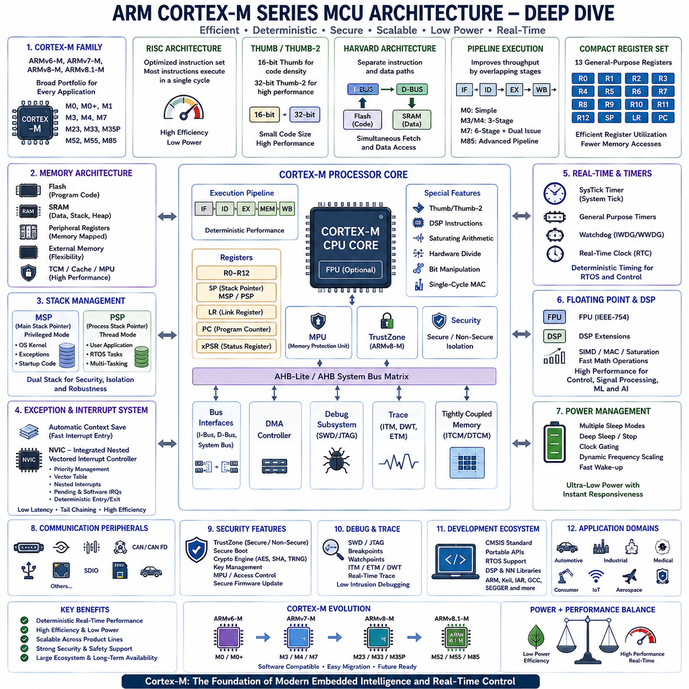
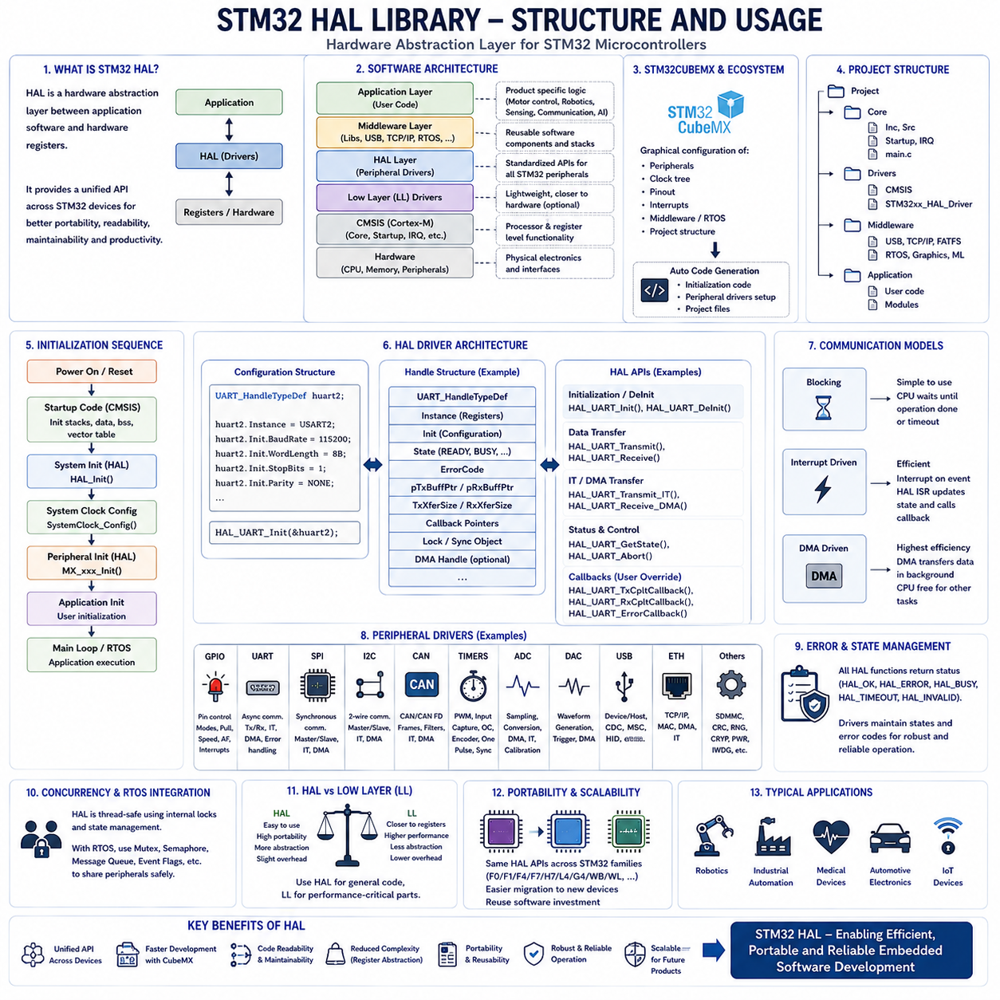
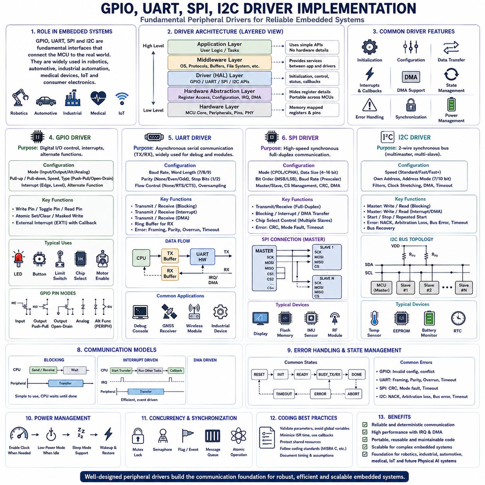
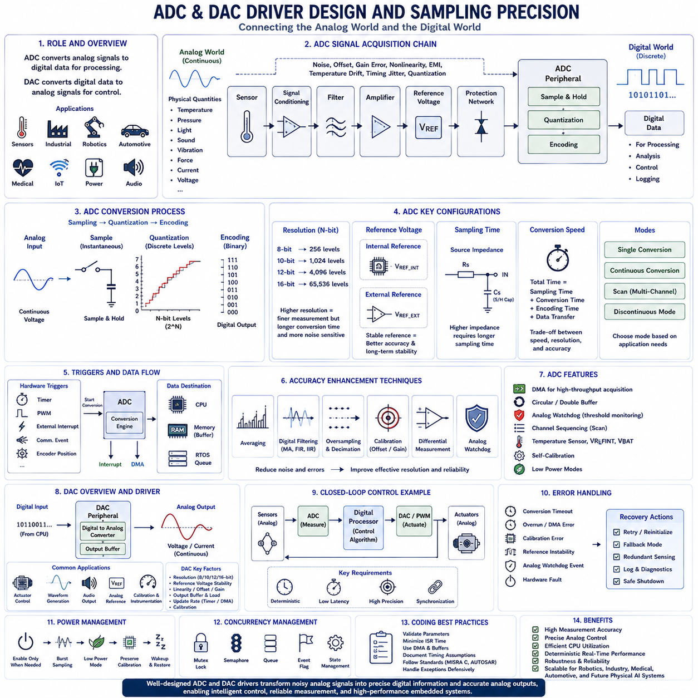
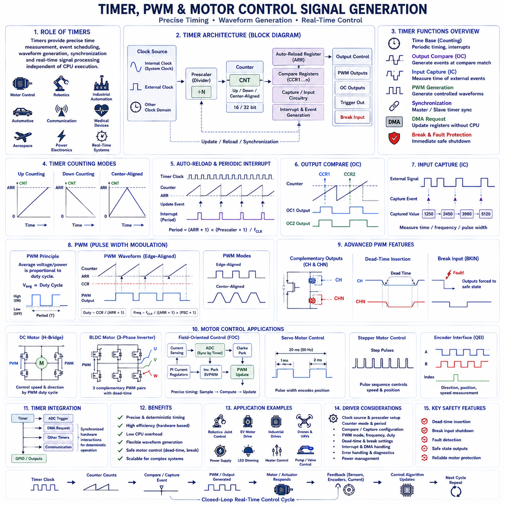
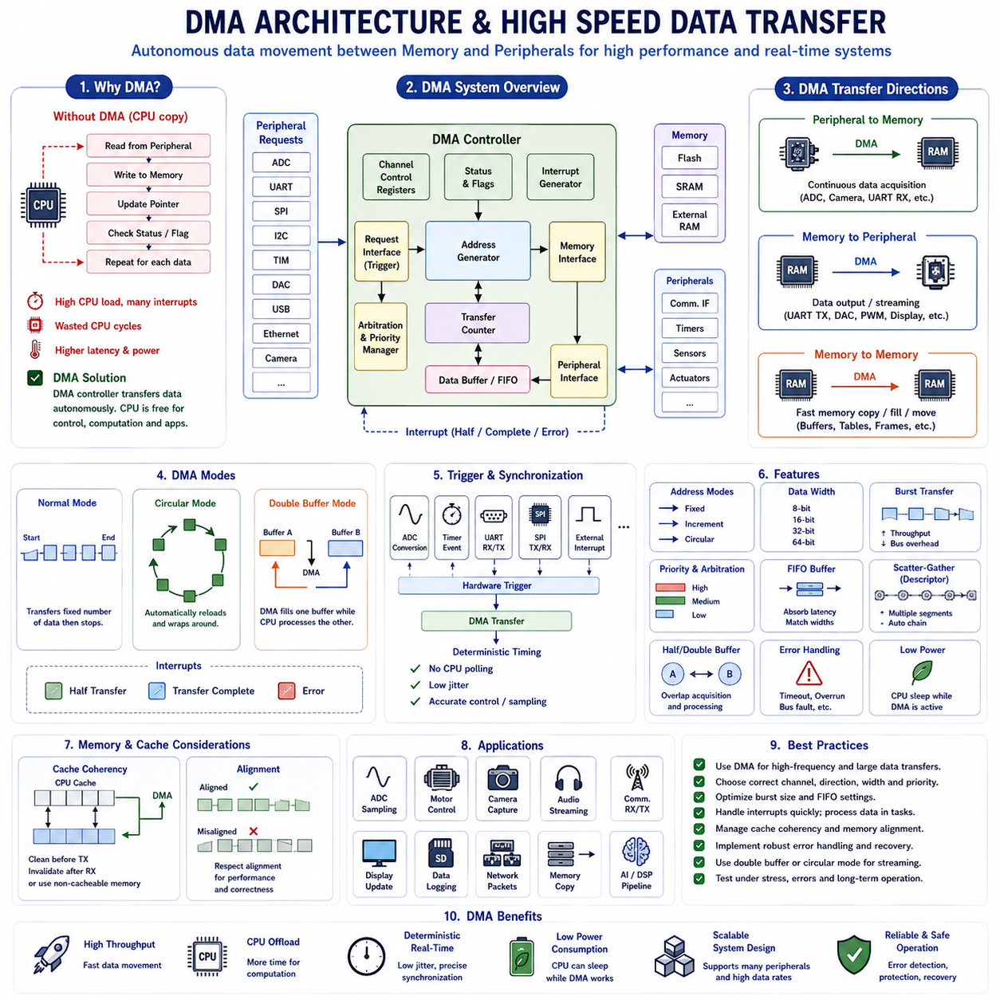
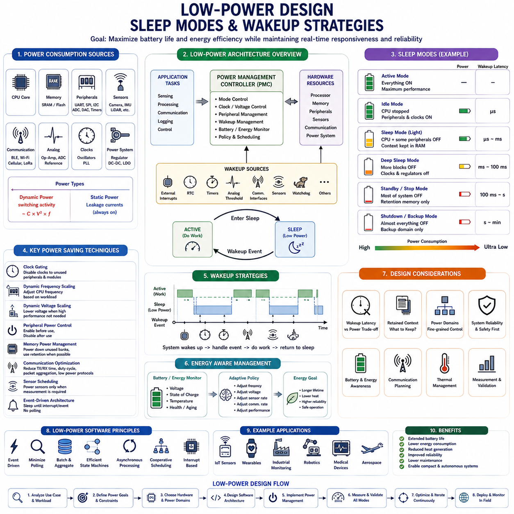
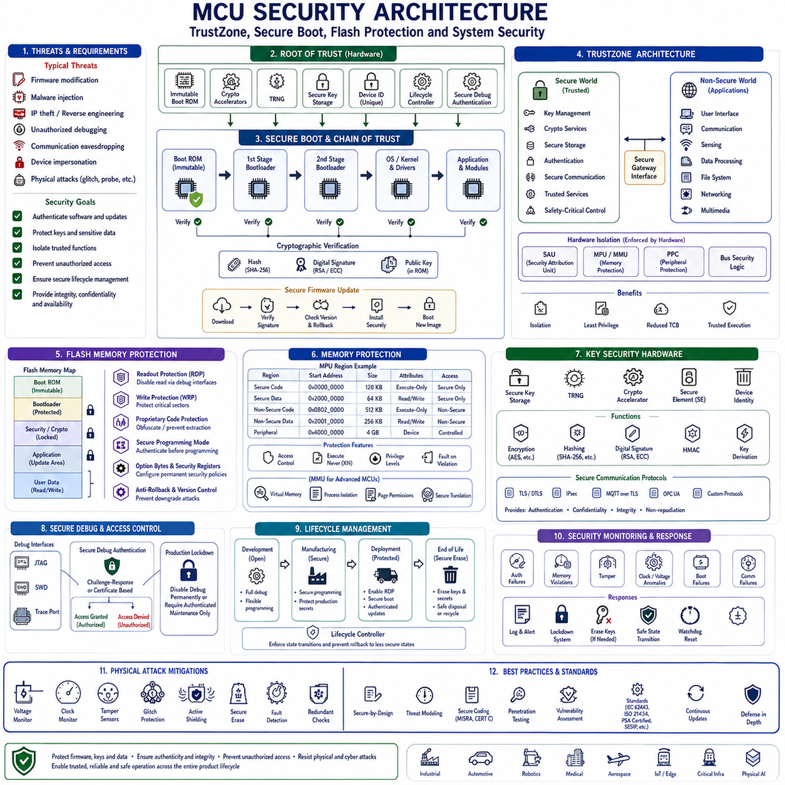
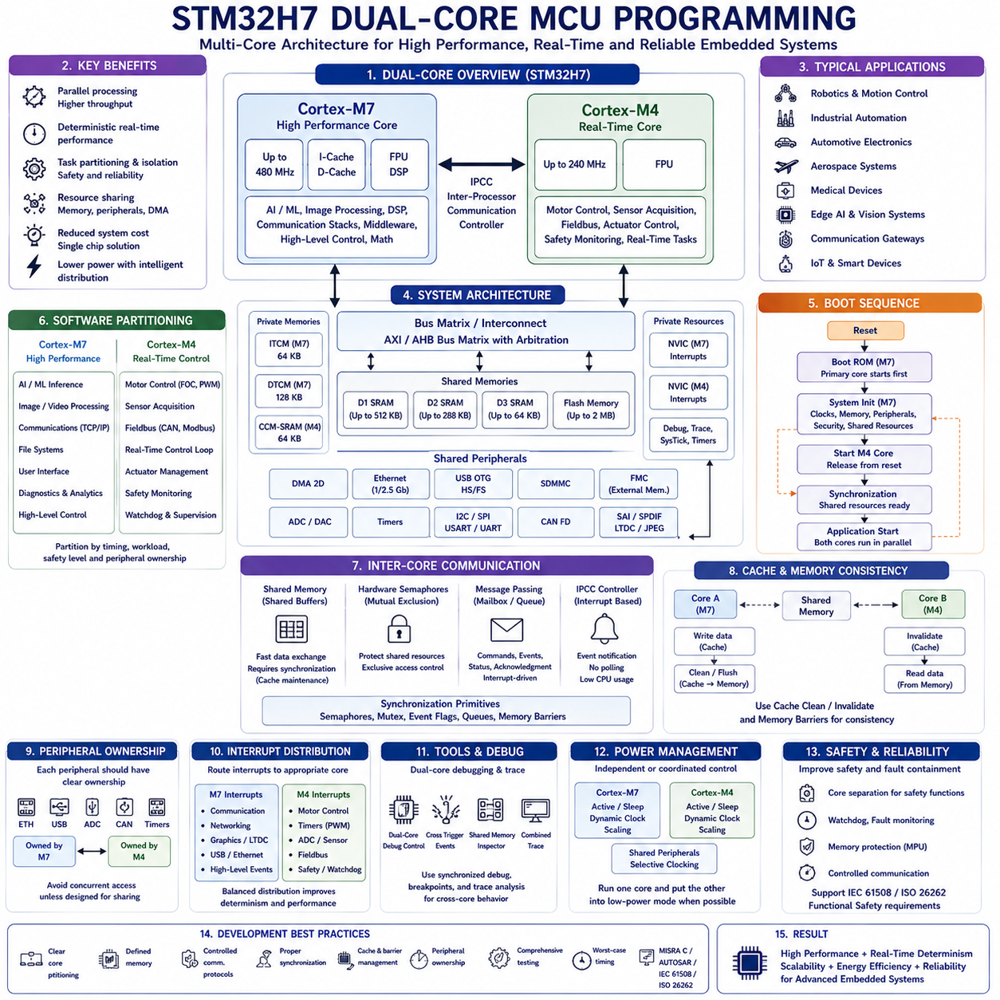
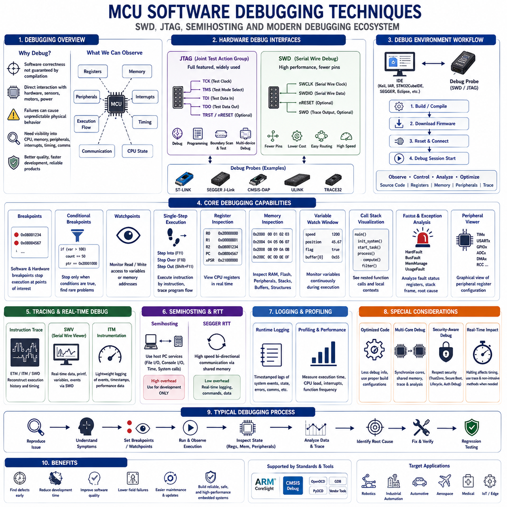

**Volume 02 Embedded Software Engineering**


# 02. Microcontroller Programming

##  

## 02.01 MCU Architecture Deep Dive: ARM Cortex-M Series

{width="7.268055555555556in" height="7.268055555555556in"}

ARM Cortex-M series microcontrollers have become the dominant computing platform for modern embedded systems because they provide an effective balance between computational performance, deterministic real-time behavior, energy efficiency, scalability, and development simplicity. Unlike general-purpose processors designed primarily for desktop or server computing, Cortex-M processors are optimized for deeply embedded applications that require direct hardware control, predictable interrupt response, low power consumption, compact silicon area, and long operational lifetimes. As a result, they are widely deployed in automotive electronics, industrial automation, medical devices, robotics, consumer electronics, aerospace systems, Internet of Things devices, and safety-critical control applications.

The Cortex-M family was developed around the ARMv6-M, ARMv7-M, ARMv8-M, and the latest ARMv8.1-M architectures, each introducing new capabilities while maintaining strong software compatibility across product generations. This architectural continuity enables developers to migrate applications from entry-level microcontrollers to high-performance embedded platforms with relatively small software modifications. The family currently includes Cortex-M0, M0+, M1, M3, M4, M7, M23, M33, M35P, M52, M55, M85, and other specialized implementations, each targeting different combinations of performance, safety, security, artificial intelligence acceleration, and power efficiency.

One of the defining characteristics of Cortex-M processors is their implementation of the Reduced Instruction Set Computer (RISC) philosophy. Instead of supporting thousands of complex instructions, Cortex-M processors execute a carefully optimized instruction set designed for high execution efficiency and simplified hardware implementation. Most instructions execute within a single clock cycle under ideal conditions, allowing deterministic execution timing while reducing processor complexity, silicon cost, and power consumption. This predictable instruction execution forms an essential foundation for real-time embedded software.

The Cortex-M architecture exclusively executes the Thumb and Thumb-2 instruction sets rather than the original 32-bit ARM instruction set. Thumb instructions use compact 16-bit encodings, while Thumb-2 introduces additional 32-bit instructions for improved computational capability without sacrificing code density. The combination significantly reduces firmware size while preserving high processing performance. Smaller executable images reduce Flash memory requirements, lower manufacturing costs, improve instruction cache utilization, and accelerate firmware updates across embedded products.

The processor core follows a Harvard architecture by separating instruction and data pathways. Independent instruction and data buses enable simultaneous instruction fetching and data access, increasing execution throughput compared with traditional Von Neumann architectures. Many implementations further extend this architecture through multiple Advanced High-performance Bus interfaces that independently access Flash memory, SRAM, peripheral devices, debugging resources, and tightly coupled memories. Such parallel memory access substantially improves overall system efficiency during complex embedded workloads.

Pipeline execution enhances processor performance by overlapping multiple instruction processing stages. Entry-level Cortex-M0 processors typically implement relatively simple pipelines, while Cortex-M3 and Cortex-M4 utilize three-stage pipelines. Cortex-M7 introduces a deeper superscalar pipeline capable of dual instruction issue under appropriate conditions, significantly increasing computational throughput. Higher-performance Cortex-M85 processors further extend pipeline optimization while preserving deterministic interrupt response and backward software compatibility.

The register architecture remains intentionally compact to maximize compiler efficiency while minimizing hardware complexity. Thirteen general-purpose registers provide temporary data storage and arithmetic operands, accompanied by dedicated stack pointer, link register, and program counter registers. Special-purpose registers maintain processor state, interrupt masks, execution privilege, exception status, floating-point configuration, and control information. Efficient register allocation significantly reduces memory access frequency, improving execution speed and reducing energy consumption.

Stack management represents a particularly elegant feature of the Cortex-M architecture. Two independent stack pointers support separate operating environments for privileged system software and ordinary application execution. The Main Stack Pointer typically serves operating system kernels, exception handlers, and startup code, while the Process Stack Pointer supports user applications and multitasking environments. This separation improves software isolation, operating system implementation, fault recovery, and overall system robustness.

Exception handling represents one of the most advanced aspects of the Cortex-M architecture. Hardware automatically saves essential processor context whenever exceptions or interrupts occur, dramatically reducing software overhead compared with traditional microcontroller architectures. Automatic context preservation includes program counter, processor status, return address, and selected registers, enabling rapid interrupt response while simplifying interrupt service routine implementation. Hardware-assisted context management significantly reduces interrupt latency while improving deterministic execution.

The Nested Vectored Interrupt Controller forms an integral component of every Cortex-M processor rather than existing as an external peripheral. The NVIC directly manages interrupt prioritization, vector table lookup, nested interrupt execution, pending interrupt management, software-generated interrupts, and deterministic interrupt entry and exit. Hardware acceleration enables exceptionally low interrupt latency while supporting hundreds of interrupt sources depending upon specific processor implementation.

Interrupt prioritization provides deterministic processing of concurrent hardware events. Programmable priority levels ensure that emergency stop systems, motor control feedback, communication deadlines, functional safety monitoring, and other time-critical events immediately preempt lower-priority software activities. Tail chaining further improves efficiency by allowing consecutive interrupt handlers to execute without unnecessary context restoration between interrupts, significantly reducing processor overhead during periods of intensive interrupt activity.

The SysTick timer provides a standardized system timer integrated into every Cortex-M processor. Real-time operating systems commonly employ SysTick to generate periodic scheduling interrupts supporting multitasking, software timers, delay management, time measurement, and operating system services. Standardized timer functionality simplifies portable operating system development while providing deterministic timing behavior across the entire Cortex-M product family.

Memory architecture provides considerable flexibility for embedded system designers. Program code typically resides within Flash memory, while SRAM supports runtime execution, communication buffers, stacks, heaps, operating system objects, and sensor data processing. Peripheral registers occupy dedicated memory-mapped address regions enabling direct hardware control through ordinary load and store instructions. External memories, tightly coupled memories, instruction caches, data caches, and memory protection units further extend architectural flexibility in higher-performance implementations.

Memory Protection Units improve software reliability by partitioning memory into independently protected regions with configurable read, write, and execute permissions. Fault isolation prevents unauthorized software components from corrupting critical operating system structures, communication buffers, safety mechanisms, or security assets. Memory protection significantly improves cybersecurity, software robustness, certification support, and diagnostic capability while enabling secure multitasking environments.

The ARMv8-M architecture introduced TrustZone technology specifically designed for embedded security. TrustZone partitions processor execution into Secure and Non-secure worlds, each maintaining independent software resources, interrupt routing, memory protection, and peripheral access. Security-critical software including cryptographic algorithms, secure boot mechanisms, authentication services, key management, and trusted firmware executes within the Secure domain while ordinary applications operate within the Non-secure environment. Hardware-enforced isolation substantially strengthens cybersecurity throughout connected embedded systems.

Floating-point capability significantly expands computational performance for scientific and control applications. Cortex-M4, Cortex-M7, Cortex-M33, Cortex-M55, Cortex-M85, and selected related processors integrate optional Floating Point Units supporting IEEE-754 arithmetic. Hardware floating-point execution dramatically accelerates digital signal processing, robotics control, sensor fusion, navigation algorithms, Kalman filtering, computer vision preprocessing, and artificial intelligence inference compared with software-emulated floating-point arithmetic.

Digital Signal Processing extensions provide efficient execution of mathematical algorithms frequently required by embedded systems. Single-cycle multiply-accumulate instructions, SIMD operations, saturation arithmetic, bit manipulation instructions, hardware division, and optimized shift operations accelerate motor control, audio processing, image filtering, vibration analysis, communication signal processing, machine learning preprocessing, and industrial control algorithms while minimizing processor utilization.

The Cortex-M55 and Cortex-M85 further extend computational capability through ARM Helium technology, officially known as the M-Profile Vector Extension. Helium introduces vector processing instructions capable of performing identical mathematical operations simultaneously across multiple data elements. Signal processing, neural network inference, image analysis, sensor fusion, robotics perception, and artificial intelligence workloads benefit substantially from vector acceleration while preserving energy-efficient embedded operation.

Power efficiency remains a primary design objective throughout the Cortex-M family. Multiple sleep modes, deep sleep states, clock gating, dynamic frequency scaling, peripheral power management, and rapid wakeup mechanisms minimize energy consumption while preserving immediate responsiveness to interrupts or external events. Battery-powered devices frequently remain in ultra-low-power sleep modes for extended periods before awakening within microseconds to process external events and then returning to sleep.

Clock architecture provides flexible tradeoffs between performance and energy consumption. Internal oscillators support rapid startup with minimal external components, while external crystal oscillators provide highly accurate timing for communication protocols and precision measurement. Phase-locked loops multiply reference frequencies to achieve higher processor clock speeds, and programmable clock trees independently control processor cores, peripheral buses, communication interfaces, timers, analog subsystems, and memory controllers according to application requirements.

Debugging support represents another major strength of the Cortex-M architecture. Hardware debugging components including Serial Wire Debug, Joint Test Action Group interfaces, Flash Patch and Breakpoint units, Data Watchpoint and Trace modules, Instrumentation Trace Macrocell components, and Embedded Trace Macrocell infrastructure provide comprehensive visibility into processor execution without significantly disturbing real-time software behavior. Advanced debugging dramatically shortens software development and fault analysis.

Performance monitoring capabilities enable detailed execution analysis. Cycle counters, event counters, exception statistics, interrupt measurements, cache monitoring, trace systems, and profiling infrastructure allow engineers to identify software bottlenecks, interrupt latency, memory access inefficiencies, synchronization delays, and algorithm optimization opportunities. Accurate performance measurement remains essential for achieving deterministic real-time operation within complex embedded systems.

Modern development ecosystems significantly simplify Cortex-M software engineering. ARM CMSIS standardizes processor initialization, peripheral abstraction, operating system interfaces, debugging support, digital signal processing libraries, neural network libraries, and software portability across semiconductor vendors. Toolchains from ARM, GNU, IAR, Keil, SEGGER, and numerous integrated development environments provide optimized compilers, static analysis, simulation, debugging, profiling, and continuous integration support.

Semiconductor manufacturers extend the standard Cortex-M processor core by integrating application-specific peripherals around the ARM architecture. Analog-to-digital converters, timers, communication interfaces, motor-control accelerators, cryptographic engines, direct memory access controllers, Ethernet controllers, CAN FD interfaces, USB controllers, graphics accelerators, artificial intelligence accelerators, and numerous application-specific peripherals differentiate products while maintaining software compatibility at the processor-core level.

Safety-critical applications frequently employ Cortex-M processors because deterministic execution, standardized architecture, integrated fault handling, memory protection, hardware debugging, and extensive development ecosystem support simplify compliance with functional safety standards such as IEC 61508, ISO 26262, IEC 62304, EN 50128, and DO-178 guidance depending upon application domain. Certified software libraries and development tools further reduce certification effort.

Modern robotic systems extensively utilize Cortex-M processors across distributed embedded architectures. Dedicated motor controllers execute deterministic motion control using Cortex-M4 or Cortex-M7 processors, sensor nodes preprocess camera or inertial measurements, battery management systems supervise energy storage, safety controllers monitor emergency conditions, communication gateways coordinate distributed networks, and higher-performance processors execute localization, diagnostics, and artificial intelligence support. Each controller performs specialized real-time functions while cooperating through deterministic communication networks.

The evolution of Cortex-M processors increasingly supports edge artificial intelligence without sacrificing deterministic embedded control. Machine learning acceleration, vector processing, optimized digital signal processing, floating-point computation, secure execution environments, functional safety mechanisms, and ultra-low-power operation collectively enable intelligent embedded devices capable of perception, prediction, anomaly detection, adaptive control, predictive maintenance, and autonomous decision support directly at the edge. These capabilities reduce cloud dependence while improving privacy, responsiveness, reliability, and operational resilience.

Ultimately, the ARM Cortex-M architecture represents one of the most successful embedded processor families ever developed because it achieves an exceptional balance between simplicity, computational performance, deterministic real-time execution, energy efficiency, scalability, security, software portability, and long-term ecosystem support. Its architectural principles have enabled billions of embedded devices across industrial automation, robotics, automotive electronics, medical systems, aerospace platforms, smart infrastructure, consumer electronics, and Physical AI applications. As embedded intelligence continues expanding toward autonomous machines and intelligent cyber-physical systems, Cortex-M processors will remain fundamental building blocks supporting reliable, secure, efficient, and highly scalable embedded computing architectures.

ARM Cortex-M 시리즈(ARM Cortex-M Series) 마이크로컨트롤러(Microcontroller)는 계산 성능(Computational Performance), 결정론적 실시간 동작(Deterministic Real-Time Behavior), 에너지 효율(Energy Efficiency), 확장성(Scalability), 그리고 개발 편의성(Development Simplicity)의 균형을 효과적으로 제공하기 때문에 현대 임베디드 시스템에서 가장 널리 사용되는 컴퓨팅 플랫폼이 되었습니다. 데스크톱이나 서버 환경을 위한 범용 프로세서와 달리 Cortex-M 프로세서는 직접적인 하드웨어 제어, 예측 가능한 인터럽트 응답, 낮은 전력 소비, 작은 실리콘 면적, 그리고 장기간의 안정적인 운용을 요구하는 임베디드 응용 분야에 최적화되어 있습니다. 그 결과 자동차 전자 시스템(Automotive Electronics), 산업 자동화(Industrial Automation), 의료기기(Medical Device), 로봇(Robotics), 소비자 전자제품(Consumer Electronics), 항공우주 시스템(Aerospace System), 사물인터넷(Internet of Things, IoT), 그리고 안전 필수 제어 시스템(Safety-Critical Control System)에 폭넓게 적용되고 있습니다.

Cortex-M 제품군은 ARMv6-M, ARMv7-M, ARMv8-M, 그리고 최신 ARMv8.1-M 아키텍처(Architecture)를 기반으로 발전해 왔으며, 각 세대는 새로운 기능을 추가하면서도 이전 세대와 높은 소프트웨어 호환성(Software Compatibility)을 유지하도록 설계되었습니다. 이러한 연속성은 개발자가 보급형 마이크로컨트롤러에서 고성능 임베디드 플랫폼으로 비교적 적은 수정만으로 소프트웨어를 이전할 수 있도록 합니다. 현재 Cortex-M0, M0+, M1, M3, M4, M7, M23, M33, M35P, M52, M55, M85 등 다양한 제품이 제공되며, 각각 성능, 안전성, 보안성, 인공지능 가속(AI Acceleration), 그리고 전력 효율 측면에서 서로 다른 목표를 가지고 설계되었습니다.

Cortex-M 프로세서의 가장 중요한 특징 가운데 하나는 축소 명령어 집합 컴퓨터(Reduced Instruction Set Computer, RISC) 구조를 채택했다는 점입니다. 수천 개의 복잡한 명령어를 지원하는 대신, Cortex-M은 높은 실행 효율과 단순한 하드웨어 구현을 목표로 최적화된 명령어 집합(Instruction Set)을 사용합니다. 이상적인 조건에서는 대부분의 명령어가 한 클록 사이클(Clock Cycle) 안에 실행되므로 실행 시간이 예측 가능하며 프로세서 구조도 단순해집니다. 이러한 특성은 실시간 임베디드 소프트웨어의 결정론적 실행을 가능하게 하는 중요한 기반이 됩니다.

Cortex-M 아키텍처는 기존 32비트 ARM 명령어 집합 대신 Thumb와 Thumb-2 명령어 집합만을 실행합니다. Thumb 명령어는 16비트 명령어 인코딩(Instruction Encoding)을 사용하며, Thumb-2는 필요한 경우 32비트 명령어를 추가하여 코드 크기를 크게 증가시키지 않으면서도 계산 성능을 향상시킵니다. 이러한 구조는 펌웨어(Firmware)의 크기를 줄이고 플래시 메모리(Flash Memory) 사용량을 감소시키며, 제조 비용 절감, 명령어 캐시(Instruction Cache) 효율 향상, 그리고 펌웨어 업데이트 속도 개선에도 기여합니다.

프로세서 코어(Core)는 하버드 아키텍처(Harvard Architecture)를 기반으로 명령어와 데이터의 접근 경로를 분리합니다. 독립적인 명령어 버스(Instruction Bus)와 데이터 버스(Data Bus)는 명령어를 가져오는 동시에 데이터를 읽고 쓸 수 있으므로 전통적인 폰 노이만 아키텍처(Von Neumann Architecture)보다 높은 처리량(Throughput)을 제공합니다. 또한 많은 Cortex-M 구현에서는 여러 개의 고성능 버스(Advanced High-performance Bus, AHB)를 사용하여 플래시 메모리, SRAM, 주변장치, 디버깅 자원, 그리고 긴밀 결합 메모리(Tightly Coupled Memory)에 병렬 접근을 지원함으로써 시스템 성능을 더욱 향상시킵니다.

파이프라인 실행(Pipeline Execution)은 여러 명령어 처리 단계를 겹쳐 수행하여 성능을 향상시키는 기술입니다. 보급형 Cortex-M0는 비교적 단순한 파이프라인을 사용하지만, Cortex-M3와 Cortex-M4는 일반적으로 3단계 파이프라인(Three-Stage Pipeline)을 사용합니다. Cortex-M7은 두 개의 명령어를 동시에 실행할 수 있는 슈퍼스칼라(Superscalar) 구조와 더욱 깊은 파이프라인을 적용하여 계산 성능을 크게 향상시켰습니다. 최신 Cortex-M85는 이러한 구조를 더욱 발전시키면서도 결정론적인 인터럽트 응답과 이전 세대와의 소프트웨어 호환성을 유지합니다.

레지스터 구조(Register Architecture)는 컴파일러 효율성과 하드웨어 단순성을 동시에 고려하여 설계되었습니다. 13개의 범용 레지스터(General-Purpose Register)는 연산과 임시 데이터 저장에 사용되며, 별도의 스택 포인터(Stack Pointer), 링크 레지스터(Link Register), 그리고 프로그램 카운터(Program Counter)가 제공됩니다. 또한 특수 목적 레지스터(Special-Purpose Register)는 프로세서 상태, 인터럽트 마스크(Interrupt Mask), 실행 권한(Execution Privilege), 예외 상태(Exception Status), 부동소수점 설정(Floating-Point Configuration), 그리고 제어 정보를 저장합니다. 효율적인 레지스터 활용은 메모리 접근을 줄여 실행 속도와 전력 효율을 높입니다.

스택 관리(Stack Management)는 Cortex-M 아키텍처의 매우 뛰어난 특징 가운데 하나입니다. 두 개의 독립적인 스택 포인터를 제공하여 특권 모드(Privileged Mode)와 일반 응용 프로그램 실행 환경을 분리합니다. 메인 스택 포인터(Main Stack Pointer, MSP)는 운영체제 커널(Kernel), 예외 처리기(Exception Handler), 그리고 초기화 코드(Startup Code)에 사용되며, 프로세스 스택 포인터(Process Stack Pointer, PSP)는 사용자 응용 프로그램과 멀티태스킹 환경을 지원합니다. 이러한 구조는 운영체제 구현, 오류 복구(Fault Recovery), 그리고 시스템 안정성을 크게 향상시킵니다.

예외 처리(Exception Handling)는 Cortex-M 아키텍처의 가장 발전된 기능 가운데 하나입니다. 인터럽트나 예외가 발생하면 하드웨어가 자동으로 중요한 실행 상태(Context)를 저장하므로 기존 마이크로컨트롤러보다 소프트웨어 오버헤드(Software Overhead)가 크게 감소합니다. 프로그램 카운터, 프로그램 상태 레지스터(Program Status Register), 반환 주소(Return Address), 그리고 일부 레지스터가 자동으로 저장되므로 인터럽트 응답 시간이 매우 짧고 인터럽트 서비스 루틴(Interrupt Service Routine, ISR) 구현도 단순해집니다.

중첩 벡터 인터럽트 제어기(Nested Vectored Interrupt Controller, NVIC)는 Cortex-M 프로세서 내부에 통합된 핵심 구성 요소입니다. NVIC는 인터럽트 우선순위 관리(Interrupt Prioritization), 벡터 테이블(Vector Table) 검색, 중첩 인터럽트(Nested Interrupt), 대기 중인 인터럽트(Pending Interrupt), 소프트웨어 인터럽트(Software-Generated Interrupt), 그리고 결정론적인 인터럽트 진입과 복귀를 하드웨어 수준에서 수행합니다. 이러한 하드웨어 지원은 매우 낮은 인터럽트 지연 시간(Interrupt Latency)을 제공합니다.

인터럽트 우선순위(Interrupt Priority)는 여러 하드웨어 이벤트를 결정론적으로 처리할 수 있도록 합니다. 비상 정지(Emergency Stop), 모터 제어(Motor Control), 통신 마감 시간(Communication Deadline), 기능 안전 감시(Function Safety Monitoring)와 같은 중요한 이벤트는 낮은 우선순위 작업을 즉시 선점(Preempt)합니다. 또한 테일 체이닝(Tail Chaining) 기능은 연속적으로 발생한 인터럽트 사이에서 불필요한 실행 상태 복원을 생략하므로 인터럽트 처리 효율을 크게 향상시킵니다.

SysTick 타이머(Timer)는 모든 Cortex-M 프로세서에 공통적으로 포함되는 표준 시스템 타이머(System Timer)입니다. 실시간 운영체제(Real-Time Operating System, RTOS)는 SysTick을 이용하여 주기적인 스케줄링 인터럽트를 생성하고, 멀티태스킹, 소프트웨어 타이머, 시간 측정(Time Measurement), 지연 관리(Delay Management), 그리고 다양한 운영체제 서비스를 제공합니다. 표준화된 타이머 구조는 다양한 Cortex-M 제품에서 동일한 운영체제를 쉽게 사용할 수 있도록 합니다.

메모리 아키텍처(Memory Architecture)는 임베디드 시스템 설계자에게 매우 높은 유연성을 제공합니다. 프로그램 코드는 플래시 메모리에 저장되며, SRAM은 실행 중 데이터, 통신 버퍼(Communication Buffer), 스택(Stack), 힙(Heap), 운영체제 객체(Operating System Object), 그리고 센서 데이터를 저장합니다. 주변장치 레지스터(Peripheral Register)는 메모리 매핑(Memory-Mapped) 주소 공간에 위치하여 일반적인 메모리 접근 명령만으로 하드웨어를 제어할 수 있습니다. 또한 외부 메모리, 긴밀 결합 메모리(Tightly Coupled Memory), 명령어 캐시, 데이터 캐시(Data Cache), 그리고 메모리 보호 장치(Memory Protection Unit, MPU)가 고성능 제품에서 추가적으로 제공됩니다.

메모리 보호 장치(Memory Protection Unit, MPU)는 메모리를 여러 개의 보호 영역으로 나누고 각각 독립적인 읽기(Read), 쓰기(Write), 실행(Execute) 권한을 설정할 수 있도록 합니다. 이를 통해 운영체제, 통신 버퍼, 안전 기능, 보안 데이터와 같은 중요한 메모리가 다른 소프트웨어에 의해 손상되는 것을 방지할 수 있습니다. 메모리 보호는 사이버 보안(Cybersecurity), 소프트웨어 신뢰성(Robustness), 인증(Certification), 그리고 진단 기능(Diagnostic Capability)을 크게 향상시킵니다.

ARMv8-M 아키텍처는 임베디드 보안을 위해 TrustZone 기술을 도입했습니다. TrustZone은 프로세서를 보안 영역(Secure World)과 일반 영역(Non-secure World)으로 분리하여 각각 독립적인 메모리 보호, 인터럽트 관리, 주변장치 접근, 그리고 소프트웨어 실행을 지원합니다. 암호화 알고리즘(Cryptographic Algorithm), 시큐어 부트(Secure Boot), 인증(Authentication), 키 관리(Key Management), 그리고 신뢰 실행 환경(Trusted Firmware)은 Secure 영역에서 실행되며, 일반 응용 프로그램은 Non-secure 영역에서 실행됩니다. 이러한 하드웨어 기반 분리는 연결형 임베디드 시스템의 보안성을 크게 향상시킵니다.

부동소수점 연산(Floating-Point Computation)은 과학 계산과 제어 응용 분야에서 매우 중요한 기능입니다. Cortex-M4, Cortex-M7, Cortex-M33, Cortex-M55, Cortex-M85 등은 IEEE-754를 지원하는 부동소수점 연산 장치(Floating Point Unit, FPU)를 선택적으로 제공합니다. 하드웨어 기반 부동소수점 연산은 디지털 신호 처리(Digital Signal Processing), 로봇 제어(Robot Control), 센서 융합(Sensor Fusion), 내비게이션(Navigation), 칼만 필터(Kalman Filter), 컴퓨터 비전(Computer Vision), 그리고 AI 추론(AI Inference)을 소프트웨어 방식보다 훨씬 빠르게 수행할 수 있도록 합니다.

디지털 신호 처리(Digital Signal Processing, DSP) 명령어는 다양한 수학 연산을 효율적으로 수행하도록 설계되었습니다. 단일 사이클 곱셈-누산(Multiply-Accumulate), SIMD(Single Instruction Multiple Data), 포화 연산(Saturation Arithmetic), 비트 조작(Bit Manipulation), 하드웨어 나눗셈(Hardware Division), 그리고 최적화된 시프트 연산은 모터 제어, 오디오 처리(Audio Processing), 영상 필터링(Image Filtering), 진동 분석(Vibration Analysis), 통신 신호 처리, 머신러닝 전처리(Machine Learning Preprocessing), 그리고 산업용 제어 알고리즘을 빠르게 실행할 수 있도록 합니다.

Cortex-M55와 Cortex-M85는 ARM Helium 기술, 즉 M-프로파일 벡터 확장(M-Profile Vector Extension, MVE)을 제공합니다. Helium은 동일한 수학 연산을 여러 데이터에 동시에 수행하는 벡터 처리(Vector Processing)를 지원합니다. 이를 통해 신호 처리, 신경망 추론(Neural Network Inference), 영상 분석(Image Analysis), 센서 융합, 로봇 인식(Robot Perception), 그리고 AI 응용 프로그램에서 매우 높은 성능 향상을 제공합니다.

전력 효율(Power Efficiency)은 Cortex-M 제품군 전체의 중요한 설계 목표입니다. 다양한 슬립 모드(Sleep Mode), 딥 슬립(Deep Sleep), 클록 게이팅(Clock Gating), 동적 주파수 조절(Dynamic Frequency Scaling), 주변장치 전력 관리, 그리고 빠른 웨이크업(Wakeup) 기능은 에너지 소비를 최소화하면서도 외부 이벤트나 인터럽트에 즉시 반응할 수 있도록 합니다. 배터리 기반 장치는 대부분의 시간을 초저전력 상태(Ultra-Low-Power State)로 유지하다가 수 마이크로초(Microsecond) 안에 깨어나 작업을 수행한 후 다시 절전 상태로 돌아갈 수 있습니다.

클록 아키텍처(Clock Architecture)는 성능과 전력 소비의 균형을 유연하게 조정할 수 있도록 합니다. 내부 발진기(Internal Oscillator)는 빠른 시작을 제공하며, 외부 수정 발진기(Crystal Oscillator)는 높은 정확도의 통신과 정밀 계측을 지원합니다. 위상 고정 루프(Phase-Locked Loop, PLL)는 기준 클록을 증폭하여 높은 프로세서 속도를 생성하며, 프로그래머블 클록 트리(Programmable Clock Tree)는 프로세서, 주변장치 버스, 통신 인터페이스, 타이머, 아날로그 회로, 그리고 메모리 제어기의 동작 주파수를 독립적으로 설정할 수 있도록 합니다.

디버깅(Debugging)은 Cortex-M 아키텍처의 또 다른 강점입니다. 직렬 와이어 디버그(Serial Wire Debug, SWD), JTAG(Joint Test Action Group), Flash Patch and Breakpoint(FPB), Data Watchpoint and Trace(DWT), Instrumentation Trace Macrocell(ITM), 그리고 Embedded Trace Macrocell(ETM)과 같은 하드웨어 디버깅 기능은 실시간 동작에 큰 영향을 주지 않으면서도 프로세서 내부를 상세하게 분석할 수 있도록 합니다. 이러한 기능은 개발과 오류 분석 시간을 크게 단축시킵니다.

성능 모니터링(Performance Monitoring)은 소프트웨어를 최적화하는 데 중요한 역할을 합니다. 사이클 카운터(Cycle Counter), 이벤트 카운터(Event Counter), 예외 통계(Exception Statistics), 인터럽트 분석, 캐시 모니터링(Cache Monitoring), 트레이스 시스템(Trace System), 그리고 프로파일링(Profiling)을 통해 개발자는 병목(Bottleneck), 인터럽트 지연, 메모리 접근 비효율, 동기화 지연, 그리고 알고리즘 최적화 가능성을 정확하게 분석할 수 있습니다.

현대의 개발 환경(Development Ecosystem)은 Cortex-M 소프트웨어 개발을 크게 단순화합니다. ARM CMSIS(Cortex Microcontroller Software Interface Standard)는 프로세서 초기화, 주변장치 추상화, 운영체제 인터페이스, 디버깅, DSP 라이브러리, AI 신경망 라이브러리, 그리고 다양한 반도체 제조사 간의 소프트웨어 호환성을 제공합니다. ARM, GNU, IAR, Keil, SEGGER 등 다양한 개발 도구는 최적화 컴파일러, 정적 분석, 시뮬레이션, 디버깅, 프로파일링, 그리고 지속적 통합을 지원합니다.

반도체 제조사는 표준 Cortex-M 코어 주변에 다양한 전용 주변장치를 추가하여 제품을 차별화합니다. ADC, 타이머, 통신 인터페이스, 모터 제어 가속기(Motor-Control Accelerator), 암호화 엔진(Cryptographic Engine), DMA, Ethernet, CAN FD, USB, 그래픽 가속기(Graphics Accelerator), AI 가속기(AI Accelerator) 등이 대표적인 예입니다. 이러한 차별화에도 불구하고 Cortex-M 코어 수준에서는 높은 소프트웨어 호환성이 유지됩니다.

안전 필수 시스템(Safety-Critical System)은 Cortex-M 프로세서를 매우 많이 사용합니다. 결정론적 실행, 표준화된 구조, 통합 오류 처리, 메모리 보호, 하드웨어 디버깅, 그리고 풍부한 개발 생태계는 IEC 61508, ISO 26262, IEC 62304, EN 50128, DO-178 등 다양한 기능 안전 표준(Function Safety Standard)의 인증 과정을 단순화합니다. 또한 인증된 소프트웨어 라이브러리와 개발 도구는 인증 비용과 시간을 줄여 줍니다.

현대의 로봇 시스템은 분산 임베디드 구조(Distributed Embedded Architecture)에서 Cortex-M 프로세서를 폭넓게 활용합니다. Cortex-M4 또는 Cortex-M7 기반의 모터 제어기(Motor Controller)는 실시간 제어를 수행하며, 센서 노드(Sensor Node)는 카메라와 IMU 데이터를 전처리하고, 배터리 관리 시스템(Battery Management System, BMS)은 전력 시스템을 관리하며, 안전 제어기(Safety Controller)는 비상 상황을 감시하고, 통신 게이트웨이(Communication Gateway)는 여러 네트워크를 연결합니다. 상위 프로세서는 위치 추정(Localization), 진단(Diagnostics), 그리고 AI 지원 기능을 수행하며, 모든 제어기는 결정론적 통신망을 통해 협력합니다.

최근 Cortex-M 프로세서는 결정론적인 임베디드 제어를 유지하면서 엣지 인공지능(Edge Artificial Intelligence)을 적극 지원하고 있습니다. 머신러닝 가속(Machine Learning Acceleration), 벡터 처리(Vector Processing), 최적화된 DSP, 부동소수점 연산, 보안 실행 환경, 기능 안전 메커니즘, 그리고 초저전력 운용은 객체 인식(Object Recognition), 예측(Prediction), 이상 탐지(Anomaly Detection), 적응 제어(Adaptive Control), 예지 정비(Predictive Maintenance), 그리고 자율 의사결정(Autonomous Decision Support)을 엣지 장치에서 직접 수행할 수 있도록 합니다. 이를 통해 클라우드 의존성을 줄이면서도 개인정보 보호(Privacy), 응답성(Responsiveness), 신뢰성(Reliability), 그리고 시스템 복원력(Operational Resilience)을 향상시킬 수 있습니다.

궁극적으로 ARM Cortex-M 아키텍처는 단순성(Simplicity), 계산 성능, 결정론적 실시간 실행, 에너지 효율, 확장성, 보안성, 소프트웨어 이식성(Software Portability), 그리고 장기적인 생태계 지원(Long-Term Ecosystem Support)의 균형을 가장 뛰어나게 달성한 임베디드 프로세서 제품군 가운데 하나입니다. 이러한 설계 철학은 산업 자동화, 로봇, 자동차 전자 시스템, 의료기기, 항공우주 플랫폼, 스마트 인프라(Smart Infrastructure), 소비자 전자제품, 그리고 피지컬 AI(Physical AI) 응용 분야에서 수십억 개의 임베디드 장치를 가능하게 했습니다. 앞으로 자율 기계(Autonomous Machine)와 지능형 사이버-물리 시스템(Intelligent Cyber-Physical System)이 더욱 발전함에 따라 Cortex-M 프로세서는 신뢰성 있고, 안전하며, 효율적이고, 높은 확장성을 갖춘 임베디드 컴퓨팅의 핵심 기반으로 계속 활용될 것입니다.

##  

## 02.02 STM32 HAL Library Structure and Usage [w/Code]

{width="7.268055555555556in" height="7.268055555555556in"}

STM32 microcontrollers have become one of the most widely adopted embedded computing platforms because they combine ARM Cortex-M processors with a rich collection of integrated peripherals, comprehensive development tools, and a highly standardized software ecosystem. As STM32 product families expanded to include hundreds of devices with different processors, memories, communication interfaces, analog peripherals, and performance levels, software portability became increasingly important. To address this challenge, STMicroelectronics developed the Hardware Abstraction Layer (HAL), a software framework that provides a unified programming interface across nearly all STM32 devices. Rather than directly manipulating peripheral registers throughout application code, developers interact with standardized HAL Application Programming Interfaces, significantly improving software readability, portability, maintainability, and development productivity.

The STM32 HAL library serves as an abstraction layer positioned between application software and low-level hardware registers. Instead of requiring developers to understand every individual register bit, timing sequence, and hardware-specific configuration, HAL encapsulates these implementation details within standardized driver functions. Application software invokes high-level interfaces to initialize peripherals, configure operating modes, transmit or receive data, control hardware resources, and monitor peripheral status. This abstraction dramatically reduces software complexity while allowing engineers to concentrate on application logic rather than hardware implementation details.

The overall STM32 software architecture consists of several distinct software layers working together in a hierarchical organization. At the highest level, user applications implement product-specific functionality such as motor control, robotics, industrial automation, sensing, communication, or artificial intelligence. Beneath the application layer resides middleware providing reusable software services including USB, TCP/IP networking, file systems, cryptographic libraries, graphics frameworks, machine learning libraries, and real-time operating systems. The HAL layer provides hardware-independent peripheral interfaces, while the Low Layer drivers and CMSIS infrastructure provide direct processor and register-level functionality. At the lowest level reside the processor core, memory system, peripheral hardware, and physical electronic interfaces.

The Cortex Microcontroller Software Interface Standard provides the processor abstraction foundation upon which HAL is built. CMSIS standardizes processor startup code, interrupt vector definitions, register descriptions, compiler compatibility, operating system interfaces, debugging infrastructure, and processor-specific functionality across all ARM Cortex-M devices. HAL builds upon this standardized processor layer while introducing peripheral-specific software interfaces unique to STM32 product families. Consequently, application software benefits from both processor portability through CMSIS and peripheral portability through HAL.

The STM32Cube software ecosystem integrates the HAL library into a complete embedded software development framework. STM32CubeMX automatically generates initialization code, peripheral configuration, clock-tree setup, interrupt configuration, middleware integration, operating system initialization, and project structure. Developers graphically configure hardware resources, after which CubeMX generates corresponding HAL initialization code. This automatic code generation reduces manual configuration effort while minimizing configuration errors during system initialization.

Every STM32Cube project follows a consistent directory structure supporting software organization and long-term maintainability. Core directories typically contain application source files, interrupt handlers, startup code, linker scripts, and processor configuration. Driver directories include CMSIS processor support and HAL peripheral drivers. Middleware directories contain networking stacks, file systems, USB libraries, graphics frameworks, machine learning libraries, and operating system components. User applications generally reside within dedicated application directories that remain largely independent from generated software infrastructure.

Application development usually begins within the main source file where the generated initialization sequence follows a standardized execution order. After processor reset, the startup code initializes memory sections, configures the processor environment, establishes interrupt vectors, initializes the system clock, and transfers execution to the main application. HAL initialization configures the processor core, initializes the SysTick timer, enables peripheral clocks, configures Flash memory latency, and prepares fundamental processor services before individual peripheral initialization functions execute.

Clock configuration represents one of the most important initialization tasks within STM32 systems. Modern STM32 microcontrollers contain multiple oscillators, phase-locked loops, clock domains, peripheral clock generators, and power management mechanisms. STM32CubeMX graphically configures the complete clock tree while automatically generating corresponding HAL initialization functions. Accurate clock configuration ensures proper processor execution, communication timing, analog conversion accuracy, USB functionality, Ethernet synchronization, and real-time operating system scheduling.

Peripheral initialization follows a highly standardized design philosophy throughout the HAL library. Every peripheral driver defines configuration structures containing initialization parameters, operating modes, timing settings, hardware options, interrupt priorities, and communication characteristics. Application software fills these configuration structures before passing them into standardized initialization functions. Once initialized, dedicated HAL interfaces perform transmission, reception, configuration updates, diagnostic monitoring, interrupt handling, and peripheral deinitialization using consistent programming patterns across different peripheral categories.

Handle structures form the central organizational concept of the HAL architecture. Each peripheral instance is represented by a dedicated handle object containing configuration parameters, hardware register addresses, software state variables, transfer status, callback functions, synchronization objects, error codes, and internal driver management information. Rather than directly manipulating hardware resources, application software interacts with peripheral handles through standardized HAL function interfaces. This object-oriented organization simplifies peripheral management while enabling multiple independent peripheral instances within the same embedded application.

State management significantly improves peripheral reliability. Each HAL driver continuously tracks peripheral operating states including reset, ready, busy, timeout, error, abort, and completion conditions. Application software can query peripheral status before initiating new operations, preventing invalid hardware access or conflicting software requests. Explicit state management greatly simplifies debugging while improving software robustness under complex multitasking environments.

Blocking operation represents the simplest HAL communication model. Application software calls transmission or reception functions that remain active until the requested operation completes, encounters an error, or exceeds a specified timeout period. Blocking interfaces simplify software implementation and are appropriate for initialization routines, configuration tasks, diagnostics, and low-frequency communication where processor utilization is not a primary concern.

Interrupt-driven operation improves processor efficiency by allowing application software to perform unrelated computation while hardware peripherals independently execute communication or data acquisition. Once peripheral activity completes, hardware generates interrupts that invoke HAL interrupt service routines, update internal driver state, and execute application callback functions. Interrupt-based programming significantly increases processor utilization while preserving deterministic event handling within real-time embedded systems.

Direct Memory Access integration provides the highest communication efficiency for large data transfers. DMA controllers autonomously transfer information between memory and peripherals without continuous processor involvement. HAL transparently configures DMA channels, synchronization mechanisms, interrupt generation, and transfer completion events while presenting consistent programming interfaces to application software. DMA significantly reduces processor workload during continuous sensor acquisition, communication, graphics processing, audio streaming, and artificial intelligence preprocessing.

Callback mechanisms provide asynchronous communication between HAL drivers and user applications. Default callback functions are implemented as weak symbols that application software overrides when customized behavior is required. Transfer completion, transmission events, reception events, timer expiration, external interrupts, analog conversion completion, communication errors, and fault conditions all invoke corresponding callback interfaces. Callback architecture cleanly separates peripheral drivers from application logic while maintaining modular software organization.

General Purpose Input Output configuration illustrates the consistency of HAL programming. GPIO initialization structures specify pin numbers, operating modes, output characteristics, pull-up or pull-down configuration, alternate functions, output speed, and interrupt configuration. A single standardized initialization function configures the selected hardware registers regardless of processor family or package variation. Similar configuration philosophies extend across UART, SPI, I2C, CAN, ADC, DAC, timers, Ethernet, USB, SDMMC, cryptographic accelerators, and other integrated peripherals.

Communication peripheral drivers share highly consistent programming interfaces. Universal Asynchronous Receiver Transmitter drivers implement transmit, receive, interrupt, DMA, callback, state management, and error handling using standardized function naming conventions. Similar architectural patterns appear throughout Serial Peripheral Interface, Inter-Integrated Circuit, Controller Area Network, Universal Serial Bus, Ethernet, and other communication interfaces. Developers who understand one HAL communication driver can rapidly learn additional peripheral interfaces because common design principles remain consistent throughout the library.

Timer drivers represent one of the most comprehensive HAL subsystems because timers support numerous embedded functions beyond simple time measurement. General-purpose timers generate periodic interrupts, pulse-width modulation signals, input capture measurements, quadrature encoder interfaces, one-pulse generation, synchronized triggering, and advanced motor-control waveforms. HAL organizes these diverse capabilities through modular initialization structures and dedicated software interfaces while maintaining consistent programming methodology.

Analog peripheral drivers simplify complex hardware configuration through structured abstraction. Analog-to-Digital Converter drivers configure sampling time, conversion resolution, triggering sources, conversion sequences, calibration procedures, oversampling, DMA integration, interrupt generation, and continuous conversion modes. Digital-to-Analog Converter interfaces similarly abstract waveform generation, output buffering, triggering mechanisms, and DMA operation while minimizing register-level programming complexity.

Error management constitutes an essential feature of robust HAL software. Nearly every HAL function returns standardized status values indicating successful execution, timeout conditions, invalid parameters, peripheral busy states, communication failures, or hardware errors. Application software should always evaluate return values before proceeding with subsequent operations. Consistent error reporting improves debugging while enabling graceful fault recovery under abnormal operating conditions.

Concurrency management becomes increasingly important when multiple software tasks simultaneously access shared hardware resources. HAL drivers internally employ locking mechanisms, state variables, synchronization flags, and interrupt protection to prevent conflicting peripheral access. When combined with real-time operating systems, additional synchronization primitives including mutexes, semaphores, message queues, and event flags coordinate peripheral sharing among multiple concurrent software tasks.

Although HAL greatly improves software portability and development productivity, abstraction introduces modest execution overhead compared with direct register manipulation. Performance-critical applications including high-frequency motor control, ultra-fast communication processing, precision timing generation, or deterministic control loops occasionally require direct register programming or Low Layer drivers to minimize execution latency. Many industrial embedded systems therefore combine HAL for general software infrastructure with Low Layer drivers for computationally intensive subsystems.

The Low Layer library complements HAL by providing lightweight software interfaces closely corresponding to hardware registers while preserving improved readability compared with direct register manipulation. Low Layer functions execute more efficiently because they minimize software abstraction and reduce function call overhead. Developers frequently employ HAL during initial product development and later migrate selected performance-critical software modules toward Low Layer interfaces after profiling identifies computational bottlenecks.

Code generation should be carefully managed throughout project evolution. STM32CubeMX automatically regenerates initialization software whenever hardware configuration changes. User application logic should therefore remain confined within protected code regions specifically reserved for manual development. Following recommended software organization prevents application code from being accidentally overwritten during future configuration updates while preserving automatic hardware configuration capability.

Software portability represents one of the greatest advantages of the HAL architecture. Application software developed for one STM32 processor family frequently migrates to newer devices requiring only minor hardware configuration changes. Since peripheral interfaces remain largely consistent across product families, organizations can reuse substantial software investments while adopting processors offering greater performance, larger memory capacity, improved security, artificial intelligence acceleration, additional communication interfaces, or enhanced energy efficiency.

Robotic systems demonstrate particularly effective use of the STM32 HAL library. Motor controllers configure timers, pulse-width modulation generators, encoder interfaces, and DMA transfers using standardized HAL drivers. Communication modules exchange CAN FD, UART, SPI, Ethernet, and USB messages through common programming interfaces. Sensor nodes acquire inertial measurements, analog signals, cameras, LiDAR synchronization signals, and external interrupts using reusable initialization structures. Battery management systems, safety controllers, actuator drivers, and communication gateways all benefit from consistent software organization across distributed embedded controllers.

As embedded systems become increasingly connected and intelligent, the HAL architecture continues evolving to support modern software requirements including cybersecurity, secure boot, cryptographic acceleration, machine learning inference, edge artificial intelligence, real-time operating systems, cloud connectivity, and functional safety. Standardized software abstraction enables engineering organizations to focus development effort on innovative product functionality while relying upon thoroughly validated peripheral software infrastructure.

Ultimately, the STM32 HAL library represents far more than a collection of peripheral drivers. It establishes a comprehensive software architecture that standardizes peripheral initialization, communication, interrupt management, DMA integration, callback mechanisms, state management, error handling, and hardware abstraction across the STM32 ecosystem. By combining CMSIS, HAL, STM32Cube tools, middleware, and application software into a unified engineering framework, developers can produce embedded systems that are portable, maintainable, scalable, reliable, and well suited for modern robotics, industrial automation, medical electronics, automotive control, Internet of Things devices, and future Physical AI platforms.

STM32 마이크로컨트롤러(STM32 Microcontroller)는 ARM Cortex-M 프로세서와 다양한 주변장치(Peripheral), 풍부한 개발 도구(Development Tool), 그리고 표준화된 소프트웨어 생태계(Software Ecosystem)를 결합하여 현대 임베디드 시스템에서 가장 널리 사용되는 플랫폼 가운데 하나가 되었습니다. STM32 제품군은 다양한 프로세서, 메모리, 통신 인터페이스, 아날로그 주변장치, 그리고 성능 수준을 갖춘 수백 종의 제품으로 확대되면서 소프트웨어 이식성(Software Portability)의 중요성이 더욱 커졌습니다. 이를 해결하기 위해 STMicroelectronics는 하드웨어 추상화 계층(Hardware Abstraction Layer, HAL)을 개발하였습니다. HAL은 거의 모든 STM32 제품에서 동일한 프로그래밍 인터페이스를 제공하는 소프트웨어 프레임워크(Software Framework)입니다. 개발자는 애플리케이션 코드에서 직접 레지스터(Register)를 제어하는 대신 표준화된 HAL 응용 프로그램 인터페이스(Application Programming Interface, API)를 사용하여 주변장치를 제어할 수 있으며, 이를 통해 코드의 가독성(Readability), 이식성, 유지보수성(Maintainability), 그리고 개발 생산성(Productivity)이 크게 향상됩니다.

STM32 HAL 라이브러리(HAL Library)는 응용 소프트웨어(Application Software)와 하드웨어 레지스터(Hardware Register) 사이에 위치하는 추상화 계층입니다. 개발자는 각 레지스터의 비트(Bit), 타이밍(Timing), 그리고 하드웨어 설정(Configuration)을 직접 이해하지 않아도 되며, HAL은 이러한 복잡한 내용을 내부 드라이버 함수(Driver Function)에 캡슐화(Encapsulation)합니다. 응용 프로그램은 고수준 인터페이스(High-Level Interface)를 호출하여 주변장치를 초기화(Initialization)하고, 동작 모드(Operation Mode)를 설정하며, 데이터를 송수신하고, 하드웨어 자원을 제어하며, 주변장치 상태를 확인할 수 있습니다. 이러한 추상화는 소프트웨어 복잡도를 크게 줄여 개발자가 하드웨어보다 응용 프로그램 자체에 집중할 수 있도록 합니다.

STM32 소프트웨어 아키텍처(Software Architecture)는 여러 계층(Layer)이 계층적으로 구성되어 동작합니다. 가장 상위에는 모터 제어(Motor Control), 로봇(Robotics), 산업 자동화(Industrial Automation), 센서 처리(Sensing), 통신(Communication), 인공지능(AI) 등을 구현하는 사용자 응용 프로그램(User Application)이 존재합니다. 그 아래에는 USB, TCP/IP 네트워크(Network), 파일 시스템(File System), 암호화 라이브러리(Cryptographic Library), 그래픽 프레임워크(Graphics Framework), 머신러닝 라이브러리(Machine Learning Library), 그리고 실시간 운영체제(Real-Time Operating System, RTOS)와 같은 미들웨어(Middleware)가 위치합니다. HAL 계층은 하드웨어와 독립적인 주변장치 인터페이스를 제공하며, Low Layer 드라이버와 CMSIS(Cortex Microcontroller Software Interface Standard)는 프로세서와 레지스터 수준 기능을 담당합니다. 가장 아래에는 프로세서 코어(Processor Core), 메모리(Memory), 주변장치, 그리고 실제 전자 하드웨어가 위치합니다.

CMSIS는 HAL이 구축되는 기반이 되는 프로세서 추상화 표준입니다. CMSIS는 프로세서 시작 코드(Startup Code), 인터럽트 벡터(Interrupt Vector), 레지스터 정의(Register Definition), 컴파일러 호환성(Compiler Compatibility), 운영체제 인터페이스, 디버깅 인프라(Debugging Infrastructure), 그리고 ARM Cortex-M 프로세서의 공통 기능을 표준화합니다. HAL은 이러한 CMSIS 위에서 STM32 전용 주변장치 인터페이스를 제공합니다. 따라서 개발자는 CMSIS를 통해 프로세서 수준의 호환성을 확보하고, HAL을 통해 주변장치 수준의 이식성을 확보할 수 있습니다.

STM32Cube 소프트웨어 생태계(STM32Cube Software Ecosystem)는 HAL을 중심으로 완전한 임베디드 개발 환경을 제공합니다. STM32CubeMX는 그래픽 사용자 인터페이스(Graphical User Interface)를 이용하여 주변장치 설정, 클록 트리(Clock Tree), 인터럽트, 미들웨어, 운영체제 초기화, 프로젝트 구조(Project Structure)를 자동으로 생성합니다. 개발자는 원하는 하드웨어 자원을 화면에서 선택하기만 하면 CubeMX가 필요한 HAL 초기화 코드를 자동으로 생성합니다. 이러한 자동 코드 생성(Code Generation)은 초기 설정 시간을 크게 줄이고 초기화 오류를 최소화합니다.

모든 STM32Cube 프로젝트는 유지보수를 고려한 일관된 디렉터리 구조(Directory Structure)를 가집니다. Core 디렉터리는 사용자 소스 코드(Source Code), 인터럽트 처리기(Interrupt Handler), 시작 코드, 링커 스크립트(Linker Script), 프로세서 설정을 포함합니다. Drivers 디렉터리는 CMSIS와 HAL 드라이버를 포함하며, Middleware 디렉터리에는 네트워크 스택(Network Stack), 파일 시스템, USB 라이브러리, 그래픽 프레임워크, 머신러닝 라이브러리, 운영체제 구성 요소가 포함됩니다. 실제 사용자 응용 프로그램은 별도의 Application 디렉터리에 위치하여 자동 생성 코드와 독립적으로 유지됩니다.

응용 프로그램은 일반적으로 main() 함수에서 시작되며, 초기화 순서는 표준화되어 있습니다. 프로세서가 리셋(Reset)되면 시작 코드는 메모리 영역을 초기화하고, 프로세서 환경을 설정하며, 인터럽트 벡터를 준비하고, 시스템 클록(System Clock)을 설정한 후 main() 함수로 실행을 넘깁니다. HAL 초기화(HAL Initialization)는 프로세서 코어를 준비하고, SysTick 타이머를 초기화하며, 주변장치 클록을 활성화하고, 플래시 메모리 대기 시간(Flash Latency)을 설정한 뒤 각 주변장치 초기화를 수행합니다.

클록 설정(Clock Configuration)은 STM32 시스템 초기화에서 가장 중요한 작업 가운데 하나입니다. STM32 마이크로컨트롤러는 여러 개의 발진기(Oscillator), 위상 고정 루프(Phase-Locked Loop, PLL), 클록 도메인(Clock Domain), 주변장치 클록, 그리고 전력 관리 기능을 제공합니다. STM32CubeMX는 전체 클록 구조를 그래픽으로 구성하며 필요한 HAL 초기화 코드를 자동 생성합니다. 정확한 클록 설정은 프로세서 실행 속도, 통신 타이밍, ADC 정확도, USB 동작, Ethernet 동기화, 그리고 RTOS 스케줄링에 직접적인 영향을 미칩니다.

HAL 라이브러리의 모든 주변장치 초기화는 일관된 설계 방식을 따릅니다. 각 드라이버는 초기화 구조체(Configuration Structure)를 정의하며, 이 구조체에는 동작 모드, 타이밍 설정, 하드웨어 옵션, 인터럽트 우선순위, 통신 특성 등이 포함됩니다. 응용 프로그램은 구조체를 설정한 후 표준 초기화 함수(Standard Initialization Function)를 호출합니다. 초기화 이후에는 전송(Transmission), 수신(Reception), 설정 변경(Configuration Update), 상태 확인(Status Monitoring), 인터럽트 처리, 종료(Deinitialization) 등을 위한 전용 HAL 함수가 동일한 방식으로 제공됩니다.

핸들 구조체(Handle Structure)는 HAL 아키텍처의 핵심 개념입니다. 각각의 주변장치는 하나의 Handle 객체(Object)로 표현되며, 여기에는 설정 정보(Configuration), 레지스터 주소(Register Address), 상태 변수(State Variable), 전송 상태(Transfer Status), 콜백 함수(Callback Function), 동기화 객체(Synchronization Object), 오류 코드(Error Code), 그리고 내부 관리 정보가 포함됩니다. 응용 프로그램은 레지스터를 직접 조작하지 않고 Handle을 통해 HAL 함수를 호출하여 주변장치를 제어합니다. 이러한 객체지향(Object-Oriented) 구조는 여러 개의 동일한 주변장치를 독립적으로 관리할 수 있도록 합니다.

상태 관리(State Management)는 HAL 드라이버의 안정성을 높이는 중요한 기능입니다. 모든 HAL 드라이버는 Reset, Ready, Busy, Timeout, Error, Abort, Complete와 같은 상태를 내부적으로 관리합니다. 응용 프로그램은 새로운 작업을 시작하기 전에 주변장치 상태를 확인하여 잘못된 접근이나 충돌을 방지할 수 있습니다. 이러한 상태 관리는 디버깅을 단순하게 하고 멀티태스킹 환경에서 시스템 신뢰성을 향상시킵니다.

블로킹(Blocking) 방식은 HAL에서 가장 단순한 통신 모델입니다. 응용 프로그램은 데이터를 송신하거나 수신하는 함수를 호출하고 해당 작업이 완료되거나 오류가 발생하거나 지정된 타임아웃(Timeout)에 도달할 때까지 기다립니다. 블로킹 방식은 초기화, 설정, 진단과 같이 CPU 사용률이 중요하지 않은 작업에서 구현이 매우 간단하다는 장점이 있습니다.

인터럽트 기반(Interrupt-Driven) 동작은 CPU 효율을 높이는 방식입니다. 주변장치는 독립적으로 데이터를 처리하며 작업이 완료되면 인터럽트를 발생시킵니다. HAL 인터럽트 서비스 루틴(Interrupt Service Routine, ISR)은 내부 상태를 갱신하고 응용 프로그램의 콜백 함수를 호출합니다. 이러한 구조는 CPU가 다른 작업을 수행하는 동안에도 주변장치가 독립적으로 동작할 수 있도록 하여 전체 시스템 효율을 향상시킵니다.

직접 메모리 접근(Direct Memory Access, DMA)은 대용량 데이터 전송에서 가장 높은 효율을 제공합니다. DMA는 CPU 개입 없이 메모리와 주변장치 사이에서 데이터를 직접 이동시킵니다. HAL은 DMA 채널(Channel), 동기화(Synchronization), 인터럽트 생성, 전송 완료 이벤트를 자동으로 설정하며 응용 프로그램에는 일관된 인터페이스를 제공합니다. DMA는 센서 데이터 수집, 통신, 그래픽 처리, 오디오 스트리밍(Audio Streaming), AI 전처리에서 CPU 부하를 크게 줄입니다.

콜백 메커니즘(Callback Mechanism)은 HAL과 응용 프로그램 사이의 비동기 통신(Asynchronous Communication)을 담당합니다. 기본 콜백 함수는 Weak Symbol로 구현되어 있으며, 개발자는 필요한 경우 이를 재정의(Override)할 수 있습니다. 전송 완료, 수신 완료, 타이머 만료(Timer Expiration), 외부 인터럽트, ADC 변환 완료, 통신 오류, 하드웨어 오류 등은 각각의 콜백 함수를 호출합니다. 이 구조는 드라이버와 응용 프로그램을 명확하게 분리하여 모듈성을 향상시킵니다.

GPIO(General Purpose Input Output)는 HAL의 일관된 설계 철학을 가장 잘 보여주는 예입니다. GPIO 초기화 구조체에는 핀 번호(Pin Number), 동작 모드(Operation Mode), 출력 특성(Output Characteristic), Pull-up/Pull-down 설정, 대체 기능(Alternate Function), 출력 속도(Output Speed), 인터럽트 설정이 포함됩니다. 하나의 표준 초기화 함수만으로 모든 STM32 제품에서 동일한 방식으로 GPIO를 설정할 수 있습니다. 이러한 구조는 UART, SPI, I2C, CAN, ADC, DAC, Timer, Ethernet, USB, SDMMC, 암호화 가속기 등 거의 모든 주변장치에도 동일하게 적용됩니다.

통신 드라이버(Communication Driver)는 매우 일관된 인터페이스를 제공합니다. UART 드라이버는 송신, 수신, 인터럽트, DMA, 콜백, 상태 관리, 오류 처리를 모두 동일한 함수 이름 규칙(Naming Convention)으로 제공합니다. SPI, I2C, CAN, USB, Ethernet 등 다른 통신 드라이버도 동일한 설계 방식을 사용합니다. 따라서 하나의 통신 드라이버를 이해하면 다른 통신 드라이버도 쉽게 학습할 수 있습니다.

타이머(Timer)는 STM32 HAL에서 가장 다양한 기능을 제공하는 주변장치 가운데 하나입니다. 일반적인 시간 측정뿐 아니라 주기 인터럽트(Periodic Interrupt), PWM(Pulse Width Modulation), 입력 캡처(Input Capture), 엔코더 인터페이스(Encoder Interface), 원 펄스 모드(One Pulse Mode), 동기화 트리거(Synchronized Trigger), 그리고 모터 제어 파형(Motor Control Waveform) 생성까지 지원합니다. HAL은 이러한 다양한 기능을 모듈형 구조체와 전용 인터페이스를 통해 일관성 있게 제공합니다.

아날로그 주변장치(Analog Peripheral)는 HAL을 통해 복잡한 하드웨어 설정을 단순화합니다. ADC 드라이버는 샘플링 시간(Sampling Time), 분해능(Resolution), 트리거(Trigger), 변환 순서(Conversion Sequence), 보정(Calibration), 오버샘플링(Oversampling), DMA, 인터럽트, 연속 변환(Continuous Conversion)을 모두 구조체를 이용하여 설정합니다. DAC도 출력 버퍼(Output Buffer), 트리거, DMA 등을 동일한 방식으로 추상화합니다.

오류 관리(Error Management)는 신뢰성 높은 HAL 소프트웨어의 중요한 기능입니다. 대부분의 HAL 함수는 실행 성공(Success), 타임아웃, 잘못된 매개변수(Invalid Parameter), Busy 상태, 통신 오류, 하드웨어 오류 등을 나타내는 표준 반환값(Return Value)을 제공합니다. 응용 프로그램은 다음 작업을 수행하기 전에 항상 반환값을 확인해야 하며, 이러한 일관된 오류 처리는 디버깅과 오류 복구(Fault Recovery)를 단순화합니다.

동시성 관리(Concurrency Management)는 여러 개의 소프트웨어 태스크(Task)가 동일한 주변장치를 사용할 때 중요합니다. HAL은 내부적으로 Lock, 상태 변수, 동기화 플래그(Synchronization Flag), 인터럽트 보호를 사용하여 충돌을 방지합니다. RTOS와 함께 사용할 경우 Mutex, Semaphore, Message Queue, Event Flag 등을 추가하여 여러 태스크가 안전하게 주변장치를 공유할 수 있습니다.

HAL은 개발 생산성과 이식성을 크게 향상시키지만 추상화 계층으로 인해 약간의 실행 오버헤드(Execution Overhead)가 발생합니다. 초고속 모터 제어, 고속 통신, 정밀 타이밍 생성, 실시간 제어 루프와 같이 성능이 매우 중요한 경우에는 Low Layer 드라이버나 직접 레지스터 접근을 사용하는 것이 더 적합할 수 있습니다. 실제 산업용 시스템에서는 일반 기능은 HAL을 사용하고 성능이 중요한 부분만 Low Layer를 사용하는 혼합 방식(Hybrid Approach)이 많이 사용됩니다.

Low Layer 라이브러리(Low Layer Library)는 HAL을 보완하는 경량 인터페이스(Lightweight Interface)를 제공합니다. Low Layer 함수는 레지스터와 거의 직접 대응되므로 함수 호출 오버헤드가 적고 실행 속도가 빠릅니다. 많은 개발자는 초기 개발 단계에서는 HAL을 사용하여 빠르게 구현한 후, 성능 분석(Profiling)을 통해 병목(Bottleneck)이 발견된 부분만 Low Layer로 변경하는 방식을 사용합니다.

코드 생성(Code Generation)은 프로젝트가 발전할수록 신중하게 관리되어야 합니다. STM32CubeMX는 하드웨어 설정이 변경될 때마다 초기화 코드를 다시 생성합니다. 따라서 사용자 응용 프로그램은 반드시 CubeMX가 보호하는 사용자 코드 영역(User Code Section)에 작성해야 합니다. 이러한 구조를 따르면 설정 변경 후에도 사용자 코드가 덮어쓰이지 않으며 자동 코드 생성 기능을 계속 활용할 수 있습니다.

소프트웨어 이식성(Software Portability)은 HAL 아키텍처의 가장 큰 장점 가운데 하나입니다. 하나의 STM32 제품군에서 개발한 소프트웨어는 하드웨어 설정만 약간 수정하면 새로운 STM32 제품군에서도 그대로 사용할 수 있는 경우가 많습니다. 주변장치 인터페이스가 대부분 동일하게 유지되므로 기업은 성능 향상, 메모리 증가, 보안 기능 강화, AI 가속, 추가 통신 기능, 전력 효율 개선이 필요한 경우에도 기존 소프트웨어 자산을 그대로 활용할 수 있습니다.

로봇 시스템(Robotic System)은 STM32 HAL 라이브러리의 장점을 가장 잘 보여주는 대표적인 응용 분야입니다. 모터 제어기(Motor Controller)는 Timer, PWM, Encoder, DMA를 HAL 드라이버로 구성하며, 통신 모듈은 CAN FD, UART, SPI, Ethernet, USB를 동일한 인터페이스로 제어합니다. 센서 노드(Sensor Node)는 IMU, ADC, 카메라 동기화(Camera Synchronization), 외부 인터럽트를 공통된 초기화 구조를 사용하여 설정합니다. 배터리 관리 시스템(Battery Management System, BMS), 안전 제어기(Safety Controller), 액추에이터 드라이버(Actuator Driver), 그리고 통신 게이트웨이(Communication Gateway)는 모두 동일한 HAL 구조를 사용하여 유지보수성과 확장성을 크게 향상시킵니다.

임베디드 시스템이 더욱 연결되고 지능화됨에 따라 HAL 아키텍처도 지속적으로 발전하고 있습니다. 사이버 보안(Cybersecurity), 시큐어 부트(Secure Boot), 암호화 가속(Cryptographic Acceleration), 머신러닝 추론(Machine Learning Inference), 엣지 AI(Edge AI), 실시간 운영체제(RTOS), 클라우드 연결성(Cloud Connectivity), 그리고 기능 안전(Function Safety)을 지원하기 위한 기능들이 지속적으로 추가되고 있습니다. 표준화된 소프트웨어 추상화는 개발자가 주변장치 제어보다 혁신적인 응용 프로그램 개발에 집중할 수 있도록 합니다.

궁극적으로 STM32 HAL 라이브러리(STM32 HAL Library)는 단순한 주변장치 드라이버의 집합이 아니라 STM32 생태계 전체를 위한 종합적인 소프트웨어 아키텍처입니다. HAL은 주변장치 초기화(Peripheral Initialization), 통신(Communication), 인터럽트 관리(Interrupt Management), DMA 연동, 콜백 메커니즘(Callback Mechanism), 상태 관리(State Management), 오류 처리(Error Handling), 그리고 하드웨어 추상화(Hardware Abstraction)를 표준화합니다. CMSIS, HAL, STM32Cube 도구, 미들웨어, 그리고 응용 프로그램을 하나의 통합된 개발 프레임워크로 결합함으로써 개발자는 높은 이식성, 유지보수성, 확장성, 신뢰성을 갖춘 임베디드 시스템을 효율적으로 개발할 수 있으며, 이는 현대의 로봇, 산업 자동화, 의료 전자장치, 자동차 제어 시스템, 사물인터넷(IoT), 그리고 미래의 피지컬 AI(Physical AI) 플랫폼을 구현하는 핵심 기반이 됩니다.

##  

## 02.03 GPIO, UART, SPI, I2C Driver Implementation [w/Code]

{width="7.268055555555556in" height="7.268055555555556in"}

General Purpose Input Output (GPIO), Universal Asynchronous Receiver Transmitter (UART), Serial Peripheral Interface (SPI), and Inter-Integrated Circuit (I²C) represent the fundamental communication and control peripherals of nearly every modern microcontroller. Regardless of whether an embedded system controls an industrial robot, an automotive electronic control unit, a medical device, an Internet of Things sensor, or a consumer electronic product, these peripherals provide the primary interfaces between the processor and the physical world. Effective driver implementation therefore forms one of the most important aspects of embedded software engineering because every higher-level software component ultimately depends upon reliable peripheral communication.

Peripheral drivers provide the software abstraction that separates application logic from hardware-specific implementation details. Instead of allowing application software to manipulate processor registers directly, drivers encapsulate initialization procedures, hardware configuration, communication protocols, interrupt handling, error management, synchronization, and power control within standardized software interfaces. This abstraction improves software portability, readability, maintainability, testing efficiency, and long-term scalability while reducing the complexity of application development across multiple hardware platforms.

Driver architecture typically follows a layered design model. The lowest layer directly accesses memory-mapped peripheral registers responsible for hardware control. Above this level, hardware abstraction interfaces provide standardized functions independent of processor implementation. Middleware components coordinate communication between drivers and operating systems, while application software invokes high-level driver APIs without requiring detailed knowledge of hardware registers or timing sequences. Such separation of responsibilities enables software reuse across multiple processor families and product generations.

GPIO drivers provide the simplest but most frequently used peripheral interface within embedded systems. Every digital input, output, interrupt pin, alternate function, communication interface, status indicator, sensor enable signal, actuator control line, reset circuit, chip-select signal, and diagnostic interface ultimately depends upon GPIO functionality. Although GPIO hardware appears simple, reliable driver implementation requires careful management of electrical characteristics, timing behavior, synchronization, interrupt generation, and hardware configuration throughout system operation.

GPIO initialization begins by enabling the peripheral clock associated with the desired port. Each GPIO pin must then be configured according to its intended function, including input mode, output mode, alternate peripheral function, analog mode, open-drain operation, push-pull output configuration, pull-up or pull-down resistor selection, output speed, and interrupt capability. Modern embedded software encapsulates these configuration parameters within structured initialization objects that simplify driver implementation while improving code readability.

Digital output drivers primarily manipulate output registers controlling external electrical signals. Applications frequently control LEDs, relays, motors, displays, chip-select signals, communication transceivers, power regulators, and external integrated circuits through GPIO outputs. Driver implementations typically provide functions supporting direct output control, bit toggling, masked updates, atomic register access, and synchronized multi-pin operation. Atomic output mechanisms prevent race conditions during concurrent software execution while preserving deterministic hardware behavior.

Digital input drivers acquire external signal states generated by buttons, switches, limit sensors, proximity detectors, optical sensors, magnetic sensors, safety devices, and numerous other external components. Reliable input acquisition frequently requires software debouncing because mechanical contacts naturally generate multiple transitions during switching. Driver implementations often combine timer-based filtering, majority voting, state machines, or configurable debounce intervals to ensure stable input detection under noisy operating conditions.

External interrupt functionality greatly improves processor efficiency by eliminating continuous polling of input signals. GPIO interrupt drivers configure trigger polarity, interrupt masking, priority assignment, callback registration, and interrupt clearing mechanisms while integrating with processor interrupt controllers. Rising edges, falling edges, or both transitions may generate hardware interrupts depending upon application requirements. Interrupt-driven GPIO operation enables rapid response while minimizing processor utilization.

Alternate function configuration transforms ordinary GPIO pins into specialized peripheral interfaces. UART transmit and receive signals, SPI clock and data channels, I²C communication lines, timer outputs, pulse-width modulation signals, Ethernet interfaces, USB connectivity, CAN communication, analog conversion inputs, and many additional hardware functions all share physical processor pins. GPIO drivers therefore manage alternate function multiplexing while ensuring conflict-free peripheral allocation throughout system initialization.

Universal Asynchronous Receiver Transmitter drivers provide serial communication without requiring a shared clock between communicating devices. UART remains one of the most widely deployed embedded communication interfaces because of its simplicity, broad compatibility, low hardware cost, and extensive support across debugging tools, industrial equipment, wireless modules, positioning systems, sensor interfaces, and diagnostic devices. Robust UART driver implementation therefore remains an essential embedded engineering skill.

UART initialization requires configuration of communication parameters including baud rate, word length, parity generation, stop bits, hardware flow control, oversampling mode, transmitter enable, receiver enable, interrupt configuration, and DMA support when required. Accurate baud rate generation depends upon processor clock configuration and peripheral divider calculations. Driver initialization validates parameter consistency before enabling hardware communication to ensure reliable operation across varying system clock frequencies.

UART transmission drivers manage data movement from application software toward communication hardware. Blocking transmission functions remain active until every byte has been physically transmitted or timeout conditions occur. Interrupt-driven transmission allows processors to continue unrelated computation while hardware serializes outgoing data. DMA-based transmission further reduces processor workload by transferring complete communication buffers directly from memory into UART hardware without continuous processor intervention.

UART reception presents additional implementation challenges because incoming data arrives asynchronously without advance processor scheduling. Driver software continuously monitors receive status through polling, interrupts, DMA transfers, circular buffers, or operating system queues depending upon application requirements. Buffer overflow detection, framing error handling, parity verification, noise filtering, timeout management, and synchronization recovery all contribute to robust long-term communication reliability.

Ring buffer implementation represents one of the most common techniques for UART reception. Circular memory structures continuously store incoming bytes regardless of application processing speed. Independent producer and consumer pointers permit interrupt handlers to deposit newly received data while application software simultaneously extracts previously received information without requiring complex synchronization. Ring buffers significantly improve communication robustness during burst traffic while minimizing processor overhead.

Serial Peripheral Interface provides high-speed synchronous communication between processors and peripheral devices using dedicated clock synchronization. Unlike UART, SPI requires a master device generating communication timing while one or more slave devices respond according to synchronized clock edges. SPI commonly connects displays, Flash memories, sensors, analog converters, digital converters, wireless transceivers, inertial measurement units, motor controllers, and numerous integrated circuits requiring reliable medium-to-high-speed communication.

SPI driver initialization configures communication mode, clock polarity, clock phase, frame size, bit ordering, baud rate prescaler, master or slave operation, chip-select management, CRC generation, interrupt support, DMA configuration, and hardware timing parameters. Since SPI communication depends upon precise clock relationships, driver initialization must ensure compatibility between processor timing and external device communication specifications before data exchange begins.

SPI communication always transmits and receives simultaneously because the interface shifts data bidirectionally during every clock cycle. Driver software therefore manages separate transmit and receive buffers even when applications appear to perform only transmission or only reception. Full-duplex operation significantly improves communication efficiency but requires careful buffer synchronization, completion detection, timeout handling, and error management throughout driver implementation.

Chip-select management constitutes another critical SPI driver responsibility. Each slave device requires independent selection signals ensuring that only one peripheral responds during any communication transaction unless specialized multidrop configurations are intentionally employed. Driver implementations automatically assert chip-select signals before transmission begins and release them only after communication completes according to individual device timing requirements. Correct chip-select timing prevents communication corruption while supporting reliable operation across diverse peripheral devices.

DMA integration substantially improves SPI performance during large data transfers including display updates, image acquisition, Flash programming, sensor streaming, and artificial intelligence preprocessing. Rather than transferring individual bytes through processor software, DMA engines autonomously move entire communication buffers while generating interrupts only after transfer completion. Driver software coordinates DMA configuration, synchronization, cache management, timeout monitoring, and completion callbacks while maintaining consistent application programming interfaces.

Inter-Integrated Circuit communication provides a two-wire synchronous serial bus supporting multiple master and slave devices connected simultaneously. SDA transfers bidirectional data while SCL distributes communication timing. Pull-up resistors maintain bus idle levels because both communication lines employ open-drain electrical characteristics allowing multiple devices to share common communication wiring safely. I²C significantly reduces printed circuit board complexity while supporting extensive peripheral expansion using only two communication wires.

I²C driver initialization configures communication speed, addressing mode, timing registers, analog filtering, digital filtering, own device address, dual addressing capability, general call response, clock stretching behavior, interrupt support, DMA integration, and timeout monitoring. Since I²C communication relies upon carefully controlled signal timing, initialization software must compute precise timing parameters based upon processor clock frequency, desired communication speed, and electrical bus characteristics.

Every I²C communication transaction follows a standardized protocol sequence beginning with a START condition generated by the master. The master subsequently transmits slave addressing information followed by read or write direction bits. Slave devices acknowledge successful reception before actual data transfer begins. Communication concludes with a STOP condition releasing the shared communication bus for future transactions. Driver implementations automatically generate these protocol elements while presenting simplified read and write interfaces to application software.

Address management represents an important aspect of I²C driver implementation because numerous slave devices may coexist on the same communication bus. Standard seven-bit addressing supports up to one hundred twenty-eight theoretical device addresses, while extended ten-bit addressing expands addressing capability for larger systems. Driver software validates addressing, detects absent devices through acknowledgment monitoring, resolves communication conflicts, and supports device discovery during system initialization.

I²C communication frequently encounters bus recovery challenges caused by interrupted transfers, electrical disturbances, unexpected processor resets, or malfunctioning peripheral devices. Robust driver implementations detect timeout conditions, perform clock recovery procedures, release blocked communication lines, reset hardware controllers, clear pending status flags, and reinitialize communication hardware before resuming ordinary operation. Effective bus recovery significantly improves long-term system reliability within electrically noisy industrial environments.

Interrupt-driven peripheral drivers maximize processor utilization across GPIO, UART, SPI, and I²C communication. Rather than continuously monitoring hardware status, processors execute application software until communication events generate hardware interrupts. Interrupt service routines update internal driver states, process completed transfers, manage communication buffers, invoke callback functions, and schedule subsequent operations while minimizing interrupt execution time. Deferred processing mechanisms transfer computationally intensive tasks toward background software contexts to preserve deterministic interrupt latency.

DMA operation further extends communication efficiency by allowing peripherals to exchange large data blocks directly with memory independently of processor execution. Driver implementations configure DMA channels, buffer descriptors, transfer lengths, synchronization events, interrupt generation, and completion notification while maintaining transparent application interfaces. DMA proves particularly valuable within robotics, industrial automation, multimedia processing, and edge artificial intelligence where continuous high-bandwidth data movement would otherwise overwhelm processor resources.

Error detection and recovery represent essential responsibilities throughout peripheral driver implementation. GPIO drivers detect invalid configurations, unsupported alternate functions, and electrical conflicts. UART drivers monitor framing errors, parity violations, buffer overruns, break detection, and communication timeouts. SPI drivers identify transfer completion failures, CRC mismatches, mode faults, and synchronization errors. I²C drivers recognize acknowledgment failures, arbitration loss, bus errors, timeout conditions, and unexpected protocol violations. Standardized error reporting enables application software to implement graceful recovery strategies while maintaining long-term operational stability.

Driver software increasingly incorporates explicit state management supporting deterministic multitasking environments. Peripheral states commonly include reset, initialized, ready, busy transmitting, busy receiving, suspended, timeout, aborted, completed, and fault conditions. Application software queries driver states before initiating new operations, preventing conflicting hardware access while simplifying debugging and improving concurrency management within real-time operating systems.

Concurrency becomes particularly important when multiple software tasks share common communication peripherals. Driver implementations utilize mutual exclusion mechanisms, semaphores, synchronization flags, message queues, event notifications, interrupt masking, and atomic operations to coordinate resource ownership. Well-designed synchronization prevents race conditions while maintaining predictable timing behavior across concurrent software execution.

Power management integration has become increasingly important within modern embedded driver architecture. Peripheral drivers enable clocks only when hardware becomes active, transition peripherals into low-power modes during inactivity, coordinate wakeup events, preserve configuration across sleep transitions, and restore communication seamlessly after processor wakeup. Intelligent power-aware driver implementation substantially extends battery operating lifetime without sacrificing application responsiveness.

Coding standards strongly influence professional driver implementation. Driver software typically avoids unnecessary dynamic memory allocation, minimizes global variables, limits interrupt execution time, validates function parameters, performs defensive error checking, isolates hardware dependencies, documents timing assumptions, and follows MISRA C, AUTOSAR, CERT C, or organizational coding guidelines. Such disciplined implementation significantly improves maintainability, safety certification, software portability, and long-term product reliability.

Modern robotic systems illustrate the coordinated operation of these peripheral drivers within complex embedded architectures. GPIO drivers manage emergency stop circuits, motor enable signals, limit switches, LEDs, and sensor power control. UART drivers communicate with GNSS receivers, diagnostic consoles, wireless modules, and industrial equipment. SPI interfaces exchange high-speed data with inertial sensors, external Flash memory, displays, and artificial intelligence accelerators. I²C networks connect environmental sensors, battery management components, power monitors, temperature sensors, and configuration memories. Collectively, these drivers establish the communication foundation supporting perception, localization, navigation, motion control, diagnostics, safety monitoring, and autonomous decision-making throughout advanced robotic platforms.

Ultimately, GPIO, UART, SPI, and I²C drivers represent far more than simple peripheral software modules. They establish standardized communication frameworks that isolate application software from hardware implementation details while providing deterministic timing, robust error handling, efficient interrupt processing, DMA acceleration, concurrency management, power optimization, and long-term maintainability. Well-designed peripheral drivers enable scalable embedded software architectures capable of supporting industrial automation, intelligent vehicles, aerospace electronics, medical equipment, Internet of Things infrastructure, autonomous robots, and the rapidly evolving ecosystem of future Physical AI systems.

범용 입출력(General Purpose Input Output, GPIO), 범용 비동기 송수신기(Universal Asynchronous Receiver Transmitter, UART), 직렬 주변장치 인터페이스(Serial Peripheral Interface, SPI), 그리고 인터-집적회로 통신(Inter-Integrated Circuit, I²C)은 거의 모든 현대 마이크로컨트롤러(Microcontroller)가 제공하는 가장 기본적인 제어 및 통신 주변장치(Peripheral)입니다. 산업용 로봇(Industrial Robot), 자동차 전자제어장치(Electronic Control Unit, ECU), 의료기기(Medical Device), 사물인터넷(Internet of Things, IoT) 센서, 소비자 전자제품(Consumer Electronics) 등 어떤 임베디드 시스템이든 이러한 주변장치는 프로세서와 실제 물리 세계를 연결하는 핵심 인터페이스 역할을 수행합니다. 따라서 드라이버(Driver)의 구현은 임베디드 소프트웨어 공학에서 가장 중요한 분야 가운데 하나이며, 모든 상위 소프트웨어는 결국 신뢰성 있는 주변장치 통신에 의존하게 됩니다.

주변장치 드라이버는 응용 프로그램(Application)과 하드웨어(Hardware) 사이를 분리하는 소프트웨어 추상화 계층(Software Abstraction Layer)을 제공합니다. 응용 프로그램이 직접 프로세서 레지스터(Register)를 조작하는 대신, 드라이버는 초기화(Initialization), 하드웨어 설정(Configuration), 통신 프로토콜(Communication Protocol), 인터럽트 처리(Interrupt Handling), 오류 관리(Error Management), 동기화(Synchronization), 전력 제어(Power Control) 등을 표준화된 인터페이스(Standardized Interface) 안에 캡슐화(Encapsulation)합니다. 이러한 구조는 소프트웨어의 이식성(Portability), 가독성(Readability), 유지보수성(Maintainability), 시험 효율성(Test Efficiency), 그리고 장기적인 확장성(Scalability)을 향상시키며, 다양한 하드웨어 플랫폼에서 응용 프로그램 개발을 단순화합니다.

드라이버 아키텍처(Driver Architecture)는 일반적으로 계층형 구조(Layered Architecture)를 따릅니다. 가장 아래 계층은 메모리 매핑(Memory-Mapped)된 주변장치 레지스터를 직접 제어합니다. 그 위에는 하드웨어 추상화 계층(Hardware Abstraction Layer)이 존재하여 프로세서 종류와 관계없이 동일한 인터페이스를 제공합니다. 미들웨어(Middleware)는 드라이버와 운영체제(Operating System) 사이의 통신을 담당하며, 응용 프로그램은 하드웨어 레지스터나 타이밍을 직접 알 필요 없이 고수준 API(Application Programming Interface)를 호출합니다. 이러한 역할 분리는 여러 프로세서 제품군과 차세대 제품에서도 소프트웨어를 쉽게 재사용할 수 있도록 합니다.

GPIO 드라이버는 가장 단순하면서도 가장 많이 사용되는 주변장치 드라이버입니다. 디지털 입력(Digital Input), 디지털 출력(Digital Output), 인터럽트 핀(Interrupt Pin), 대체 기능(Alternate Function), 통신 인터페이스, 상태 표시기(Status Indicator), 센서 활성화 신호(Sensor Enable Signal), 액추에이터 제어선(Actuator Control Line), 리셋 회로(Reset Circuit), 칩 선택 신호(Chip-Select Signal), 그리고 진단 인터페이스(Diagnostic Interface)는 모두 GPIO 기능을 기반으로 동작합니다. 하드웨어는 단순해 보이지만 신뢰성 있는 GPIO 드라이버는 전기적 특성(Electrical Characteristic), 타이밍(Timing), 동기화, 인터럽트 처리, 그리고 하드웨어 설정을 세심하게 관리해야 합니다.

GPIO 초기화는 먼저 해당 포트의 주변장치 클록(Peripheral Clock)을 활성화하는 것으로 시작합니다. 이후 각 GPIO 핀은 입력(Input), 출력(Output), 대체 기능(Alternate Function), 아날로그 모드(Analog Mode), 오픈 드레인(Open-Drain), 푸시풀(Push-Pull), 풀업(Pull-up), 풀다운(Pull-down), 출력 속도(Output Speed), 인터럽트 기능 등을 용도에 맞게 설정합니다. 현대의 임베디드 소프트웨어는 이러한 설정을 초기화 구조체(Configuration Structure)에 저장하고 이를 이용하여 드라이버를 구성함으로써 코드의 가독성과 유지보수성을 향상시킵니다.

디지털 출력 드라이버는 외부 전기 신호를 제어하는 출력 레지스터(Output Register)를 관리합니다. LED, 릴레이(Relay), 모터(Motor), 디스플레이(Display), 칩 선택 신호, 통신 트랜시버(Communication Transceiver), 전원 레귤레이터(Power Regulator), 외부 집적회로(Integrated Circuit) 등은 GPIO 출력을 통해 제어됩니다. 드라이버는 일반적으로 출력 설정(Output Control), 비트 토글(Bit Toggle), 마스크 갱신(Masked Update), 원자적 접근(Atomic Access), 다중 핀 동기 제어(Synchronized Multi-Pin Operation)를 지원합니다. 원자적 출력 방식은 여러 소프트웨어가 동시에 GPIO를 사용할 때 경쟁 상태(Race Condition)를 방지합니다.

디지털 입력 드라이버는 버튼(Button), 스위치(Switch), 리미트 센서(Limit Sensor), 근접 센서(Proximity Sensor), 광학 센서(Optical Sensor), 자기 센서(Magnetic Sensor), 안전 장치(Safety Device) 등 다양한 외부 신호를 읽어옵니다. 기계식 스위치는 접점이 튀는 바운스(Bounce) 현상이 발생하므로 입력 드라이버는 디바운싱(Debouncing) 기능을 반드시 포함해야 합니다. 타이머 기반 필터링(Timer-Based Filtering), 다수결(Majority Voting), 상태 기계(State Machine), 설정 가능한 디바운스 시간(Configurable Debounce Interval) 등을 사용하여 안정적인 입력을 보장합니다.

외부 인터럽트(External Interrupt)는 입력 신호를 지속적으로 검사하는 폴링(Polling) 방식을 제거하여 프로세서 효율을 크게 향상시킵니다. GPIO 인터럽트 드라이버는 트리거 극성(Trigger Polarity), 인터럽트 마스크(Interrupt Mask), 우선순위(Priority), 콜백 등록(Callback Registration), 인터럽트 클리어(Clear)를 설정하며 프로세서의 인터럽트 제어기와 연동됩니다. 상승 에지(Rising Edge), 하강 에지(Falling Edge), 또는 양쪽 모두를 트리거로 사용할 수 있으며, 이를 통해 CPU 부하를 줄이면서도 빠른 응답성을 제공합니다.

대체 기능(Alternate Function)은 GPIO 핀을 다양한 주변장치 인터페이스로 전환하는 기능입니다. UART의 송신과 수신, SPI의 클록과 데이터, I²C의 SDA와 SCL, 타이머 출력, PWM(Pulse Width Modulation), Ethernet, USB, CAN, ADC 입력 등 다양한 기능이 동일한 물리적 핀을 공유합니다. GPIO 드라이버는 이러한 멀티플렉싱(Multiplexing)을 관리하여 초기화 과정에서 주변장치 간 충돌이 발생하지 않도록 합니다.

UART 드라이버는 송신기와 수신기가 동일한 클록을 공유하지 않는 비동기 직렬 통신(Asynchronous Serial Communication)을 제공합니다. UART는 구조가 단순하고, 다양한 장비와 호환되며, 하드웨어 비용이 낮고, 디버깅 장비, 산업용 장비, 무선 모듈(Wireless Module), GNSS 수신기, 센서 인터페이스, 진단 장비 등에서 폭넓게 사용됩니다. 따라서 신뢰성 있는 UART 드라이버 구현은 모든 임베디드 엔지니어가 반드시 익혀야 하는 핵심 기술입니다.

UART 초기화에서는 통신 속도(Baud Rate), 데이터 길이(Word Length), 패리티(Parity), 정지 비트(Stop Bit), 하드웨어 흐름 제어(Hardware Flow Control), 오버샘플링(Oversampling), 송신기 활성화(Transmitter Enable), 수신기 활성화(Receiver Enable), 인터럽트 설정, DMA 지원 여부 등을 설정합니다. 정확한 Baud Rate는 시스템 클록(System Clock)과 분주기(Divider)를 이용하여 계산되며, 드라이버는 모든 설정의 일관성을 확인한 후 하드웨어를 활성화합니다.

UART 송신 드라이버는 응용 프로그램의 데이터를 통신 하드웨어로 전달합니다. 블로킹 방식(Blocking Mode)은 모든 데이터가 전송될 때까지 함수가 반환되지 않습니다. 인터럽트 방식(Interrupt Mode)은 CPU가 다른 작업을 수행하는 동안 UART가 독립적으로 데이터를 전송합니다. DMA 기반 방식은 메모리에서 UART로 데이터를 직접 전송하므로 CPU 부하를 최소화하면서 대용량 데이터를 효율적으로 처리할 수 있습니다.

UART 수신은 데이터가 예고 없이 비동기적으로 도착하기 때문에 송신보다 구현이 어렵습니다. 드라이버는 폴링, 인터럽트, DMA, 순환 버퍼(Circular Buffer), 운영체제 큐(Operating System Queue) 등을 사용하여 데이터를 지속적으로 수집합니다. 또한 버퍼 오버플로(Buffer Overflow), 프레이밍 오류(Framing Error), 패리티 오류(Parity Error), 노이즈(Noise), 타임아웃, 동기화 복구(Synchronization Recovery)를 처리하여 장기간 안정적인 통신을 유지합니다.

순환 버퍼(Ring Buffer)는 UART 수신에서 가장 널리 사용되는 기법입니다. 원형 메모리 구조(Circular Memory Structure)는 응용 프로그램의 처리 속도와 관계없이 들어오는 데이터를 계속 저장합니다. 인터럽트는 Producer Pointer를 이용하여 데이터를 저장하고, 응용 프로그램은 Consumer Pointer를 이용하여 데이터를 읽어 갑니다. 이러한 구조는 많은 데이터가 한꺼번에 들어오는 버스트 통신(Burst Communication)에서도 CPU 부하를 줄이면서 안정적인 수신을 보장합니다.

SPI는 전용 클록(Clock)을 사용하는 고속 동기 직렬 통신(High-Speed Synchronous Serial Communication)입니다. UART와 달리 SPI는 마스터(Master)가 클록을 생성하며 하나 이상의 슬레이브(Slave)가 이에 동기화되어 동작합니다. SPI는 디스플레이(Display), 플래시 메모리(Flash Memory), 센서(Sensor), ADC, DAC, 무선 통신 모듈, IMU(Inertial Measurement Unit), 모터 제어기(Motor Controller) 등 높은 속도의 통신이 필요한 다양한 장치에서 사용됩니다.

SPI 드라이버는 통신 모드(Communication Mode), 클록 극성(Clock Polarity), 클록 위상(Clock Phase), 프레임 크기(Frame Size), 비트 순서(Bit Order), 분주기(Prescaler), 마스터/슬레이브 설정, 칩 선택(Chip Select), CRC 생성(CRC Generation), 인터럽트, DMA 등을 초기화합니다. SPI는 클록 타이밍이 매우 중요하기 때문에 드라이버는 프로세서와 외부 장치의 타이밍 요구사항이 일치하는지를 반드시 확인해야 합니다.

SPI는 모든 클록 사이클에서 동시에 송신과 수신을 수행하는 전이중 통신(Full-Duplex Communication) 방식입니다. 따라서 응용 프로그램이 송신만 수행하는 것처럼 보이더라도 실제 드라이버는 송신 버퍼와 수신 버퍼를 모두 관리해야 합니다. 이러한 구조는 높은 통신 효율을 제공하지만 버퍼 동기화(Buffer Synchronization), 완료 확인, 타임아웃 관리, 오류 처리 등을 신중하게 구현해야 합니다.

칩 선택(Chip-Select) 신호 관리는 SPI 드라이버의 중요한 역할 가운데 하나입니다. 각각의 슬레이브 장치는 독립적인 Chip Select 신호를 가지며, 드라이버는 통신 시작 전에 선택 신호를 활성화하고 통신이 종료된 이후에만 비활성화합니다. 정확한 Chip Select 타이밍은 데이터 손상을 방지하고 다양한 주변장치와 안정적인 통신을 가능하게 합니다.

DMA는 디스플레이 갱신(Display Update), 영상(Image) 수집, 플래시 메모리 기록, 센서 스트리밍(Sensor Streaming), AI 전처리(AI Preprocessing) 등 대용량 SPI 데이터 전송에서 매우 중요한 역할을 합니다. CPU가 데이터를 하나씩 전송하는 대신 DMA가 전체 버퍼를 직접 이동하며, 드라이버는 DMA 설정, 동기화, 캐시 관리(Cache Management), 타임아웃 감시, 완료 콜백을 관리합니다.

I²C는 두 개의 선만 사용하는 동기 직렬 버스(Synchronous Serial Bus)입니다. SDA는 양방향 데이터(Data)를 전송하며 SCL은 클록을 제공합니다. 두 신호선은 오픈 드레인(Open-Drain) 구조를 사용하므로 풀업 저항(Pull-up Resistor)이 필요하며, 여러 개의 마스터와 슬레이브가 하나의 버스를 안전하게 공유할 수 있습니다. I²C는 두 개의 선만으로 다양한 장치를 연결할 수 있으므로 PCB 복잡도를 크게 줄여 줍니다.

I²C 드라이버 초기화는 통신 속도(Speed), 주소 방식(Addressing Mode), 타이밍 레지스터(Timing Register), 아날로그 필터(Analog Filter), 디지털 필터(Digital Filter), 자신의 주소(Own Address), 듀얼 주소(Dual Address), General Call 응답, Clock Stretching, 인터럽트, DMA, 타임아웃 등을 설정합니다. 정확한 통신을 위해서는 프로세서 클록과 버스의 전기적 특성을 고려하여 타이밍을 계산해야 합니다.

모든 I²C 통신은 마스터가 생성하는 START 조건으로 시작합니다. 이후 슬레이브 주소(Slave Address)와 읽기(Read)/쓰기(Write) 비트를 전송하며, 슬레이브는 ACK(Acknowledge)를 반환합니다. 실제 데이터 전송이 완료되면 STOP 조건을 생성하여 버스를 해제합니다. 드라이버는 이러한 프로토콜을 내부적으로 처리하며 응용 프로그램에는 단순한 읽기와 쓰기 인터페이스만 제공합니다.

주소 관리(Address Management)는 I²C 드라이버에서 매우 중요한 기능입니다. 하나의 버스에는 여러 개의 슬레이브 장치가 존재할 수 있으며, 일반적으로 7비트 주소(7-bit Address)를 사용하지만 더 큰 시스템에서는 10비트 주소도 사용할 수 있습니다. 드라이버는 주소를 확인하고 ACK를 통해 장치 존재 여부를 확인하며 충돌을 방지하고 초기화 과정에서 장치 검색(Device Discovery)도 수행할 수 있습니다.

I²C는 통신 중단, 전기적 잡음(Electrical Noise), 예기치 않은 리셋(Reset), 고장 난 슬레이브 등으로 인해 버스가 멈추는 문제가 발생할 수 있습니다. 신뢰성 높은 드라이버는 타임아웃을 감지하고 클록 복구(Clock Recovery), 버스 해제(Bus Release), 하드웨어 리셋, 상태 플래그(Status Flag) 초기화, 통신 재초기화를 수행하여 장기간 안정적인 시스템 운용을 보장합니다.

GPIO, UART, SPI, I²C 모두 인터럽트 기반 드라이버를 사용하면 CPU 효율을 크게 향상시킬 수 있습니다. CPU는 주변장치를 계속 감시하지 않고 응용 프로그램을 수행하며, 통신 이벤트가 발생할 때만 인터럽트가 실행됩니다. 인터럽트 서비스 루틴(ISR)은 드라이버 상태를 갱신하고 전송 완료를 처리하며 버퍼를 관리하고 콜백 함수를 호출합니다. 시간이 오래 걸리는 작업은 백그라운드 태스크(Background Task)로 넘겨 인터럽트 지연 시간을 최소화합니다.

DMA는 통신 효율을 더욱 향상시키는 기술입니다. DMA는 주변장치와 메모리 사이의 대용량 데이터를 CPU 개입 없이 직접 전송합니다. 드라이버는 DMA 채널(Channel), 버퍼(Buffer), 전송 길이(Transfer Length), 동기화 이벤트, 인터럽트, 완료 알림(Notification)을 관리하며 응용 프로그램에는 동일한 인터페이스를 제공합니다. 로봇, 산업 자동화, 멀티미디어 처리(Multimedia Processing), 엣지 AI에서는 DMA가 CPU 부하를 크게 줄여 줍니다.

오류 검출(Error Detection)과 오류 복구(Error Recovery)는 모든 주변장치 드라이버의 핵심 기능입니다. GPIO는 잘못된 설정과 전기적 충돌을 감지하고, UART는 프레이밍 오류, 패리티 오류, 버퍼 오버런(Buffer Overrun), Break Detection, 타임아웃을 감시합니다. SPI는 CRC 오류, 모드 오류(Mode Fault), 동기화 오류를 감지하며, I²C는 ACK 실패, Arbitration Loss, Bus Error, Timeout, 프로토콜 오류를 처리합니다. 이러한 표준화된 오류 보고는 응용 프로그램이 안정적으로 복구 절차를 수행할 수 있도록 합니다.

현대의 드라이버는 명확한 상태 관리(State Management)를 수행합니다. 주변장치는 Reset, Initialized, Ready, Busy Transmitting, Busy Receiving, Suspended, Timeout, Aborted, Completed, Fault와 같은 상태를 관리합니다. 응용 프로그램은 새로운 작업을 시작하기 전에 상태를 확인함으로써 충돌을 방지하고 디버깅을 단순화하며 RTOS 환경에서도 안정적인 동시성을 유지할 수 있습니다.

여러 개의 소프트웨어 태스크가 동일한 주변장치를 공유하는 환경에서는 동시성 관리(Concurrency Management)가 매우 중요합니다. 드라이버는 Mutex, Semaphore, 동기화 플래그(Synchronization Flag), 메시지 큐(Message Queue), 이벤트(Event), 인터럽트 마스킹(Interrupt Masking), 원자적 연산(Atomic Operation)을 이용하여 자원(Resource)의 소유권을 안전하게 관리합니다. 이러한 구조는 경쟁 상태(Race Condition)를 방지하면서도 예측 가능한 실시간 성능을 유지합니다.

전력 관리(Power Management)는 현대 임베디드 드라이버에서 점점 더 중요한 요소가 되고 있습니다. 드라이버는 필요한 경우에만 주변장치 클록을 활성화하고, 사용하지 않을 때는 저전력 모드(Low-Power Mode)로 전환하며, 절전 모드(Sleep Mode) 전후의 설정을 유지하고, 웨이크업(Wakeup) 이후 통신을 자동으로 복원합니다. 이러한 전력 인식(Power-Aware) 드라이버는 배터리 기반 시스템의 운용 시간을 크게 연장합니다.

전문적인 드라이버 구현에서는 코딩 표준(Coding Standard)이 매우 중요한 역할을 합니다. 드라이버는 불필요한 동적 메모리(Dynamic Memory)를 사용하지 않고, 전역 변수(Global Variable)를 최소화하며, 인터럽트 실행 시간을 줄이고, 함수 매개변수(Parameter)를 검증하며, 방어적 프로그래밍(Defensive Programming)을 수행하고, 하드웨어 의존성을 분리하며, 타이밍 가정을 문서화하고, MISRA C, AUTOSAR, CERT C 등의 코딩 규칙을 준수합니다. 이러한 구현 방식은 유지보수성, 기능 안전(Function Safety), 소프트웨어 이식성, 그리고 장기 신뢰성을 크게 향상시킵니다.

현대의 로봇 시스템(Robotic System)은 이러한 주변장치 드라이버가 어떻게 협력하는지를 잘 보여주는 대표적인 사례입니다. GPIO 드라이버는 비상 정지(Emergency Stop), 모터 활성화(Motor Enable), 리미트 스위치(Limit Switch), LED, 센서 전원(Sensor Power)을 제어합니다. UART는 GNSS 수신기, 진단 콘솔(Diagnostic Console), 무선 모듈, 산업 장비와 통신합니다. SPI는 IMU, 외부 플래시 메모리, 디스플레이, AI 가속기와 고속 데이터를 교환합니다. I²C는 환경 센서(Environmental Sensor), 배터리 관리 시스템(Battery Management System), 전력 모니터(Power Monitor), 온도 센서(Temperature Sensor), 설정 메모리(Configuration Memory)를 연결합니다. 이러한 드라이버들은 함께 로봇의 인식(Perception), 위치 추정(Localization), 내비게이션(Navigation), 모션 제어(Motion Control), 진단(Diagnostics), 안전 감시(Safety Monitoring), 그리고 자율 의사결정(Autonomous Decision Making)을 지원하는 통신 기반을 형성합니다.

궁극적으로 GPIO, UART, SPI, 그리고 I²C 드라이버는 단순한 주변장치 제어 소프트웨어를 넘어서는 핵심 인프라입니다. 이들은 응용 프로그램을 하드웨어 구현으로부터 분리하면서 결정론적인 타이밍(Deterministic Timing), 신뢰성 있는 오류 처리(Robust Error Handling), 효율적인 인터럽트 처리(Efficient Interrupt Processing), DMA 가속, 동시성 관리, 전력 최적화(Power Optimization), 그리고 장기 유지보수성을 제공하는 표준화된 통신 프레임워크를 구축합니다. 잘 설계된 주변장치 드라이버는 산업 자동화, 지능형 차량(Intelligent Vehicle), 항공우주 전자장치(Aerospace Electronics), 의료기기, 사물인터넷(IoT), 자율 로봇(Autonomous Robot), 그리고 미래의 피지컬 AI(Physical AI) 시스템을 구현하는 확장 가능하고 신뢰성 높은 임베디드 소프트웨어 아키텍처의 핵심 기반이 됩니다.

##  

## 02.04 ADC/DAC Driver Design and Sampling Precision [w/Code]

{width="7.268055555555556in" height="7.268055555555556in"}

Analog signals dominate the physical world because temperature, pressure, light intensity, sound, vibration, force, current, voltage, magnetic fields, chemical concentration, and countless other physical phenomena vary continuously rather than discretely. Digital microcontrollers, however, operate exclusively on binary information represented by logical zeros and ones. Analog-to-Digital Converters (ADC) and Digital-to-Analog Converters (DAC) therefore serve as the essential interfaces connecting digital embedded systems with the analog environment. ADC peripherals transform continuously varying electrical signals into digital values that processors can analyze, while DAC peripherals convert digital information into precise analog voltages or currents capable of controlling external physical systems. Well-designed ADC and DAC drivers are fundamental components of modern embedded software because they directly influence measurement accuracy, control precision, real-time responsiveness, energy efficiency, and overall system reliability.

ADC driver design begins with understanding the complete analog signal acquisition chain rather than focusing solely on software implementation. The analog front-end consists of sensors, signal conditioning circuits, filters, amplifiers, voltage references, protection networks, sampling capacitors, and conversion hardware before digital software processing even begins. Every stage introduces potential error sources including electrical noise, offset voltage, gain error, nonlinear distortion, temperature drift, quantization uncertainty, electromagnetic interference, and timing jitter. Effective driver software must therefore cooperate closely with hardware design to maximize measurement accuracy while maintaining deterministic sampling behavior throughout the embedded system.

Analog-to-Digital Conversion fundamentally consists of three sequential processes: sampling, quantization, and digital encoding. During sampling, the converter captures the instantaneous analog voltage using an internal sample-and-hold circuit. Quantization maps this continuous voltage into one of a finite number of discrete digital levels determined by converter resolution. Finally, binary encoding represents the selected quantization level as digital data that software can process. Driver implementation must correctly configure timing, resolution, triggering, conversion sequences, and data transfer while recognizing that every conversion inherently introduces finite measurement uncertainty due to quantization.

ADC resolution determines the smallest measurable voltage difference distinguishable by the converter. An N-bit converter provides 2\^N discrete quantization levels distributed across the reference voltage range. For example, an 8-bit ADC provides 256 levels, a 10-bit converter provides 1,024 levels, a 12-bit converter provides 4,096 levels, while 16-bit converters support 65,536 discrete measurement values. Higher resolution enables finer voltage discrimination but often requires longer conversion times, improved analog design, cleaner reference voltages, lower electrical noise, and more sophisticated calibration to realize the theoretical precision available from additional digital bits.

Reference voltage stability directly determines conversion accuracy because every digital output value is measured relative to the selected voltage reference. Internal references provide convenient implementation with moderate accuracy, while external precision references significantly improve measurement stability, temperature performance, long-term drift characteristics, and repeatability. Driver software should carefully configure reference selection while considering power consumption, startup time, calibration requirements, and application-specific accuracy objectives. High-performance industrial and medical systems frequently employ dedicated external voltage references with exceptionally low temperature coefficients to maximize measurement consistency over extended operational lifetimes.

Sampling time represents one of the most frequently misunderstood ADC configuration parameters. Before conversion begins, the sample-and-hold capacitor must fully charge to the input signal voltage through the combined impedance of sensors, amplifiers, filters, and analog routing. High source impedance requires longer sampling intervals to achieve accurate voltage acquisition. Insufficient sampling time causes incomplete capacitor charging, introducing systematic measurement errors even when converter resolution appears adequate. Driver initialization therefore selects sampling durations according to source impedance, desired sampling frequency, signal bandwidth, and overall measurement accuracy requirements.

Conversion speed determines how rapidly analog measurements become available for software processing. Total conversion time includes sampling duration, internal quantization time, digital encoding, and result transfer. High-speed control applications including motor control, power electronics, robotics, communication systems, and digital signal processing frequently require hundreds of thousands or even millions of conversions per second. Lower-speed environmental monitoring applications may instead prioritize resolution, stability, and power efficiency over maximum sampling throughput. Driver configuration balances conversion rate against precision, processor workload, and application timing constraints.

Single conversion mode provides the simplest ADC operating model by initiating one conversion upon software request or hardware trigger. After conversion completes, hardware remains idle until another request occurs. Single conversion proves appropriate for configuration measurements, diagnostics, user input acquisition, battery monitoring, calibration procedures, and relatively slow environmental sensing. Blocking, interrupt-driven, or DMA-based software interfaces may all support single conversion depending upon application requirements and processor utilization objectives.

Continuous conversion mode automatically performs repeated measurements without requiring individual software requests. After each conversion completes, hardware immediately begins sampling the next measurement. Continuous acquisition greatly simplifies high-speed signal monitoring while minimizing software overhead. Driver implementations typically combine continuous conversion with DMA transfers, circular memory buffers, interrupt notifications, and real-time operating system synchronization to support efficient long-term data acquisition within robotics, industrial automation, vibration monitoring, and predictive maintenance applications.

Scan conversion mode enables automatic acquisition of multiple analog input channels using programmable conversion sequences. Driver software configures channel ordering, sampling times, trigger sources, DMA operation, interrupt generation, and memory organization before hardware sequentially converts all specified channels without further processor intervention. Multi-channel scanning proves essential for robotics, battery management systems, industrial instrumentation, environmental monitoring, medical electronics, and intelligent sensing platforms requiring synchronized measurement from numerous analog sensors.

Hardware triggering significantly improves sampling determinism by synchronizing conversions with timers, communication events, external interrupts, PWM signals, encoder positions, or other precisely timed hardware sources. Unlike software triggering, which introduces variable execution latency, hardware triggers generate highly repeatable sampling intervals independent of processor workload. Precise timing synchronization becomes particularly important within motor control, digital power conversion, sensor fusion, robotics localization, vibration analysis, and synchronized multi-sensor acquisition.

Interrupt-driven ADC operation allows processors to perform unrelated computation while conversions execute independently. Hardware generates interrupts after conversion completion, threshold detection, analog watchdog events, or sequence completion. Driver interrupt service routines retrieve conversion results, update software state, invoke callback functions, initiate subsequent conversions when appropriate, and notify higher software layers without requiring continuous polling. Interrupt-based acquisition substantially improves processor efficiency while preserving deterministic event handling.

Direct Memory Access integration represents the preferred solution for high-throughput analog acquisition. DMA automatically transfers conversion results directly into memory without processor involvement, dramatically reducing software overhead during continuous sampling. Circular DMA buffers support uninterrupted acquisition by repeatedly overwriting the oldest samples after memory becomes full. Double-buffer techniques permit one memory region to undergo processor analysis while hardware simultaneously fills another buffer, maximizing computational efficiency for digital signal processing, artificial intelligence preprocessing, and real-time analytics.

Calibration plays a critical role in achieving high measurement accuracy. Manufacturing tolerances introduce offset errors, gain variation, capacitor mismatch, comparator imperfections, and reference deviations within every ADC peripheral. Many modern microcontrollers therefore include hardware self-calibration procedures that compensate for internal converter imperfections before ordinary operation begins. Additional application-level calibration further corrects sensor-specific characteristics, analog front-end errors, temperature drift, and installation variation using known reference measurements or stored calibration coefficients.

Noise represents one of the greatest challenges affecting analog measurement quality. Thermal noise, switching regulators, digital communication activity, processor execution, electromagnetic interference, power supply ripple, ground loops, sensor wiring, and external electromagnetic sources all influence measured signals. Driver software frequently employs averaging, moving filters, median filters, finite impulse response filters, infinite impulse response filters, oversampling, decimation, digital smoothing, adaptive filtering, and outlier rejection to improve effective measurement precision without requiring hardware modification.

Oversampling provides an effective method for increasing effective resolution beyond native converter capability. By acquiring multiple measurements and averaging appropriately, random quantization noise decreases while effective signal resolution increases. For every additional effective resolution bit, approximately four times as many independent samples are generally required under suitable noise conditions. Modern microcontrollers increasingly incorporate hardware oversampling engines that automatically accumulate multiple conversions before presenting averaged results to software, simplifying driver implementation while improving measurement quality.

Analog watchdog functionality continuously compares conversion results against programmable threshold values entirely within hardware. Whenever measured signals exceed specified limits, dedicated hardware immediately generates interrupts without requiring continuous processor monitoring of every conversion. Analog watchdogs prove especially valuable for battery voltage supervision, motor current protection, thermal monitoring, pressure limits, safety-critical industrial control, medical equipment, and autonomous robotic systems requiring immediate response to abnormal operating conditions.

Differential conversion capability further improves measurement performance by sampling voltage differences between two input terminals rather than measuring signals relative to ground. Differential acquisition significantly suppresses common-mode interference while improving immunity to electrical noise generated by long sensor cables, industrial environments, high-current switching systems, and distributed instrumentation. Driver software configures differential channel pairing, gain selection, offset correction, calibration procedures, and conversion sequences according to hardware capabilities.

Digital-to-Analog Converters perform the complementary function by transforming digital processor outputs into continuous analog signals. DAC peripherals generate programmable voltages controlling variable-speed drives, actuator references, laboratory instruments, audio systems, waveform generators, analog communication interfaces, industrial controllers, robotics actuators, and calibration equipment. Driver software configures reference selection, output buffering, triggering mechanisms, waveform generation, DMA integration, and calibration while ensuring stable analog output throughout varying operating conditions.

DAC output resolution follows principles analogous to ADC operation. Higher-resolution converters generate finer voltage increments, enabling smoother waveform generation and more precise actuator control. Output accuracy depends not only upon digital resolution but also upon reference voltage stability, output buffer characteristics, linearity, offset error, gain accuracy, temperature variation, and load impedance. Driver software often incorporates calibration procedures compensating for systematic analog output errors before precision operation begins.

Waveform generation represents one of the most common DAC applications. Driver software continuously updates output values according to predefined lookup tables, mathematical functions, communication protocols, or control algorithms. Hardware timers synchronize update frequency while DMA autonomously transfers waveform samples into DAC registers, minimizing processor involvement. Sine waves, square waves, triangular signals, sawtooth waveforms, arbitrary signal synthesis, and analog reference trajectories all become possible through coordinated timer, DMA, and DAC driver operation.

Closed-loop control systems tightly integrate ADC acquisition with DAC output generation. Sensors measure physical system responses through ADC channels while control algorithms calculate corrective actions subsequently transmitted through DAC outputs or pulse-width modulation generators. Deterministic synchronization between measurement acquisition, software computation, and analog output ensures stable control performance within robotics, industrial automation, aerospace systems, medical devices, motor control, and precision instrumentation. Driver software therefore coordinates timing relationships across multiple hardware peripherals while minimizing latency and execution jitter.

Power management increasingly influences analog driver implementation because high-resolution converters consume measurable energy during active operation. Driver software enables analog peripherals only when required, schedules burst acquisition, disables unused channels, enters low-power conversion modes, coordinates wakeup timing, and preserves calibration information across sleep transitions. Intelligent power-aware driver architecture substantially extends battery lifetime within portable measurement devices, wireless sensors, wearable electronics, autonomous robots, and Internet of Things applications.

Error handling forms an essential component of robust analog driver software. Drivers detect conversion timeouts, overrun conditions, DMA synchronization failures, calibration errors, reference instability, invalid configurations, analog watchdog events, hardware faults, and communication failures. Standardized error reporting enables higher software layers to implement graceful recovery, fault diagnostics, redundant sensing, degraded operating modes, or emergency shutdown procedures depending upon application criticality.

Concurrency management becomes increasingly important when multiple software tasks simultaneously access shared analog resources. Driver implementations coordinate ADC channels, DMA controllers, calibration procedures, reference configuration, and DAC outputs using mutual exclusion mechanisms, synchronization primitives, interrupt protection, and explicit peripheral state management. Such coordination prevents conflicting hardware access while maintaining deterministic timing behavior throughout multitasking real-time operating systems.

Coding quality strongly influences long-term reliability of analog drivers. Professional implementations validate all configuration parameters, isolate hardware dependencies, minimize interrupt execution time, avoid unnecessary dynamic memory allocation, document timing assumptions, verify calibration completion, handle exceptional operating conditions defensively, and follow established coding standards including MISRA C, AUTOSAR, and CERT C. Well-structured driver software simplifies verification, maintenance, portability, certification, and long-term product evolution.

Modern robotic systems provide excellent examples of integrated ADC and DAC driver usage. ADC channels continuously monitor battery voltage, motor current, temperature sensors, force sensors, pressure sensors, analog encoders, environmental sensors, and power electronics. DAC outputs generate actuator reference signals, analog control voltages, calibration references, diagnostic outputs, laboratory test signals, and communication interfaces where required. Combined with timers, DMA controllers, interrupt management, digital signal processing, and real-time operating systems, analog drivers establish the measurement and control foundation supporting perception, diagnostics, motion control, energy management, predictive maintenance, and autonomous decision-making.

Ultimately, ADC and DAC driver design extends far beyond simple peripheral initialization. Successful implementation requires comprehensive understanding of analog electronics, sampling theory, quantization, timing synchronization, calibration, signal conditioning, digital filtering, DMA integration, interrupt architecture, power management, concurrency control, error recovery, and software engineering principles. Well-designed analog drivers transform noisy physical signals into precise digital information and accurate analog control outputs, providing the essential interface between embedded intelligence and the continuously varying physical world. These principles remain fundamental to industrial automation, intelligent vehicles, aerospace systems, medical electronics, precision instrumentation, robotics, and the rapidly expanding ecosystem of future Physical AI platforms.

아날로그 신호(Analog Signal)는 온도(Temperature), 압력(Pressure), 조도(Light Intensity), 음향(Sound), 진동(Vibration), 힘(Force), 전류(Current), 전압(Voltage), 자기장(Magnetic Field), 화학 농도(Chemical Concentration) 등 대부분의 물리량이 연속적으로 변화하기 때문에 실제 물리 세계를 지배하는 신호 형태입니다. 반면 디지털 마이크로컨트롤러(Microcontroller)는 0과 1의 이진(Binary) 정보만 처리할 수 있습니다. 따라서 아날로그-디지털 변환기(Analog-to-Digital Converter, ADC)와 디지털-아날로그 변환기(Digital-to-Analog Converter, DAC)는 디지털 임베디드 시스템과 아날로그 환경을 연결하는 핵심 인터페이스 역할을 수행합니다. ADC는 연속적으로 변화하는 전기 신호를 프로세서가 처리할 수 있는 디지털 값으로 변환하며, DAC는 디지털 데이터를 정밀한 아날로그 전압이나 전류로 변환하여 외부 시스템을 제어합니다. 우수한 ADC 및 DAC 드라이버(Driver)는 측정 정확도(Measurement Accuracy), 제어 정밀도(Control Precision), 실시간 응답성(Real-Time Responsiveness), 에너지 효율(Energy Efficiency), 그리고 시스템 신뢰성(System Reliability)을 결정하는 핵심 요소입니다.

ADC 드라이버 설계는 단순히 소프트웨어 구현만이 아니라 전체 아날로그 신호 획득 체인(Analog Signal Acquisition Chain)을 이해하는 것에서 시작됩니다. 아날로그 프런트엔드(Analog Front-End)는 센서(Sensor), 신호 조절 회로(Signal Conditioning Circuit), 필터(Filter), 증폭기(Amplifier), 기준 전압(Reference Voltage), 보호 회로(Protection Circuit), 샘플링 커패시터(Sampling Capacitor), 그리고 변환 회로(Conversion Hardware)로 구성됩니다. 각 단계에서는 전기적 노이즈(Electrical Noise), 오프셋 전압(Offset Voltage), 이득 오차(Gain Error), 비선형 왜곡(Nonlinear Distortion), 온도 드리프트(Temperature Drift), 양자화 오차(Quantization Error), 전자기 간섭(Electromagnetic Interference, EMI), 그리고 타이밍 지터(Timing Jitter)와 같은 다양한 오차가 발생할 수 있습니다. 따라서 드라이버는 하드웨어 설계와 긴밀하게 협력하여 측정 정확도를 극대화하면서도 결정론적인 샘플링을 유지해야 합니다.

아날로그-디지털 변환(Analog-to-Digital Conversion)은 크게 샘플링(Sampling), 양자화(Quantization), 그리고 디지털 인코딩(Digital Encoding)의 세 단계로 이루어집니다. 샘플링 과정에서는 샘플 앤 홀드 회로(Sample-and-Hold Circuit)가 특정 시점의 아날로그 전압을 저장합니다. 양자화는 이 연속적인 전압을 변환기의 분해능(Resolution)에 따라 유한한 디지털 단계 가운데 하나로 매핑합니다. 마지막으로 선택된 양자화 값은 이진 데이터(Binary Data)로 인코딩되어 소프트웨어가 처리할 수 있는 형태가 됩니다. 드라이버는 타이밍, 분해능, 트리거(Trigger), 변환 순서(Conversion Sequence), 그리고 데이터 전송을 올바르게 설정해야 하며, 모든 변환에는 양자화에 따른 측정 오차가 본질적으로 존재한다는 점을 고려해야 합니다.

ADC 분해능은 변환기가 구별할 수 있는 최소 전압 차이를 의미합니다. N비트(Bit) ADC는 기준 전압 범위를 2\^N개의 양자화 단계로 나누어 표현합니다. 예를 들어 8비트 ADC는 256단계, 10비트는 1,024단계, 12비트는 4,096단계, 16비트는 65,536단계를 제공합니다. 분해능이 높을수록 더 작은 전압 차이를 구별할 수 있지만, 일반적으로 변환 시간이 길어지고 더욱 정밀한 아날로그 회로, 안정적인 기준 전압, 낮은 노이즈, 그리고 정교한 보정(Calibration)이 필요합니다.

기준 전압(Reference Voltage)의 안정성은 ADC 정확도를 결정하는 가장 중요한 요소 가운데 하나입니다. 모든 디지털 출력 값은 선택된 기준 전압을 기준으로 계산되기 때문입니다. 내부 기준 전압(Internal Reference)은 사용이 간편하지만 정확도가 제한될 수 있으며, 외부 정밀 기준 전압(External Precision Reference)은 장기 안정성(Long-Term Stability), 온도 특성(Temperature Performance), 반복성(Repeatability)을 크게 향상시킵니다. 드라이버는 전력 소비(Power Consumption), 시작 시간(Startup Time), 보정 요구사항 등을 고려하여 적절한 기준 전압을 선택해야 하며, 산업용 및 의료용 시스템에서는 매우 낮은 온도 계수(Temperature Coefficient)를 갖는 외부 기준 전압을 사용하는 경우가 많습니다.

샘플링 시간(Sampling Time)은 ADC 설정에서 가장 자주 오해되는 항목 가운데 하나입니다. 샘플 앤 홀드 커패시터는 센서, 증폭기, 필터, 배선 등을 거쳐 입력 전압까지 충분히 충전되어야 합니다. 입력 임피던스(Source Impedance)가 높을수록 더 긴 샘플링 시간이 필요합니다. 샘플링 시간이 부족하면 커패시터가 충분히 충전되지 않아 분해능이 충분하더라도 지속적인 측정 오차가 발생합니다. 따라서 드라이버는 입력 임피던스, 원하는 샘플링 속도(Sampling Frequency), 신호 대역폭(Signal Bandwidth), 그리고 요구되는 정확도를 고려하여 적절한 샘플링 시간을 설정해야 합니다.

변환 속도(Conversion Speed)는 아날로그 데이터가 얼마나 빠르게 소프트웨어에서 사용할 수 있는지를 결정합니다. 전체 변환 시간은 샘플링 시간, 내부 양자화, 디지털 인코딩, 그리고 결과 전송 시간을 모두 포함합니다. 모터 제어(Motor Control), 전력 전자(Power Electronics), 로봇(Robotics), 통신 시스템(Communication System), 디지털 신호 처리(Digital Signal Processing, DSP)와 같은 고속 제어 시스템은 초당 수십만에서 수백만 번의 변환을 요구할 수 있습니다. 반면 환경 모니터링(Environmental Monitoring)과 같은 응용 분야는 최대 속도보다 분해능과 안정성, 전력 효율을 더 중요하게 고려합니다. 드라이버는 변환 속도와 정확도, CPU 부하, 그리고 실시간 요구사항 사이의 균형을 맞추어야 합니다.

단일 변환 모드(Single Conversion Mode)는 가장 단순한 ADC 동작 방식입니다. 소프트웨어나 하드웨어 트리거가 한 번의 변환을 시작하고, 변환이 완료되면 ADC는 다음 요청이 들어올 때까지 대기합니다. 이 방식은 설정 측정(Configuration Measurement), 진단(Diagnostics), 사용자 입력(User Input), 배터리 모니터링(Battery Monitoring), 보정 절차(Calibration Procedure), 그리고 저속 환경 센싱(Low-Speed Environmental Sensing)에 적합합니다. 응용 프로그램은 블로킹(Blocking), 인터럽트(Interrupt), DMA(Direct Memory Access) 방식 가운데 적절한 인터페이스를 선택하여 사용할 수 있습니다.

연속 변환 모드(Continuous Conversion Mode)는 한 번 시작되면 소프트웨어의 추가 요청 없이 계속해서 ADC 변환을 수행합니다. 하나의 변환이 끝나면 다음 변환이 즉시 시작되므로 고속 신호를 지속적으로 모니터링하는 데 적합합니다. 일반적으로 DMA, 순환 버퍼(Circular Buffer), 인터럽트 알림, RTOS(Real-Time Operating System)와 함께 사용되어 로봇, 산업 자동화, 진동 모니터링(Vibration Monitoring), 예지 정비(Predictive Maintenance) 등에서 효율적인 장기 데이터 수집을 지원합니다.

스캔 변환 모드(Scan Conversion Mode)는 여러 개의 ADC 입력 채널(Channel)을 자동으로 순차 변환하는 기능입니다. 드라이버는 채널 순서, 샘플링 시간, 트리거, DMA, 인터럽트, 메모리 저장 방식을 설정하면 하드웨어가 CPU 개입 없이 모든 채널을 자동으로 변환합니다. 다채널 스캔은 로봇, 배터리 관리 시스템(Battery Management System, BMS), 산업 계측(Industrial Instrumentation), 환경 모니터링, 의료 전자(Medical Electronics), 그리고 지능형 센서 시스템에서 필수적인 기능입니다.

하드웨어 트리거(Hardware Trigger)는 ADC 샘플링의 결정론적 특성을 크게 향상시킵니다. 타이머(Timer), 통신 이벤트, 외부 인터럽트, PWM(Pulse Width Modulation), 엔코더(Encoder) 위치 등 정확한 하드웨어 이벤트와 ADC 변환을 동기화할 수 있습니다. 소프트웨어 트리거는 CPU 실행 시간에 따라 지연이 달라질 수 있지만, 하드웨어 트리거는 일정한 샘플링 간격을 제공합니다. 이러한 정밀한 동기화는 모터 제어, 전력 변환(Digital Power Conversion), 센서 융합(Sensor Fusion), 로봇 위치 추정(Localization), 진동 분석, 그리고 다중 센서 동기화에서 매우 중요합니다.

인터럽트 기반 ADC 동작은 변환이 수행되는 동안 CPU가 다른 작업을 수행할 수 있도록 합니다. 변환 완료, 임계값 초과(Threshold Detection), 아날로그 워치독(Analog Watchdog), 스캔 완료 등의 이벤트가 발생하면 하드웨어가 인터럽트를 생성합니다. 인터럽트 서비스 루틴(Interrupt Service Routine, ISR)은 변환 결과를 읽고 내부 상태를 갱신하며 콜백 함수(Callback Function)를 호출하고 필요하면 다음 변환을 시작합니다. 이러한 방식은 CPU 효율을 높이면서도 실시간 응답성을 유지합니다.

DMA는 대용량 ADC 데이터 수집에서 가장 효율적인 방법입니다. DMA는 변환 결과를 CPU 개입 없이 메모리로 직접 저장하므로 지속적인 샘플링에서 CPU 부하를 크게 줄여 줍니다. 순환 DMA 버퍼(Circular DMA Buffer)는 버퍼가 가득 차면 가장 오래된 데이터를 덮어쓰면서 연속적으로 데이터를 저장합니다. 더블 버퍼(Double Buffer) 기법은 한 버퍼를 CPU가 분석하는 동안 다른 버퍼에 새로운 데이터를 저장할 수 있어 DSP, AI 전처리, 실시간 분석(Real-Time Analytics)의 효율을 극대화합니다.

보정(Calibration)은 높은 측정 정확도를 확보하는 데 필수적인 과정입니다. 제조 공정상의 오차는 오프셋(Offset), 이득(Gain), 커패시터 불일치(Capacitor Mismatch), 비교기 오차(Comparator Imperfection), 기준 전압 편차 등을 발생시킵니다. 많은 최신 마이크로컨트롤러는 자체 보정(Self-Calibration) 기능을 제공하여 내부 ADC 오차를 자동으로 보정합니다. 추가적으로 응용 프로그램 수준의 보정은 센서 특성, 아날로그 프런트엔드, 온도 변화, 설치 오차 등을 기준 측정값(Known Reference Measurement)이나 저장된 보정 계수(Calibration Coefficient)를 이용하여 보정합니다.

노이즈(Noise)는 아날로그 측정 품질을 저하시키는 가장 큰 요인입니다. 열 잡음(Thermal Noise), 스위칭 전원(Switching Regulator), 디지털 통신(Digital Communication), CPU 동작, 전자기 간섭(EMI), 전원 리플(Power Supply Ripple), 접지 루프(Ground Loop), 센서 배선, 외부 전자기 환경 등이 모두 측정 결과에 영향을 미칩니다. 드라이버는 평균(Averaging), 이동 평균(Moving Average), 중앙값 필터(Median Filter), FIR(Finite Impulse Response), IIR(Infinite Impulse Response), 오버샘플링(Oversampling), 데시메이션(Decimation), 디지털 평활화(Digital Smoothing), 적응형 필터(Adaptive Filtering), 이상치 제거(Outlier Rejection) 등을 사용하여 하드웨어 변경 없이 측정 품질을 향상시킬 수 있습니다.

오버샘플링은 기본 ADC 분해능보다 더 높은 유효 분해능(Effective Resolution)을 얻는 대표적인 방법입니다. 여러 번 측정한 결과를 평균하면 양자화 잡음이 감소하여 유효 분해능이 증가합니다. 일반적으로 유효 분해능을 1비트 향상시키기 위해서는 약 4배 많은 샘플이 필요합니다. 최신 마이크로컨트롤러는 하드웨어 오버샘플링 기능을 제공하여 여러 번의 변환을 자동으로 누적하고 평균값을 계산하므로 드라이버 구현이 단순해지고 측정 품질도 향상됩니다.

아날로그 워치독(Analog Watchdog)은 변환 결과가 설정된 임계값을 벗어나는지를 하드웨어에서 지속적으로 감시하는 기능입니다. 신호가 허용 범위를 벗어나면 CPU가 모든 데이터를 검사하지 않아도 하드웨어가 즉시 인터럽트를 생성합니다. 배터리 전압 감시(Battery Voltage Supervision), 모터 전류 보호(Motor Current Protection), 온도 감시(Thermal Monitoring), 압력 감시(Pressure Monitoring), 안전 필수 산업 제어(Safety-Critical Industrial Control), 의료기기, 자율 로봇에서 매우 유용하게 사용됩니다.

차동 변환(Differential Conversion)은 하나의 입력을 접지(Ground) 기준으로 측정하는 대신 두 입력 단자 간의 전압 차이를 측정합니다. 차동 측정은 공통 모드 노이즈(Common-Mode Noise)를 효과적으로 제거하며 긴 센서 케이블(Long Sensor Cable), 산업 환경, 대전류 스위칭 시스템, 분산 계측 시스템에서 발생하는 전기적 간섭에 강한 특성을 제공합니다. 드라이버는 차동 채널 구성, 이득 설정(Gain Selection), 오프셋 보정, 보정 절차, 변환 순서를 적절히 관리해야 합니다.

DAC는 ADC와 반대 기능을 수행하여 디지털 데이터를 연속적인 아날로그 출력으로 변환합니다. DAC는 가변 속도 드라이브(Variable-Speed Drive), 액추에이터 기준 신호(Actuator Reference), 실험 장비(Laboratory Instrument), 오디오 시스템(Audio System), 파형 발생기(Waveform Generator), 아날로그 통신, 산업용 제어기, 로봇 액추에이터(Robot Actuator), 보정 장비(Calibration Equipment) 등에서 사용됩니다. 드라이버는 기준 전압 선택, 출력 버퍼(Output Buffer), 트리거, 파형 생성, DMA, 그리고 보정 기능을 관리하여 안정적인 아날로그 출력을 유지합니다.

DAC 출력 분해능은 ADC와 동일한 원리를 따릅니다. 높은 분해능은 더욱 작은 전압 단계를 생성할 수 있어 부드러운 파형 생성과 정밀한 액추에이터 제어가 가능합니다. 출력 정확도는 디지털 분해능뿐 아니라 기준 전압의 안정성, 출력 버퍼 특성, 선형성(Linearity), 오프셋, 이득 오차, 온도 변화, 부하 임피던스(Load Impedance)에 의해 결정됩니다. 따라서 드라이버는 정밀한 출력을 위해 보정 기능을 포함하는 경우가 많습니다.

파형 생성(Waveform Generation)은 DAC의 대표적인 응용 분야입니다. 드라이버는 룩업 테이블(Lookup Table), 수학 함수(Mathematical Function), 통신 프로토콜, 또는 제어 알고리즘에 따라 출력 값을 지속적으로 갱신합니다. 타이머는 출력 주기를 정확하게 제어하고 DMA는 메모리의 파형 데이터를 DAC 레지스터로 자동 전송합니다. 이를 통해 사인파(Sine Wave), 사각파(Square Wave), 삼각파(Triangular Wave), 톱니파(Sawtooth Wave), 임의 파형(Arbitrary Waveform), 그리고 아날로그 기준 궤적(Analog Reference Trajectory)을 생성할 수 있습니다.

폐루프 제어 시스템(Closed-Loop Control System)은 ADC와 DAC를 긴밀하게 결합하여 사용합니다. ADC는 센서를 통해 시스템 상태를 측정하고, 제어 알고리즘(Control Algorithm)은 오차를 계산한 후 DAC나 PWM을 이용하여 새로운 제어 명령을 출력합니다. 측정, 계산, 출력이 결정론적으로 동기화되어야만 로봇, 산업 자동화, 항공우주 시스템(Aerospace System), 의료기기, 모터 제어, 정밀 계측에서 안정적인 제어 성능을 얻을 수 있습니다. 따라서 드라이버는 여러 하드웨어 주변장치 간의 타이밍 관계를 조정하면서 지연 시간(Latency)과 실행 지터(Execution Jitter)를 최소화해야 합니다.

전력 관리(Power Management)는 아날로그 드라이버 설계에서 점점 더 중요한 요소가 되고 있습니다. 고분해능 ADC와 DAC는 동작 시 상당한 전력을 소비할 수 있으므로 드라이버는 필요한 경우에만 아날로그 주변장치를 활성화하고, 버스트 샘플링(Burst Sampling)을 수행하며, 사용하지 않는 채널은 비활성화하고, 저전력 변환 모드(Low-Power Conversion Mode)를 사용하며, 절전(Sleep) 이후에도 보정 정보를 유지해야 합니다. 이러한 전력 최적화는 휴대형 측정 장비, 무선 센서, 웨어러블 전자기기(Wearable Electronics), 자율 로봇, IoT 장치의 배터리 수명을 크게 향상시킵니다.

오류 처리(Error Handling)는 신뢰성 높은 아날로그 드라이버의 필수 요소입니다. 드라이버는 변환 타임아웃(Conversion Timeout), 오버런(Overrun), DMA 동기화 오류, 보정 실패, 기준 전압 불안정, 잘못된 설정, 아날로그 워치독 이벤트, 하드웨어 고장 등을 감지합니다. 표준화된 오류 보고는 상위 소프트웨어가 오류 진단(Fault Diagnostics), 이중 센서(Redundant Sensing), 성능 저하 모드(Degraded Operation), 비상 정지(Emergency Shutdown)와 같은 적절한 복구 절차를 수행할 수 있도록 합니다.

동시성 관리(Concurrency Management)는 여러 태스크(Task)가 하나의 ADC 또는 DAC를 동시에 사용할 때 매우 중요합니다. 드라이버는 ADC 채널, DMA, 보정 절차, 기준 전압 설정, DAC 출력 등을 Mutex, Semaphore, 동기화 기법(Synchronization Primitive), 인터럽트 보호(Interrupt Protection), 그리고 상태 관리(State Management)를 통해 조정합니다. 이러한 구조는 충돌을 방지하면서도 실시간 운영체제(RTOS) 환경에서 결정론적인 실행을 유지합니다.

코드 품질(Code Quality)은 아날로그 드라이버의 장기 신뢰성을 결정하는 중요한 요소입니다. 전문적인 드라이버는 모든 설정값을 검증하고, 하드웨어 의존성을 분리하며, 인터럽트 실행 시간을 최소화하고, 불필요한 동적 메모리(Dynamic Memory)를 사용하지 않으며, 타이밍 가정을 문서화하고, 보정 완료 여부를 확인하며, 예외 상황(Exceptional Condition)을 방어적으로 처리하고, MISRA C, AUTOSAR, CERT C와 같은 코딩 표준을 준수합니다. 이러한 구현은 검증, 유지보수, 이식성, 인증(Certification), 그리고 장기적인 제품 발전을 크게 단순화합니다.

현대의 로봇 시스템은 ADC와 DAC 드라이버의 통합 활용을 잘 보여주는 대표적인 사례입니다. ADC는 배터리 전압(Battery Voltage), 모터 전류(Motor Current), 온도 센서(Temperature Sensor), 힘 센서(Force Sensor), 압력 센서(Pressure Sensor), 아날로그 엔코더(Analog Encoder), 환경 센서(Environmental Sensor), 전력 전자 회로(Power Electronics)를 지속적으로 모니터링합니다. DAC는 액추에이터 기준 신호(Actuator Reference Signal), 아날로그 제어 전압(Analog Control Voltage), 보정 기준(Calibration Reference), 진단 출력(Diagnostic Output), 실험용 신호(Test Signal), 그리고 필요한 아날로그 통신 인터페이스를 생성합니다. 타이머, DMA, 인터럽트, DSP, RTOS와 함께 이러한 드라이버는 로봇의 인식(Perception), 진단(Diagnostics), 모션 제어(Motion Control), 에너지 관리(Energy Management), 예지 정비(Predictive Maintenance), 그리고 자율 의사결정(Autonomous Decision-Making)의 기반을 제공합니다.

궁극적으로 ADC와 DAC 드라이버 설계는 단순한 주변장치 초기화를 넘어서는 종합적인 기술입니다. 성공적인 구현을 위해서는 아날로그 전자공학(Analog Electronics), 샘플링 이론(Sampling Theory), 양자화(Quantization), 타이밍 동기화(Timing Synchronization), 보정(Calibration), 신호 조절(Signal Conditioning), 디지털 필터링(Digital Filtering), DMA 연동, 인터럽트 아키텍처(Interrupt Architecture), 전력 관리, 동시성 제어, 오류 복구, 그리고 소프트웨어 공학 원리에 대한 깊은 이해가 필요합니다. 우수한 아날로그 드라이버는 노이즈가 많은 실제 물리 신호를 정확한 디지털 정보로 변환하고, 정밀한 아날로그 출력으로 다시 제어함으로써 임베디드 지능과 연속적으로 변화하는 물리 세계를 연결하는 핵심 인터페이스를 제공합니다. 이러한 설계 원칙은 산업 자동화, 지능형 차량(Intelligent Vehicle), 항공우주 시스템, 의료 전자장치(Medical Electronics), 정밀 계측(Precision Instrumentation), 로봇, 그리고 미래의 피지컬 AI(Physical AI) 플랫폼에서 앞으로도 핵심 기술로 활용될 것입니다.

##  

## 02.05 Timer/PWM Motor Control Signal Generation [w/Code]

{width="7.268055555555556in" height="7.268055555555556in"}

Timer peripherals represent one of the most versatile and indispensable hardware resources in modern embedded systems because they provide precise time measurement, deterministic event scheduling, waveform generation, motion control, communication synchronization, and real-time signal processing. Unlike ordinary software delays that depend on processor execution speed and operating system scheduling, hardware timers operate independently of software execution, ensuring highly accurate timing even when processors execute multiple concurrent tasks. Consequently, timer peripherals form the foundation of motor control, robotics, industrial automation, automotive electronics, communication systems, medical devices, aerospace applications, and nearly every real-time embedded platform requiring predictable temporal behavior.

A hardware timer fundamentally consists of a clock source, prescaler, counter register, auto-reload register, compare registers, capture circuitry, interrupt generation logic, and output control circuitry. The timer receives clock pulses from either the processor clock or an external timing source. A programmable prescaler divides the incoming frequency to achieve the desired timing resolution before incrementing or decrementing the timer counter. Once the counter reaches predefined values, hardware automatically generates interrupts, output transitions, communication triggers, DMA requests, or pulse-width modulation waveforms without requiring continuous processor intervention.

Clock selection represents the first critical design decision during timer configuration. Internal processor clocks provide highly accurate synchronization with software execution, while external clock sources enable measurement of independent physical events or synchronization with external systems. Advanced microcontrollers often support multiple clock domains, allowing timers to operate from high-speed processor clocks, low-power oscillators, external crystal references, or dedicated peripheral clocks. Driver software carefully selects clock sources according to application requirements for timing accuracy, energy efficiency, synchronization, and operating frequency.

The prescaler allows a high-frequency processor clock to be divided into slower timer frequencies appropriate for application timing requirements. For example, a 100 MHz processor clock can be divided to produce timer frequencies ranging from tens of megahertz down to only a few hertz. Higher timer frequencies provide finer timing resolution but shorter maximum timing intervals, while lower frequencies extend measurable durations at the expense of temporal precision. Driver configuration therefore balances timing accuracy against measurement range according to the operational requirements of the embedded application.

The timer counter serves as the primary timing element within every timer peripheral. Depending upon hardware capabilities, counters may increment upward, decrement downward, or operate bidirectionally through center-aligned counting modes. Counter width typically ranges from 16 bits to 32 bits, determining the maximum measurable interval before overflow occurs. Driver software initializes counter values, operating modes, overflow behavior, synchronization mechanisms, and counting direction while ensuring compatibility with the intended application timing requirements.

Auto-reload registers define the maximum counter value before automatic reset or reversal occurs. Once the counter reaches the programmed reload value, hardware immediately restarts the counting cycle while optionally generating interrupts, synchronization events, or waveform transitions. This mechanism enables highly accurate periodic timing without continuous processor supervision. Real-time operating systems, communication scheduling, industrial control loops, and robotics frequently employ periodic timer interrupts generated through auto-reload functionality to establish deterministic software execution intervals.

Output compare functionality enables timers to generate precisely timed output transitions when the counter matches programmable comparison values. Driver software configures comparison registers together with desired output actions including signal assertion, deassertion, toggling, pulse generation, or waveform modification. Output compare operation provides deterministic hardware timing independent of processor execution latency and therefore supports accurate communication protocols, synchronized triggering, industrial automation, robotics coordination, and digital control applications.

Input capture functionality performs the complementary operation by recording timer counter values whenever external signal transitions occur. Instead of generating output events, capture circuitry measures precisely when incoming signals arrive relative to timer operation. Driver software configures capture polarity, filtering, synchronization, interrupt generation, and timestamp acquisition. Input capture enables highly accurate measurement of pulse widths, signal frequencies, rotational velocity, encoder timing, communication characteristics, ultrasonic ranging, and external event timing.

Periodic interrupt generation represents one of the most widely utilized timer functions within embedded software. Rather than executing software delays or polling loops, processors respond to timer-generated interrupts occurring at deterministic intervals. Operating system scheduling, software timers, sensor sampling, communication maintenance, diagnostics, battery management, robotics control, and industrial automation frequently depend upon periodic interrupts generated by dedicated hardware timers. Driver implementation carefully minimizes interrupt execution time while preserving deterministic temporal behavior.

Pulse Width Modulation represents one of the most important timer applications because it enables efficient analog power control using purely digital switching signals. Rather than continuously varying output voltage, PWM repeatedly switches digital outputs between fully enabled and fully disabled states while controlling the percentage of time spent in each state during every switching cycle. The average electrical power delivered to external loads becomes proportional to duty cycle while maintaining exceptionally high power conversion efficiency.

PWM operation depends upon periodic timer counting combined with programmable compare values. During each counting cycle, timer outputs transition when counter values match comparison registers. Adjusting comparison values directly changes output duty cycle without modifying switching frequency. Driver software therefore controls analog-equivalent output power simply by updating compare registers while hardware autonomously generates precisely timed switching waveforms. This architecture enables deterministic motor control, power regulation, lighting control, heating systems, communication modulation, and actuator management.

PWM frequency significantly influences overall system performance. Lower switching frequencies reduce processor overhead and switching losses but may generate audible acoustic noise, mechanical vibration, or visible lighting flicker. Higher frequencies improve output smoothness while increasing switching losses and electromagnetic emissions. Motor controllers frequently employ PWM frequencies between several kilohertz and tens of kilohertz depending upon motor characteristics, power electronics, acoustic requirements, thermal constraints, and electromagnetic compatibility objectives.

Duty cycle determines the proportion of each PWM period during which output signals remain active. Zero percent duty cycle produces continuously disabled outputs, fifty percent duty cycle delivers approximately half the available average power, while one hundred percent duty cycle continuously enables outputs. Intermediate duty cycles provide proportional control over motor torque, rotational velocity, heating power, lighting brightness, valve position, pump flow, actuator force, and numerous other physical quantities. Driver software dynamically adjusts duty cycles according to feedback measurements, control algorithms, operating conditions, and application objectives.

Edge-aligned PWM generates output transitions at fixed timer boundaries before terminating pulses according to programmable comparison values. This approach offers straightforward implementation with efficient hardware utilization. Center-aligned PWM instead symmetrically positions switching transitions around the center of each timing period by counting both upward and downward. Center-aligned operation significantly reduces harmonic distortion, current ripple, electromagnetic interference, torque ripple, and acoustic noise while improving motor control performance within industrial and robotic applications.

Advanced timer peripherals provide complementary PWM outputs specifically designed for half-bridge and full-bridge power converters. Complementary outputs generate opposite switching signals controlling upper and lower power transistors while programmable dead time prevents simultaneous transistor conduction that would otherwise create destructive short circuits. Driver software carefully configures complementary channels, dead-time intervals, fault protection, emergency shutdown, and synchronization according to power electronics safety requirements.

Dead-time insertion represents one of the most critical safety mechanisms within motor control systems. Semiconductor switching devices require finite transition times during switching between conducting and non-conducting states. If complementary transistors simultaneously conduct even briefly, catastrophic shoot-through currents may destroy power electronics almost instantaneously. Hardware dead-time generators automatically delay complementary switching transitions by precisely controlled intervals measured in nanoseconds or microseconds, ensuring safe converter operation independent of processor execution timing.

Break input functionality further enhances motor control safety by immediately disabling PWM outputs whenever hardware fault conditions occur. External fault signals generated by overcurrent detectors, overvoltage protection circuits, emergency stop systems, thermal monitoring, functional safety controllers, or hardware diagnostics directly force PWM outputs into predefined safe states without waiting for processor software response. Driver initialization configures fault polarity, filtering, recovery behavior, output states, and restart procedures according to application-specific safety requirements.

Motor control represents the most demanding timer application because multiple hardware resources must operate with precise synchronization. Brushless DC motors, permanent magnet synchronous motors, induction motors, servo systems, stepper motors, and robotic actuators require tightly coordinated PWM generation, current measurement, encoder acquisition, communication scheduling, protection monitoring, and real-time feedback control. Timer drivers therefore coordinate numerous peripheral interactions while maintaining deterministic timing relationships throughout complex embedded control systems.

DC motor control commonly employs PWM signals to regulate average armature voltage supplied through H-bridge power converters. Driver software computes desired duty cycles according to velocity commands, current feedback, battery voltage, thermal limitations, acceleration profiles, and closed-loop control algorithms. Hardware timers autonomously generate switching waveforms while processors periodically update comparison values according to measured operating conditions and control objectives.

Brushless DC motor controllers require multiple synchronized PWM outputs driving three independent inverter phases. Driver implementations configure complementary switching pairs, center-aligned counting, dead-time insertion, current sampling synchronization, Hall sensor acquisition, encoder feedback, and fault monitoring. Precise timer coordination ensures smooth torque production while minimizing current ripple, switching losses, acoustic emissions, and mechanical vibration throughout motor operation.

Field-Oriented Control algorithms impose particularly demanding timing requirements upon timer peripherals. Current measurements must occur precisely synchronized with PWM switching to minimize measurement distortion caused by switching transients. Timer-generated hardware triggers initiate Analog-to-Digital Converter sampling at carefully selected electrical angles while processors subsequently execute Clarke transformations, Park transformations, current regulators, inverse transformations, and space-vector modulation before updating PWM duty cycles during the next switching period.

Servo motor control employs PWM differently from power conversion applications. Rather than varying duty cycle continuously, servo interfaces encode desired mechanical position through pulse widths repeated at relatively low frequencies. Standard hobby servos typically expect approximately fifty-hertz update rates with pulse widths ranging between approximately one and two milliseconds. Timer drivers therefore generate highly accurate pulse timing while minimizing jitter that would otherwise degrade positioning accuracy and mechanical stability.

Stepper motor drivers utilize timer-generated pulse sequences to determine rotational speed and movement distance. Each output pulse advances the motor by one microstep or full step depending upon driver configuration. Driver software calculates acceleration profiles, deceleration trajectories, velocity limits, jerk constraints, synchronization among multiple axes, and motion planning while hardware timers generate deterministic pulse trains independently of processor workload. Robotics, computer numerical control machinery, additive manufacturing systems, and laboratory automation extensively employ timer-controlled stepper motion.

Quadrature encoder interfaces constitute another specialized timer capability supporting precise position and velocity measurement. Rather than generating timing signals, timers decode two phase-shifted encoder channels directly within hardware while automatically tracking rotational direction, accumulated position, rotational velocity, overflow handling, and index pulse synchronization. Hardware encoder decoding substantially reduces processor workload while providing highly accurate motion feedback for robotics, industrial automation, autonomous vehicles, and precision positioning systems.

Timer synchronization enables multiple independent timer peripherals to operate cooperatively within large embedded systems. Master timers generate synchronization events initiating slave timer operation, PWM generation, analog sampling, communication scheduling, or coordinated actuator control. Hardware synchronization eliminates software timing uncertainty while ensuring deterministic relationships among multiple concurrent timing domains. Complex robotic manipulators, industrial production systems, synchronized power converters, and distributed control architectures frequently depend upon coordinated timer synchronization.

Direct Memory Access integration allows timer peripherals to autonomously update compare registers, waveform tables, pulse sequences, and output patterns without continuous processor intervention. DMA transfers periodically modify timer parameters according to predefined memory tables, enabling waveform synthesis, arbitrary signal generation, communication modulation, LED animation, digital power conversion, and complex actuator trajectories. Driver software configures synchronization events, buffer management, completion interrupts, and memory organization while maintaining transparent application interfaces.

Interrupt management remains essential despite extensive hardware automation because timers frequently notify software regarding overflow events, compare matches, capture completion, synchronization events, break conditions, or communication scheduling. Well-designed interrupt service routines execute rapidly, update software state, initiate subsequent operations, invoke callback functions, and defer computationally intensive processing toward background software contexts. Such interrupt architecture preserves deterministic response while maximizing processor availability for higher-level application logic.

Power management increasingly influences timer driver implementation within battery-powered embedded systems. Driver software selectively enables timer clocks, suspends inactive peripherals, preserves timer configuration during sleep transitions, coordinates wakeup scheduling, and restores deterministic operation following low-power modes. Some ultra-low-power timers continue operating even while primary processor clocks remain disabled, enabling long-duration timing with exceptionally low energy consumption.

Error handling and diagnostic capability significantly improve timer reliability within safety-critical applications. Driver software validates configuration parameters, detects invalid prescaler values, identifies synchronization failures, monitors overflow conditions, verifies DMA completion, reports capture errors, detects communication inconsistencies, and supports graceful recovery following abnormal operating conditions. Comprehensive diagnostics simplify system verification while supporting predictive maintenance, functional safety certification, and long-term operational reliability.

Professional timer driver implementation follows disciplined software engineering principles emphasizing modularity, hardware abstraction, deterministic execution, parameter validation, interrupt minimization, comprehensive documentation, defensive programming, and compliance with standards including MISRA C, AUTOSAR, IEC 61508, and ISO 26262 where appropriate. Such structured implementation improves maintainability, portability, certification readiness, software reuse, verification efficiency, and long-term scalability across multiple embedded platforms.

Modern robotic systems integrate timer peripherals throughout nearly every subsystem. Motor controllers generate synchronized PWM waveforms controlling traction motors, robotic joints, and manipulators. Sensor acquisition synchronizes analog sampling with mechanical motion. Communication scheduling coordinates deterministic industrial networks. Encoder interfaces measure precise mechanical position and velocity. Servo outputs position cameras, grippers, and articulated mechanisms. Safety controllers immediately disable power electronics through hardware break inputs whenever abnormal conditions arise. Together these timer-driven functions establish the deterministic temporal foundation supporting perception, motion planning, closed-loop control, diagnostics, energy management, functional safety, and autonomous operation.

Ultimately, timer peripherals represent far more than simple timekeeping devices. They provide comprehensive hardware infrastructure supporting deterministic scheduling, precision waveform generation, pulse-width modulation, motor control, synchronized sensing, communication timing, encoder acquisition, DMA acceleration, safety protection, power optimization, and real-time coordination throughout embedded systems. Carefully designed timer and PWM driver architectures transform precise digital timing into controlled physical motion, efficient energy conversion, accurate actuator control, and synchronized real-time behavior, making them indispensable building blocks for industrial automation, intelligent transportation, medical equipment, aerospace systems, robotics, and the rapidly advancing ecosystem of future Physical AI platforms.

타이머(Timer) 주변장치는 정밀한 시간 측정(Precise Time Measurement), 결정론적 이벤트 스케줄링(Deterministic Event Scheduling), 파형 생성(Waveform Generation), 모터 제어(Motor Control), 통신 동기화(Communication Synchronization), 그리고 실시간 신호 처리(Real-Time Signal Processing)를 제공하기 때문에 현대 임베디드 시스템에서 가장 다양하고 필수적인 하드웨어 자원 가운데 하나입니다. 일반적인 소프트웨어 지연(Software Delay)은 프로세서 실행 속도와 운영체제 스케줄링의 영향을 받지만, 하드웨어 타이머는 소프트웨어 실행과 독립적으로 동작하여 프로세서가 여러 작업을 동시에 수행하는 상황에서도 매우 정확한 시간 제어를 제공합니다. 따라서 타이머는 모터 제어, 로봇, 산업 자동화, 자동차 전자 시스템, 통신 장비, 의료기기, 항공우주 시스템, 그리고 예측 가능한 시간 동작이 필요한 거의 모든 실시간 임베디드 플랫폼의 기반이 됩니다.

하드웨어 타이머(Hardware Timer)는 기본적으로 클록 소스(Clock Source), 프리스케일러(Prescaler), 카운터 레지스터(Counter Register), 자동 재장전 레지스터(Auto-Reload Register), 비교 레지스터(Compare Register), 입력 캡처 회로(Input Capture Circuit), 인터럽트 생성 로직(Interrupt Generation Logic), 그리고 출력 제어 회로(Output Control Circuit)로 구성됩니다. 타이머는 프로세서 클록 또는 외부 클록으로부터 입력을 받아 프리스케일러를 통해 원하는 주파수로 분주(Division)한 후 카운터를 증가 또는 감소시킵니다. 카운터가 미리 설정된 값에 도달하면 하드웨어는 자동으로 인터럽트, 출력 신호 변화, 통신 트리거, DMA 요청, PWM 파형 등을 생성하며 CPU의 지속적인 개입 없이 동작합니다.

클록 선택(Clock Selection)은 타이머 설정에서 가장 중요한 설계 요소 가운데 하나입니다. 내부 프로세서 클록은 소프트웨어 실행과 정확하게 동기화되며, 외부 클록은 독립적인 물리 이벤트 측정이나 외부 장치와의 동기화를 가능하게 합니다. 최신 마이크로컨트롤러는 여러 개의 클록 도메인(Clock Domain)을 지원하여 고속 프로세서 클록, 저전력 발진기(Low-Power Oscillator), 외부 수정 발진기(Crystal Oscillator), 또는 전용 주변장치 클록을 사용할 수 있습니다. 드라이버는 정확도, 전력 소비, 동기화 요구사항, 동작 주파수를 고려하여 적절한 클록을 선택합니다.

프리스케일러(Prescaler)는 고속 프로세서 클록을 응용 프로그램에 적합한 낮은 타이머 주파수로 분주하는 기능을 수행합니다. 예를 들어 100MHz 프로세서 클록은 프리스케일러를 이용하여 수십 MHz부터 수 Hz까지 다양한 타이머 주파수로 변환할 수 있습니다. 높은 타이머 주파수는 더 정밀한 시간 해상도(Time Resolution)를 제공하지만 측정 가능한 최대 시간은 짧아지며, 반대로 낮은 주파수는 긴 시간을 측정할 수 있지만 시간 해상도는 감소합니다. 따라서 드라이버는 측정 범위와 시간 정확도의 균형을 고려하여 프리스케일러를 설정합니다.

타이머 카운터(Timer Counter)는 타이머의 핵심 구성 요소입니다. 하드웨어에 따라 카운터는 증가(Up Counting), 감소(Down Counting), 또는 중앙 정렬(Center-Aligned Counting) 방식으로 동작할 수 있습니다. 카운터의 폭(Counter Width)은 일반적으로 16비트 또는 32비트이며, 이는 오버플로(Overflow)가 발생하기 전까지 측정 가능한 최대 시간을 결정합니다. 드라이버는 초기 카운터 값, 동작 모드, 오버플로 처리, 동기화 방식, 그리고 카운트 방향을 설정하여 응용 프로그램의 시간 요구사항을 만족시킵니다.

자동 재장전 레지스터(Auto-Reload Register, ARR)는 카운터가 도달해야 하는 최대 값을 정의합니다. 카운터가 ARR 값에 도달하면 하드웨어는 자동으로 카운터를 초기화하거나 반대 방향으로 카운트를 시작하며, 동시에 인터럽트, 동기화 이벤트, 또는 출력 신호를 생성할 수 있습니다. 이러한 기능을 이용하면 CPU가 지속적으로 감시하지 않아도 매우 정확한 주기성(Periodicity)을 유지할 수 있습니다. RTOS, 통신 스케줄링, 산업용 제어 루프(Control Loop), 로봇 제어 등은 ARR 기반의 주기 인터럽트를 광범위하게 사용합니다.

출력 비교(Output Compare) 기능은 타이머 카운터가 비교 레지스터의 값과 일치할 때 정확한 시점에 출력 신호를 생성합니다. 드라이버는 비교 레지스터와 함께 출력 활성화(Assertion), 비활성화(Deassertion), 토글(Toggle), 펄스 생성(Pulse Generation), 또는 파형 변경(Waveform Modification)을 설정합니다. 출력 비교는 CPU의 실행 지연과 관계없이 결정론적인 하드웨어 타이밍을 제공하므로 통신 프로토콜, 산업 자동화, 로봇 동기화, 디지털 제어에서 매우 중요한 역할을 수행합니다.

입력 캡처(Input Capture)는 출력 비교와 반대되는 기능으로 외부 신호가 입력될 때 현재 타이머 값을 저장합니다. 입력 캡처는 외부 이벤트가 언제 발생했는지를 매우 정확하게 측정할 수 있으며, 드라이버는 입력 극성(Polarity), 필터(Filter), 동기화, 인터럽트, 그리고 타임스탬프(Timestamp) 저장을 설정합니다. 이를 통해 펄스 폭(Pulse Width), 주파수(Frequency), 회전 속도(Rotational Speed), 엔코더(Encoder) 타이밍, 통신 특성, 초음파 거리(Ultrasonic Ranging), 외부 이벤트 시간을 정밀하게 측정할 수 있습니다.

주기 인터럽트(Periodic Interrupt)는 타이머의 가장 널리 사용되는 기능 가운데 하나입니다. 소프트웨어 지연이나 반복적인 폴링(Polling) 대신 하드웨어 타이머가 일정한 간격으로 인터럽트를 생성합니다. RTOS 스케줄링, 소프트웨어 타이머, 센서 샘플링, 통신 유지, 진단, 배터리 관리, 로봇 제어, 산업 자동화 등은 모두 주기 인터럽트를 기반으로 동작합니다. 드라이버는 인터럽트 서비스 루틴(Interrupt Service Routine, ISR)의 실행 시간을 최소화하면서도 정확한 시간 간격을 유지하도록 설계되어야 합니다.

펄스 폭 변조(Pulse Width Modulation, PWM)는 타이머의 가장 중요한 응용 분야 가운데 하나입니다. PWM은 출력 전압을 연속적으로 변화시키는 대신 디지털 출력을 매우 빠르게 ON과 OFF로 반복하면서 각 주기 동안 ON 상태가 유지되는 비율(Duty Cycle)을 조절합니다. 평균 전력(Average Power)은 Duty Cycle에 비례하며, 스위칭 소자는 항상 완전 ON 또는 완전 OFF 상태로 동작하므로 매우 높은 전력 효율(Power Efficiency)을 얻을 수 있습니다.

PWM은 주기적으로 동작하는 타이머와 비교 레지스터를 이용하여 구현됩니다. 카운터가 비교 값과 일치하면 출력이 전환되며, 비교 값을 변경하면 스위칭 주파수는 유지한 채 Duty Cycle만 변경됩니다. 드라이버는 비교 레지스터 값을 갱신하는 것만으로 모터 제어, 전원 공급기(Power Supply), 조명 제어(Lighting Control), 히터, 통신 변조(Modulation), 액추에이터 제어(Actuator Control) 등을 수행할 수 있습니다.

PWM 주파수(PWM Frequency)는 시스템 성능에 큰 영향을 미칩니다. 낮은 주파수는 스위칭 손실(Switching Loss)을 줄이지만 가청 소음(Audible Noise), 기계적 진동(Mechanical Vibration), 조명 깜박임(Flicker)을 발생시킬 수 있습니다. 반대로 높은 주파수는 더욱 부드러운 출력을 제공하지만 스위칭 손실과 전자기 방사(Electromagnetic Emission)가 증가합니다. 모터 제어에서는 일반적으로 수 kHz에서 수십 kHz 범위의 PWM 주파수를 사용하며, 이는 모터 특성, 전력 회로, 소음, 발열, EMC(Electromagnetic Compatibility) 요구사항에 따라 결정됩니다.

Duty Cycle은 PWM 한 주기에서 출력이 활성 상태를 유지하는 비율입니다. 0% Duty Cycle은 출력이 항상 OFF 상태이며, 50%는 평균적으로 절반의 전력을 공급하고, 100%는 항상 ON 상태를 의미합니다. 중간 값은 모터 토크(Torque), 회전 속도(Rotational Speed), 히터 출력, 조명 밝기(Brightness), 밸브 위치(Valve Position), 펌프 유량(Pump Flow), 액추에이터 힘(Actuator Force) 등을 비례적으로 제어할 수 있도록 합니다. 드라이버는 센서 피드백(Feedback), 제어 알고리즘(Control Algorithm), 운전 조건에 따라 Duty Cycle을 지속적으로 변경합니다.

엣지 정렬 PWM(Edge-Aligned PWM)은 항상 주기의 시작점에서 출력이 전환되는 가장 단순한 PWM 방식입니다. 반면 중앙 정렬 PWM(Center-Aligned PWM)은 카운터가 증가와 감소를 반복하면서 스위칭이 주기의 중심을 기준으로 대칭적으로 발생합니다. 중앙 정렬 PWM은 고조파(Harmonic), 전류 리플(Current Ripple), 전자기 간섭(EMI), 토크 리플(Torque Ripple), 그리고 소음을 줄일 수 있어 산업용 및 로봇용 모터 제어에서 널리 사용됩니다.

고급 타이머(Advanced Timer)는 하프 브리지(Half-Bridge)와 풀 브리지(Full-Bridge) 전력 변환기를 위한 상보 PWM(Complementary PWM)을 지원합니다. 상보 출력은 상부와 하부 전력 트랜지스터(Power Transistor)를 반대 위상으로 제어하며, 동시에 두 소자가 켜지는 것을 방지하기 위해 데드 타임(Dead Time)을 삽입합니다. 드라이버는 상보 채널, 데드 타임, 오류 보호(Fault Protection), 비상 정지(Emergency Shutdown), 그리고 동기화를 정확하게 설정해야 합니다.

데드 타임 삽입(Dead-Time Insertion)은 모터 제어에서 가장 중요한 안전 기능 가운데 하나입니다. MOSFET이나 IGBT와 같은 전력 반도체(Power Semiconductor)는 ON과 OFF 사이를 전환하는 데 일정한 시간이 필요합니다. 만약 상부와 하부 스위치가 동시에 켜지면 쇼트 스루(Shoot-Through)가 발생하여 전력 회로가 즉시 손상될 수 있습니다. 하드웨어 데드 타임 생성기는 나노초(Nanosecond) 또는 마이크로초(Microsecond) 단위의 정확한 지연을 자동으로 삽입하여 이러한 위험을 방지합니다.

브레이크 입력(Break Input)은 모터 제어의 안전성을 더욱 향상시키는 기능입니다. 과전류(Overcurrent), 과전압(Overvoltage), 비상 정지(Emergency Stop), 과열(Thermal Monitoring), 기능 안전 제어기(Function Safety Controller), 또는 하드웨어 진단 회로(Hardware Diagnostic Circuit)가 이상을 감지하면 브레이크 입력이 즉시 PWM 출력을 안전 상태(Safe State)로 강제 전환합니다. 드라이버는 브레이크 극성, 필터, 복구 동작, 출력 상태, 그리고 재시작 절차를 설정하여 안전 요구사항을 만족시킵니다.

모터 제어(Motor Control)는 타이머 응용 가운데 가장 복잡한 분야입니다. 브러시드 DC 모터(Brushed DC Motor), 브러시리스 DC 모터(Brushless DC Motor, BLDC), 영구자석 동기 모터(Permanent Magnet Synchronous Motor, PMSM), 유도 전동기(Induction Motor), 서보 모터(Servo Motor), 스테퍼 모터(Stepper Motor)는 PWM 생성, 전류 측정(Current Measurement), 엔코더 입력, 통신, 보호 기능, 실시간 피드백 제어가 모두 정밀하게 동기화되어야 합니다. 따라서 타이머 드라이버는 여러 주변장치를 동시에 제어하면서도 결정론적인 타이밍을 유지해야 합니다.

DC 모터 제어에서는 PWM을 이용하여 H-브리지(H-Bridge)를 통해 모터에 공급되는 평균 전압을 조절합니다. 드라이버는 목표 속도(Velocity Command), 전류 피드백(Current Feedback), 배터리 전압, 온도 제한(Thermal Limitation), 가속 프로파일(Acceleration Profile), 폐루프 제어 알고리즘에 따라 Duty Cycle을 계산합니다. 하드웨어 타이머는 PWM을 자동 생성하고 CPU는 제어 주기마다 비교 레지스터를 갱신합니다.

BLDC 모터는 세 개의 인버터 상(Three Inverter Phases)을 동시에 제어하는 여러 개의 PWM 출력을 필요로 합니다. 드라이버는 상보 PWM, 중앙 정렬 PWM, 데드 타임, 전류 샘플링 동기화, 홀 센서(Hall Sensor), 엔코더 피드백, 그리고 보호 기능을 설정합니다. 정밀한 타이머 동기화는 토크를 부드럽게 유지하고 전류 리플, 스위칭 손실, 소음, 진동을 최소화합니다.

필드 지향 제어(Field-Oriented Control, FOC)는 타이머에 가장 엄격한 시간 요구사항을 부여하는 알고리즘입니다. 전류 측정은 PWM 스위칭과 정확하게 동기화되어야 스위칭 노이즈를 최소화할 수 있습니다. 타이머는 ADC 변환을 정확한 시점에 시작시키고, CPU는 Clarke 변환, Park 변환, 전류 제어기(Current Regulator), 역변환(Inverse Transformation), 공간 벡터 PWM(Space Vector PWM)을 계산한 후 다음 PWM 주기에서 새로운 Duty Cycle을 적용합니다.

서보 모터(Servo Motor)는 일반 PWM과는 다른 방식으로 동작합니다. 서보는 Duty Cycle이 아니라 펄스 폭(Pulse Width)으로 목표 위치를 지정하며, 일반적으로 약 50Hz의 반복 주기와 약 1\~2ms의 펄스를 사용합니다. 타이머 드라이버는 매우 정확한 펄스 폭을 생성해야 하며, 지터(Jitter)가 발생하면 위치 정확도와 기계적 안정성이 저하됩니다.

스테퍼 모터(Stepper Motor)는 타이머가 생성하는 펄스 개수와 주파수에 따라 회전 속도와 이동 거리가 결정됩니다. 드라이버는 가속(Acceleration), 감속(Deceleration), 최대 속도, 저크(Jerk), 다축 동기화(Multi-Axis Synchronization), 모션 계획(Motion Planning)을 계산하고, 타이머는 CPU 부하와 관계없이 정확한 펄스열(Pulse Train)을 생성합니다. 산업용 CNC, 3D 프린터(Additive Manufacturing), 실험 자동화 시스템에서 이러한 방식이 널리 사용됩니다.

직교 엔코더 인터페이스(Quadrature Encoder Interface)는 타이머의 또 다른 중요한 기능입니다. 타이머는 두 개의 위상차가 있는 엔코더 신호를 직접 해석하여 회전 방향(Direction), 누적 위치(Position), 회전 속도(Velocity), 오버플로 처리, 인덱스 펄스(Index Pulse)를 하드웨어에서 관리합니다. 이를 통해 CPU 부하를 크게 줄이면서도 매우 정확한 위치 피드백을 제공하며, 로봇, 산업 자동화, 자율주행 차량, 정밀 위치 제어에 널리 활용됩니다.

타이머 동기화(Timer Synchronization)는 여러 개의 타이머가 동시에 협력하도록 하는 기능입니다. 마스터 타이머(Master Timer)는 슬레이브 타이머(Slave Timer)의 시작, PWM 생성, ADC 샘플링, 통신 스케줄링, 또는 액추에이터 제어를 동기화합니다. 이러한 하드웨어 동기화는 소프트웨어 지연을 제거하고 여러 제어 시스템 간의 정확한 시간 관계를 유지합니다. 복잡한 로봇 팔(Robot Manipulator), 산업 생산 설비, 동기식 전력 변환기, 분산 제어 시스템에서 필수적으로 사용됩니다.

DMA는 타이머가 CPU 개입 없이 비교 레지스터, 파형 테이블(Waveform Table), 펄스 시퀀스(Pulse Sequence)를 자동으로 갱신할 수 있도록 합니다. DMA는 메모리에 저장된 데이터를 주기적으로 타이머에 전송하여 임의 파형 생성(Arbitrary Waveform Generation), LED 애니메이션, 통신 변조, 디지털 전력 변환(Digital Power Conversion), 복잡한 액추에이터 궤적(Actuator Trajectory) 등을 구현합니다. 드라이버는 DMA 동기화, 버퍼 관리(Buffer Management), 완료 인터럽트, 메모리 구조를 관리합니다.

하드웨어 자동화가 많이 이루어졌더라도 인터럽트 관리(Interrupt Management)는 여전히 매우 중요합니다. 타이머는 오버플로, 비교 일치(Compare Match), 입력 캡처 완료, 동기화 이벤트, 브레이크 입력, 통신 스케줄링 등을 CPU에 알립니다. 인터럽트 서비스 루틴은 가능한 한 짧게 실행되어 상태를 갱신하고, 다음 작업을 시작하며, 콜백을 호출하고, 시간이 오래 걸리는 작업은 백그라운드 태스크로 넘겨야 합니다. 이러한 구조는 결정론적인 응답성과 높은 CPU 활용률을 동시에 제공합니다.

전력 관리(Power Management)는 배터리 기반 임베디드 시스템에서 점점 더 중요해지고 있습니다. 드라이버는 필요한 타이머만 활성화하고, 사용하지 않는 타이머는 비활성화하며, 절전 모드(Sleep Mode)에서도 설정을 유지하고, 웨이크업(Wakeup) 이후에도 정확한 동작을 복원해야 합니다. 일부 초저전력 타이머(Ultra-Low-Power Timer)는 CPU가 정지한 상태에서도 계속 동작하여 매우 낮은 소비전력으로 장시간 타이밍을 제공합니다.

오류 처리(Error Handling)와 진단(Diagnostics)은 안전 필수 시스템에서 타이머의 신뢰성을 높이는 중요한 기능입니다. 드라이버는 잘못된 프리스케일러 값, 동기화 실패, 오버플로, DMA 오류, 입력 캡처 오류, 통신 이상 등을 감지하고 적절한 오류 정보를 제공합니다. 이러한 진단 기능은 기능 안전(Function Safety), 예지 정비(Predictive Maintenance), 시스템 검증(System Verification), 그리고 장기 신뢰성 확보에 큰 도움이 됩니다.

전문적인 타이머 드라이버는 모듈화(Modularity), 하드웨어 추상화(Hardware Abstraction), 결정론적 실행(Deterministic Execution), 매개변수 검증(Parameter Validation), 최소 인터럽트 실행 시간, 충분한 문서화(Documentation), 방어적 프로그래밍(Defensive Programming), 그리고 MISRA C, AUTOSAR, IEC 61508, ISO 26262 등의 코딩 및 안전 표준을 준수합니다. 이러한 설계 방식은 유지보수성, 이식성, 인증(Certification), 소프트웨어 재사용성, 검증 효율, 그리고 장기 확장성을 크게 향상시킵니다.

현대의 로봇 시스템은 거의 모든 하위 시스템에서 타이머를 활용합니다. 모터 제어기는 이동 구동기(Traction Motor), 로봇 관절(Robot Joint), 매니퓰레이터(Manipulator)를 제어하기 위한 PWM을 생성합니다. 센서 데이터 획득은 모터 동작과 정확하게 동기화되며, 산업용 네트워크는 일정한 주기로 통신을 수행합니다. 엔코더는 위치와 속도를 측정하고, 서보 출력은 카메라, 그리퍼(Gripper), 관절을 제어합니다. 안전 제어기는 이상이 발생하면 브레이크 입력을 통해 전력 회로를 즉시 차단합니다. 이러한 타이머 기반 기능들은 인식(Perception), 모션 계획(Motion Planning), 폐루프 제어(Closed-Loop Control), 진단, 에너지 관리(Energy Management), 기능 안전(Function Safety), 그리고 자율 운용(Autonomous Operation)을 위한 시간 기반(Time Foundation)을 제공합니다.

궁극적으로 타이머 주변장치는 단순한 시간 측정 장치(Timekeeping Device)를 넘어서는 핵심 하드웨어 인프라입니다. 타이머는 결정론적인 스케줄링(Deterministic Scheduling), 정밀한 파형 생성(Precision Waveform Generation), PWM, 모터 제어, 센서 동기화(Synchronized Sensing), 통신 타이밍, 엔코더 처리, DMA 가속, 안전 보호(Safety Protection), 전력 최적화(Power Optimization), 그리고 실시간 협조 제어(Real-Time Coordination)를 지원합니다. 우수하게 설계된 타이머 및 PWM 드라이버는 정밀한 디지털 타이밍을 실제 물리적인 움직임, 효율적인 에너지 변환, 정밀한 액추에이터 제어, 그리고 동기화된 실시간 동작으로 변환하는 핵심 기술이며, 산업 자동화, 지능형 운송 시스템(Intelligent Transportation System), 의료기기, 항공우주 시스템, 로봇, 그리고 미래의 피지컬 AI(Physical AI) 플랫폼을 구현하는 가장 중요한 기반 기술 가운데 하나입니다.

##  

## 02.06 DMA Architecture and High-Speed Data Transfer [w/Code]

{width="7.268055555555556in" height="7.268055555555556in"}

Direct Memory Access (DMA) is a hardware mechanism that transfers data between memory and peripheral devices without requiring the Central Processing Unit (CPU) to execute an instruction for every byte or word. Within microcontroller programming, DMA connects communication, sensing, waveform generation, and memory operations to dedicated transfer hardware, enabling high throughput while preserving processor time for control, diagnostics, communication protocols, and application logic.

Without DMA, the CPU normally reads data from a peripheral register, stores it in memory, updates a pointer, checks status flags, and repeats the sequence for every data element. This processor-driven method is easy to understand but becomes inefficient when ADCs, cameras, communication interfaces, audio devices, or high-rate sensors continuously produce data. Frequent interrupts and copying operations may consume most available execution cycles.

A DMA controller acts as an autonomous data movement engine connected to the system bus. Software configures a source address, destination address, transfer count, data width, transfer direction, address increment behavior, request source, priority, and interrupt options. Once activated, the controller performs the transfer independently and informs software only when a defined event, such as half completion, full completion, or an error, occurs.

The internal DMA architecture normally includes peripheral and memory interfaces, address generators, transfer counters, request synchronization logic, channel arbitration, status registers, and interrupt generation circuits. The address generator determines where each data element is read and written, while the transfer counter tracks remaining data. Arbitration logic resolves simultaneous requests when several channels compete for access to memory or peripheral buses.

Microcontrollers commonly provide several DMA channels or streams that can be associated with ADC, DAC, UART, SPI, I²C, timers, Ethernet, USB, SDMMC, camera interfaces, cryptographic engines, and other hardware modules. Some devices use fixed channel-to-peripheral mappings, while more advanced controllers include request multiplexers that allow flexible routing of peripheral events to available DMA channels.

Peripheral-to-memory transfer is used when hardware continuously generates information that must be stored for later processing. ADC samples, UART receive data, SPI sensor streams, camera pixels, microphone samples, encoder measurements, radar frames, and network packets can be copied directly into SRAM. The CPU can then analyze completed buffers without being interrupted for every individual sample or communication byte.

Memory-to-peripheral transfer supports data generated by software that must be delivered to hardware at a controlled rate. Typical examples include UART transmission, SPI display updates, DAC waveform generation, PWM duty-cycle tables, audio playback, network packet transmission, and motor-control reference sequences. DMA reads the prepared data from memory and supplies the peripheral whenever its hardware request becomes active.

Memory-to-memory operation allows DMA to accelerate buffer copying, memory initialization, frame rearrangement, packet assembly, image preparation, table movement, and other repetitive data operations. Although a CPU can execute these tasks directly, DMA may complete large transfers with lower software overhead. This capability is especially valuable when the processor must simultaneously execute real-time control or computationally intensive algorithms.

Source and destination address modes define how addresses change after each transfer. A peripheral register usually remains at a fixed address, while the memory address increments after each byte, half-word, or word. In memory-to-memory operations, both addresses normally increment. Incorrect increment configuration may repeatedly overwrite one memory location or access invalid addresses, making parameter validation essential.

Transfer width must match the peripheral register and memory data representation. Common choices include 8-bit bytes, 16-bit half-words, and 32-bit words. Some advanced systems additionally support 64-bit transfers or programmable bursts. Mismatched widths may truncate data, introduce alignment faults, waste memory bandwidth, or produce incorrect peripheral behavior, particularly when ADC results or communication frames use specific formats.

Normal DMA mode stops after the programmed number of transfers has completed. It is suitable for finite transactions such as sending a communication packet, reading a sensor register block, copying a frame, or updating a display region. Software receives a completion event, processes the result, and reconfigures or restarts the channel when another transaction becomes necessary.

Circular DMA mode automatically reloads the transfer count and returns the memory pointer to the beginning of the buffer after reaching its end. This mode supports continuous ADC acquisition, UART reception, audio streaming, sensor monitoring, and periodic control data. Because hardware does not stop between cycles, software must process data rapidly enough to avoid losing information when new samples overwrite unprocessed values.

Half-transfer and full-transfer interrupts allow continuous acquisition and processing to overlap. When DMA fills the first half of a buffer, software begins processing that section while the controller continues filling the second half. After the complete buffer is filled, software processes the second section while acquisition returns to the first. This ping-pong pattern reduces latency and supports predictable streaming pipelines.

Double-buffer mode formalizes this approach by providing two independently addressable memory regions. DMA writes into one buffer while the CPU, DSP, or AI accelerator processes the other. Hardware or driver logic then exchanges their roles at transfer boundaries. Double buffering prevents acquisition and processing from accessing the same region simultaneously and is widely used in imaging, audio, robotics, and digital signal processing.

DMA requests are usually generated by hardware events rather than ordinary software timing. An ADC may request transfer after each conversion, UART may request data when its transmit register becomes empty, SPI may request service when receive data becomes available, and a timer may request updates on every compare event. Hardware triggering removes software jitter and preserves precise timing relationships between peripherals and memory.

Timer-triggered DMA is particularly valuable for deterministic signal generation and control. A timer event can initiate movement of waveform values into a DAC, update PWM compare registers, load GPIO output patterns, or schedule communication data. Since the timer and DMA operate independently from task scheduling, output timing remains stable even when the CPU executes interrupts, operating-system services, or complex algorithms.

Channel priority controls how the DMA controller handles simultaneous transfer requests. Safety-related sensing, motor-current acquisition, communication deadlines, or real-time control data may receive high priority, while logging, user-interface updates, or background storage receive lower priority. Priority configuration must be coordinated with system-bus behavior because excessive high-priority traffic may delay CPU memory access or starve lower-priority channels.

Burst transfers improve efficiency by moving several consecutive data elements during one bus ownership period. This reduces arbitration overhead and increases sustained bandwidth for memory, display, camera, Ethernet, storage, and AI-related workloads. However, long bursts can delay other bus masters, including the CPU, so burst length must balance throughput with real-time responsiveness and fair resource sharing.

FIFO support may be included between the source and destination interfaces. A DMA FIFO absorbs differences in transfer width, bus latency, burst size, and peripheral request timing. It can combine smaller peripheral transfers into larger memory bursts or temporarily store data when the destination bus is busy. Driver software must configure FIFO thresholds and error handling according to throughput and latency requirements.

DMA interrupt handling should remain short and deterministic. The interrupt service routine normally identifies the channel, checks completion or error flags, clears the hardware condition, updates driver state, records diagnostics, and notifies a task through a callback, semaphore, event flag, or queue. Large-scale data processing should occur outside the interrupt context to avoid delaying other time-critical interrupts.

Transfer errors may result from invalid addresses, inaccessible memory regions, alignment violations, bus faults, incorrect channel selection, FIFO overflow, synchronization loss, peripheral failure, or memory protection rules. Robust drivers distinguish error types, stop unsafe transfers, preserve diagnostic information, reset affected hardware when necessary, and return the peripheral and DMA channel to a known recoverable state.

Cache coherency becomes critical on high-performance microcontrollers and embedded processors with data caches. CPU-written transmit data may remain in cache instead of reaching physical memory, while DMA-received data may update memory without refreshing cached copies. Drivers must clean cache lines before transmission, invalidate them after reception, use memory barriers, or place DMA buffers in non-cacheable memory regions.

Buffer alignment also affects correctness and performance. DMA buffers should satisfy the alignment requirements of transfer width, cache lines, bus architecture, memory protection, and peripheral hardware. Proper alignment avoids split transactions and access faults while simplifying cache maintenance. Linker scripts or compiler attributes are often used to place DMA buffers in dedicated SRAM sections with predictable addresses.

Memory protection mechanisms can restrict DMA access even when the CPU can reach a particular address. Some processors include bus security controllers, TrustZone attribution, firewalls, or DMA-specific privilege settings. Secure systems must ensure that non-secure DMA channels cannot read cryptographic keys, protected firmware, safety data, or unauthorized memory while still allowing legitimate peripheral transfers.

Scatter-gather DMA processes multiple noncontiguous memory regions through descriptor tables. Each descriptor specifies addresses, transfer size, configuration, and a pointer to the next operation. Hardware follows the chain without requiring software intervention between segments. This capability is useful for network packets, storage blocks, fragmented buffers, image planes, file systems, and complex communication protocols.

Linked-list DMA extends descriptor-based operation by supporting configurable sequences of peripheral, memory, and synchronization actions. Software can prepare a complete acquisition or output pipeline before execution begins. Advanced microcontrollers use linked lists to coordinate multi-channel ADC sampling, camera frames, waveform generation, communication packets, and sensor-processing stages with minimal CPU involvement.

DMA drivers should expose clear state transitions such as reset, ready, busy, half-complete, complete, aborted, timeout, and error. Explicit state management prevents the same channel from being configured by multiple modules simultaneously. In RTOS-based systems, mutexes protect configuration operations, while semaphores, queues, task notifications, and event flags communicate asynchronous completion to waiting software components.

Aborting a DMA operation requires more than merely disabling the channel. The driver may need to stop the peripheral request source, wait for current bus transactions to complete, clear pending flags, reset FIFO state, restore peripheral registers, invalidate partial data, and notify dependent tasks. A carefully designed abort sequence prevents stale requests or incomplete transfers from corrupting subsequent operations.

Power efficiency is a major advantage of DMA. The CPU can execute meaningful computation or enter a sleep state while DMA continues moving data between active peripherals and memory. Communication completion or buffer thresholds can wake the processor only when software attention is necessary. This event-driven architecture reduces instruction execution, interrupt frequency, and energy consumption in battery-powered systems.

Performance analysis should consider more than nominal transfer speed. Engineers must evaluate bus contention, memory latency, cache maintenance cost, interrupt rate, peripheral request frequency, burst size, FIFO behavior, buffer-processing time, and worst-case system load. A DMA channel capable of high peak throughput may still produce missed deadlines if shared-bus arbitration and software processing are not engineered as one system.

In motor control, DMA can transfer timer-triggered ADC current measurements into memory and update PWM compare values at exact control-cycle boundaries. This reduces timing jitter between sensing and actuation. The CPU receives completed sample groups, calculates control outputs, and prepares the next duty-cycle values while DMA and timers maintain deterministic acquisition and waveform-generation timing.

In robotic perception systems, DMA connects cameras, LiDAR interfaces, IMUs, microphones, encoders, and communication controllers to memory buffers. The processor or accelerator analyzes one dataset while hardware acquires the next. This concurrency allows localization, mapping, object recognition, navigation, sensor fusion, and safety monitoring to execute without being overwhelmed by low-level copying operations.

Professional DMA implementation requires clear hardware abstraction, validated configuration, bounded interrupt execution, static or controlled buffer allocation, explicit cache handling, memory protection awareness, comprehensive diagnostics, and documented timing assumptions. Coding standards such as MISRA C, AUTOSAR, and CERT C help prevent unsafe pointer use, uncontrolled shared state, and ambiguous error handling within safety-oriented embedded systems.

Testing should verify finite, circular, half-transfer, double-buffer, peripheral-to-memory, memory-to-peripheral, and memory-to-memory modes under normal and abnormal conditions. Verification must include incorrect alignment, invalid size, simultaneous channel activity, peripheral timeout, buffer overrun, abort handling, cache interaction, priority contention, sleep transitions, and long-duration stress operation to demonstrate reliable behavior.

Ultimately, DMA architecture separates repetitive data movement from intelligent computation. Dedicated transfer hardware manages high-speed communication while the CPU performs control, reasoning, diagnostics, planning, and application processing. When channels, buffers, priorities, triggers, caches, interrupts, protection, and recovery mechanisms are engineered together, DMA provides scalable throughput, deterministic timing, lower energy consumption, and reliable operation for advanced embedded systems, autonomous robots, intelligent vehicles, industrial automation, medical equipment, aerospace electronics, and future Physical AI platforms.

직접 메모리 접근(Direct Memory Access, DMA)은 중앙처리장치(Central Processing Unit, CPU)가 모든 바이트(Byte)나 워드(Word)를 전송하기 위해 일일이 명령어를 실행하지 않아도 메모리(Memory)와 주변장치(Peripheral Device) 사이에서 데이터를 이동할 수 있도록 하는 하드웨어 메커니즘(Hardware Mechanism)입니다. 마이크로컨트롤러 프로그래밍(Microcontroller Programming)에서 DMA는 통신, 센싱(Sensing), 파형 생성(Waveform Generation), 그리고 메모리 연산을 전용 전송 하드웨어와 연결합니다. 이를 통해 높은 처리량(Throughput)을 확보하면서도 CPU는 제어, 진단, 통신 프로토콜, 그리고 응용 프로그램 로직(Application Logic)을 실행할 수 있습니다.

DMA가 없다면 CPU는 일반적으로 주변장치 레지스터(Peripheral Register)에서 데이터를 읽고, 이를 메모리에 저장하며, 포인터(Pointer)를 갱신하고, 상태 플래그(Status Flag)를 확인한 뒤 모든 데이터 요소에 대해 동일한 작업을 반복합니다. 이러한 CPU 기반 방식은 이해하기 쉽지만 ADC, 카메라, 통신 인터페이스, 오디오 장치, 또는 고속 센서가 지속적으로 데이터를 생성하는 경우 매우 비효율적입니다. 잦은 인터럽트(Interrupt)와 데이터 복사 작업은 사용 가능한 CPU 실행 사이클 대부분을 소비할 수 있습니다.

DMA 제어기(DMA Controller)는 시스템 버스(System Bus)에 연결된 독립적인 데이터 이동 엔진(Data Movement Engine)으로 동작합니다. 소프트웨어는 소스 주소(Source Address), 목적지 주소(Destination Address), 전송 횟수(Transfer Count), 데이터 폭(Data Width), 전송 방향(Transfer Direction), 주소 증가 방식(Address Increment Behavior), 요청 소스(Request Source), 우선순위(Priority), 그리고 인터럽트 옵션을 설정합니다. DMA가 활성화되면 전체 전송을 독립적으로 수행하고, 반 전송 완료(Half Completion), 전체 전송 완료(Full Completion), 또는 오류(Error)와 같은 이벤트가 발생했을 때만 소프트웨어에 알립니다.

DMA 내부 아키텍처(DMA Architecture)는 일반적으로 주변장치 인터페이스(Peripheral Interface), 메모리 인터페이스(Memory Interface), 주소 생성기(Address Generator), 전송 카운터(Transfer Counter), 요청 동기화 로직(Request Synchronization Logic), 채널 중재기(Channel Arbitration), 상태 레지스터(Status Register), 그리고 인터럽트 생성 회로(Interrupt Generation Circuit)로 구성됩니다. 주소 생성기는 각 데이터가 어디에서 읽히고 어디에 기록되는지를 결정하며, 전송 카운터는 남아 있는 데이터의 수를 관리합니다. 중재 로직(Arbitration Logic)은 여러 DMA 채널이 동시에 메모리나 주변장치 버스 접근을 요청할 때 우선순위를 조정합니다.

마이크로컨트롤러는 일반적으로 ADC(Analog-to-Digital Converter), DAC(Digital-to-Analog Converter), UART(Universal Asynchronous Receiver Transmitter), SPI(Serial Peripheral Interface), I²C(Inter-Integrated Circuit), 타이머(Timer), Ethernet, USB, SDMMC, 카메라 인터페이스(Camera Interface), 암호화 엔진(Cryptographic Engine), 그리고 기타 하드웨어 모듈에 연결할 수 있는 여러 DMA 채널(Channel) 또는 스트림(Stream)을 제공합니다. 일부 장치는 주변장치와 DMA 채널 간의 연결이 고정되어 있지만, 고급 제어기는 요청 멀티플렉서(Request Multiplexer)를 제공하여 주변장치 이벤트를 사용 가능한 DMA 채널에 유연하게 연결할 수 있습니다.

주변장치-메모리 전송(Peripheral-to-Memory Transfer)은 하드웨어가 지속적으로 생성하는 데이터를 후속 처리를 위해 저장해야 할 때 사용됩니다. ADC 샘플, UART 수신 데이터, SPI 센서 스트림(Sensor Stream), 카메라 픽셀(Camera Pixel), 마이크 샘플(Microphone Sample), 엔코더 측정값(Encoder Measurement), 레이더 프레임(Radar Frame), 그리고 네트워크 패킷(Network Packet)을 SRAM에 직접 복사할 수 있습니다. CPU는 각각의 샘플이나 통신 바이트마다 인터럽트를 받지 않고도 완성된 버퍼를 분석할 수 있습니다.

메모리-주변장치 전송(Memory-to-Peripheral Transfer)은 소프트웨어가 생성한 데이터를 제어된 속도로 하드웨어에 전달해야 할 때 사용됩니다. 대표적인 예로 UART 송신, SPI 디스플레이 갱신(Display Update), DAC 파형 생성, PWM(Pulse Width Modulation) 듀티 사이클 테이블(Duty-Cycle Table), 오디오 재생(Audio Playback), 네트워크 패킷 송신, 그리고 모터 제어 기준 시퀀스(Motor-Control Reference Sequence)가 있습니다. DMA는 준비된 데이터를 메모리에서 읽고 주변장치의 하드웨어 요청이 활성화될 때마다 자동으로 공급합니다.

메모리-메모리 전송(Memory-to-Memory Transfer)은 버퍼 복사(Buffer Copy), 메모리 초기화(Memory Initialization), 프레임 재배열(Frame Rearrangement), 패킷 조립(Packet Assembly), 이미지 준비(Image Preparation), 테이블 이동(Table Movement), 그리고 기타 반복적인 데이터 작업을 가속합니다. CPU도 이러한 작업을 직접 수행할 수 있지만, DMA는 훨씬 적은 소프트웨어 오버헤드(Software Overhead)로 대용량 전송을 완료할 수 있습니다. 특히 CPU가 동시에 실시간 제어나 계산 집약적인 알고리즘을 실행해야 하는 경우 매우 유용합니다.

소스 및 목적지 주소 모드(Address Mode)는 각 전송 이후 주소가 어떻게 변경되는지를 정의합니다. 주변장치 레지스터는 일반적으로 고정된 주소(Fixed Address)를 유지하고, 메모리 주소는 각각의 바이트, 하프워드(Half-Word), 또는 워드 전송 후 증가합니다. 메모리-메모리 전송에서는 일반적으로 두 주소가 모두 증가합니다. 주소 증가 설정이 잘못되면 하나의 메모리 위치를 반복적으로 덮어쓰거나 유효하지 않은 주소에 접근할 수 있으므로 매개변수 검증(Parameter Validation)이 필수적입니다.

전송 데이터 폭(Transfer Width)은 주변장치 레지스터와 메모리 데이터 표현 방식에 맞아야 합니다. 일반적으로 8비트 바이트(Byte), 16비트 하프워드(Half-Word), 그리고 32비트 워드(Word)를 선택할 수 있습니다. 일부 고급 시스템은 64비트 전송이나 프로그래머블 버스트(Programmable Burst)도 지원합니다. 데이터 폭이 일치하지 않으면 데이터가 잘리거나, 정렬 오류(Alignment Fault)가 발생하거나, 메모리 대역폭이 낭비되거나, 특히 ADC 결과나 통신 프레임에서 잘못된 주변장치 동작이 발생할 수 있습니다.

일반 DMA 모드(Normal DMA Mode)는 설정된 전송 횟수가 완료되면 동작을 중지합니다. 통신 패킷 전송, 센서 레지스터 블록 읽기, 프레임 복사, 또는 디스플레이 일부 영역 갱신과 같은 유한한 전송(Finite Transaction)에 적합합니다. 소프트웨어는 완료 이벤트를 받은 후 결과를 처리하고, 새로운 전송이 필요할 때 채널을 다시 설정하거나 재시작합니다.

순환 DMA 모드(Circular DMA Mode)는 버퍼의 끝에 도달하면 전송 횟수를 자동으로 다시 설정하고 메모리 포인터를 버퍼의 시작으로 되돌립니다. 이 모드는 연속적인 ADC 데이터 획득, UART 수신, 오디오 스트리밍(Audio Streaming), 센서 모니터링(Sensor Monitoring), 그리고 주기적인 제어 데이터 처리에 적합합니다. 하드웨어가 주기 사이에 정지하지 않으므로 소프트웨어는 새로운 샘플이 처리되지 않은 데이터를 덮어쓰기 전에 충분히 빠르게 데이터를 처리해야 합니다.

반 전송 인터럽트(Half-Transfer Interrupt)와 전체 전송 인터럽트(Full-Transfer Interrupt)를 사용하면 연속적인 데이터 수집과 처리를 중첩할 수 있습니다. DMA가 버퍼의 앞 절반을 채우면 소프트웨어는 해당 영역을 처리하기 시작하고, DMA는 동시에 뒤 절반을 계속 채웁니다. 전체 버퍼가 채워지면 소프트웨어는 뒤 절반을 처리하고 데이터 수집은 다시 앞 절반으로 돌아갑니다. 이러한 핑퐁 패턴(Ping-Pong Pattern)은 지연 시간(Latency)을 줄이고 예측 가능한 스트리밍 파이프라인(Streaming Pipeline)을 지원합니다.

더블 버퍼 모드(Double-Buffer Mode)는 두 개의 독립적인 메모리 영역을 제공하여 이러한 방식을 더욱 명확하게 구현합니다. DMA가 한 버퍼에 데이터를 기록하는 동안 CPU, DSP(Digital Signal Processor), 또는 AI 가속기(AI Accelerator)는 다른 버퍼의 데이터를 처리합니다. 전송 경계에 도달하면 하드웨어 또는 드라이버 로직이 두 버퍼의 역할을 교환합니다. 더블 버퍼링(Double Buffering)은 데이터 수집과 처리가 동일한 메모리 영역에 동시에 접근하는 것을 방지하며 영상, 오디오, 로봇, 디지털 신호 처리 분야에서 널리 사용됩니다.

DMA 요청은 일반적인 소프트웨어 타이밍이 아니라 하드웨어 이벤트(Hardware Event)에 의해 생성되는 경우가 많습니다. ADC는 변환이 완료될 때 전송을 요청하고, UART는 송신 레지스터가 비었을 때 데이터를 요청하며, SPI는 수신 데이터가 준비되었을 때 DMA 서비스를 요청할 수 있습니다. 타이머는 비교 이벤트(Compare Event)가 발생할 때마다 DMA 갱신을 요청할 수 있습니다. 하드웨어 트리거(Hardware Trigger)는 소프트웨어 지터(Software Jitter)를 제거하고 주변장치와 메모리 사이의 정확한 시간 관계를 유지합니다.

타이머 트리거 DMA(Timer-Triggered DMA)는 결정론적인 신호 생성과 제어에 특히 유용합니다. 타이머 이벤트를 이용하여 DAC에 파형 데이터를 전달하거나, PWM 비교 레지스터를 갱신하거나, GPIO 출력 패턴을 로드하거나, 통신 데이터를 일정한 시점에 전송할 수 있습니다. 타이머와 DMA는 태스크 스케줄링(Task Scheduling)과 독립적으로 동작하므로 CPU가 인터럽트, 운영체제 서비스, 또는 복잡한 알고리즘을 실행하는 동안에도 출력 타이밍이 안정적으로 유지됩니다.

채널 우선순위(Channel Priority)는 여러 DMA 요청이 동시에 발생했을 때 어떤 전송을 먼저 처리할지를 결정합니다. 안전 관련 센싱(Safety-Related Sensing), 모터 전류 획득(Motor-Current Acquisition), 통신 마감 시간(Communication Deadline), 또는 실시간 제어 데이터는 높은 우선순위를 부여할 수 있으며, 로그 기록(Logging), 사용자 인터페이스 갱신(User-Interface Update), 또는 백그라운드 저장 작업은 낮은 우선순위를 사용할 수 있습니다. 지나치게 많은 고우선순위 트래픽은 CPU의 메모리 접근을 지연시키거나 낮은 우선순위 채널을 장시간 대기시킬 수 있으므로 시스템 버스 동작과 함께 설계해야 합니다.

버스트 전송(Burst Transfer)은 한 번 버스 사용 권한을 얻은 동안 여러 개의 연속된 데이터를 전송하여 효율을 향상시킵니다. 이 방식은 중재 오버헤드(Arbitration Overhead)를 줄이고 메모리, 디스플레이, 카메라, Ethernet, 저장장치, 그리고 AI 관련 작업의 지속 대역폭(Sustained Bandwidth)을 높입니다. 그러나 지나치게 긴 버스트는 CPU를 포함한 다른 버스 마스터(Bus Master)를 지연시킬 수 있으므로 처리량과 실시간 응답성, 공정한 자원 분배를 고려하여 버스트 길이를 설정해야 합니다.

일부 DMA 제어기는 소스와 목적지 인터페이스 사이에 선입선출 버퍼(First-In First-Out, FIFO)를 제공합니다. DMA FIFO는 전송 데이터 폭, 버스 지연, 버스트 크기, 그리고 주변장치 요청 타이밍의 차이를 흡수합니다. 작은 주변장치 전송을 더 큰 메모리 버스트로 결합하거나, 목적지 버스가 사용 중일 때 데이터를 일시적으로 저장할 수 있습니다. 드라이버는 처리량과 지연 시간 요구사항에 따라 FIFO 임계값(FIFO Threshold)과 오류 처리 방식을 설정해야 합니다.

DMA 인터럽트 처리는 짧고 결정론적으로 유지되어야 합니다. 인터럽트 서비스 루틴(Interrupt Service Routine, ISR)은 일반적으로 DMA 채널을 식별하고, 완료 또는 오류 플래그를 확인하고, 하드웨어 상태를 지우고, 드라이버 상태를 갱신하며, 진단 정보를 기록한 뒤 콜백(Callback), 세마포어(Semaphore), 이벤트 플래그(Event Flag), 또는 큐(Queue)를 통해 태스크에 알립니다. 대규모 데이터 처리는 다른 중요한 인터럽트의 지연을 방지하기 위해 인터럽트 컨텍스트(Interrupt Context) 외부에서 수행해야 합니다.

전송 오류(Transfer Error)는 잘못된 주소, 접근할 수 없는 메모리 영역, 정렬 위반(Alignment Violation), 버스 오류(Bus Fault), 잘못된 채널 선택, FIFO 오버플로(FIFO Overflow), 동기화 손실(Synchronization Loss), 주변장치 오류, 또는 메모리 보호 규칙으로 인해 발생할 수 있습니다. 신뢰성 높은 드라이버는 오류 유형을 구분하고, 위험한 전송을 중단하며, 진단 정보를 보존하고, 필요한 경우 하드웨어를 초기화하며, 주변장치와 DMA 채널을 복구 가능한 알려진 상태(Known State)로 되돌려야 합니다.

데이터 캐시(Data Cache)를 사용하는 고성능 마이크로컨트롤러와 임베디드 프로세서에서는 캐시 일관성(Cache Coherency)이 매우 중요합니다. CPU가 수정한 송신 데이터는 물리 메모리에 기록되지 않고 캐시에 남아 있을 수 있으며, DMA가 메모리에 저장한 수신 데이터는 CPU의 캐시 사본에 즉시 반영되지 않을 수 있습니다. 드라이버는 송신 전에 캐시 라인을 정리(Cache Clean)하고, 수신 후에는 무효화(Cache Invalidate)하며, 메모리 배리어(Memory Barrier)를 사용하거나 DMA 버퍼를 비캐시 메모리(Non-Cacheable Memory)에 배치해야 합니다.

버퍼 정렬(Buffer Alignment) 역시 정확성과 성능에 영향을 미칩니다. DMA 버퍼는 전송 데이터 폭, 캐시 라인(Cache Line), 버스 아키텍처(Bus Architecture), 메모리 보호, 그리고 주변장치 하드웨어가 요구하는 정렬 조건을 만족해야 합니다. 올바른 정렬은 분할 버스 전송(Split Transaction)과 접근 오류를 방지하고 캐시 유지보수를 단순화합니다. 링커 스크립트(Linker Script)나 컴파일러 속성(Compiler Attribute)을 이용하여 DMA 버퍼를 예측 가능한 주소의 전용 SRAM 영역에 배치하는 경우가 많습니다.

CPU가 특정 주소에 접근할 수 있더라도 메모리 보호 메커니즘(Memory Protection Mechanism)이 DMA 접근을 제한할 수 있습니다. 일부 프로세서는 버스 보안 제어기(Bus Security Controller), TrustZone 영역 지정, 방화벽(Firewall), 또는 DMA 전용 권한 설정을 제공합니다. 보안 시스템에서는 비보안 DMA 채널이 암호화 키(Cryptographic Key), 보호된 펌웨어, 안전 데이터, 또는 승인되지 않은 메모리를 읽지 못하도록 하면서도 정상적인 주변장치 전송은 허용해야 합니다.

스캐터-개더 DMA(Scatter-Gather DMA)는 디스크립터 테이블(Descriptor Table)을 이용하여 서로 연속되지 않은 여러 메모리 영역을 자동으로 처리합니다. 각 디스크립터는 소스 주소, 목적지 주소, 전송 크기, 설정 정보, 그리고 다음 작업에 대한 포인터를 포함합니다. 하드웨어는 전송 구간마다 소프트웨어 개입 없이 이 연결 구조를 따라갑니다. 이 기능은 네트워크 패킷, 저장장치 블록, 분할된 버퍼(Fragmented Buffer), 이미지 평면(Image Plane), 파일 시스템, 그리고 복잡한 통신 프로토콜에 유용합니다.

링크드 리스트 DMA(Linked-List DMA)는 주변장치, 메모리, 그리고 동기화 동작의 설정 가능한 시퀀스(Sequence)를 지원하여 디스크립터 기반 전송을 확장합니다. 소프트웨어는 실행 전에 완전한 데이터 획득 또는 출력 파이프라인을 준비할 수 있습니다. 고급 마이크로컨트롤러는 링크드 리스트를 이용하여 다채널 ADC 샘플링, 카메라 프레임, 파형 생성, 통신 패킷, 그리고 센서 처리 단계를 최소한의 CPU 개입으로 조정합니다.

DMA 드라이버는 리셋(Reset), 준비(Ready), 동작 중(Busy), 반 전송 완료(Half-Complete), 완료(Complete), 중단(Aborted), 타임아웃(Timeout), 그리고 오류(Error)와 같은 명확한 상태 전환(State Transition)을 제공해야 합니다. 명시적인 상태 관리는 여러 모듈이 동일한 DMA 채널을 동시에 설정하는 것을 방지합니다. RTOS 기반 시스템에서는 뮤텍스(Mutex)가 설정 작업을 보호하고, 세마포어, 큐, 태스크 알림(Task Notification), 그리고 이벤트 플래그가 비동기 완료 이벤트를 대기 중인 소프트웨어 구성 요소에 전달합니다.

DMA 작업을 중단(Abort)할 때는 단순히 채널을 비활성화하는 것만으로는 충분하지 않습니다. 드라이버는 주변장치의 DMA 요청 소스를 중지하고, 현재 버스 전송이 완료될 때까지 기다리며, 대기 중인 플래그를 제거하고, FIFO 상태를 초기화하고, 주변장치 레지스터를 복원하고, 부분적으로 전송된 데이터를 무효화하며, 관련 태스크에 중단 사실을 알려야 할 수 있습니다. 신중하게 설계된 중단 절차는 남아 있는 요청이나 불완전한 전송이 이후 작업을 손상시키는 것을 방지합니다.

전력 효율(Power Efficiency)은 DMA가 제공하는 주요 장점 가운데 하나입니다. CPU는 DMA가 활성화된 주변장치와 메모리 사이에서 데이터를 전송하는 동안 유용한 계산을 수행하거나 절전 상태(Sleep State)에 진입할 수 있습니다. 통신 완료나 버퍼 임계값 이벤트가 발생할 때만 CPU를 깨워 소프트웨어 처리를 수행할 수 있습니다. 이러한 이벤트 기반(Event-Driven) 아키텍처는 명령어 실행 횟수, 인터럽트 빈도, 그리고 배터리 기반 시스템의 에너지 소비를 줄여 줍니다.

성능 분석(Performance Analysis)은 명목상의 DMA 전송 속도만 고려해서는 안 됩니다. 버스 경쟁(Bus Contention), 메모리 지연(Memory Latency), 캐시 유지보수 비용(Cache Maintenance Cost), 인터럽트 발생률, 주변장치 요청 빈도, 버스트 크기, FIFO 동작, 버퍼 처리 시간, 그리고 최악의 시스템 부하(Worst-Case System Load)를 함께 평가해야 합니다. 높은 최고 처리량(Peak Throughput)을 제공하는 DMA 채널이라도 공유 버스 중재와 소프트웨어 처리가 통합적으로 설계되지 않으면 실시간 마감 시간을 놓칠 수 있습니다.

모터 제어(Motor Control)에서는 DMA가 타이머 트리거 ADC 전류 측정값을 메모리에 전송하고, 정확한 제어 주기 경계에서 PWM 비교 값을 갱신할 수 있습니다. 이를 통해 센싱과 액추에이션(Actuation) 사이의 타이밍 지터를 줄일 수 있습니다. CPU는 완성된 샘플 그룹을 받아 제어 출력을 계산하고 다음 듀티 사이클 값을 준비하며, DMA와 타이머는 결정론적인 데이터 획득과 파형 생성 타이밍을 유지합니다.

로봇 인식 시스템(Robotic Perception System)에서 DMA는 카메라, LiDAR, IMU, 마이크, 엔코더, 그리고 통신 제어기를 메모리 버퍼에 연결합니다. 프로세서나 가속기는 하나의 데이터 세트를 분석하는 동안 하드웨어가 다음 데이터를 수집합니다. 이러한 동시성(Concurrency)을 통해 위치 추정(Localization), 지도 작성(Mapping), 객체 인식(Object Recognition), 내비게이션(Navigation), 센서 융합(Sensor Fusion), 그리고 안전 감시(Safety Monitoring)를 저수준 복사 작업의 병목 없이 실행할 수 있습니다.

전문적인 DMA 구현은 명확한 하드웨어 추상화(Hardware Abstraction), 검증된 설정(Validated Configuration), 제한된 인터럽트 실행 시간(Bounded Interrupt Execution), 정적 또는 통제된 버퍼 할당(Buffer Allocation), 명시적인 캐시 처리, 메모리 보호 인식, 종합적인 진단(Diagnostics), 그리고 문서화된 타이밍 가정(Timing Assumption)을 요구합니다. MISRA C, AUTOSAR, CERT C와 같은 코딩 표준은 안전 지향 임베디드 시스템에서 위험한 포인터 사용, 통제되지 않은 공유 상태, 그리고 모호한 오류 처리를 방지하는 데 도움을 줍니다.

시험(Testing)은 정상 및 비정상 조건에서 일반 모드, 순환 모드, 반 전송, 더블 버퍼, 주변장치-메모리, 메모리-주변장치, 그리고 메모리-메모리 전송을 모두 검증해야 합니다. 잘못된 정렬, 유효하지 않은 크기, 동시 채널 동작, 주변장치 타임아웃, 버퍼 오버런(Buffer Overrun), 중단 처리, 캐시 상호작용, 우선순위 경쟁, 절전 상태 전환, 그리고 장시간 스트레스 운용(Long-Duration Stress Operation)을 포함하여 신뢰성 있는 동작을 입증해야 합니다.

궁극적으로 DMA 아키텍처는 반복적인 데이터 이동(Data Movement)과 지능적인 계산(Intelligent Computation)을 분리합니다. 전용 전송 하드웨어가 고속 통신을 관리하는 동안 CPU는 제어, 추론(Reasoning), 진단, 계획(Planning), 그리고 응용 프로그램 처리를 수행합니다. 채널, 버퍼, 우선순위, 트리거, 캐시, 인터럽트, 보호 기능, 그리고 복구 메커니즘을 하나의 시스템으로 통합하여 설계하면 DMA는 확장 가능한 처리량, 결정론적인 타이밍, 낮은 에너지 소비, 그리고 신뢰성 높은 동작을 제공합니다. 이러한 특성은 고급 임베디드 시스템, 자율 로봇, 지능형 차량(Intelligent Vehicle), 산업 자동화, 의료기기, 항공우주 전자장치(Aerospace Electronics), 그리고 미래의 피지컬 AI(Physical AI) 플랫폼을 구현하는 핵심 기반이 됩니다.

##  

## 02.07 Low Power Design: Sleep Modes and Wakeup Strategies

{width="7.268055555555556in" height="7.268055555555556in"}

Modern embedded systems increasingly operate from batteries, harvested energy, or strict power budgets, making low-power design one of the most important aspects of embedded software architecture. Unlike desktop computers or servers that typically prioritize computational performance, embedded devices often spend the majority of their operational lifetime waiting for external events while consuming as little energy as possible. Wireless sensor networks, wearable electronics, medical devices, industrial monitoring systems, Internet of Things platforms, autonomous robots, aerospace electronics, and automotive control units all depend on carefully engineered power management strategies to maximize operating lifetime without sacrificing reliability or real-time responsiveness.

Power consumption within an embedded system originates from several hardware components including the processor core, memory, communication interfaces, sensors, analog peripherals, clocks, voltage regulators, external devices, and power conversion circuits. Dynamic power is primarily consumed when transistors switch states during computation, while static power results from leakage currents that continue flowing even when circuits remain inactive. As semiconductor technologies continue shrinking, leakage power becomes an increasingly significant portion of total energy consumption, making hardware shutdown and intelligent sleep management essential design considerations rather than optional optimizations.

A successful low-power architecture begins during the earliest stages of system design rather than being added after software development has finished. Engineers analyze expected operating scenarios, identify active and idle periods, estimate processor utilization, classify peripheral activity, evaluate communication frequency, determine acceptable wakeup latency, and establish battery life targets before implementing application software. This system-level approach allows hardware selection, software architecture, communication scheduling, and power management algorithms to be optimized together instead of independently.

Processor operating states are generally divided into several progressively lower-power modes. During active mode, the processor executes instructions normally while all required clocks remain enabled. Idle mode typically suspends instruction execution while maintaining peripheral clocks so communication and timing functions continue operating. Sleep modes disable progressively more hardware resources while preserving sufficient system context for rapid recovery. Deep sleep, standby, shutdown, or backup modes disable nearly all circuitry except specifically selected wakeup resources, achieving extremely low current consumption at the expense of longer recovery times.

Clock management represents one of the most effective techniques for reducing processor power consumption because switching activity directly depends upon clock frequency. Clock gating selectively disables clocks supplied to unused peripherals, timers, communication modules, cryptographic engines, memory interfaces, and processor subsystems. Rather than powering entire hardware blocks continuously, software enables clocks only when individual peripherals perform useful work. Since disabled circuits no longer receive clock transitions, unnecessary dynamic power consumption is significantly reduced without altering functional behavior.

Dynamic Frequency Scaling adjusts processor operating frequency according to computational demand. During periods requiring intensive digital signal processing, artificial intelligence inference, image processing, or communication, processors may operate at maximum frequency. During monitoring, waiting, logging, or background maintenance, lower frequencies often provide sufficient computational capability while substantially reducing dynamic power consumption. Intelligent frequency management balances application performance against energy efficiency throughout changing operating conditions.

Dynamic Voltage Scaling further extends energy reduction by decreasing processor supply voltage whenever maximum computational performance is unnecessary. Since dynamic power approximately scales with the square of supply voltage, even modest voltage reductions produce substantial energy savings. However, reduced voltage also limits maximum operating frequency and timing margins. Driver software therefore coordinates voltage and frequency transitions carefully to maintain reliable operation under all environmental conditions and computational workloads.

Peripheral power management complements processor sleep operation because communication interfaces, analog converters, sensors, timers, memory controllers, wireless transceivers, and display modules frequently consume considerable energy even while processors remain inactive. Driver software explicitly enables peripheral clocks before operation, performs required communication or measurement tasks, safely disables hardware afterward, and confirms completion before entering sleep. Effective peripheral management often reduces overall system power more significantly than processor optimization alone.

Memory also contributes significantly to embedded power consumption. Static Random Access Memory continuously consumes leakage current while retaining stored information, whereas Flash memory primarily consumes energy during read or programming operations. Some processors partition memory into independently controlled banks allowing unused regions to enter retention or complete shutdown modes. Software allocates frequently accessed data within retained memory while permitting temporary buffers, caches, or unused regions to be powered down during extended idle periods.

Communication interfaces frequently dominate power consumption within wireless embedded systems. Bluetooth Low Energy, Wi-Fi, Zigbee, LoRa, cellular networks, satellite communication, and industrial radio modules consume considerable energy during transmission and reception. Consequently, efficient software minimizes communication frequency, aggregates multiple messages into larger packets, schedules periodic synchronization, compresses transmitted information, and avoids unnecessary network activity whenever possible. Communication planning therefore becomes an integral component of overall power management strategy.

Sensor operation similarly requires careful scheduling because many sensing devices consume substantial energy during measurement despite remaining inactive most of the time. Cameras, LiDAR systems, radar modules, environmental sensors, gas analyzers, inertial measurement units, microphones, ultrasonic sensors, and precision analog circuits may require startup delays before stable operation begins. Driver software activates sensors shortly before required measurements, performs acquisition efficiently, stores results, and immediately returns hardware to low-power states after completion.

Sleep mode selection depends upon application requirements for wakeup latency, retained system context, energy consumption, and available wakeup sources. Light sleep typically preserves processor registers, memory contents, and peripheral configuration while allowing rapid wakeup within microseconds. Deeper sleep modes disable additional hardware resources, requiring partial hardware reinitialization after wakeup but providing significantly lower current consumption. The deepest standby or shutdown modes often reset large portions of the system while retaining only specifically designated backup registers or retention memory.

Wakeup sources determine when processors resume execution from low-power states. External interrupts generated by push buttons, motion detectors, safety sensors, communication interfaces, real-time clocks, timers, analog threshold detectors, watchdog timers, battery management circuits, capacitive touch sensors, or wireless modules commonly trigger wakeup events. Driver software configures polarity, filtering, debounce mechanisms, interrupt priority, and wakeup permissions before entering sleep to ensure reliable system recovery under expected operating conditions.

Real-Time Clock peripherals frequently remain active even while nearly all other processor circuitry has been disabled. Low-frequency crystal oscillators provide highly accurate timekeeping with extremely small energy consumption, allowing software to schedule periodic wakeups after predefined intervals. Environmental monitoring, periodic communication, maintenance tasks, data logging, battery supervision, predictive diagnostics, and synchronized network operation commonly employ RTC-generated wakeup events to balance functionality with energy efficiency.

Timer-based wakeup mechanisms extend periodic scheduling beyond long-duration real-time clocks. Low-power timers continue operating within selected sleep modes and generate interrupts after precisely defined intervals. Software combines timer wakeups with event-driven processing, enabling deterministic sampling frequencies for sensors, communication protocols, motor supervision, diagnostics, or industrial monitoring while avoiding continuous processor activity between scheduled operations.

Interrupt-driven architecture forms the foundation of modern low-power embedded software. Rather than continuously polling hardware status, processors remain asleep until interrupts indicate meaningful external events requiring software attention. This event-driven execution model dramatically reduces unnecessary processor activity while simultaneously improving system responsiveness because hardware immediately notifies software whenever significant changes occur. Well-designed interrupt systems therefore improve both energy efficiency and real-time performance.

Wakeup latency represents the elapsed time between a wakeup event and the moment software resumes useful execution. Latency includes oscillator startup, clock stabilization, voltage regulator activation, memory availability, peripheral initialization, pipeline synchronization, interrupt handling, and software context restoration. Applications involving motor control, industrial safety, autonomous navigation, communication deadlines, or functional safety must carefully evaluate whether selected sleep modes satisfy worst-case timing requirements.

Context preservation significantly influences wakeup complexity. Some processors automatically retain general-purpose registers, stack pointers, peripheral configuration, memory contents, interrupt masks, and processor status during light sleep. Deeper power-saving modes may preserve only backup registers or selected retention memory while requiring complete software initialization after reset. Application software therefore determines which operational state must survive sleep transitions and stores essential information before entering low-power modes.

Power domains partition integrated circuits into independently controlled hardware regions. Processor cores, memories, communication interfaces, analog peripherals, graphics engines, artificial intelligence accelerators, and external buses may each belong to separate voltage domains. Software selectively enables only domains currently required for application execution while disabling inactive regions. Fine-grained power domain management provides substantially greater energy savings than global processor sleep alone.

Modern embedded processors often incorporate hardware power controllers that automate many aspects of low-power operation. Dedicated hardware sequences oscillator shutdown, voltage transitions, clock switching, memory retention, regulator control, and wakeup sequencing without extensive software intervention. Driver software primarily configures operating policies and desired power states while hardware safely performs the detailed transition process according to device-specific timing requirements.

Battery-powered products require additional software awareness of available energy. Battery voltage, charging state, temperature, discharge current, aging characteristics, remaining capacity, and predicted operating lifetime influence power management decisions. Applications may progressively reduce processor frequency, communication rate, display brightness, sensing frequency, or computational complexity as battery capacity decreases while reserving sufficient energy for critical safety functions or orderly system shutdown.

Energy harvesting systems introduce additional complexity because available power continuously changes according to environmental conditions. Solar panels, vibration generators, thermal gradients, radio frequency harvesting, and piezoelectric devices may provide highly variable energy levels. Embedded software therefore dynamically adapts sensing frequency, communication intervals, processor activity, and storage behavior according to harvested energy availability rather than assuming constant battery capacity.

Low-power communication protocols intentionally minimize radio activity because wireless transmission often dominates total energy consumption. Protocols employ duty cycling, synchronized wakeup schedules, beacon intervals, sleep coordination, packet aggregation, adaptive transmission power, acknowledgment optimization, and compressed communication formats to reduce active radio time while maintaining reliable connectivity. Software architecture closely coordinates application scheduling with communication opportunities to avoid unnecessary wakeup events.

Autonomous robotic systems present unique low-power challenges because processors, sensors, actuators, communication systems, localization hardware, and artificial intelligence accelerators consume significant energy simultaneously. Robots dynamically transition between active navigation, perception, waiting, charging, standby monitoring, and maintenance modes. Power management software coordinates processor sleep, sensor scheduling, motor controller activation, wireless communication, battery supervision, and wakeup logic while ensuring immediate response to safety-critical events.

Internet of Things devices often demonstrate the most aggressive application of low-power principles. Many battery-powered sensors remain asleep for more than ninety-nine percent of their operational lifetime, waking only briefly to collect measurements, process data, transmit results, and immediately return to sleep. Achieving multi-year battery lifetime therefore depends more upon minimizing active duration and wakeup frequency than optimizing computational efficiency during active execution.

Power optimization should always be validated through quantitative measurement rather than assumptions. Engineers measure current consumption within every operating mode, characterize wakeup transitions, evaluate battery lifetime under representative workloads, identify unexpected leakage paths, verify peripheral shutdown, monitor communication duty cycles, and compare measured results against design objectives. Accurate measurement frequently reveals hidden energy consumption sources overlooked during software development.

Software architecture strongly influences overall energy efficiency. Event-driven programming, asynchronous communication, deferred processing, batch data handling, cooperative scheduling, efficient state machines, interrupt-based synchronization, and minimal polling all contribute to reduced processor utilization. Well-structured software naturally creates long uninterrupted sleep intervals, whereas poorly organized software frequently wakes processors unnecessarily, dramatically shortening battery lifetime despite using identical hardware.

Reliable wakeup strategies require comprehensive fault handling because wakeup events may occur unexpectedly, simultaneously, or under abnormal environmental conditions. Driver software validates wakeup sources, filters false triggers, prevents repeated oscillation between sleep and active states, restores hardware safely, verifies clock stability, confirms peripheral readiness, and records diagnostic information whenever abnormal wakeup sequences occur. Such defensive design improves long-term reliability in unattended embedded deployments.

Professional low-power software development follows disciplined engineering practices emphasizing deterministic state transitions, explicit peripheral ownership, validated power sequencing, documented wakeup behavior, comprehensive testing, hardware abstraction, modular driver architecture, defensive programming, and compliance with standards such as MISRA C, AUTOSAR, IEC 61508, and ISO 26262 where appropriate. Thorough verification ensures every supported sleep mode, wakeup source, battery condition, communication scenario, and fault condition operates safely throughout the product lifetime.

Ultimately, low-power design extends far beyond simply placing processors into sleep mode. It represents a comprehensive architectural philosophy integrating processor states, clocks, voltage management, peripheral control, communication scheduling, memory retention, battery supervision, wakeup strategies, event-driven software, and application behavior into a unified energy management system. Well-engineered low-power architectures dramatically extend operating lifetime, reduce thermal generation, improve reliability, lower maintenance requirements, and enable advanced embedded systems, autonomous robots, intelligent vehicles, industrial monitoring platforms, medical devices, aerospace electronics, and future Physical AI systems to operate efficiently within demanding real-world energy constraints.

현대의 임베디드 시스템(Embedded System)은 점점 더 배터리(Battery), 에너지 하베스팅(Energy Harvesting), 또는 엄격한 전력 예산(Power Budget)을 기반으로 동작하고 있으며, 이에 따라 저전력 설계(Low-Power Design)는 임베디드 소프트웨어 아키텍처에서 가장 중요한 요소 가운데 하나가 되었습니다. 일반적으로 데스크톱 컴퓨터나 서버는 계산 성능(Computational Performance)을 우선시하지만, 임베디드 장치는 대부분의 동작 시간 동안 외부 이벤트를 기다리면서 가능한 한 적은 에너지를 소비하도록 설계됩니다. 무선 센서 네트워크(Wireless Sensor Network), 웨어러블 전자기기(Wearable Electronics), 의료기기(Medical Device), 산업 모니터링 시스템(Industrial Monitoring System), 사물인터넷(Internet of Things, IoT) 플랫폼, 자율 로봇(Autonomous Robot), 항공우주 전자장치(Aerospace Electronics), 그리고 자동차 전자 제어기(Automotive Control Unit)는 모두 신뢰성과 실시간 응답성을 유지하면서 동작 시간을 최대화하기 위해 정교한 전력 관리 전략(Power Management Strategy)에 의존합니다.

임베디드 시스템의 전력 소비(Power Consumption)는 프로세서 코어(Processor Core), 메모리(Memory), 통신 인터페이스(Communication Interface), 센서(Sensor), 아날로그 주변장치(Analog Peripheral), 클록(Clock), 전압 레귤레이터(Voltage Regulator), 외부 장치(External Device), 그리고 전력 변환 회로(Power Conversion Circuit) 등 다양한 하드웨어 구성 요소에서 발생합니다. 동적 전력(Dynamic Power)은 주로 계산 과정에서 트랜지스터가 상태를 전환할 때 소비되며, 정적 전력(Static Power)은 회로가 동작하지 않더라도 누설 전류(Leakage Current)에 의해 지속적으로 소비됩니다. 반도체 공정이 미세화될수록 누설 전력의 비중이 증가하므로, 하드웨어 차단(Hardware Shutdown)과 지능적인 절전 관리(Sleep Management)는 선택 사항이 아니라 필수적인 설계 요소가 되고 있습니다.

성공적인 저전력 아키텍처(Low-Power Architecture)는 소프트웨어 개발이 끝난 후 추가되는 기능이 아니라 시스템 설계 초기 단계부터 시작되어야 합니다. 엔지니어는 예상 운용 시나리오(Operating Scenario)를 분석하고, 활성 구간과 유휴 구간(Idle Period)을 구분하며, 프로세서 사용률(Processor Utilization)을 예측하고, 주변장치의 동작 패턴을 분류하며, 통신 주기(Communication Frequency), 허용 가능한 웨이크업 지연(Wakeup Latency), 그리고 목표 배터리 수명(Battery Life Target)을 정의합니다. 이러한 시스템 수준(System-Level)의 접근은 하드웨어 선택, 소프트웨어 아키텍처, 통신 스케줄링, 전력 관리 알고리즘을 하나의 통합된 구조로 최적화할 수 있도록 합니다.

프로세서의 동작 상태(Operating State)는 일반적으로 여러 단계의 저전력 모드로 구분됩니다. 활성 모드(Active Mode)에서는 프로세서가 모든 명령어를 정상적으로 실행하며 필요한 클록이 모두 활성화됩니다. 유휴 모드(Idle Mode)는 명령어 실행은 중단하지만 주변장치 클록은 유지하여 통신과 타이밍 기능을 계속 수행합니다. 슬립 모드(Sleep Mode)는 더 많은 하드웨어를 비활성화하면서도 빠른 복귀를 위해 필요한 시스템 상태를 유지합니다. 딥 슬립(Deep Sleep), 스탠바이(Standby), 셧다운(Shutdown), 또는 백업 모드(Backup Mode)는 웨이크업에 필요한 최소한의 회로만 유지하여 매우 낮은 소비전류를 달성하지만, 복귀 시간은 더 길어집니다.

클록 관리(Clock Management)는 프로세서 소비전력을 줄이는 가장 효과적인 방법 가운데 하나입니다. 동적 전력은 클록 주파수(Clock Frequency)에 직접 비례하기 때문입니다. 클록 게이팅(Clock Gating)은 사용하지 않는 주변장치, 타이머(Timer), 통신 모듈(Communication Module), 암호화 엔진(Cryptographic Engine), 메모리 인터페이스(Memory Interface), 그리고 프로세서 내부 블록으로 공급되는 클록을 선택적으로 차단합니다. 전체 하드웨어를 항상 동작시키는 대신, 실제로 필요한 순간에만 클록을 공급함으로써 기능은 유지하면서도 불필요한 동적 전력 소비를 크게 줄일 수 있습니다.

동적 주파수 조절(Dynamic Frequency Scaling)은 계산량에 따라 프로세서의 동작 주파수를 조절하는 기술입니다. 디지털 신호 처리(Digital Signal Processing), 인공지능 추론(AI Inference), 영상 처리(Image Processing), 또는 고속 통신이 필요한 경우에는 최대 주파수로 동작하고, 모니터링(Monitoring), 대기(Waiting), 로그 기록(Logging), 또는 백그라운드 유지보수(Background Maintenance)와 같은 작업에서는 낮은 주파수만으로도 충분한 성능을 제공할 수 있습니다. 이러한 지능적인 주파수 관리는 시스템 성능과 에너지 효율(Energy Efficiency) 사이의 균형을 유지합니다.

동적 전압 조절(Dynamic Voltage Scaling)은 최대 성능이 필요하지 않을 때 프로세서의 공급 전압(Supply Voltage)을 낮추어 추가적인 에너지 절감을 제공합니다. 동적 전력은 공급 전압의 제곱에 거의 비례하므로, 작은 전압 감소만으로도 상당한 전력 절감 효과를 얻을 수 있습니다. 그러나 전압이 낮아질수록 최대 동작 주파수와 타이밍 여유(Timing Margin)가 감소하므로, 드라이버는 모든 환경 조건과 계산 부하에서 안정적인 동작을 보장하도록 전압과 주파수의 전환을 신중하게 관리해야 합니다.

주변장치 전력 관리(Peripheral Power Management)는 프로세서 절전만큼 중요합니다. 통신 인터페이스, ADC, 센서, 타이머, 메모리 제어기(Memory Controller), 무선 송수신기(Wireless Transceiver), 그리고 디스플레이(Display)는 프로세서가 유휴 상태일 때도 상당한 전력을 소비할 수 있습니다. 드라이버는 주변장치를 사용하기 전에 클록을 활성화하고, 필요한 작업을 수행한 후 안전하게 종료하며, 슬립 상태로 진입하기 전에 모든 작업이 완료되었는지 확인해야 합니다. 실제 시스템에서는 이러한 주변장치 관리가 프로세서 최적화보다 더 큰 절전 효과를 제공하는 경우도 많습니다.

메모리(Memory) 역시 상당한 전력을 소비합니다. SRAM(Static Random Access Memory)은 데이터를 유지하기 위해 지속적으로 누설 전류를 소비하며, Flash 메모리는 읽기나 프로그램 동작 시 전력을 사용합니다. 일부 프로세서는 메모리를 여러 개의 독립적인 뱅크(Bank)로 분리하여 사용하지 않는 영역을 보존(Retention)하거나 완전히 전원을 차단할 수 있도록 지원합니다. 소프트웨어는 자주 사용하는 데이터는 유지 메모리에 배치하고, 임시 버퍼(Buffer), 캐시(Cache), 또는 사용하지 않는 메모리는 장시간 유휴 상태에서 차단하도록 설계합니다.

통신 인터페이스는 무선 임베디드 시스템에서 가장 큰 전력 소비 요소가 되는 경우가 많습니다. Bluetooth Low Energy(BLE), Wi-Fi, Zigbee, LoRa, 셀룰러 통신(Cellular Network), 위성 통신(Satellite Communication), 그리고 산업용 무선 모듈은 송수신 과정에서 상당한 에너지를 소비합니다. 따라서 효율적인 소프트웨어는 통신 횟수를 최소화하고, 여러 메시지를 하나의 큰 패킷(Packet)으로 통합하며, 주기적인 동기화(Synchronization)를 수행하고, 데이터를 압축하며, 불필요한 네트워크 활동을 가능한 한 줄입니다. 이러한 통신 계획은 전체 전력 관리 전략의 핵심 요소입니다.

센서(Sensor)의 동작 또한 세심한 스케줄링이 필요합니다. 많은 센서는 대부분의 시간 동안 비활성 상태로 있다가 측정 순간에만 상당한 전력을 소비합니다. 카메라(Camera), LiDAR, 레이더(Radar), 환경 센서(Environmental Sensor), 가스 분석기(Gas Analyzer), IMU(Inertial Measurement Unit), 마이크(Microphone), 초음파 센서(Ultrasonic Sensor), 그리고 정밀 아날로그 회로는 안정적인 측정을 위해 일정한 초기화 시간이 필요할 수 있습니다. 드라이버는 측정 직전에 센서를 활성화하고, 데이터를 획득한 뒤 즉시 다시 저전력 상태로 전환해야 합니다.

슬립 모드(Sleep Mode)의 선택은 웨이크업 지연(Wakeup Latency), 유지해야 하는 시스템 상태(System Context), 소비전력, 그리고 사용할 수 있는 웨이크업 소스(Wakeup Source)에 따라 결정됩니다. 라이트 슬립(Light Sleep)은 프로세서 레지스터(Register), 메모리, 주변장치 설정을 유지하면서 수 마이크로초(Microsecond) 내에 빠르게 복귀할 수 있습니다. 더 깊은 슬립 모드는 추가적인 하드웨어를 비활성화하여 소비전류를 크게 줄이지만, 복귀 시 일부 하드웨어를 다시 초기화해야 합니다. 가장 깊은 스탠바이 또는 셧다운 모드는 시스템 대부분을 초기화하며 일부 백업 레지스터(Backup Register)나 유지 메모리(Retention Memory)만 보존합니다.

웨이크업 소스(Wakeup Source)는 프로세서가 저전력 상태에서 다시 동작을 시작하는 조건을 결정합니다. 푸시 버튼(Push Button), 모션 센서(Motion Sensor), 안전 센서(Safety Sensor), 통신 인터페이스, RTC(Real-Time Clock), 타이머, 아날로그 임계값 검출기(Analog Threshold Detector), 워치독 타이머(Watchdog Timer), 배터리 관리 회로(Battery Management Circuit), 정전식 터치 센서(Capacitive Touch Sensor), 또는 무선 모듈 등이 일반적인 웨이크업 이벤트를 생성합니다. 드라이버는 슬립 진입 전에 극성(Polarity), 필터(Filter), 디바운스(Debounce), 인터럽트 우선순위, 그리고 웨이크업 허용 여부를 올바르게 설정해야 합니다.

실시간 시계(Real-Time Clock, RTC)는 대부분의 프로세서 회로가 정지한 상태에서도 계속 동작할 수 있습니다. 저주파 수정 발진기(Low-Frequency Crystal Oscillator)는 매우 적은 전력으로 정확한 시간을 유지하며, 소프트웨어는 미리 정의된 시간이 지난 후 시스템을 자동으로 깨울 수 있습니다. 환경 모니터링, 주기적인 통신, 유지보수 작업, 데이터 로깅(Data Logging), 배터리 감시, 예지 진단(Predictive Diagnostics), 그리고 네트워크 동기화는 RTC 기반 웨이크업을 통해 기능성과 에너지 효율을 동시에 확보합니다.

저전력 타이머(Low-Power Timer)는 RTC보다 짧은 주기의 정밀한 스케줄링을 지원합니다. 이러한 타이머는 일부 슬립 모드에서도 계속 동작하며, 정확한 시간 간격마다 인터럽트를 생성합니다. 소프트웨어는 타이머 기반 웨이크업과 이벤트 기반(Event-Driven) 처리를 결합하여 센서 샘플링, 통신 프로토콜, 모터 감시, 진단, 산업용 모니터링 등을 일정한 주기로 수행하면서도 대부분의 시간은 절전 상태를 유지할 수 있습니다.

인터럽트 기반 아키텍처(Interrupt-Driven Architecture)는 현대 저전력 임베디드 시스템의 핵심입니다. CPU는 하드웨어 상태를 반복적으로 확인하는 폴링(Polling)을 수행하는 대신 인터럽트가 발생할 때까지 슬립 상태를 유지합니다. 이러한 이벤트 기반 실행(Event-Driven Execution)은 불필요한 CPU 동작을 크게 줄이는 동시에, 의미 있는 이벤트가 발생하면 하드웨어가 즉시 소프트웨어에 알리므로 실시간 응답성도 향상됩니다.

웨이크업 지연(Wakeup Latency)은 웨이크업 이벤트가 발생한 시점부터 소프트웨어가 실제 작업을 시작하기까지 걸리는 시간입니다. 여기에는 발진기 시작(Oscillator Startup), 클록 안정화(Clock Stabilization), 전압 레귤레이터 활성화, 메모리 준비, 주변장치 초기화, 파이프라인 동기화(Pipeline Synchronization), 인터럽트 처리, 그리고 시스템 상태 복원이 포함됩니다. 모터 제어, 산업 안전, 자율주행, 통신 마감 시간, 기능 안전 시스템은 이러한 최악의 지연 시간을 반드시 평가해야 합니다.

시스템 상태 보존(Context Preservation)은 웨이크업 과정의 복잡도에 큰 영향을 줍니다. 일부 프로세서는 일반 레지스터, 스택 포인터(Stack Pointer), 주변장치 설정, 메모리 내용, 인터럽트 마스크, 그리고 프로세서 상태를 자동으로 유지합니다. 그러나 더 깊은 절전 모드에서는 일부 백업 레지스터나 유지 메모리만 남기고 나머지는 모두 초기화될 수 있습니다. 따라서 응용 프로그램은 절전 진입 전에 반드시 유지해야 하는 정보를 저장해야 합니다.

전력 도메인(Power Domain)은 하나의 칩을 독립적으로 제어할 수 있는 여러 전력 영역으로 분리합니다. 프로세서 코어, 메모리, 통신 인터페이스, 아날로그 주변장치, 그래픽 엔진(Graphics Engine), AI 가속기(AI Accelerator), 그리고 외부 버스는 각각 별도의 전력 도메인으로 구성될 수 있습니다. 소프트웨어는 필요한 도메인만 활성화하고 사용하지 않는 영역은 비활성화하여 전체 프로세서를 단순히 절전시키는 것보다 훨씬 높은 에너지 절감 효과를 얻을 수 있습니다.

현대의 임베디드 프로세서는 전용 전력 제어기(Power Controller)를 내장하여 저전력 전환 과정을 자동으로 수행합니다. 발진기 정지, 전압 전환, 클록 변경, 메모리 유지, 레귤레이터 제어, 그리고 웨이크업 순서는 하드웨어가 자동으로 수행하며, 드라이버는 원하는 전력 정책과 절전 상태만 설정하면 됩니다. 이러한 하드웨어 기반 제어는 소프트웨어를 단순화하고 안정성을 향상시킵니다.

배터리 기반 제품(Battery-Powered Product)은 사용 가능한 에너지에 대한 소프트웨어의 지속적인 인식이 필요합니다. 배터리 전압, 충전 상태(State of Charge), 온도, 방전 전류, 노화 특성(Aging Characteristic), 남은 용량(Remaining Capacity), 그리고 예상 동작 시간은 전력 관리 정책에 직접적인 영향을 줍니다. 배터리 용량이 감소하면 프로세서 주파수, 통신 속도, 디스플레이 밝기, 센서 측정 빈도, 그리고 계산 복잡도를 점진적으로 줄이면서도 안전 기능을 위한 최소한의 에너지는 반드시 확보해야 합니다.

에너지 하베스팅 시스템(Energy Harvesting System)은 환경 조건에 따라 사용 가능한 전력이 지속적으로 변하기 때문에 더욱 복잡한 전력 관리가 필요합니다. 태양광 패널(Solar Panel), 진동 발전기(Vibration Generator), 열전 발전(Thermal Gradient), RF 에너지 하베스팅(Radio Frequency Harvesting), 그리고 압전 발전(Piezoelectric Device)은 모두 일정하지 않은 에너지를 제공합니다. 따라서 임베디드 소프트웨어는 남아 있는 배터리가 아니라 현재 확보 가능한 에너지에 따라 센서 측정 주기, 통신 간격, 프로세서 동작, 그리고 데이터 저장 전략을 동적으로 변경해야 합니다.

저전력 통신 프로토콜(Low-Power Communication Protocol)은 무선 통신이 전체 에너지 소비의 대부분을 차지하기 때문에 무선 송수신 시간을 최소화하도록 설계됩니다. 듀티 사이클링(Duty Cycling), 동기화된 웨이크업(Synchronized Wakeup), 비콘 간격(Beacon Interval), 절전 협조(Sleep Coordination), 패킷 통합(Packet Aggregation), 적응형 송신 전력(Adaptive Transmission Power), 확인 응답 최적화(Acknowledgment Optimization), 그리고 데이터 압축(Compressed Communication)을 이용하여 무선 장치의 활성 시간을 줄입니다. 응용 프로그램의 실행 스케줄은 이러한 통신 기회와 긴밀하게 연동되어야 합니다.

자율 로봇(Autonomous Robot)은 저전력 설계 측면에서 매우 독특한 도전 과제를 제공합니다. 프로세서, 센서, 액추에이터(Actuator), 통신 시스템, 위치 추정 장치(Localization Hardware), 그리고 AI 가속기가 동시에 많은 전력을 소비하기 때문입니다. 로봇은 이동, 인식, 대기, 충전, 감시, 유지보수 등 다양한 상태를 반복적으로 전환하며, 전력 관리 소프트웨어는 프로세서 절전, 센서 스케줄링, 모터 제어기 활성화, 무선 통신, 배터리 감시, 그리고 웨이크업 논리를 함께 관리하면서도 안전 관련 이벤트에는 즉시 반응해야 합니다.

사물인터넷(IoT) 장치는 저전력 기술을 가장 적극적으로 활용하는 대표적인 사례입니다. 많은 배터리 기반 센서는 전체 수명의 99% 이상을 절전 상태에서 보내며, 짧은 시간 동안만 깨어 데이터를 측정하고 처리한 후 결과를 전송하고 다시 슬립 상태로 돌아갑니다. 따라서 수년간의 배터리 수명을 달성하기 위해서는 활성 상태에서의 계산 효율보다 활성 시간과 웨이크업 횟수를 최소화하는 것이 더욱 중요합니다.

전력 최적화(Power Optimization)는 반드시 정량적인 측정(Quantitative Measurement)을 통해 검증되어야 합니다. 엔지니어는 각 전력 모드에서의 소비전류를 측정하고, 웨이크업 전환 과정을 분석하며, 실제 작업 부하에서의 배터리 수명을 평가하고, 예상하지 못한 누설 전류를 찾고, 주변장치의 전원 차단 여부를 확인하며, 통신 듀티 사이클을 분석하고, 설계 목표와 실제 결과를 비교해야 합니다. 이러한 실제 측정은 개발 과정에서 발견하지 못했던 숨겨진 전력 소비 요소를 찾아내는 데 매우 중요합니다.

소프트웨어 아키텍처는 전체 에너지 효율에 직접적인 영향을 미칩니다. 이벤트 기반 프로그래밍(Event-Driven Programming), 비동기 통신(Asynchronous Communication), 지연 처리(Deferred Processing), 일괄 데이터 처리(Batch Data Handling), 협력형 스케줄링(Cooperative Scheduling), 효율적인 상태 머신(State Machine), 인터럽트 기반 동기화, 그리고 최소한의 폴링은 모두 CPU 사용률을 줄이는 데 기여합니다. 잘 설계된 소프트웨어는 긴 절전 구간을 자연스럽게 생성하지만, 구조가 좋지 않은 소프트웨어는 동일한 하드웨어에서도 CPU를 불필요하게 자주 깨워 배터리 수명을 크게 단축시킬 수 있습니다.

신뢰성 있는 웨이크업 전략(Wakeup Strategy)은 예기치 않은 상황에 대한 철저한 오류 처리를 포함해야 합니다. 웨이크업 이벤트는 동시에 여러 개가 발생하거나, 예상하지 못한 환경 조건에서 발생할 수 있습니다. 드라이버는 웨이크업 원인을 검증하고, 잘못된 트리거(False Trigger)를 제거하며, 슬립과 활성 상태 사이를 반복적으로 오가는 현상을 방지하고, 하드웨어를 안전하게 복원하며, 클록의 안정성을 확인하고, 주변장치 준비 상태를 점검하며, 이상 상황에 대한 진단 정보를 기록해야 합니다. 이러한 방어적 설계는 장기간 무인 운용되는 임베디드 시스템의 신뢰성을 크게 향상시킵니다.

전문적인 저전력 소프트웨어 개발은 결정론적인 상태 전환(Deterministic State Transition), 명확한 주변장치 소유권(Peripheral Ownership), 검증된 전력 시퀀스(Power Sequencing), 문서화된 웨이크업 동작, 철저한 시험(Testing), 하드웨어 추상화(Hardware Abstraction), 모듈형 드라이버 구조(Modular Driver Architecture), 방어적 프로그래밍(Defensive Programming), 그리고 필요에 따라 MISRA C, AUTOSAR, IEC 61508, ISO 26262와 같은 표준을 준수합니다. 충분한 검증을 통해 모든 절전 모드, 웨이크업 소스, 배터리 상태, 통신 시나리오, 그리고 오류 상황이 제품의 전체 수명 동안 안전하게 동작하는 것을 보장해야 합니다.

궁극적으로 저전력 설계(Low-Power Design)는 단순히 프로세서를 슬립 모드에 넣는 기술이 아닙니다. 이는 프로세서 상태, 클록, 전압 관리, 주변장치 제어, 통신 스케줄링, 메모리 유지, 배터리 관리, 웨이크업 전략, 이벤트 기반 소프트웨어, 그리고 응용 프로그램의 동작을 하나의 통합된 에너지 관리 시스템(Energy Management System)으로 결합하는 종합적인 아키텍처 철학입니다. 잘 설계된 저전력 아키텍처는 동작 시간을 크게 연장하고, 발열을 줄이며, 시스템 신뢰성을 향상시키고, 유지보수 비용을 절감하며, 첨단 임베디드 시스템, 자율 로봇, 지능형 차량(Intelligent Vehicle), 산업 모니터링 플랫폼, 의료기기, 항공우주 전자장치, 그리고 미래의 피지컬 AI(Physical AI) 시스템이 제한된 에너지 환경에서도 효율적으로 동작할 수 있도록 하는 핵심 기반 기술이 됩니다.

##  

## 02.08 MCU Security Features: TrustZone / Flash Protection

{width="7.268055555555556in" height="7.268055555555556in"}

Modern microcontrollers increasingly operate as connected computing platforms rather than isolated embedded devices, making security a fundamental architectural requirement instead of an optional feature. Industrial automation, autonomous robots, automotive electronic control units, medical devices, aerospace systems, Internet of Things products, and intelligent edge computing platforms continuously exchange software updates, communicate over public and private networks, and process sensitive operational data. These systems must defend themselves against unauthorized firmware modification, intellectual property theft, malicious software injection, physical debugging attacks, communication interception, and system impersonation. Consequently, modern MCU security architectures integrate multiple layers of hardware and software protection that establish a trusted execution environment throughout the entire product lifecycle.

Embedded security begins with the concept of the hardware Root of Trust. The Root of Trust is the small collection of immutable hardware resources that establish the initial trust relationship for every software component executed on the processor. Because software itself cannot verify its own authenticity before execution begins, security must originate from hardware mechanisms that remain protected throughout the device lifetime. Typical Root of Trust components include immutable Boot ROM, cryptographic accelerators, hardware random number generators, secure key storage, device identity registers, lifecycle controllers, and secure debug authentication hardware.

Secure Boot represents one of the most important security mechanisms implemented in modern microcontrollers. Rather than executing application firmware immediately after reset, Secure Boot first verifies the authenticity and integrity of the software image using cryptographic techniques. The immutable Boot ROM computes a cryptographic hash of the firmware, verifies its digital signature using trusted public keys stored inside secure hardware, and transfers execution only if verification succeeds. Any modification of firmware contents invalidates the signature and prevents unauthorized code execution, protecting the system against malware injection and firmware tampering.

The cryptographic foundation of Secure Boot relies upon modern public-key cryptography and secure hashing algorithms. Hash functions such as SHA-256 produce fixed-length fingerprints uniquely representing firmware contents, while asymmetric algorithms including RSA and Elliptic Curve Digital Signature Algorithm verify digital signatures without exposing private signing keys. Hardware cryptographic accelerators significantly reduce authentication time while preventing software implementation vulnerabilities and improving resistance against timing attacks and fault injection attempts.

A secure boot chain extends protection beyond the initial firmware image. The Boot ROM authenticates the first-stage bootloader, which subsequently verifies the second-stage bootloader, operating system kernel, middleware, drivers, application software, and optionally downloadable software modules. Every stage verifies the integrity of the next stage before transferring execution, creating a complete Chain of Trust throughout system startup. This hierarchical verification architecture prevents unauthorized software from entering the execution environment even if attackers compromise individual software components.

Secure firmware update mechanisms complement Secure Boot by ensuring that only authenticated software images may replace existing firmware during field operation. Firmware updates distributed through USB, Ethernet, Wi-Fi, Bluetooth, cellular communication, or Over-the-Air delivery undergo signature verification before installation. Version control, rollback protection, compatibility checking, and secure installation procedures prevent attackers from installing outdated vulnerable firmware or unauthorized software images while preserving reliable remote maintenance capability.

TrustZone technology extends hardware security by partitioning processor resources into Secure and Non-Secure execution environments. Originally developed for ARM processors, TrustZone creates hardware-enforced isolation between trusted software responsible for cryptographic operations, secure storage, authentication, and safety-critical control functions, and ordinary application software that manages user interfaces, communication, sensing, or noncritical processing. Hardware prevents unauthorized access across security boundaries regardless of software behavior within either execution domain.

TrustZone operation depends upon hardware attribution mechanisms assigning security attributes to memory regions, peripheral devices, interrupts, communication interfaces, and processor resources. Secure Attribution Units, Memory Protection Controllers, Peripheral Protection Controllers, and bus security logic determine whether individual transactions originate from Secure or Non-Secure software. Unauthorized access attempts generate hardware exceptions before protected information becomes accessible, ensuring deterministic security enforcement independent of application software correctness.

Secure software executing inside the TrustZone Secure World typically performs cryptographic key management, authentication services, secure storage management, random number generation, firmware verification, certificate validation, secure communication establishment, and trusted system services. Non-Secure applications request these services through carefully controlled Secure Gateway interfaces without directly accessing confidential keys or sensitive hardware resources. This architecture minimizes the trusted computing base while simplifying application development.

Flash memory protection mechanisms defend firmware against unauthorized reading, modification, and reverse engineering. Modern microcontrollers commonly provide multiple protection levels including write protection, read protection, proprietary code protection, secure programming modes, and lifecycle-based access restrictions. These hardware controls prevent accidental firmware corruption during software updates while simultaneously protecting intellectual property against unauthorized extraction through debugging interfaces or direct memory access.

Readout Protection disables external debugging tools from reading Flash memory contents after production programming has completed. Development interfaces such as JTAG and Serial Wire Debug remain useful during product development but become potential attack vectors once products enter deployment. Readout Protection permanently or conditionally disables memory extraction through debugging hardware, significantly increasing resistance against firmware cloning, reverse engineering, and unauthorized software duplication.

Write Protection prevents specific Flash memory sectors from accidental or malicious modification during normal operation. Critical bootloaders, calibration parameters, cryptographic libraries, safety functions, and factory configuration data often reside within protected regions. Software updates may modify designated application partitions while permanently preserving immutable security components required for reliable startup and trusted execution.

Option Bytes and security configuration registers define permanent or semi-permanent security policies throughout the product lifecycle. These programmable hardware settings configure debug accessibility, boot source selection, memory protection regions, watchdog behavior, brownout protection, TrustZone partitioning, secure boot activation, and lifecycle transitions. Because many configuration options become irreversible after production programming, careful planning and validation are essential before deployment.

Memory Protection Units provide another important security layer by enforcing software access permissions during runtime. MPU hardware partitions memory into independently protected regions supporting read-only, read-write, execute-only, privileged-only, secure-only, or non-executable attributes. Illegal memory accesses generate hardware exceptions immediately, preventing accidental corruption, unauthorized modification, stack overflow exploitation, buffer overflow attacks, and execution from writable memory regions.

More advanced processors additionally incorporate Memory Management Units supporting virtual memory translation, process isolation, page permissions, secure address translation, and operating system memory protection. Although MMUs primarily appear in application processors rather than small microcontrollers, they provide stronger isolation between software components executing simultaneously under embedded Linux, Android, or real-time operating systems supporting multiple independent processes.

Hardware debug interfaces represent both valuable development tools and significant security risks. JTAG, SWD, boundary scan, trace ports, and embedded debugging hardware allow complete processor inspection during software development. Production systems therefore implement secure debug authentication requiring cryptographic credentials before enabling debugging access. Some systems permanently disable debugging after manufacturing, while others permit authenticated maintenance through manufacturer-issued certificates or challenge-response authentication mechanisms.

Device identity forms the basis of secure authentication between embedded systems and external infrastructure. Modern microcontrollers frequently include immutable unique identifiers programmed during semiconductor manufacturing. These hardware identities support certificate generation, secure communication establishment, device registration, manufacturing traceability, fleet management, cloud authentication, and anti-counterfeit protection without requiring software-generated identifiers vulnerable to modification or duplication.

Hardware security modules and secure key storage mechanisms protect cryptographic secrets throughout device operation. Encryption keys should never appear within application memory where software vulnerabilities could expose them. Dedicated secure storage hardware restricts key visibility while allowing cryptographic accelerators to perform encryption, decryption, hashing, authentication, and digital signature operations internally. Keys remain physically inaccessible even when software executes successfully.

True Random Number Generators provide unpredictable entropy required for cryptographic protocols, session key generation, secure communication, authentication challenges, certificate management, and encryption initialization vectors. Unlike deterministic software pseudo-random generators, hardware TRNGs derive randomness from physical phenomena such as oscillator jitter, thermal noise, avalanche effects, or metastable electronic behavior. High-quality entropy forms an essential prerequisite for every modern cryptographic system.

Cryptographic accelerators substantially improve both performance and security by implementing algorithms directly within dedicated hardware rather than general-purpose software. AES, SHA, RSA, ECC, HMAC, ChaCha20, Poly1305, and authenticated encryption algorithms execute more efficiently while reducing processor workload and minimizing software implementation vulnerabilities. Hardware implementations also simplify certification under industrial, automotive, and governmental security standards.

Secure communication protocols depend upon multiple MCU security features operating together. Device identity establishes trust, random number generators produce cryptographic challenges, secure key storage protects private keys, cryptographic accelerators perform authentication and encryption, TrustZone isolates security services, and Secure Boot guarantees software integrity. Together these hardware mechanisms enable secure implementations of TLS, DTLS, IPsec, Matter, OPC UA, MQTT over TLS, and industrial secure communication protocols.

Physical attacks remain significant concerns for embedded security because attackers may obtain direct access to deployed products. Voltage glitching, clock manipulation, fault injection, electromagnetic interference, side-channel analysis, microprobing, laser attacks, decapsulation, and memory extraction techniques attempt to bypass software protections by manipulating hardware behavior. Security-oriented microcontrollers increasingly incorporate tamper detection circuits, voltage monitors, clock supervision, active shielding, secure erase mechanisms, fault detection, and redundant verification logic to resist sophisticated physical attacks.

Lifecycle management ensures that security policies evolve appropriately from manufacturing through deployment and product retirement. During development, unrestricted debugging and software programming remain necessary. Manufacturing enables secure programming while protecting production secrets. Field deployment activates readout protection, secure boot, authenticated firmware updates, and restricted debugging. End-of-life procedures securely erase confidential information before disposal or recycling. Hardware lifecycle controllers enforce these transitions while preventing unauthorized reversal to less secure operating states.

Security event monitoring allows embedded software to detect abnormal conditions indicating possible attacks or hardware failures. Failed authentication attempts, repeated debug access requests, memory protection violations, secure boot failures, cryptographic errors, tamper detection events, clock anomalies, voltage disturbances, watchdog resets, and communication authentication failures may all generate security logs or initiate protective responses. Continuous monitoring significantly improves both operational security and post-incident forensic analysis.

Automotive, industrial, aerospace, and medical applications frequently combine cybersecurity with functional safety rather than treating them independently. Secure firmware ensures trusted execution, while safety mechanisms ensure predictable operation despite hardware faults or environmental disturbances. Modern embedded architectures therefore coordinate secure boot, TrustZone isolation, memory protection, watchdog supervision, redundancy, diagnostic monitoring, error correction, and safe-state transitions within a unified dependable computing platform.

Professional embedded security development follows secure-by-design principles throughout hardware selection, software architecture, coding, testing, manufacturing, deployment, maintenance, and retirement. Defensive programming, secure coding standards, comprehensive threat modeling, penetration testing, vulnerability assessment, cryptographic validation, secure key management, continuous firmware update capability, and compliance with standards such as IEC 62443, ISO 21434, PSA Certified, SESIP, MISRA C, AUTOSAR, and CERT C collectively establish robust long-term cybersecurity.

Ultimately, MCU security features extend far beyond isolated protection mechanisms such as TrustZone or Flash readout protection. They form an integrated security architecture combining immutable hardware trust anchors, authenticated boot, secure firmware updates, memory isolation, cryptographic acceleration, secure communication, hardware identity, lifecycle management, tamper resistance, runtime monitoring, and protected key storage into a unified defensive framework. Properly engineered MCU security architectures protect intellectual property, maintain software authenticity, preserve confidential information, resist increasingly sophisticated cyberattacks, and establish the trusted foundation required for autonomous robots, connected industrial systems, intelligent vehicles, medical equipment, aerospace electronics, critical infrastructure, and future Physical AI platforms operating within hostile and continuously evolving cybersecurity environments.

현대의 마이크로컨트롤러(Microcontroller, MCU)는 더 이상 독립적으로 동작하는 임베디드 장치가 아니라 네트워크에 연결되는 컴퓨팅 플랫폼으로 발전하고 있으며, 이에 따라 보안(Security)은 선택적인 기능이 아니라 시스템 아키텍처의 필수 요소가 되었습니다. 산업 자동화(Industrial Automation), 자율 로봇(Autonomous Robot), 자동차 전자제어장치(Automotive Electronic Control Unit, ECU), 의료기기(Medical Device), 항공우주 시스템(Aerospace System), 사물인터넷(Internet of Things, IoT) 제품, 그리고 지능형 엣지 컴퓨팅(Intelligent Edge Computing) 플랫폼은 지속적으로 소프트웨어 업데이트를 수행하고, 공용 및 사설 네트워크를 통해 통신하며, 민감한 운영 데이터를 처리합니다. 이러한 시스템은 무단 펌웨어 수정(Firmware Modification), 지적재산권(Intellectual Property) 탈취, 악성 코드 삽입(Malicious Software Injection), 물리적 디버깅 공격(Physical Debugging Attack), 통신 도청(Communication Interception), 그리고 시스템 위장(System Impersonation)으로부터 자신을 보호해야 합니다. 따라서 현대 MCU는 제품의 전체 수명 주기에 걸쳐 신뢰할 수 있는 실행 환경(Trusted Execution Environment)을 구축하기 위해 여러 계층의 하드웨어 및 소프트웨어 보안 기능을 통합하고 있습니다.

임베디드 보안(Embedded Security)은 하드웨어 신뢰의 근원(Hardware Root of Trust)이라는 개념에서 시작됩니다. Root of Trust는 프로세서에서 실행되는 모든 소프트웨어의 최초 신뢰 관계를 확립하는 변경 불가능한(Immutable) 하드웨어 자원의 집합입니다. 소프트웨어는 실행되기 전에 자신의 무결성(Integrity)을 스스로 검증할 수 없기 때문에 보안은 장치의 수명 동안 보호되는 하드웨어 메커니즘에서 시작되어야 합니다. 일반적인 Root of Trust 구성 요소에는 변경 불가능한 부트 ROM(Boot ROM), 암호화 가속기(Cryptographic Accelerator), 하드웨어 난수 생성기(Hardware Random Number Generator), 보안 키 저장소(Secure Key Storage), 장치 식별 레지스터(Device Identity Register), 라이프사이클 제어기(Lifecycle Controller), 그리고 보안 디버그 인증(Secure Debug Authentication) 하드웨어가 포함됩니다.

보안 부트(Secure Boot)는 현대 MCU에서 구현되는 가장 중요한 보안 기능 가운데 하나입니다. 시스템은 리셋(Reset) 후 즉시 응용 프로그램 펌웨어를 실행하는 대신 암호학적 기법(Cryptographic Technique)을 이용하여 펌웨어의 진위성(Authentication)과 무결성(Integrity)을 먼저 검증합니다. 변경이 불가능한 Boot ROM은 펌웨어의 암호학적 해시(Hash)를 계산하고, 보안 하드웨어에 저장된 신뢰된 공개키(Trusted Public Key)를 이용하여 디지털 서명(Digital Signature)을 검증한 후 검증이 성공했을 경우에만 실행을 시작합니다. 펌웨어 내용이 조금이라도 변경되면 디지털 서명이 무효화되어 승인되지 않은 코드 실행이 차단되므로 악성 코드 삽입과 펌웨어 변조를 방지할 수 있습니다.

Secure Boot의 암호학적 기반은 현대 공개키 암호(Public-Key Cryptography)와 안전한 해시 알고리즘(Hash Algorithm)에 있습니다. SHA-256과 같은 해시 함수(Hash Function)는 펌웨어를 대표하는 고정 길이의 지문(Fingerprint)을 생성하며, RSA와 타원곡선 디지털 서명 알고리즘(Elliptic Curve Digital Signature Algorithm, ECDSA)은 개인키(Private Key)를 노출하지 않고도 디지털 서명을 검증합니다. 하드웨어 암호화 가속기는 인증 시간을 크게 단축할 뿐 아니라 소프트웨어 구현 취약점을 줄이고 타이밍 공격(Timing Attack)이나 결함 주입(Fault Injection) 공격에 대한 저항성을 향상시킵니다.

신뢰 부트 체인(Secure Boot Chain)은 초기 펌웨어를 넘어 전체 시스템으로 보호를 확장합니다. Boot ROM은 1단계 부트로더(First-Stage Bootloader)를 검증하고, 1단계 부트로더는 다시 2단계 부트로더, 운영체제 커널(Operating System Kernel), 미들웨어(Middleware), 드라이버(Driver), 응용 프로그램(Application), 그리고 필요에 따라 다운로드 가능한 소프트웨어 모듈까지 순차적으로 검증합니다. 각 단계는 다음 단계의 무결성을 확인한 후 실행 권한을 넘기므로 시스템 전체에 걸친 신뢰 체인(Chain of Trust)이 형성됩니다. 이러한 계층적 검증 구조는 일부 소프트웨어가 공격받더라도 승인되지 않은 코드가 실행 환경으로 진입하는 것을 방지합니다.

보안 펌웨어 업데이트(Secure Firmware Update)는 Secure Boot를 보완하여 현장에서 설치되는 모든 소프트웨어가 인증된 것임을 보장합니다. USB, Ethernet, Wi-Fi, Bluetooth, 셀룰러 통신(Cellular Communication), 또는 OTA(Over-the-Air)를 통해 전달되는 펌웨어는 설치 전에 반드시 디지털 서명 검증을 거칩니다. 버전 관리(Version Control), 롤백 방지(Rollback Protection), 호환성 검사(Compatibility Checking), 그리고 안전한 설치 절차(Secure Installation Procedure)는 오래된 취약 버전이나 승인되지 않은 펌웨어의 설치를 방지하면서도 신뢰성 있는 원격 유지보수를 가능하게 합니다.

트러스트존(TrustZone)은 프로세서 자원을 보안 영역(Secure World)과 일반 영역(Non-Secure World)으로 분리하는 하드웨어 기반 보안 기술입니다. ARM 프로세서에서 시작된 TrustZone은 암호 연산, 보안 저장소, 인증(Authentication), 그리고 안전 필수 제어(Safety-Critical Control)를 담당하는 신뢰 영역과 사용자 인터페이스(User Interface), 통신, 센서 처리, 일반 응용 프로그램을 담당하는 일반 영역을 하드웨어 수준에서 완전히 분리합니다. 하드웨어는 두 영역 사이의 접근을 강제로 통제하므로 어느 한쪽의 소프트웨어가 손상되더라도 보안 경계를 넘을 수 없습니다.

TrustZone은 메모리 영역(Memory Region), 주변장치(Peripheral), 인터럽트(Interrupt), 통신 인터페이스, 그리고 프로세서 자원에 보안 속성(Security Attribute)을 부여하는 하드웨어 메커니즘을 기반으로 동작합니다. Secure Attribution Unit(SAU), Memory Protection Controller(MPC), Peripheral Protection Controller(PPC), 그리고 버스 보안 로직(Bus Security Logic)은 각각의 접근이 Secure 또는 Non-Secure 영역에서 발생했는지를 판단합니다. 허가되지 않은 접근은 하드웨어 예외(Hardware Exception)를 즉시 발생시켜 보호된 정보가 노출되기 전에 차단되므로 응용 프로그램의 오류와 관계없이 일관된 보안 정책이 유지됩니다.

TrustZone의 Secure World에서 실행되는 소프트웨어는 일반적으로 암호 키 관리(Cryptographic Key Management), 인증 서비스(Authentication Service), 보안 저장소 관리(Secure Storage Management), 난수 생성(Random Number Generation), 펌웨어 검증(Firmware Verification), 인증서 검증(Certificate Validation), 보안 통신(Secure Communication), 그리고 신뢰 서비스(Trusted System Service)를 수행합니다. 일반 응용 프로그램은 Secure Gateway를 통해 필요한 서비스를 요청하지만 민감한 키(Key)나 보안 하드웨어에는 직접 접근하지 못합니다. 이러한 구조는 신뢰 컴퓨팅 기반(Trusted Computing Base)을 최소화하면서도 응용 프로그램 개발을 단순하게 만듭니다.

플래시 메모리 보호(Flash Memory Protection)는 펌웨어를 무단 읽기, 수정, 그리고 역공학(Reverse Engineering)으로부터 보호하는 핵심 기능입니다. 현대 MCU는 쓰기 보호(Write Protection), 읽기 보호(Read Protection), 독점 코드 보호(Proprietary Code Protection), 보안 프로그래밍 모드(Secure Programming Mode), 그리고 라이프사이클 기반 접근 제어(Lifecycle-Based Access Restriction)를 제공합니다. 이러한 기능은 펌웨어 업데이트 중의 실수로 인한 손상을 방지할 뿐 아니라 디버깅 인터페이스나 직접적인 메모리 접근을 통한 지적재산권 유출도 방지합니다.

읽기 보호(Readout Protection)는 제품 생산이 완료된 이후 외부 디버깅 장치가 Flash 내용을 읽지 못하도록 차단합니다. JTAG(Joint Test Action Group)나 SWD(Serial Wire Debug)는 개발 과정에서는 필수적인 도구이지만 양산 이후에는 중요한 공격 경로가 됩니다. Readout Protection은 디버그 인터페이스를 통해 펌웨어를 추출하는 것을 차단하여 펌웨어 복제, 역공학, 그리고 불법 복제를 어렵게 만듭니다.

쓰기 보호(Write Protection)는 Flash의 특정 영역이 우발적이거나 악의적으로 수정되는 것을 방지합니다. 부트로더(Bootloader), 보정 데이터(Calibration Data), 암호화 라이브러리(Cryptographic Library), 안전 기능(Safety Function), 그리고 공장 설정(Factory Configuration)은 일반적으로 보호된 영역에 저장됩니다. 응용 프로그램은 업데이트가 가능하지만 시스템의 핵심 보안 구성 요소는 항상 변경되지 않도록 유지됩니다.

옵션 바이트(Option Byte)와 보안 설정 레지스터(Security Configuration Register)는 제품의 전체 라이프사이클에 걸쳐 영구적 또는 반영구적인 보안 정책을 정의합니다. 이들은 디버그 접근 권한(Debug Accessibility), 부트 소스(Boot Source), 메모리 보호 영역(Memory Protection Region), 워치독(Watchdog), 브라운아웃 보호(Brownout Protection), TrustZone 분할, Secure Boot 활성화, 그리고 라이프사이클 전환(Lifecycle Transition)을 제어합니다. 많은 설정은 한 번 프로그래밍되면 되돌릴 수 없기 때문에 양산 전에 충분한 계획과 검증이 반드시 필요합니다.

메모리 보호 장치(Memory Protection Unit, MPU)는 실행 중인 소프트웨어의 접근 권한을 제어하는 또 다른 중요한 보안 계층입니다. MPU는 메모리를 읽기 전용(Read-Only), 읽기·쓰기(Read-Write), 실행 전용(Execute-Only), 특권 모드 전용(Privileged-Only), Secure 전용, 또는 실행 금지(Non-Executable) 영역으로 분리합니다. 허용되지 않은 접근은 즉시 하드웨어 예외를 발생시켜 메모리 손상, 버퍼 오버플로(Buffer Overflow), 스택 오버플로(Stack Overflow), 그리고 쓰기 가능한 메모리에서의 코드 실행을 방지합니다.

보다 고급 프로세서는 메모리 관리 장치(Memory Management Unit, MMU)를 포함하기도 합니다. MMU는 가상 메모리(Virtual Memory), 프로세스 격리(Process Isolation), 페이지 권한(Page Permission), 보안 주소 변환(Secure Address Translation), 그리고 운영체제 수준의 메모리 보호를 제공합니다. MMU는 일반적인 MCU보다 Linux, Android, 또는 다중 프로세스를 지원하는 RTOS 기반 응용 프로세서(Application Processor)에서 주로 사용됩니다.

하드웨어 디버그 인터페이스(Hardware Debug Interface)는 개발에는 매우 유용하지만 동시에 중요한 보안 위협이기도 합니다. JTAG, SWD, Boundary Scan, Trace Port, 그리고 임베디드 디버그 기능은 개발 단계에서는 시스템 내부를 완전히 분석할 수 있게 해줍니다. 양산 제품에서는 암호학적 자격 증명(Cryptographic Credential)을 요구하는 보안 디버그 인증(Secure Debug Authentication)을 적용하거나, 제조 이후 디버깅 기능을 영구적으로 차단하거나, 제조사가 발급한 인증서(Certificate)나 챌린지-응답(Challenge-Response) 인증을 통해서만 유지보수를 허용합니다.

장치 식별(Device Identity)은 임베디드 장치와 외부 시스템 간의 신뢰를 구축하는 기반입니다. 현대 MCU는 제조 과정에서 변경 불가능한 고유 식별자(Unique Identifier)를 내부에 저장합니다. 이러한 하드웨어 ID는 인증서 생성(Certificate Generation), 보안 통신, 장치 등록(Device Registration), 제조 이력 추적(Manufacturing Traceability), 플릿 관리(Fleet Management), 그리고 위조 방지(Anti-Counterfeit Protection)에 활용되며 소프트웨어 기반 ID보다 훨씬 높은 신뢰성을 제공합니다.

하드웨어 보안 모듈(Hardware Security Module)과 보안 키 저장소(Secure Key Storage)는 암호 키를 안전하게 보호합니다. 암호화 키는 소프트웨어 메모리에 저장되어서는 안 되며, 응용 프로그램의 취약점으로 인해 노출될 위험이 있습니다. 전용 보안 저장소는 키를 외부에서 볼 수 없도록 보호하면서도 암호화 가속기가 내부적으로 암호화, 복호화, 해시, 인증, 그리고 디지털 서명 연산을 수행하도록 지원합니다.

진정한 난수 생성기(True Random Number Generator, TRNG)는 암호 프로토콜(Cryptographic Protocol), 세션 키(Session Key), 보안 통신, 인증 챌린지(Authentication Challenge), 인증서 관리, 그리고 초기화 벡터(Initialization Vector)에 필요한 예측 불가능한 엔트로피(Entropy)를 제공합니다. 소프트웨어 기반 의사 난수 생성기(Pseudo Random Number Generator)와 달리 TRNG는 발진기 지터(Oscillator Jitter), 열 잡음(Thermal Noise), 애벌랜치 효과(Avalanche Effect), 또는 메타안정성(Metastability)과 같은 물리적 현상에서 난수를 생성합니다. 높은 품질의 엔트로피는 현대 암호 시스템의 필수 조건입니다.

암호화 가속기(Cryptographic Accelerator)는 암호 알고리즘을 전용 하드웨어에서 수행함으로써 성능과 보안을 동시에 향상시킵니다. AES, SHA, RSA, ECC(Elliptic Curve Cryptography), HMAC, ChaCha20, Poly1305 등의 알고리즘은 소프트웨어보다 훨씬 빠르게 실행되며 CPU 부하를 줄이고 구현상의 취약점을 감소시킵니다. 또한 산업, 자동차, 정부 분야의 보안 인증(Certification) 획득에도 유리합니다.

보안 통신 프로토콜(Secure Communication Protocol)은 MCU의 다양한 보안 기능이 함께 동작할 때 비로소 안전하게 구현될 수 있습니다. 장치 식별은 신뢰를 제공하고, 난수 생성기는 암호 챌린지를 생성하며, 보안 키 저장소는 개인키를 보호하고, 암호화 가속기는 암호 연산을 수행하며, TrustZone은 보안 서비스를 격리하고, Secure Boot는 실행되는 소프트웨어의 신뢰성을 보장합니다. 이러한 기능들은 TLS, DTLS, IPsec, Matter, OPC UA, MQTT over TLS 등 다양한 보안 통신 프로토콜을 구현하는 기반이 됩니다.

물리적 공격(Physical Attack)은 임베디드 보안에서 매우 중요한 위협입니다. 공격자는 실제 장치를 확보한 뒤 전압 글리칭(Voltage Glitching), 클록 조작(Clock Manipulation), 결함 주입(Fault Injection), 전자기 간섭(Electromagnetic Interference), 사이드 채널 분석(Side-Channel Analysis), 마이크로 프로빙(Microprobing), 레이저 공격(Laser Attack), 디캡슐레이션(Decapsulation), 메모리 추출(Memory Extraction) 등을 이용하여 소프트웨어 보호를 우회하려고 시도합니다. 이를 방지하기 위해 보안 MCU는 탬퍼 감지(Tamper Detection), 전압 감시, 클록 감시, 능동 차폐(Active Shielding), 보안 삭제(Secure Erase), 결함 검출(Fault Detection), 그리고 중복 검증(Redundant Verification) 기능을 제공합니다.

라이프사이클 관리(Lifecycle Management)는 제조부터 폐기까지 단계별로 적절한 보안 정책을 적용합니다. 개발 단계에서는 자유로운 디버깅과 프로그래밍이 필요하지만, 생산 단계에서는 안전한 프로그래밍과 생산 비밀 보호가 요구됩니다. 현장 운용 단계에서는 Readout Protection, Secure Boot, 인증된 펌웨어 업데이트, 제한된 디버깅을 활성화하며, 제품 폐기 단계에서는 모든 민감한 정보를 안전하게 삭제합니다. 하드웨어 라이프사이클 제어기는 이러한 단계 전환을 관리하며 보안 수준을 임의로 낮추는 것을 방지합니다.

보안 이벤트 모니터링(Security Event Monitoring)은 공격이나 하드웨어 이상을 실시간으로 감지하는 기능입니다. 인증 실패(Failed Authentication), 반복적인 디버그 접근, 메모리 보호 위반, Secure Boot 실패, 암호화 오류, 탬퍼 감지, 클록 이상, 전압 이상, 워치독 리셋, 그리고 통신 인증 실패는 모두 보안 이벤트로 기록되거나 보호 동작을 시작할 수 있습니다. 지속적인 모니터링은 시스템 보안뿐 아니라 사고 이후의 포렌식 분석(Forensic Analysis)에도 큰 도움이 됩니다.

자동차, 산업, 항공우주, 그리고 의료 시스템은 사이버 보안(Cybersecurity)과 기능 안전(Function Safety)을 독립적으로 다루지 않고 통합적으로 설계합니다. Secure Firmware는 신뢰할 수 있는 실행 환경을 보장하고, 기능 안전 메커니즘은 하드웨어 고장이나 환경 이상에서도 예측 가능한 동작을 유지합니다. 따라서 현대 임베디드 시스템은 Secure Boot, TrustZone, 메모리 보호, 워치독, 이중화(Redundancy), 진단 모니터링(Diagnostic Monitoring), 오류 수정(Error Correction), 그리고 안전 상태 전환(Safe-State Transition)을 하나의 통합된 신뢰 플랫폼으로 구성합니다.

전문적인 임베디드 보안 개발은 하드웨어 선정부터 소프트웨어 아키텍처, 코딩, 시험, 생산, 배포, 유지보수, 그리고 제품 폐기까지 Secure-by-Design 원칙을 따릅니다. 방어적 프로그래밍(Defensive Programming), 보안 코딩 표준(Secure Coding Standard), 위협 모델링(Threat Modeling), 침투 시험(Penetration Testing), 취약점 평가(Vulnerability Assessment), 암호 검증(Cryptographic Validation), 안전한 키 관리(Secure Key Management), 지속적인 펌웨어 업데이트, 그리고 IEC 62443, ISO 21434, PSA Certified, SESIP, MISRA C, AUTOSAR, CERT C와 같은 표준 준수는 장기적인 사이버 보안을 구축하는 핵심 요소입니다.

궁극적으로 MCU의 보안 기능은 TrustZone이나 Flash 읽기 보호와 같은 개별 기술을 의미하는 것이 아닙니다. 이는 변경 불가능한 하드웨어 신뢰의 근원(Hardware Root of Trust), 인증된 부트(Authentication Boot), 보안 펌웨어 업데이트(Secure Firmware Update), 메모리 격리(Memory Isolation), 암호화 가속(Cryptographic Acceleration), 보안 통신(Secure Communication), 하드웨어 식별(Hardware Identity), 라이프사이클 관리(Lifecycle Management), 탬퍼 저항(Tamper Resistance), 실행 중 보안 모니터링(Runtime Monitoring), 그리고 보호된 키 저장소(Protected Key Storage)를 하나의 통합된 방어 체계로 결합한 보안 아키텍처입니다. 적절하게 설계된 MCU 보안 구조는 지적재산권을 보호하고, 소프트웨어의 신뢰성을 유지하며, 기밀 정보를 보호하고, 점점 더 정교해지는 사이버 공격에 대응하며, 자율 로봇, 연결형 산업 시스템, 지능형 차량, 의료기기, 항공우주 전자장치, 국가 기반시설(Critical Infrastructure), 그리고 미래의 피지컬 AI(Physical AI) 플랫폼이 신뢰할 수 있는 기반 위에서 안전하게 동작할 수 있도록 하는 핵심 기술이 됩니다.

##  

## 02.09 Multi-Core MCU Programming: STM32H7 Dual Core

{width="7.268055555555556in" height="7.268055555555556in"}

Modern embedded systems increasingly demand higher computational capability while maintaining deterministic real-time behavior, low power consumption, compact hardware size, and functional reliability. As robotic platforms, industrial automation, automotive electronics, aerospace systems, medical devices, and intelligent edge computing continue integrating artificial intelligence, advanced communication, sensor fusion, computer vision, and sophisticated control algorithms, the computational workload often exceeds the capability of traditional single-core microcontrollers. Multi-core microcontrollers address this challenge by integrating multiple processor cores within a single chip, allowing different software tasks to execute concurrently while sharing memory, peripherals, and communication resources. This architecture significantly improves system responsiveness, throughput, and software partitioning without requiring separate processors.

A multi-core microcontroller differs fundamentally from a high-frequency single-core processor. Rather than attempting to execute every software component sequentially on one processor, multiple cores execute independent or cooperative workloads simultaneously. This parallel execution improves overall computational efficiency while reducing scheduling conflicts between time-critical control functions and computationally intensive background processing. Engineers can dedicate specific cores to motor control, communication, artificial intelligence preprocessing, diagnostics, safety monitoring, or user interface management, producing a cleaner and more deterministic software architecture.

The STM32H7 Dual-Core family represents one of the most widely adopted dual-core microcontroller architectures in industrial embedded development. Devices such as the STM32H745, STM32H747, STM32H755, and STM32H757 integrate two ARM Cortex processors within a single microcontroller. The Cortex-M7 core provides high-performance computation with instruction and data caches, floating-point acceleration, and advanced digital signal processing capability, while the Cortex-M4 core offers excellent real-time deterministic execution with lower power consumption. Together they provide a flexible balance between computational performance and predictable embedded control.

The Cortex-M7 processor typically operates at significantly higher frequencies than the Cortex-M4 and serves as the primary application processor. It executes complex algorithms including artificial intelligence inference, image processing, digital signal processing, communication protocol stacks, high-level control logic, mathematical computation, and middleware. Large cache memories, floating-point hardware, branch prediction improvements, and pipeline optimizations allow the Cortex-M7 to achieve substantially greater computational throughput than conventional microcontroller cores while maintaining compatibility with embedded software development tools.

The Cortex-M4 processor complements the Cortex-M7 by focusing on deterministic real-time execution. It frequently handles motor control, sensor acquisition, communication timing, industrial fieldbus interfaces, actuator management, watchdog supervision, safety monitoring, periodic control loops, and interrupt-intensive peripheral management. Since the Cortex-M4 executes a more focused workload, real-time deadlines remain predictable even while the Cortex-M7 performs computationally intensive operations simultaneously.

Although both processor cores reside within the same integrated circuit, they share many hardware resources. Shared SRAM regions, Flash memory, peripheral buses, clock infrastructure, interrupt controllers, communication interfaces, DMA controllers, and system configuration hardware are accessible according to programmable ownership and protection policies. Software architects must therefore design memory allocation, peripheral ownership, synchronization mechanisms, and communication protocols carefully to prevent resource conflicts and maintain deterministic system behavior.

Memory organization forms one of the most important aspects of dual-core software architecture. The STM32H7 family partitions memory into several independent regions connected through high-performance bus matrices. Some memories provide private access with minimal contention, while others are intentionally shared to enable inter-core communication. Engineers often place each core\'s stack, frequently accessed variables, interrupt vectors, and performance-critical data within dedicated memory regions while reserving shared memory exclusively for controlled information exchange.

The internal bus architecture employs multiple Advanced High-performance Bus and AXI interconnects allowing concurrent access to different memories and peripherals. Arbitration logic manages simultaneous transactions generated by both processors, DMA controllers, Ethernet interfaces, USB controllers, graphics engines, or external memory interfaces. Understanding bus topology helps software developers minimize contention and optimize memory placement for maximum throughput and predictable real-time performance.

Boot management differs significantly from single-core systems because both processors require coordinated startup. After reset, one processor typically begins execution first while the second remains held in reset or standby until explicitly released. The primary processor configures clocks, memory, peripheral initialization, security settings, and shared resources before enabling secondary-core execution. Controlled startup sequencing prevents simultaneous hardware initialization and guarantees consistent system configuration.

Boot synchronization also ensures that shared software resources become available in the correct order. The primary processor may initialize external memory, configure communication peripherals, establish shared buffers, create synchronization objects, validate firmware versions, and complete system diagnostics before signaling the secondary processor that execution may safely continue. Proper initialization sequencing significantly improves system reliability and simplifies software maintenance.

Software partitioning represents one of the most important architectural decisions in multi-core development. Functions should be grouped according to timing requirements, computational complexity, communication frequency, safety classification, and hardware ownership. High-performance computational workloads generally execute on the Cortex-M7, while deterministic real-time control loops remain assigned to the Cortex-M4. Careful partitioning minimizes inter-core communication overhead while maximizing parallel execution efficiency.

Inter-core communication enables processors to exchange commands, status information, sensor measurements, processed results, synchronization events, and diagnostic data. Shared memory provides the simplest communication mechanism because both processors directly access common data structures. However, uncontrolled shared memory access may introduce race conditions, inconsistent data, and unpredictable software behavior. Communication protocols therefore require explicit synchronization and ownership management.

Hardware semaphores provide efficient mutual exclusion mechanisms specifically designed for multi-core processors. Before accessing shared resources, software acquires a hardware semaphore that temporarily grants exclusive ownership. Other processors attempting simultaneous access automatically wait until the semaphore becomes available. Hardware semaphores eliminate many synchronization errors while providing deterministic protection for shared buffers, configuration structures, peripheral registers, and communication queues.

Message passing offers another widely adopted communication model. Instead of allowing unrestricted access to shared variables, processors exchange structured messages through mailboxes, queues, circular buffers, or communication channels. One processor publishes commands or data, while the receiving processor acknowledges successful reception and processes the information independently. Message-based communication improves modularity, reduces synchronization complexity, and simplifies software verification.

Inter-Processor Communication Controller hardware further simplifies communication between processor cores. The IPCC generates interrupts whenever messages become available, eliminating continuous polling of shared memory. Event-driven communication minimizes processor utilization while providing immediate notification of new commands, sensor updates, synchronization events, or completion acknowledgments. Such interrupt-driven messaging forms the basis of many professional multi-core software architectures.

Cache management becomes considerably more important on processors such as the Cortex-M7 that include instruction and data caches. Since shared memory updates performed by one processor may remain temporarily stored inside cache rather than immediately appearing within physical memory, the second processor may observe outdated information. Software must therefore perform cache cleaning, cache invalidation, memory barriers, and explicit synchronization whenever cached shared memory participates in inter-core communication.

Memory consistency requires software to guarantee that all processors observe shared data in the intended order. Memory barrier instructions prevent compilers and processors from reordering critical memory operations. Without proper barriers, one processor may observe partially updated structures, stale flags, or inconsistent synchronization variables. Correct memory ordering becomes particularly important for communication queues, synchronization objects, hardware descriptors, and shared peripheral control structures.

Peripheral ownership should always be explicitly defined. Communication interfaces, ADCs, timers, motor controllers, Ethernet controllers, USB peripherals, graphics engines, external memory interfaces, cryptographic accelerators, and DMA channels should normally be controlled by only one processor unless carefully designed sharing mechanisms exist. Clear ownership prevents simultaneous register modification, unexpected hardware behavior, and difficult-to-diagnose synchronization failures.

Interrupt management also requires careful architectural planning. Each processor possesses its own Nested Vector Interrupt Controller while certain interrupt sources may be routed selectively according to system configuration. High-priority real-time interrupts generally remain assigned to the Cortex-M4, whereas communication, networking, graphics, user interfaces, and computational tasks frequently execute under Cortex-M7 interrupt management. Balanced interrupt distribution improves determinism while reducing unnecessary processor interference.

DMA controllers operate independently from processor execution and frequently interact with both cores. DMA may transfer sensor data into shared memory while one processor performs acquisition and another simultaneously processes completed buffers. Software must coordinate DMA ownership, buffer availability, cache maintenance, synchronization events, and completion notifications carefully to avoid data corruption or inconsistent memory visibility.

Real-Time Operating Systems significantly simplify multi-core application development. Independent RTOS instances may execute simultaneously on each processor, with each scheduler managing tasks assigned exclusively to its local core. Alternatively, lightweight bare-metal software may operate on one processor while an RTOS executes on the other. Task notifications, semaphores, queues, event flags, shared memory, and hardware mailboxes coordinate communication across processor boundaries while preserving deterministic scheduling.

Debugging dual-core applications presents unique challenges because both processors execute concurrently while interacting through shared resources. Professional debugging environments support synchronized processor control, simultaneous breakpoint management, cross-trigger events, shared memory inspection, inter-core trace analysis, and timeline visualization. Developers must consider interactions between processors rather than analyzing each core independently when investigating timing errors, race conditions, communication failures, or unexpected synchronization behavior.

Performance optimization within dual-core systems extends beyond processor frequency. Engineers evaluate processor utilization, memory contention, communication overhead, cache efficiency, DMA activity, interrupt latency, synchronization frequency, bus arbitration delays, and software partitioning quality. Excessive inter-core communication may eliminate the advantages of parallel execution, whereas carefully partitioned workloads often achieve substantial performance improvements with relatively modest synchronization overhead.

Power management becomes more sophisticated because each processor may operate independently. During reduced computational demand, one processor may remain fully active while the second enters low-power mode. Dynamic clock scaling, independent sleep states, selective peripheral activation, and coordinated wakeup strategies allow dual-core microcontrollers to achieve high computational capability while maintaining excellent energy efficiency. Intelligent workload distribution further minimizes unnecessary processor activity throughout changing operational conditions.

Safety-critical applications frequently benefit from processor separation. One core may execute functional safety supervision, watchdog management, fault diagnostics, emergency shutdown procedures, communication monitoring, and redundancy management, while the second executes ordinary application software. Hardware isolation, memory protection, controlled communication interfaces, and independent execution paths improve fault containment and simplify compliance with functional safety standards such as IEC 61508 and ISO 26262.

Robotic systems provide excellent examples of effective dual-core software partitioning. The Cortex-M4 may execute deterministic motor control, encoder acquisition, inertial measurement processing, actuator supervision, safety monitoring, and real-time communication with motor drivers. Simultaneously, the Cortex-M7 performs localization, sensor fusion, trajectory planning, AI inference preprocessing, diagnostics, networking, and communication with higher-level computing platforms. This separation significantly improves responsiveness while preserving deterministic control performance.

Industrial automation similarly benefits from multi-core microcontrollers. One processor maintains precise control loops, fieldbus timing, machine safety supervision, and deterministic input-output processing, while the second processor handles Ethernet communication, Human-Machine Interface management, predictive maintenance algorithms, production analytics, remote diagnostics, cybersecurity monitoring, and cloud connectivity. Independent execution improves scalability while preventing communication workloads from disturbing real-time industrial control.

Reliable multi-core software development requires disciplined engineering practices emphasizing explicit processor ownership, deterministic synchronization, defensive programming, validated communication protocols, modular software architecture, controlled shared memory access, documented resource allocation, comprehensive testing, timing analysis, and compliance with standards such as MISRA C, AUTOSAR, IEC 61508, ISO 26262, and CERT C where applicable. Thorough verification includes startup synchronization, communication robustness, cache coherency, fault recovery, interrupt interaction, and worst-case execution analysis.

Ultimately, multi-core MCU programming represents a transition from sequential embedded software toward coordinated parallel execution. Instead of viewing additional processor cores merely as increased computational capacity, engineers design cooperative software architectures in which independent processors perform specialized tasks while exchanging information through carefully synchronized communication mechanisms. When processor partitioning, memory organization, synchronization, communication, cache management, power control, and safety architecture are engineered as an integrated system, dual-core microcontrollers such as the STM32H7 family provide exceptional computational performance, deterministic real-time behavior, scalability, energy efficiency, and reliability for advanced embedded systems, autonomous robots, industrial automation platforms, intelligent vehicles, medical equipment, aerospace electronics, and future Physical AI applications.

현대의 임베디드 시스템(Embedded System)은 결정론적인 실시간 동작(Deterministic Real-Time Behavior), 낮은 전력 소비(Low Power Consumption), 작은 하드웨어 크기(Compact Hardware Size), 그리고 높은 신뢰성(Functional Reliability)을 유지하면서도 점점 더 높은 계산 성능(Computational Capability)을 요구하고 있습니다. 로봇 플랫폼(Robotic Platform), 산업 자동화(Industrial Automation), 자동차 전자 시스템(Automotive Electronics), 항공우주 시스템(Aerospace System), 의료기기(Medical Device), 그리고 지능형 엣지 컴퓨팅(Intelligent Edge Computing)이 인공지능(Artificial Intelligence), 고급 통신(Advanced Communication), 센서 융합(Sensor Fusion), 컴퓨터 비전(Computer Vision), 그리고 복잡한 제어 알고리즘(Control Algorithm)을 통합하면서 기존 단일 코어(Single-Core) 마이크로컨트롤러의 성능만으로는 이러한 요구를 만족하기 어려워졌습니다. 멀티코어 마이크로컨트롤러(Multi-Core Microcontroller)는 하나의 칩 내부에 여러 개의 프로세서 코어를 통합하여 서로 다른 소프트웨어 작업을 동시에 실행하면서도 메모리, 주변장치, 그리고 통신 자원을 공유할 수 있도록 합니다. 이러한 구조는 별도의 프로세서를 추가하지 않고도 시스템 응답성(System Responsiveness), 처리량(Throughput), 그리고 소프트웨어 구조화를 크게 향상시킵니다.

멀티코어 마이크로컨트롤러는 단순히 동작 주파수가 높은 단일 코어 프로세서와는 근본적으로 다른 구조를 가집니다. 하나의 프로세서에서 모든 소프트웨어를 순차적으로 실행하는 대신, 여러 개의 코어가 독립적이거나 협력적인 작업을 동시에 수행합니다. 이러한 병렬 실행(Parallel Execution)은 계산 효율을 높이는 동시에 실시간 제어와 계산 집약적인 백그라운드 작업 간의 스케줄링 충돌(Scheduling Conflict)을 줄여 줍니다. 엔지니어는 특정 코어를 모터 제어(Motor Control), 통신(Communication), 인공지능 전처리(AI Preprocessing), 진단(Diagnostics), 안전 감시(Safety Monitoring), 또는 사용자 인터페이스(User Interface)에 전용으로 할당할 수 있으며, 이를 통해 더욱 명확하고 결정론적인 소프트웨어 아키텍처를 구축할 수 있습니다.

STM32H7 듀얼 코어(STM32H7 Dual-Core) 제품군은 산업용 임베디드 시스템에서 가장 널리 사용되는 듀얼 코어(Dual-Core) MCU 아키텍처 가운데 하나입니다. STM32H745, STM32H747, STM32H755, 그리고 STM32H757과 같은 제품은 하나의 마이크로컨트롤러 내부에 두 개의 ARM Cortex 프로세서를 통합하고 있습니다. Cortex-M7 코어는 명령어 캐시(Instruction Cache), 데이터 캐시(Data Cache), 부동소수점 연산(Floating Point), 그리고 디지털 신호 처리(Digital Signal Processing, DSP) 기능을 갖춘 고성능 프로세서이며, Cortex-M4 코어는 낮은 전력 소비와 우수한 실시간 결정론성을 제공하는 프로세서입니다. 두 코어는 계산 성능과 예측 가능한 임베디드 제어 사이의 균형을 효과적으로 제공합니다.

Cortex-M7 프로세서는 일반적으로 Cortex-M4보다 훨씬 높은 동작 주파수로 실행되며 시스템의 주 응용 프로세서(Primary Application Processor) 역할을 수행합니다. 인공지능 추론(AI Inference), 영상 처리(Image Processing), 디지털 신호 처리(DSP), 통신 프로토콜 스택(Communication Protocol Stack), 고수준 제어 로직(High-Level Control Logic), 수치 계산(Mathematical Computation), 그리고 미들웨어(Middleware)를 실행하는 것이 일반적입니다. 대용량 캐시(Cache), 부동소수점 하드웨어(Floating Point Unit), 분기 예측(Branch Prediction), 그리고 파이프라인 최적화(Pipeline Optimization)를 통해 기존 MCU보다 훨씬 높은 계산 성능을 제공합니다.

반면 Cortex-M4 프로세서는 결정론적인 실시간 실행(Deterministic Real-Time Execution)에 집중합니다. 일반적으로 모터 제어(Motor Control), 센서 데이터 획득(Sensor Acquisition), 통신 타이밍(Communication Timing), 산업용 필드버스(Fieldbus), 액추에이터 제어(Actuator Management), 워치독 감시(Watchdog Supervision), 안전 모니터링(Safety Monitoring), 주기적 제어 루프(Control Loop), 그리고 인터럽트 중심의 주변장치 관리(Interrupt-Intensive Peripheral Management)를 담당합니다. Cortex-M4는 비교적 제한된 작업만 수행하므로 Cortex-M7이 복잡한 계산을 수행하는 동안에도 실시간 응답성을 안정적으로 유지할 수 있습니다.

두 프로세서 코어는 동일한 집적회로(Integrated Circuit) 안에 존재하지만 많은 하드웨어 자원을 공유합니다. 공유 SRAM(Shared SRAM), Flash 메모리, 주변장치 버스(Peripheral Bus), 클록 시스템(Clock Infrastructure), 인터럽트 제어기(Interrupt Controller), 통신 인터페이스, DMA 제어기(DMA Controller), 그리고 시스템 설정 하드웨어(System Configuration Hardware)는 프로그래밍 가능한 접근 권한과 보호 정책에 따라 공유됩니다. 따라서 소프트웨어 설계자는 메모리 할당, 주변장치 소유권, 동기화 메커니즘(Synchronization Mechanism), 그리고 통신 프로토콜을 신중하게 설계하여 자원 충돌(Resource Conflict)을 방지해야 합니다.

메모리 구성(Memory Organization)은 듀얼 코어 소프트웨어 아키텍처에서 가장 중요한 요소 가운데 하나입니다. STM32H7 제품군은 고성능 버스 매트릭스(Bus Matrix)를 통해 연결된 여러 개의 독립적인 메모리 영역으로 구성됩니다. 일부 메모리는 특정 코어만 사용하는 전용 메모리이며, 다른 메모리는 두 코어가 데이터를 교환하기 위한 공유 메모리입니다. 일반적으로 각 코어의 스택(Stack), 자주 접근하는 변수, 인터럽트 벡터(Interrupt Vector), 그리고 성능이 중요한 데이터는 전용 메모리에 배치하고, 공유 메모리는 코어 간 정보 교환만을 위해 사용합니다.

내부 버스 아키텍처(Bus Architecture)는 여러 개의 AXI(Advanced eXtensible Interface) 및 AHB(Advanced High-performance Bus)를 사용하여 서로 다른 메모리와 주변장치에 동시에 접근할 수 있도록 구성됩니다. 중재 로직(Arbitration Logic)은 두 프로세서, DMA, Ethernet, USB, 그래픽 엔진(Graphics Engine), 외부 메모리 인터페이스 등이 동시에 버스를 사용할 때 접근 순서를 조정합니다. 버스 구조를 이해하면 메모리 배치를 최적화하고 버스 충돌을 최소화하여 높은 처리량과 안정적인 실시간 성능을 확보할 수 있습니다.

듀얼 코어 시스템에서는 부트 관리(Boot Management)가 단일 코어 시스템보다 훨씬 복잡합니다. 리셋 이후 일반적으로 하나의 프로세서만 먼저 실행되며 다른 프로세서는 리셋 상태나 대기 상태를 유지합니다. 첫 번째 프로세서는 클록 설정, 메모리 초기화, 주변장치 초기화, 보안 설정(Security Setting), 그리고 공유 자원 구성을 완료한 후 두 번째 프로세서를 활성화합니다. 이러한 단계적인 부트 절차는 하드웨어 초기화 충돌을 방지하고 시스템 구성을 일관되게 유지합니다.

부트 동기화(Boot Synchronization)는 공유 소프트웨어 자원이 올바른 순서로 준비되도록 보장합니다. 첫 번째 프로세서는 외부 메모리를 초기화하고, 통신 주변장치를 설정하며, 공유 버퍼를 생성하고, 동기화 객체(Synchronization Object)를 초기화하며, 펌웨어 버전(Firmware Version)을 검증하고, 시스템 진단을 완료한 후 두 번째 프로세서에 실행 가능 신호를 전달합니다. 이러한 초기화 순서는 시스템의 신뢰성을 높이고 유지보수를 단순화합니다.

소프트웨어 분할(Software Partitioning)은 멀티코어 개발에서 가장 중요한 아키텍처 결정 가운데 하나입니다. 각 기능은 실시간 요구사항, 계산 복잡도, 통신 빈도, 안전 등급(Safety Classification), 그리고 하드웨어 소유권에 따라 구분되어야 합니다. 일반적으로 복잡한 계산은 Cortex-M7에서 수행하고, 결정론적인 실시간 제어 루프는 Cortex-M4에서 수행합니다. 적절한 기능 분리는 코어 간 통신을 최소화하면서 병렬 실행의 효율을 극대화합니다.

코어 간 통신(Inter-Core Communication)은 명령(Command), 상태 정보(Status Information), 센서 데이터(Sensor Measurement), 처리 결과(Processed Result), 동기화 이벤트(Synchronization Event), 그리고 진단 정보를 서로 교환하기 위해 사용됩니다. 공유 메모리는 가장 단순한 통신 방법이지만 접근을 적절히 제어하지 않으면 경쟁 상태(Race Condition), 데이터 불일치(Data Inconsistency), 그리고 예측 불가능한 동작이 발생할 수 있습니다. 따라서 명확한 동기화와 자원 관리가 필수적입니다.

하드웨어 세마포어(Hardware Semaphore)는 멀티코어 환경을 위해 특별히 설계된 상호 배제(Mutual Exclusion) 메커니즘입니다. 공유 자원에 접근하기 전에 프로세서는 하드웨어 세마포어를 획득하여 해당 자원의 독점 사용 권한을 확보합니다. 다른 프로세서는 세마포어가 해제될 때까지 자동으로 대기합니다. 하드웨어 세마포어는 공유 버퍼, 설정 정보, 주변장치 레지스터, 그리고 통신 큐를 안전하게 보호합니다.

메시지 전달(Message Passing)은 또 다른 대표적인 코어 간 통신 방식입니다. 공유 변수에 직접 접근하는 대신, 프로세서는 메일박스(Mailbox), 큐(Queue), 원형 버퍼(Circular Buffer), 또는 통신 채널을 통해 구조화된 메시지를 교환합니다. 송신 측은 명령이나 데이터를 전달하고, 수신 측은 이를 확인(Acknowledge)한 후 독립적으로 처리합니다. 이러한 방식은 모듈성을 높이고 동기화 복잡도를 줄이며 소프트웨어 검증을 단순화합니다.

프로세서 간 통신 제어기(Inter-Processor Communication Controller, IPCC)는 두 코어 사이의 통신을 더욱 단순하게 만듭니다. IPCC는 새로운 메시지가 도착하면 자동으로 인터럽트를 발생시켜 공유 메모리를 지속적으로 확인(Polling)할 필요를 제거합니다. 이벤트 기반(Event-Driven)의 메시지 전달은 CPU 사용률을 줄이면서도 새로운 명령, 센서 데이터, 동기화 이벤트, 그리고 완료 신호를 즉시 전달할 수 있습니다.

Cortex-M7과 같이 캐시(Cache)를 사용하는 프로세서에서는 캐시 관리(Cache Management)가 매우 중요합니다. 한 프로세서가 공유 메모리를 수정하더라도 해당 데이터가 캐시에만 존재하면 다른 프로세서는 오래된 데이터를 읽을 수 있습니다. 따라서 공유 메모리를 사용할 때는 Cache Clean, Cache Invalidate, Memory Barrier 등을 이용하여 두 프로세서가 동일한 데이터를 참조하도록 해야 합니다.

메모리 일관성(Memory Consistency)은 두 프로세서가 동일한 데이터를 동일한 순서로 인식하도록 보장하는 개념입니다. 메모리 배리어(Memory Barrier)는 컴파일러와 프로세서가 중요한 메모리 접근 순서를 변경하지 못하도록 합니다. 적절한 메모리 배리어가 없으면 한 프로세서는 불완전하게 갱신된 데이터 구조나 오래된 플래그를 읽을 수 있습니다. 특히 통신 큐, 동기화 객체, 하드웨어 디스크립터(Hardware Descriptor), 그리고 공유 주변장치 제어 구조에서 매우 중요합니다.

주변장치 소유권(Peripheral Ownership)은 명확하게 정의되어야 합니다. 통신 인터페이스, ADC, 타이머, 모터 제어기(Motor Controller), Ethernet, USB, 그래픽 엔진, 외부 메모리 인터페이스, 암호화 가속기(Cryptographic Accelerator), 그리고 DMA 채널은 특별한 공유 구조가 없는 한 하나의 프로세서만 관리하는 것이 바람직합니다. 명확한 소유권은 레지스터 충돌과 예측하기 어려운 하드웨어 동작을 방지합니다.

인터럽트 관리(Interrupt Management) 또한 신중한 설계가 필요합니다. 각 프로세서는 독립적인 NVIC(Nested Vector Interrupt Controller)를 가지며 일부 인터럽트는 시스템 설정에 따라 특정 코어로 전달됩니다. 일반적으로 높은 우선순위의 실시간 인터럽트는 Cortex-M4가 처리하고, 통신, 네트워크, 그래픽, 사용자 인터페이스, 그리고 계산 중심의 인터럽트는 Cortex-M7이 담당합니다. 이러한 분산 구조는 실시간성과 전체 시스템 성능을 향상시킵니다.

DMA 제어기(DMA Controller)는 프로세서와 독립적으로 동작하며 두 코어 모두와 상호작용할 수 있습니다. DMA는 센서 데이터를 공유 메모리에 저장하는 동안 한 프로세서는 데이터를 수집하고 다른 프로세서는 동시에 해당 데이터를 처리할 수 있습니다. 따라서 DMA 소유권, 버퍼 상태, 캐시 관리, 동기화 이벤트, 그리고 완료 알림을 신중하게 관리하여 데이터 손상(Data Corruption)을 방지해야 합니다.

실시간 운영체제(Real-Time Operating System, RTOS)는 멀티코어 응용 프로그램 개발을 크게 단순화합니다. 각각의 프로세서에서 독립적인 RTOS가 실행될 수도 있으며, 하나의 코어는 Bare Metal 소프트웨어를 실행하고 다른 코어는 RTOS를 실행할 수도 있습니다. 태스크 알림(Task Notification), 세마포어, 큐, 이벤트 플래그(Event Flag), 공유 메모리, 그리고 하드웨어 메일박스를 이용하여 두 프로세서 사이의 통신을 수행하면서도 결정론적인 스케줄링을 유지할 수 있습니다.

듀얼 코어 응용 프로그램의 디버깅(Debugging)은 두 프로세서가 동시에 실행되고 공유 자원을 사용하기 때문에 단일 코어보다 훨씬 복잡합니다. 전문적인 디버깅 환경은 두 프로세서의 동기화 제어, 동시 브레이크포인트(Breakpoint), 교차 트리거(Cross Trigger), 공유 메모리 분석, 코어 간 트레이스(Trace), 그리고 타임라인 분석(Timeline Visualization)을 제공합니다. 타이밍 오류나 동기화 문제를 분석할 때는 각 코어를 개별적으로 보는 것이 아니라 상호작용을 함께 고려해야 합니다.

듀얼 코어 시스템의 성능 최적화는 단순히 프로세서 주파수만 높이는 것이 아닙니다. 프로세서 사용률, 메모리 경쟁(Memory Contention), 통신 오버헤드(Communication Overhead), 캐시 효율(Cache Efficiency), DMA 활동, 인터럽트 지연, 동기화 빈도, 버스 중재(Bus Arbitration), 그리고 소프트웨어 분할의 적절성을 함께 평가해야 합니다. 코어 간 통신이 지나치게 많으면 병렬 실행의 이점이 사라질 수 있으며, 반대로 적절한 작업 분할은 적은 동기화만으로도 큰 성능 향상을 제공합니다.

전력 관리(Power Management)는 각 프로세서를 독립적으로 제어할 수 있기 때문에 더욱 복잡합니다. 계산량이 적을 때는 한 프로세서만 동작시키고 다른 프로세서는 저전력 모드(Low-Power Mode)에 둘 수 있습니다. 동적 클록 조절(Dynamic Clock Scaling), 독립적인 슬립 모드(Independent Sleep State), 선택적 주변장치 활성화, 그리고 협력적인 웨이크업 전략(Coordinated Wakeup Strategy)을 통해 높은 계산 성능과 우수한 에너지 효율을 동시에 달성할 수 있습니다.

기능 안전(Function Safety)이 중요한 시스템은 프로세서 분리를 통해 큰 이점을 얻을 수 있습니다. 한 프로세서는 기능 안전 감시(Function Safety Supervision), 워치독 관리, 고장 진단(Fault Diagnostics), 비상 정지(Emergency Shutdown), 통신 감시, 그리고 이중화 관리(Redundancy Management)를 수행하고, 다른 프로세서는 일반 응용 프로그램을 실행합니다. 하드웨어 격리(Hardware Isolation), 메모리 보호(Memory Protection), 제어된 통신 인터페이스, 그리고 독립적인 실행 경로는 고장 전파를 줄이고 IEC 61508 및 ISO 26262와 같은 기능 안전 표준 준수를 용이하게 합니다.

로봇 시스템(Robotic System)은 듀얼 코어 소프트웨어 분할의 대표적인 예입니다. Cortex-M4는 결정론적인 모터 제어, 엔코더 데이터 획득(Encoder Acquisition), IMU 처리, 액추에이터 감시, 안전 모니터링, 그리고 모터 드라이버와의 실시간 통신을 수행합니다. 동시에 Cortex-M7은 위치 추정(Localization), 센서 융합, 궤적 계획(Trajectory Planning), AI 전처리, 진단, 네트워크 통신, 그리고 상위 컴퓨팅 플랫폼과의 통신을 수행합니다. 이러한 역할 분리는 제어 성능을 유지하면서 시스템 응답성을 크게 향상시킵니다.

산업 자동화(Industrial Automation) 역시 멀티코어 MCU의 장점을 효과적으로 활용합니다. 하나의 프로세서는 정밀 제어 루프(Control Loop), 필드버스(Fieldbus), 기계 안전(Machine Safety), 그리고 결정론적인 입출력(Input/Output) 처리를 수행하고, 다른 프로세서는 Ethernet 통신, HMI(Human-Machine Interface), 예지 정비(Predictive Maintenance), 생산 분석(Production Analytics), 원격 진단(Remote Diagnostics), 사이버 보안(Cybersecurity), 그리고 클라우드 연결(Cloud Connectivity)을 담당합니다. 이러한 독립적인 실행은 확장성을 향상시키면서도 통신 작업이 실시간 제어를 방해하지 않도록 합니다.

신뢰성 있는 멀티코어 소프트웨어 개발은 명확한 프로세서 소유권(Processor Ownership), 결정론적인 동기화, 방어적 프로그래밍(Defensive Programming), 검증된 통신 프로토콜, 모듈형 소프트웨어 아키텍처(Modular Software Architecture), 통제된 공유 메모리 접근, 문서화된 자원 할당(Resource Allocation), 철저한 시험(Testing), 타이밍 분석(Timing Analysis), 그리고 필요에 따라 MISRA C, AUTOSAR, IEC 61508, ISO 26262, CERT C와 같은 표준 준수를 요구합니다. 충분한 검증을 통해 부트 동기화, 통신 안정성, 캐시 일관성(Cache Coherency), 오류 복구(Fault Recovery), 인터럽트 상호작용, 그리고 최악 실행 시간(Worst-Case Execution Time)을 모두 확인해야 합니다.

궁극적으로 멀티코어 MCU 프로그래밍(Multi-Core MCU Programming)은 순차적인 임베디드 소프트웨어에서 협력적인 병렬 실행(Coordinated Parallel Execution)으로의 전환을 의미합니다. 추가된 프로세서 코어를 단순한 계산 성능 증가가 아니라 서로 다른 역할을 수행하는 협력 프로세서로 활용해야 합니다. 프로세서 분할(Processor Partitioning), 메모리 구성(Memory Organization), 동기화(Synchronization), 통신(Communication), 캐시 관리(Cache Management), 전력 제어(Power Control), 그리고 기능 안전 아키텍처(Safety Architecture)를 하나의 통합 시스템으로 설계할 경우 STM32H7과 같은 듀얼 코어 MCU는 뛰어난 계산 성능, 결정론적인 실시간 동작, 확장성, 에너지 효율, 그리고 높은 신뢰성을 제공하며 첨단 임베디드 시스템, 자율 로봇, 산업 자동화, 지능형 차량(Intelligent Vehicle), 의료기기, 항공우주 전자장치, 그리고 미래의 피지컬 AI(Physical AI) 플랫폼을 구현하는 핵심 기술이 됩니다.

##  

## 02.10 MCU SW Debugging Techniques: SWD, JTAG, Semihosting

{width="7.268055555555556in" height="7.268055555555556in"}

Debugging is one of the most critical activities throughout the entire embedded software development lifecycle because software correctness cannot be guaranteed through compilation alone. Embedded systems directly interact with hardware, external sensors, communication interfaces, power electronics, motors, and real-time control loops where software defects may produce unpredictable physical behavior rather than simple application crashes. Consequently, professional embedded development depends on powerful debugging infrastructures capable of observing processor execution, memory contents, peripheral states, interrupt activity, timing behavior, and communication events while software executes on the target hardware. Modern debugging techniques combine hardware interfaces, integrated development environments, trace technologies, runtime monitoring, and automated diagnostic tools to significantly improve software quality and development efficiency.

Unlike desktop software, embedded applications cannot always rely on operating system services, graphical user interfaces, or console outputs for diagnosing problems. Many embedded systems operate without displays, keyboards, filesystems, or even serial terminals. Furthermore, initialization failures frequently occur before communication interfaces become operational, making traditional software logging impossible. Hardware-assisted debugging therefore becomes essential because engineers require direct visibility into processor registers, memory contents, peripheral configuration, execution flow, and processor state immediately after reset or during fault conditions.

The two most widely adopted hardware debugging interfaces for modern microcontrollers are Joint Test Action Group (JTAG) and Serial Wire Debug (SWD). Both interfaces provide external debugging tools with controlled access to processor registers, memory, breakpoints, execution control, and hardware resources without requiring modifications to application software. Integrated development environments communicate through dedicated debug probes connected to these hardware interfaces, enabling developers to observe and control target execution while maintaining close interaction with the actual embedded hardware.

JTAG originated as an industry-standard boundary scan technology for printed circuit board manufacturing and hardware verification before evolving into a comprehensive processor debugging interface. Standard JTAG implementations employ multiple dedicated signals including Test Clock, Test Mode Select, Test Data Input, Test Data Output, and optional reset signals. Beyond processor debugging, JTAG supports device programming, boundary scan testing, production verification, hardware diagnostics, FPGA configuration, and multi-device debugging across complex embedded systems interconnected through standardized scan chains.

Serial Wire Debug was developed specifically by ARM to provide nearly all essential debugging capabilities while requiring fewer physical connections than traditional JTAG. Instead of multiple dedicated data signals, SWD primarily uses only Serial Wire Clock and Serial Wire Data together with optional reset and trace connections. The reduced pin count lowers hardware complexity, minimizes printed circuit board routing requirements, simplifies connector design, reduces manufacturing cost, and preserves valuable package pins for application peripherals while maintaining excellent debugging functionality.

Modern integrated development environments such as STM32CubeIDE, Keil MDK, IAR Embedded Workbench, SEGGER Embedded Studio, and Eclipse-based toolchains provide seamless integration with SWD and JTAG debugging hardware. Developers initiate debugging sessions directly from the development environment, automatically downloading firmware, resetting processors, configuring debugging hardware, establishing communication with target processors, and presenting comprehensive graphical interfaces for source-level debugging, register inspection, peripheral monitoring, memory visualization, and execution control.

Debug probes function as intelligent communication bridges between development computers and embedded targets. Popular commercial probes include ST-LINK, SEGGER J-Link, CMSIS-DAP compatible probes, ULINK, Lauterbach TRACE32, and vendor-specific debugging hardware. These devices translate high-level debugger commands into low-level SWD or JTAG transactions while managing communication timing, voltage adaptation, target reset sequencing, firmware programming, breakpoint insertion, memory access, and trace data acquisition.

Programming embedded firmware through debugging interfaces represents one of the most common development activities. After software compilation, debugging hardware programs Flash memory through SWD or JTAG without requiring bootloaders or application software support. Verification procedures compare programmed memory contents against compiled binaries to detect programming failures before execution begins. Fast programming algorithms significantly reduce development iteration time during frequent software modification and testing.

Source-level debugging allows developers to observe software behavior directly using original C or C++ source code rather than processor assembly instructions. The debugger correlates executable machine instructions with source code lines generated during compilation using symbolic debugging information. Engineers therefore examine program execution within familiar programming languages while retaining complete visibility into underlying processor state, memory organization, and compiler-generated machine code whenever necessary.

Breakpoints temporarily suspend processor execution when specified program locations become active. Software breakpoints replace executable instructions with special debug instructions stored within program memory, while hardware breakpoints employ dedicated comparator circuits inside the processor to detect instruction fetches without modifying program memory. Hardware breakpoints remain particularly valuable when debugging Flash memory, read-only memory, bootloaders, or security-sensitive firmware regions where software modification is undesirable or impossible.

Conditional breakpoints further enhance debugging efficiency by suspending execution only when specified logical conditions evaluate as true. Rather than stopping every iteration within repetitive loops, debuggers may monitor variable values, memory contents, processor registers, pointer addresses, function parameters, execution counts, or complex logical expressions before interrupting execution. Conditional breakpoints significantly reduce debugging time when investigating intermittent software defects or rare operational conditions.

Watchpoints monitor data rather than program execution. Hardware comparators detect read operations, write operations, or any access to selected memory addresses while automatically suspending processor execution whenever monitored variables change unexpectedly. Watchpoints prove particularly valuable when identifying memory corruption, unintended variable modification, stack overflow, buffer overflow, race conditions, or unexpected peripheral register updates occurring within large software systems.

Single-step execution enables detailed examination of program flow by executing one machine instruction or one source code statement at a time. Developers observe register updates, memory modifications, function calls, stack evolution, and peripheral interactions after every execution step. Step Into enters called functions, Step Over executes complete function calls without entering internal implementation, and Step Out resumes execution until returning from the current function. These controlled execution modes greatly simplify investigation of complex algorithms and initialization sequences.

Register inspection provides direct visibility into processor internal state. General-purpose registers, stack pointers, program counters, status registers, floating-point registers, exception status, interrupt masks, and special control registers become continuously observable during debugging sessions. Understanding processor register contents allows developers to diagnose incorrect program flow, corrupted stack frames, arithmetic errors, interrupt behavior, and processor exceptions that remain invisible through ordinary software logging.

Memory inspection complements register observation by displaying RAM, Flash, peripheral registers, external memory, shared buffers, stack contents, heap allocation, communication structures, DMA descriptors, and application variables. Modern debuggers support multiple visualization formats including hexadecimal, decimal, binary, floating-point, ASCII text, graphical arrays, memory maps, and structured variable representations derived directly from programming language data types.

Variable watch windows continuously display selected software variables throughout program execution. Developers monitor application state, communication buffers, sensor measurements, control parameters, counters, flags, pointers, object members, and mathematical calculations without repeatedly navigating memory regions. Automatic symbolic interpretation significantly improves debugging efficiency while reducing manual address calculations.

Call stack visualization reveals the hierarchy of nested function calls leading to the current execution point. Each stack frame identifies function parameters, local variables, return addresses, and execution context. Call stack analysis rapidly identifies recursive software errors, stack corruption, unexpected execution paths, infinite recursion, exception origins, and interrupt nesting behavior that may otherwise prove difficult to reconstruct manually.

Embedded software frequently encounters hardware exceptions resulting from invalid memory accesses, undefined instructions, divide-by-zero operations, bus faults, memory protection violations, stack overflow, alignment faults, or floating-point errors. Cortex processors provide dedicated fault status registers recording exception causes together with processor state at failure time. Professional debugging therefore includes systematic analysis of HardFault handlers, fault registers, stack frames, exception return values, and memory addresses to accurately determine root causes.

Peripheral register visualization allows engineers to inspect hardware configuration directly during program execution. Rather than manually decoding hexadecimal register values, modern development environments present graphical interpretations of timer configuration, communication interfaces, GPIO states, ADC settings, interrupt controllers, DMA channels, clock systems, watchdog configuration, and power management registers according to processor documentation. Interactive peripheral views significantly simplify hardware verification and driver debugging.

Real-time debugging introduces unique challenges because halting processor execution may disrupt communication protocols, motor control, industrial automation, sensor sampling, or safety-critical timing. Some debugging technologies therefore permit nonintrusive observation while processors continue executing normally. Data trace, event monitoring, performance counters, instrumentation, and hardware trace mechanisms provide valuable runtime visibility without significantly disturbing deterministic application behavior.

Instruction trace technology records processor execution history continuously, allowing developers to reconstruct software behavior preceding faults or unexpected events. Embedded Trace Macrocell, Instrumentation Trace Macrocell, and Serial Wire Output provide hardware-supported execution tracing with minimal runtime overhead. Trace analysis identifies unexpected branches, interrupt timing, execution frequency, software bottlenecks, and complex interactions between concurrent software components that remain difficult to observe using conventional breakpoints.

Serial Wire Viewer extends SWD debugging by transmitting real-time diagnostic information from embedded software to development environments through dedicated trace channels. Unlike conventional serial communication requiring UART peripherals and application software drivers, SWV employs dedicated debugging hardware integrated into Cortex processors. Engineers transmit formatted diagnostic messages, variable updates, event notifications, interrupt statistics, execution timestamps, and performance measurements with minimal processor overhead.

Instrumentation Trace Macrocell provides efficient software instrumentation through lightweight trace message generation. Application software inserts instrumentation macros recording function entry, function exit, execution timing, variable values, communication events, state transitions, or application-specific diagnostics. Hardware automatically forwards these messages through trace interfaces without significantly affecting software timing or requiring conventional communication drivers.

Semihosting enables embedded applications to utilize host computer services during debugging sessions. Instead of implementing complete file systems, console interfaces, or operating system abstractions inside target hardware, embedded software performs standardized software requests intercepted by the debugger. Host computers subsequently provide file access, console output, keyboard input, formatted printing, timing information, or operating system services transparently through debugging connections. Semihosting greatly simplifies application development and software testing while avoiding unnecessary target-side infrastructure.

Despite its convenience, semihosting introduces considerable execution overhead because every semihosting request temporarily suspends target execution while interacting with the debugger. Consequently, semihosting should generally remain limited to software development rather than production firmware. Real-time applications requiring deterministic execution typically replace semihosting with UART logging, SWV tracing, RTT communication, or dedicated diagnostic interfaces before deployment.

SEGGER Real-Time Transfer represents another highly efficient debugging communication technology. RTT exchanges bidirectional information between embedded software and host computers through shared memory accessed over debugging interfaces without stopping processor execution. Compared with semihosting or conventional UART communication, RTT provides substantially higher throughput, lower latency, and minimal processor overhead while supporting formatted diagnostic output, command interfaces, data streaming, and runtime monitoring.

Runtime logging complements hardware debugging by recording software events throughout long-duration execution. Timestamped log messages capture initialization sequences, communication events, sensor measurements, control decisions, diagnostic information, fault conditions, watchdog resets, and system state transitions. Effective logging frameworks employ configurable verbosity levels, circular buffers, asynchronous transmission, event filtering, and efficient formatting to balance diagnostic usefulness against memory consumption and processor utilization.

Performance profiling identifies computational bottlenecks preventing applications from satisfying real-time deadlines. Profiling tools measure function execution frequency, cumulative execution time, interrupt latency, processor utilization, memory access patterns, cache behavior, communication overhead, and task scheduling efficiency. Engineers subsequently optimize critical software regions while preserving functional correctness and deterministic execution behavior.

Debugging optimized software frequently proves more difficult than debugging unoptimized builds because compiler optimizations eliminate variables, reorder instructions, inline functions, and restructure control flow. Professional development therefore employs multiple build configurations balancing optimization against debugging visibility. Development builds prioritize symbolic information and diagnostic clarity, whereas release builds emphasize execution performance, code size reduction, energy efficiency, and production reliability.

Multi-core debugging extends traditional debugging concepts by simultaneously controlling multiple processors executing cooperative software. Modern debugging environments synchronize breakpoints, processor execution, shared memory inspection, communication analysis, trace collection, and timeline visualization across processor boundaries. Developers investigate synchronization failures, cache coherency issues, communication latency, race conditions, and resource contention while maintaining consistent observation of the complete multi-core execution environment.

Security-aware debugging becomes increasingly important as modern microcontrollers implement Secure Boot, TrustZone, memory protection, cryptographic acceleration, secure debug authentication, and lifecycle management. Development environments must respect hardware security boundaries while still providing sufficient diagnostic visibility during authorized development. Production devices frequently disable unrestricted debugging entirely or require authenticated secure debugging procedures that preserve cybersecurity while supporting maintenance and fault analysis.

Professional debugging methodology emphasizes systematic problem isolation rather than random experimentation. Engineers reproduce failures consistently, minimize software complexity, verify assumptions incrementally, inspect processor state objectively, collect trace evidence, analyze timing behavior, validate hardware configuration, review compiler output, examine synchronization mechanisms, and document observed behavior before implementing corrective modifications. Such disciplined debugging significantly reduces development time while improving long-term software quality and maintainability.

Ultimately, MCU software debugging extends far beyond simply inserting breakpoints or observing variables. It represents a comprehensive engineering discipline integrating SWD, JTAG, hardware trace, semihosting, runtime logging, register inspection, memory analysis, peripheral visualization, performance profiling, fault diagnosis, communication monitoring, synchronization analysis, and security-aware development into a unified diagnostic framework. Properly applied debugging techniques dramatically improve software reliability, accelerate development, simplify maintenance, reduce field failures, and enable engineers to construct highly dependable embedded systems, autonomous robots, industrial automation platforms, intelligent vehicles, aerospace electronics, medical equipment, and future Physical AI systems operating within increasingly complex real-world environments.

디버깅(Debugging)은 임베디드 소프트웨어 개발 생명주기(Embedded Software Development Lifecycle) 전체에서 가장 중요한 활동 가운데 하나입니다. 소프트웨어는 단순히 컴파일(Compilation)이 성공했다고 해서 올바르게 동작하는 것이 보장되지 않기 때문입니다. 임베디드 시스템은 하드웨어(Hardware), 외부 센서(External Sensor), 통신 인터페이스(Communication Interface), 전력 전자(Power Electronics), 모터(Motor), 그리고 실시간 제어 루프(Real-Time Control Loop)와 직접 상호작용하므로, 소프트웨어 결함은 단순한 프로그램 종료가 아니라 예측할 수 없는 물리적 동작으로 이어질 수 있습니다. 따라서 전문적인 임베디드 개발은 프로세서 실행 상태, 메모리 내용, 주변장치 상태, 인터럽트 동작, 실행 타이밍, 그리고 통신 이벤트를 실제 하드웨어에서 관찰할 수 있는 강력한 디버깅 인프라(Debugging Infrastructure)에 의존합니다. 현대의 디버깅 기술은 하드웨어 인터페이스, 통합 개발 환경(Integrated Development Environment, IDE), 트레이스(Trace) 기술, 실행 중 모니터링(Runtime Monitoring), 그리고 자동 진단 도구를 결합하여 소프트웨어 품질과 개발 효율을 크게 향상시킵니다.

데스크톱 소프트웨어와 달리 임베디드 응용 프로그램은 운영체제 서비스(Operating System Service), 그래픽 사용자 인터페이스(Graphical User Interface), 또는 콘솔 출력(Console Output)에 항상 의존할 수 없습니다. 많은 임베디드 시스템은 디스플레이(Display), 키보드(Keyboard), 파일 시스템(File System), 심지어 직렬 터미널(Serial Terminal)조차 없이 동작합니다. 또한 초기화 실패는 통신 인터페이스가 활성화되기 이전에 발생하는 경우가 많아 일반적인 로그 출력(Logging)이 불가능합니다. 따라서 하드웨어 기반 디버깅(Hardware-Assisted Debugging)은 필수적이며, 엔지니어는 리셋 직후나 오류 발생 시점에서도 프로세서 레지스터(Register), 메모리, 주변장치 설정, 실행 흐름(Execution Flow), 그리고 프로세서 상태를 직접 확인할 수 있어야 합니다.

현대 MCU에서 가장 널리 사용되는 하드웨어 디버깅 인터페이스는 JTAG(Joint Test Action Group)과 SWD(Serial Wire Debug)입니다. 두 인터페이스 모두 외부 디버깅 장치(Debug Probe)가 응용 프로그램을 수정하지 않고도 프로세서 레지스터, 메모리, 브레이크포인트(Breakpoint), 실행 제어(Execution Control), 그리고 하드웨어 자원에 접근할 수 있도록 합니다. 통합 개발 환경은 이러한 디버그 프로브(Debug Probe)를 통해 대상 하드웨어(Target Hardware)와 통신하며, 개발자는 실제 임베디드 하드웨어를 제어하고 관찰하면서 소스 수준(Source-Level)의 디버깅을 수행할 수 있습니다.

JTAG는 원래 인쇄회로기판(Printed Circuit Board, PCB)의 제조 검사와 경계 스캔(Boundary Scan)을 위한 산업 표준으로 개발되었으며, 이후 프로세서 디버깅 인터페이스로 발전하였습니다. 표준 JTAG는 Test Clock(TCK), Test Mode Select(TMS), Test Data Input(TDI), Test Data Output(TDO), 그리고 선택적인 리셋 신호를 사용합니다. 프로세서 디버깅뿐 아니라 장치 프로그래밍(Device Programming), 경계 스캔 시험(Boundary Scan Testing), 생산 검증(Production Verification), 하드웨어 진단(Hardware Diagnostics), FPGA 구성(FPGA Configuration), 그리고 여러 장치를 연결한 복합 시스템의 디버깅까지 지원합니다.

SWD는 ARM이 기존 JTAG보다 적은 핀(Pin)으로 대부분의 디버깅 기능을 제공하기 위해 개발한 인터페이스입니다. SWD는 기본적으로 Serial Wire Clock(SWCLK)과 Serial Wire Data(SWDIO) 두 개의 신호만 사용하며, 필요에 따라 리셋 및 트레이스 신호를 추가합니다. 핀 수가 줄어들면 PCB 배선이 단순해지고, 커넥터 설계가 쉬워지며, 제조 비용이 감소하고, MCU의 귀중한 핀을 응용 프로그램용 주변장치에 사용할 수 있으면서도 우수한 디버깅 기능을 유지할 수 있습니다.

STM32CubeIDE, Keil MDK, IAR Embedded Workbench, SEGGER Embedded Studio, Eclipse 기반 툴체인(Toolchain)과 같은 현대적인 통합 개발 환경은 SWD와 JTAG 디버깅을 완전히 지원합니다. 개발자는 IDE에서 직접 디버깅 세션(Debugging Session)을 시작하면 펌웨어 다운로드(Firmware Download), 프로세서 리셋, 디버그 인터페이스 초기화, 대상 장치 연결이 자동으로 수행됩니다. 이후 소스 코드 디버깅, 레지스터 확인, 주변장치 모니터링, 메모리 시각화, 그리고 실행 제어를 그래픽 환경에서 수행할 수 있습니다.

디버그 프로브(Debug Probe)는 개발용 컴퓨터와 대상 임베디드 시스템 사이를 연결하는 지능형 통신 장치입니다. 대표적인 장치로는 ST-LINK, SEGGER J-Link, CMSIS-DAP 호환 프로브, ULINK, Lauterbach TRACE32, 그리고 각 반도체 제조사의 전용 디버깅 장치가 있습니다. 이러한 장치는 디버거(Debugger)의 고수준 명령을 SWD 또는 JTAG의 저수준 트랜잭션으로 변환하며, 통신 타이밍, 전압 적응, 리셋 시퀀스, Flash 프로그래밍, 브레이크포인트 설정, 메모리 접근, 그리고 트레이스 데이터 수집을 수행합니다.

디버깅 인터페이스를 통한 펌웨어 프로그래밍(Firmware Programming)은 가장 일반적인 개발 작업 가운데 하나입니다. 소프트웨어가 컴파일되면 디버그 하드웨어는 부트로더(Bootloader) 없이도 SWD 또는 JTAG를 이용하여 Flash 메모리에 프로그램을 기록합니다. 기록이 완료되면 검증 과정(Verification Procedure)을 통해 Flash의 실제 내용과 컴파일된 바이너리(Binary)를 비교하여 기록 오류를 확인합니다. 이러한 고속 프로그래밍 알고리즘은 반복적인 수정과 시험 과정에서 개발 시간을 크게 단축합니다.

소스 수준 디버깅(Source-Level Debugging)은 어셈블리(Assembly) 명령이 아닌 원래의 C 또는 C++ 소스 코드를 기준으로 프로그램을 분석할 수 있도록 합니다. 디버거는 컴파일 시 생성된 심볼 정보(Symbolic Debug Information)를 이용하여 실행 중인 기계어(Machine Code)를 원본 소스 코드와 연결합니다. 개발자는 친숙한 프로그래밍 언어 수준에서 프로그램을 분석하면서도 필요에 따라 프로세서 상태, 메모리 구조, 그리고 컴파일러가 생성한 실제 명령어까지 함께 확인할 수 있습니다.

브레이크포인트(Breakpoint)는 지정된 코드 위치에 도달하면 프로그램 실행을 일시적으로 중단하는 기능입니다. 소프트웨어 브레이크포인트는 프로그램 메모리의 명령어를 디버그 명령으로 교체하는 방식이며, 하드웨어 브레이크포인트(Hardware Breakpoint)는 프로세서 내부의 비교기(Comparator)를 이용하여 프로그램 메모리를 수정하지 않고 특정 주소의 실행을 감지합니다. 하드웨어 브레이크포인트는 Flash 메모리, 읽기 전용 메모리(Read-Only Memory), 부트로더, 또는 보안 펌웨어와 같이 수정이 어려운 영역을 디버깅할 때 매우 유용합니다.

조건부 브레이크포인트(Conditional Breakpoint)는 지정한 논리 조건(Logical Condition)이 만족될 때만 프로그램을 중단시킵니다. 반복문(Loop)의 모든 반복에서 중단하는 대신 특정 변수 값, 메모리 내용, 레지스터 상태, 포인터 주소(Pointer Address), 함수 인자(Function Parameter), 실행 횟수, 또는 복잡한 논리식을 조건으로 사용할 수 있습니다. 이러한 기능은 간헐적인 오류(Intermittent Fault)나 매우 드물게 발생하는 문제를 분석할 때 특히 효과적입니다.

워치포인트(Watchpoint)는 코드 실행이 아니라 데이터(Data)를 감시합니다. 하드웨어 비교기는 특정 메모리 주소에 대한 읽기(Read), 쓰기(Write), 또는 모든 접근을 감시하며 예상하지 못한 접근이 발생하면 자동으로 프로그램 실행을 중단합니다. 워치포인트는 메모리 손상(Memory Corruption), 예상하지 못한 변수 변경, 스택 오버플로(Stack Overflow), 버퍼 오버플로(Buffer Overflow), 경쟁 상태(Race Condition), 그리고 잘못된 주변장치 레지스터 변경을 찾는 데 매우 효과적입니다.

단일 단계 실행(Single-Step Execution)은 프로그램을 한 개의 기계어 명령이나 하나의 소스 코드 문장씩 실행하면서 내부 동작을 상세하게 분석하는 기능입니다. 개발자는 각 단계마다 레지스터 값, 메모리 변화, 함수 호출(Function Call), 스택(Stack), 그리고 주변장치 동작을 확인할 수 있습니다. Step Into는 함수 내부로 들어가며, Step Over는 함수 전체를 한 번에 실행하고, Step Out은 현재 함수가 종료될 때까지 실행을 계속합니다. 이러한 기능은 복잡한 알고리즘과 초기화 과정을 분석하는 데 매우 유용합니다.

레지스터 확인(Register Inspection)은 프로세서 내부 상태를 직접 확인할 수 있게 해줍니다. 일반 목적 레지스터(General-Purpose Register), 스택 포인터(Stack Pointer), 프로그램 카운터(Program Counter), 상태 레지스터(Status Register), 부동소수점 레지스터(Floating-Point Register), 예외 상태(Exception Status), 인터럽트 마스크(Interrupt Mask), 그리고 제어 레지스터(Control Register)를 지속적으로 확인할 수 있습니다. 레지스터 분석은 잘못된 프로그램 흐름, 손상된 스택 프레임(Stack Frame), 산술 오류, 인터럽트 문제, 그리고 예외 상황을 분석하는 데 필수적입니다.

메모리 확인(Memory Inspection)은 RAM, Flash, 주변장치 레지스터, 외부 메모리, 공유 버퍼(Shared Buffer), 스택, 힙(Heap), 통신 구조체(Communication Structure), DMA 디스크립터(DMA Descriptor), 그리고 응용 프로그램 변수를 직접 확인할 수 있도록 합니다. 현대의 디버거는 16진수(Hexadecimal), 10진수(Decimal), 2진수(Binary), 부동소수점(Floating Point), ASCII 문자열(Text), 그래픽 배열(Graphical Array), 메모리 맵(Memory Map), 그리고 구조체 기반 표현까지 다양한 형식으로 데이터를 표시합니다.

변수 감시 창(Variable Watch Window)은 프로그램 실행 중 선택한 변수의 값을 지속적으로 표시합니다. 개발자는 응용 프로그램 상태, 통신 버퍼, 센서 데이터, 제어 파라미터(Control Parameter), 카운터(Counter), 플래그(Flag), 포인터, 객체 멤버(Object Member), 그리고 계산 결과를 메모리 주소를 직접 찾지 않고도 쉽게 확인할 수 있습니다. 심볼(Symbol)을 이용한 자동 해석은 디버깅 효율을 크게 향상시킵니다.

호출 스택(Call Stack)은 현재 실행 위치까지의 함수 호출 계층(Function Call Hierarchy)을 보여줍니다. 각 스택 프레임(Stack Frame)은 함수 인자, 지역 변수(Local Variable), 반환 주소(Return Address), 그리고 실행 문맥(Execution Context)을 포함합니다. 호출 스택 분석은 재귀 오류(Recursive Error), 스택 손상, 예기치 않은 실행 경로, 무한 재귀(Infinite Recursion), 예외 발생 위치, 그리고 인터럽트 중첩(Interrupt Nesting)을 신속하게 파악하는 데 도움이 됩니다.

임베디드 소프트웨어는 잘못된 메모리 접근, 정의되지 않은 명령어, 0으로 나누기(Divide-by-Zero), 버스 오류(Bus Fault), 메모리 보호 위반(Memory Protection Violation), 스택 오버플로, 정렬 오류(Alignment Fault), 그리고 부동소수점 오류와 같은 하드웨어 예외(Hardware Exception)를 자주 경험합니다. Cortex 프로세서는 예외 원인을 기록하는 전용 Fault Status Register를 제공하며, 오류 발생 당시의 프로세서 상태도 함께 저장합니다. 따라서 전문적인 디버깅은 HardFault Handler, Fault Register, Stack Frame, Exception Return Value, 그리고 오류 주소를 체계적으로 분석하여 근본 원인을 찾아냅니다.

주변장치 레지스터 시각화(Peripheral Register Visualization)는 프로그램 실행 중 하드웨어 설정을 직접 확인할 수 있게 해줍니다. 개발자는 16진수 레지스터 값을 직접 해석할 필요 없이 타이머(Timer), 통신 인터페이스, GPIO, ADC, 인터럽트 제어기, DMA, 클록 시스템, 워치독, 그리고 전력 관리 레지스터를 그래픽 형태로 확인할 수 있습니다. 이러한 시각화는 드라이버 개발과 하드웨어 검증을 크게 단순화합니다.

실시간 디버깅(Real-Time Debugging)은 프로그램 실행을 중단하면 통신 프로토콜, 모터 제어, 산업 자동화, 센서 샘플링, 또는 안전 필수 기능이 영향을 받을 수 있다는 점에서 특별한 어려움이 있습니다. 따라서 일부 디버깅 기술은 프로세서를 멈추지 않고 실행 상태를 관찰할 수 있도록 지원합니다. 데이터 트레이스(Data Trace), 이벤트 모니터링(Event Monitoring), 성능 카운터(Performance Counter), 계측(Instrumentation), 그리고 하드웨어 트레이스(Hardware Trace)는 실시간 동작에 거의 영향을 주지 않으면서도 유용한 실행 정보를 제공합니다.

명령어 트레이스(Instruction Trace)는 프로세서의 실행 이력을 지속적으로 기록하여 오류 발생 직전의 실행 흐름을 재구성할 수 있도록 합니다. ETM(Embedded Trace Macrocell), ITM(Instrumentation Trace Macrocell), 그리고 SWO(Serial Wire Output)는 매우 작은 실행 오버헤드로 하드웨어 기반 트레이스를 제공합니다. 트레이스 분석은 예상하지 못한 분기, 인터럽트 타이밍, 실행 빈도, 성능 병목, 그리고 동시 실행되는 여러 소프트웨어 구성 요소 간의 복잡한 상호작용을 분석하는 데 유용합니다.

SWV(Serial Wire Viewer)는 전용 트레이스 채널을 통해 실시간 진단 정보를 개발 환경으로 전송하는 기능입니다. UART와 달리 별도의 통신 드라이버가 필요하지 않으며 Cortex 프로세서 내부의 디버그 하드웨어를 사용합니다. 개발자는 포맷된 진단 메시지, 변수 변화, 이벤트 알림, 인터럽트 통계, 실행 시간 정보, 그리고 성능 측정 데이터를 매우 낮은 오버헤드로 전송할 수 있습니다.

ITM(Instrumentation Trace Macrocell)은 경량의 추적 메시지(Lightweight Trace Message)를 생성하는 계측 기능을 제공합니다. 응용 프로그램은 함수 시작과 종료, 실행 시간, 변수 값, 통신 이벤트, 상태 전이(State Transition), 또는 응용 프로그램 고유의 진단 정보를 기록하기 위한 계측 매크로(Instrumentation Macro)를 삽입할 수 있습니다. 하드웨어는 이러한 메시지를 통신 드라이버 없이 자동으로 트레이스 인터페이스로 전송합니다.

세미호스팅(Semihosting)은 디버깅 중인 임베디드 프로그램이 개발용 컴퓨터의 서비스를 직접 사용할 수 있도록 하는 기능입니다. 대상 장치에 파일 시스템(File System), 콘솔(Console), 또는 운영체제 서비스를 구현하지 않아도 표준화된 소프트웨어 요청을 디버거가 가로채어 개발용 PC가 파일 접근, 콘솔 출력, 키보드 입력, 포맷 출력, 시간 정보, 그리고 운영체제 서비스를 대신 제공합니다. Semihosting은 응용 프로그램 개발과 시험을 크게 단순화합니다.

그러나 Semihosting은 모든 요청마다 프로세서 실행을 일시적으로 중단하고 디버거와 통신해야 하므로 상당한 실행 오버헤드(Execution Overhead)가 발생합니다. 따라서 일반적으로 개발 단계에서만 사용하며 양산 펌웨어에서는 사용하지 않습니다. 결정론적인 실시간 실행이 필요한 시스템은 Semihosting 대신 UART 로그(UART Logging), SWV, RTT(Real-Time Transfer), 또는 전용 진단 인터페이스를 사용합니다.

SEGGER RTT(Real-Time Transfer)는 매우 효율적인 디버깅 통신 기술입니다. RTT는 디버깅 인터페이스를 통해 공유 메모리(Shared Memory)를 사용하여 대상 시스템과 호스트 컴퓨터 사이에서 양방향 데이터를 교환하며, 프로세서를 멈추지 않습니다. Semihosting이나 UART보다 훨씬 높은 전송 속도, 낮은 지연 시간, 그리고 매우 작은 CPU 오버헤드를 제공하며, 진단 출력, 명령 인터페이스(Command Interface), 데이터 스트리밍(Data Streaming), 그리고 실행 중 모니터링(Runtime Monitoring)을 지원합니다.

실행 중 로그(Runtime Logging)는 장시간 실행되는 시스템에서 발생하는 이벤트를 기록하는 중요한 진단 기법입니다. 타임스탬프(Timestamp)가 포함된 로그는 초기화 과정, 통신 이벤트, 센서 데이터, 제어 결정, 진단 정보, 오류 상황, 워치독 리셋, 그리고 시스템 상태 전이를 기록합니다. 효율적인 로그 시스템은 다양한 로그 수준(Log Level), 원형 버퍼(Circular Buffer), 비동기 전송(Asynchronous Transmission), 이벤트 필터링(Event Filtering), 그리고 효율적인 포맷팅을 사용하여 메모리 사용량과 CPU 부하를 최소화합니다.

성능 프로파일링(Performance Profiling)은 실시간 요구사항을 만족하지 못하는 계산 병목(Computational Bottleneck)을 찾는 과정입니다. 프로파일링 도구는 함수 실행 빈도(Function Execution Frequency), 누적 실행 시간(Cumulative Execution Time), 인터럽트 지연(Interrupt Latency), CPU 사용률(Processor Utilization), 메모리 접근 패턴, 캐시 동작(Cache Behavior), 통신 오버헤드, 그리고 태스크 스케줄링(Task Scheduling) 효율을 측정합니다. 개발자는 이러한 정보를 바탕으로 중요한 코드 영역을 최적화하면서도 기능적 정확성과 결정론성을 유지할 수 있습니다.

최적화된 코드(Optimized Software)는 디버깅이 더욱 어렵습니다. 컴파일러 최적화(Compiler Optimization)는 변수 제거, 명령어 재배치, 함수 인라인(Function Inlining), 그리고 제어 흐름 변경을 수행하기 때문입니다. 따라서 전문적인 개발에서는 디버깅용 빌드(Debug Build)와 릴리스 빌드(Release Build)를 별도로 유지합니다. 디버깅 빌드는 심볼 정보와 분석 편의성을 우선하며, 릴리스 빌드는 성능, 코드 크기, 에너지 효율, 그리고 제품 신뢰성을 최우선으로 합니다.

멀티코어 디버깅(Multi-Core Debugging)은 협력적으로 실행되는 여러 프로세서를 동시에 제어해야 하므로 더욱 복잡합니다. 현대의 디버깅 환경은 브레이크포인트 동기화(Breakpoint Synchronization), 프로세서 동기 실행, 공유 메모리 분석, 통신 분석, 트레이스 수집, 그리고 타임라인 시각화를 동시에 지원합니다. 개발자는 동기화 오류(Synchronization Failure), 캐시 일관성(Cache Coherency), 통신 지연, 경쟁 상태(Race Condition), 그리고 자원 경쟁(Resource Contention)을 전체 시스템 관점에서 분석해야 합니다.

보안 인식 디버깅(Security-Aware Debugging)은 Secure Boot, TrustZone, 메모리 보호(Memory Protection), 암호화 가속(Cryptographic Acceleration), 보안 디버그 인증(Secure Debug Authentication), 그리고 라이프사이클 관리(Lifecycle Management)를 지원하는 최신 MCU에서 점점 더 중요해지고 있습니다. 개발 환경은 하드웨어 보안 경계를 존중하면서도 승인된 개발 과정에서는 충분한 디버깅 기능을 제공해야 합니다. 양산 장치는 일반적으로 디버깅을 완전히 차단하거나 인증된 보안 디버깅 절차를 통해서만 접근을 허용합니다.

전문적인 디버깅 방법론(Debugging Methodology)은 무작위 실험(Random Experiment)이 아니라 체계적인 문제 분리(Systematic Problem Isolation)를 기반으로 합니다. 엔지니어는 오류를 반복적으로 재현하고, 문제를 단순화하며, 가정을 단계적으로 검증하고, 프로세서 상태를 객관적으로 분석하며, 트레이스 데이터를 수집하고, 실행 타이밍을 조사하며, 하드웨어 설정을 확인하고, 컴파일러 출력을 검토하며, 동기화 구조를 분석하고, 관찰된 결과를 문서화한 후 수정 작업을 수행합니다. 이러한 체계적인 접근은 개발 시간을 줄이고 장기적인 소프트웨어 품질과 유지보수성을 향상시킵니다.

궁극적으로 MCU 소프트웨어 디버깅(MCU Software Debugging)은 단순히 브레이크포인트를 설정하거나 변수 값을 확인하는 기술이 아닙니다. SWD, JTAG, 하드웨어 트레이스(Hardware Trace), Semihosting, 실행 중 로그(Runtime Logging), 레지스터 분석(Register Inspection), 메모리 분석(Memory Analysis), 주변장치 시각화(Peripheral Visualization), 성능 프로파일링(Performance Profiling), 오류 진단(Fault Diagnosis), 통신 모니터링(Communication Monitoring), 동기화 분석(Synchronization Analysis), 그리고 보안 기반 개발(Security-Aware Development)을 하나의 통합된 진단 체계로 결합하는 종합적인 엔지니어링 분야입니다. 이러한 디버깅 기법을 올바르게 활용하면 소프트웨어 신뢰성을 크게 향상시키고, 개발 기간을 단축하며, 유지보수를 단순화하고, 현장 오류를 줄일 수 있습니다. 또한 고신뢰 임베디드 시스템, 자율 로봇, 산업 자동화 플랫폼, 지능형 차량(Intelligent Vehicle), 항공우주 전자장치(Aerospace Electronics), 의료기기(Medical Equipment), 그리고 미래의 피지컬 AI(Physical AI) 시스템을 더욱 안정적으로 구현할 수 있는 기반을 제공합니다.
