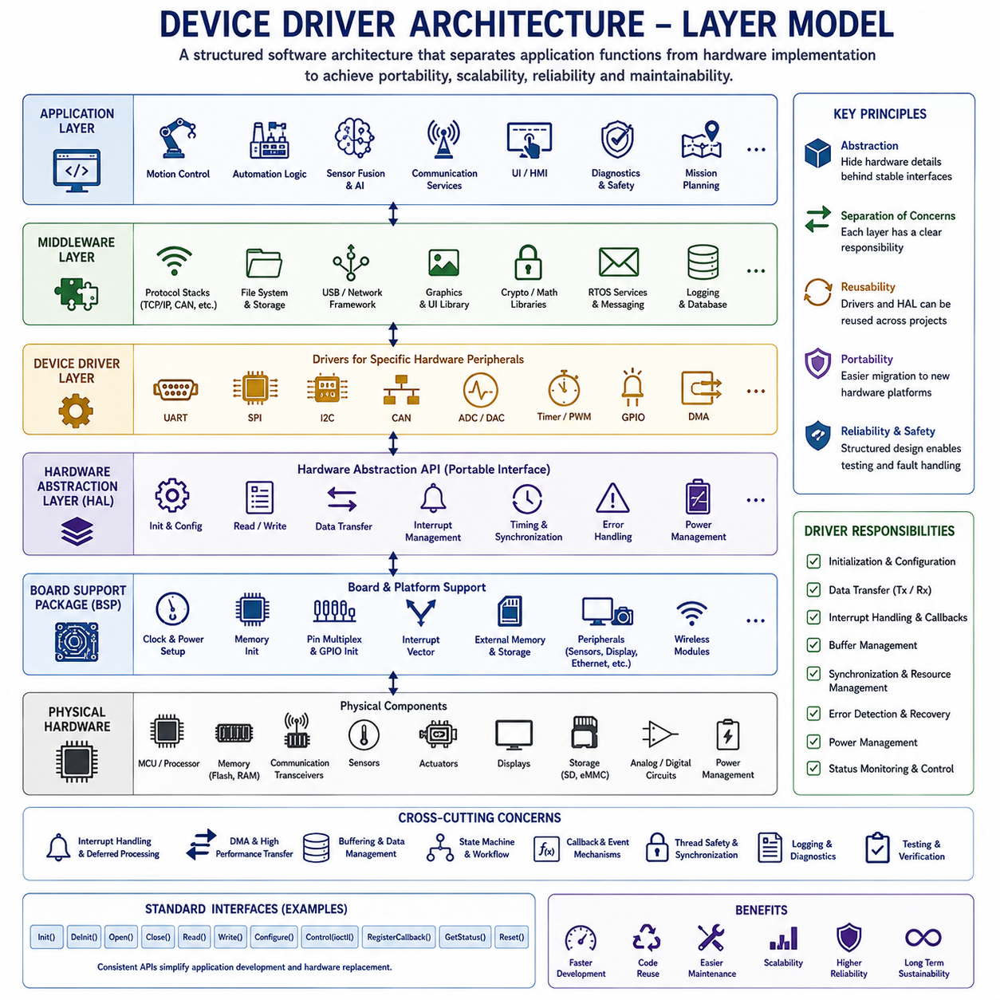
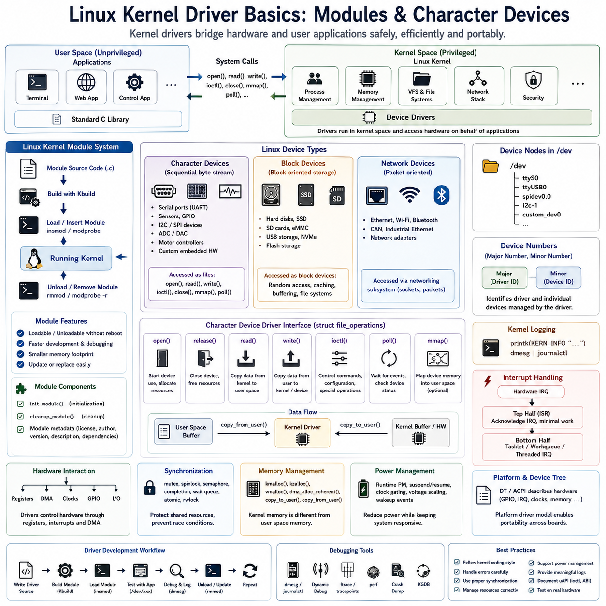
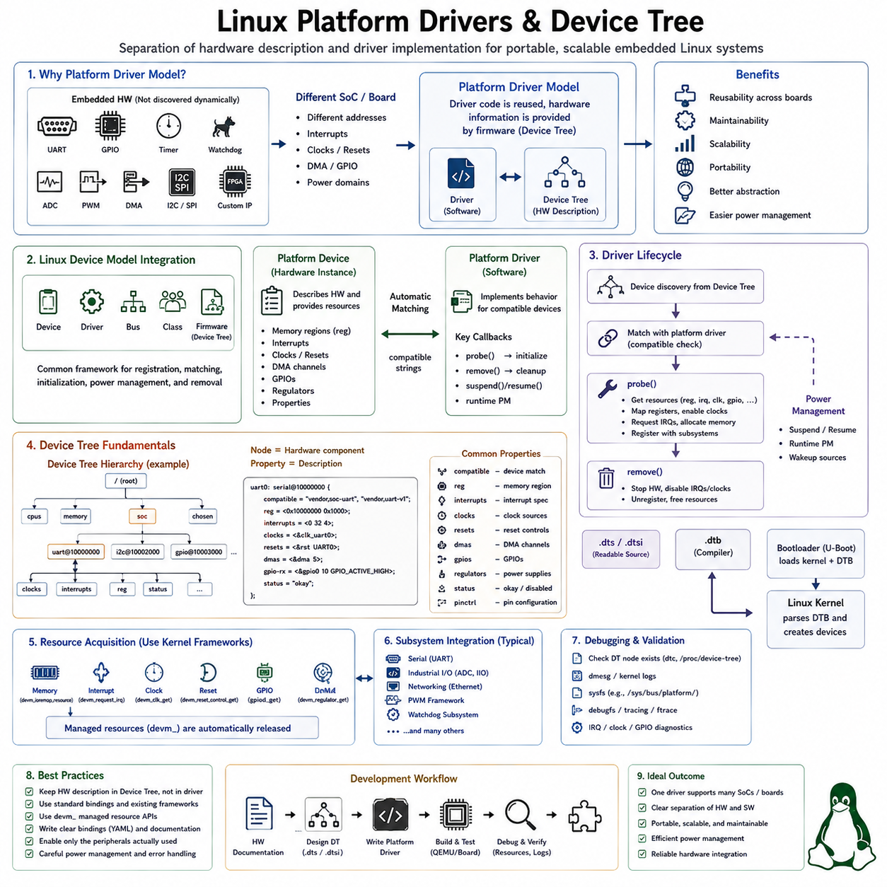
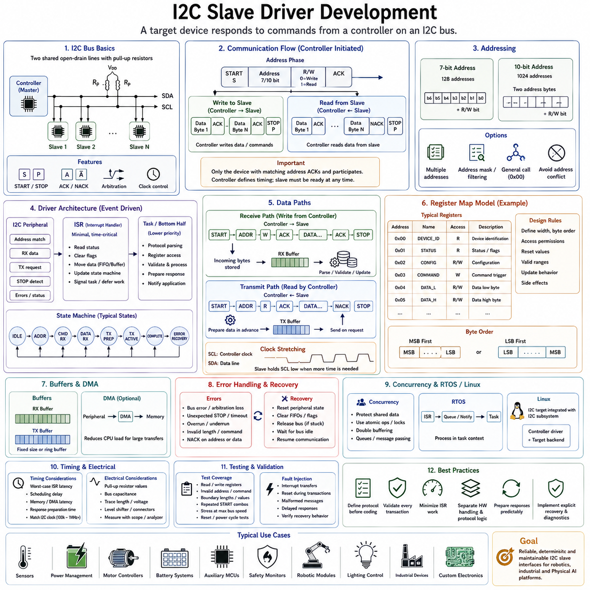
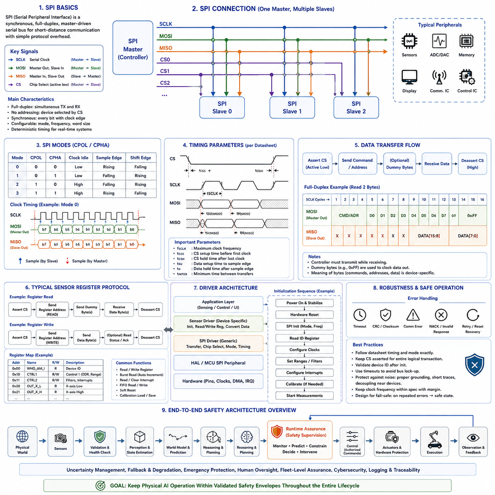
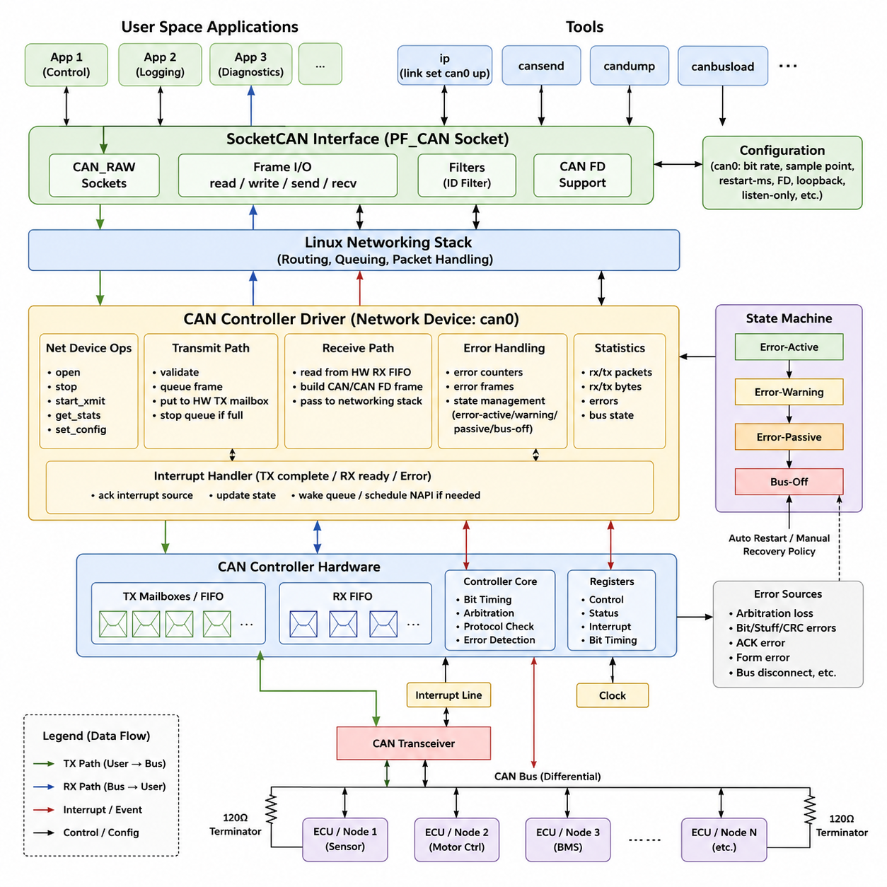
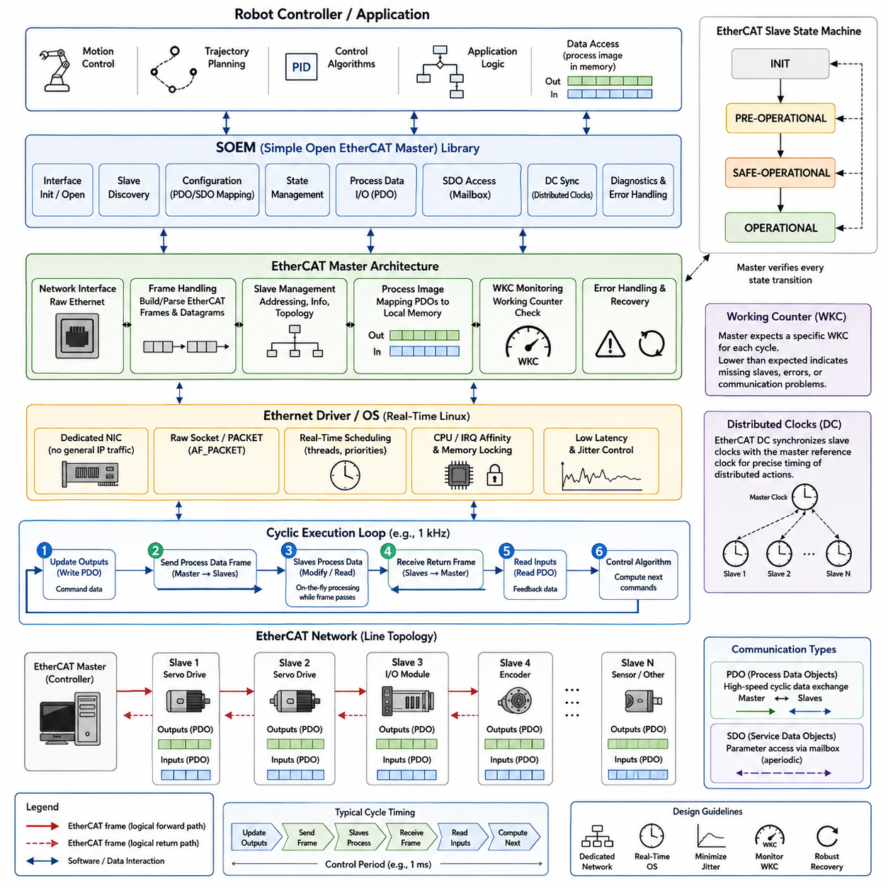
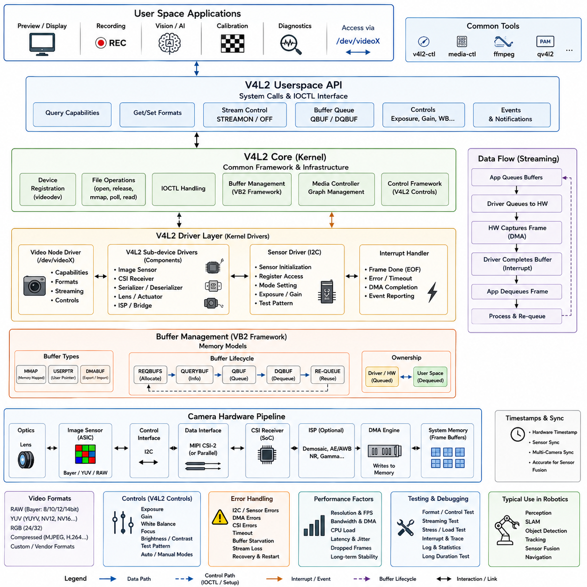
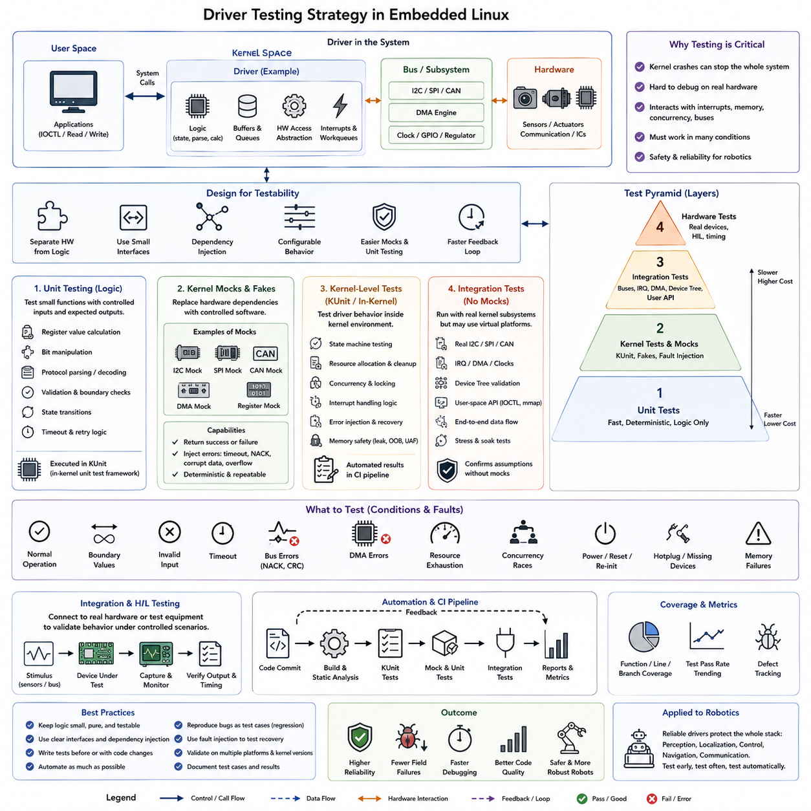
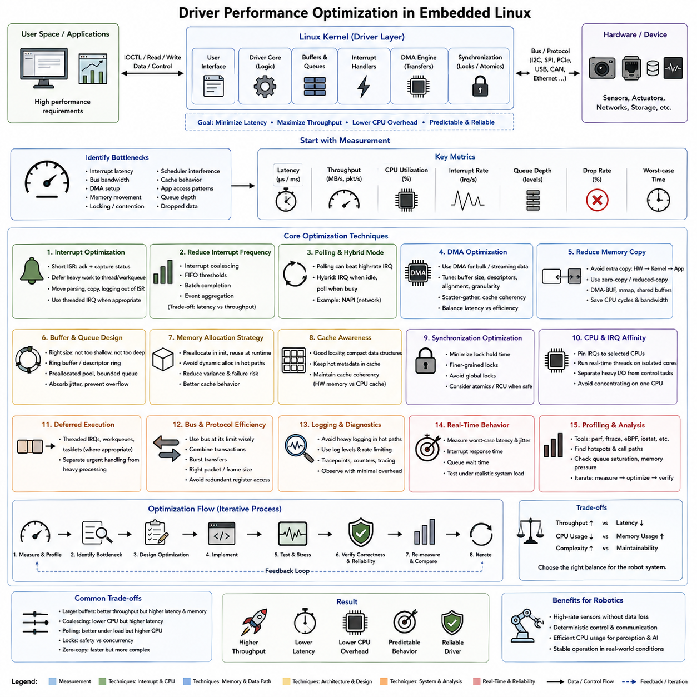

**Volume 02 Embedded Software Engineering**

# 03. Device Drivers

## 03.01 Device Driver Architecture Layer Model

{width="7.268055555555556in" height="7.268055555555556in"}

A device driver forms the fundamental software bridge between hardware peripherals and higher-level software components within an embedded system. Rather than allowing applications to manipulate hardware registers directly, device drivers encapsulate hardware-specific implementation details behind standardized software interfaces. This abstraction significantly improves portability, maintainability, scalability, and reliability while reducing coupling between application software and hardware platforms. As embedded systems become increasingly complex through the integration of multiple sensors, actuators, communication interfaces, storage devices, displays, motor controllers, and intelligent peripherals, a structured driver architecture becomes essential for managing hardware resources consistently throughout the software lifecycle.

The primary objective of a device driver architecture is to separate software responsibilities into well-defined layers. Each software layer communicates only with adjacent layers through carefully designed interfaces while hiding its internal implementation details. Such separation allows hardware modifications, software upgrades, platform migration, and peripheral replacement to occur with minimal influence on application software. A layered architecture also simplifies testing, debugging, code reuse, team collaboration, and long-term product maintenance by assigning clear responsibilities to every software component.

Embedded software commonly adopts a hierarchical layer model consisting of the Application Layer, Middleware Layer, Device Driver Layer, Hardware Abstraction Layer, Board Support Package, and Physical Hardware. Although exact terminology differs among operating systems, microcontroller vendors, AUTOSAR implementations, and embedded Linux distributions, the fundamental architectural philosophy remains consistent. Higher software layers express functional requirements while lower layers implement direct hardware control, enabling software engineers to develop complex embedded applications without requiring detailed knowledge of every hardware register.

The Application Layer contains software responsible for implementing the actual product functionality. Motion control algorithms, industrial automation logic, robotic behaviors, sensor fusion, artificial intelligence inference, communication services, user interfaces, diagnostic functions, safety supervision, and mission planning typically execute within this layer. Applications request hardware services through standardized software interfaces rather than manipulating registers directly, ensuring that application logic remains independent of specific microcontroller implementations.

The Middleware Layer provides reusable software services positioned between applications and hardware drivers. Communication protocol stacks, file systems, USB frameworks, TCP/IP networking, graphics libraries, cryptographic libraries, mathematical packages, real-time operating system services, middleware messaging frameworks, logging systems, data serialization, database interfaces, and cloud connectivity commonly reside within this layer. Middleware coordinates multiple drivers simultaneously while presenting simplified interfaces to applications.

The Device Driver Layer directly manages individual hardware peripherals. Separate drivers control UART communication, SPI buses, I2C interfaces, CAN controllers, Ethernet hardware, ADC modules, DAC converters, timers, PWM generators, GPIO controllers, DMA engines, watchdog timers, SD card interfaces, USB controllers, display controllers, audio codecs, motor drivers, inertial sensors, cameras, and numerous other embedded peripherals. Each driver exposes standardized software functions independent of underlying register organization whenever possible.

The Hardware Abstraction Layer provides a generalized programming interface independent of specific hardware implementations. Instead of exposing register-level programming details, HAL functions perform hardware initialization, peripheral configuration, interrupt management, data transmission, synchronization, timing control, and error handling through consistent software APIs. Applications and middleware therefore remain largely independent of particular microcontroller families, allowing migration between hardware platforms with relatively small software modifications.

Many semiconductor manufacturers provide comprehensive HAL libraries supporting their microcontroller families. Examples include STM32 HAL, NXP SDK, Nordic SDK, Renesas Flexible Software Package, Silicon Labs Gecko SDK, Microchip Harmony Framework, and Texas Instruments DriverLib. These libraries significantly reduce software development effort by encapsulating hardware-specific register manipulation inside thoroughly tested software components while preserving compatibility across multiple processor variants.

The Board Support Package extends hardware abstraction beyond the processor itself by adapting generic software to a specific hardware platform. The BSP initializes processor clocks, memory controllers, interrupt vectors, power management hardware, external memory, communication interfaces, displays, sensors, storage devices, Ethernet controllers, wireless modules, and board-specific peripherals. Different hardware products using the same processor frequently require independent BSP implementations while sharing higher-level software almost unchanged.

The Physical Hardware layer consists of microcontrollers, processors, memories, communication transceivers, sensors, actuators, displays, storage devices, analog circuits, digital interfaces, power management components, and external integrated circuits connected through electrical interfaces. Device drivers ultimately manipulate this hardware through memory-mapped registers, communication buses, interrupts, direct memory access controllers, and hardware timing mechanisms. The layered software architecture shields upper software components from these hardware implementation details.

Register access represents the lowest software abstraction level inside most device drivers. Embedded processors map peripheral control registers directly into processor address space, allowing ordinary memory operations to configure hardware behavior. Register definitions typically appear as structured memory maps generated from processor documentation. Device drivers manipulate configuration bits, status flags, interrupt enable registers, communication buffers, timing parameters, and control fields while preserving proper initialization sequences defined by hardware specifications.

Driver initialization establishes the operational state required before hardware becomes available to higher software layers. Initialization typically enables peripheral clocks, configures input-output pins, establishes communication speeds, initializes DMA channels, enables interrupts, clears status flags, configures timing parameters, allocates software resources, validates hardware availability, and performs self-diagnostic procedures. Well-designed initialization routines produce deterministic hardware states regardless of previous system conditions.

Device configuration allows applications to customize hardware behavior according to operational requirements. UART drivers configure baud rates, parity modes, stop bits, and flow control. SPI drivers establish clock polarity, phase relationships, transfer rates, and chip-select timing. ADC drivers configure sampling rates, reference voltages, conversion resolution, trigger sources, and channel sequences. Flexible configuration interfaces maximize driver reuse across diverse application scenarios.

Most professional driver architectures distinguish initialization, configuration, operational control, status monitoring, and shutdown into separate software interfaces. Rather than combining all functionality within single complex functions, drivers expose modular operations such as initialize, configure, enable, disable, transmit, receive, start conversion, stop operation, query status, clear errors, suspend, resume, and reset. Such modular interfaces simplify software maintenance while improving readability and testing.

Interrupt handling forms another fundamental driver responsibility. Hardware peripherals generate interrupts whenever communication completes, timers expire, analog conversions finish, errors occur, buffers overflow, or external events require immediate software attention. Device drivers register interrupt service routines that acknowledge hardware events, preserve processor context, update software state, transfer data, schedule deferred processing, and notify higher software layers while minimizing interrupt execution time.

Deferred interrupt processing separates time-critical interrupt activities from computationally intensive software operations. Immediate interrupt handlers perform only essential hardware servicing before scheduling additional processing within ordinary software tasks. This design minimizes interrupt latency, improves real-time responsiveness, reduces interrupt nesting complexity, and simplifies synchronization between interrupt context and application software.

Polling and interrupt-driven architectures represent two common driver execution models. Polling repeatedly examines hardware status until desired events occur, providing simple software implementation at the cost of increased processor utilization. Interrupt-driven drivers instead allow processors to execute unrelated software until hardware requests attention automatically. Most modern embedded systems prefer interrupt-driven operation because it substantially improves processor efficiency, energy consumption, and real-time responsiveness.

Direct Memory Access significantly enhances driver performance by transferring data independently of processor execution. Rather than copying every communication byte through software, DMA controllers transfer complete memory blocks directly between peripherals and memory. UART, SPI, ADC, DAC, Ethernet, USB, display controllers, audio interfaces, camera modules, and storage devices commonly employ DMA to reduce processor utilization while supporting substantially higher communication throughput.

Buffer management represents a central aspect of communication driver design. Ring buffers, circular queues, double buffers, scatter-gather lists, packet buffers, descriptor tables, and streaming memory pools organize transmitted and received data efficiently while accommodating asynchronous communication timing. Proper buffer management prevents data loss during temporary processor overload while maximizing communication bandwidth.

Synchronization mechanisms ensure correct interaction between multiple software components simultaneously accessing shared hardware resources. Mutexes, semaphores, event flags, spinlocks, critical sections, hardware semaphores, message queues, and atomic operations coordinate peripheral ownership while preventing race conditions, inconsistent register configuration, and communication conflicts. Synchronization becomes increasingly important within multitasking operating systems and multicore processors.

Error detection and recovery constitute essential driver responsibilities because embedded hardware inevitably encounters communication failures, electrical disturbances, timing violations, protocol errors, memory faults, peripheral resets, and unexpected operating conditions. Robust drivers detect hardware anomalies through status registers, timeout monitoring, cyclic redundancy checks, parity verification, protocol validation, watchdog supervision, and diagnostic counters before initiating recovery procedures that restore normal operation without requiring complete system restart.

State machines provide structured organization for driver behavior throughout hardware operation. Typical communication drivers transition through initialization, idle, transmission, reception, waiting, completion, timeout, recovery, and shutdown states according to hardware events and application requests. Explicit state machine implementation improves software clarity while simplifying debugging, testing, documentation, and formal verification of driver behavior.

Portable driver design minimizes hardware-specific assumptions by separating processor-dependent implementation from hardware-independent functionality. Register definitions, interrupt mapping, clock configuration, and low-level initialization remain isolated inside hardware adaptation modules while communication protocols, buffering algorithms, error handling, and application interfaces remain reusable across multiple processor families. Such separation substantially reduces software migration effort between hardware platforms.

Object-oriented principles increasingly influence embedded driver architecture even within C-based software projects. Driver instances encapsulate hardware state, configuration parameters, synchronization objects, callback functions, communication buffers, and operational status into well-defined software structures. Although implemented without full C++ object systems, encapsulation, modularity, abstraction, and interface separation significantly improve software maintainability.

Callback mechanisms enable asynchronous communication between drivers and higher software layers. Rather than continuously polling driver status, applications register callback functions that execute automatically whenever communication completes, sensor data becomes available, hardware faults occur, timers expire, or asynchronous events require software attention. Event-driven architectures reduce processor utilization while improving application responsiveness.

Device driver interfaces frequently follow standardized Application Programming Interface conventions. Read, write, open, close, initialize, configure, ioctl-style control operations, event registration, buffer submission, status queries, timeout control, and resource release provide consistent interaction models across diverse hardware peripherals. Standardized APIs simplify application development because programmers interact with similar software interfaces regardless of underlying hardware complexity.

Real-Time Operating Systems strongly influence driver architecture by introducing multitasking, scheduling, synchronization, message passing, software timers, memory management, and task priorities. RTOS-aware drivers coordinate processor resources safely across multiple concurrent tasks while respecting deterministic timing requirements. Device drivers therefore become integral components of overall operating system architecture rather than isolated hardware control modules.

Safety-critical embedded systems require drivers satisfying stringent reliability requirements. Defensive programming, parameter validation, timeout supervision, fault detection, redundancy management, error reporting, deterministic execution, memory protection, resource ownership verification, and comprehensive diagnostic capability ensure predictable hardware behavior even under abnormal operating conditions. Automotive, aerospace, industrial, railway, and medical software frequently validate driver implementations according to standards such as ISO 26262, IEC 61508, DO-178C, IEC 62304, or EN 50128.

Testing driver software extends beyond ordinary functional verification because hardware interaction introduces timing-dependent behavior. Unit testing validates individual software functions, hardware-in-the-loop testing verifies interaction with physical devices, integration testing evaluates communication between drivers and middleware, stress testing measures sustained operation under heavy workload, fault injection examines recovery capability, and long-duration reliability testing detects intermittent failures impossible to observe during short experiments.

Professional embedded software development emphasizes clear architectural boundaries separating hardware implementation from application functionality. Device drivers should neither contain application-specific decision logic nor expose hardware registers directly to upper software layers. Instead, drivers provide reliable, reusable, deterministic hardware services that remain stable despite processor upgrades, peripheral replacement, operating system evolution, or product family expansion. Such disciplined architectural separation dramatically improves scalability, maintainability, software quality, verification efficiency, and long-term product sustainability across industrial automation, autonomous robotics, intelligent transportation, medical electronics, aerospace systems, consumer electronics, and future Physical AI platforms requiring reliable interaction between increasingly sophisticated software and complex embedded hardware.

## 03.02 Linux Kernel Driver Basics: Modules, Char Devices [w/Code]

{width="7.268055555555556in" height="7.268055555555556in"}

Linux has become the dominant operating system for embedded systems, industrial controllers, robotics, autonomous vehicles, edge AI platforms, networking equipment, consumer electronics, aerospace systems, and high-performance computing because of its flexibility, scalability, reliability, and open-source ecosystem. Unlike bare-metal firmware, Linux provides process management, virtual memory, multitasking, networking, security mechanisms, file systems, and standardized hardware abstraction. However, Linux itself cannot directly communicate with every hardware device without dedicated software that understands the behavior of each peripheral. Linux kernel drivers fulfill this role by acting as the bridge between hardware devices and user-space applications while maintaining the security, stability, and portability of the operating system.

A Linux device driver is a kernel-level software component responsible for controlling specific hardware devices and exposing standardized interfaces to the rest of the operating system. Instead of allowing applications to manipulate hardware registers directly, drivers encapsulate hardware-specific operations behind well-defined kernel interfaces. This separation protects system integrity while enabling applications to access storage devices, communication interfaces, sensors, actuators, displays, cameras, network adapters, audio devices, GPUs, and custom embedded hardware through consistent software abstractions. Proper driver architecture therefore allows hardware evolution without requiring application software redesign.

The Linux kernel occupies the highest privilege level within the processor, commonly referred to as kernel space. Application software executes within user space, where direct hardware access is prohibited by memory protection mechanisms implemented by the processor. Whenever applications require hardware services, system calls transfer execution safely from user space into kernel space. Device drivers execute inside the kernel and perform hardware operations on behalf of applications while ensuring access control, synchronization, resource management, and error handling. This separation greatly improves operating system stability and security.

The Linux kernel itself consists of numerous subsystems working together to manage hardware resources efficiently. Memory management, process scheduling, virtual file systems, networking, security frameworks, interrupt management, power management, and device drivers cooperate through standardized kernel interfaces. Drivers integrate into these subsystems instead of functioning as isolated software modules. Consequently, driver developers must understand kernel architecture, synchronization primitives, memory allocation mechanisms, interrupt processing, and kernel programming conventions before implementing reliable hardware support.

One of Linux\'s greatest strengths is its modular architecture. Rather than compiling every hardware driver permanently into the kernel image, Linux allows many drivers to exist as dynamically loadable kernel modules. A kernel module represents an independently compiled binary object that can be inserted into or removed from the running kernel without requiring a complete operating system reboot. This modular approach significantly simplifies development, debugging, hardware maintenance, software updates, and optional feature deployment while reducing the memory footprint of production systems.

Kernel modules provide flexibility throughout the embedded software lifecycle. During development, engineers repeatedly modify driver source code, compile updated modules, unload previous versions, and insert newly compiled modules within seconds. Production systems load only required drivers according to detected hardware configurations, reducing memory consumption and startup complexity. Modules also simplify maintenance because updated drivers may replace existing implementations without rebuilding or redistributing the complete kernel image.

Every Linux kernel module begins with a standardized initialization routine and cleanup routine. The initialization function executes when the module loads into the kernel, allocating resources, registering devices, initializing hardware, configuring interrupts, creating kernel objects, and preparing software data structures. Conversely, the cleanup function executes when the module unloads, releasing allocated memory, unregistering devices, disabling interrupts, stopping ongoing operations, destroying synchronization objects, and returning the kernel to its previous state. Proper cleanup prevents resource leakage and maintains long-term kernel stability.

Kernel module metadata provides descriptive information allowing the operating system and development tools to identify software components correctly. Module metadata typically specifies author information, licensing, supported hardware, version numbers, dependencies, descriptions, and firmware requirements. Correct licensing declarations become particularly important because Linux distinguishes between GPL-compatible modules and proprietary binary modules when determining access to certain internal kernel symbols.

Building Linux kernel modules requires a specialized compilation environment using the Linux kernel build system, commonly known as Kbuild. Unlike ordinary C applications compiled against standard libraries, kernel modules compile against kernel headers, internal APIs, architecture-specific definitions, compiler configuration options, and processor-dependent build rules. The build system ensures compatibility between compiled modules and the exact kernel version executing on the target hardware.

Unlike ordinary applications, kernel modules cannot use standard C libraries provided by user-space operating systems. Functions such as printf(), malloc(), fopen(), and standard file handling routines are unavailable inside kernel space. Instead, drivers employ kernel-specific interfaces including printk() for logging, kmalloc() for memory allocation, copy_to_user() and copy_from_user() for controlled memory exchange, and numerous specialized APIs designed specifically for kernel execution environments. Developers must therefore adopt a different programming model than conventional application software.

Linux categorizes hardware devices into several standardized classes including character devices, block devices, and network devices. Although all device types ultimately control physical hardware, each category follows different operational semantics and kernel interfaces optimized for particular communication patterns. Understanding these distinctions represents a fundamental prerequisite for Linux device driver development.

Character devices provide sequential streams of bytes without requiring block-oriented storage semantics. Communication ports, serial interfaces, keyboards, sensors, GPIO controllers, motor controllers, ADC interfaces, DAC devices, embedded control interfaces, custom FPGA communication channels, and numerous industrial devices operate naturally as character devices. Applications access character devices through familiar file operations such as open(), read(), write(), close(), and ioctl(), making hardware interaction appear similar to ordinary file manipulation.

Block devices differ by managing fixed-size storage blocks supporting random access. Hard disks, solid-state drives, SD cards, embedded MultiMediaCards, USB storage devices, NVMe controllers, optical drives, and flash storage typically appear as block devices. The Linux block layer provides sophisticated buffering, caching, scheduling, request merging, error recovery, and filesystem integration to maximize storage performance while presenting standardized interfaces to applications.

Network devices represent another specialized driver category responsible for transmitting and receiving communication packets rather than simple byte streams. Ethernet controllers, Wi-Fi adapters, Bluetooth radios, CAN interfaces, industrial Ethernet devices, and software-defined networking hardware integrate into the Linux networking subsystem through standardized packet processing interfaces rather than ordinary file operations.

Character device drivers occupy a particularly important position within embedded Linux development because custom hardware frequently communicates through relatively simple register interfaces or streaming communication channels. Many robotic controllers, industrial automation systems, embedded AI accelerators, sensor hubs, laboratory instruments, FPGA peripherals, and proprietary hardware modules expose user-space interfaces through character device drivers due to their implementation simplicity and operational flexibility.

Every character device receives a unique device number identifying its driver and specific hardware instance. Linux separates this identifier into a major number representing the responsible driver and a minor number distinguishing individual devices managed by the same driver. For example, multiple serial ports may share one major number while each port receives its own minor number. The kernel automatically routes application requests to the appropriate driver according to these identifiers.

Device nodes appearing under the /dev directory provide user-space access points for kernel-managed devices. Character device drivers register themselves with the kernel, after which device management systems such as udev automatically create corresponding device files including /dev/ttyUSB0, /dev/ttyS0, /dev/spidev0.0, /dev/i2c-1, or custom hardware interfaces. Applications subsequently interact with these files using conventional operating system APIs despite underlying hardware complexity.

Character device registration informs the kernel that a new driver wishes to manage one or more device numbers. Registration establishes associations between device identifiers and driver operations while allocating internal kernel resources. Unregistration reverses these operations during module removal, ensuring that obsolete device nodes disappear correctly and kernel resources become available for future drivers.

Linux character drivers expose standardized operations through a file_operations structure. Rather than directly invoking hardware-specific functions, the kernel references this structure whenever applications perform file operations. Developers populate function pointers corresponding to open, release, read, write, unlocked_ioctl, poll, mmap, and additional optional services according to hardware capabilities. This architecture provides remarkable consistency across thousands of independent Linux device drivers.

The open operation executes whenever an application begins communicating with a device. Drivers validate hardware availability, allocate private data structures, initialize communication state, enable hardware resources, increment reference counters, verify permissions, and prepare subsequent data transfers. Proper resource initialization within open significantly improves reliability throughout later device interactions.

The read operation transfers data from kernel-managed hardware buffers into user-space application memory. Because kernel and user memory remain isolated for security reasons, direct pointer access is prohibited. Instead, drivers safely copy information through dedicated kernel interfaces ensuring memory protection while validating access permissions and preventing kernel corruption due to invalid user pointers.

Similarly, the write operation transfers information from user space into kernel buffers before forwarding commands or data toward hardware devices. Input validation, buffer management, synchronization, timeout handling, communication scheduling, and protocol verification frequently accompany write operations to maintain reliable hardware behavior even under erroneous application conditions.

The ioctl interface extends ordinary file operations by supporting hardware-specific control commands beyond simple byte transfer. Device configuration, communication parameters, calibration procedures, firmware management, diagnostic requests, motor control settings, sensor configuration, operating modes, timing parameters, and specialized embedded functionality commonly utilize ioctl commands. Well-designed ioctl interfaces remain carefully documented to ensure compatibility between applications and evolving driver implementations.

Memory mapping enables applications to access selected kernel-managed memory regions directly without repeated copying operations. High-performance graphics processors, frame buffers, DMA buffers, shared memory communication channels, AI accelerators, FPGA interfaces, and multimedia systems frequently employ mmap mechanisms to reduce processor overhead while maximizing communication bandwidth. Careful access protection remains essential because memory mapping bypasses conventional data copying mechanisms.

Kernel logging provides essential diagnostic visibility during driver development. Rather than using standard output streams unavailable within kernel space, drivers generate messages through printk or modern logging macros integrated with the Linux kernel logging subsystem. Different severity levels classify informational messages, warnings, recoverable errors, critical failures, debugging information, and emergency conditions. Developers examine these logs using tools such as dmesg or the system journal to diagnose driver behavior.

Interrupt handling represents another fundamental driver responsibility because hardware devices frequently signal asynchronous events requiring immediate software attention. Communication completion, sensor readiness, DMA termination, hardware faults, timer expiration, GPIO transitions, network packet arrival, and storage completion typically generate interrupts. Drivers register interrupt handlers with the kernel, acknowledge hardware events, schedule deferred processing, and notify waiting applications while minimizing interrupt execution latency.

Linux separates interrupt handling into immediate top-half processing and deferred bottom-half processing. The top half executes immediately after interrupt arrival, performing only essential hardware servicing before returning processor control quickly. More computationally intensive activities execute later through tasklets, work queues, threaded interrupts, or other deferred execution mechanisms. This architecture improves system responsiveness while maintaining deterministic interrupt latency.

Kernel synchronization mechanisms become essential whenever multiple processes, processors, interrupts, or kernel threads access shared hardware resources simultaneously. Mutexes, spinlocks, semaphores, completions, wait queues, atomic operations, reader-writer locks, and reference counters coordinate concurrent execution safely while preventing race conditions, deadlocks, inconsistent hardware configuration, and memory corruption.

Memory management inside kernel drivers differs substantially from user-space programming. Kernel memory allocation must consider execution context, interrupt safety, DMA accessibility, cache coherency, physical memory requirements, allocation priority, and fragmentation constraints. Interfaces including kmalloc, vmalloc, dma_alloc_coherent, and slab allocators support specialized memory requirements encountered throughout diverse driver implementations.

Linux employs the platform driver model extensively for embedded systems integrating hardware permanently attached to processor buses rather than dynamically discoverable interfaces such as PCI or USB. Platform drivers obtain hardware descriptions from Device Tree structures or ACPI tables describing processor peripherals, GPIO assignments, interrupt numbers, clock sources, DMA channels, memory addresses, and hardware dependencies. This separation between hardware description and driver implementation significantly improves portability across processor families.

The Device Tree provides a hardware description language allowing embedded Linux kernels to support numerous hardware platforms without recompiling drivers. Instead of hardcoding physical addresses, interrupt numbers, or peripheral configuration inside drivers, hardware descriptions reside within structured Device Tree source files interpreted during system startup. Drivers request hardware resources symbolically through standardized kernel interfaces, making software substantially more reusable across different processor boards.

Power management has become increasingly important as embedded Linux platforms operate within mobile robots, battery-powered devices, industrial sensors, autonomous vehicles, drones, wearable electronics, and edge AI systems. Modern drivers therefore support runtime power management, suspend and resume operations, clock gating, voltage scaling, peripheral sleep states, and wakeup event management to maximize operational lifetime without sacrificing system responsiveness.

Debugging Linux kernel drivers requires specialized methodologies because software executes within privileged kernel space. Kernel logging, dynamic debugging, tracepoints, ftrace, perf, Kernel Address Sanitizer, lock dependency analysis, crash dumps, kernel debuggers, and hardware tracing collectively provide visibility into driver execution while preserving system stability. Defensive programming, extensive error checking, careful synchronization analysis, and incremental validation remain essential because kernel failures typically affect the entire operating system.

Professional Linux driver development emphasizes modularity, hardware abstraction, portability, deterministic behavior, efficient resource management, standardized interfaces, rigorous synchronization, comprehensive error handling, and long-term maintainability. Character device drivers provide an accessible foundation for understanding Linux kernel programming because they illustrate the essential relationships among kernel modules, device registration, standardized file operations, user-space interaction, interrupt management, synchronization, and hardware control. Mastering these concepts enables engineers to develop reliable Linux support for custom embedded hardware, industrial automation equipment, intelligent robots, autonomous systems, communication platforms, AI accelerators, medical devices, aerospace electronics, and future Physical AI infrastructures operating within increasingly sophisticated embedded computing environments.

## 03.03 Platform Driver and Device Tree Writing [w/Code]

{width="7.268055555555556in" height="7.268055555555556in"}

Platform drivers are a fundamental mechanism used by Linux to manage hardware devices that are integrated directly into an embedded system rather than dynamically discovered through buses such as PCI or USB. Typical examples include UART controllers, GPIO blocks, timers, watchdogs, ADC units, PWM controllers, DMA engines, I2C controllers, SPI controllers, and custom FPGA peripherals. The platform driver model separates the software that controls a device from the hardware description that specifies where and how that device exists within a particular board or System-on-Chip.

This separation solves an important problem in embedded Linux development. A single peripheral controller may appear at different physical addresses, use different interrupt lines, clocks, DMA channels, GPIO signals, or power domains depending on the processor and board configuration. If these details are hardcoded inside the driver, every hardware variation requires source-code modification. Platform drivers instead obtain hardware-specific information from firmware descriptions such as Device Tree, allowing the same driver implementation to operate across multiple hardware platforms.

The Linux device model represents hardware through structured kernel objects rather than treating each driver as an isolated software component. Devices, drivers, buses, classes, and firmware descriptions participate in a common framework that manages registration, matching, initialization, power management, resource ownership, and removal. Platform devices and platform drivers are therefore integrated into the broader Linux device model, enabling consistent interaction with kernel subsystems and standardized lifecycle management.

A platform device represents a hardware component that exists within the system and provides the resources required to operate it. These resources may include memory-mapped register regions, interrupt numbers, clocks, reset signals, DMA channels, GPIO connections, regulators, and additional configuration properties. The platform device does not itself implement hardware behavior. Instead, it describes the hardware instance so that an appropriate platform driver can discover and control it.

A platform driver contains the executable software responsible for operating one or more compatible platform devices. The driver normally defines initialization and removal behavior together with optional power-management operations. When Linux identifies a compatible hardware device, the kernel associates that device with the appropriate platform driver and invokes the driver\'s probe function. This automatic matching mechanism eliminates the need for application software to manually initialize individual hardware controllers.

The probe function represents one of the most important entry points in platform driver development. It executes when the kernel determines that a driver matches a particular device. During probing, the driver retrieves hardware resources, maps registers into kernel virtual address space, obtains interrupt lines, configures clocks, requests GPIO signals, allocates memory, initializes synchronization objects, registers subsystem interfaces, and places the hardware into a known operational state. Successful completion indicates that the device is ready for use.

Resource acquisition should follow Linux kernel resource-management conventions rather than relying on arbitrary physical addresses or manually maintained board-specific constants. Platform drivers retrieve memory resources, interrupts, clocks, regulators, DMA channels, and GPIO descriptors through standardized kernel APIs. This approach allows the kernel to validate resource ownership, prevent conflicts between drivers, and maintain a consistent representation of the hardware configuration throughout the operating system.

Memory-mapped I/O is commonly used by platform devices because many SoC peripherals expose control and status registers within the processor\'s physical address space. The driver obtains the register region described by the hardware configuration and maps it into kernel virtual memory before accessing it. Register access is then performed through kernel-provided I/O functions rather than ordinary C pointer operations, preserving architecture compatibility and appropriate memory-ordering behavior.

Managed resource interfaces, commonly identified by the devm_ prefix, significantly simplify platform driver implementation. Resources allocated through device-managed APIs are automatically released when the device is detached or when probing fails. Memory allocations, register mappings, interrupt registrations, GPIO descriptors, clocks, and many other resources can use this model. Automatic cleanup reduces complicated error-handling paths and prevents resource leaks during initialization failures.

The remove operation performs the reverse lifecycle transition when a platform device is disconnected, disabled, or its driver is unloaded. Depending on the resources used, the driver stops hardware activity, disables communication, unregisters subsystem interfaces, terminates asynchronous work, and ensures that no software component continues accessing unavailable hardware. Device-managed resources reduce the amount of explicit cleanup required, but operational shutdown must still be handled carefully.

Device Tree is the primary hardware-description mechanism used by Linux on many ARM, ARM64, RISC-V, PowerPC, and other embedded platforms. Instead of encoding board-specific information inside C source files, Device Tree describes the hardware topology using a structured hierarchical representation. The kernel receives this description during boot and uses it to discover processors, buses, memory regions, interrupt controllers, clocks, communication peripherals, sensors, regulators, and numerous other hardware components.

A Device Tree is conceptually organized as a hierarchy of nodes and properties. Each node represents a hardware component or logical hardware container, while properties describe characteristics associated with that node. The hierarchy commonly begins at a root node and branches into processors, memory, buses, SoC peripherals, reserved memory, chosen boot parameters, and board-specific devices. This tree structure naturally represents the physical and logical relationships among embedded hardware components.

Device Tree Source files normally use the .dts extension, while reusable hardware fragments use .dtsi include files. A processor vendor may provide common .dtsi definitions describing the SoC architecture, while individual board .dts files enable peripherals, assign GPIO signals, configure regulators, define connectors, or override properties specific to that board. This layered organization avoids duplicating complete hardware descriptions for every product derived from the same processor platform.

The Device Tree Compiler converts human-readable Device Tree Source into a compact binary Device Tree Blob, commonly identified by the .dtb extension. Bootloaders such as U-Boot typically load the Linux kernel together with the appropriate DTB into memory and pass the hardware description to the kernel during startup. Linux then parses the tree and creates corresponding device representations that can participate in driver matching and resource allocation.

The compatible property forms the central connection between Device Tree nodes and Linux drivers. A hardware node normally contains one or more compatible strings identifying the device implementation. Platform drivers maintain matching tables containing compatible strings they support. During device discovery, the kernel compares these values and invokes the appropriate driver\'s probe function when a match occurs. Compatible strings should describe actual hardware compatibility rather than arbitrary software configuration names.

Compatible identifiers conventionally use a vendor-prefixed naming scheme to reduce ambiguity between hardware manufacturers. A node describing a particular peripheral might identify the manufacturer and hardware model through a string such as "vendor,device". Drivers may support several related compatible identifiers when multiple hardware generations share similar register layouts or operational behavior. More specific identifiers are normally placed before generic fallback compatibility entries.

The reg property describes memory-mapped hardware resources such as peripheral register regions. It generally specifies a base address and region size according to the address and size cell conventions inherited from the parent bus. Platform drivers retrieve these resources through kernel APIs instead of directly parsing arbitrary addresses. Correctly describing register ranges is essential because incorrect addresses can cause access to unrelated hardware or generate processor bus faults.

Interrupt properties describe how a peripheral connects to the system interrupt architecture. The exact encoding depends on the interrupt controller referenced by the surrounding Device Tree hierarchy. Drivers normally request an interrupt using generic kernel functions and do not need to understand the raw Device Tree encoding. This abstraction allows the same driver to work across platforms with different interrupt controller implementations.

Clock properties describe the clock sources required by a hardware peripheral. Modern SoCs contain complex clock trees with oscillators, phase-locked loops, dividers, gates, and peripheral-specific clock domains. Device Tree identifies the appropriate clock providers and clock inputs, while the driver uses the Linux common clock framework to obtain, configure, enable, and disable those clocks. This prevents hardware-specific clock topology from becoming embedded directly within peripheral driver logic.

Reset controllers are similarly represented through Device Tree when peripherals require explicit hardware reset control. A platform driver can acquire the appropriate reset line through the kernel reset framework and assert or deassert it during initialization, recovery, suspend, or shutdown. Separating reset topology from driver implementation allows one peripheral driver to operate correctly even when reset wiring differs between SoC generations.

GPIO connections should normally be described using GPIO properties rather than raw numeric GPIO identifiers. Modern Linux drivers use descriptor-based GPIO interfaces that associate logical functions with hardware signals defined in Device Tree. Reset pins, enable signals, interrupt lines, chip selects, status inputs, and control outputs can therefore be described by the board configuration without embedding processor-specific GPIO numbering inside driver source code.

Power regulators represent another important hardware dependency. Sensors, communication modules, displays, cameras, and other peripherals may require one or more independently controlled voltage rails. Device Tree can describe these supply relationships, and drivers obtain regulator handles through the Linux regulator framework. The driver can then enable or disable required supplies while remaining independent of the specific power-management IC or board-level electrical design.

DMA relationships can also be represented within Device Tree. High-throughput peripherals such as UART, SPI, I2S, ADC, camera interfaces, storage controllers, and networking hardware frequently rely on DMA engines for efficient data movement. Rather than hardcoding DMA controller channels, the Device Tree describes the relationship between peripheral DMA requests and available DMA controllers. Drivers request channels through the DMA framework and remain portable across different system configurations.

The status property commonly controls whether a hardware node should be instantiated for a particular board. SoC-level include files frequently describe all peripherals physically available within the processor but mark optional controllers as disabled. Individual board Device Tree files then enable only the interfaces actually connected and used by that hardware design. This approach allows one common SoC description to support numerous products without duplicating the processor-level hardware definition.

Device Tree aliases can provide stable logical identifiers for selected devices even when the underlying tree hierarchy changes. Serial controllers, Ethernet interfaces, storage devices, and other resources may use aliases to influence numbering or simplify references from other nodes. However, aliases should be used carefully because Linux device naming can also depend on subsystem-specific enumeration and runtime discovery behavior.

Phandles provide references between Device Tree nodes and allow one hardware component to identify services supplied by another. Clocks, GPIO controllers, interrupt controllers, regulators, DMA controllers, pin controllers, IOMMUs, and power domains frequently use these references. This relationship-based representation is one of the most powerful characteristics of Device Tree because complex SoC connectivity can be described without duplicating provider-specific implementation details.

Pin control configuration defines how multiplexed processor pins are assigned to peripheral functions. A physical processor pin may support GPIO, UART, SPI, I2C, PWM, CAN, Ethernet, or other alternate functions depending on the SoC. Device Tree pinctrl definitions describe the required multiplexing, electrical characteristics, pull resistors, drive strength, and operational states, while platform drivers request predefined pin states through the Linux pin control framework.

Device Tree bindings define the formal contract describing how a particular hardware device should be represented. A binding specifies required properties, optional properties, compatible strings, register resources, interrupts, clocks, supplies, GPIOs, and other configuration information expected by a driver. Modern Linux development increasingly expresses bindings using YAML schemas, allowing automated validation of Device Tree descriptions and reducing configuration errors before software reaches target hardware.

A well-designed binding describes hardware rather than software policy. Device Tree should normally represent physical characteristics, wiring, resource relationships, and immutable platform configuration instead of application behavior or arbitrary driver tuning decisions. Runtime policies that can change independently of the physical hardware generally belong in drivers, kernel configuration, user space, or dedicated subsystem interfaces rather than being encoded as permanent Device Tree properties.

Driver developers should avoid inventing custom Device Tree properties when an established subsystem binding already provides a standardized representation. Existing frameworks for clocks, regulators, GPIO, interrupts, DMA, pin control, thermal management, power domains, I2C, SPI, Ethernet, and many other hardware categories define common conventions. Reusing these conventions improves compatibility with kernel infrastructure and makes hardware descriptions easier for other engineers to understand and maintain.

Platform driver matching is commonly implemented using an of_device_id table when Device Tree is involved. Each entry identifies a compatible hardware implementation supported by the driver, and the table is associated with the platform driver structure. When the kernel discovers a matching Device Tree node, the corresponding platform device is bound to the driver. This mechanism cleanly separates hardware identification from the driver\'s operational implementation.

Platform drivers frequently register additional interfaces with specialized Linux subsystems after probing succeeds. A UART controller may register with the serial subsystem, an ADC with the Industrial I/O framework, a network controller with the networking stack, a PWM controller with the PWM framework, or a watchdog with the watchdog subsystem. The platform driver therefore often acts as the hardware discovery and resource-management layer underneath a more specialized kernel framework.

Error handling during probe is especially important because embedded hardware frequently has dependencies that may not yet be available when the driver initially attempts initialization. Clocks, regulators, GPIO controllers, DMA providers, or other supporting devices may themselves require separate drivers. Linux supports deferred probing so a driver can postpone initialization until required dependencies become available rather than permanently failing during the original boot sequence.

Power management integrates naturally with the platform driver model. Drivers may implement suspend, resume, runtime suspend, and runtime resume operations that coordinate device state with Linux power-management policies. Clocks can be disabled, regulators shut down, interrupts configured as wakeup sources, and internal device state preserved while unused hardware enters low-power modes. Correct power management is particularly important for mobile robots, autonomous platforms, battery-powered sensors, and edge computing devices.

Device Tree overlays provide a mechanism for modifying or extending an existing hardware description without replacing the complete base Device Tree. They are particularly useful for expansion boards, FPGA configurations, development platforms, modular hardware, and dynamically selectable peripherals. An overlay can introduce new nodes, enable disabled devices, or modify selected properties, although careful lifecycle and dependency management is necessary when hardware configuration changes during operation.

Debugging platform drivers begins by verifying that the expected Device Tree node actually exists in the running system and contains the correct properties. Engineers then confirm that compatible matching occurred, inspect kernel logs, verify resource acquisition, check register mappings and interrupts, and observe whether the probe function completed successfully. Many apparent driver defects are ultimately caused by incorrect Device Tree descriptions rather than errors within the driver\'s operational code.

Kernel interfaces such as sysfs provide additional visibility into the Linux device model. Platform devices and drivers appear within structured system directories that expose binding relationships, device attributes, power-management state, and driver information. Combined with kernel logs, Device Tree inspection, debugfs, tracing, interrupt statistics, clock summaries, GPIO diagnostics, and subsystem-specific tools, these interfaces provide powerful methods for investigating hardware integration problems.

A robust development workflow begins with accurate hardware documentation. Engineers identify register regions, interrupt connections, clocks, resets, GPIO signals, DMA requirements, power supplies, pin multiplexing, and dependencies before creating the Device Tree description. The corresponding platform driver then retrieves these resources using standard kernel frameworks rather than duplicating hardware information. This division creates a clear architectural boundary between board configuration and reusable driver logic.

Platform driver and Device Tree development becomes particularly valuable in robotics and Physical AI systems containing heterogeneous computing hardware. A robotic controller may integrate motor-control interfaces, safety processors, IMUs, GNSS receivers, LiDAR interfaces, cameras, FPGA accelerators, CAN controllers, Ethernet devices, synchronization hardware, and custom sensor interfaces around a single SoC. Device Tree describes how these resources are physically connected, while reusable drivers provide standardized Linux services to higher-level robotic software.

The most maintainable embedded Linux systems therefore treat the platform driver and Device Tree as complementary components rather than independent technologies. Device Tree answers where hardware exists, how it is connected, and which resources it requires, while the platform driver defines how that hardware should be initialized, controlled, monitored, suspended, recovered, and exposed to the rest of Linux. Maintaining this separation prevents board-specific details from contaminating reusable driver implementations.

Mastering platform drivers and Device Tree writing provides a foundation for developing scalable embedded Linux platforms across industrial automation, autonomous robots, intelligent vehicles, edge AI computers, communication systems, aerospace electronics, medical devices, and advanced Physical AI machines. Correct use of device matching, standardized bindings, resource frameworks, managed allocation, subsystem integration, power management, and structured hardware descriptions allows one driver architecture to support multiple processors and boards while remaining maintainable throughout long product lifecycles.

## 03.04 I2C Slave Driver Development [w/Code]

{width="7.268055555555556in" height="7.268055555555556in"}

I2C slave driver development is an important embedded software discipline for devices that must respond to commands from another controller rather than initiate communication themselves. In an Inter-Integrated Circuit bus, the controller generates the clock and starts transactions, while a target device recognizes its assigned address and participates in read or write transfers. Sensors, power-management devices, motor-control modules, battery systems, auxiliary MCUs, and custom robotic electronics frequently operate in this target role.

An I2C bus normally uses two shared signal lines: Serial Data, or SDA, and Serial Clock, or SCL. Both lines commonly use open-drain or open-collector electrical signaling with pull-up resistors. Devices actively drive a line low but release it when representing a high state. This wired communication structure allows multiple devices to share the same bus while supporting acknowledgment, arbitration, and clock-control mechanisms without requiring dedicated point-to-point signal pairs.

From the slave-driver perspective, communication begins when the controller generates a START condition and transmits an address together with a direction bit. Every target connected to the bus observes this sequence, but only the device whose configured address matches the transmitted address should respond. The selected target acknowledges the address and enters an appropriate receive or transmit state according to whether the controller intends to write data to the target or read data from it.

A robust slave driver is therefore fundamentally event driven. Unlike controller-side software, it cannot decide when the next transaction will occur because the external controller owns the bus schedule. The driver must remain ready for address detection, incoming bytes, transmit requests, repeated START conditions, STOP conditions, errors, and exceptional bus events. This asynchronous behavior strongly influences the architecture of interrupt handlers, buffers, state machines, synchronization mechanisms, and application interfaces.

Address configuration is one of the first design decisions. Conventional I2C supports 7-bit addressing and also defines extended 10-bit addressing for applications requiring a larger address space. Embedded products most commonly use 7-bit addresses because they are simple and widely supported. The slave driver must configure the peripheral correctly and ensure that its address does not conflict with another target device connected to the same physical bus.

Some controllers support multiple target addresses, address masks, general-call recognition, or programmable address filtering. These capabilities can be useful when one embedded processor represents several logical functions or when a family of devices must respond to selected address ranges. However, additional addressing flexibility increases software complexity, so the driver should enable only the mechanisms required by the actual communication protocol and system architecture.

The receive path handles transactions in which the external controller writes information to the target. After successful address recognition, incoming bytes are captured by the I2C peripheral and transferred into software-managed storage. The driver must determine whether each byte represents a register address, command identifier, payload value, checksum, configuration parameter, or another protocol element according to the higher-level communication format implemented by the product.

Interrupt-driven reception is widely used because the target cannot predict when the controller will begin transmitting. The peripheral generates interrupts for address matches, received bytes, STOP detection, errors, and other relevant conditions. The interrupt service routine performs the minimum time-critical processing required to preserve communication, while more complex protocol interpretation should normally be deferred to a lower-priority execution context.

High-throughput implementations may combine I2C target operation with Direct Memory Access. DMA can move received or transmitted bytes between the peripheral and memory without requiring an interrupt for every byte. This reduces CPU overhead and improves scalability when transfers are relatively large. However, short command-oriented transactions may gain little from DMA because setup cost, variable transaction lengths, repeated START conditions, and protocol state transitions can dominate the transfer.

Transmit operation occurs when the controller addresses the target for reading. The target must provide data quickly enough to satisfy the controller\'s clocking sequence. Therefore, information expected by the controller should preferably be prepared before the read request arrives. Real-time computation inside a time-critical transmit event can create excessive latency and may require clock stretching if the hardware and system protocol permit it.

Clock stretching allows a target to hold SCL low temporarily when it requires additional time before continuing a transaction. This mechanism can help when software latency, data preparation, memory access, or peripheral processing prevents an immediate response. Nevertheless, a well-designed system should not depend excessively on clock stretching because some controllers impose strict timeout limits and certain hardware or software implementations provide incomplete support for prolonged stretching.

Many I2C target devices expose a register-oriented communication model. The controller first writes a register index or internal address and subsequently reads or writes the associated data. A custom slave driver can implement a similar virtual register map containing status information, configuration parameters, sensor values, diagnostic results, firmware information, control commands, and other application data. This creates a simple and predictable interface between independently developed embedded modules.

A register-map architecture should clearly define data width, byte order, access permissions, reset values, valid ranges, update behavior, and side effects. Read-only registers may expose measurements and status, while writable registers may modify configuration or request actions. Some registers can be read-write, and others may implement write-one-to-clear or command-trigger semantics. Precise definitions prevent ambiguous behavior between controller and target software teams.

Multi-byte values require explicit byte-order conventions. A 16-bit, 32-bit, or 64-bit value can be transferred most-significant byte first or least-significant byte first, but both sides must use the same interpretation. The communication specification should therefore define endianness independently of the native byte order used by either processor. This becomes particularly important when different MCU architectures or Linux-based processors communicate over the same I2C bus.

Buffer design directly affects driver reliability. Receive buffers must be large enough to accommodate valid controller writes without overwriting adjacent memory, while transmit buffers must contain complete and consistent data when requested. Fixed-size buffers are often preferable in small embedded targets because their memory requirements are deterministic. Ring buffers or message queues can be introduced when transactions must be decoupled from application processing.

Every incoming length, index, command, and payload field should be validated before it influences memory access or hardware control. An incorrect controller transaction must never cause a buffer overflow, invalid register access, arbitrary pointer operation, or uncontrolled actuator command. Even when the I2C bus is physically internal to a product, defensive validation is necessary because electrical noise, software defects, reset timing, or compromised components can generate unexpected traffic.

A state-machine architecture provides a clear method for controlling target-side protocol behavior. Typical states may represent idle operation, address recognition, command reception, payload reception, transmit preparation, active transmission, completion, and error recovery. Events generated by interrupts or peripheral status flags cause transitions between these states. Explicit state management makes repeated START operations and partially completed transactions easier to reason about and debug.

Repeated START conditions are particularly important because many I2C protocols use a combined write-read transaction. The controller may first write a register address and then issue a repeated START without releasing the bus before reading the requested data. The target driver must preserve the internal transaction context across this transition and switch cleanly from receive behavior to transmit behavior without incorrectly resetting the selected register or protocol state.

STOP detection normally marks the completion of a transaction and provides an opportunity to finalize processing. The driver may validate the received message, commit configuration changes, notify an application task, reset temporary counters, or prepare for the next transaction. However, the implementation should not assume that every logical operation ends with an ordinary STOP because repeated START sequences can intentionally connect multiple bus phases into one higher-level transaction.

Acknowledgment behavior is central to I2C communication. A target normally generates ACK when it successfully recognizes its address or accepts a transferred byte. NACK indicates that a transfer cannot continue under the expected conditions. Depending on the peripheral architecture, acknowledgment may be controlled automatically by hardware or influenced by software. The driver must understand precisely when ACK and NACK states are generated to avoid corrupted or unexpectedly terminated transactions.

Error handling should address more than ordinary protocol failures. Bus errors, unexpected STOP conditions, arbitration-related events, overrun or underrun conditions, peripheral timeouts, malformed message lengths, invalid register accesses, and application-level protocol violations may all occur. The driver should detect these conditions, preserve diagnostic information, restore a known state, and ensure that the next valid transaction can proceed without requiring a complete system restart.

A bus may occasionally become stuck when SDA or SCL remains low because of interrupted transfers, reset sequencing, electrical faults, or a malfunctioning device. Recovery strategy depends on hardware capabilities and system ownership. In some designs the controller performs recovery by generating clock pulses and reconstructing an idle bus condition. A target-side driver should reset its internal communication state when the peripheral reports recovery or when the bus returns to a valid idle condition.

Concurrency becomes important when I2C interrupt handlers and application tasks access the same buffers or virtual registers. Shared data must be protected against partial updates and race conditions without blocking time-critical interrupt processing. Atomic variables, short critical sections, double buffering, message queues, or carefully designed ownership rules can provide safe data exchange depending on whether the system uses bare-metal firmware, an RTOS, or Linux.

Double buffering is particularly useful for data that must remain internally consistent while the controller reads it. An application may update one buffer containing sensor measurements or system status while the I2C interface exposes another stable snapshot. Once the update is complete, the buffers can be exchanged atomically. This prevents the controller from receiving a mixture of old and new fields during a multi-byte transaction.

In RTOS-based systems, the interrupt handler should generally capture communication events and notify a dedicated task rather than execute complex application logic directly. Queues, task notifications, semaphores, or event flags can transfer information from interrupt context to task context. The communication task then validates commands, updates application state, generates responses, and performs operations that would be inappropriate inside a time-critical interrupt service routine.

Linux presents a different architectural environment because I2C target functionality is integrated with the kernel I2C subsystem. Hardware-specific controller drivers provide target-mode capability when supported by the underlying controller, while higher-level target backends can implement particular behaviors. This separation prevents every target application from duplicating low-level register, interrupt, and controller-management logic and follows the broader Linux principle of subsystem-based driver architecture.

For a custom Linux platform, the underlying I2C controller must first support slave or target mode at both hardware and driver levels. Not every controller implementation exposes this functionality. Engineers must therefore verify the SoC reference manual, Linux controller driver, kernel configuration, and target-mode interfaces before designing a product around Linux I2C target operation. Hardware capability alone does not guarantee that the required functionality is available through the selected kernel version.

Device Tree normally describes the physical I2C controller, its register region, interrupts, clocks, pin configuration, DMA relationships, and board-level activation. The controller\'s platform driver uses this description to initialize the hardware and register an I2C adapter with the kernel. Target functionality then operates through the I2C subsystem rather than implementing unrelated board-specific access directly inside application code.

The boundary between low-level driver logic and application protocol should remain clear. Peripheral status flags, FIFO operation, interrupt acknowledgment, bus timing, and controller-specific error handling belong near the hardware driver. Register maps, product commands, calibration semantics, robot-control messages, and application-specific status definitions belong in higher layers whenever possible. This separation improves portability and makes communication protocols easier to test independently from hardware.

Timing analysis is essential because the target reacts to an externally generated clock. Worst-case interrupt latency, disabled-interrupt duration, RTOS scheduling delay, memory-access time, DMA setup latency, and response preparation time must be considered against the selected I2C clock frequency. A system that functions at 100 kHz may fail intermittently at 400 kHz or faster if software cannot service hardware events within the available timing margin.

Electrical design must also be considered together with software. Pull-up resistor values, bus capacitance, trace length, voltage compatibility, level shifters, connector characteristics, electromagnetic interference, and the number of attached devices influence rise time and signal integrity. Software cannot compensate for a fundamentally invalid electrical bus. Oscilloscope or logic-analyzer measurements should therefore accompany driver debugging whenever communication errors appear timing dependent.

Logic analyzers are especially valuable because they reveal START and STOP conditions, addresses, direction bits, ACK and NACK responses, data bytes, repeated START sequences, clock stretching, and timing relationships. Driver logs explain what software believed happened, while the analyzer shows what physically occurred on the bus. Comparing these two perspectives is one of the fastest methods for locating errors in target-side state handling.

Testing should cover more than successful register reads and writes. The controller should intentionally send invalid addresses, unsupported commands, excessive lengths, truncated messages, rapid repeated transactions, repeated START combinations, unexpected read lengths, reset sequences, and boundary register values. Stress testing at the maximum intended bus frequency helps reveal race conditions and timing assumptions that ordinary functional tests may not expose.

Fault injection is valuable for safety-related or highly reliable embedded products. Communication can be interrupted during transfers, the target can be reset at different protocol phases, malformed command sequences can be transmitted, and application processing can intentionally be delayed. The objective is to verify that the driver returns to a known state and that communication failure cannot propagate into unsafe actuator behavior, corrupted persistent configuration, or uncontrolled system operation.

Diagnostics should record information useful for system-level troubleshooting without overwhelming limited embedded resources. Counters for address matches, successful transactions, NACK events, malformed commands, bus errors, overruns, timeouts, and recovery operations can provide valuable insight. These statistics may themselves be exposed through diagnostic registers, a debugging interface, system logs, or maintenance software.

Security must also be considered when I2C commands can modify important device behavior. Although I2C does not inherently provide authentication or encryption, the target protocol can restrict sensitive commands, validate operating states, protect firmware-update operations, and reject dangerous configuration changes. Physical proximity should not automatically be treated as sufficient authorization in complex robots, vehicles, industrial systems, or serviceable equipment.

Firmware-update protocols require particularly careful design. If an I2C target supports bootloader control or firmware transfer, the implementation should protect against incomplete images, corrupted data, unexpected resets, and unauthorized update requests. Integrity verification, version management, rollback strategy, protected boot regions, and explicit state transitions can prevent a failed update from permanently disabling an embedded module.

Power management introduces another set of design requirements. A target may enter a low-power state while the controller remains active, so the system must define whether an address match can wake the device, whether the I2C peripheral remains clocked during sleep, and how quickly valid responses can resume. Wakeup latency must be compatible with controller timeout behavior, and stale response data should not be returned accidentally after power-state transitions.

Reset behavior must be deterministic from the controller\'s perspective. After power-on reset, watchdog reset, software reset, or brownout, the target should return to a documented address, register state, and communication condition. If initialization requires significant time, the controller needs a reliable way to determine when the target is ready. Status registers, retry policies, dedicated ready signals, or defined NACK behavior can provide this coordination.

In robotic systems, I2C target drivers can provide efficient local communication between a central processor and intelligent peripheral controllers. A motor module, power board, sensor hub, safety monitor, lighting controller, battery interface, or actuator electronics may expose a compact register map to a higher-level MCU or embedded Linux computer. This architecture keeps time-critical hardware control local while providing centralized configuration, monitoring, and diagnostics.

However, I2C should be selected according to its intended operating environment. It is highly effective for short-distance board-level communication but is generally less suitable for long cables, electrically harsh environments, or distributed robot networks than interfaces specifically designed for those conditions. CAN, RS-485, Ethernet, or industrial communication technologies may be more appropriate when distance, fault containment, electromagnetic robustness, or network scalability dominates the system requirements.

A maintainable I2C slave driver should therefore be treated as more than a simple byte-reception routine. It combines electrical assumptions, peripheral configuration, address recognition, event-driven state management, interrupt or DMA processing, buffering, protocol interpretation, synchronization, error recovery, diagnostics, timing analysis, power management, and system-level safety behavior. Each layer must have clearly defined responsibilities and predictable failure handling.

The most effective development process begins by defining the communication contract before implementing hardware-specific code. Engineers specify addresses, transaction sequences, register maps, byte order, access permissions, maximum lengths, timing requirements, error responses, reset behavior, and version compatibility. The low-level driver is then developed around this contract, followed by analyzer-based validation, stress testing, fault injection, and integration with the application.

A well-designed I2C target architecture ultimately provides deterministic and reusable communication between independently developed hardware modules. By separating peripheral-level bus handling from product-level protocol logic, validating every external transaction, minimizing interrupt workload, preparing responses predictably, and implementing explicit recovery behavior, engineers can build reliable interfaces for sensors, controllers, robotic subsystems, industrial electronics, and Physical AI platforms that remain maintainable throughout long product lifecycles.

## 03.05 SPI Driver Development: Sensor Interface [w/Code]

{width="7.268055555555556in" height="7.268055555555556in"}

SPI driver development is a fundamental embedded software task for connecting processors with high-speed sensors, converters, memories, displays, communication devices, and dedicated control electronics. The Serial Peripheral Interface provides synchronous serial communication in which a controller generates the clock and coordinates data exchange with one or more peripheral devices. Its simple electrical structure and low protocol overhead make SPI especially suitable for deterministic sensor interfaces in embedded and robotic systems.

A conventional SPI connection uses four logical signals: Serial Clock, controller output peripheral input, controller input peripheral output, and chip select. These signals are commonly identified as SCLK, MOSI, MISO, and CS, although modern documentation may use alternative controller/peripheral terminology. Unlike I2C, SPI normally uses actively driven logic levels and does not require address transmission because the controller selects the intended peripheral through a dedicated chip-select signal.

SPI is inherently synchronous because every transmitted or received bit is associated with a clock transition generated by the controller. The peripheral interprets incoming data and changes outgoing data according to defined clock edges. Consequently, both devices must agree on clock polarity, clock phase, maximum clock frequency, bit order, word size, and chip-select timing. A mismatch in any of these parameters can produce communication failures even when the electrical wiring is correct.

Clock polarity and clock phase define four commonly recognized SPI operating modes. Clock polarity determines whether the inactive clock level is low or high, while clock phase determines which clock transition is used to capture data and which transition changes the transmitted value. These combinations are conventionally called Mode 0, Mode 1, Mode 2, and Mode 3. The driver must configure the controller according to the timing requirements specified in the peripheral datasheet.

Clock frequency is another critical configuration parameter. A peripheral may specify a maximum SPI clock rate together with minimum setup, hold, chip-select, and inter-transfer timing requirements. Selecting a frequency below the maximum does not automatically guarantee reliable communication if other timing constraints are violated. Driver development should therefore consider the complete timing diagram rather than treating the maximum SCLK frequency as the only relevant specification.

SPI supports simultaneous transmission and reception because separate data lines normally exist for each direction. Every clock cycle can shift one bit from the controller to the peripheral while another bit moves in the opposite direction. This full-duplex behavior means that receiving data often requires transmitting something at the same time. Dummy bytes or predefined command values are therefore frequently transmitted while the controller clocks response data from a sensor.

Unlike protocols with standardized device-level message semantics, SPI defines primarily the electrical transfer mechanism. The meaning of transmitted bytes is determined by each peripheral. A sensor may interpret the first byte as a register address and direction field, followed by payload bytes. Another device may use command words, frame headers, checksums, status fields, or variable-length messages. The SPI driver must therefore separate generic bus transfer behavior from device-specific protocol interpretation.

Sensor interfaces commonly use a register-oriented protocol. The controller sends a register address, sometimes combined with read/write or auto-increment bits, and then exchanges one or more data bytes. Configuration registers control measurement ranges, sampling frequencies, filters, interrupt behavior, operating modes, and calibration options, while data registers expose measurements and status information. A reusable sensor driver should encapsulate these register-level details behind clear software interfaces.

The initialization sequence is often more complex than simply configuring the SPI peripheral. A sensor may require power stabilization, hardware reset, startup delays, identification-register checks, soft reset, clock configuration, measurement-range selection, filter configuration, interrupt setup, FIFO initialization, and calibration loading before valid measurements become available. The driver should implement this sequence deterministically and report initialization failures clearly to higher software layers.

Device identification is a useful early validation step. Many sensors provide a fixed identification register containing a product or silicon identifier. Reading this register after bus initialization verifies several assumptions simultaneously, including chip-select routing, SPI mode, basic clock operation, register addressing, and receive functionality. An unexpected identifier should normally be treated as a hardware configuration or communication error rather than allowing initialization to continue silently.

Chip-select handling is central to correct SPI transactions. The controller normally asserts CS before the first clock edge and releases it after the complete logical transaction. Some peripherals require CS to remain active across command and data phases, while others interpret a rising edge as the end of a command. Incorrectly toggling CS between bytes can therefore reset the peripheral\'s internal protocol state and cause apparently valid byte transfers to produce incorrect register accesses.

Systems containing multiple SPI peripherals may share SCLK, MOSI, and MISO while using separate chip-select signals for each device. This arrangement reduces pin usage but requires careful electrical and software coordination. Only the selected peripheral should actively drive MISO, and the controller must configure each transaction according to the selected device\'s requirements. Different peripherals on the same bus may use different modes, frequencies, word lengths, or timing constraints.

A well-designed SPI software architecture separates the bus controller layer from the device-driver layer. The controller layer configures hardware registers, clocking, FIFO behavior, interrupts, DMA, and low-level transfers. The device layer understands sensor commands, register addresses, conversion rules, calibration parameters, and operating states. This separation enables the same sensor driver logic to be adapted to different MCU families, RTOS environments, or Linux SPI controllers with minimal modification.

Blocking transfers provide the simplest implementation model. The calling function initiates an SPI transaction and waits until all requested bytes have been transmitted and received. This approach is easy to understand and can be appropriate for short initialization operations or low-rate sensor access. However, blocking execution consumes processor time and may introduce unacceptable latency when large transfers or high-frequency sampling must coexist with real-time control tasks.

Interrupt-driven SPI operation allows the CPU to perform other work while the peripheral moves data through transmit and receive registers or FIFOs. Interrupt handlers respond when additional data must be supplied, received information becomes available, or the transaction completes. The interrupt routine should remain short and deterministic, while completion notifications and protocol processing are preferably transferred to application tasks or lower-priority execution contexts.

Direct Memory Access is particularly effective for high-rate SPI sensor interfaces. DMA transfers data directly between SPI hardware and memory buffers with limited CPU intervention. This is useful for high-frequency IMUs, ADCs, imaging devices, radar components, and other peripherals generating continuous data streams. DMA reduces interrupt frequency and CPU utilization while improving the predictability of data acquisition under heavy processing workloads.

DMA operation introduces additional buffer-management requirements. Buffers must remain valid until a transfer completes, and systems containing data caches may require cache cleaning or invalidation depending on memory architecture and DMA coherency. Alignment restrictions, transfer widths, circular DMA modes, and memory accessibility must also be considered. Incorrect handling can produce stale data, corrupted transfers, or failures that appear intermittent and are difficult to reproduce.

Double buffering is useful when sensor acquisition and data processing must operate concurrently. DMA can fill one buffer while the application processes another, and the roles are exchanged when a transfer completes. This technique reduces acquisition gaps and supports continuous sampling. For deterministic systems, buffer size and transfer period should be selected together with task execution time so that processing always completes before the buffer is reused.

Many modern sensors include internal FIFO memory that can be combined with SPI burst transfers. Instead of reading each sample immediately, the sensor accumulates several measurements and generates an interrupt when a threshold is reached. The host then retrieves multiple samples in one transaction. This reduces bus overhead and processor wakeups, although the driver must correctly interpret FIFO count, sample ordering, overflow conditions, timestamps, and partial frames.

Burst reading is generally more efficient than performing independent register transactions for every data value. Sensors often support automatic register-address increment so that acceleration, angular velocity, temperature, timestamp, or status fields can be read sequentially while CS remains asserted. The driver should use burst transfers when supported because fewer transaction boundaries reduce protocol overhead and improve temporal consistency among related sensor values.

Temporal consistency is particularly important for multi-axis sensors. If each axis is read through a separate transaction while the sensor continues updating its internal registers, values from different sampling instants may be combined into one software sample. Hardware snapshot mechanisms, FIFO frames, data-ready synchronization, or atomic burst reads help ensure that all components of a measurement correspond to the same acquisition event.

A data-ready interrupt provides an efficient method for synchronizing the processor with sensor sampling. Instead of repeatedly polling a status register, the sensor asserts a GPIO interrupt when new information becomes available. The interrupt handler can record a timestamp and initiate or schedule an SPI transfer. This architecture reduces unnecessary bus traffic and provides more predictable relationships between physical measurement time and software processing time.

Interrupt timestamps should be distinguished from SPI completion timestamps. The data-ready edge often represents the sensor\'s measurement event more accurately, while the completion of an SPI transfer represents when the host finished retrieving the data. In robotics, navigation, sensor fusion, and control applications, confusing these timestamps can introduce phase errors. Drivers should therefore define clearly which event is used as the measurement timestamp.

High-rate robotic sensing often requires integration with a common time base. IMUs, encoders, force sensors, ADCs, cameras, LiDAR systems, and motor controllers may generate information at different rates and latencies. An SPI driver cannot solve system-wide synchronization alone, but it should preserve precise timestamps and expose known communication delays so higher layers can align measurements correctly for estimation and control.

Raw sensor values normally require conversion before they become meaningful engineering quantities. Register values may represent signed integers, fixed-point numbers, packed bit fields, or device-specific formats. The device driver converts these representations using sensitivity factors, measurement ranges, offsets, and calibration coefficients. Keeping conversion logic close to the sensor abstraction prevents higher application layers from depending on register-specific implementation details.

Byte order must be handled explicitly when multi-byte values are transferred. A sensor may transmit the most-significant byte first even when the host processor uses little-endian memory representation. Drivers should assemble values according to the protocol specification rather than copying arbitrary byte sequences directly into native integer objects. Explicit conversion also avoids alignment and portability problems between different processor architectures.

Signed sensor data requires careful interpretation. Accelerometers, gyroscopes, current sensors, magnetic sensors, and force sensors commonly return two\'s-complement values. The driver must reconstruct the complete integer width before applying sign extension and scaling. Incorrect casting order can convert negative measurements into large positive values, producing errors that may propagate into control, localization, state estimation, or diagnostic algorithms.

Register access functions should provide a controlled interface for reading, writing, setting, and clearing configuration fields. Repeatedly constructing raw SPI transactions throughout application code increases duplication and makes error handling inconsistent. Functions such as register read, register write, masked update, and burst read create a reusable foundation upon which higher-level initialization, configuration, acquisition, and diagnostic operations can be implemented.

Read-modify-write operations require special care because some registers contain reserved bits, status flags, or write-sensitive fields. The driver should preserve bits that must remain unchanged and avoid rewriting status bits with unintended values. Datasheet access semantics must be followed precisely, particularly for write-one-to-clear, self-clearing, latch, reset, and command fields that do not behave like ordinary memory.

Error detection at the SPI electrical layer is limited because basic SPI does not inherently provide acknowledgment, addressing validation, or error correction. A transaction can complete electrically even when the wrong device is selected or the received data is meaningless. Device drivers therefore rely on identification registers, status fields, expected value ranges, checksums, CRC mechanisms, sequence counters, or application-level consistency checks when stronger integrity detection is required.

Some sensors include CRC or checksum fields specifically for safety or high-integrity applications. The driver should validate these values before delivering data to control software. Repeated integrity failures may indicate signal-quality problems, timing violations, incorrect SPI configuration, or hardware faults. Diagnostic counters and fault thresholds can distinguish occasional recoverable communication errors from persistent conditions requiring sensor isolation or system-level action.

Timeout handling is necessary even when SPI hardware is expected to operate deterministically. A transfer may fail to complete because of peripheral faults, DMA configuration errors, clock gating, software defects, or hardware state problems. Waiting indefinitely can freeze an entire control task. Driver APIs should therefore use bounded waiting or completion timeouts and return explicit error information when the expected transaction does not finish.

Recovery may involve aborting an active transfer, clearing peripheral flags, resetting DMA channels, deasserting chip select, reinitializing the SPI controller, resetting the sensor, or repeating its startup sequence. Recovery should return both sides to a known protocol state. Repeated retries without state restoration can worsen synchronization because the host and peripheral may interpret subsequent bytes as different portions of a transaction.

Concurrency must be controlled when several software components share one SPI controller. Two tasks must never interleave bytes belonging to independent transactions. Mutexes, bus locks, serialized message queues, or framework-provided synchronization can ensure transaction-level exclusivity. Locking should normally cover the complete logical transaction, including chip-select assertion, command transmission, data exchange, and chip-select release.

Priority considerations become important when a low-priority task and a high-priority control function share the same SPI bus. A long transfer initiated by background software can delay urgent sensor access. Real-time designs may limit maximum transaction lengths, schedule background communication carefully, use separate SPI controllers, or implement priority-aware bus arbitration. Bus utilization should therefore be treated as a shared real-time resource rather than only a bandwidth calculation.

Bus bandwidth analysis should include protocol overhead and not merely the nominal SCLK frequency. Chip-select delays, command bytes, register addresses, dummy cycles, inter-transfer gaps, operating-system scheduling, interrupt latency, and DMA setup consume time. When several sensors share a bus, engineers should calculate worst-case transaction demand and verify that required sampling deadlines remain achievable under simultaneous activity.

Signal integrity becomes increasingly important as SPI frequency and physical distance increase. Trace impedance, return paths, connector discontinuities, cable length, capacitive loading, level shifters, voltage domains, drive strength, and electromagnetic interference can distort clock and data signals. SPI is primarily intended for relatively short connections, so reliable high-speed operation requires hardware design and PCB layout to be considered together with driver configuration.

Oscilloscopes are valuable for checking clock frequency, polarity, phase, setup time, hold time, chip-select timing, rise and fall behavior, overshoot, ringing, and noise. Logic analyzers provide decoded transaction views that expose commands, addresses, and data. Combining physical waveform inspection with protocol decoding allows engineers to distinguish electrical integrity problems from incorrect register commands or software state-management defects.

Linux provides a standardized SPI subsystem that separates controller drivers from protocol or device drivers. A controller driver operates the SoC SPI hardware, while device drivers use common kernel interfaces to submit transfers and messages. This architecture allows a sensor driver to remain largely independent of the underlying controller implementation and supports consistent integration with platform drivers, Device Tree, power management, and kernel device models.

Device Tree is commonly used to describe SPI-connected hardware in embedded Linux systems. A sensor node can identify its compatible device type, chip-select assignment, maximum bus frequency, interrupt GPIO, power supplies, reset signals, and other hardware properties. The Linux device model then matches the node with an appropriate driver, allowing board-specific wiring to remain outside reusable sensor-driver source code.

A Linux SPI transaction is commonly represented as one or more transfers grouped into a logical message. Multiple transfers may be used when command, dummy, and response phases require different buffers or parameters while chip select must remain controlled across the overall operation. Correct grouping is important for devices whose internal state depends on uninterrupted transaction boundaries.

Sensor drivers in Linux often integrate with established subsystems rather than exposing arbitrary custom interfaces. Accelerometers, gyroscopes, magnetometers, ADCs, and environmental sensors commonly use the Industrial I/O framework. This provides standardized channels, buffering, triggering, attributes, and user-space access. Reusing an established subsystem improves interoperability and avoids designing unnecessary device-specific application interfaces.

In MCU-based systems, Hardware Abstraction Layer functions may provide basic SPI initialization and transfer services, but production-quality drivers should avoid excessive dependence on vendor-specific APIs within the sensor protocol layer. A narrow bus abstraction can isolate functions for transfer, timing, GPIO control, and synchronization. This makes the device driver easier to port between different MCU vendors, RTOS environments, simulation frameworks, and hardware generations.

Testing should begin with simple deterministic transactions before enabling DMA, interrupts, FIFOs, or complex scheduling. Reading a known identification register at a conservative clock frequency establishes a trustworthy baseline. Engineers can then verify register writes, readback behavior, burst transfers, data-ready interrupts, maximum frequency, DMA operation, and sustained sampling. Building complexity incrementally makes failures easier to localize.

Boundary and negative testing should include invalid register requests, maximum transfer lengths, unexpected status values, sensor resets during communication, transfer timeouts, FIFO overflow, delayed processing, and repeated initialization. Where possible, communication should also be tested at voltage, temperature, clock, and processing-load extremes because marginal timing or electrical behavior may only appear under stressful operating conditions.

Fault injection can validate recovery behavior by intentionally interrupting transfers, corrupting data, withholding expected interrupts, forcing sensor resets, or creating software delays. A robust driver should detect abnormal conditions, prevent corrupted measurements from entering critical algorithms, recover when possible, and report persistent faults to system supervision. Safety-critical systems may additionally require explicit degraded modes when a sensor becomes unavailable.

Diagnostics should expose enough information to distinguish sensor faults from communication faults. Useful information includes transfer counts, timeout counts, CRC failures, FIFO overruns, unexpected identifiers, reset events, initialization failures, and last-known device status. Structured diagnostics become particularly valuable in autonomous robots where intermittent failures may occur during field operation and must later be reconstructed from recorded logs.

Power management should coordinate the SPI controller, sensor operating mode, clocks, regulators, and interrupts. A sensor may support standby, sleep, low-power sampling, or complete shutdown. The driver must understand which registers are retained, how long wakeup requires, whether reconfiguration is necessary, and when measurement data becomes valid again. Power transitions should never silently deliver stale or invalid measurements as current sensor data.

Reset and startup behavior should also be deterministic. Hardware reset, software reset, watchdog recovery, and power cycling may return a sensor to different documented defaults. The driver should restore required configuration and verify readiness before announcing that the device is operational. Configuration shadowing can help reconstruct sensor state, but assumptions about retained register values should always follow the device specification.

SPI sensor interfaces are particularly important in robotics and Physical AI platforms because low-latency local sensing directly supports control and state estimation. IMUs provide angular velocity and acceleration, encoders report motion, force and torque sensors measure interaction, ADCs monitor analog signals, and dedicated sensor processors provide processed observations. Efficient SPI drivers connect these measurements to real-time control and higher-level perception pipelines.

A robot may contain both MCU-level and Linux-level SPI interfaces. An MCU can acquire high-rate motor or inertial measurements with deterministic timing, while a Linux computer handles lower-rate sensors, configuration, diagnostics, or preprocessing. System architecture should assign interfaces according to latency, safety, bandwidth, and ownership requirements rather than connecting every sensor directly to the most powerful processor.

For high-performance sensing, the complete acquisition path should be considered as one pipeline: physical measurement, sensor conversion, internal FIFO, data-ready event, SPI transfer, DMA completion, timestamp association, calibration, buffering, and algorithm consumption. Optimizing only the SPI clock rate may provide little benefit if sensor conversion delay, scheduling latency, or downstream processing dominates the end-to-end measurement latency.

The most maintainable SPI driver architecture therefore combines clear hardware abstraction with explicit device protocol modeling. Low-level code controls clocks, chip select, interrupts, DMA, and transfers, while the sensor layer manages registers, initialization, calibration, measurement conversion, diagnostics, and operating states. Higher application layers consume meaningful measurements without needing to understand the electrical or register-level details of the SPI device.

A disciplined development workflow begins with the peripheral datasheet and timing specification, defines transaction formats and error behavior, implements conservative polling-based communication, and verifies it using physical measurement tools. Interrupts, DMA, FIFO operation, high-speed clocks, concurrency, and power management are then introduced incrementally. Each stage should preserve deterministic behavior and provide observable diagnostics before additional optimization is attempted.

A reliable SPI sensor driver ultimately provides more than successful byte transfer. It creates a deterministic bridge between physical sensing hardware and the software components responsible for estimation, control, diagnostics, and intelligent behavior. Correct timing configuration, transaction boundaries, buffering, synchronization, integrity checking, recovery, subsystem integration, and precise timestamp handling allow SPI-based sensing to scale from simple embedded controllers to advanced autonomous robots and Physical AI systems.

## 03.06 CAN Driver: SocketCAN Design [w/Code]

{width="7.268055555555556in" height="7.268055555555556in"}

A Controller Area Network driver in embedded Linux provides the software boundary between CAN controller hardware and applications that exchange real-time messages with motors, battery systems, safety controllers, sensors, and other electronic control units. Linux standardizes this communication through SocketCAN, which represents CAN interfaces as network devices and allows applications to use the familiar socket programming model rather than vendor-specific driver APIs.

SocketCAN follows the Linux networking architecture and separates hardware-dependent CAN controller logic from protocol handling and user-space communication. A CAN controller driver registers a network device with the kernel, implements transmission and reception operations, manages controller states, and reports errors through standardized mechanisms. This design lets tools and applications operate consistently across different CAN controllers while keeping hardware-specific register access inside the driver.

At the lowest layer, the CAN controller driver communicates directly with memory-mapped registers, interrupts, clocks, transceivers, and optional DMA resources. During initialization, the driver obtains these resources through the platform-device infrastructure and Device Tree description, configures the controller, allocates a CAN network device, and registers it with the networking subsystem. Hardware configuration therefore remains isolated from application-level CAN communication.

The SocketCAN framework exposes interfaces such as can0 or can1 in the same general manner that Linux exposes Ethernet devices. The interface can be configured with utilities such as ip, including nominal bit rate, sample point, restart behavior, and CAN FD parameters when supported. Bringing can0 into the UP state causes the driver to initialize controller timing, enable reception and interrupts, and transition the CAN hardware into an operational communication state.

Transmission begins when a user-space application creates a CAN socket and writes a CAN frame. The networking stack routes the frame to the selected CAN network device and eventually invokes the driver\'s transmit operation. The driver validates the controller state, places the CAN identifier, payload, and control information into a hardware transmit mailbox or FIFO, and starts transmission. The network queue may temporarily stop when no hardware transmit resources remain available.

When transmission completes, the CAN controller normally generates an interrupt. The interrupt handler identifies the completed mailbox, releases the associated echo buffer, updates packet and byte statistics, and wakes the network queue when additional frames can be accepted. SocketCAN echo handling is important because CAN nodes observe their own transmitted traffic logically, and the framework must maintain consistent semantics between physical bus behavior and software socket communication.

Reception follows the opposite path. When the controller detects a valid CAN frame, it stores the identifier, data length, payload, and status information in a receive FIFO or mailbox and generates an interrupt. The driver retrieves this information, allocates an appropriate SocketCAN frame buffer, converts hardware-specific fields into a standard CAN or CAN FD representation, and submits the packet to the Linux networking stack for delivery to interested sockets.

Interrupt processing must remain short because a heavily loaded CAN bus can generate frequent receive and transmit events. Drivers commonly perform only essential hardware acknowledgement and event handling in the interrupt context, while scalable networking mechanisms may defer additional processing. Receive FIFO depth, interrupt latency, CPU scheduling, and queue behavior must be considered together, especially in robots where CAN traffic includes high-frequency actuator feedback and control commands.

SocketCAN applications normally use PF_CAN sockets with protocols such as CAN_RAW. After creating a socket, software resolves the index of can0, binds the socket to that interface, and exchanges struct can_frame or struct canfd_frame objects through standard read, write, send, or receive operations. CAN_RAW filters can restrict incoming traffic to selected identifiers, reducing unnecessary processing and allowing independent robot software components to subscribe only to relevant device messages.

CAN error handling is an essential part of driver design because communication faults affect both availability and system safety. The controller tracks transmit and receive errors and can transition through error-active, error-warning, error-passive, and bus-off conditions. A SocketCAN driver should translate hardware fault information into standardized CAN error frames and update network-device state so diagnostic applications can distinguish arbitration problems, protocol errors, controller faults, and bus disconnection.

Bus-off recovery requires an explicit system policy. Some systems configure automatic restart after a specified interval, while safety-sensitive robots may require supervisory software to inspect the failure before communication resumes. Repeated bus-off events can indicate damaged wiring, incorrect termination, incompatible bit timing, electrical noise, or a defective node. The driver should therefore expose meaningful statistics and state transitions instead of hiding recovery events from higher software layers.

CAN FD extends the traditional CAN model by supporting larger payloads and higher data-phase bit rates. A compatible SocketCAN driver must configure both arbitration-phase and data-phase timing, manage CAN FD controller capabilities, and distinguish classical CAN frames from CAN FD frames correctly. The network interface should advertise supported control modes so configuration software can determine whether features such as flexible data rate, bit-rate switching, loopback, or listen-only operation are available.

A robust driver lifecycle includes probe, interface opening, normal operation, interface shutdown, and device removal. The probe path allocates resources and registers the network device, while the open path activates clocks, configures bit timing, initializes FIFOs, requests or enables interrupts, and starts the network queue. The stop path reverses these operations carefully so that no interrupt handler or queued transmission accesses hardware after the controller has been disabled.

Concurrency must also be addressed because transmit requests, receive interrupts, error interrupts, interface configuration, and shutdown can occur through different execution contexts. Shared controller state requires appropriate kernel synchronization, but excessive locking can increase latency. The design should minimize critical sections, follow Linux networking conventions, and clearly define ownership of transmit buffers, receive buffers, controller state, and hardware resources throughout every transition.

Testing should cover more than successful frame exchange. A driver should be exercised under high bus utilization, burst reception, transmit-queue saturation, malformed traffic, disconnected buses, arbitration loss, error-passive transitions, bus-off conditions, restart sequences, and repeated interface up/down cycles. Linux utilities such as candump, cansend, and CAN traffic generators provide practical interfaces for integration testing, while kernel logs and network statistics help expose driver-level failures.

For robotics, SocketCAN provides an important architectural advantage because motor controllers, battery management systems, steering controllers, safety modules, and distributed sensor nodes can share a common Linux communication abstraction. Hardware-specific CAN details remain below the network-device boundary, while middleware and control software operate through stable socket interfaces. This separation improves portability, diagnostics, testing, and long-term maintainability across changing embedded computing platforms.

## 03.07 EtherCAT Driver Architecture and SOEM Usage [w/Code]

{width="7.268055555555556in" height="7.268055555555556in"}

EtherCAT is a deterministic industrial Ethernet technology designed for high-performance communication between a master controller and distributed slave devices such as servo drives, motor controllers, I/O modules, encoders, and sensors. In robotic systems, an EtherCAT driver provides the low-level communication foundation required to exchange cyclic process data with predictable timing while maintaining access to configuration, diagnostics, and device-state information.

Unlike conventional Ethernet communication, EtherCAT processes frames while they pass through each slave device. A master transmits an Ethernet frame containing one or more EtherCAT datagrams, and each slave reads or modifies the portion assigned to it before forwarding the frame. This processing model minimizes protocol overhead and enables many distributed devices to participate in a tightly synchronized control network using a relatively small number of Ethernet frames.

The software architecture typically separates the physical network interface, EtherCAT frame processing, master protocol logic, device configuration, and application control layers. At the lowest level, the network interface sends and receives raw Ethernet frames. Above it, the EtherCAT master constructs datagrams, manages slave addressing, interprets responses, and provides process-data abstractions that allow robot control software to communicate with devices without manipulating Ethernet packets directly.

A Linux EtherCAT implementation requires careful selection and configuration of the Ethernet interface. The interface used for real-time EtherCAT traffic is normally dedicated to the fieldbus rather than shared with ordinary IP networking. The master must obtain sufficiently direct access to Ethernet transmission and reception so that operating-system buffering, unpredictable scheduling, and unrelated network traffic do not introduce excessive latency or jitter into the cyclic communication path.

Simple Open EtherCAT Master (SOEM) is a lightweight open-source EtherCAT master library intended for applications that need direct control over EtherCAT communication. Rather than providing a large middleware framework, SOEM exposes a compact C programming interface for network initialization, slave discovery, configuration, process-data exchange, synchronization, and error handling. This makes it useful for embedded Linux controllers and robotic systems where developers require explicit control over the communication cycle.

SOEM initialization begins by opening the selected network interface and preparing the raw Ethernet communication mechanism. The master then scans the EtherCAT network and discovers connected slave devices. During this process, SOEM identifies slaves, reads important configuration information, establishes addressing, and builds an internal representation of the network. Successful discovery is essential because subsequent process-data mapping depends on the detected slave topology and device capabilities.

EtherCAT slaves follow a standardized state model consisting primarily of INIT, PRE-OPERATIONAL, SAFE-OPERATIONAL, and OPERATIONAL states. Configuration normally begins in INIT or PRE-OPERATIONAL, where communication parameters and device objects can be prepared. SAFE-OPERATIONAL allows validated input communication while outputs remain constrained, and OPERATIONAL enables normal cyclic input and output exchange. A robust master verifies every requested state transition instead of assuming that all slaves transitioned successfully.

Process Data Objects (PDOs) provide the primary mechanism for cyclic real-time communication. Output PDOs carry commands from the master toward slave devices, while input PDOs return status and measurement information. SOEM maps these data objects into a process image in host memory, allowing application software to access distributed EtherCAT data as structured memory rather than constructing individual protocol transactions during every control cycle.

Service Data Objects (SDOs) complement PDO communication by supporting parameter-oriented access through the EtherCAT mailbox mechanisms. SDO operations are commonly used during initialization, commissioning, diagnostics, or occasional parameter changes rather than within the high-frequency control loop. Servo configuration parameters, operating modes, limits, calibration values, and device-specific object dictionary entries can therefore be configured before cyclic PDO communication enters its deterministic operating phase.

The cyclic execution loop is the central element of an EtherCAT master used for robot control. At each control period, the application updates output process data, transmits the EtherCAT process-data frame, receives the returning frame, and extracts updated input data. Control algorithms then use the latest feedback to calculate commands for the next cycle. The complete sequence must execute within the required period, making scheduler latency and execution-time variation important design parameters.

SOEM provides functions for sending and receiving process data and returns a Working Counter (WKC) that indicates whether expected EtherCAT datagrams were processed successfully. The application can compare the received WKC with an expected value derived from the configured network. A lower-than-expected WKC can indicate missing slaves, communication interruption, incorrect states, or unsuccessful data processing, making WKC monitoring a fundamental runtime diagnostic mechanism.

Distributed Clocks (DC) provide precise synchronization among EtherCAT slave devices. Each compatible slave maintains a local clock, and the EtherCAT synchronization mechanism compensates for timing differences so that distributed actions can occur at closely aligned instants. This capability is especially valuable for multi-axis robots because servo drives controlling different joints must sample feedback and apply commands coherently to preserve trajectory accuracy and coordinated motion.

Using Distributed Clocks effectively requires more than enabling synchronization. The master control cycle should maintain a stable relationship with the EtherCAT reference clock and compensate for accumulated phase error when necessary. In Linux systems, this often requires real-time scheduling, careful timer selection, CPU affinity, and minimized scheduling interference. EtherCAT network synchronization cannot compensate for an application thread whose execution timing is itself highly unpredictable.

A practical robot EtherCAT driver should isolate the real-time process-data path from slower management operations. The cyclic thread handles PDO exchange and time-critical control data, while separate non-real-time logic can perform diagnostics, configuration, logging, and supervisory recovery. This separation prevents expensive mailbox transactions, console output, filesystem activity, or management functions from unexpectedly delaying the control loop and degrading deterministic communication behavior.

Memory management must also be deterministic during cyclic operation. Process-image buffers, command structures, diagnostic records, and other frequently accessed resources should normally be allocated before entering the real-time loop. Dynamic memory allocation, uncontrolled locking, page faults, and blocking system calls should be avoided in timing-critical sections. On real-time Linux platforms, memory locking and CPU or interrupt affinity can further reduce latency variation.

Error handling should consider both individual slave failures and network-wide communication problems. The master should continuously observe WKC values, slave states, link status, and application-level device faults. When a slave unexpectedly leaves OPERATIONAL state, recovery logic can inspect its current condition and determine whether acknowledgement, state transition, reconfiguration, or complete device recovery is appropriate rather than blindly continuing to transmit actuator commands.

Network topology is another important architectural consideration. EtherCAT supports line and other topology arrangements through compatible slave hardware, allowing many actuators and I/O modules to be connected without conventional Ethernet switches. The software should maintain an expected topology and device identity model so that incorrect wiring, missing devices, or replacement hardware can be detected before motion is enabled. This is particularly important for safety-sensitive robotic machinery.

Testing an SOEM-based EtherCAT driver should include initialization failures, missing slaves, incorrect slave order, PDO mapping errors, state-transition failures, reduced WKC conditions, cable disconnection, reconnection, and repeated recovery attempts. Cyclic timing should also be measured under CPU load to determine maximum latency and jitter. Successful communication alone is insufficient when the driver is intended to support deterministic servo or motion-control applications.

In a complete robotic architecture, EtherCAT forms the deterministic communication bridge between high-level motion software and distributed real-time hardware. The robot controller calculates commands, the SOEM-based master places them into the process image, EtherCAT distributes them to servo drives and I/O devices, and synchronized feedback returns during subsequent cycles. This layered design combines standardized industrial networking with explicit software control suitable for embedded Linux and demanding robotic control systems.

## 03.08 Camera Driver: V4L2 Framework [w/Code]

{width="7.268055555555556in" height="7.268055555555556in"}

Video4Linux2, commonly called V4L2, is the standard Linux framework for camera, video capture, and related multimedia devices. In robotic embedded systems, a V4L2 camera driver connects physical image sensors and capture hardware to user-space perception software through standardized device interfaces. This allows applications to configure resolution, pixel format, frame rate, exposure, and streaming behavior without depending directly on sensor-specific register operations.

The V4L2 architecture separates user-space applications, the Linux V4L2 core, device drivers, bus-specific sensor drivers, and physical imaging hardware. Applications normally interact with device nodes such as /dev/video0 using system calls and ioctl operations. The V4L2 core provides common data structures and interfaces, while individual drivers implement hardware-specific initialization, configuration, buffer management, interrupt processing, and frame-transfer operations.

A camera subsystem may contain several hardware components rather than a single device. A typical embedded design includes an image sensor, lens and actuator controls, an I2C control interface, a MIPI CSI-2 or parallel image interface, a receiver, and possibly an image signal processor. The Linux driver architecture must represent these components and coordinate their configuration so that the complete image pipeline operates with compatible formats, timing, and data rates.

Sensor configuration is commonly performed through I2C register transactions. During initialization, the sensor driver verifies the device identity, configures clocking, selects operating modes, and programs registers for image dimensions, exposure, gain, frame timing, and output format. Device Tree information can describe sensor addresses, clocks, GPIO reset lines, regulators, endpoints, and physical connections, allowing the kernel to construct the camera hardware topology without embedding board-specific information in application software.

Modern embedded camera pipelines often use the V4L2 sub-device framework to represent individual components. An image sensor, CSI receiver, serializer, deserializer, lens controller, or image-processing block can appear as a V4L2 sub-device. The media-controller framework then describes connections between these entities as links and pads, creating a graph representation of the complete pipeline from the image source to the final video capture interface.

Video formats are negotiated through V4L2 structures and ioctl commands. Applications can query supported formats and request combinations of image width, height, pixel encoding, and related parameters. Common camera outputs include raw Bayer formats, YUV representations, and compressed formats depending on the hardware. The driver must verify requested settings against sensor and capture-engine capabilities and propagate compatible format information through the pipeline.

Streaming usually follows a buffer-oriented architecture because continuous camera data cannot be transferred efficiently using one small synchronous read operation per frame. V4L2 therefore supports streaming I/O using memory-mapped buffers, user pointers, and DMA-oriented mechanisms. The application requests a collection of frame buffers, prepares them for capture, queues them to the driver, and starts streaming after enough buffers are available to sustain continuous acquisition.

The V4L2 memory-mapped streaming model commonly uses REQBUFS, QUERYBUF, QBUF, DQBUF, STREAMON, and STREAMOFF operations. REQBUFS establishes the buffer pool, while QUERYBUF provides information needed for memory mapping. QBUF transfers buffer ownership to the driver, and DQBUF returns a completed frame to the application. Re-queuing processed buffers creates a continuous circulation between application processing and camera capture.

Direct Memory Access, or DMA, is essential for high-resolution and high-frame-rate camera systems. Rather than copying every pixel through the CPU, the capture engine transfers image data directly into memory buffers. The driver configures DMA descriptors, buffer addresses, transfer sizes, and hardware queues before capture begins. When a frame or buffer completes, an interrupt informs the driver that the corresponding buffer can be finalized and returned to V4L2.

Buffer ownership must be clearly controlled throughout streaming. A queued buffer belongs to the driver and hardware until capture completes, while a dequeued buffer belongs to the user-space application. The application processes the frame and eventually queues the buffer again. Incorrect ownership handling can produce corrupted images, overwritten frames, memory races, or pipeline stalls, so driver implementations must maintain strict buffer-state transitions.

The videobuf2 framework, usually abbreviated VB2, provides reusable infrastructure for V4L2 buffer management. It handles buffer allocation models, queue operations, memory mapping, state transitions, and interaction with streaming applications. Hardware-specific drivers implement callbacks that prepare buffers, enqueue them to the capture engine, start or stop streaming, and clean up resources while VB2 manages much of the common queue lifecycle.

Camera controls provide another standardized V4L2 capability. Parameters such as exposure, analog gain, brightness, contrast, focus, white balance, and test patterns can be represented through the V4L2 control framework when supported by hardware. The driver translates standardized or device-specific control values into sensor register operations, allowing camera applications and diagnostic utilities to adjust imaging behavior through consistent Linux interfaces.

Frame timing and timestamps are particularly important in robotics because images are often fused with LiDAR, IMU, GNSS, radar, or joint-state measurements. The camera driver should associate captured frames with accurate timestamps representing the acquisition event as closely as hardware permits. Poor timestamp semantics or variable buffering latency can create spatial errors in sensor fusion even when individual camera images appear visually correct.

Multi-camera robotic systems add synchronization and bandwidth challenges. Several cameras may share CSI receivers, memory bandwidth, interrupt resources, or processing engines. Hardware trigger signals, synchronized sensor clocks, or platform-specific timestamp mechanisms may be required when images must correspond to the same physical instant. The driver architecture should preserve synchronization information while preventing one camera stream from unpredictably blocking another.

Error handling must cover sensor communication failures, DMA errors, buffer starvation, CSI transmission errors, frame-size mismatches, hardware timeouts, and unexpected stream termination. A robust driver reports meaningful status, safely stops damaged pipelines, releases or marks affected buffers, and supports controlled restart where possible. Persistent faults should remain visible to diagnostic software instead of being concealed by unlimited automatic retries.

Performance evaluation should measure more than average frame rate. Important characteristics include dropped frames, end-to-end latency, timestamp accuracy, CPU utilization, memory bandwidth, interrupt load, DMA efficiency, and latency variation under system load. Long-duration testing is especially important for robots because camera drivers that operate correctly for short demonstrations may expose queue starvation, memory leakage, thermal effects, or synchronization drift during continuous operation.

Driver testing can use standard V4L2 utilities to enumerate devices, inspect formats, modify controls, capture frames, and exercise streaming. Tests should cover multiple resolutions and pixel formats, repeated STREAMON and STREAMOFF cycles, application termination during capture, sensor disconnection where applicable, buffer exhaustion, and concurrent system workloads. Kernel tracing and driver statistics can then reveal bottlenecks or abnormal frame-processing behavior.

Within a complete robot software architecture, the V4L2 camera driver forms the boundary between physical imaging hardware and perception middleware. Frames travel from the sensor through the capture pipeline and DMA buffers into standardized V4L2 queues, after which perception software can perform calibration, rectification, detection, tracking, visual SLAM, or AI inference. This layered approach isolates hardware details while providing a reusable Linux interface for diverse robotic camera platforms.

## 03.09 Driver Testing Strategy: Unit Testing / Kernel Mocks

{width="7.268055555555556in" height="7.268055555555556in"}

Driver testing in embedded Linux must verify more than whether hardware appears to operate correctly. A device driver executes inside the kernel, interacts with interrupts, memory, buses, concurrency mechanisms, and user-space interfaces, and can destabilize the entire system when defects occur. A structured testing strategy therefore separates testable logic from hardware dependencies and combines unit testing, kernel-level testing, mocks, integration tests, and physical-device validation.

The first design principle is testability. Hardware-independent logic such as register-value calculation, state transitions, protocol parsing, buffer management decisions, validation rules, and error interpretation should be separated from direct register access. When these responsibilities are isolated behind small interfaces, developers can execute significant portions of driver behavior without requiring the physical device, enabling faster and more repeatable verification during development.

Unit testing focuses on small driver functions with precisely controlled inputs and expected outputs. Suitable targets include bit-field manipulation, conversion between physical units and register values, packet decoding, configuration validation, queue-state transitions, and timeout calculations. Each test should exercise normal values, boundary conditions, invalid inputs, and representative failure cases so defects are detected before they reach hardware integration.

Kernel code requires specialized testing because conventional user-space test frameworks cannot directly execute many kernel functions. Linux provides kernel-oriented testing mechanisms such as KUnit, which allows test cases to run within the kernel environment. KUnit is particularly useful for deterministic functions and internal modules that can be exercised without actual hardware, while test results can be integrated into automated build and continuous-integration workflows.

A kernel mock replaces a real dependency with a controlled software implementation. Instead of accessing an actual I2C controller, SPI peripheral, CAN device, DMA engine, or hardware register block, the code under test interacts with a mock interface that returns predefined responses. This allows tests to reproduce conditions that would otherwise be difficult, expensive, dangerous, or statistically rare on physical hardware.

Mocking becomes most effective when hardware access is concentrated in a narrow abstraction layer. Register read and write functions, bus transactions, clock operations, GPIO controls, memory allocation, and device-state queries can be wrapped behind interfaces that production code connects to real kernel services. Test builds can replace selected operations with mocks, allowing higher-level driver logic to remain unchanged while its external dependencies are controlled.

Mocks should support both successful and unsuccessful operations. An I2C mock, for example, can return valid sensor identification data during one test and simulate NACK responses, corrupted values, or timeouts during another. A DMA mock can represent successful completion, delayed completion, or transfer failure. Such fault injection verifies whether driver recovery logic works correctly rather than testing only the expected operating path.

State-machine testing is particularly important for drivers with initialization, configuration, active, error, recovery, and shutdown states. Tests should confirm valid transitions and deliberately request invalid transitions to ensure they are rejected safely. Repeated initialization and shutdown sequences should also be exercised because resource leaks, stale pointers, duplicated registrations, and incorrect interrupt state often appear only after multiple lifecycle cycles.

Resource-management tests verify that every successful allocation has a corresponding release operation. Kernel drivers may acquire memory, IRQs, DMA channels, clocks, regulators, GPIOs, work queues, device nodes, and bus resources. Tests should inject failures at different points during probe and initialization and confirm that previously acquired resources are released correctly when a later operation fails.

Concurrency testing addresses interactions between process context, interrupt handlers, worker threads, timers, and asynchronous callbacks. A driver may appear correct during sequential execution but fail when two execution paths access shared state simultaneously. Testing should therefore examine locking assumptions, race conditions, completion ordering, queue ownership, and shutdown behavior while asynchronous operations are still active.

Interrupt behavior can be tested by separating interrupt interpretation from hardware acknowledgement. A mock can present different status-register combinations representing receive completion, transmission completion, timeout, overflow, or device errors. The test then verifies that the handler updates state correctly, schedules deferred processing when required, and avoids performing inappropriate blocking or expensive operations in interrupt context.

Boundary and negative testing are essential because many serious driver defects occur outside nominal operating conditions. Tests should include zero-length transfers, maximum buffer sizes, unsupported configuration values, malformed descriptors, invalid identifiers, queue exhaustion, repeated callbacks, missing devices, and unexpected hardware states. Defensive checks should reject unsafe operations without causing memory corruption, kernel warnings, deadlocks, or crashes.

Memory safety requires dedicated verification because kernel memory corruption can propagate far beyond the driver that caused it. Tests should exercise allocation failures, buffer boundaries, pointer validity, object lifetime, and cleanup paths. Kernel debugging facilities and sanitizers can complement unit tests by detecting out-of-bounds access, use-after-free conditions, leaks, locking errors, and other defects that may not immediately produce visible functional failures.

Unit tests and mocks cannot prove that a driver works with real hardware. Integration testing must therefore verify communication with the actual bus controller, peripheral, interrupts, DMA subsystem, Device Tree configuration, and user-space API. The purpose is not to replace unit testing but to validate assumptions made by the mocked environment and confirm that software abstractions correspond correctly to physical behavior.

Hardware-in-the-loop testing extends integration testing by controlling external device behavior through test equipment or programmable hardware. Sensors can be stimulated with known inputs, communication buses can be loaded or interrupted, and actuators can be exercised under controlled conditions. This approach allows repeatable validation of timing, electrical interaction, recovery, and end-to-end behavior while retaining more control than ordinary field testing.

Regression testing ensures that previously corrected defects do not reappear after driver modifications. Every significant bug should ideally produce a reproducible test case before or during the correction process. Once added to the automated test suite, that test becomes a permanent requirement. This is particularly valuable when drivers evolve across kernel versions, hardware revisions, board variants, and different robot product generations.

Automated testing should be integrated with continuous integration where practical. Source changes can trigger compilation for supported architectures, static analysis, KUnit execution, configuration tests, and selected emulated or virtualized tests. Physical hardware tests may execute less frequently because boards are limited resources, but they can still be scheduled as nightly or release-validation stages within a broader verification pipeline.

Coverage metrics help identify untested driver behavior, although high numerical coverage alone does not guarantee correctness. Statement, branch, and function coverage can reveal initialization failures, recovery paths, or rare error branches that normal testing never reaches. The goal should be meaningful coverage of safety-relevant decisions, resource cleanup, state transitions, concurrency behavior, and failure recovery rather than maximizing a single percentage.

A mature driver verification strategy therefore forms a layered test pyramid. Fast unit tests and kernel mocks validate deterministic logic continuously, kernel tests verify behavior within the operating-system environment, integration tests confirm interaction with actual subsystems, and hardware testing validates electrical and timing behavior. Together these layers reduce dependence on expensive physical debugging and expose failures much earlier in development.

For robotic systems, this layered strategy is especially important because drivers connect software directly to sensors, motors, communication networks, and safety-related hardware. A defect may propagate upward into perception, localization, control, or navigation even when the higher-level algorithms are correct. Designing drivers for testability and combining unit tests, kernel mocks, fault injection, integration testing, and hardware validation creates a more reliable foundation for the complete robot software stack.

## 03.10 Driver Performance Optimization: IRQ, Polling, DMA

{width="7.268055555555556in" height="7.268055555555556in"}

Driver performance optimization in embedded Linux focuses on reducing latency, improving throughput, controlling CPU overhead, and maintaining predictable behavior while preserving correctness and reliability. A driver sits directly between hardware and higher software layers, so inefficient interrupt processing, excessive memory copies, poor queue management, or unnecessary synchronization can propagate performance problems throughout the robot software stack.

Optimization should begin with measurement rather than assumptions. The developer must identify whether the dominant limitation comes from interrupt latency, bus bandwidth, DMA setup, memory movement, locking, scheduler interference, cache behavior, or application access patterns. Metrics such as transfer latency, throughput, CPU utilization, interrupt rate, queue depth, dropped data, and worst-case execution time provide a quantitative baseline for evaluating changes.

Interrupt architecture strongly affects driver performance because high-rate devices can generate thousands of hardware events per second. Interrupt handlers should normally acknowledge the hardware, capture essential status information, and schedule additional processing as quickly as possible. Complex parsing, large memory operations, blocking calls, and extensive logging should be moved out of the immediate interrupt context whenever the device and kernel subsystem allow deferred processing.

Reducing interrupt frequency can significantly decrease CPU overhead for high-throughput devices. Hardware interrupt coalescing, FIFO thresholds, batch completion, and event aggregation allow several transactions to be processed for one interrupt instead of generating an interrupt for every small unit of data. However, excessive aggregation increases latency, so the optimal configuration depends on whether the system prioritizes maximum throughput or rapid response to individual events.

Polling can outperform interrupt-driven processing under sustained high event rates because repeated interrupt entry and exit creates considerable overhead. A hybrid architecture can use interrupts when traffic is light and temporarily switch to polling when activity becomes intense. Linux networking demonstrates this principle through mechanisms such as NAPI, where interrupt-driven notification initiates bounded polling to process batches efficiently under heavy load.

Direct Memory Access, or DMA, is one of the most important optimization mechanisms for devices transferring large or continuous data streams. DMA allows hardware to move data between peripheral interfaces and system memory without requiring the CPU to copy every byte. Camera frames, high-speed ADC samples, network packets, storage transfers, and other bulk data can therefore consume substantially fewer CPU cycles when DMA is configured effectively.

DMA optimization requires more than simply enabling a DMA controller. Buffer size, descriptor count, alignment, transfer granularity, scatter-gather capability, cache coherency, and completion frequency all influence performance. Very small DMA transfers create excessive setup overhead, while extremely large transfers may increase latency or occupy shared resources too long. The driver should select transfer parameters according to the device bandwidth and real-time requirements.

Memory copying is another common source of unnecessary overhead. Data may otherwise move from hardware buffers to kernel buffers and then again into application memory. Where the subsystem supports it, zero-copy or reduced-copy techniques can allow applications and devices to share or map buffers more directly. DMA-BUF, memory mapping, shared buffers, and subsystem-specific mechanisms can reduce CPU consumption and memory bandwidth pressure in high-data-rate pipelines.

Buffer and queue design determines whether the driver can absorb short-term variations in processing time. Buffers that are too shallow cause overflow or starvation during temporary scheduling delays, while excessively deep queues consume memory and increase end-to-end latency. Ring buffers, descriptor rings, preallocated buffer pools, and bounded queues provide predictable resource usage while allowing hardware and software processing stages to operate asynchronously.

Memory allocation should generally be removed from time-critical execution paths. Repeated dynamic allocation during interrupts or high-frequency transactions increases execution-time variation and can fail under memory pressure. Frequently used descriptors, packets, frame buffers, and control structures can instead be preallocated during initialization and recycled during operation. This approach improves determinism while reducing allocator and cache overhead.

Cache behavior can become important when drivers repeatedly access descriptors, control structures, and large data buffers. Data structures should avoid unnecessary size and poor locality, while frequently accessed metadata should remain easy for the processor to cache. DMA-capable architectures also require correct cache coherency handling because incorrect synchronization between CPU caches and device-visible memory can produce corrupted or stale data even when performance appears acceptable.

Synchronization is necessary for shared driver state, but excessive locking can become a major scalability problem. Long critical sections increase contention and may delay interrupts, worker threads, or application operations. The driver should minimize the amount of work performed while holding locks, distinguish independent resources where appropriate, and avoid global locks when finer-grained synchronization can safely provide greater concurrency.

Lock optimization must never compromise correctness. Replacing a lock with atomic operations, lock-free structures, or read-copy-update mechanisms is useful only when the ownership and memory-ordering rules are clearly understood. In embedded robotics, predictable behavior is often more valuable than maximum theoretical throughput, so a simple synchronization mechanism with bounded latency may be preferable to a highly complex optimization.

CPU affinity and interrupt affinity can improve predictability on multicore embedded processors. Important driver interrupts may be assigned to selected CPU cores, while real-time control threads execute on cores chosen to reduce interference. Separating high-volume device processing from critical control computation can reduce cache disruption and scheduler contention, although the complete system must be analyzed because concentrating too many interrupts on one CPU can create a new bottleneck.

Deferred execution mechanisms such as threaded interrupts, work queues, tasklets where applicable, and subsystem-specific polling allow drivers to separate urgent hardware handling from less critical processing. The immediate handler can preserve hardware responsiveness while deferred code performs parsing, buffer completion, protocol work, or notification. Choosing the correct execution context depends on latency requirements and whether the deferred operation may sleep or block.

Bus characteristics must also be considered because software optimization cannot exceed physical communication limits. I2C clock rate, SPI frequency, CAN bus utilization, PCIe bandwidth, USB scheduling, and Ethernet link capacity establish fundamental throughput boundaries. Combining transactions, avoiding redundant register accesses, using burst transfers, and selecting appropriate packet sizes can reduce protocol overhead and make better use of available bus bandwidth.

Logging and diagnostics can unexpectedly dominate driver execution time. Debug messages inside interrupt handlers or high-frequency transfer loops may alter timing enough to hide or create performance problems. Production drivers should use controlled logging levels, rate limiting, tracepoints, counters, and event tracing instead of unrestricted console output. Diagnostic instrumentation should provide observability while imposing minimal disturbance on normal execution.

Performance optimization must include real-time behavior rather than considering only average throughput. A driver that processes large amounts of data quickly but occasionally blocks for several milliseconds may be unsuitable for servo control or synchronized sensing. Worst-case latency, jitter, interrupt response, queue waiting time, and scheduling delays should therefore be measured under realistic CPU, memory, I/O, and communication loads.

Linux profiling and tracing tools can reveal where driver execution time is spent. Tools such as perf and ftrace can identify expensive functions, interrupt activity, scheduling delays, and call paths, while subsystem statistics and hardware performance counters can expose queue saturation or memory pressure. Optimization should follow an iterative cycle of measurement, modification, stress testing, and regression verification rather than relying on isolated benchmark results.

In robotic embedded systems, effective driver optimization balances throughput, latency, determinism, CPU efficiency, and reliability. Interrupt moderation, adaptive polling, DMA, reduced-copy data paths, preallocated buffers, efficient queues, controlled synchronization, CPU affinity, and careful profiling form complementary techniques rather than independent tricks. Applied systematically, they create a driver layer capable of supporting high-rate sensors, deterministic control networks, and demanding real-time robot workloads.
