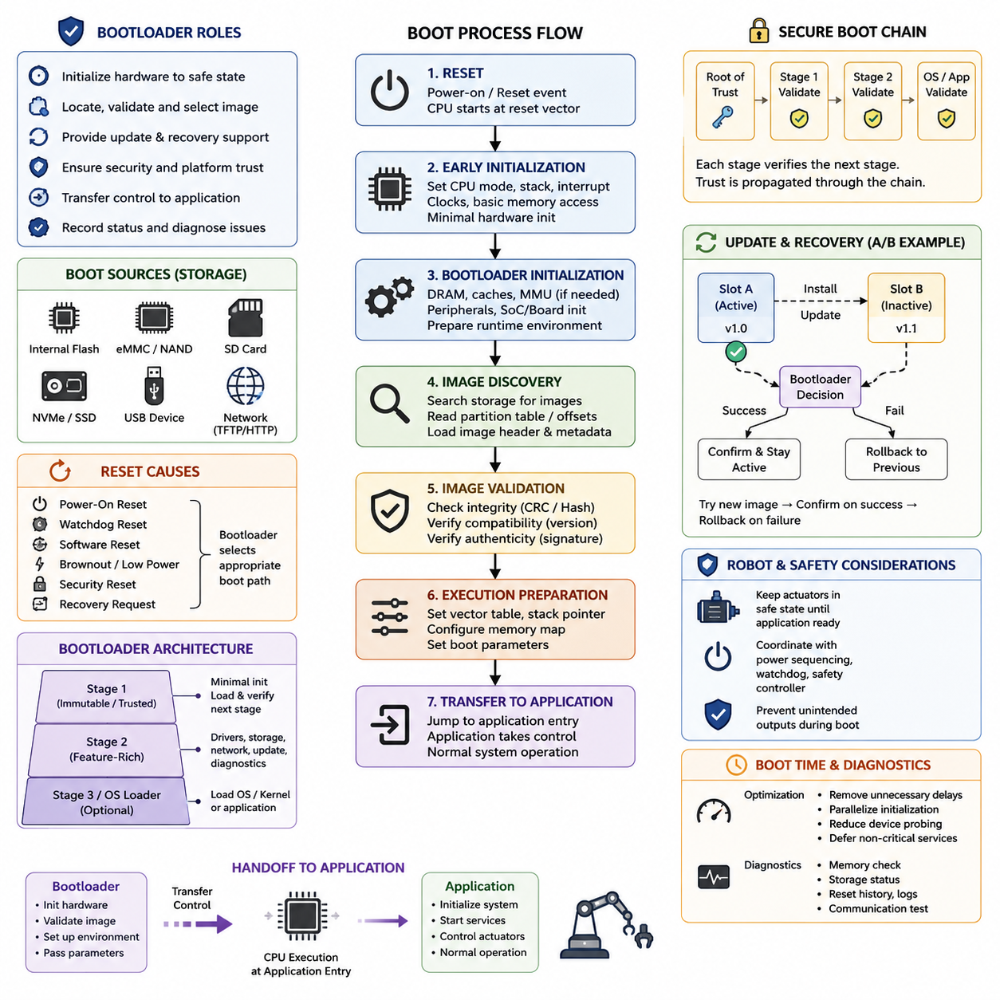
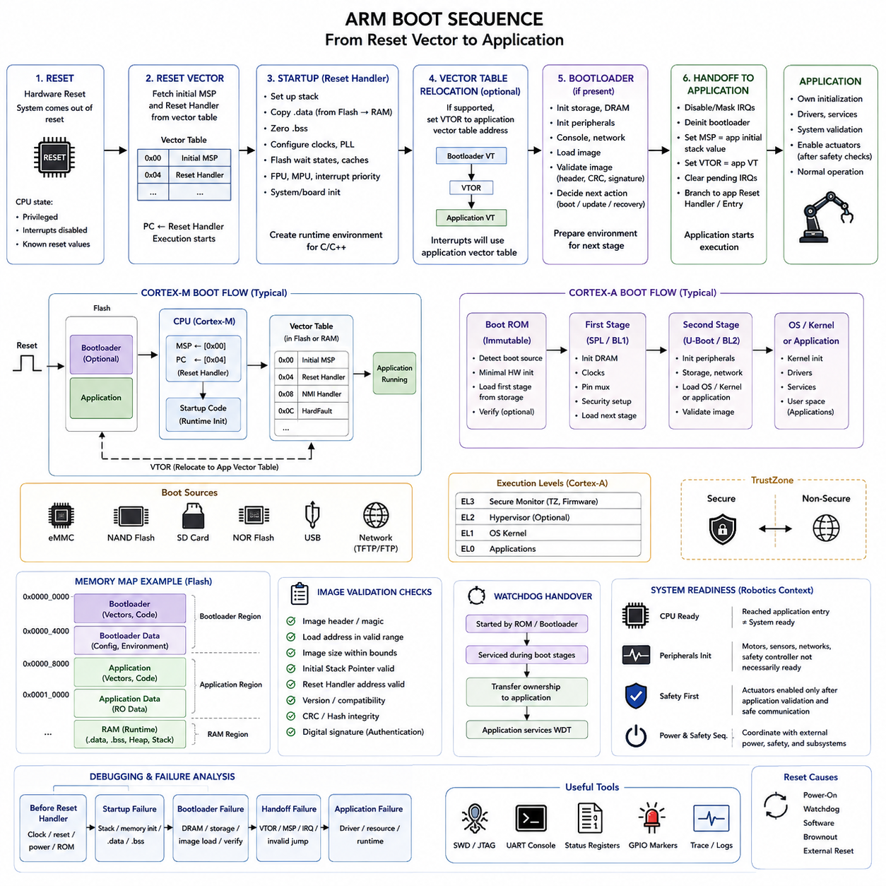
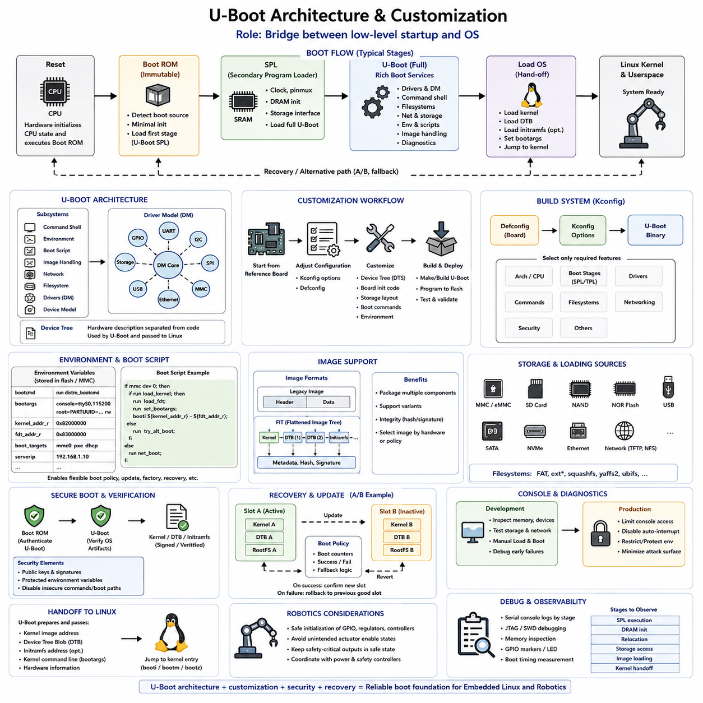
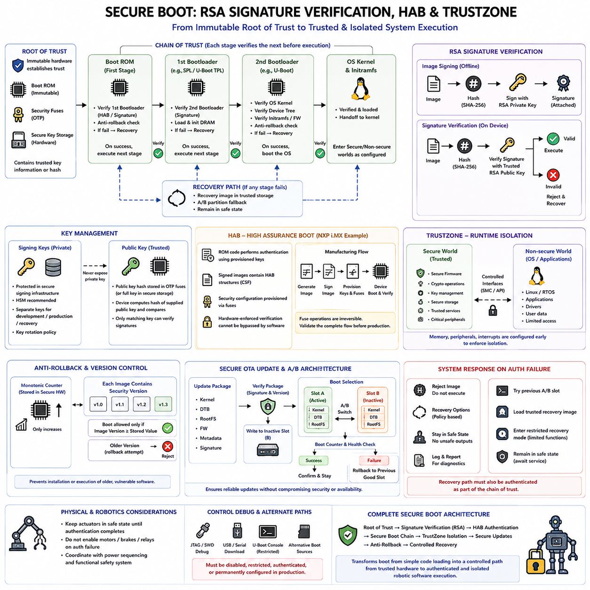
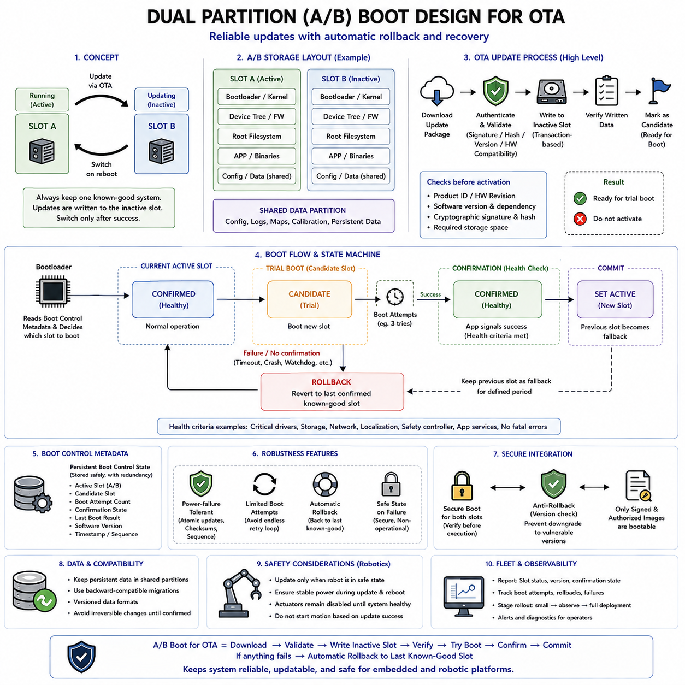
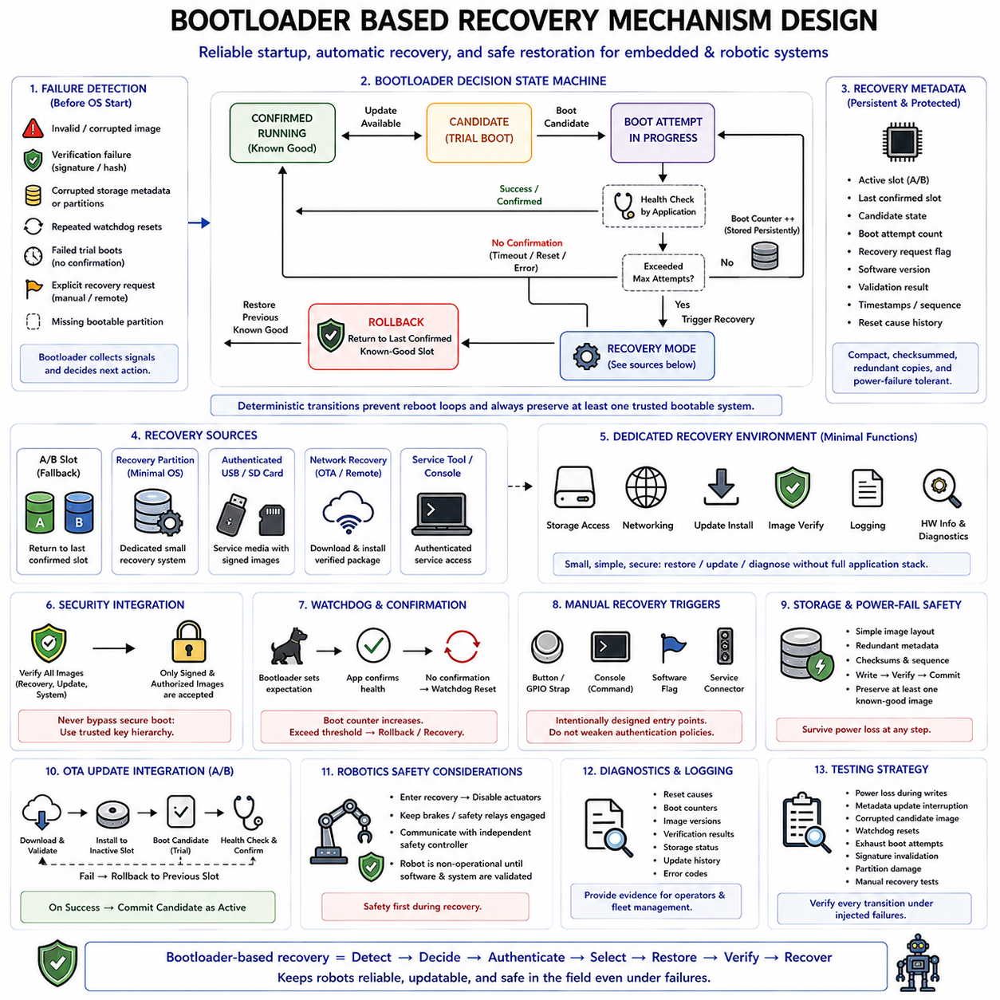
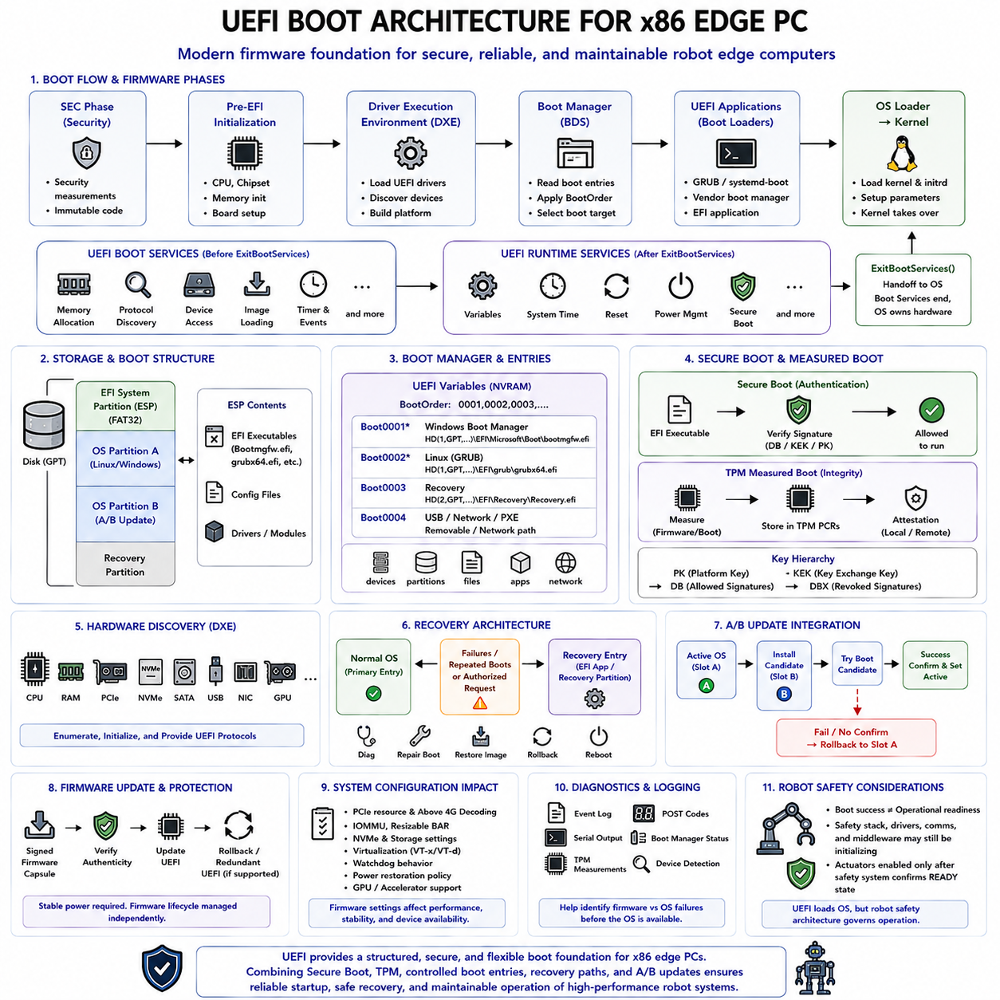
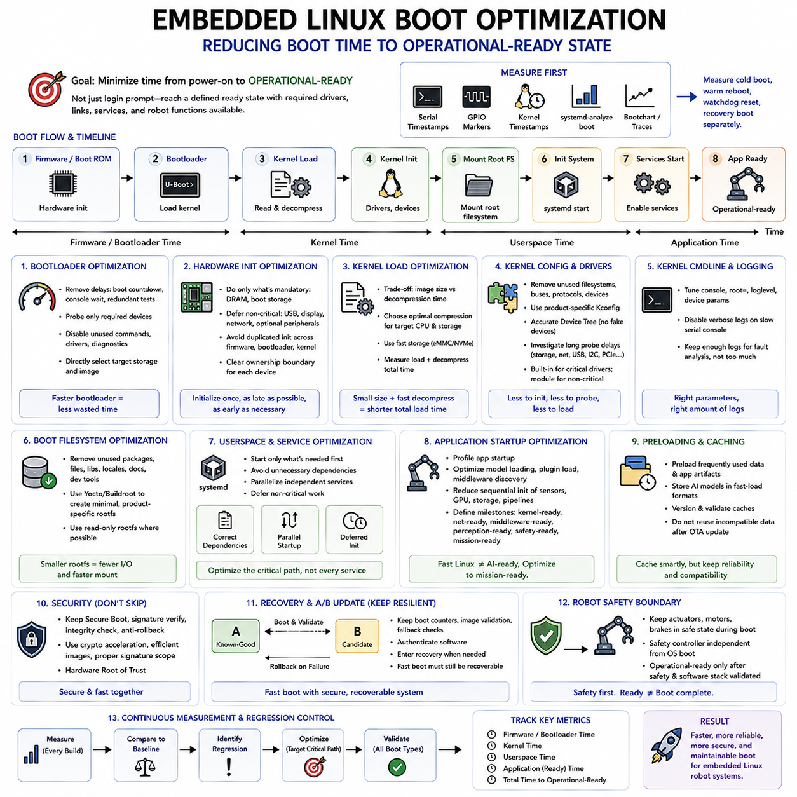
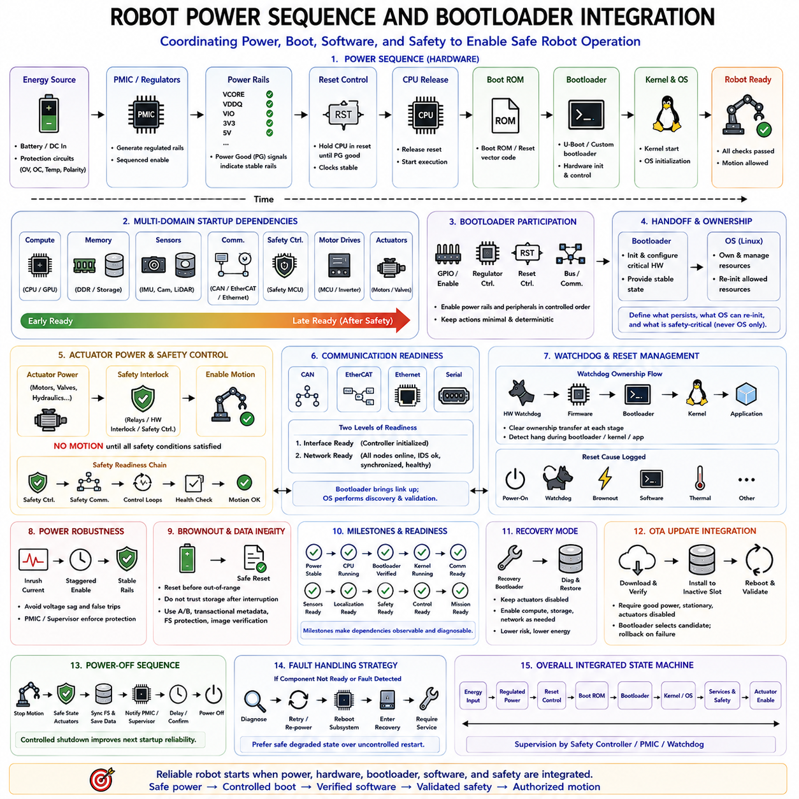
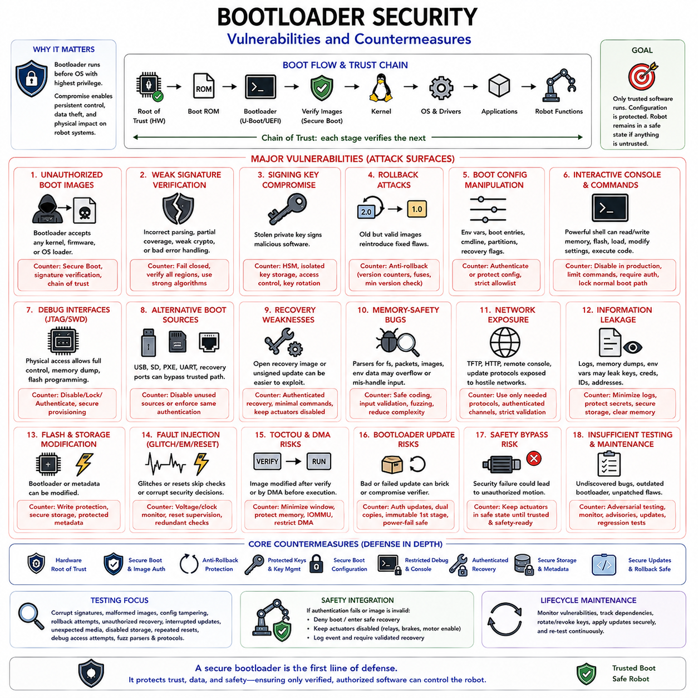

**Volume 02 Embedded Software Engineering**

# 04. Bootloader Architecture

## 04.01 Bootloader Role and Boot Sequence Principles

{width="7.268055555555556in" height="7.268055555555556in"}

A bootloader is the first software component that establishes a controlled execution environment after an embedded processor leaves reset. Its purpose is not simply to start the main application, but to bridge the gap between hardware-defined reset behavior and software-defined system operation. In robotic embedded systems, this transition must be predictable because controllers, sensors, communication interfaces, safety circuits, and higher-level computing modules may depend on a coordinated startup process.

When power is applied or a reset event occurs, the processor begins execution from an architecture-defined reset location. At this stage, most of the runtime environment expected by application software does not yet exist. Clock sources may still use conservative defaults, external memory may be unavailable, peripherals may be inactive, and volatile memory contains no reliable application state. The earliest boot code therefore operates under strict assumptions and performs only the initialization required to make subsequent execution safe and deterministic.

A fundamental boot sequence can be understood as a progression from reset handling to hardware initialization, image validation, execution preparation, and application transfer. The exact implementation differs among microcontrollers, application processors, and embedded PCs, but the architectural principle remains similar. Each stage establishes conditions required by the next stage, reducing uncertainty until the complete firmware, operating system, or robot application environment can execute normally.

Early initialization commonly establishes processor mode, stack configuration, interrupt behavior, clocking, memory access, and essential hardware state. On simple microcontrollers, these operations may be followed almost immediately by application startup. More capable processors often require initialization of DRAM controllers, caches, memory management hardware, storage interfaces, and board-specific devices before a large software image can be loaded. This difference explains why bootloaders range from very small MCU programs to sophisticated multi-stage software systems.

Bootloaders also define how executable images are discovered and represented. Firmware may reside directly in internal flash, while larger embedded systems may load images from eMMC, SD cards, NAND or NOR flash, NVMe storage, USB devices, or network sources. The bootloader must understand enough of the storage layout to locate the intended image and determine where it should execute. Partition tables, fixed offsets, image headers, metadata, and configuration records therefore become part of the overall boot architecture.

Image validation is another central responsibility because transferring control to corrupted or incompatible software can leave a robot in an unpredictable state. Basic implementations may verify a magic value, image length, version field, checksum, or CRC. More advanced systems extend validation to cryptographic hashes and digital signatures. These mechanisms separate the question of whether an image can be read from the more important questions of whether it is intact, compatible, and authorized to execute.

The bootloader must maintain a clearly defined boundary between its own execution context and that of the application. Before transferring control, it may configure the application\'s vector table, initial stack pointer, processor privilege state, memory mappings, interrupt state, and boot parameters. Residual bootloader configuration must either be intentionally inherited or returned to an agreed state. Otherwise, the application may behave differently depending on how the preceding boot stage happened to configure the hardware.

Boot architecture frequently uses multiple stages when a single program cannot perform every startup function efficiently. A small immutable or highly trusted first stage can initialize only the resources needed to locate and verify a larger second stage. The second stage can then provide storage drivers, configuration processing, networking, diagnostics, recovery functions, or operating-system loading. This staged model reduces the complexity of the earliest trusted code while allowing later stages to support richer platform functionality.

Reset cause is important because not every boot begins from the same system condition. Power-on reset, watchdog reset, software reset, brownout, security reset, and recovery requests may require different behavior. A robust bootloader records or interprets the reset reason and selects an appropriate path. For example, repeated watchdog resets may indicate that the current application cannot start successfully, while an explicit maintenance request may instruct the system to remain in update or diagnostic mode instead of launching normal operation.

Bootloaders are closely connected to firmware update architecture. Because the running application cannot always safely replace itself, the bootloader can provide an independent environment for installing or activating new software. Update metadata may identify the active image, candidate image, version, integrity information, and previous known-good state. This separation becomes especially valuable for robots deployed remotely, where a failed firmware update must not permanently disable a controller or require immediate physical service.

Reliable designs therefore distinguish image installation from successful activation. A newly written image can first be verified and marked as a candidate, then booted under controlled conditions. Only after the application demonstrates successful startup should the system confirm it as valid. If boot attempts repeatedly fail, the bootloader can return to a previous image or recovery environment. Such principles provide the conceptual foundation for dual-partition A/B boot architectures and rollback mechanisms used in dependable OTA systems.

Security extends the bootloader from a startup mechanism into an enforcement point for platform trust. If an attacker can replace executable software before normal security controls become active, protections implemented by the operating system or application may be bypassed. A secure boot chain therefore begins from a trusted element that verifies the next executable stage, which subsequently verifies another stage. Trust is propagated through the sequence rather than being assumed after the system has already started.

Robotic systems place additional requirements on boot behavior because software startup interacts with physical actuators. Motor drivers, brakes, manipulators, propulsion systems, and other hazardous outputs should remain in defined safe states until the software responsible for controlling them has been validated and initialized. The bootloader or associated startup hardware must avoid unintended output transitions and should coordinate with watchdogs, safety controllers, and power sequencing logic before operational authority is transferred.

Boot-time diagnostics can improve maintainability without turning the bootloader into a full application environment. Memory checks, storage status, firmware metadata, reset history, board identification, and essential communication diagnostics can help determine why a system failed to start. However, every additional feature increases bootloader complexity and attack surface. Good architecture therefore keeps early boot functions minimal while placing nonessential diagnostics and services in later, more replaceable software layers.

Boot time itself is an architectural consideration. A robot controller may need to recover rapidly after power interruption or reset, but shortening startup by skipping necessary initialization or validation can compromise reliability. Boot optimization should instead remove unnecessary delays, parallelize independent initialization where hardware permits, avoid redundant device probing, and defer noncritical services. The objective is not simply the shortest possible boot time, but the shortest startup path that preserves required safety, integrity, and deterministic behavior.

A well-designed bootloader ultimately provides a controlled chain from uncertain hardware reset state to trusted application execution. Its responsibilities combine initialization, image selection, validation, recovery, update support, security enforcement, and transfer of control. Within the broader embedded software structure, these principles establish the foundation for ARM-specific boot flows, U-Boot customization, secure boot, A/B updates, recovery mechanisms, UEFI, boot-time optimization, robot power sequencing, and bootloader security discussed in subsequent topics.

## 04.02 ARM Boot Sequence: Reset Vector to Application

{width="7.268055555555556in" height="7.268055555555556in"}

On an ARM-based embedded system, the boot sequence begins when reset logic places the processor into a defined architectural state and determines the first executable address. The processor does not immediately run the robot application or operating system. Instead, hardware-defined reset behavior establishes the initial execution context from which startup software can configure memory, clocks, security state, interrupts, and other resources required by later software stages.

For ARM Cortex-M microcontrollers, the vector table provides the fundamental connection between reset and software execution. The beginning of the vector table normally contains the initial Main Stack Pointer value followed by the address of the Reset Handler. After reset, the processor obtains these values and begins executing the reset routine. This compact mechanism allows a microcontroller to transition rapidly from hardware reset into deterministic firmware initialization.

The Reset Handler is responsible for creating the runtime conditions expected by compiled C or C++ software. At this point, initialized global variables cannot simply be assumed to exist in RAM, and uninitialized variables may contain arbitrary values. Startup code therefore copies initialized data from its load location in nonvolatile memory into RAM and clears the BSS region so that zero-initialized variables satisfy the language runtime assumptions.

Before application code executes, processor-specific initialization may also configure clock sources, phase-locked loops, flash wait states, cache behavior, floating-point hardware, memory protection, and interrupt priorities. The exact order is important because changing the processor clock before configuring flash timing or voltage conditions can produce unstable execution. Startup software must therefore follow the dependencies defined by the MCU, SoC, board design, and selected operating frequency.

The Vector Table Offset Register, where supported, allows the interrupt vector table to be relocated from its original boot address to another memory region. This capability becomes particularly important when a bootloader and application occupy different flash regions. The bootloader can use its own vectors during startup and later configure the processor so that exceptions and interrupts are dispatched through the application\'s vector table after control is transferred.

Application processors based on ARM Cortex-A cores typically require a more elaborate boot path than Cortex-M devices. A processor may begin with immutable Boot ROM code provided by the silicon vendor. This ROM determines the configured boot source, initializes a minimal hardware subset, and locates an executable first-stage image. Boot sources can include flash, eMMC, SD storage, USB recovery interfaces, or other platform-specific mechanisms.

The first software stage loaded by Boot ROM is normally constrained by the limited hardware environment available at that time. External DRAM may not yet be usable, so early code may execute from internal SRAM or another small memory region. Its primary responsibility is to perform enough low-level initialization to enable larger subsequent stages, especially DRAM initialization, clock configuration, pin multiplexing, and access to persistent storage.

Once DRAM becomes available, a larger bootloader stage can establish the environment required for operating-system or application loading. This stage may initialize storage controllers, network interfaces, serial consoles, caches, memory management facilities, and board-specific peripherals. On embedded Linux platforms, software such as U-Boot commonly occupies this role, although the exact sequence depends on the processor vendor and platform architecture defined for the target system.

ARM boot flows must also account for processor privilege and execution levels. Cortex-A architectures can provide multiple Exception Levels that separate secure firmware, hypervisors, operating-system kernels, and applications. Early firmware determines which execution state is entered by later software and configures architectural resources accordingly. Incorrect privilege transitions can prevent the kernel from starting or unintentionally expose resources that should remain isolated.

TrustZone-capable ARM platforms introduce another dimension by separating Secure and Non-secure execution environments. Secure startup code can establish memory attribution, peripheral access permissions, trusted firmware services, and security boundaries before handing execution to less privileged software. The boot sequence therefore becomes not only a hardware initialization process but also a mechanism for establishing the security architecture that remains active throughout system operation.

When a bootloader is present on a Cortex-M system, transferring control to the application requires more than calling an ordinary function. The bootloader must identify the application\'s vector table, obtain the application\'s initial stack pointer, obtain its Reset Handler address, and prepare the processor state for the transition. Interrupts and peripherals owned by the bootloader must also be handled carefully so that they do not unexpectedly remain active after the application begins.

A robust handoff commonly disables or masks relevant interrupts, stops unnecessary bootloader services, clears pending interrupt conditions where appropriate, and establishes the application\'s vector table location. The Main Stack Pointer is then loaded with the application\'s initial stack value, and execution branches to the application\'s Reset Handler or defined entry point. From the application\'s perspective, the resulting environment should closely match the startup conditions assumed by its firmware architecture.

The linker configuration is fundamental to this process because it defines where the bootloader, application, vector table, executable code, constants, initialized data, and runtime memory regions reside. If a bootloader occupies the beginning of flash, the application must normally be linked for a different address. The bootloader and application must therefore share an explicit memory-map contract rather than independently assuming ownership of the same physical addresses.

Image validation should occur before the ARM application entry point is trusted. The bootloader can inspect image metadata, address ranges, stack-pointer validity, version information, integrity values, and cryptographic authentication data. A malformed Reset Handler address or invalid stack location may indicate corruption even before deeper verification occurs. These checks help prevent an invalid image from converting a recoverable boot problem into uncontrolled processor execution.

Watchdog behavior must also be considered throughout the sequence. A watchdog started by Boot ROM, safety firmware, or the bootloader may remain active when later software begins. Startup stages must either service it within defined timing constraints or intentionally transfer responsibility to the next stage. In robotic controllers, this ownership transition should be explicit because unexpected watchdog expiration during actuator initialization can repeatedly reset the system and prevent normal recovery.

ARM-based robotic systems often coordinate processor boot with external power and safety sequencing. The main CPU may start while motor controllers, sensors, communication networks, and safety processors are still initializing. Software should therefore distinguish processor readiness from system readiness. Reaching the application entry point does not automatically mean that actuators may be enabled; the application must complete its own validation and establish safe communication with dependent subsystems.

Debugging an ARM boot failure requires identifying the exact stage at which execution stops. A failure before the Reset Handler suggests different causes from a fault during memory initialization, vector relocation, DRAM setup, image verification, or application handoff. SWD, JTAG, serial traces, boot status registers, reset-cause registers, GPIO markers, and carefully placed diagnostic messages can provide evidence without requiring the complete application environment to operate.

The complete ARM boot sequence can therefore be viewed as a controlled transformation of processor state. Hardware reset establishes the architectural starting point; the reset vector selects initial software execution; startup code establishes the language and memory environment; bootloader stages initialize and validate the platform; and the final handoff installs the application\'s execution context. This progression provides the foundation for secure boot, recovery, OTA updates, and reliable robotic startup.

## 04.03 U-Boot Architecture and Customization [w/Code]

{width="7.268055555555556in" height="7.268055555555556in"}

U-Boot is a widely used open-source bootloader for embedded systems, particularly ARM-based SoCs running embedded Linux. It occupies the transition between low-level processor startup and the operating system, providing hardware initialization, image loading, configuration, diagnostics, and recovery capabilities. In robotics, U-Boot often becomes the platform-level control point that prepares an embedded compute board before Linux and robot software services begin execution.

A typical U-Boot boot path is divided into stages because the processor initially has access to only limited memory and hardware resources. Boot ROM normally executes first and loads a small initial U-Boot component into internal SRAM. This early stage performs the minimum initialization necessary to enable DRAM and other essential resources. After external memory becomes available, a larger U-Boot image can execute with substantially richer functionality.

On many platforms, the small initial component is called SPL, or Secondary Program Loader. Some systems introduce an additional TPL stage when initialization must be divided further because internal SRAM is extremely constrained. SPL commonly establishes clocks, pin multiplexing, DRAM, and the storage interface needed to locate the full U-Boot image. Keeping this stage compact reduces memory requirements while separating essential startup logic from feature-rich boot services.

The full U-Boot stage provides a command environment and a collection of reusable subsystems for storage, networking, filesystems, device discovery, image handling, environment variables, and operating-system startup. Instead of embedding every board operation into a single monolithic routine, U-Boot organizes functionality through drivers, commands, configuration options, and architecture-specific code. This modular organization enables the same framework to support many processors and embedded boards.

Modern U-Boot increasingly uses the Driver Model to represent hardware devices through structured classes and drivers. Devices such as GPIO controllers, serial ports, I2C buses, SPI controllers, Ethernet interfaces, MMC devices, and storage controllers can be discovered and initialized through common interfaces. Device Tree information further separates hardware description from much of the executable code, making board variations easier to maintain without duplicating complete bootloader implementations.

Board customization normally begins with an existing configuration that closely matches the target processor and hardware platform. Developers then adjust configuration options, Device Tree definitions, board initialization code, storage layouts, boot commands, and environment settings. This approach is preferable to creating an entirely independent U-Boot port because vendor and upstream implementations already contain processor initialization, peripheral drivers, and architectural conventions that can be reused.

The U-Boot build system uses architecture and board configuration information to determine which features are included in the resulting binary. A defconfig file provides a baseline configuration, while Kconfig options control individual subsystems and capabilities. Developers can enable only the drivers, commands, filesystems, security functions, and networking features required by the product, helping balance functionality against flash size, RAM consumption, boot time, maintenance complexity, and attack surface.

Device Tree customization is especially important when U-Boot must understand board-specific hardware before Linux starts. Nodes can describe memory, UARTs, GPIO signals, regulators, Ethernet interfaces, storage controllers, buses, and connected peripherals. U-Boot may use its own Device Tree during initialization and later provide a Device Tree Blob to the Linux kernel. Correct configuration is therefore necessary to maintain consistency between bootloader-level hardware preparation and kernel-level device management.

Environment variables provide a flexible mechanism for controlling U-Boot behavior without rebuilding the entire bootloader. Variables can define console parameters, kernel command lines, image locations, network addresses, partition identifiers, boot targets, and scripts. The bootcmd variable commonly determines the default sequence executed after the boot delay. Carefully designed environments allow a product to change deployment or recovery behavior while keeping executable bootloader code relatively stable.

Boot scripts can combine U-Boot commands into repeatable startup logic. A script may inspect storage, select a partition, load a kernel image, load a Device Tree, prepare boot arguments, and launch Linux. More advanced logic can inspect update status, boot counters, hardware variants, or recovery flags before deciding which image should run. For robotic products, this makes startup policy explicit and allows normal, maintenance, factory, and recovery boot paths to share a common framework.

U-Boot can load software from many storage and communication mechanisms, including MMC, eMMC, SD cards, NAND, NOR, USB, SATA, NVMe, Ethernet, and network protocols supported by the target configuration. Filesystem support allows images to be loaded from FAT, ext-family filesystems, or other supported formats. This flexibility is valuable during development, but production configurations should generally disable unnecessary boot sources to reduce complexity and unauthorized execution paths.

Linux startup requires U-Boot to prepare several pieces of information before transferring control. Depending on the platform, it loads the kernel, Device Tree Blob, and optionally an initial RAM filesystem into suitable memory locations. It also constructs the kernel command line and provides information about the target hardware. Memory addresses must be selected carefully so that the kernel, Device Tree, initramfs, decompression workspace, and U-Boot runtime data do not overwrite one another.

U-Boot supports multiple image representations, including conventional kernel images and structured formats such as FIT, the Flattened Image Tree. FIT can package or describe multiple components and associate them with hashes or cryptographic signatures. This is useful when a product must manage a kernel, Device Tree variants, firmware components, or configuration alternatives as a coordinated boot artifact. Image metadata also enables the bootloader to select software appropriate for a particular hardware configuration.

Customization for secure products extends beyond simply loading the correct image. U-Boot can participate in a verified boot chain in which earlier trusted firmware authenticates U-Boot and U-Boot subsequently verifies the operating-system artifacts it loads. Public keys, signed images, protected configuration, and controlled boot commands must be integrated consistently. Security can be weakened if an authenticated image path exists alongside an unrestricted console or an alternative unverified boot mechanism.

The interactive U-Boot console is extremely useful during board bring-up because engineers can inspect memory, test storage, configure network interfaces, read Device Tree information, and manually load images. The same capability may become a security concern in deployed robots. Production customization should therefore determine whether console access is required, how interruption of automatic boot is controlled, which commands remain available, and whether environment modification should be restricted or authenticated.

U-Boot also provides an effective foundation for recovery and OTA update architectures. Boot variables or persistent metadata can identify active and candidate software slots, count unsuccessful boots, and select a recovery image when normal startup repeatedly fails. In an A/B design, U-Boot can choose between two system partitions while leaving the previously working software available. Successful application startup can later confirm the candidate image and complete the update transaction.

Robotic platforms require additional attention to the boundary between U-Boot and physical system operation. U-Boot may configure GPIO pins, communication controllers, regulators, or other interfaces connected indirectly to actuators. Board initialization must therefore avoid unintended motor enable signals or unsafe peripheral states. Linux startup should occur while safety-critical outputs remain controlled by dedicated hardware or explicitly defined safe states until higher-level software confirms system readiness.

Debugging a customized U-Boot implementation is most effective when the boot path is divided into observable stages. Serial console output can identify failures during SPL execution, DRAM initialization, relocation, storage access, Device Tree processing, image loading, or kernel handoff. JTAG, memory inspection, GPIO markers, and boot timing measurements can provide additional visibility when console output is unavailable. Early failures should be isolated before adding complex boot scripts or operating-system behavior.

A maintainable U-Boot architecture therefore treats customization as controlled platform integration rather than unrestricted modification of bootloader source code. Processor-specific initialization, SPL, Driver Model, Device Tree, Kconfig, environment variables, boot scripts, image verification, recovery policy, and Linux handoff should form a coherent startup design. This architecture provides a foundation for secure boot, A/B updates, recovery mechanisms, boot optimization, and reliable embedded Linux operation in robotic systems.

## 04.04 Secure Boot: RSA Signature Verification, HAB, TrustZone

{width="7.268055555555556in" height="7.268055555555556in"}

Secure boot establishes a cryptographic chain of trust from an immutable hardware-controlled starting point to the software that eventually operates the embedded system. Instead of assuming that code stored in flash, eMMC, or another boot medium is trustworthy, each boot stage verifies the authenticity and integrity of the next stage before execution. For robotic platforms, this prevents unauthorized firmware from gaining control of sensors, networks, safety functions, and actuators during startup.

The foundation of secure boot is the Root of Trust, which must exist in a component that ordinary software cannot freely modify. Depending on the processor, this may involve immutable Boot ROM, one-time programmable fuses, secure key storage, or hardware security logic. The Root of Trust contains or derives the information needed to recognize authorized software, allowing the processor to make its first security decision before potentially untrusted code begins executing.

Digital signatures separate software authenticity from simple corruption detection. A checksum or CRC can detect accidental changes but can normally be recalculated by an attacker after modifying an image. Secure boot instead uses asymmetric cryptography in which a private key is used during the controlled software release process to sign an image, while the embedded device uses corresponding trusted public-key information to verify that signature before accepting the image.

RSA is a widely recognized public-key algorithm used in secure boot implementations. During image preparation, a cryptographic hash such as SHA-256 is calculated over defined portions of the firmware or boot image. The signing system uses the protected RSA private key to generate a digital signature associated with that digest. The target device does not require possession of the private key; it requires only the trusted public-key material necessary to verify the signature.

Verification begins by calculating a new hash over the received or stored image using the same defined hashing procedure. The boot verification logic then evaluates the RSA signature with the trusted public key and determines whether the signed digest corresponds to the newly calculated digest. If they match according to the selected signature scheme, the image has both integrity and authenticity evidence. If verification fails, execution must not continue through the normal trusted boot path.

Key management is therefore as important as the RSA calculation itself. If an attacker obtains the signing private key, malicious software can potentially be signed so that it appears legitimate to deployed devices. Private keys should consequently be protected in controlled signing infrastructure, preferably using hardware-backed key protection where appropriate. Development keys, production keys, recovery keys, and key-rotation policies should also be separated according to the product security lifecycle.

The trusted public key must also be anchored securely on the device. Some processors store a hash of the authorized public key in one-time programmable memory rather than storing the complete key directly in fuses. During boot, the supplied public key is hashed and compared with the trusted fused value before being used for signature verification. This approach creates a compact hardware binding between a manufactured device and the software-signing authority permitted to control it.

A chain of trust extends verification beyond the first externally loaded image. Immutable Boot ROM can authenticate a first-stage bootloader, which can authenticate a second-stage bootloader, which can then verify a kernel, Device Tree, initramfs, firmware package, or other executable component. Each verified stage becomes responsible for preserving the trust established by the previous stage. One unverified executable path can undermine the security assumptions of the entire sequence.

High Assurance Boot, commonly associated with NXP i.MX platforms as HAB, provides a hardware-supported framework for authenticating boot images. The processor\'s Boot ROM participates in verification using security configuration and trusted key information provisioned into the device. Signed boot images contain the structures required for authentication, allowing ROM-level code to determine whether an image is authorized before transferring execution to software stored in externally modifiable memory.

HAB-based designs typically integrate image generation, signing, key provisioning, device configuration, and boot-time authentication into a coordinated manufacturing and release process. Provisioning security fuses is particularly sensitive because many fuse operations are irreversible. Development systems should therefore validate the complete signing and authentication flow before production security configuration is permanently committed. Incorrect provisioning can prevent otherwise functional hardware from booting authorized software.

Secure boot must also define what happens when authentication fails. Simply rejecting an image is necessary but may not be sufficient for an operational robot. The platform may enter a restricted recovery mode, attempt a previously verified A/B partition, load a trusted recovery image, or remain in a safe non-operational state. Recovery software must itself belong to the authenticated chain; otherwise, an attacker could deliberately trigger failure and exploit an unsecured recovery path.

ARM TrustZone complements secure boot by providing hardware-supported separation after authenticated software begins executing. TrustZone divides system resources into Secure and Non-secure worlds or security states, depending on the ARM architecture. Secure firmware can protect cryptographic operations, key material, security configuration, and selected peripherals while allowing a general-purpose operating system and applications to execute with more restricted access in the Non-secure environment.

Secure boot and TrustZone solve related but different problems. Secure boot answers whether software is authorized to execute during startup, while TrustZone helps control what software can access after execution begins. A correctly signed operating system should not automatically receive unrestricted access to every security-sensitive resource. Secure-world firmware can retain ownership of keys, trusted services, secure storage, or critical configuration and expose only controlled interfaces to Non-secure software.

TrustZone configuration must occur early enough that untrusted software never temporarily receives access to protected resources. Memory regions, peripheral security attributes, interrupt routing, and execution states should be configured before control reaches the Non-secure operating system. On Cortex-A systems, trusted firmware commonly participates in establishing these boundaries and managing transitions between security states, while Cortex-M TrustZone implementations provide related isolation mechanisms for microcontroller-class systems.

Anti-rollback protection is another important extension of secure boot. A correctly signed image may still contain an old vulnerability, so signature verification alone does not guarantee that the software version is acceptable. Secure version counters, monotonic values, or protected rollback indexes can prevent installation or execution of software older than the minimum authorized security version. This allows compromised historical releases to be revoked without invalidating the overall signing architecture.

Secure OTA updates must preserve the same trust principles used during initial boot. An update package should be authenticated before activation, written to controlled storage, and verified again as required before execution. In an A/B architecture, the existing trusted image can remain available until the candidate software successfully boots. Signature verification, rollback protection, boot counters, and recovery policy together prevent update failure from becoming either a security bypass or a permanent availability failure.

Robotic systems add a physical consequence to secure boot design because compromised startup software can affect motion and interaction with the environment. Actuator-enable signals should remain in safe states while authentication is incomplete, and failure of boot verification should not accidentally release brakes, energize motors, or bypass an independent safety controller. Security failure handling must therefore be coordinated with the robot\'s power sequencing and functional safety architecture.

Debug interfaces and development features require similar attention. JTAG, SWD, serial download modes, USB recovery, unrestricted U-Boot consoles, or alternative boot sources can provide paths around an otherwise strong verified boot chain. Production devices should establish an explicit policy for these mechanisms, disabling, restricting, authenticating, or permanently configuring them according to service requirements. Secure boot is effective only when alternative execution paths are controlled consistently.

A complete secure boot architecture therefore combines hardware Root of Trust, protected key provisioning, cryptographic hashing, RSA signature verification, authenticated boot stages, controlled recovery, rollback protection, and runtime isolation. Technologies such as HAB establish trust during the early boot process, while ARM TrustZone can preserve security boundaries after startup. Together, these mechanisms transform boot from simple software loading into a controlled transition from trusted hardware to authenticated and isolated robotic software execution.

## 04.05 Dual Partition A/B Boot Design for OTA

{width="7.268055555555556in" height="7.268055555555556in"}

Dual-partition A/B boot architecture is a reliability mechanism designed to make over-the-air firmware and operating-system updates resilient to interruption or software failure. Instead of replacing the currently running system in place, the device maintains two independently bootable software slots, commonly called Slot A and Slot B. One slot remains active while the other receives the candidate update, preserving a known bootable system during the update process.

The central principle is separation between the running image and the image being modified. If Slot A is currently active, the OTA service downloads and installs the new software into inactive Slot B without overwriting Slot A. Power loss, network interruption, storage errors, or incomplete installation can therefore leave the existing operational image intact. Only after the candidate slot has been completely written and validated does the system consider changing the next boot target.

An A/B storage layout may duplicate the kernel, root filesystem, Device Tree, boot firmware, or other platform components according to system requirements. Some designs maintain complete system images in both slots, while others duplicate only components that must be atomically updated. Shared data partitions can hold configuration, logs, robot maps, calibration data, and persistent application information that should survive switching between software slots.

Partition design must carefully distinguish immutable software artifacts from persistent state. If application data is embedded directly inside a slot-specific root filesystem, switching slots may unintentionally restore outdated configuration or lose newly generated information. Persistent robot identity, calibration, update metadata, and operational data should therefore be placed in explicitly managed storage regions whose compatibility with both the old and new software versions is understood.

OTA processing normally begins by obtaining an authenticated update package and determining whether it is appropriate for the target hardware and current software state. The updater can verify product identifiers, hardware revisions, software versions, cryptographic signatures, hashes, package dependencies, and required storage capacity. These checks should occur before activation so that an incompatible or corrupted image does not become the next boot candidate.

Writing the inactive slot should be treated as a transactional operation rather than evidence that the update has succeeded. Individual partitions or image components may be written, synchronized, and verified after storage. The system should not mark the new slot as bootable until all required components have passed integrity checks. Update metadata must accurately represent whether a slot is empty, incomplete, candidate, active, confirmed, invalid, or otherwise eligible for boot selection.

After successful installation, the bootloader is instructed to attempt the candidate slot during a subsequent reboot. This decision is usually represented through bootloader environment variables, dedicated metadata, boot-control structures, or platform-specific persistent state. The active slot should not be permanently replaced merely because the bootloader successfully jumped to the new kernel. Reaching an application entry point is only the beginning of determining whether the update is operationally valid.

A trial boot therefore introduces a distinction between bootable and confirmed software. The candidate image may be cryptographically valid and structurally complete yet still fail because of driver incompatibility, service startup errors, configuration migration problems, resource exhaustion, or application faults. During the trial period, the bootloader or update framework maintains enough state to recognize that the candidate has not yet demonstrated successful system operation.

Boot counters provide a practical mechanism for limiting repeated attempts to start a defective candidate. Before booting the trial slot, persistent metadata can record an attempt or decrement a remaining-attempt counter. If the operating system fails to reach the confirmation condition and resets repeatedly, the bootloader eventually stops selecting that slot. The previously confirmed slot can then be restored automatically without requiring physical access to the deployed robot.

Confirmation should represent meaningful system health rather than simply elapsed time after kernel startup. A robotic platform may require successful initialization of critical drivers, storage, network interfaces, localization components, safety controllers, and required application services before declaring the new image healthy. The confirmation policy should be strict enough to detect unusable updates while avoiding dependencies on optional services that could unnecessarily trigger rollback.

Once the candidate satisfies the defined health criteria, software records a successful boot confirmation in persistent boot-control state. The candidate slot then becomes the new confirmed active slot, and the previous slot can remain available as a fallback for a defined period or until the next update. This explicit commit operation completes the OTA transaction and prevents later unrelated resets from being incorrectly interpreted as evidence that the update failed.

Rollback is the complementary operation that restores service when the candidate cannot be confirmed. The bootloader selects the previous known-good slot, records the failure state of the candidate, and resumes operation using trusted software. Rollback policy should prevent an endless cycle in which the system alternates between two defective states. Failed slots, attempt counters, recovery conditions, and operator intervention requirements must therefore be represented explicitly.

A/B boot architecture must integrate with secure boot rather than operate as an independent reliability mechanism. Both Slot A and Slot B should be subject to the same authentication policy, and switching partitions must never provide a path around signature verification. The bootloader should authenticate the selected image before execution, while anti-rollback rules determine whether a correctly signed but obsolete version remains authorized under the current security policy.

Power-failure tolerance is essential because OTA updates frequently involve large writes to flash or eMMC. Metadata updates should be designed so that interruption cannot leave contradictory information about which slot is active or confirmed. Redundant metadata copies, checksums, sequence numbers, atomic storage operations, and carefully ordered state transitions can help the bootloader recover a consistent decision after unexpected power loss at any point in the installation or activation process.

Bootloader and updater responsibilities must be clearly separated. The OTA application typically downloads packages, performs high-level validation, writes the inactive slot, and requests activation. The bootloader should make the final boot selection using small, robust metadata and enforce attempt limits, authentication, and fallback policy. Keeping the boot decision independent from the newly installed operating system allows recovery even when that operating system cannot initialize successfully.

U-Boot-based platforms can implement A/B selection using environment variables, boot scripts, boot counters, partition identifiers, and verified image-loading commands. A boot script can inspect slot state, choose the candidate or confirmed partition, load its kernel and Device Tree, and update attempt information before execution. Production implementations should protect this state from unauthorized modification because manipulating boot variables could otherwise redirect execution or defeat update policy.

A/B updates also require careful handling of data-format compatibility. After a new software version modifies a shared database or configuration format, the previous slot may no longer understand that persistent state during rollback. Update design should therefore consider backward-compatible migrations, versioned data formats, deferred irreversible conversion, or recovery procedures. Software rollback is only useful when the restored version can still operate with the persistent data it encounters.

Robotic systems add operational safety requirements to the update lifecycle. A robot should normally perform installation and reboot only when motion can be safely interrupted, sufficient battery or external power is available, and the platform can tolerate temporary loss of services. During trial boot and rollback, actuator enablement should remain governed by normal safety validation. An OTA mechanism must never interpret successful software installation as permission to begin physical operation.

Fleet deployments further benefit from staged A/B activation. A new release can first be installed on a small subset of robots, observed for boot success and runtime health, and then progressively deployed to larger groups. Slot status, update version, confirmation state, rollback events, and failure causes should be reported to fleet management. This transforms A/B boot from a device-level recovery feature into part of a broader deployment assurance strategy.

A robust dual-partition design therefore treats OTA as a controlled state transition: download and authenticate the package, write the inactive slot, verify its contents, mark it as a candidate, perform a limited trial boot, evaluate system health, and either confirm the new slot or return to the previous known-good image. By preserving one trusted bootable system throughout the process, A/B architecture provides a fundamental reliability foundation for remotely maintained embedded and robotic platforms.

## 04.06 Bootloader-Based Recovery Mechanism Design

{width="7.268055555555556in" height="7.268055555555556in"}

A bootloader-based recovery mechanism provides an independent path for restoring an embedded system when the normal application, operating system, or update process can no longer start reliably. Because the bootloader executes before the main software stack, it can evaluate system state and select a recovery action without depending on the damaged software. In robotic systems, this capability is essential for reducing field service and preventing failed updates from permanently disabling deployed machines.

Recovery design begins by defining which failures can be detected before normal application execution. Typical indicators include an invalid application image, failed cryptographic verification, corrupted storage metadata, repeated watchdog resets, unsuccessful trial boots, explicit recovery requests, or missing bootable partitions. The bootloader combines these signals with persistent state to decide whether normal startup remains safe or whether execution should be redirected to a controlled recovery path.

A robust architecture distinguishes transient boot failure from persistent software failure. A single unexpected reset may result from temporary power instability and should not necessarily trigger recovery, while several consecutive failures strongly suggest that the active software cannot reach a healthy operating state. Persistent boot counters, reset-cause information, application confirmation flags, and watchdog history allow the bootloader to make this distinction using evidence that survives processor resets.

The recovery decision should be implemented as a deterministic state machine rather than a collection of loosely related boot commands. States may represent confirmed software, candidate software, failed boot attempts, rollback eligibility, recovery mode, and unrecoverable failure. Clearly defined transitions ensure that each reset produces a predictable decision and prevents the system from becoming trapped in uncontrolled reboot loops or repeatedly selecting an image already known to be defective.

Recovery can use several sources depending on the platform architecture. A dual-partition system may return to the previously confirmed A/B slot, while another design may maintain a dedicated recovery partition containing a minimal operating environment. Some systems also support authenticated USB, network, SD card, or service-tool recovery. Whatever source is selected, the recovery path should be simpler and more protected than the normal runtime environment so that it remains dependable during failures.

A dedicated recovery image should contain only the functions required to diagnose and restore the platform. It may provide storage access, networking, update installation, image verification, logging, hardware identification, and limited diagnostic services without loading the complete robot application stack. Minimizing the recovery environment reduces dependencies and attack surface while increasing the probability that it will still operate when the primary software configuration has become inconsistent.

Image integrity and authenticity must be enforced during recovery just as they are during normal boot. A recovery mechanism that accepts arbitrary unsigned software can become a direct bypass around secure boot. The bootloader should authenticate recovery images, update packages, and replacement system images using the same trusted key hierarchy or an explicitly authorized recovery key. Security failure must redirect the system toward another trusted state rather than unrestricted execution.

Recovery metadata is critical because the bootloader needs reliable information even when application storage is damaged. Metadata can describe the active image, last confirmed image, candidate state, boot attempt count, recovery request, software version, and validation result. This information should be compact, checksummed, and stored using a power-failure-tolerant method. Redundant copies and sequence numbers can help reconstruct the most recent valid state when one metadata update is interrupted.

Watchdog integration allows recovery logic to detect software that begins execution but never becomes healthy. Before launching the application, the bootloader can establish an expectation that the application will reach a defined checkpoint and confirm successful startup. If the watchdog resets the processor before confirmation, the persistent attempt counter indicates another failed boot. After a configured threshold, the bootloader can stop retrying the defective image and enter rollback or recovery automatically.

Recovery should distinguish successful boot from successful system operation. A Linux kernel may start correctly while critical robot services fail because of incompatible drivers, corrupted configuration, missing sensor interfaces, or application initialization errors. The recovery architecture should therefore allow higher-level software to report a health confirmation only after essential services become operational. Absence of this confirmation within a defined policy can be interpreted as an unsuccessful trial.

Manual recovery triggers are also useful during manufacturing, development, and field service. A hardware button, GPIO strap, service connector, authenticated console command, or persistent software flag can request recovery during the next boot. Such triggers should be intentionally designed rather than added as uncontrolled shortcuts. In production robots, physical or logical recovery entry must not provide an attacker with an easy method for bypassing normal authentication and boot restrictions.

Network recovery can be valuable for remotely deployed systems when local service access is difficult. A minimal recovery environment may establish a controlled network connection, obtain an authenticated software package, verify its compatibility and signature, and restore a bootable slot. However, networking substantially increases complexity, so recovery implementations should restrict protocols, endpoints, credentials, and commands to the minimum functionality required for trusted restoration.

Storage recovery must account for partial writes and filesystem corruption. Whenever possible, the bootloader should depend on simple image layouts and compact metadata rather than complex writable filesystems for its fundamental recovery decisions. If a partition cannot be mounted or an image cannot be verified, the system should still retain enough independent information to select another boot source. Recovery architecture is strongest when failures in one storage structure do not destroy every restoration path.

Power loss during recovery is a particularly important design case. Rewriting the only remaining valid image can convert a recoverable device into an unusable one. Restoration should therefore preserve at least one trusted boot path until the replacement image has been completely written and verified. A/B partitions, dedicated recovery images, transactional metadata updates, and write-then-verify procedures allow recovery operations to survive unexpected interruption without losing the last known-good state.

Bootloader recovery integrates naturally with OTA update architecture. The updater installs a candidate image, the bootloader performs a controlled trial boot, and the application confirms successful operation only after health checks pass. If confirmation never arrives, recovery logic selects the previous known-good slot. This division of responsibility allows the update software to remain feature-rich while keeping the final recovery decision inside a smaller and more dependable pre-application component.

U-Boot-based systems can implement recovery policies through boot counters, environment variables, scripts, partition selection, verified image commands, and dedicated recovery targets. Production designs should protect these controls against unauthorized modification and should avoid excessively complicated scripts. The recovery logic should remain understandable enough to test every important transition, including normal boot, failed candidate boot, rollback, corrupted image, recovery request, and repeated recovery failure.

Robotic recovery mechanisms must coordinate software restoration with physical safety. Entering recovery mode should normally prevent motion commands, keep actuators disabled, maintain brakes or safety relays in their defined states, and communicate appropriately with independent safety controllers. A robot that is repairing its software should be considered non-operational until both software integrity and system readiness have been re-established through the normal safety validation process.

Diagnostics are an important secondary function of recovery because operators need evidence explaining why normal boot failed. Reset causes, boot counters, image versions, verification results, storage status, update history, and error codes can be retained for local or remote inspection. Logs should be bounded and designed so that diagnostic storage failure does not prevent recovery itself. The primary objective remains restoration, while diagnostics provide the information needed to prevent recurrence.

Recovery testing should deliberately reproduce the failures that the architecture claims to tolerate. Tests should interrupt power during image writes and metadata updates, corrupt candidate images, trigger watchdog resets, exhaust boot attempts, invalidate signatures, damage selected partitions, and exercise manual recovery requests. A recovery mechanism cannot be considered dependable merely because its normal path works; its reliability is demonstrated by predictable behavior under intentionally injected faults.

A well-designed bootloader recovery mechanism therefore forms a protected control layer beneath the operating system and robot application. It detects persistent startup failure, evaluates trusted metadata, limits retries, authenticates available images, selects rollback or recovery paths, preserves a known-good system, and maintains physical safety during restoration. Combined with secure boot and A/B updates, it allows remotely deployed embedded and robotic platforms to recover from software faults without surrendering security or operational control.

## 04.07 UEFI Boot Architecture for x86 Edge PC

{width="7.268055555555556in" height="7.268055555555556in"}

Unified Extensible Firmware Interface, or UEFI, defines the firmware architecture that initializes modern x86 edge PCs and transfers control from platform hardware to the operating system. Unlike legacy BIOS, which depends heavily on fixed boot conventions and real-mode compatibility, UEFI provides structured interfaces, executable firmware applications, standardized boot services, persistent variables, and a flexible mechanism for discovering and launching operating-system boot loaders.

The x86 boot process begins immediately after processor reset, before Linux, Windows, or robotic middleware is available. Firmware establishes the processor execution environment and performs platform-specific initialization required to make memory and essential chipset resources usable. On an industrial edge PC, this stage must account for CPU configuration, memory controllers, PCIe topology, storage interfaces, watchdog hardware, management controllers, and board-specific power sequencing.

Modern firmware implementations commonly divide early initialization into several logical phases. A security-oriented initial phase establishes a trusted execution foundation, while pre-EFI initialization performs low-level processor, chipset, and memory initialization. After sufficient DRAM becomes available, the Driver Execution Environment can load firmware drivers and enumerate platform devices. These phases progressively transform the machine from reset state into a system capable of locating and launching a boot target.

During the Driver Execution Environment, UEFI discovers hardware and constructs the services required by later boot components. Firmware drivers can initialize PCI Express devices, NVMe controllers, SATA interfaces, USB controllers, network adapters, graphics hardware, and other platform resources. This hardware discovery is especially important for edge PCs because accelerator cards, industrial network interfaces, GPU devices, and high-speed storage may influence how the operating system is loaded and configured.

UEFI separates Boot Services from Runtime Services. Boot Services provide memory allocation, protocol discovery, device access, image loading, timers, and other capabilities required while firmware still controls the platform. Runtime Services are a smaller set of interfaces that remain accessible after the operating system takes control, supporting functions such as firmware variables, system time, and selected platform operations. This separation creates a defined boundary between firmware initialization and OS ownership.

The UEFI boot manager determines which executable image should be launched according to persistent firmware configuration. Boot entries are stored in nonvolatile variables and can identify specific devices, partitions, files, or alternative recovery paths. BootOrder defines the preferred sequence, while individual Boot#### entries describe particular boot targets. This mechanism allows an edge PC to maintain normal, maintenance, recovery, and removable-media boot options under an explicit firmware policy.

Modern x86 systems commonly use the GUID Partition Table, or GPT, together with an EFI System Partition. The EFI System Partition contains boot applications and related files in a filesystem that UEFI firmware can access directly. Instead of loading executable code from a fixed disk sector as traditional BIOS designs did, UEFI can locate a defined executable file such as an operating-system boot manager and load it as a firmware-recognized application.

For Linux-based edge computers, the selected EFI executable may be GRUB, systemd-boot, a vendor boot manager, or a directly bootable EFI-compatible kernel configuration. The boot manager identifies the selected operating system, prepares kernel parameters, and locates the kernel and optional initial RAM filesystem. Control then progresses from UEFI firmware to the OS loader and finally to the kernel, which initializes its own drivers and takes ownership of the machine.

The transition from firmware to the operating system is formalized through ExitBootServices. Before this call, the OS loader can use UEFI Boot Services for memory, device, and protocol operations. The loader obtains the firmware memory map and prepares the kernel environment, then invokes ExitBootServices when it is ready to assume control. Afterward, ordinary Boot Services are no longer available, and the operating system becomes responsible for managing hardware resources.

UEFI Secure Boot adds authentication to the executable loading process. Firmware maintains trusted signature databases and verifies EFI executables before allowing them to run under Secure Boot policy. This can create a chain from platform firmware through the operating-system boot loader and into later verified components. On an edge robotics computer, the objective is to prevent unauthorized boot software from gaining privileged control before the robot software security stack becomes active.

Secure Boot depends on a hierarchy of keys and signature databases rather than on the boot order alone. Platform Key, Key Exchange Keys, authorized signature databases, and forbidden or revoked signature information define which executables can be trusted or rejected. Production provisioning must protect these values and define how keys are updated or revoked. Incorrect key management can either weaken boot security or prevent legitimate field software from starting.

A Trusted Platform Module, or TPM, can complement UEFI Secure Boot through measured boot. Instead of only deciding whether an executable is allowed to run, measured boot records cryptographic measurements of firmware and boot components into protected TPM Platform Configuration Registers. Remote or local software can later evaluate these measurements to determine whether the machine started in an expected configuration, supporting device attestation and fleet security monitoring.

UEFI configuration also affects the reliability of industrial edge hardware. PCIe resource allocation, Above 4G Decoding, IOMMU settings, Resizable BAR support, NVMe configuration, virtualization extensions, watchdog behavior, and power restoration policies can influence GPU and accelerator availability after boot. Edge platforms containing high-performance GPUs or AI accelerators therefore require firmware settings to be treated as part of the deployed system configuration rather than informal technician preferences.

Boot-device selection must be controlled carefully in deployed robots. USB, network PXE, removable media, internal NVMe, and recovery devices may all be technically bootable, but enabling every path increases operational uncertainty and security exposure. Production firmware should define a restricted boot order and explicitly determine which alternative paths are permitted. Maintenance flexibility should be preserved without allowing uncontrolled software to replace the trusted operating environment.

Recovery architecture can use UEFI boot entries to maintain an independent restoration path. A primary operating-system entry may be preferred during normal operation, while another EFI application or recovery partition can be selected after repeated failures or by an authorized maintenance request. The recovery environment can diagnose storage, reinstall verified system images, repair boot configuration, or restore a known-good software state without requiring the normal robot application to function.

OTA updates on x86 edge PCs must consider both operating-system partitions and the UEFI boot configuration that selects them. A/B system partitions can be combined with independent EFI boot entries so that a candidate image is attempted without immediately destroying the previous known-good system. Successful startup can confirm the candidate, while repeated failures can redirect subsequent boots to the earlier slot or a dedicated recovery environment.

Firmware updates introduce another layer of risk because UEFI itself operates beneath the operating system. An interrupted or incompatible firmware update can prevent the edge PC from reaching any OS recovery mechanism. Industrial platforms therefore benefit from signed firmware capsules, protected update procedures, rollback or redundant firmware support where available, and stable external power during firmware modification. Firmware lifecycle management should be separated from ordinary application OTA policy.

Fast Boot options require careful evaluation in robotic systems. Reducing POST and device initialization can shorten recovery time after power cycling, but excessive optimization may skip hardware discovery or diagnostic behavior needed for reliable operation. Edge PCs with discrete GPUs, PCIe accelerators, multiple NVMe devices, or industrial interfaces should be validated under cold boot, warm reboot, watchdog reset, and unexpected power-loss conditions before aggressive startup optimization is enabled.

UEFI diagnostics provide valuable evidence when an edge PC fails before the operating system becomes available. Firmware event logs, POST indicators, serial output where supported, boot-manager status, TPM measurements, storage detection, and PCIe enumeration information can help distinguish firmware failure from OS failure. This separation is important in robotic deployments because a machine that appears offline may actually have failed long before Linux or fleet-monitoring software could generate application logs.

For robotic edge PCs, boot completion should remain distinct from operational readiness. UEFI may successfully load the operating system while GPU drivers, network links, localization services, safety communication, or robot middleware are still initializing. Actuator authorization should therefore remain governed by the robot safety architecture rather than firmware boot success. The system becomes operational only after the complete software and safety stack has established a verified ready state.

A well-designed UEFI architecture for an x86 edge PC therefore combines structured firmware initialization, hardware enumeration, GPT and EFI System Partition management, controlled boot entries, Secure Boot, optional TPM measured boot, recovery paths, and reliable OS handoff. When integrated with A/B updates, watchdog recovery, firmware security, and robotic safety controls, UEFI becomes the foundation for a maintainable and trustworthy startup architecture for high-performance edge computing platforms.

## 04.08 Embedded Linux Boot Optimization: Reducing Boot Time

{width="7.268055555555556in" height="7.268055555555556in"}

Embedded Linux boot optimization is the systematic reduction of time between hardware reset and the point at which the device can perform its intended application function. The objective is not merely to display a login prompt sooner, but to reach a defined operational-ready state with the required drivers, communication links, services, and robot functions available. Optimization therefore covers firmware, bootloader, kernel, root filesystem, userspace initialization, and application startup as one continuous sequence.

Boot time should first be decomposed into measurable phases rather than treated as a single number. A typical sequence consists of Boot ROM or firmware initialization, bootloader execution, kernel loading and decompression, kernel initialization, root filesystem mounting, init-system startup, service activation, and application readiness. Measuring boundaries between these phases reveals where time is actually consumed and prevents optimization effort from being spent on components that contribute little to total startup latency.

A useful optimization process establishes a repeatable baseline under realistic hardware conditions. Serial-console timestamps, GPIO transitions, kernel timestamps, systemd-analyze, bootchart-style traces, and application-level readiness markers can identify important timing boundaries. Cold boot, warm reboot, watchdog reset, and recovery boot should be measured separately because storage initialization, peripheral state, memory training, and hardware enumeration may produce significantly different startup behavior.

Bootloader optimization begins by removing delays that do not contribute to production operation. Interactive boot countdowns, unnecessary console waiting, redundant hardware tests, unused storage probing, network discovery, and development-only diagnostics can add substantial latency. U-Boot configurations should enable only required commands and drivers, while the boot sequence should directly select the intended storage device and image rather than repeatedly scanning every technically available boot source.

Hardware initialization should be divided into operations required before Linux and operations that can safely be deferred. DRAM initialization and access to the boot storage are normally mandatory, but some USB controllers, network interfaces, displays, or optional peripherals may not need complete initialization inside the bootloader. Avoiding duplicated initialization between firmware, bootloader, and kernel can reduce latency while preserving a clear ownership boundary for each device.

Kernel image loading time depends on storage throughput, image size, compression format, memory bandwidth, and decompression performance. A smaller kernel usually requires less data to read, but aggressive compression can increase CPU decompression time. The optimal configuration therefore depends on the target processor and storage medium. Measurements should compare total load-plus-decompression time rather than assuming that the smallest compressed image automatically provides the fastest startup.

Kernel configuration is one of the most effective optimization areas. General-purpose Linux kernels contain support for large numbers of filesystems, buses, protocols, devices, and debugging features that an embedded product may never use. Removing unnecessary functionality reduces kernel size and initialization work. A product-specific Kconfig should preserve only required platform capabilities while maintaining the diagnostic, security, recovery, and update functions necessary for dependable field operation.

Device probing can introduce significant and sometimes unpredictable delays during kernel startup. Drivers may scan buses, wait for unavailable devices, retry communication, or block while hardware becomes ready. Device Tree definitions should accurately represent the installed hardware so that the kernel does not initialize nonexistent components. Long probe delays should be investigated individually, especially for storage, network, USB, I2C, SPI, PCIe, GPU, and industrial communication devices.

Built-in drivers and loadable kernel modules present an important startup tradeoff. Drivers required immediately for root storage, console access, safety communication, or essential robot hardware may be compiled into the kernel to guarantee early availability. Less critical functionality can remain modular and load later. However, moving everything into modules does not automatically improve startup because module discovery, filesystem access, dependency resolution, and sequential loading can introduce additional latency.

Kernel command-line parameters can influence startup behavior and should be managed as part of the optimization configuration. Console settings, root filesystem selection, logging level, device-specific parameters, and initialization options can change boot timing. Excessive diagnostic output over a slow serial console can noticeably extend startup on some platforms. Production logging should retain enough information for fault analysis without allowing verbose development traces to dominate the critical boot path.

The root filesystem also affects boot performance because the kernel must locate, mount, and access userspace programs and libraries before services can start. Reducing unnecessary packages, files, libraries, locales, documentation, and development tools decreases storage activity and filesystem metadata processing. Embedded distributions generated with Yocto or Buildroot can produce product-specific root filesystems rather than carrying the broad package set typical of a general-purpose desktop distribution.

Userspace optimization requires understanding dependencies rather than simply deleting services. Init systems such as systemd can start independent services concurrently, but poorly defined dependencies may serialize tasks unnecessarily. Services should declare only the resources they genuinely require. A robot application that needs CAN and a safety controller, for example, should not necessarily wait for an unrelated cloud service, graphical environment, package manager, or optional network interface before beginning initialization.

Critical-path analysis is therefore more valuable than optimizing every service equally. The startup dependency graph should identify the longest sequence of operations between userspace initialization and operational readiness. Reducing a service by 500 milliseconds has little effect if that service runs outside the critical path, while removing a 200-millisecond dependency from a serialized chain may directly reduce readiness time. Optimization should target the dependency chain that determines the final deadline.

Parallel initialization can substantially reduce startup time when dependencies permit it. Network setup, sensor discovery, logging, application preparation, and nonessential hardware initialization may execute concurrently rather than sequentially. Parallelization must nevertheless respect real resource dependencies and race conditions. Starting a robot process early is useful only if the interfaces it requires have stable ownership, predictable device names, valid configuration, and sufficiently initialized hardware.

Deferred initialization moves noncritical work beyond the operational-readiness boundary. Log rotation, telemetry upload, package maintenance, optional diagnostics, secondary network discovery, user-interface components, and nonessential database processing may not need to delay basic robot functionality. The system can reach a minimal operational state first and progressively enable secondary capabilities afterward, provided safety and functional requirements clearly define which capabilities are mandatory before motion is permitted.

Application startup itself often becomes the final major source of latency. Large robotic frameworks may load plugins, parse configuration, discover middleware peers, initialize GPU libraries, allocate memory, load AI models, and establish sensor pipelines before reporting readiness. Boot optimization must therefore extend beyond Linux initialization. Profiling the robot application can reveal model loading, middleware discovery, storage access, GPU context creation, or sequential sensor initialization that dominates total time-to-operation.

For edge AI robots, boot-complete and AI-ready may represent different milestones. Linux may reach userspace quickly while GPU drivers, CUDA-related runtime components, inference engines, neural-network weights, camera pipelines, and perception services continue initializing. The boot performance specification should therefore define milestones such as kernel-ready, network-ready, middleware-ready, perception-ready, safety-ready, and mission-ready rather than reporting only a single operating-system boot time.

Preloading and caching can reduce repeated initialization costs, but they must be designed carefully for embedded reliability. Frequently used configuration data or application artifacts may be organized for efficient sequential access, while large AI models can be stored in formats optimized for rapid loading. Persistent caches should be versioned and validated so that an OTA update does not reuse incompatible data merely to save startup time. Reliability remains more important than a marginal timing improvement.

Security operations must remain inside the trusted startup path even when they add measurable latency. Secure Boot signature verification, integrity checks, anti-rollback evaluation, encrypted storage setup, and key initialization should not be disabled merely to improve benchmarks. Instead, cryptographic acceleration, efficient image organization, appropriate signature scope, and hardware Root of Trust capabilities can reduce overhead while preserving the security guarantees established by the boot architecture.

Recovery and A/B update mechanisms must also survive optimization. Removing boot counters, image validation, fallback checks, or recovery decisions may produce an impressive normal-case boot time while making deployed systems less resilient. The optimized bootloader should still recognize failed candidate images, select known-good partitions, authenticate software, and enter recovery when required. Fast startup is valuable only when it remains compatible with secure and recoverable field operation.

Robotic systems add a safety boundary that cannot be optimized away. Faster kernel or application startup must not cause motors, brakes, relays, or actuators to enter operational states before safety validation is complete. Safety controllers and critical outputs should remain in defined safe states throughout boot. The final readiness signal should represent successful initialization of the required software and safety chain, not simply the completion of the fastest possible execution path.

Boot-time optimization should finally be maintained as a regression-controlled engineering metric. Every kernel change, driver addition, service dependency, OTA feature, security mechanism, or application update can gradually increase startup latency. Automated tests can record phase-level timing and compare results against defined budgets. By continuously measuring firmware, bootloader, kernel, userspace, and robot readiness, fast boot becomes a maintained system property rather than a one-time optimization exercise.

## 04.09 Robot Power Sequence and Bootloader Integration

{width="7.268055555555556in" height="7.268055555555556in"}

Robot power sequencing defines the controlled order in which electrical domains, processors, sensors, communication devices, safety controllers, and actuators become energized and operational. Bootloader integration connects this physical power process with software startup so that the computing system understands which hardware resources are available at each stage. A reliable robot must therefore coordinate electrical readiness, processor boot, software initialization, and motion authorization rather than treating them as independent events.

The sequence normally begins with a primary energy source such as a battery pack or external DC supply. Before the main computing system starts, protection circuits may evaluate voltage, current, temperature, polarity, and battery-management conditions. Power-management hardware then generates regulated rails for processors, memory, storage, sensors, and communication devices. Power-good signals provide evidence that individual voltage domains have stabilized sufficiently for downstream components to leave reset.

Reset control is closely related to power sequencing because a processor should not execute code while its supply, clock, or memory environment remains unstable. A power-management IC, reset supervisor, FPGA, MCU, or dedicated safety controller may hold the main processor in reset until required rails satisfy defined thresholds. Once reset is released, the processor begins its hardware-defined boot path and executes Boot ROM or reset-vector code before reaching the programmable bootloader.

Robotic systems frequently contain several computing domains that do not start simultaneously. A central CPU or edge computer may coexist with motor-control MCUs, safety controllers, sensor processors, GPU modules, network switches, and intelligent actuators. Some components may become ready within milliseconds while others require several seconds. The startup architecture should therefore define dependencies explicitly instead of assuming that every peripheral is operational when the main processor reaches its bootloader.

The bootloader can participate in sequencing by controlling GPIO outputs, regulators, enable signals, reset lines, and communication interfaces. For example, it may enable a sensor power rail only after core memory initialization has completed or release a peripheral from reset after its required clock is stable. Such actions should remain minimal and deterministic because complex device initialization is usually better handled by the operating system unless the hardware is required for the boot process itself.

Bootloader ownership of hardware must be clearly separated from operating-system ownership. If U-Boot configures a GPIO, regulator, Ethernet controller, or communication bus and Linux later initializes the same resource differently, the transition can produce glitches or unintended state changes. The boot architecture should define which configuration must persist across handoff, which resources Linux may reinitialize, and which safety-critical outputs must never depend solely on ordinary bootloader or kernel behavior.

Actuator power requires stricter control than ordinary computing power. Motors, hydraulic valves, steering systems, manipulators, and other motion-producing devices should normally remain disabled while firmware and software are starting. Processor boot success does not constitute permission for motion. Hardware interlocks, safety relays, motor-enable circuits, or independent safety controllers should preserve a safe state until the complete robot control system has demonstrated that required safety conditions are satisfied.

A useful architecture therefore separates compute power, sensor power, communication power, and actuator power into logical domains. Compute resources may start first so that diagnostics and control logic become available. Essential sensors and communication networks can then be enabled and validated. Actuator power or torque authorization occurs later, after localization, safety communication, control loops, and required supervision mechanisms have reached defined readiness states.

Power sequencing should also consider high-inrush devices. GPUs, motor drives, LiDAR units, network equipment, and storage devices can produce significant transient current when energized simultaneously. Staggered power enablement can reduce voltage sag and prevent protection circuits from interpreting normal startup current as a fault. The bootloader or supervisory controller can participate in this timing, although hard real-time power protection should remain implemented in dedicated electrical or safety hardware.

Communication readiness creates another dependency between power and boot. CAN, EtherCAT, Ethernet, serial buses, and other robot networks may connect devices that are still resetting while the central computer is already running. Software should distinguish between an interface controller being initialized and all nodes on that network being operational. Boot logic can establish basic communication, while higher-level software performs device discovery, identity checks, synchronization, and health validation.

Watchdog architecture must span the power and boot sequence. A hardware watchdog may begin operating before Linux starts and can detect a processor that becomes trapped during bootloader execution or kernel startup. Ownership of watchdog servicing should transfer explicitly from firmware to the bootloader, kernel, and finally the robot application where appropriate. An unclear transition can cause unexpected resets even though individual software components appear to initialize correctly.

Persistent reset-cause information is valuable when coordinating boot and power management. The bootloader can inspect whether startup followed normal power-on, watchdog expiration, brownout, software reset, thermal protection, or another hardware event. Different reset causes may justify different actions. A watchdog reset during an OTA trial image may trigger rollback, while a brownout may require additional power stabilization or diagnostic logging before the system attempts normal operation.

Brownout handling is particularly important in battery-powered robots because processor execution can become unreliable before complete power loss occurs. Voltage supervisors should reset or shut down computing devices before supply levels leave their guaranteed operating range. The bootloader should not assume that persistent storage is valid after an interrupted write. A/B partitions, transactional metadata, filesystem protection, and image verification help the robot recover when power disappears during software updates or configuration changes.

The startup sequence should define explicit readiness milestones rather than a single boot-complete event. Useful states may include power stable, processor running, bootloader verified, kernel running, communication ready, sensors ready, localization ready, safety ready, control ready, and mission ready. These milestones make dependencies observable and allow system supervisors to determine exactly why a robot remains unavailable instead of treating every startup delay as a generic boot failure.

Bootloader diagnostics can expose early electrical problems that the operating system would otherwise never observe. GPIO markers, serial messages, power-good inputs, reset-status registers, regulator status, watchdog information, and boot timestamps can identify whether failure occurred before DRAM initialization, during peripheral enablement, or after OS handoff. These signals are especially useful when a robot repeatedly resets before application logging becomes available.

Recovery mode should maintain a different power policy from normal operation. A robot repairing firmware or restoring an operating-system image usually requires computing, storage, and perhaps network connectivity, but it does not require actuator power. The bootloader and recovery environment should therefore keep motion-producing systems disabled while providing enough resources for diagnostics and restoration. This reduces both energy consumption and physical risk during maintenance.

OTA updates must be coordinated with the robot\'s power state because interruption during flash or eMMC writes can damage candidate software or metadata. Update policy can require adequate battery charge, external power, stationary condition, and actuator disablement before installation begins. After reboot, the bootloader selects the candidate image, while normal power sequencing continues to prevent motion until the new software has passed both boot validation and operational health checks.

Power-off sequencing is also part of boot architecture because uncontrolled shutdown can affect the next startup. The operating system should stop robot motion, place actuators into safe states, synchronize filesystems, preserve essential metadata, and notify power-management hardware before rails are removed. A supervisory MCU can delay final power removal until shutdown confirmation arrives or a timeout expires. This creates a coordinated lifecycle from power-on through operation to controlled power-off.

Fault handling should prefer a safe degraded state over repeated uncontrolled restart. If a required sensor, safety controller, or power domain does not become ready within its allowed time, the system may continue diagnostics while preventing mission execution. Depending on the fault, the supervisor can retry a peripheral, cycle a noncritical power domain, reboot the compute subsystem, enter recovery, or require service without energizing actuators.

Timing optimization must preserve these safety dependencies. Shortening delays is useful when measurements show that hardware is already stable, but arbitrary removal of power-settling intervals or reset timing can create intermittent failures that are difficult to reproduce. Power-good signals, device specifications, measured startup behavior, and explicit handshakes are preferable to unnecessarily long fixed delays, allowing startup to become faster without sacrificing deterministic hardware readiness.

A robust robot startup architecture therefore forms a coordinated state machine spanning energy input, regulated power domains, reset control, Boot ROM, bootloader, operating system, robot services, safety validation, and actuator authorization. The bootloader acts as an important bridge between hardware power state and software execution, but physical safety remains enforced independently. Integrating these layers produces predictable startup, diagnosable faults, safe recovery, reliable OTA operation, and controlled transition to robot motion.

## 04.10 Bootloader Security Vulnerabilities and Countermeasures

{width="7.268055555555556in" height="7.268055555555556in"}

Bootloader security is fundamental because the bootloader executes before the operating system and establishes the software environment in which every later component operates. A vulnerability at this stage can allow an attacker to bypass operating-system protections, modify trusted software, extract sensitive information, or gain persistent privileged control. For embedded and robotic systems, compromise can ultimately affect sensors, communication interfaces, safety functions, and physical actuators.

The bootloader has an unusually powerful position within the system architecture. It often executes with unrestricted processor privileges and can access flash memory, RAM, hardware registers, cryptographic engines, boot configuration, and peripheral interfaces. Because many operating-system security mechanisms are not yet active, an attacker who obtains bootloader-level execution may operate beneath conventional endpoint defenses and establish modifications that remain effective across operating-system reinstallations.

One major vulnerability is execution of unauthorized boot images. If the bootloader accepts arbitrary kernels, firmware, recovery images, or operating-system loaders, an attacker with physical or remote access to the update path may replace legitimate software with malicious code. Secure Boot addresses this threat by requiring cryptographic authentication of executable images before control is transferred, establishing a chain of trust from an immutable hardware Root of Trust through later software stages.

Weak signature verification can undermine Secure Boot even when cryptography appears to be enabled. Incorrect parsing, incomplete image coverage, unsupported error handling, weak algorithms, or acceptance of malformed metadata may create paths around authentication. Verification code should fail closed, authenticate all security-relevant image regions, use approved cryptographic algorithms and parameters, and reject ambiguous or partially verified structures before any untrusted code is executed.

Private signing-key compromise represents a different threat because correctly implemented verification cannot distinguish legitimate software from malicious software signed with a stolen authorized key. Production signing keys should therefore be isolated from development systems and protected through controlled signing infrastructure, hardware security modules where appropriate, access controls, auditing, and key-rotation procedures. Development, production, and recovery trust domains should be deliberately separated.

Rollback attacks exploit old software that remains correctly signed but contains known vulnerabilities. An attacker may replace a current image with an earlier authorized release and then exploit a weakness that has already been corrected. Anti-rollback protection uses trusted version information, monotonic counters, security-version numbers, or protected fuses to establish the minimum acceptable software revision. Signature validity and version authorization must therefore be evaluated together.

Boot configuration manipulation is another important attack surface. U-Boot environment variables, UEFI boot entries, kernel command-line parameters, partition selectors, and recovery flags can alter which software executes and how security controls are applied. If these values can be modified without authorization, an attacker may redirect boot to an alternate image, disable protections, change root filesystems, or enter privileged maintenance modes. Security-sensitive boot configuration must therefore be authenticated, protected, or tightly constrained.

Interactive bootloader consoles can expose powerful administrative commands. A development U-Boot shell may permit arbitrary memory reads and writes, flash modification, environment changes, network loading, device inspection, and direct execution at chosen addresses. Such capabilities are useful during engineering but dangerous in production. Production systems should disable unnecessary console access, restrict available commands, require authentication where service access is necessary, and prevent interruption of the normal boot path by unauthorized users.

Debug interfaces such as JTAG and SWD can similarly bypass software security if left unrestricted. Physical access to these interfaces may permit processor control, memory inspection, flash programming, breakpoint insertion, or extraction of sensitive material. Production lifecycle configuration should explicitly determine whether debug access is disabled, permanently locked, cryptographically authenticated, or available only through controlled service procedures. Unpopulated connectors alone should not be treated as a sufficient security boundary.

Alternative boot sources can create hidden bypass paths. USB, SD card, network PXE, UART download modes, recovery ports, and manufacturer-specific serial boot mechanisms may allow software to execute without following the normal trusted boot sequence. Every boot source supported by the processor and board should be included in the threat model. Production configuration should disable unnecessary sources or ensure that every permitted source enforces equivalent authentication and authorization requirements.

Recovery mechanisms require particular attention because they intentionally operate when normal boot has failed. An unrestricted recovery image, unsigned update interface, or privileged maintenance command can become easier to exploit than the primary boot path. Recovery software should therefore remain inside the same chain of trust, accept only authenticated replacement images, restrict commands and interfaces, and preserve actuator-safe states. Recovery should restore trust rather than suspend security to regain availability.

Memory-safety vulnerabilities within bootloader code can provide another route to privileged execution. Bootloaders frequently parse filesystem structures, network packets, device descriptors, environment data, image headers, compressed content, and update packages before the operating system is active. Buffer overflows, integer errors, use-after-free conditions, and malformed-input handling failures can therefore become security-critical. Reducing parser complexity and validating all externally controlled lengths and structures lowers this attack surface.

Network-enabled bootloaders require additional defensive design. TFTP, DHCP, HTTP, remote consoles, or custom update protocols may expose boot-stage code to potentially hostile network traffic. Production systems should enable only protocols genuinely required for deployment or recovery and should not assume that an isolated robot network will remain trustworthy. Authenticated update channels, strict input validation, restricted endpoints, and minimal pre-OS networking reduce the opportunity for remote bootloader exploitation.

Sensitive information may also leak through bootloader interfaces. Memory-dump commands, verbose logs, crash output, environment variables, manufacturing data, or improperly cleared RAM can expose keys, credentials, device identities, addresses, and security configuration. Production logging should therefore balance diagnostic requirements against information disclosure. Secret material should be stored in protected hardware-backed locations where possible and should never be unnecessarily printed or exposed through maintenance commands.

Flash and persistent-storage protection are equally important because an attacker may attempt to modify the bootloader itself or trusted metadata. Hardware write protection, protected flash regions, authenticated updates, storage locking, and privilege separation can limit unauthorized modification. Critical metadata such as active-slot selection, boot counters, trusted versions, and recovery state should also be protected against corruption and manipulation while remaining resilient to unexpected power loss.

Fault injection introduces threats that ordinary software validation may not address. Voltage glitches, clock manipulation, electromagnetic disturbance, or carefully timed resets can potentially cause processors to skip checks or corrupt security decisions during boot. Systems requiring higher assurance can combine voltage and clock monitoring, reset supervision, hardware security features, redundant checks, and fail-safe verification logic. Security-critical decisions should not rely on a single fragile comparison or transient software state.

Time-of-check to time-of-use problems can occur when an image is verified and then modified before execution. Boot architecture should minimize the interval and mutable storage between authentication and use. Verified images should be loaded into controlled memory, relevant memory regions should be protected where supported, and DMA-capable peripherals should not be allowed to modify trusted executable content unexpectedly. IOMMU and hardware access-control mechanisms can strengthen this boundary on capable platforms.

Bootloader updates themselves present significant risk because a failed or malicious update may compromise the component responsible for verifying all later software. Bootloader update packages must therefore be authenticated and installed through carefully controlled procedures. Redundant bootloader copies, immutable first-stage loaders, hardware recovery paths, transactional metadata, and power-failure-safe update mechanisms can reduce the probability that an interrupted update permanently disables the platform.

Robotic platforms must connect boot security failures to physical safety policy. Authentication failure, corrupted firmware, unexpected rollback, or invalid boot metadata should never result in unrestricted actuator operation. Motor enables, safety relays, brakes, and other motion-authorizing mechanisms should remain in defined safe states until trusted software has completed initialization and safety readiness has been independently established. Security failure should therefore transition the robot toward safe recovery rather than uncertain operation.

Security testing must examine adversarial paths rather than only successful boot behavior. Testing should include corrupted signatures, malformed images, manipulated environment variables, unauthorized recovery requests, obsolete signed software, interrupted updates, disabled storage devices, repeated watchdog resets, unexpected removable media, and attempts to access debug interfaces. Fuzzing image parsers and protocol handlers can reveal vulnerabilities that normal functional testing is unlikely to exercise.

The bootloader should also be maintained as part of the product security lifecycle rather than treated as immutable engineering infrastructure after release. Vulnerability monitoring, dependency tracking, security advisories, cryptographic-policy changes, key revocation, controlled firmware updates, and regression testing are necessary throughout deployment. A secure design at product launch can gradually become vulnerable if newly discovered weaknesses cannot be patched or affected trust credentials cannot be replaced.

A robust countermeasure strategy therefore combines hardware Root of Trust, Secure Boot, anti-rollback protection, protected keys, constrained boot configuration, restricted debug and console access, authenticated recovery, memory-safe design practices, protected persistent storage, and secure update mechanisms. For robotic systems, these protections must additionally integrate with independent safety controls so that compromised or unverifiable software can never obtain authority over physical motion.
