**Volume 02 Embedded Software Engineering**


# 05. Firmware Architecture

##  

## 05.01 Firmware Architecture Design Principles: Modularity / Portability

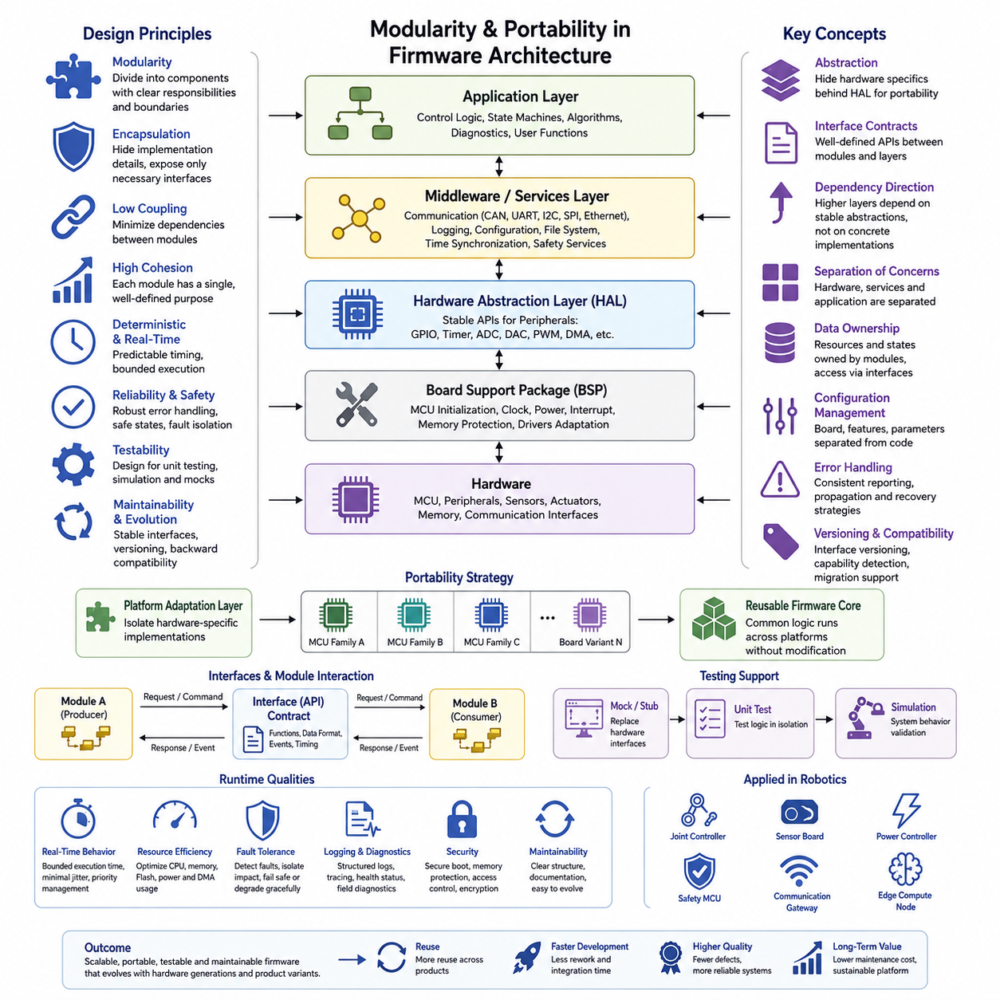{width="7.268055555555556in" height="7.268055555555556in"}

Firmware architecture defines the structural rules that determine how low-level hardware control, reusable services, and application behavior are organized within an embedded system. In robotics, firmware often sits between electrical hardware and higher-level control software, so its architecture must support predictable execution while remaining understandable and maintainable. Modularity and portability are therefore fundamental design principles rather than optional implementation conveniences.

Modularity divides firmware into components with clearly defined responsibilities and interfaces. Instead of allowing application logic to directly manipulate registers, peripherals, communication protocols, and control algorithms throughout the codebase, each responsibility is encapsulated behind an explicit boundary. A well-structured module exposes only the operations required by other components while keeping implementation details private, reducing unintended dependencies and simplifying change.

A useful modular decomposition separates hardware-dependent mechanisms from hardware-independent behavior. Peripheral access, board initialization, clock configuration, interrupt handling, and register operations belong near the hardware boundary, while device services, communication protocols, diagnostics, state management, and control logic occupy progressively higher layers. This organization prepares the architecture for the later distinction among HAL, middleware, and application layers defined within the firmware chapter structure.

The Hardware Abstraction Layer, or HAL, is one of the most important mechanisms for achieving portability. It provides stable software interfaces for GPIO, timers, ADCs, communication peripherals, storage, and other hardware resources while hiding MCU-specific implementation details. Application components should depend primarily on these abstractions rather than directly on vendor registers or peripheral libraries, allowing hardware implementations to change without forcing extensive modification of higher-level firmware.

Portability extends beyond replacing one microcontroller with another. Firmware may need to migrate between board revisions, MCU families, processor architectures, operating environments, or different products within a robot platform. Portable architecture therefore isolates assumptions about memory maps, byte ordering, interrupt controllers, peripheral instances, clock frequencies, DMA channels, and compiler behavior. Platform-specific definitions should be concentrated in controlled adaptation layers instead of being scattered throughout application code.

Interfaces are the contracts connecting modules, and their quality strongly influences architectural stability. Interfaces should communicate intent rather than expose internal representation. A motor-control module, for example, should provide operations such as initialization, command submission, state retrieval, and fault handling rather than allowing external components to manipulate its internal registers or buffers. Small and cohesive interfaces reduce coupling, make dependencies visible, and permit implementations to evolve independently.

Dependency direction is equally important. Higher-level policy should depend on stable abstractions, while hardware-specific implementations satisfy those abstractions from below. When application code directly depends on a particular MCU vendor library, portability becomes expensive because platform assumptions propagate upward. Inverting that dependency through interfaces allows the same control or application logic to operate with different hardware implementations, simulation adapters, or test doubles without redesigning the entire firmware system.

Modularity must also account for embedded resource constraints. Excessive abstraction can introduce memory overhead, additional call paths, larger binaries, or unpredictable execution behavior. Firmware architecture therefore seeks controlled modularity rather than abstraction for its own sake. Interfaces should remain lightweight, memory ownership should be explicit, dynamic allocation should be limited where determinism matters, and performance-critical paths should be designed so that architectural separation does not obscure timing behavior.

Data ownership provides another essential architectural boundary. Shared global state creates hidden coupling because unrelated modules can modify the same information without explicit coordination. Strong firmware architectures assign ownership of buffers, device states, configuration objects, and communication queues to specific components. Other components access those resources through defined interfaces. This makes synchronization requirements visible and reduces race conditions, unintended side effects, and debugging complexity.

Configuration should also be separated from behavioral implementation. Board pin assignments, communication rates, sensor selections, calibration constants, feature switches, and product variants frequently change even when the underlying algorithms remain stable. Keeping configuration in dedicated structures or platform definitions allows a common firmware core to serve multiple hardware variants. This approach reduces source-code branching and helps prevent product-specific modifications from fragmenting a reusable firmware platform.

Modular architecture improves testability because components with explicit dependencies can be evaluated independently. Hardware interfaces can be replaced with mocks or simulated implementations, allowing state machines, protocol handlers, fault logic, and control functions to execute without physical hardware. This architectural property directly supports the firmware chapter\'s later emphasis on mock environments and unit testing, where separation of hardware dependencies becomes a prerequisite for effective automated verification.

Error handling should follow the same architectural discipline as normal functional behavior. Modules need explicit mechanisms for reporting invalid parameters, timeouts, communication failures, resource exhaustion, hardware faults, and inconsistent states. Errors should propagate across layer boundaries in controlled forms rather than through undocumented global flags. The architecture should distinguish recoverable failures from conditions requiring subsystem reset, degraded operation, or transition to a defined safe state.

Real-time behavior places additional constraints on modular firmware. Components may be logically independent yet still interact through interrupts, periodic tasks, DMA completion events, or shared communication resources. Architectural boundaries should therefore document timing assumptions as well as functional interfaces. Maximum execution time, blocking behavior, interrupt context restrictions, queue capacity, and synchronization rules are part of the effective contract between modules when firmware participates in deterministic robot control.

Portability also depends on minimizing assumptions about the execution environment. Firmware that can operate only because of undocumented initialization order, compiler extensions, implicit memory placement, or a particular startup implementation is difficult to reuse. Platform initialization should establish explicit preconditions, and architecture should clearly separate startup code, runtime services, and application activation. This makes adaptation to bare-metal systems, RTOS-based systems, or different toolchains substantially more manageable.

Versioning becomes increasingly important as modular firmware evolves. Interfaces between bootloaders, application firmware, communication protocols, stored configuration, and external controllers may survive across multiple releases. Architectural design should anticipate compatibility by defining data formats, interface versions, capability identification, and migration behavior. Stable contracts allow modules to evolve independently while preventing a local firmware update from unexpectedly breaking neighboring components or higher-level robot software.

For robotic systems, these principles create a scalable foundation extending from individual actuator controllers to distributed embedded subsystems. A joint controller, sensor board, power controller, or safety MCU can retain hardware-specific implementations while sharing common architectural patterns for diagnostics, communication, configuration, and lifecycle management. This consistency reduces integration effort and supports systematic firmware development across heterogeneous robot hardware rather than treating every embedded controller as an isolated project.

Ultimately, modularity and portability are complementary architectural properties. Modularity establishes boundaries that contain complexity, while portability uses those boundaries to separate reusable behavior from platform-specific mechanisms. Effective firmware architecture balances abstraction with deterministic execution, explicit ownership, stable interfaces, testability, and resource awareness. The result is firmware that can evolve with hardware generations and product variants without repeatedly rebuilding the embedded software foundation from the beginning.

펌웨어 아키텍처(Firmware Architecture)는 임베디드 시스템(Embedded System) 내부에서 저수준 하드웨어 제어(Low-Level Hardware Control), 재사용 가능한 서비스(Reusable Services), 애플리케이션 동작(Application Behavior)을 어떻게 구성할 것인지를 결정하는 구조적 규칙을 정의합니다. 로보틱스(Robotics)에서 펌웨어는 전기적 하드웨어(Electrical Hardware)와 상위 수준 제어 소프트웨어(Higher-Level Control Software) 사이에 위치하는 경우가 많으므로, 이해와 유지보수가 가능하면서도 예측 가능한 실행을 지원해야 합니다. 따라서 모듈성(Modularity)과 이식성(Portability)은 선택적인 구현 편의 기능이 아니라 기본적인 설계 원칙입니다.

모듈성(Modularity)은 펌웨어를 명확하게 정의된 책임과 인터페이스(Interface)를 가진 구성요소(Component)로 분할합니다. 애플리케이션 로직(Application Logic)이 코드베이스(Codebase) 전체에서 레지스터(Register), 주변장치(Peripheral), 통신 프로토콜(Communication Protocol), 제어 알고리즘(Control Algorithm)을 직접 조작하도록 하는 대신, 각각의 책임을 명확한 경계 뒤에 캡슐화(Encapsulation)합니다. 잘 구성된 모듈(Module)은 다른 구성요소에 필요한 기능만 외부에 제공하고 구현 세부사항은 내부에 유지하여 의도하지 않은 의존성을 줄이고 변경을 단순화합니다.

효과적인 모듈 분해(Modular Decomposition)는 하드웨어 의존적 메커니즘(Hardware-Dependent Mechanism)과 하드웨어 독립적 동작(Hardware-Independent Behavior)을 분리합니다. 주변장치 접근(Peripheral Access), 보드 초기화(Board Initialization), 클록 설정(Clock Configuration), 인터럽트 처리(Interrupt Handling), 레지스터 연산(Register Operation)은 하드웨어 경계에 가깝게 배치하고, 장치 서비스(Device Service), 통신 프로토콜, 진단(Diagnostics), 상태 관리(State Management), 제어 로직(Control Logic)은 점진적으로 상위 계층에 배치합니다. 이러한 구성은 이후 하드웨어 추상화 계층(HAL), 미들웨어(Middleware), 애플리케이션 계층(Application Layer)을 명확하게 구분하기 위한 기반이 됩니다.

하드웨어 추상화 계층(Hardware Abstraction Layer, HAL)은 이식성(Portability)을 확보하기 위한 가장 중요한 메커니즘 가운데 하나입니다. HAL은 GPIO, 타이머(Timer), ADC, 통신 주변장치(Communication Peripheral), 저장장치(Storage) 등의 하드웨어 자원에 안정적인 소프트웨어 인터페이스를 제공하면서 MCU별 구현 세부사항을 숨깁니다. 애플리케이션 구성요소는 공급업체별 레지스터나 주변장치 라이브러리에 직접 의존하기보다 이러한 추상화에 의존해야 하며, 이를 통해 상위 펌웨어를 광범위하게 수정하지 않고도 하드웨어 구현을 변경할 수 있습니다.

이식성(Portability)은 단순히 하나의 마이크로컨트롤러(Microcontroller)를 다른 마이크로컨트롤러로 교체하는 것보다 넓은 개념입니다. 펌웨어는 보드 개정(Board Revision), MCU 제품군, 프로세서 아키텍처(Processor Architecture), 실행 환경(Operating Environment), 또는 로봇 플랫폼 내 서로 다른 제품 사이에서 이전될 수 있어야 합니다. 따라서 메모리 맵(Memory Map), 바이트 순서(Byte Ordering), 인터럽트 컨트롤러(Interrupt Controller), 주변장치 인스턴스, 클록 주파수, DMA 채널, 컴파일러 동작에 대한 가정을 격리해야 합니다. 플랫폼별 정의는 애플리케이션 전체에 분산시키지 않고 제어된 적응 계층(Adaptation Layer)에 집중시켜야 합니다.

인터페이스(Interface)는 모듈을 연결하는 계약(Contract)이며, 그 품질은 아키텍처 안정성에 직접적인 영향을 미칩니다. 인터페이스는 내부 표현을 노출하기보다 기능의 의도(Intent)를 전달해야 합니다. 예를 들어 모터 제어 모듈(Motor-Control Module)은 외부 구성요소가 내부 레지스터나 버퍼(Buffer)를 직접 조작하도록 허용하는 대신 초기화(Initialization), 명령 전달(Command Submission), 상태 조회(State Retrieval), 고장 처리(Fault Handling)와 같은 기능을 제공해야 합니다. 작고 응집력 있는 인터페이스는 결합도(Coupling)를 낮추고 의존성을 명확하게 하며 구현이 독립적으로 발전할 수 있도록 합니다.

의존성 방향(Dependency Direction) 역시 중요합니다. 상위 수준 정책(High-Level Policy)은 안정적인 추상화(Abstraction)에 의존하고, 하드웨어별 구현은 아래 계층에서 이러한 추상화를 충족해야 합니다. 애플리케이션 코드가 특정 MCU 공급업체 라이브러리에 직접 의존하면 플랫폼 가정이 상위 계층까지 전파되어 이식 비용이 증가합니다. 인터페이스를 통해 이러한 의존성을 역전(Dependency Inversion)하면 동일한 제어 로직이나 애플리케이션 로직을 전체 펌웨어 시스템의 재설계 없이 서로 다른 하드웨어 구현, 시뮬레이션 어댑터(Simulation Adapter), 테스트 대역(Test Double)과 함께 사용할 수 있습니다.

모듈성(Modularity)은 임베디드 자원 제약(Resource Constraints)도 고려해야 합니다. 지나친 추상화는 메모리 오버헤드(Memory Overhead), 추가적인 호출 경로(Call Path), 바이너리 크기 증가, 예측하기 어려운 실행 동작을 초래할 수 있습니다. 따라서 펌웨어 아키텍처는 추상화 자체를 목적으로 하기보다 통제된 모듈성을 추구해야 합니다. 인터페이스는 가볍게 유지하고, 메모리 소유권(Memory Ownership)은 명확하게 정의하며, 결정성(Determinism)이 중요한 영역에서는 동적 메모리 할당(Dynamic Allocation)을 제한해야 합니다. 또한 성능이 중요한 경로에서는 아키텍처 분리가 타이밍 동작(Timing Behavior)을 가리지 않도록 설계해야 합니다.

데이터 소유권(Data Ownership)은 또 하나의 핵심적인 아키텍처 경계를 제공합니다. 공유 전역 상태(Shared Global State)는 서로 관련 없는 모듈이 명시적인 조정 없이 동일한 정보를 변경할 수 있기 때문에 숨겨진 결합(Hidden Coupling)을 발생시킵니다. 강력한 펌웨어 아키텍처는 버퍼, 장치 상태(Device State), 구성 객체(Configuration Object), 통신 큐(Communication Queue)의 소유권을 특정 구성요소에 할당합니다. 다른 구성요소는 정의된 인터페이스를 통해 해당 자원에 접근하며, 이를 통해 동기화 요구사항(Synchronization Requirement)이 명확해지고 경쟁 상태(Race Condition), 의도하지 않은 부작용(Side Effect), 디버깅 복잡성을 줄일 수 있습니다.

구성(Configuration) 역시 동작 구현(Behavioral Implementation)과 분리해야 합니다. 보드 핀 할당(Board Pin Assignment), 통신 속도, 센서 선택, 보정 상수(Calibration Constant), 기능 스위치(Feature Switch), 제품 변형(Product Variant)은 기본 알고리즘이 동일하더라도 자주 변경될 수 있습니다. 구성을 전용 구조체나 플랫폼 정의에 유지하면 하나의 공통 펌웨어 코어(Common Firmware Core)를 여러 하드웨어 변형에서 사용할 수 있습니다. 이러한 접근 방식은 소스 코드 분기(Source-Code Branching)를 줄이고 제품별 변경으로 인해 재사용 가능한 펌웨어 플랫폼이 파편화되는 것을 방지합니다.

모듈형 아키텍처(Modular Architecture)는 명확한 의존성을 가진 구성요소를 독립적으로 평가할 수 있기 때문에 테스트 가능성(Testability)을 향상시킵니다. 하드웨어 인터페이스를 목(Mock)이나 시뮬레이션 구현(Simulated Implementation)으로 교체하면 물리적 하드웨어 없이 상태 머신(State Machine), 프로토콜 처리기(Protocol Handler), 고장 로직(Fault Logic), 제어 기능을 실행할 수 있습니다. 이러한 아키텍처 특성은 이후 목 환경(Mock Environment)과 단위 테스트(Unit Testing)를 효과적으로 수행하기 위한 기반이 되며, 하드웨어 의존성 분리가 자동화 검증(Automated Verification)의 전제 조건이 됩니다.

오류 처리(Error Handling)는 정상적인 기능 동작과 동일한 수준의 아키텍처 규율을 따라야 합니다. 모듈은 잘못된 매개변수(Invalid Parameter), 타임아웃(Timeout), 통신 장애(Communication Failure), 자원 고갈(Resource Exhaustion), 하드웨어 고장(Hardware Fault), 일관되지 않은 상태(Inconsistent State)를 보고하는 명확한 메커니즘을 가져야 합니다. 오류는 문서화되지 않은 전역 플래그(Global Flag)를 통해 전달하는 대신 계층 경계를 따라 통제된 형태로 전파해야 합니다. 또한 복구 가능한 장애와 서브시스템 재설정(Subsystem Reset), 성능 저하 운전(Degraded Operation), 정의된 안전 상태(Safe State) 전환이 필요한 조건을 구분해야 합니다.

실시간 동작(Real-Time Behavior)은 모듈형 펌웨어에 추가적인 제약을 부여합니다. 구성요소가 논리적으로 독립되어 있더라도 인터럽트, 주기적 태스크(Periodic Task), DMA 완료 이벤트(DMA Completion Event), 공유 통신 자원을 통해 서로 영향을 줄 수 있습니다. 따라서 아키텍처 경계는 기능적 인터페이스뿐 아니라 타이밍 가정(Timing Assumption)도 명확하게 정의해야 합니다. 최대 실행 시간(Maximum Execution Time), 블로킹 동작(Blocking Behavior), 인터럽트 컨텍스트(Interrupt Context)의 제한, 큐 용량(Queue Capacity), 동기화 규칙은 펌웨어가 결정론적인 로봇 제어에 참여할 때 모듈 사이의 실질적인 계약이 됩니다.

이식성(Portability)은 실행 환경에 대한 가정을 최소화하는 것에도 의존합니다. 문서화되지 않은 초기화 순서, 컴파일러 확장(Compiler Extension), 암묵적인 메모리 배치(Memory Placement), 특정 시작 코드(Startup Implementation)에 의존하는 펌웨어는 재사용하기 어렵습니다. 플랫폼 초기화는 명시적인 사전조건(Precondition)을 설정해야 하며, 아키텍처는 시작 코드(Startup Code), 런타임 서비스(Runtime Service), 애플리케이션 활성화(Application Activation)를 명확하게 분리해야 합니다. 이를 통해 베어메탈(Bare-Metal), RTOS 기반 시스템, 서로 다른 툴체인(Toolchain)으로의 적용을 훨씬 쉽게 관리할 수 있습니다.

모듈형 펌웨어가 발전하면서 버전 관리(Versioning)의 중요성도 증가합니다. 부트로더(Bootloader), 애플리케이션 펌웨어, 통신 프로토콜, 저장된 구성 정보, 외부 컨트롤러 사이의 인터페이스는 여러 릴리스(Release)에 걸쳐 유지될 수 있습니다. 따라서 아키텍처는 데이터 형식(Data Format), 인터페이스 버전(Interface Version), 기능 식별(Capability Identification), 마이그레이션 동작(Migration Behavior)을 정의하여 호환성(Compatibility)을 고려해야 합니다. 안정적인 계약을 유지하면 각 모듈이 독립적으로 발전하면서도 특정 펌웨어 업데이트가 인접 구성요소나 상위 수준 로봇 소프트웨어를 예기치 않게 손상시키는 것을 방지할 수 있습니다.

로봇 시스템(Robotic System)에서 이러한 원칙은 개별 액추에이터 컨트롤러(Actuator Controller)부터 분산 임베디드 서브시스템(Distributed Embedded Subsystem)에 이르는 확장 가능한 기반을 제공합니다. 관절 컨트롤러(Joint Controller), 센서 보드(Sensor Board), 전력 컨트롤러(Power Controller), 안전 MCU(Safety MCU)는 각각 하드웨어별 구현을 유지하면서도 진단, 통신, 구성, 수명주기 관리(Lifecycle Management)를 위한 공통 아키텍처 패턴을 공유할 수 있습니다. 이러한 일관성은 이기종 로봇 하드웨어(Heterogeneous Robot Hardware) 전체의 통합 비용을 줄이고 각 임베디드 컨트롤러를 개별 프로젝트로 취급하는 대신 체계적인 펌웨어 개발을 가능하게 합니다.

궁극적으로 모듈성(Modularity)과 이식성(Portability)은 서로 보완적인 아키텍처 특성입니다. 모듈성은 복잡성을 제한하는 경계를 설정하고, 이식성은 이러한 경계를 이용하여 재사용 가능한 동작(Reusable Behavior)과 플랫폼별 메커니즘(Platform-Specific Mechanism)을 분리합니다. 효과적인 펌웨어 아키텍처는 추상화와 결정론적 실행(Deterministic Execution), 명확한 소유권, 안정적인 인터페이스, 테스트 가능성, 자원 제약에 대한 고려 사이에서 균형을 유지해야 합니다. 그 결과 하드웨어 세대와 제품 변형이 변화하더라도 임베디드 소프트웨어 기반을 처음부터 반복적으로 다시 구축하지 않고 지속적으로 발전시킬 수 있는 펌웨어를 구현할 수 있습니다.

##  

## 05.02 Bare-Metal Firmware Architecture Design [w/Code]

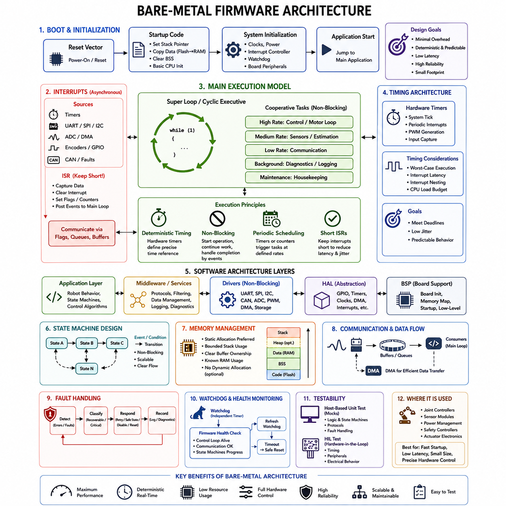{width="7.268055555555556in" height="7.268055555555556in"}

Bare-metal firmware executes directly on a microcontroller or processor without an operating system or real-time operating system managing tasks, memory, or hardware resources. The firmware therefore assumes direct responsibility for processor initialization, peripheral configuration, interrupt handling, timing, communication, and application control. This architecture provides minimal software overhead and highly predictable behavior, but requires disciplined organization to prevent hardware logic and application behavior from becoming tightly coupled.

A typical bare-metal system begins execution at the reset vector after power-on or reset. Startup code establishes the processor environment by configuring the stack pointer, initializing memory regions, copying initialized data from Flash to RAM, clearing uninitialized sections, and preparing essential processor state. System initialization then configures clocks, power domains, interrupt controllers, watchdogs, and board-specific hardware before transferring control to the main firmware application.

The simplest execution architecture uses a super loop, commonly represented by an infinite main loop that repeatedly invokes application functions. Sensor acquisition, communication processing, state updates, actuator commands, diagnostics, and background maintenance may execute sequentially within this loop. Although conceptually simple, the design must ensure that individual operations do not block execution for excessive periods because one slow function can delay every other activity sharing the loop.

A more structured super-loop architecture divides application behavior into cooperative tasks executed at controlled intervals. A high-frequency function may process motor control, while slower functions handle sensor monitoring, communication, diagnostics, or status reporting. Software counters, hardware timers, or periodic timer interrupts can establish these execution rates. This creates a lightweight cyclic executive that provides basic scheduling behavior without introducing a full RTOS task scheduler.

Timing is a fundamental architectural concern because bare-metal firmware has no operating system to guarantee task activation. Hardware timers should establish deterministic time references, while application logic should avoid long blocking delays. Instead of waiting synchronously for a peripheral operation to complete, firmware can initiate the operation, continue executing other work, and later process completion through polling, status flags, interrupts, or state transitions. This preserves responsiveness across the system.

Interrupt Service Routines, or ISRs, provide asynchronous responses to hardware events such as timer expiration, UART reception, ADC conversion completion, encoder transitions, CAN messages, or fault signals. ISRs should normally perform only time-critical work, capture essential information, acknowledge the interrupt source, and communicate the event to foreground processing. Lengthy calculations or blocking operations inside interrupts increase latency and can interfere with higher-priority real-time activities.

Communication between interrupt context and the main execution loop requires carefully controlled shared state. Variables modified by both contexts may require volatile qualification, atomic access, interrupt masking, or other synchronization techniques appropriate to the processor architecture. A common design allows an ISR to set an event flag, update a counter, or place data into a buffer, while the main loop performs the more complex processing associated with that event.

Layering remains valuable even without an operating system. Hardware-specific register operations can be isolated within a Board Support Package and Hardware Abstraction Layer, while device drivers expose higher-level operations for sensors, actuators, communication interfaces, and storage. Middleware components can implement protocols or reusable services, and the application layer can concentrate on robot behavior. This separation prevents the super loop from becoming a collection of unrelated register-level operations.

Peripheral drivers should support non-blocking operation whenever responsiveness is important. UART reception can use interrupts or DMA, ADC sampling can be timer-triggered, and SPI transactions can progress through state-driven operations rather than busy waiting. DMA is particularly useful for moving larger data blocks without continuous processor intervention. These mechanisms allow the CPU to execute control and application logic while hardware peripherals independently perform data transfers.

Finite State Machines, or FSMs, are especially effective in bare-metal architectures because they transform long procedural sequences into incremental state transitions. Initialization, communication protocols, actuator sequencing, calibration, recovery, and device management can each be represented as states responding to events and conditions. Instead of blocking until an entire operation finishes, the firmware advances the operation across repeated loop iterations while preserving system responsiveness.

Memory management should remain explicit and predictable. Static allocation is commonly preferred because RAM requirements can be determined during development and runtime allocation failures are avoided. Stack usage must be carefully bounded, particularly when interrupts can nest or functions contain large local variables. Buffers for communication, sensor acquisition, diagnostics, and control data should have clearly defined ownership and capacity so memory consumption remains understandable throughout system operation.

Bare-metal firmware must also define initialization dependencies explicitly. Drivers should not assume that clocks, GPIO configuration, DMA resources, or communication peripherals have already been prepared unless the architecture guarantees that sequence. A controlled startup procedure typically initializes platform resources first, then device drivers, reusable services, application state, and finally interrupt-driven or periodic operation. Explicit initialization order reduces failures caused by hidden dependencies between components.

Error handling requires architectural planning because there is no operating system supervising failed tasks or processes. Drivers and services should report errors through defined status values, fault structures, or diagnostic events. Recoverable failures may trigger retries or peripheral reinitialization, while serious failures may disable outputs, place actuators into safe conditions, store diagnostic information, or intentionally reset the controller through a watchdog or software-controlled reset mechanism.

Watchdog integration is particularly important in unattended robot controllers. The watchdog should be refreshed only when critical firmware execution is known to be healthy rather than unconditionally from a timer interrupt. A health-monitoring mechanism can verify that essential control loops, communication services, and state machines continue to make progress. If execution stalls or critical conditions become inconsistent, expiration of the watchdog provides a controlled mechanism for restoring the controller.

Deterministic execution requires understanding worst-case behavior rather than relying only on average processing time. Designers should evaluate the execution duration of periodic functions, interrupt latency, interrupt nesting, communication bursts, DMA activity, and shared-resource contention. The combined workload must remain within the available processing budget so that high-priority control operations consistently meet their deadlines even when several hardware events occur close together.

Testing becomes easier when bare-metal architecture separates hardware access from application logic. Register-level implementations can be replaced by mock interfaces on a host computer, enabling state machines, protocol logic, fault handling, and control decisions to be tested independently of the target board. Hardware-in-the-loop testing can then verify timing, interrupts, peripherals, and electrical interactions that cannot be represented accurately in a purely software-based environment.

For robot joint controllers, sensor modules, power-management boards, safety controllers, and compact actuator electronics, bare-metal firmware remains attractive when startup speed, small memory footprint, low latency, and precise hardware control are more important than sophisticated operating-system services. Its effectiveness depends less on the absence of an RTOS than on architectural discipline: explicit timing, short interrupts, non-blocking execution, layered drivers, controlled state, deterministic memory use, and systematic fault handling.

A well-designed bare-metal architecture can therefore provide a compact yet scalable embedded software foundation. The reset and initialization path establishes a known platform state, interrupts capture asynchronous hardware events, cooperative foreground functions execute application behavior, and layered interfaces isolate hardware dependencies. When these elements are combined with deterministic timing, state-machine-based logic, diagnostics, watchdog supervision, and testable modules, bare-metal firmware can reliably support demanding real-time robotic subsystems.

베어메탈 펌웨어(Bare-Metal Firmware)는 태스크(Task), 메모리(Memory), 하드웨어 자원(Hardware Resource)을 관리하는 운영체제(Operating System)나 실시간 운영체제(Real-Time Operating System, RTOS) 없이 마이크로컨트롤러(Microcontroller) 또는 프로세서(Processor)에서 직접 실행됩니다. 따라서 펌웨어 자체가 프로세서 초기화, 주변장치 설정, 인터럽트 처리, 타이밍, 통신, 애플리케이션 제어를 직접 담당합니다. 이러한 아키텍처는 소프트웨어 오버헤드가 작고 높은 예측성을 제공하지만, 하드웨어 로직과 애플리케이션 동작이 강하게 결합되지 않도록 체계적인 구조가 필요합니다.

일반적인 베어메탈 시스템(Bare-Metal System)은 전원이 인가되거나 리셋(Reset)이 발생한 이후 리셋 벡터(Reset Vector)에서 실행을 시작합니다. 시작 코드(Startup Code)는 스택 포인터(Stack Pointer)를 설정하고, 메모리 영역을 초기화하며, 초기화된 데이터를 플래시(Flash)에서 RAM으로 복사하고, 초기화되지 않은 영역을 지우는 방식으로 프로세서 실행 환경을 구성합니다. 이후 시스템 초기화(System Initialization)는 클록(Clock), 전력 도메인(Power Domain), 인터럽트 컨트롤러(Interrupt Controller), 워치독(Watchdog), 보드별 하드웨어를 설정한 다음 메인 펌웨어 애플리케이션(Main Firmware Application)으로 제어권을 전달합니다.

가장 단순한 실행 아키텍처(Execution Architecture)는 애플리케이션 함수를 반복적으로 호출하는 무한 메인 루프(Infinite Main Loop), 즉 슈퍼 루프(Super Loop)를 사용합니다. 센서 데이터 획득, 통신 처리, 상태 갱신, 액추에이터 명령, 진단, 백그라운드 유지관리 기능 등을 이 루프에서 순차적으로 실행할 수 있습니다. 개념적으로 단순하지만 하나의 느린 함수가 동일한 루프를 공유하는 다른 모든 동작을 지연시킬 수 있으므로 개별 작업이 지나치게 오랫동안 실행을 차단하지 않도록 설계해야 합니다.

보다 구조화된 슈퍼 루프 아키텍처(Super-Loop Architecture)는 애플리케이션 동작을 제어된 주기로 실행되는 협력형 태스크(Cooperative Task)로 분리합니다. 높은 주파수의 함수는 모터 제어를 처리하고, 상대적으로 느린 함수는 센서 감시, 통신, 진단 또는 상태 보고를 처리할 수 있습니다. 소프트웨어 카운터(Software Counter), 하드웨어 타이머(Hardware Timer), 주기적 타이머 인터럽트(Periodic Timer Interrupt)를 이용하여 각각의 실행 주기를 설정할 수 있으며, 이를 통해 완전한 RTOS 태스크 스케줄러 없이 기본적인 스케줄링 기능을 제공하는 경량 순환 실행기(Cyclic Executive)를 구성할 수 있습니다.

베어메탈 펌웨어에는 태스크 활성화를 보장하는 운영체제가 없기 때문에 타이밍(Timing)은 핵심적인 아키텍처 고려사항입니다. 하드웨어 타이머를 이용하여 결정론적인 시간 기준(Deterministic Time Reference)을 설정하고 애플리케이션 로직에서는 긴 블로킹 지연(Blocking Delay)을 피해야 합니다. 주변장치 작업이 완료될 때까지 동기적으로 기다리는 대신 작업을 시작한 후 다른 처리를 계속 수행하고, 이후 폴링(Polling), 상태 플래그(Status Flag), 인터럽트 또는 상태 전이(State Transition)를 통해 완료를 처리하면 전체 시스템의 응답성을 유지할 수 있습니다.

인터럽트 서비스 루틴(Interrupt Service Routine, ISR)은 타이머 만료, UART 수신, ADC 변환 완료, 엔코더(Encoder) 변화, CAN 메시지 또는 고장 신호와 같은 하드웨어 이벤트에 비동기적으로 대응합니다. ISR은 일반적으로 시간에 민감한 작업만 수행하고, 필요한 정보를 획득하며, 인터럽트 발생 원인을 처리한 후 해당 이벤트를 포그라운드 처리(Foreground Processing) 영역으로 전달해야 합니다. 인터럽트 내부에서 긴 계산이나 블로킹 작업을 수행하면 지연시간(Latency)이 증가하고 더 높은 우선순위의 실시간 동작을 방해할 수 있습니다.

인터럽트 컨텍스트(Interrupt Context)와 메인 실행 루프(Main Execution Loop) 사이의 통신에서는 공유 상태(Shared State)를 신중하게 제어해야 합니다. 두 실행 영역에서 모두 수정되는 변수에는 프로세서 아키텍처에 따라 볼러타일(volatile) 지정, 원자적 접근(Atomic Access), 인터럽트 마스킹(Interrupt Masking) 또는 다른 적절한 동기화 기법이 필요할 수 있습니다. 일반적인 설계에서는 ISR이 이벤트 플래그를 설정하거나 카운터를 갱신하거나 데이터를 버퍼(Buffer)에 저장하고, 메인 루프가 해당 이벤트와 관련된 복잡한 처리를 수행하도록 구성합니다.

운영체제가 없는 환경에서도 계층화(Layering)는 중요합니다. 하드웨어별 레지스터 연산을 보드 지원 패키지(Board Support Package, BSP)와 하드웨어 추상화 계층(Hardware Abstraction Layer, HAL)에 격리하고, 장치 드라이버(Device Driver)는 센서, 액추에이터, 통신 인터페이스 및 저장장치를 위한 상위 수준 기능을 제공할 수 있습니다. 미들웨어(Middleware)는 프로토콜이나 재사용 가능한 서비스를 구현하고, 애플리케이션 계층(Application Layer)은 로봇 동작에 집중합니다. 이러한 분리는 슈퍼 루프가 서로 관련 없는 레지스터 수준 작업의 집합으로 변하는 것을 방지합니다.

주변장치 드라이버(Peripheral Driver)는 시스템 응답성이 중요한 경우 가능한 한 논블로킹 동작(Non-Blocking Operation)을 지원해야 합니다. UART 수신에는 인터럽트나 직접 메모리 접근(Direct Memory Access, DMA)을 사용할 수 있고, ADC 샘플링은 타이머에 의해 트리거될 수 있으며, SPI 통신은 바쁜 대기(Busy Waiting) 대신 상태 기반 동작으로 진행할 수 있습니다. 특히 DMA는 프로세서가 지속적으로 개입하지 않고도 큰 데이터 블록을 이동하는 데 효과적이며, 하드웨어 주변장치가 독립적으로 데이터를 전송하는 동안 CPU가 제어 및 애플리케이션 로직을 수행할 수 있도록 합니다.

유한 상태 머신(Finite State Machine, FSM)은 긴 절차적 처리 순서를 점진적인 상태 전이(State Transition)로 변환할 수 있기 때문에 베어메탈 아키텍처에서 특히 효과적입니다. 초기화, 통신 프로토콜, 액추에이터 시퀀싱(Actuator Sequencing), 보정(Calibration), 복구(Recovery), 장치 관리 등을 이벤트와 조건에 반응하는 상태로 표현할 수 있습니다. 전체 작업이 끝날 때까지 실행을 차단하는 대신 반복되는 루프 실행 과정에서 상태를 단계적으로 전환함으로써 시스템 응답성을 유지할 수 있습니다.

메모리 관리(Memory Management)는 명시적이고 예측 가능하게 유지해야 합니다. 정적 메모리 할당(Static Allocation)은 개발 과정에서 RAM 요구량을 결정할 수 있고 런타임 메모리 할당 실패를 방지할 수 있기 때문에 일반적으로 선호됩니다. 특히 인터럽트 중첩(Interrupt Nesting)이 가능하거나 함수가 큰 지역 변수를 사용하는 경우 스택 사용량(Stack Usage)을 엄격하게 제한해야 합니다. 통신, 센서 데이터 획득, 진단 및 제어 데이터를 위한 버퍼는 명확한 소유권과 용량을 가져야 하며, 이를 통해 시스템 전체의 메모리 소비를 이해하고 관리할 수 있습니다.

베어메탈 펌웨어는 초기화 의존성(Initialization Dependency)도 명시적으로 정의해야 합니다. 아키텍처에서 실행 순서를 보장하지 않는다면 드라이버는 클록, GPIO 설정, DMA 자원 또는 통신 주변장치가 이미 준비되어 있다고 가정해서는 안 됩니다. 통제된 시작 절차(Startup Procedure)는 일반적으로 플랫폼 자원을 먼저 초기화한 다음 장치 드라이버, 재사용 가능한 서비스, 애플리케이션 상태를 순서대로 준비하고 마지막으로 인터럽트 기반 또는 주기적 동작을 활성화합니다. 명확한 초기화 순서는 구성요소 사이의 숨겨진 의존성으로 발생하는 장애를 줄여줍니다.

오류 처리(Error Handling)는 실패한 태스크나 프로세스를 감독하는 운영체제가 존재하지 않기 때문에 아키텍처 차원의 계획이 필요합니다. 드라이버와 서비스는 정의된 상태 값(Status Value), 고장 구조체(Fault Structure), 진단 이벤트(Diagnostic Event)를 통해 오류를 보고해야 합니다. 복구 가능한 장애는 재시도나 주변장치 재초기화를 수행할 수 있지만, 심각한 장애에서는 출력을 비활성화하고 액추에이터를 안전 상태(Safe Condition)로 전환하며 진단 정보를 저장하거나 워치독 또는 소프트웨어 제어 리셋(Software-Controlled Reset)을 통해 컨트롤러를 의도적으로 재시작할 수 있습니다.

워치독 통합(Watchdog Integration)은 무인으로 동작하는 로봇 컨트롤러에서 특히 중요합니다. 워치독은 타이머 인터럽트에서 무조건 갱신하기보다 핵심 펌웨어가 정상적으로 실행되고 있다는 것이 확인된 경우에만 갱신되어야 합니다. 상태 감시 메커니즘(Health-Monitoring Mechanism)은 필수 제어 루프, 통신 서비스, 상태 머신이 지속적으로 정상 진행되고 있는지 확인할 수 있습니다. 실행이 정지하거나 핵심 상태가 비정상적으로 변하면 워치독 만료를 통해 컨트롤러를 제어된 방식으로 복구할 수 있습니다.

결정론적 실행(Deterministic Execution)을 확보하려면 평균적인 처리 시간뿐 아니라 최악 조건의 동작(Worst-Case Behavior)을 이해해야 합니다. 설계자는 주기 함수의 실행 시간, 인터럽트 지연시간, 인터럽트 중첩, 통신 트래픽 집중, DMA 동작, 공유 자원 경합(Shared-Resource Contention)을 평가해야 합니다. 여러 하드웨어 이벤트가 짧은 시간 간격으로 동시에 발생하더라도 높은 우선순위의 제어 동작이 지속적으로 데드라인(Deadline)을 만족하도록 전체 작업 부하를 사용 가능한 프로세싱 예산(Processing Budget) 안에서 관리해야 합니다.

베어메탈 아키텍처가 하드웨어 접근과 애플리케이션 로직을 분리하면 테스트(Test)가 더욱 쉬워집니다. 레지스터 수준 구현을 호스트 컴퓨터에서 동작하는 목 인터페이스(Mock Interface)로 교체하면 대상 보드(Target Board) 없이도 상태 머신, 프로토콜 로직, 고장 처리, 제어 의사결정을 독립적으로 시험할 수 있습니다. 이후 하드웨어 인더루프 테스트(Hardware-in-the-Loop Testing, HIL)를 통해 순수 소프트웨어 환경에서 정확하게 표현하기 어려운 타이밍, 인터럽트, 주변장치 및 전기적 상호작용을 검증할 수 있습니다.

로봇 관절 컨트롤러(Robot Joint Controller), 센서 모듈(Sensor Module), 전력 관리 보드(Power-Management Board), 안전 컨트롤러(Safety Controller), 소형 액추에이터 전자장치(Actuator Electronics)에서는 정교한 운영체제 서비스보다 빠른 시작 속도, 작은 메모리 사용량, 낮은 지연시간, 정밀한 하드웨어 제어가 중요할 경우 베어메탈 펌웨어가 효과적인 선택이 될 수 있습니다. 그 효과는 단순히 RTOS를 사용하지 않는다는 사실보다 명시적 타이밍, 짧은 인터럽트, 논블로킹 실행, 계층화된 드라이버, 통제된 상태, 결정론적 메모리 사용, 체계적인 고장 처리와 같은 아키텍처 규율에 의해 결정됩니다.

잘 설계된 베어메탈 아키텍처(Bare-Metal Architecture)는 작고 단순하면서도 확장 가능한 임베디드 소프트웨어 기반(Embedded Software Foundation)을 제공할 수 있습니다. 리셋 및 초기화 경로는 알려진 플랫폼 상태를 구축하고, 인터럽트는 비동기 하드웨어 이벤트를 포착하며, 협력형 포그라운드 함수는 애플리케이션 동작을 수행하고, 계층화된 인터페이스는 하드웨어 의존성을 격리합니다. 이러한 요소를 결정론적 타이밍, 상태 머신 기반 로직, 진단, 워치독 감독(Watchdog Supervision), 테스트 가능한 모듈과 결합하면 베어메탈 펌웨어는 높은 실시간 성능이 요구되는 로봇 서브시스템을 안정적으로 지원할 수 있습니다.

##  

## 05.03 FSM-Based Firmware Design Patterns [w/Code]

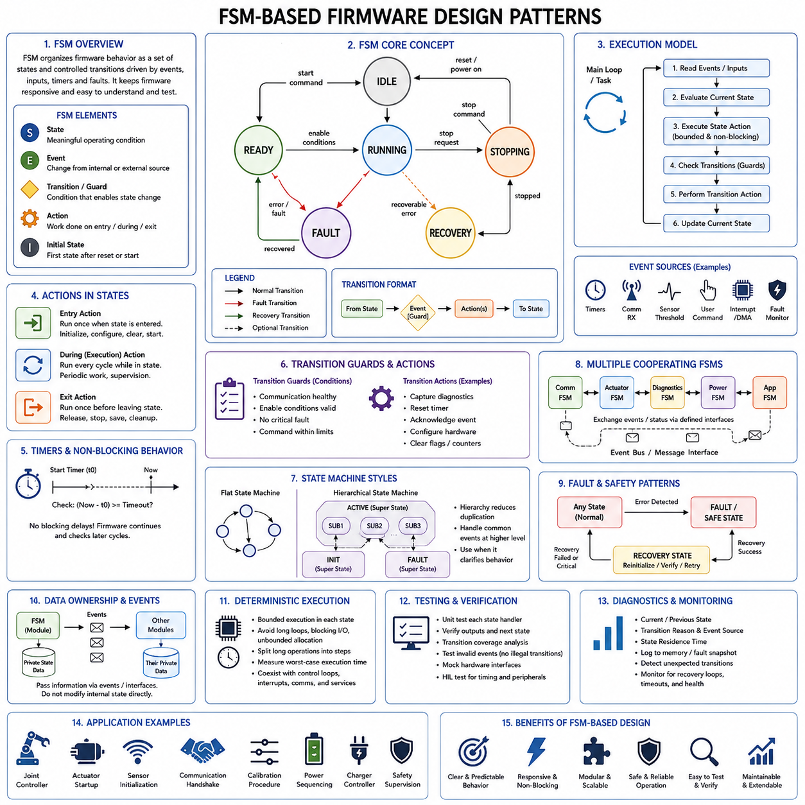{width="7.268055555555556in" height="7.268055555555556in"}

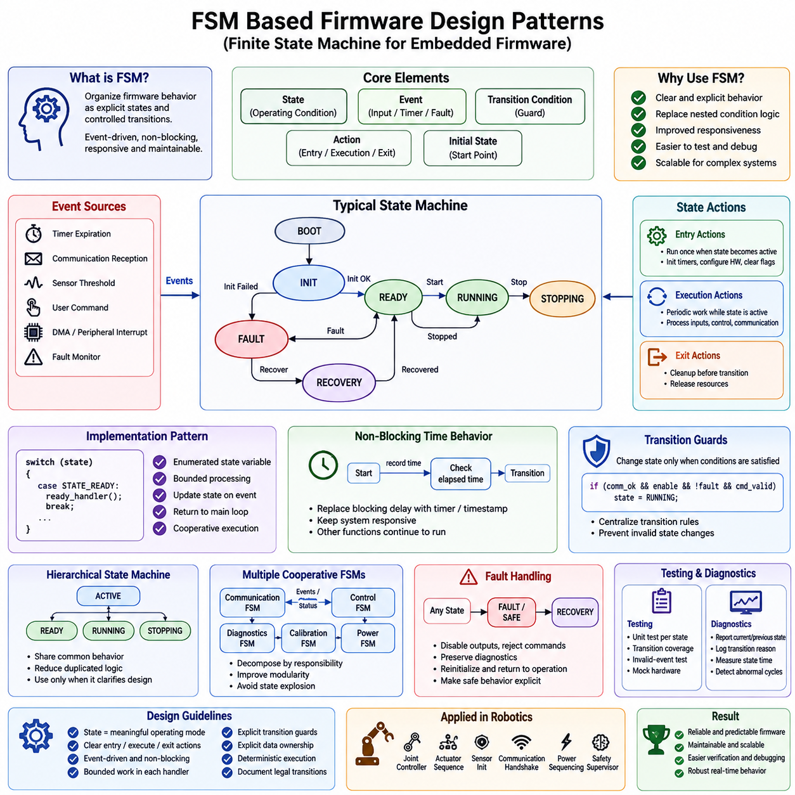{width="7.268055555555556in" height="7.268055555555556in"}

A Finite State Machine, or FSM, provides a disciplined way to organize firmware behavior as a set of explicit operating states and controlled transitions between them. Instead of implementing long procedural sequences with deeply nested conditions, the firmware represents its current operating condition as a state and determines the next action from events, inputs, timers, or faults. This structure is especially effective in embedded controllers that must remain responsive while managing sequential behavior.

An FSM normally consists of states, events, transition conditions, actions, and an initial state. A state represents a meaningful operating condition such as initialization, idle, ready, running, stopping, fault, or recovery. Events describe changes that may influence behavior, while transition conditions determine whether movement from one state to another is permitted. Actions perform the work associated with entering, executing, leaving, or transitioning between states.

State selection should reflect externally meaningful behavior rather than every internal variable combination. If states are too broad, each state accumulates complex conditional logic and loses the advantages of the FSM model. If states are excessively detailed, the transition graph becomes difficult to understand and maintain. Effective firmware design therefore identifies states around distinct operating modes, resource ownership, safety conditions, communication phases, or hardware sequences that require clearly differentiated behavior.

A common implementation pattern uses an enumerated state variable and a dispatch mechanism such as a switch statement. During each execution cycle, the firmware evaluates the current state, performs bounded processing, checks relevant events, and updates the state when a valid transition occurs. The function then returns control to the main loop or scheduler. This repeated execution model avoids blocking behavior and allows multiple firmware functions to progress cooperatively over time.

Entry, execution, and exit actions help separate responsibilities within each state. Entry actions run once when a state becomes active and may initialize timers, configure hardware, clear flags, or issue commands. Execution actions perform periodic work while the state remains active. Exit actions release resources or complete cleanup before transition. Separating these behaviors prevents repeated initialization and makes the lifecycle of each state easier to inspect and test.

Event-driven FSM design improves responsiveness by allowing state transitions to react to asynchronous conditions. Events may originate from timer expiration, communication reception, sensor thresholds, user commands, DMA completion, interrupts, or fault monitors. Interrupt Service Routines should generally capture time-critical information and convert hardware activity into flags, counters, or queued events. The foreground FSM can then process those events without placing complex state logic inside interrupt context.

Timers are particularly important because many firmware sequences depend on time without being allowed to block. Instead of calling a delay function while waiting for hardware stabilization, communication response, motor settling, or retry intervals, the FSM records a timestamp or starts a timer and returns immediately. Later executions compare the elapsed time with the required interval. This converts synchronous waiting into non-blocking temporal behavior while allowing other firmware functions to continue operating.

Transition guards define conditions that must be satisfied before a transition is accepted. A motor controller, for example, may move from READY to RUNNING only when communication is healthy, enable conditions are valid, no critical fault exists, and the requested command is within allowable limits. Guards centralize transition rules and prevent state changes from being scattered throughout unrelated functions, making operational logic easier to review and verify.

Transition actions should remain distinct from continuous state behavior whenever practical. A transition may capture diagnostic information, reset a timer, acknowledge an event, or configure hardware required by the destination state. Keeping these operations explicit reduces hidden side effects. It also allows engineers to determine not only which states are reachable but exactly what happens when the firmware crosses each behavioral boundary.

Hierarchical State Machines can manage complexity when a controller contains related groups of states. Several operational states may share common behavior under an overarching ACTIVE state, while initialization or fault states remain separate. Hierarchy reduces duplicated transition logic and allows common events to be handled at higher levels. However, hierarchy should be introduced only when it clarifies behavior, because excessive nesting can make execution paths difficult to trace in resource-constrained firmware.

Multiple cooperating FSMs are often preferable to one enormous state machine. Communication management, actuator sequencing, diagnostics, calibration, power management, and application control can each have their own state model while exchanging explicit events or status information. This decomposition improves modularity and prevents unrelated concerns from producing a combinatorial explosion of states. Interfaces between FSMs must nevertheless be carefully defined to avoid hidden cyclic dependencies.

Fault handling fits naturally into state-based firmware. Critical errors can trigger transitions from normal operating states into FAULT or SAFE states where outputs are disabled, commands are rejected, and diagnostic information is preserved. Recoverable conditions may transition through a RECOVERY state that reinitializes hardware or verifies system health before returning to operation. Explicit fault states make degraded and safe behavior visible as part of the architecture rather than treating errors as exceptional afterthoughts.

State transition validation is particularly important in safety-related embedded systems. Not every state should be reachable directly from every other state, and invalid transitions should be rejected or reported. A controller may require RUNNING to pass through STOPPING before reaching IDLE, while a critical safety event may be permitted to transition immediately from any operational state to SAFE. Defining legal transitions explicitly reduces unintended operating sequences.

Data ownership should also follow state-machine boundaries. State-specific variables should be contained within the responsible module, while information shared with other components should pass through defined interfaces. Events should carry only the information necessary for processing, and their lifetime should be clearly understood. This approach prevents external modules from changing internal state variables directly and protects the FSM from inconsistent transitions caused by uncontrolled shared data.

FSM execution must remain deterministic when used in real-time firmware. Each state handler should perform bounded work and avoid indefinite loops, blocking communication, uncontrolled dynamic allocation, or unpredictable processing. Long operations should be divided into incremental steps across multiple states or iterations. Worst-case execution time can then be evaluated more easily, allowing the state machine to coexist with control loops, interrupts, communication services, and other periodic firmware activities.

Testing is one of the strongest advantages of explicit FSM architecture. Individual states can be exercised with controlled events and inputs, while tests verify expected outputs and destination states. Transition coverage can determine whether every permitted transition has been executed, and invalid-event tests can verify that prohibited transitions are rejected. Hardware interfaces can be mocked so initialization, timeout, recovery, and fault sequences are evaluated without requiring the physical target system.

Diagnostics can expose the current state, previous state, transition reason, event source, and time spent in each state. Recording this information in logs or fault snapshots significantly improves debugging because engineers can reconstruct the behavioral sequence leading to a failure. Unexpected transitions, repeated recovery cycles, and states that exceed expected residence times can also be detected by runtime monitoring and incorporated into health supervision.

In robotic firmware, FSM patterns are well suited to joint controllers, actuator startup sequences, sensor initialization, communication handshakes, calibration procedures, power sequencing, charging controllers, and safety supervision. A joint controller might progress through BOOT, INIT, CALIBRATION, READY, RUNNING, STOPPING, and FAULT states while responding to commands, sensor feedback, timeouts, and safety events. Such explicit behavior makes interactions between hardware control and system-level requirements understandable.

FSM-based firmware design therefore converts temporal and event-driven behavior into an architecture that can be inspected, tested, and reasoned about systematically. Clear states define operating modes, guarded transitions define legal behavioral changes, events connect asynchronous activity to foreground processing, and non-blocking handlers preserve responsiveness. When combined with modular interfaces, deterministic timing, explicit fault states, diagnostics, and automated transition testing, FSMs provide a scalable foundation for reliable embedded robotic firmware.

유한 상태 머신(Finite State Machine, FSM)은 펌웨어 동작을 명시적인 운용 상태(Operating State)와 그 상태 사이의 제어된 전이(Transition) 집합으로 구성하는 체계적인 방법을 제공합니다. 복잡하게 중첩된 조건문을 사용하는 긴 절차적 시퀀스 대신, 펌웨어는 현재 운용 조건을 하나의 상태(State)로 표현하고 이벤트(Event), 입력(Input), 타이머(Timer), 고장(Fault)에 따라 다음 동작을 결정합니다. 이러한 구조는 순차적인 동작을 관리하면서 지속적인 응답성을 유지해야 하는 임베디드 컨트롤러(Embedded Controller)에 특히 효과적입니다.

FSM은 일반적으로 상태(State), 이벤트(Event), 전이 조건(Transition Condition), 동작(Action), 초기 상태(Initial State)로 구성됩니다. 상태는 초기화(Initialization), 유휴(Idle), 준비(Ready), 실행(Running), 정지(Stopping), 고장(Fault), 복구(Recovery)와 같은 의미 있는 운용 조건을 나타냅니다. 이벤트는 동작에 영향을 줄 수 있는 변화를 나타내며, 전이 조건은 한 상태에서 다른 상태로 이동할 수 있는지를 결정합니다. 동작은 상태 진입(Entry), 실행(Execution), 이탈(Exit) 또는 상태 전이 과정에서 필요한 작업을 수행합니다.

상태 선택(State Selection)은 모든 내부 변수의 조합보다는 외부에서 의미를 가지는 동작을 반영해야 합니다. 상태의 범위가 지나치게 넓으면 각 상태 내부에 복잡한 조건 로직이 누적되어 FSM 모델의 장점이 감소합니다. 반대로 상태를 지나치게 세분화하면 상태 전이 그래프(Transition Graph)를 이해하고 유지하기 어려워집니다. 따라서 효과적인 펌웨어 설계에서는 명확하게 구별해야 하는 운용 모드(Operating Mode), 자원 소유권(Resource Ownership), 안전 조건(Safety Condition), 통신 단계 또는 하드웨어 시퀀스를 중심으로 상태를 정의합니다.

일반적인 구현 패턴(Implementation Pattern)은 열거형 상태 변수(Enumerated State Variable)와 스위치 문(Switch Statement) 같은 디스패치 메커니즘(Dispatch Mechanism)을 사용합니다. 각 실행 주기마다 펌웨어는 현재 상태를 평가하고 제한된 처리를 수행한 다음 관련 이벤트를 확인하고 유효한 전이가 발생하면 상태를 갱신합니다. 이후 함수는 메인 루프(Main Loop)나 스케줄러(Scheduler)에 제어권을 반환합니다. 이러한 반복 실행 모델은 블로킹 동작(Blocking Behavior)을 방지하고 여러 펌웨어 기능이 시간의 흐름에 따라 협력적으로 진행되도록 합니다.

진입 동작(Entry Action), 실행 동작(Execution Action), 이탈 동작(Exit Action)을 구분하면 각 상태 내부의 책임을 효과적으로 분리할 수 있습니다. 진입 동작은 상태가 활성화될 때 한 번 실행되며 타이머 초기화, 하드웨어 설정, 플래그(Flag) 초기화 또는 명령 전달 등을 수행할 수 있습니다. 실행 동작은 해당 상태가 활성 상태로 유지되는 동안 주기적인 작업을 수행합니다. 이탈 동작은 전이가 발생하기 전에 자원을 해제하거나 정리 작업을 완료하며, 이러한 분리를 통해 반복적인 초기화를 방지하고 각 상태의 수명주기(Lifecycle)를 쉽게 분석하고 테스트할 수 있습니다.

이벤트 구동 FSM 설계(Event-Driven FSM Design)는 상태 전이가 비동기 조건(Asynchronous Condition)에 반응하도록 하여 시스템 응답성을 향상시킵니다. 이벤트는 타이머 만료, 통신 수신, 센서 임계값(Sensor Threshold), 사용자 명령, DMA 완료, 인터럽트(Interrupt), 고장 감시기(Fault Monitor) 등에서 발생할 수 있습니다. 인터럽트 서비스 루틴(Interrupt Service Routine, ISR)은 일반적으로 시간에 민감한 정보를 획득하고 하드웨어 동작을 플래그, 카운터 또는 큐 이벤트(Queued Event)로 변환해야 합니다. 이후 포그라운드 FSM(Foreground FSM)이 이러한 이벤트를 처리함으로써 복잡한 상태 로직이 인터럽트 컨텍스트 내부에 들어가는 것을 방지할 수 있습니다.

많은 펌웨어 시퀀스가 실행을 차단하지 않으면서 시간에 의존하기 때문에 타이머(Timer)는 특히 중요합니다. 하드웨어 안정화, 통신 응답, 모터 안정화 또는 재시도 간격을 기다리기 위해 지연 함수(Delay Function)를 호출하는 대신 FSM은 타임스탬프(Timestamp)를 기록하거나 타이머를 시작한 후 즉시 제어권을 반환합니다. 이후 실행 과정에서 경과 시간(Elapsed Time)을 필요한 시간 간격과 비교합니다. 이를 통해 동기식 대기(Synchronous Waiting)를 논블로킹 시간 동작(Non-Blocking Temporal Behavior)으로 변환하면서 다른 펌웨어 기능을 계속 실행할 수 있습니다.

전이 가드(Transition Guard)는 상태 전이가 허용되기 전에 충족되어야 하는 조건을 정의합니다. 예를 들어 모터 컨트롤러(Motor Controller)는 통신이 정상이고 활성화 조건이 유효하며 치명적인 고장이 존재하지 않고 요청된 명령이 허용 범위에 있을 때만 준비(READY) 상태에서 실행(RUNNING) 상태로 전환할 수 있습니다. 가드는 전이 규칙을 중앙화하여 상태 변경 조건이 서로 관련 없는 함수 전체에 분산되는 것을 방지하고 운용 로직(Operational Logic)을 보다 쉽게 검토하고 검증할 수 있도록 합니다.

전이 동작(Transition Action)은 가능한 경우 지속적인 상태 동작(Continuous State Behavior)과 구분되어야 합니다. 상태 전이가 발생할 때 진단 정보(Diagnostic Information)를 기록하거나 타이머를 재설정하고 이벤트를 확인하거나 목적 상태(Destination State)에 필요한 하드웨어를 구성할 수 있습니다. 이러한 작업을 명시적으로 분리하면 숨겨진 부작용(Hidden Side Effect)을 줄일 수 있습니다. 또한 엔지니어는 어떤 상태에 도달할 수 있는지뿐만 아니라 펌웨어가 각 동작 경계를 통과할 때 정확히 어떤 작업이 수행되는지도 파악할 수 있습니다.

계층적 상태 머신(Hierarchical State Machine)은 컨트롤러에 서로 연관된 상태 그룹이 존재할 때 복잡성을 관리할 수 있습니다. 여러 운용 상태가 상위 활성(ACTIVE) 상태 아래에서 공통 동작을 공유하고 초기화 또는 고장 상태는 별도로 유지될 수 있습니다. 계층 구조(Hierarchy)는 중복된 전이 로직을 줄이고 공통 이벤트를 상위 수준에서 처리할 수 있도록 합니다. 그러나 과도한 계층화는 자원이 제한된 펌웨어에서 실행 경로를 추적하기 어렵게 만들 수 있으므로 동작을 명확하게 표현할 수 있는 경우에만 도입하는 것이 바람직합니다.

하나의 거대한 상태 머신보다 여러 개의 협력형 FSM(Cooperating FSM)을 사용하는 것이 더 효과적인 경우가 많습니다. 통신 관리, 액추에이터 시퀀싱(Actuator Sequencing), 진단, 보정(Calibration), 전력 관리(Power Management), 애플리케이션 제어가 각각 자체 상태 모델을 가지면서 명시적인 이벤트 또는 상태 정보를 교환할 수 있습니다. 이러한 분해는 모듈성(Modularity)을 향상시키고 서로 관련 없는 기능이 결합되어 상태 수가 폭발적으로 증가하는 것을 방지합니다. 다만 FSM 사이의 인터페이스는 숨겨진 순환 의존성(Cyclic Dependency)이 발생하지 않도록 신중하게 정의해야 합니다.

고장 처리(Fault Handling)는 상태 기반 펌웨어에 자연스럽게 통합할 수 있습니다. 치명적인 오류는 정상 운용 상태에서 고장(FAULT) 또는 안전(SAFE) 상태로 전이를 발생시켜 출력을 비활성화하고 명령을 거부하며 진단 정보를 보존하도록 할 수 있습니다. 복구 가능한 조건은 하드웨어를 재초기화하거나 시스템 상태를 확인한 후 정상 운용으로 복귀하는 복구(RECOVERY) 상태를 거칠 수 있습니다. 명시적인 고장 상태를 정의하면 성능 저하 동작(Degraded Behavior)과 안전 동작을 예외적인 사후 처리로 취급하지 않고 아키텍처 자체의 일부로 표현할 수 있습니다.

상태 전이 검증(State Transition Validation)은 안전 관련 임베디드 시스템(Safety-Related Embedded System)에서 특히 중요합니다. 모든 상태가 다른 모든 상태로 직접 전환될 수 있어서는 안 되며, 유효하지 않은 전이는 거부하거나 보고해야 합니다. 예를 들어 컨트롤러가 실행(RUNNING) 상태에서 유휴(IDLE) 상태로 이동하려면 반드시 정지(STOPPING) 상태를 거쳐야 할 수 있지만, 치명적인 안전 이벤트가 발생하면 모든 운용 상태에서 즉시 안전(SAFE) 상태로 전환하도록 허용할 수 있습니다. 합법적인 전이(Legal Transition)를 명확하게 정의하면 의도하지 않은 운용 시퀀스를 줄일 수 있습니다.

데이터 소유권(Data Ownership) 역시 상태 머신의 경계를 따라 정의되어야 합니다. 상태별 변수는 해당 모듈 내부에서 관리하고, 다른 구성요소와 공유해야 하는 정보는 정의된 인터페이스(Interface)를 통해 전달해야 합니다. 이벤트에는 처리에 필요한 정보만 포함하고 이벤트의 수명(Lifetime)을 명확하게 이해해야 합니다. 이러한 접근 방식은 외부 모듈이 내부 상태 변수를 직접 변경하는 것을 방지하고 통제되지 않은 공유 데이터로 인해 FSM에서 일관되지 않은 상태 전이가 발생하는 것을 방지합니다.

FSM 실행은 실시간 펌웨어(Real-Time Firmware)에서 사용될 경우 결정론적(Deterministic)으로 유지되어야 합니다. 각각의 상태 처리기(State Handler)는 제한된 작업만 수행하고 무한 루프, 블로킹 통신, 통제되지 않은 동적 메모리 할당(Dynamic Memory Allocation), 예측하기 어려운 처리를 피해야 합니다. 긴 작업은 여러 상태 또는 여러 실행 주기에 걸쳐 점진적인 단계로 분할해야 합니다. 이를 통해 최악 실행 시간(Worst-Case Execution Time)을 보다 쉽게 평가하고 상태 머신이 제어 루프, 인터럽트, 통신 서비스 및 다른 주기적 펌웨어 기능과 안정적으로 공존하도록 할 수 있습니다.

테스트(Test)는 명시적인 FSM 아키텍처가 제공하는 가장 강력한 장점 가운데 하나입니다. 제어된 이벤트와 입력을 사용하여 각각의 상태를 독립적으로 실행하고 예상 출력과 목적 상태가 올바른지 검증할 수 있습니다. 전이 커버리지(Transition Coverage)를 통해 허용된 모든 상태 전이가 실행되었는지 확인할 수 있으며, 유효하지 않은 이벤트 테스트를 통해 금지된 전이가 정상적으로 거부되는지도 검증할 수 있습니다. 하드웨어 인터페이스를 목(Mock)으로 대체하면 실제 대상 시스템 없이도 초기화, 타임아웃, 복구 및 고장 시퀀스를 평가할 수 있습니다.

진단(Diagnostics)은 현재 상태(Current State), 이전 상태(Previous State), 전이 원인(Transition Reason), 이벤트 발생원(Event Source), 각 상태에서 머문 시간(State Residence Time)을 외부에 제공할 수 있습니다. 이러한 정보를 로그(Log)나 고장 스냅샷(Fault Snapshot)에 기록하면 엔지니어가 장애 발생 이전의 동작 시퀀스를 재구성할 수 있으므로 디버깅 효율이 크게 향상됩니다. 예상하지 못한 상태 전이, 반복되는 복구 사이클, 예상 체류 시간을 초과한 상태 역시 런타임 모니터링(Runtime Monitoring)을 통해 탐지하여 상태 감시(Health Supervision)에 활용할 수 있습니다.

로봇 펌웨어(Robotic Firmware)에서 FSM 패턴은 관절 컨트롤러(Joint Controller), 액추에이터 시작 시퀀스, 센서 초기화, 통신 핸드셰이크(Communication Handshake), 보정 절차, 전력 시퀀싱(Power Sequencing), 충전 컨트롤러(Charging Controller), 안전 감시에 적합합니다. 예를 들어 관절 컨트롤러는 부팅(BOOT), 초기화(INIT), 보정(CALIBRATION), 준비(READY), 실행(RUNNING), 정지(STOPPING), 고장(FAULT) 상태를 순차적으로 거치면서 명령, 센서 피드백, 타임아웃 및 안전 이벤트에 대응할 수 있습니다. 이러한 명시적인 동작 표현은 하드웨어 제어와 시스템 수준 요구사항 사이의 관계를 쉽게 이해하도록 합니다.

FSM 기반 펌웨어 설계(FSM-Based Firmware Design)는 시간적이고 이벤트 구동적인 동작을 체계적으로 분석하고 테스트할 수 있는 아키텍처로 변환합니다. 명확한 상태는 운용 모드를 정의하고, 가드가 적용된 전이(Guarded Transition)는 허용되는 동작 변화를 정의하며, 이벤트는 비동기 활동과 포그라운드 처리를 연결하고, 논블로킹 상태 처리기는 시스템 응답성을 유지합니다. 이러한 구조를 모듈형 인터페이스, 결정론적 타이밍, 명시적인 고장 상태, 진단 및 자동화된 전이 테스트와 결합하면 FSM은 신뢰성 높은 임베디드 로봇 펌웨어를 위한 확장 가능한 기반을 제공합니다.

##  

## 05.04 Firmware Components: HAL, Middleware, Application Layer

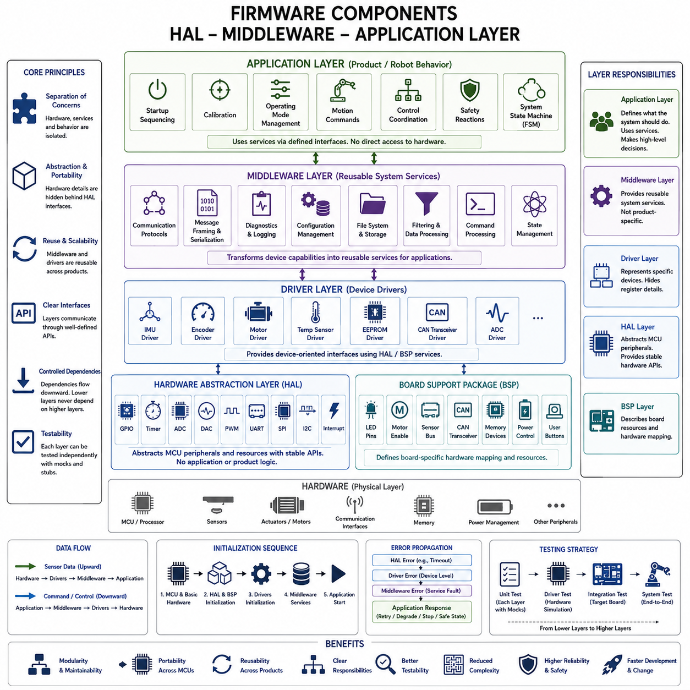{width="7.268055555555556in" height="7.268055555555556in"}

Firmware components are commonly organized into layers so that hardware-dependent mechanisms, reusable system services, and product-specific behavior can evolve with limited impact on one another. A practical embedded architecture places the Hardware Abstraction Layer, or HAL, close to the physical hardware, middleware above hardware-facing services, and the application layer at the top. This separation establishes clear responsibilities and reduces uncontrolled dependencies across the firmware system.

The Hardware Abstraction Layer provides a standardized software boundary between processor-specific hardware and higher-level firmware components. It encapsulates direct access to registers, clocks, GPIO, timers, ADC, DAC, PWM, DMA, communication peripherals, and interrupt-related resources. Instead of allowing application functions to manipulate MCU registers directly, the HAL exposes controlled operations that represent hardware capabilities through stable interfaces.

HAL design improves portability because hardware-specific implementation details remain concentrated near the bottom of the architecture. When a product migrates to another MCU family or a board revision changes peripheral assignments, developers can replace or adapt HAL implementations while preserving much of the middleware and application logic. The effectiveness of this approach depends on preventing vendor-specific definitions, register structures, and device assumptions from leaking through abstraction boundaries.

A Board Support Package, or BSP, frequently complements the HAL by representing characteristics of a particular physical board. While the HAL describes generic peripheral capabilities, the BSP associates those capabilities with concrete hardware resources such as LED pins, motor-enable signals, sensor buses, communication transceivers, memory devices, or power-control lines. This distinction helps separate processor abstraction from product-board configuration and supports reuse across multiple hardware variants.

Device drivers normally build on HAL or BSP services to represent specific physical devices. A driver may configure an IMU, encoder, motor driver, temperature sensor, EEPROM, CAN transceiver, or external ADC without requiring its users to understand the underlying register transactions. The driver converts low-level peripheral operations into device-oriented interfaces such as initialize, configure, read, write, start, stop, reset, and obtain status.

Middleware occupies the architectural region between hardware-oriented components and application behavior. It provides reusable functions that are not tied directly to a single peripheral or product feature. Communication protocols, message framing, serialization, diagnostic services, logging, configuration management, file systems, filtering, command processing, and reusable state-management mechanisms can reside in this layer. Middleware therefore transforms low-level device capabilities into services useful to application logic.

Communication middleware is particularly important in robotic embedded systems because controllers frequently exchange commands and telemetry over CAN, UART, SPI, I2C, Ethernet, EtherCAT, or other interfaces. The hardware driver should manage the physical transfer mechanism, while middleware can handle packet construction, message identification, checksums, protocol states, retries, timeouts, and data interpretation. Separating these responsibilities allows communication policy to evolve independently of peripheral implementation.

Middleware should remain reusable and avoid embedding unnecessary product-specific decisions. A diagnostic service, for example, can provide fault registration, event storage, timestamps, and status retrieval without deciding how a particular robot should react to every fault. Similarly, a configuration service can manage parameters and persistent storage while leaving application logic responsible for interpreting those parameters. This separation preserves cohesion and prevents middleware from gradually becoming hidden application code.

The application layer contains firmware behavior that expresses the purpose of the embedded controller. In a robot joint controller, this may include startup sequencing, calibration, operating-mode management, motion commands, control coordination, safety reactions, and system-level state transitions. Application logic should primarily interact with middleware and abstract device interfaces rather than directly manipulating processor registers, allowing functional behavior to remain understandable independently of hardware details.

Application components can be organized around functions, services, or finite state machines depending on system complexity. An actuator application might contain BOOT, INIT, CALIBRATION, READY, RUNNING, STOPPING, and FAULT states while using lower layers for sensor acquisition, communication, timing, and diagnostics. This keeps the state machine focused on behavioral decisions instead of mixing those decisions with register configuration, packet transmission, or low-level interrupt processing.

Layer boundaries should be enforced through explicit interfaces. Higher layers request capabilities from lower layers without accessing their internal data structures or implementation details. A sensor service might expose measured values and health status rather than its DMA buffers, while a communication service might expose received commands instead of UART registers. Such interfaces establish contracts that define valid operations, data ownership, error reporting, timing assumptions, and lifecycle expectations.

Dependency direction generally flows downward from application behavior toward abstractions provided by lower layers. Hardware-specific modules should not depend on product-level application logic because this creates circular coupling and makes reuse difficult. When lower-level components must report events upward, callbacks, event queues, status interfaces, or message mechanisms can provide controlled inversion of communication without introducing direct knowledge of higher-level implementations.

Data flow deserves separate consideration from dependency direction. Sensor data may physically travel upward from hardware through drivers and middleware to application logic, while actuator commands travel downward toward hardware. This does not require reversing architectural dependencies. Interfaces can allow information to move in both directions while preserving a stable structural rule in which high-level policy depends on lower-level abstractions rather than concrete hardware implementations.

Interrupt processing should also respect component boundaries. HAL or driver code normally handles the immediate hardware-specific interrupt operation, clears the interrupt source, captures essential data, and signals completion or an event. More complex protocol processing or behavioral decisions should occur in middleware or application context. Keeping interrupt handlers short prevents low-level asynchronous execution from becoming tightly coupled with large portions of the firmware architecture.

Error propagation must be defined consistently across layers. HAL functions can report peripheral-level conditions such as timeout or transfer failure, while drivers translate these into device-level errors and middleware may classify them into communication or service faults. The application layer can then determine the appropriate operational response, such as retrying, entering degraded operation, stopping an actuator, or transitioning into a safe state. Each layer adds context without concealing important failure information.

Initialization follows the architectural hierarchy and must respect dependencies among components. Processor clocks, memory, and basic hardware resources are prepared first, followed by HAL and BSP configuration. Device drivers are then initialized before middleware services that depend on those devices, and application components start only after their required services are available. A defined initialization sequence prevents higher layers from attempting to use resources whose lower-level dependencies have not yet reached a valid state.

Testing benefits significantly from layered firmware architecture. Application and middleware components can be tested with mock HAL or driver implementations that simulate sensors, communication channels, timing, and hardware faults. Driver tests can focus on device behavior independently from robot application logic, while target-board integration tests validate the actual HAL and BSP. This decomposition enables failures to be localized and allows much of the firmware to be verified without physical hardware.

Performance-sensitive firmware must balance architectural separation with embedded constraints. Excessively complicated interfaces can increase execution overhead, memory usage, and debugging difficulty, while insufficient separation produces tightly coupled code. Well-designed layers therefore use lightweight APIs, bounded buffers, explicit ownership, predictable execution, and carefully selected abstraction boundaries. Critical control and interrupt paths remain efficient while the overall architecture retains modularity and testability.

In robotic systems, this layered structure can be reused across joint controllers, sensor modules, power controllers, safety MCUs, communication gateways, and other embedded nodes. Different products may require different devices and board configurations while sharing common middleware for diagnostics, configuration, communication, and lifecycle management. Application behavior can then specialize each controller without repeatedly rebuilding the entire hardware-facing software foundation.

HAL, middleware, and the application layer therefore represent different levels of responsibility rather than merely different source-code directories. HAL isolates hardware mechanisms, drivers and BSP components represent concrete devices and boards, middleware provides reusable system capabilities, and the application layer defines controller behavior and operational policy. When these boundaries are supported by stable interfaces, controlled dependencies, explicit data ownership, consistent errors, and systematic testing, they form a scalable firmware architecture for reliable robotic embedded systems.

펌웨어 구성요소(Firmware Components)는 일반적으로 하드웨어 의존적 메커니즘(Hardware-Dependent Mechanism), 재사용 가능한 시스템 서비스(Reusable System Service), 제품별 동작(Product-Specific Behavior)이 서로에게 미치는 영향을 최소화하면서 독립적으로 발전할 수 있도록 계층(Layer)으로 구성됩니다. 실용적인 임베디드 아키텍처(Embedded Architecture)는 물리적 하드웨어와 가까운 위치에 하드웨어 추상화 계층(Hardware Abstraction Layer, HAL)을 배치하고, 그 위에 미들웨어(Middleware), 최상위에 애플리케이션 계층(Application Layer)을 배치합니다. 이러한 분리는 각 계층의 책임을 명확히 하고 펌웨어 시스템 전체에서 통제되지 않는 의존성을 줄입니다.

하드웨어 추상화 계층(Hardware Abstraction Layer, HAL)은 프로세서별 하드웨어(Processor-Specific Hardware)와 상위 수준 펌웨어 구성요소 사이에 표준화된 소프트웨어 경계(Standardized Software Boundary)를 제공합니다. HAL은 레지스터(Register), 클록(Clock), GPIO, 타이머(Timer), ADC, DAC, PWM, DMA, 통신 주변장치(Communication Peripheral), 인터럽트 관련 자원(Interrupt-Related Resource)에 대한 직접 접근을 캡슐화(Encapsulation)합니다. 애플리케이션 함수가 MCU 레지스터를 직접 조작하도록 하는 대신 HAL은 안정적인 인터페이스를 통해 하드웨어 기능을 표현하는 통제된 연산을 제공합니다.

HAL 설계(HAL Design)는 하드웨어별 구현 세부사항을 아키텍처 하위 영역에 집중시키기 때문에 이식성(Portability)을 향상시킵니다. 제품을 다른 MCU 제품군으로 이전하거나 보드 개정(Board Revision)에 따라 주변장치 할당이 변경되더라도 HAL 구현을 교체하거나 조정하면서 대부분의 미들웨어와 애플리케이션 로직을 유지할 수 있습니다. 이러한 접근 방식의 효과를 확보하려면 공급업체별 정의, 레지스터 구조(Register Structure), 장치 관련 가정(Device Assumption)이 추상화 경계를 넘어 상위 계층으로 유출되지 않도록 해야 합니다.

보드 지원 패키지(Board Support Package, BSP)는 특정 물리적 보드의 특성을 표현함으로써 HAL을 보완하는 경우가 많습니다. HAL이 일반적인 주변장치 기능을 정의한다면 BSP는 이러한 기능을 LED 핀, 모터 활성화 신호(Motor-Enable Signal), 센서 버스(Sensor Bus), 통신 트랜시버(Communication Transceiver), 메모리 장치(Memory Device), 전력 제어선(Power-Control Line)과 같은 실제 하드웨어 자원과 연결합니다. 이러한 구분은 프로세서 추상화(Processor Abstraction)와 제품 보드 구성(Product-Board Configuration)을 분리하여 여러 하드웨어 변형에서 재사용할 수 있도록 합니다.

장치 드라이버(Device Driver)는 일반적으로 HAL 또는 BSP 서비스를 기반으로 특정 물리적 장치를 표현합니다. 드라이버는 사용자가 내부의 레지스터 트랜잭션(Register Transaction)을 이해하지 않아도 관성 측정 장치(Inertial Measurement Unit, IMU), 엔코더(Encoder), 모터 드라이버(Motor Driver), 온도 센서, EEPROM, CAN 트랜시버, 외부 ADC 등을 설정할 수 있도록 합니다. 드라이버는 저수준 주변장치 연산을 초기화(Initialize), 설정(Configure), 읽기(Read), 쓰기(Write), 시작(Start), 정지(Stop), 리셋(Reset), 상태 조회(Status Retrieval)와 같은 장치 중심 인터페이스로 변환합니다.

미들웨어(Middleware)는 하드웨어 지향 구성요소와 애플리케이션 동작 사이의 아키텍처 영역을 담당합니다. 미들웨어는 하나의 특정 주변장치나 제품 기능에 직접 종속되지 않는 재사용 가능한 기능을 제공합니다. 통신 프로토콜(Communication Protocol), 메시지 프레이밍(Message Framing), 직렬화(Serialization), 진단 서비스(Diagnostic Service), 로깅(Logging), 구성 관리(Configuration Management), 파일 시스템(File System), 필터링(Filtering), 명령 처리(Command Processing), 재사용 가능한 상태 관리 메커니즘 등이 이 계층에 위치할 수 있습니다. 따라서 미들웨어는 저수준 장치 기능을 애플리케이션 로직이 사용할 수 있는 서비스로 변환합니다.

통신 미들웨어(Communication Middleware)는 컨트롤러가 CAN, UART, SPI, I2C, Ethernet, EtherCAT 등의 인터페이스를 통해 명령과 텔레메트리(Telemetry)를 빈번하게 교환하는 로봇 임베디드 시스템에서 특히 중요합니다. 하드웨어 드라이버는 물리적 전송 메커니즘을 관리하고, 미들웨어는 패킷 구성(Packet Construction), 메시지 식별, 체크섬(Checksum), 프로토콜 상태, 재시도(Retry), 타임아웃(Timeout), 데이터 해석을 처리할 수 있습니다. 이러한 책임 분리를 통해 주변장치 구현과 독립적으로 통신 정책을 발전시킬 수 있습니다.

미들웨어는 재사용 가능성을 유지해야 하며 불필요한 제품별 의사결정을 포함하지 않아야 합니다. 예를 들어 진단 서비스는 특정 로봇이 각각의 고장에 어떻게 대응할 것인지를 결정하지 않고 고장 등록(Fault Registration), 이벤트 저장(Event Storage), 타임스탬프(Timestamp), 상태 조회 기능을 제공할 수 있습니다. 마찬가지로 구성 서비스(Configuration Service)는 매개변수(Parameter)와 영구 저장장치(Persistent Storage)를 관리하고, 해당 매개변수를 어떻게 해석할 것인지는 애플리케이션 로직에 맡길 수 있습니다. 이러한 분리는 응집도(Cohesion)를 유지하고 미들웨어가 숨겨진 애플리케이션 코드로 변하는 것을 방지합니다.

애플리케이션 계층(Application Layer)은 임베디드 컨트롤러의 목적을 표현하는 펌웨어 동작을 포함합니다. 로봇 관절 컨트롤러(Robot Joint Controller)의 경우 시작 시퀀스(Startup Sequencing), 보정(Calibration), 운용 모드 관리(Operating-Mode Management), 모션 명령(Motion Command), 제어 조정(Control Coordination), 안전 대응(Safety Reaction), 시스템 수준 상태 전이(System-Level State Transition) 등이 포함될 수 있습니다. 애플리케이션 로직은 프로세서 레지스터를 직접 조작하기보다 주로 미들웨어와 추상화된 장치 인터페이스를 사용해야 하며, 이를 통해 기능적 동작을 하드웨어 세부사항과 독립적으로 이해할 수 있습니다.

애플리케이션 구성요소(Application Component)는 시스템 복잡도에 따라 함수(Function), 서비스(Service), 유한 상태 머신(Finite State Machine, FSM)을 중심으로 구성할 수 있습니다. 액추에이터 애플리케이션은 부팅(BOOT), 초기화(INIT), 보정(CALIBRATION), 준비(READY), 실행(RUNNING), 정지(STOPPING), 고장(FAULT) 상태를 포함하면서 하위 계층을 통해 센서 데이터 획득, 통신, 타이밍, 진단 기능을 사용할 수 있습니다. 이를 통해 상태 머신은 레지스터 설정, 패킷 전송, 저수준 인터럽트 처리와 혼합되지 않고 동작 의사결정(Behavioral Decision)에 집중할 수 있습니다.

계층 경계(Layer Boundary)는 명시적인 인터페이스(Explicit Interface)를 통해 유지되어야 합니다. 상위 계층은 하위 계층의 내부 데이터 구조나 구현 세부사항에 직접 접근하지 않고 제공되는 기능을 요청해야 합니다. 센서 서비스는 내부 DMA 버퍼 대신 측정값과 상태 정보(Health Status)를 제공하고, 통신 서비스는 UART 레지스터 대신 수신된 명령을 제공할 수 있습니다. 이러한 인터페이스는 유효한 연산, 데이터 소유권(Data Ownership), 오류 보고(Error Reporting), 타이밍 가정(Timing Assumption), 수명주기 요구사항(Lifecycle Expectation)을 정의하는 계약(Contract)을 형성합니다.

의존성 방향(Dependency Direction)은 일반적으로 애플리케이션 동작에서 하위 계층이 제공하는 추상화 방향으로 흐릅니다. 하드웨어별 모듈이 제품 수준의 애플리케이션 로직에 의존하면 순환 결합(Circular Coupling)이 발생하여 재사용이 어려워지므로 이러한 구조를 피해야 합니다. 하위 구성요소가 상위 계층으로 이벤트를 전달해야 할 경우 콜백(Callback), 이벤트 큐(Event Queue), 상태 인터페이스(Status Interface), 메시지 메커니즘(Message Mechanism)을 사용하면 상위 구현을 직접 알지 않고도 통제된 역방향 통신을 구현할 수 있습니다.

데이터 흐름(Data Flow)은 의존성 방향과 별도로 고려해야 합니다. 센서 데이터는 물리적으로 하드웨어에서 드라이버와 미들웨어를 거쳐 애플리케이션 로직으로 상향 이동하고, 액추에이터 명령은 반대로 하드웨어를 향해 하향 이동할 수 있습니다. 그러나 이것이 아키텍처 의존성을 반대로 만들어야 한다는 의미는 아닙니다. 인터페이스를 사용하면 정보가 양방향으로 이동하면서도 상위 수준 정책이 구체적인 하드웨어 구현이 아니라 하위 수준의 추상화에 의존한다는 안정적인 구조적 규칙을 유지할 수 있습니다.

인터럽트 처리(Interrupt Processing) 역시 구성요소 경계를 준수해야 합니다. HAL이나 드라이버 코드는 일반적으로 즉각적인 하드웨어별 인터럽트 처리를 수행하고, 인터럽트 발생 원인을 제거하며, 필수 데이터를 획득하고, 완료 또는 이벤트를 알립니다. 보다 복잡한 프로토콜 처리나 동작 의사결정은 미들웨어 또는 애플리케이션 컨텍스트(Application Context)에서 수행해야 합니다. 인터럽트 처리기를 짧게 유지하면 저수준 비동기 실행(Asynchronous Execution)이 펌웨어 아키텍처의 광범위한 영역과 강하게 결합되는 것을 방지할 수 있습니다.

오류 전파(Error Propagation)는 모든 계층에서 일관성 있게 정의되어야 합니다. HAL 함수는 타임아웃이나 전송 실패와 같은 주변장치 수준의 상태를 보고하고, 드라이버는 이를 장치 수준 오류(Device-Level Error)로 변환하며, 미들웨어는 통신 또는 서비스 고장(Service Fault)으로 분류할 수 있습니다. 이후 애플리케이션 계층은 재시도, 성능 저하 운전(Degraded Operation), 액추에이터 정지, 안전 상태(Safe State) 전이와 같은 적절한 운용 대응을 결정합니다. 각 계층은 중요한 고장 정보를 숨기지 않으면서 필요한 문맥(Context)을 추가해야 합니다.

초기화(Initialization)는 아키텍처 계층 구조를 따르면서 구성요소 사이의 의존성을 준수해야 합니다. 먼저 프로세서 클록, 메모리, 기본 하드웨어 자원을 준비하고 이후 HAL과 BSP를 설정합니다. 그다음 장치 드라이버를 초기화한 후 해당 장치에 의존하는 미들웨어 서비스를 준비하며, 필요한 서비스가 사용 가능한 상태가 된 이후에만 애플리케이션 구성요소를 시작합니다. 정의된 초기화 순서(Initialization Sequence)는 하위 수준 의존성이 아직 유효한 상태에 도달하지 않았는데 상위 계층이 해당 자원을 사용하는 문제를 방지합니다.

계층형 펌웨어 아키텍처(Layered Firmware Architecture)는 테스트(Test)에 상당한 이점을 제공합니다. 애플리케이션과 미들웨어 구성요소는 센서, 통신 채널, 타이밍, 하드웨어 고장을 시뮬레이션하는 목 HAL(Mock HAL) 또는 목 드라이버(Mock Driver)를 이용하여 테스트할 수 있습니다. 드라이버 테스트는 로봇 애플리케이션 로직과 독립적으로 장치 동작에 집중할 수 있으며, 대상 보드 통합 테스트(Target-Board Integration Test)는 실제 HAL과 BSP를 검증할 수 있습니다. 이러한 분해는 장애 위치를 쉽게 특정하고 실제 물리적 하드웨어 없이도 펌웨어의 상당 부분을 검증할 수 있게 합니다.

성능에 민감한 펌웨어(Performance-Sensitive Firmware)는 아키텍처 분리와 임베디드 시스템의 제약 사이에서 균형을 유지해야 합니다. 지나치게 복잡한 인터페이스는 실행 오버헤드(Execution Overhead), 메모리 사용량, 디버깅 난이도를 증가시키지만, 분리가 부족하면 코드가 강하게 결합됩니다. 따라서 잘 설계된 계층은 경량 API(Lightweight API), 제한된 버퍼(Bounded Buffer), 명확한 소유권, 예측 가능한 실행, 신중하게 선택된 추상화 경계를 사용합니다. 이를 통해 중요한 제어 및 인터럽트 경로의 효율성을 유지하면서 전체 아키텍처의 모듈성과 테스트 가능성을 확보할 수 있습니다.

로봇 시스템(Robotic System)에서 이러한 계층 구조는 관절 컨트롤러(Joint Controller), 센서 모듈(Sensor Module), 전력 컨트롤러(Power Controller), 안전 MCU(Safety MCU), 통신 게이트웨이(Communication Gateway) 및 다양한 임베디드 노드(Embedded Node)에 재사용할 수 있습니다. 서로 다른 제품은 서로 다른 장치와 보드 구성을 필요로 하더라도 진단, 구성, 통신, 수명주기 관리(Lifecycle Management)를 위한 공통 미들웨어를 공유할 수 있습니다. 이후 애플리케이션 동작을 각 컨트롤러에 특화함으로써 전체 하드웨어 대응 소프트웨어 기반을 매번 새롭게 구축할 필요가 없습니다.

따라서 하드웨어 추상화 계층(HAL), 미들웨어(Middleware), 애플리케이션 계층(Application Layer)은 단순히 서로 다른 소스 코드 디렉터리가 아니라 서로 다른 책임 수준(Level of Responsibility)을 나타냅니다. HAL은 하드웨어 메커니즘을 격리하고, 드라이버와 BSP는 구체적인 장치와 보드를 표현하며, 미들웨어는 재사용 가능한 시스템 기능을 제공하고, 애플리케이션 계층은 컨트롤러 동작과 운용 정책(Operational Policy)을 정의합니다. 이러한 경계를 안정적인 인터페이스, 통제된 의존성, 명시적인 데이터 소유권, 일관된 오류 처리, 체계적인 테스트로 지원하면 신뢰성 높은 로봇 임베디드 시스템을 위한 확장 가능한 펌웨어 아키텍처를 구성할 수 있습니다.

##  

## 05.05 Firmware Interface Definition: API Design Principles

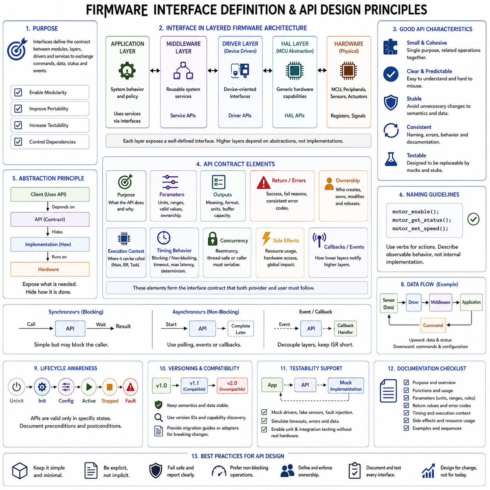{width="7.268055555555556in" height="7.268055555555556in"}

A firmware interface defines the contract through which modules, layers, drivers, and services exchange commands, data, status, and events. Good API design prevents one component from depending on another component's internal representation, allowing implementations to change while preserving expected behavior. Within layered firmware architecture, these contracts are essential for maintaining modularity, portability, testability, and controlled dependency direction.

An interface should describe what a component provides rather than how that capability is implemented. A motor interface may expose initialization, enable, disable, command, status, and fault operations without revealing PWM registers, timer channels, DMA structures, or internal control variables. This distinction preserves encapsulation and allows application software to express intent using domain-level operations instead of manipulating hardware mechanisms directly.

API boundaries should correspond to architectural responsibilities. HAL APIs represent generic MCU capabilities, device-driver APIs represent physical devices, middleware APIs provide reusable services, and application interfaces coordinate system behavior. Allowing higher layers to bypass these boundaries creates hidden dependencies and weakens portability. A well-defined interface therefore becomes both a programming mechanism and an architectural rule governing which components are permitted to know about one another.

A good firmware API should be small, cohesive, and difficult to misuse. Each operation should have a clear purpose, predictable semantics, and a limited set of responsibilities. Interfaces containing many unrelated functions often indicate that the underlying module owns too many concerns. Conversely, excessively fragmented APIs increase coordination overhead. The objective is to expose the minimum capability necessary for clients while keeping related operations together behind one meaningful abstraction.

Naming strongly influences interface readability. Function, type, parameter, event, and error names should communicate intent consistently across the firmware platform. Operations such as initialize, start, stop, read, write, configure, reset, and get_status should retain predictable meanings. Names should describe observable behavior rather than internal implementation details, because implementation-oriented names make interfaces harder to preserve when the underlying hardware or algorithm changes.

Input parameters form part of the API contract and should have explicit units, ranges, ownership rules, and validity conditions. A velocity command should make clear whether its value represents radians per second, revolutions per minute, or normalized output. Timing values should identify their units, and pointers should define whether NULL is permitted. Ambiguous parameter semantics create integration defects even when the underlying implementation is technically correct.

Output semantics require the same discipline. An API returning sensor data should specify whether the value is raw, calibrated, filtered, timestamped, or converted into engineering units. Status functions should distinguish current operating state from historical fault information. When output buffers are supplied by the caller, the interface should define required capacity and valid data length. Clear semantics prevent different modules from interpreting identical data structures in incompatible ways.

Return values and error codes should communicate operational results consistently. APIs should distinguish success from invalid parameters, unavailable resources, timeout, busy conditions, communication failures, hardware faults, and unsupported operations when these distinctions matter to the caller. Error definitions should remain stable enough for higher layers to implement recovery policies without depending on vendor-specific register flags or undocumented internal states.

Resource ownership is another critical part of interface definition. APIs involving buffers, memory blocks, peripheral handles, DMA transfers, or message objects must establish who creates, modifies, retains, and releases each resource. Unclear ownership produces memory corruption, stale references, duplicated modification, and race conditions. Firmware interfaces should therefore make ownership transfer explicit and minimize shared mutable state wherever deterministic behavior is required.

Execution context must also be documented. Some APIs may be safe from the main loop but prohibited inside an Interrupt Service Routine, while others are specifically designed for interrupt context. An operation may be synchronous, asynchronous, blocking, or non-blocking. Without this information, a logically correct function call can still violate real-time constraints. Context restrictions are therefore part of the interface contract rather than secondary implementation documentation.

Timing semantics become especially important in robotic firmware. An interface may guarantee bounded execution time, initiate an asynchronous transaction, or require completion within a defined timeout. Control APIs may need deterministic activation periods and maximum latency, while diagnostic operations can tolerate slower processing. Explicit timing assumptions help system designers determine whether multiple components can coexist within available CPU and communication budgets.

Non-blocking APIs are generally preferable for operations whose completion time depends on hardware or communication. Instead of waiting until a CAN transaction, SPI transfer, flash write, or sensor conversion finishes, an API can start the operation and report completion through status polling, callbacks, events, or queues. This model preserves responsiveness and integrates naturally with bare-metal super loops, finite state machines, and real-time schedulers.

Callbacks and event interfaces provide controlled communication from lower layers toward higher layers. A driver can report transfer completion or device faults without directly depending on application code. However, callback contracts must specify execution context, permitted operations, data lifetime, and reentrancy expectations. Event queues provide greater decoupling when processing should be deferred, while direct callbacks may be appropriate for short and deterministic notifications.

Reentrancy and concurrency requirements should be explicitly defined when APIs can be called from multiple tasks, interrupt contexts, or processing cores. An interface may be reentrant, internally synchronized, or require serialization by the caller. Hidden assumptions about concurrent access are a common source of intermittent firmware defects. Making synchronization responsibilities part of the contract allows developers to reason about shared peripherals and services systematically.

Configuration interfaces should separate static platform configuration from runtime commands. Pin assignments, peripheral instances, communication rates, buffer capacities, and hardware capabilities may be established during initialization, while operational parameters can change during execution. Separating these categories avoids APIs that permit unsafe reconfiguration at arbitrary times and clarifies which properties remain invariant throughout the component lifecycle.

Lifecycle semantics should define when an interface can legally be used. Components commonly progress through states such as uninitialized, initialized, configured, active, stopped, and faulted. Calling start before initialization or configuration may therefore be invalid. APIs should either prevent such sequences structurally or detect them explicitly. Clear lifecycle rules align interfaces with FSM-based firmware and make illegal operating sequences easier to identify during testing.

Versioning must be considered when interfaces persist across firmware releases or independently developed components. Stable APIs should avoid unnecessary changes to function semantics, data layouts, enumerations, and message formats. When incompatible changes are unavoidable, explicit version identification, capability discovery, migration rules, or compatibility adapters can prevent older components from silently misinterpreting newer interfaces. The surrounding firmware structure explicitly places compatibility strategy immediately after interface definition.

Interface design should support testability from the beginning. Application logic that depends on abstract APIs can be connected to mock drivers, simulated sensors, fake communication services, or fault-injection implementations. Tests can then reproduce timeout, corrupted data, unavailable hardware, and abnormal state sequences without physical devices. Stable interfaces effectively create substitution points where real implementations can be replaced with controlled test doubles.

Documentation should treat an API as a behavioral specification rather than merely a list of function prototypes. Each operation should communicate purpose, inputs, outputs, preconditions, postconditions, errors, timing behavior, ownership, execution context, and side effects where relevant. Interface documentation should also identify assumptions that cannot be expressed directly by the programming language, because those assumptions frequently determine whether integration succeeds or fails.

In robotic firmware, carefully designed interfaces establish stable boundaries among sensor drivers, motor controllers, communication services, diagnostics, safety functions, and application state machines. A higher-level controller can request motion or read health information without understanding register-level mechanisms. This principle scales from a single MCU to distributed robot subsystems because each component exposes capabilities through contracts rather than exposing its internal implementation.

Firmware API design is therefore an architectural discipline centered on explicit contracts. Effective interfaces combine clear semantics, limited responsibilities, controlled ownership, consistent errors, defined timing, lifecycle rules, concurrency expectations, version compatibility, and test substitution points. When these properties are maintained across HAL, drivers, middleware, and application components, firmware can evolve without allowing implementation changes to propagate unpredictably throughout the embedded system.

펌웨어 인터페이스(Firmware Interface)는 모듈(Module), 계층(Layer), 드라이버(Driver), 서비스(Service)가 명령(Command), 데이터(Data), 상태(Status), 이벤트(Event)를 교환하는 계약(Contract)을 정의합니다. 올바른 API 설계(API Design)는 하나의 구성요소가 다른 구성요소의 내부 표현(Internal Representation)에 의존하는 것을 방지하여 예상되는 동작을 유지하면서 구현을 변경할 수 있도록 합니다. 계층형 펌웨어 아키텍처(Layered Firmware Architecture)에서 이러한 계약은 모듈성(Modularity), 이식성(Portability), 테스트 가능성(Testability), 통제된 의존성 방향(Controlled Dependency Direction)을 유지하는 데 필수적입니다.

인터페이스(Interface)는 구성요소가 기능을 어떻게 구현하는지가 아니라 어떤 기능을 제공하는지를 설명해야 합니다. 모터 인터페이스(Motor Interface)는 PWM 레지스터, 타이머 채널, DMA 구조, 내부 제어 변수를 노출하지 않고 초기화(Initialization), 활성화(Enable), 비활성화(Disable), 명령(Command), 상태(Status), 고장(Fault) 기능을 제공할 수 있습니다. 이러한 구분은 캡슐화(Encapsulation)를 유지하며 애플리케이션 소프트웨어가 하드웨어 메커니즘을 직접 조작하는 대신 도메인 수준 연산(Domain-Level Operation)을 통해 의도를 표현할 수 있도록 합니다.

API 경계(API Boundary)는 아키텍처의 책임과 일치해야 합니다. HAL API는 일반적인 MCU 기능을 표현하고, 장치 드라이버 API(Device-Driver API)는 물리적 장치를 표현하며, 미들웨어 API(Middleware API)는 재사용 가능한 서비스를 제공하고, 애플리케이션 인터페이스(Application Interface)는 시스템 동작을 조정합니다. 상위 계층이 이러한 경계를 우회하도록 허용하면 숨겨진 의존성(Hidden Dependency)이 발생하고 이식성이 약화됩니다. 따라서 잘 정의된 인터페이스는 프로그래밍 메커니즘인 동시에 어떤 구성요소가 서로를 인식할 수 있는지를 규정하는 아키텍처 규칙입니다.

좋은 펌웨어 API는 작고 응집력(Cohesion)이 높으며 잘못 사용하기 어렵게 설계되어야 합니다. 각각의 연산은 명확한 목적, 예측 가능한 의미(Semantics), 제한된 책임 범위를 가져야 합니다. 서로 관련 없는 많은 함수를 포함하는 인터페이스는 기본 모듈이 지나치게 많은 책임을 가지고 있음을 의미할 수 있습니다. 반대로 API를 지나치게 세분화하면 구성요소 간 조정 오버헤드(Coordination Overhead)가 증가합니다. 따라서 클라이언트(Client)에 필요한 최소한의 기능을 제공하면서 관련 연산을 하나의 의미 있는 추상화(Abstraction) 안에 유지해야 합니다.

명명 방식(Naming)은 인터페이스의 가독성에 큰 영향을 줍니다. 함수(Function), 타입(Type), 매개변수(Parameter), 이벤트(Event), 오류(Error)의 이름은 펌웨어 플랫폼 전체에서 일관된 의도를 전달해야 합니다. 초기화(Initialize), 시작(Start), 정지(Stop), 읽기(Read), 쓰기(Write), 설정(Configure), 리셋(Reset), 상태 조회(Get Status)와 같은 연산은 일관되고 예측 가능한 의미를 유지해야 합니다. 구현 중심의 이름은 기반 하드웨어나 알고리즘이 변경될 때 인터페이스 유지가 어려워지므로 이름은 내부 구현보다 외부에서 관찰 가능한 동작(Observable Behavior)을 표현해야 합니다.

입력 매개변수(Input Parameter)는 API 계약의 일부이며 명확한 단위(Unit), 범위(Range), 소유권 규칙(Ownership Rule), 유효성 조건(Validity Condition)을 가져야 합니다. 속도 명령(Velocity Command)은 값이 초당 라디안(Radians per Second), 분당 회전수(Revolutions per Minute), 정규화 출력(Normalized Output) 중 무엇을 의미하는지 명확해야 합니다. 시간 값은 단위를 식별할 수 있어야 하며 포인터(Pointer)는 NULL 허용 여부를 정의해야 합니다. 모호한 매개변수 의미는 기반 구현이 기술적으로 정확하더라도 통합 결함(Integration Defect)을 발생시킬 수 있습니다.

출력 의미(Output Semantics)에도 동일한 수준의 규율이 필요합니다. 센서 데이터를 반환하는 API는 해당 값이 원시 데이터(Raw Data), 보정 데이터(Calibrated Data), 필터링 데이터(Filtered Data), 타임스탬프 데이터(Timestamped Data), 공학 단위(Engineering Unit)로 변환된 데이터인지 명시해야 합니다. 상태 함수는 현재 운용 상태(Current Operating State)와 과거 고장 정보(Historical Fault Information)를 구분해야 합니다. 호출자가 출력 버퍼(Output Buffer)를 제공하는 경우 인터페이스는 필요한 용량과 유효 데이터 길이를 정의해야 하며, 명확한 의미 정의를 통해 서로 다른 모듈이 동일한 데이터 구조를 서로 다르게 해석하는 문제를 방지할 수 있습니다.

반환 값(Return Value)과 오류 코드(Error Code)는 연산 결과를 일관된 방식으로 전달해야 합니다. 호출자에게 이러한 구분이 필요한 경우 API는 성공(Success), 잘못된 매개변수(Invalid Parameter), 사용할 수 없는 자원(Unavailable Resource), 타임아웃(Timeout), 사용 중(Busy), 통신 실패(Communication Failure), 하드웨어 고장(Hardware Fault), 지원되지 않는 연산(Unsupported Operation)을 구분해야 합니다. 오류 정의는 상위 계층이 공급업체별 레지스터 플래그나 문서화되지 않은 내부 상태에 의존하지 않고 복구 정책(Recovery Policy)을 구현할 수 있을 정도로 안정적이어야 합니다.

자원 소유권(Resource Ownership)은 인터페이스 정의에서 또 하나의 핵심 요소입니다. 버퍼, 메모리 블록(Memory Block), 주변장치 핸들(Peripheral Handle), DMA 전송, 메시지 객체(Message Object)를 사용하는 API는 각각의 자원을 누가 생성하고 수정하며 유지하고 해제하는지를 정의해야 합니다. 불명확한 소유권은 메모리 손상(Memory Corruption), 오래된 참조(Stale Reference), 중복 수정, 경쟁 상태(Race Condition)를 발생시킬 수 있습니다. 따라서 결정론적 동작(Deterministic Behavior)이 필요한 펌웨어에서는 소유권 이전(Ownership Transfer)을 명확히 하고 공유 가변 상태(Shared Mutable State)를 최소화해야 합니다.

실행 컨텍스트(Execution Context) 역시 문서화되어야 합니다. 일부 API는 메인 루프(Main Loop)에서는 안전하지만 인터럽트 서비스 루틴(Interrupt Service Routine, ISR)에서는 사용할 수 없으며, 다른 API는 인터럽트 컨텍스트를 위해 특별히 설계될 수 있습니다. 또한 연산은 동기식(Synchronous), 비동기식(Asynchronous), 블로킹(Blocking), 논블로킹(Non-Blocking) 방식으로 동작할 수 있습니다. 이러한 정보가 없다면 논리적으로 올바른 함수 호출이라도 실시간 제약(Real-Time Constraint)을 위반할 수 있으므로 컨텍스트 제한은 부가적인 구현 문서가 아니라 인터페이스 계약의 일부입니다.

타이밍 의미(Timing Semantics)는 로봇 펌웨어에서 특히 중요합니다. 인터페이스는 제한된 실행 시간(Bounded Execution Time)을 보장하거나 비동기 트랜잭션(Asynchronous Transaction)을 시작하거나 정의된 타임아웃 안에서 완료되어야 할 수 있습니다. 제어 API(Control API)는 결정론적인 활성화 주기와 최대 지연시간(Maximum Latency)이 필요할 수 있지만 진단 연산(Diagnostic Operation)은 상대적으로 느린 처리를 허용할 수 있습니다. 명시적인 타이밍 가정은 여러 구성요소가 사용 가능한 CPU 및 통신 예산 안에서 함께 동작할 수 있는지를 판단하는 데 도움을 줍니다.

완료 시간이 하드웨어나 통신 상태에 따라 달라지는 연산에는 일반적으로 논블로킹 API(Non-Blocking API)가 적합합니다. CAN 트랜잭션, SPI 전송, 플래시 쓰기(Flash Write), 센서 변환이 완료될 때까지 기다리는 대신 API가 작업을 시작하고 상태 폴링(Status Polling), 콜백(Callback), 이벤트(Event), 큐(Queue)를 통해 완료 여부를 전달할 수 있습니다. 이러한 모델은 시스템 응답성을 유지하고 베어메탈 슈퍼 루프(Bare-Metal Super Loop), 유한 상태 머신(Finite State Machine, FSM), 실시간 스케줄러(Real-Time Scheduler)와 자연스럽게 통합됩니다.

콜백(Callback)과 이벤트 인터페이스(Event Interface)는 하위 계층에서 상위 계층으로 통제된 통신을 제공합니다. 드라이버는 애플리케이션 코드에 직접 의존하지 않으면서 전송 완료나 장치 고장을 보고할 수 있습니다. 그러나 콜백 계약은 실행 컨텍스트, 허용되는 연산, 데이터 수명(Data Lifetime), 재진입성(Reentrancy) 요구사항을 명확히 정의해야 합니다. 처리를 지연시켜야 하는 경우 이벤트 큐(Event Queue)가 더 높은 디커플링(Decoupling)을 제공하며, 짧고 결정론적인 알림에는 직접 콜백이 적합할 수 있습니다.

API가 여러 태스크(Task), 인터럽트 컨텍스트 또는 프로세싱 코어(Processing Core)에서 호출될 수 있다면 재진입성(Reentrancy)과 동시성(Concurrency) 요구사항을 명확하게 정의해야 합니다. 인터페이스 자체가 재진입 가능하거나 내부적으로 동기화될 수도 있으며, 호출자가 직렬화(Serialization)를 보장해야 할 수도 있습니다. 동시 접근에 관한 숨겨진 가정은 간헐적으로 발생하는 펌웨어 결함의 주요 원인이므로 동기화 책임(Synchronization Responsibility)을 계약의 일부로 만들면 공유 주변장치와 서비스를 체계적으로 분석할 수 있습니다.

구성 인터페이스(Configuration Interface)는 정적 플랫폼 구성(Static Platform Configuration)과 런타임 명령(Runtime Command)을 분리해야 합니다. 핀 할당, 주변장치 인스턴스, 통신 속도, 버퍼 용량, 하드웨어 기능은 초기화 과정에서 설정될 수 있으며 운용 매개변수는 실행 중 변경될 수 있습니다. 이러한 범주를 분리하면 임의의 시점에 위험한 재설정을 허용하는 API를 방지하고 구성요소의 수명주기 전체에서 어떤 속성이 불변(Invariant)으로 유지되는지를 명확하게 할 수 있습니다.

수명주기 의미(Lifecycle Semantics)는 인터페이스를 언제 합법적으로 사용할 수 있는지를 정의해야 합니다. 구성요소는 일반적으로 미초기화(Uninitialized), 초기화(Initialized), 설정 완료(Configured), 활성(Active), 정지(Stopped), 고장(Faulted) 등의 상태를 거칩니다. 따라서 초기화나 설정 이전에 시작(Start)을 호출하는 것은 유효하지 않을 수 있습니다. API는 이러한 순서를 구조적으로 방지하거나 명시적으로 감지해야 하며, 명확한 수명주기 규칙은 FSM 기반 펌웨어와 인터페이스를 정렬하고 테스트 과정에서 잘못된 운용 순서를 쉽게 식별하도록 합니다.

인터페이스가 여러 펌웨어 릴리스(Firmware Release) 또는 독립적으로 개발되는 구성요소 사이에서 지속적으로 사용된다면 버전 관리(Versioning)를 고려해야 합니다. 안정적인 API는 함수 의미, 데이터 레이아웃(Data Layout), 열거형(Enumeration), 메시지 형식(Message Format)의 불필요한 변경을 피해야 합니다. 호환되지 않는 변경이 불가피한 경우 명시적인 버전 식별(Version Identification), 기능 탐색(Capability Discovery), 마이그레이션 규칙(Migration Rule), 호환성 어댑터(Compatibility Adapter)를 사용하여 이전 구성요소가 새로운 인터페이스를 잘못 해석하는 것을 방지할 수 있습니다.

인터페이스 설계는 처음부터 테스트 가능성(Testability)을 지원해야 합니다. 추상화된 API에 의존하는 애플리케이션 로직은 목 드라이버(Mock Driver), 시뮬레이션 센서(Simulated Sensor), 가상 통신 서비스(Fake Communication Service), 고장 주입 구현(Fault-Injection Implementation)에 연결할 수 있습니다. 이를 통해 물리적 장치 없이도 타임아웃, 손상된 데이터, 사용할 수 없는 하드웨어, 비정상적인 상태 시퀀스를 재현할 수 있습니다. 안정적인 인터페이스는 실제 구현을 통제된 테스트 대역(Test Double)으로 교체할 수 있는 효과적인 대체 지점(Substitution Point)을 제공합니다.

문서화(Documentation)는 API를 단순한 함수 프로토타입(Function Prototype)의 목록이 아니라 동작 명세(Behavioral Specification)로 다루어야 합니다. 각각의 연산은 필요한 경우 목적, 입력, 출력, 사전조건(Precondition), 사후조건(Postcondition), 오류, 타이밍 동작, 소유권, 실행 컨텍스트, 부작용(Side Effect)을 명확하게 전달해야 합니다. 또한 프로그래밍 언어 자체로 직접 표현할 수 없는 가정도 인터페이스 문서에 포함해야 하는데, 이러한 가정이 실제 시스템 통합의 성공과 실패를 결정하는 경우가 많기 때문입니다.

로봇 펌웨어(Robotic Firmware)에서 신중하게 설계된 인터페이스는 센서 드라이버, 모터 컨트롤러, 통신 서비스, 진단 기능, 안전 기능, 애플리케이션 상태 머신 사이에 안정적인 경계를 형성합니다. 상위 수준 컨트롤러는 레지스터 수준의 메커니즘을 이해하지 않고도 모션(Motion)을 요청하거나 상태 정보(Health Information)를 읽을 수 있습니다. 각 구성요소가 내부 구현 대신 명확한 계약을 통해 기능을 제공하므로 이러한 원칙은 단일 MCU에서 분산 로봇 서브시스템(Distributed Robot Subsystem)까지 확장할 수 있습니다.

따라서 펌웨어 API 설계(Firmware API Design)는 명시적인 계약(Explicit Contract)을 중심으로 하는 아키텍처 규율(Architectural Discipline)입니다. 효과적인 인터페이스는 명확한 의미, 제한된 책임, 통제된 소유권, 일관된 오류, 정의된 타이밍, 수명주기 규칙, 동시성 요구사항, 버전 호환성(Version Compatibility), 테스트 대체 지점을 결합합니다. 이러한 특성을 HAL, 드라이버, 미들웨어, 애플리케이션 구성요소 전반에서 유지하면 구현 변경이 임베디드 시스템 전체에 예측할 수 없는 방식으로 전파되는 것을 방지하면서 펌웨어를 지속적으로 발전시킬 수 있습니다.

##  

## 05.06 Firmware Version Control and Compatibility Strategy

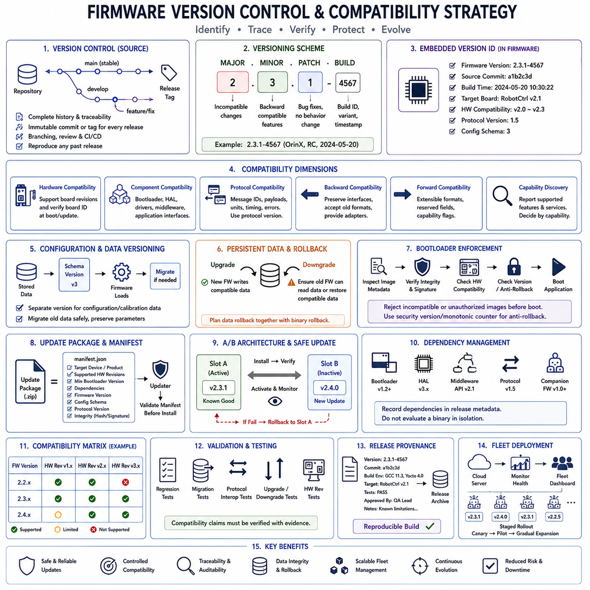{width="7.268055555555556in" height="7.268055555555556in"}

Firmware version control provides a disciplined mechanism for identifying, reproducing, comparing, and maintaining software releases throughout the lifecycle of an embedded product. In robotic systems, firmware may remain deployed for years across controllers with different hardware revisions and operational histories. A version strategy must therefore identify not only source-code evolution but also the exact binary, configuration, interfaces, dependencies, and compatibility assumptions associated with each release.

Source version control should preserve the complete history of firmware changes and provide traceability from a released binary back to the source used to build it. Each production release should correspond to an immutable commit or tag, while development occurs through controlled branches and reviewed changes. This enables engineers to reproduce previous releases, compare modifications, investigate regressions, and maintain multiple supported firmware generations without relying on manually copied source directories.

A firmware version identifier should communicate meaningful compatibility information rather than functioning only as a build label. A common approach distinguishes major, minor, and patch revisions. A major revision can indicate incompatible architectural or interface changes, a minor revision can introduce backward-compatible capabilities, and a patch revision can identify corrections that preserve existing behavior. Additional build metadata may identify development builds, release candidates, hardware variants, or manufacturing configurations.

Version identity should be embedded into the firmware image itself so that a running controller can report exactly which software it contains. Useful metadata may include firmware version, build identifier, source commit, build timestamp, target board, hardware compatibility range, protocol version, and configuration schema version. Diagnostic tools, bootloaders, service software, and higher-level robot controllers can retrieve this information to establish traceability and determine whether interacting components are mutually compatible.

Hardware and firmware compatibility must be explicitly modeled because identical firmware cannot always operate safely on every board revision. Changes in pin assignments, sensors, memory devices, communication transceivers, clock sources, power circuits, or safety signals can invalidate assumptions embedded in older software. Firmware should therefore identify supported hardware revisions and verify board identity during startup or update whenever the platform provides reliable hardware identification.

Compatibility also exists between firmware components. A bootloader may need to understand an application image format, middleware may depend on particular driver capabilities, and an application may expect specific service interfaces. Versioning these boundaries allows compatibility decisions to be made deliberately. Stable interfaces should remain backward compatible when practical, while incompatible changes should require explicit version transitions instead of silently changing previously defined behavior.

Communication protocols require particular attention because robotic controllers frequently evolve independently. Message identifiers, payload layouts, units, enumerations, timing expectations, and error semantics can change between releases. A protocol version should therefore be available independently from the overall firmware version when necessary. Receivers should validate supported protocol versions and reject, translate, or safely degrade unsupported messages rather than interpreting incompatible data as valid commands.

Backward compatibility allows newer firmware to continue operating with components designed for an earlier contract. This can be achieved by preserving existing message fields, maintaining stable API semantics, accepting older configuration formats, or providing translation adapters. Compatibility should not mean preserving every historical behavior indefinitely. The objective is to define a controlled support window so that system evolution remains possible without causing unexpected failures in deployed robots.

Forward compatibility is more difficult because older firmware cannot predict all future features. Interfaces can nevertheless be designed to tolerate extension through reserved fields, explicit lengths, capability flags, optional parameters, or unknown-message handling rules. An older component should ideally ignore unsupported optional information while preserving safe operation. Extensible formats reduce the need for coordinated upgrades across every embedded node whenever a new capability is introduced.

Capability discovery complements version comparison by describing what a component can actually perform. Two devices may report different firmware versions while still supporting the same required interface. A controller can advertise capabilities such as supported control modes, sensor features, diagnostic services, protocol options, or safety functions. Higher-level software can then make compatibility decisions based on required capabilities rather than relying solely on rigid version-number comparisons.

Configuration data requires its own version strategy because firmware updates may change parameter definitions, units, ranges, calibration structures, or persistent-storage layouts. Stored data should include a schema or format version so firmware can determine whether existing information can be loaded directly. When formats change, migration functions can convert older data into the current representation while preserving calibration and product-specific parameters whenever technically safe.

Persistent memory must also handle downgrade scenarios. Newer firmware may write configuration structures that older firmware cannot interpret, making rollback unsafe even if the older binary itself remains available. Designers should therefore consider backward-readable formats, separate versioned storage regions, migration reversibility, or restoration of compatible configuration during rollback. Binary rollback and data rollback must be treated as related parts of the same compatibility strategy.

Bootloaders provide an important enforcement point for firmware compatibility. Before transferring execution, a bootloader can inspect image metadata, target identifiers, version information, image size, integrity data, and hardware compatibility. Secure systems may additionally enforce a security version or monotonic counter so vulnerable historical firmware cannot be reinstalled. Such anti-rollback policy is distinct from ordinary functional rollback and should be designed according to the system\'s security requirements.

Update packages should contain sufficient metadata for compatibility to be checked before installation. The target device, supported hardware revisions, minimum bootloader version, required configuration schema, dependencies, firmware version, and integrity information can be included in a manifest. An updater should reject an incompatible package before modifying active software. This principle becomes especially important when a robot fleet contains multiple controller generations or product variants.

A/B firmware architectures can improve update resilience by retaining a known working image while installing a new release into an inactive partition. After validation, the system activates the new image and monitors successful startup. If activation fails, the bootloader can return to the previous usable slot. The broader firmware structure treats A/B boot, recovery, OTA rollback, and fleet rollout as dedicated architectural concerns, making version compatibility a prerequisite for safe deployment rather than merely a repository convention.

Dependency management should identify the software assumptions associated with each release. Firmware may depend on bootloader capabilities, HAL revisions, communication protocol versions, calibration formats, external FPGA images, companion-controller firmware, or host-side software. Recording these dependencies in release metadata prevents a binary from being evaluated in isolation when correct operation actually requires a particular combination of components.

Compatibility matrices are useful when multiple hardware and software generations must coexist. A matrix can define which firmware releases are approved for specific board revisions, bootloader versions, protocol versions, or companion controllers. This becomes particularly valuable in robotic fleets where hardware replacement and software deployment do not occur simultaneously. Explicit compatibility information turns upgrade planning from trial-and-error integration into a controlled engineering process.

Release validation should test both intended new functionality and compatibility with supported existing configurations. Regression testing can verify established behavior, while migration tests exercise older persistent data, protocol interoperability, bootloader handover, and upgrade or downgrade paths. Representative hardware revisions should be included whenever hardware differences can affect behavior. Compatibility claims should therefore be supported by verification evidence rather than inferred solely from version numbering.

Production firmware should maintain release provenance. A release record can associate the version with source commit, build environment, compiler and toolchain, target configuration, validation results, known limitations, and approval status. Reproducible builds strengthen this process because engineers can regenerate a binary from recorded inputs and compare it with the deployed artifact. Provenance becomes particularly important when investigating field failures or maintaining long-lived robot platforms.

Fleet operation introduces another dimension because different robots may temporarily run different firmware versions during staged deployment. Management systems should identify the firmware and hardware state of each controller before assigning an update. Canary groups or pilot robots can receive a release first, followed by gradual expansion after monitoring confirms acceptable behavior. The surrounding embedded-software structure explicitly extends these principles into fleet OTA orchestration and staged rollout.

Firmware version control and compatibility strategy therefore connect source management, interface stability, hardware support, persistent data, boot validation, update policy, testing, and fleet operations. A robust system gives every release an unambiguous identity, records its dependencies, verifies compatibility before activation, preserves traceability, and defines controlled migration and rollback behavior. These mechanisms allow embedded robotic platforms to evolve over many hardware and software generations without sacrificing reliability or maintainability.

펌웨어 버전 관리(Firmware Version Control)는 임베디드 제품(Embedded Product)의 전체 수명주기(Lifecycle)에 걸쳐 소프트웨어 릴리스(Software Release)를 식별하고, 재현하고, 비교하며, 유지관리하기 위한 체계적인 메커니즘을 제공합니다. 로봇 시스템(Robotic System)에서는 서로 다른 하드웨어 개정(Hardware Revision)과 운용 이력(Operational History)을 가진 컨트롤러에 펌웨어가 수년 동안 배포되어 사용될 수 있습니다. 따라서 버전 전략(Version Strategy)은 소스 코드의 변화뿐만 아니라 각 릴리스와 연관된 정확한 바이너리(Binary), 구성(Configuration), 인터페이스(Interface), 의존성(Dependency), 호환성 가정(Compatibility Assumption)을 식별할 수 있어야 합니다.

소스 버전 관리(Source Version Control)는 펌웨어 변경의 전체 이력을 보존하고 릴리스된 바이너리에서 해당 바이너리를 생성한 소스까지 추적할 수 있는 추적성(Traceability)을 제공해야 합니다. 각각의 제품 릴리스(Production Release)는 변경할 수 없는 커밋(Immutable Commit) 또는 태그(Tag)에 대응해야 하며, 개발은 통제된 브랜치(Branch)와 검토된 변경을 통해 이루어져야 합니다. 이를 통해 엔지니어는 과거 릴리스를 재현하고, 변경사항을 비교하며, 회귀 문제(Regression)를 조사하고, 수동으로 복사한 소스 디렉터리에 의존하지 않고 여러 세대의 지원 대상 펌웨어를 유지할 수 있습니다.

펌웨어 버전 식별자(Firmware Version Identifier)는 단순한 빌드 레이블(Build Label)이 아니라 의미 있는 호환성 정보를 전달해야 합니다. 일반적인 방법은 주 버전(Major), 부 버전(Minor), 패치 버전(Patch)을 구분하는 것입니다. 주 버전은 호환되지 않는 아키텍처 또는 인터페이스 변경을 나타낼 수 있고, 부 버전은 하위 호환 가능한 기능 추가를 나타낼 수 있으며, 패치 버전은 기존 동작을 유지하면서 수정된 사항을 식별할 수 있습니다. 추가적인 빌드 메타데이터(Build Metadata)는 개발 빌드, 릴리스 후보(Release Candidate), 하드웨어 변형(Hardware Variant), 제조 구성(Manufacturing Configuration)을 식별하는 데 사용할 수 있습니다.

버전 식별 정보(Version Identity)는 실행 중인 컨트롤러가 어떤 소프트웨어를 포함하고 있는지 정확하게 보고할 수 있도록 펌웨어 이미지(Firmware Image) 자체에 포함되어야 합니다. 유용한 메타데이터에는 펌웨어 버전, 빌드 식별자(Build Identifier), 소스 커밋(Source Commit), 빌드 타임스탬프(Build Timestamp), 대상 보드(Target Board), 하드웨어 호환 범위(Hardware Compatibility Range), 프로토콜 버전(Protocol Version), 구성 스키마 버전(Configuration Schema Version) 등이 포함될 수 있습니다. 진단 도구(Diagnostic Tool), 부트로더(Bootloader), 서비스 소프트웨어(Service Software), 상위 수준 로봇 컨트롤러는 이러한 정보를 조회하여 추적성을 확보하고 상호작용하는 구성요소들이 서로 호환되는지를 판단할 수 있습니다.

하드웨어와 펌웨어의 호환성(Hardware-Firmware Compatibility)은 동일한 펌웨어가 모든 보드 개정에서 항상 안전하게 동작할 수 있는 것은 아니기 때문에 명시적으로 모델링해야 합니다. 핀 할당(Pin Assignment), 센서, 메모리 장치, 통신 트랜시버(Communication Transceiver), 클록 소스(Clock Source), 전력 회로(Power Circuit), 안전 신호(Safety Signal)의 변경은 이전 소프트웨어에 포함된 가정을 무효화할 수 있습니다. 따라서 펌웨어는 지원되는 하드웨어 개정을 식별해야 하며 플랫폼에서 신뢰할 수 있는 하드웨어 식별 기능을 제공한다면 시작 또는 업데이트 과정에서 보드 식별 정보(Board Identity)를 검증해야 합니다.

호환성(Compatibility)은 펌웨어 구성요소 사이에도 존재합니다. 부트로더는 애플리케이션 이미지 형식(Application Image Format)을 이해해야 할 수 있고, 미들웨어(Middleware)는 특정 드라이버 기능에 의존할 수 있으며, 애플리케이션은 특정 서비스 인터페이스(Service Interface)를 요구할 수 있습니다. 이러한 경계에 버전을 부여하면 호환성 여부를 의도적으로 결정할 수 있습니다. 안정적인 인터페이스는 가능한 경우 하위 호환성(Backward Compatibility)을 유지해야 하며, 호환되지 않는 변경은 기존에 정의된 동작을 조용히 변경하기보다 명시적인 버전 전환(Version Transition)을 요구해야 합니다.

로봇 컨트롤러는 서로 독립적으로 발전하는 경우가 많기 때문에 통신 프로토콜(Communication Protocol)은 특별한 주의가 필요합니다. 메시지 식별자(Message Identifier), 페이로드 레이아웃(Payload Layout), 단위(Unit), 열거형(Enumeration), 타이밍 요구사항(Timing Expectation), 오류 의미(Error Semantics)는 릴리스에 따라 변경될 수 있습니다. 따라서 필요한 경우 전체 펌웨어 버전과 독립된 프로토콜 버전을 제공해야 합니다. 수신기는 지원 가능한 프로토콜 버전을 검증하고 호환되지 않는 데이터를 유효한 명령으로 잘못 해석하지 않도록 지원되지 않는 메시지를 거부하거나 변환하거나 안전한 성능 저하 방식(Safe Degradation)으로 처리해야 합니다.

하위 호환성(Backward Compatibility)은 새로운 펌웨어가 이전 계약(Contract)에 맞추어 설계된 구성요소와 계속 동작할 수 있도록 합니다. 기존 메시지 필드를 유지하거나, 안정적인 API 의미를 보존하거나, 이전 구성 형식을 받아들이거나, 변환 어댑터(Translation Adapter)를 제공하는 방식으로 구현할 수 있습니다. 그러나 호환성은 모든 과거 동작을 무기한 유지하는 것을 의미하지 않습니다. 핵심 목표는 명확한 지원 기간(Support Window)을 정의하여 배포된 로봇에서 예기치 않은 장애를 발생시키지 않으면서 시스템을 지속적으로 발전시키는 것입니다.

상위 호환성(Forward Compatibility)은 이전 펌웨어가 미래의 모든 기능을 예측할 수 없기 때문에 더욱 어렵습니다. 그러나 예약 필드(Reserved Field), 명시적인 길이 정보(Explicit Length), 기능 플래그(Capability Flag), 선택적 매개변수(Optional Parameter), 알 수 없는 메시지 처리 규칙(Unknown-Message Handling Rule)을 이용하여 확장에 대응할 수 있는 인터페이스를 설계할 수 있습니다. 이전 구성요소는 지원하지 않는 선택적 정보를 무시하면서도 안전한 동작을 유지할 수 있어야 하며, 확장 가능한 형식(Extensible Format)은 새로운 기능을 도입할 때 모든 임베디드 노드를 동시에 업그레이드해야 하는 필요성을 줄여줍니다.

기능 탐색(Capability Discovery)은 구성요소가 실제로 수행할 수 있는 기능을 설명함으로써 버전 비교를 보완합니다. 서로 다른 펌웨어 버전을 가진 두 장치라도 필요한 동일한 인터페이스를 지원할 수 있습니다. 컨트롤러는 지원 가능한 제어 모드(Control Mode), 센서 기능, 진단 서비스, 프로토콜 옵션, 안전 기능 등을 알릴 수 있습니다. 그러면 상위 수준 소프트웨어는 단순한 버전 번호 비교에만 의존하지 않고 실제로 필요한 기능을 기준으로 호환성을 판단할 수 있습니다.

구성 데이터(Configuration Data)는 펌웨어 업데이트에 따라 매개변수 정의, 단위, 범위, 보정 구조(Calibration Structure), 영구 저장장치 레이아웃(Persistent-Storage Layout)이 변경될 수 있기 때문에 별도의 버전 전략이 필요합니다. 저장된 데이터에는 스키마 또는 형식 버전(Schema or Format Version)을 포함하여 기존 정보를 직접 불러올 수 있는지 펌웨어가 판단할 수 있도록 해야 합니다. 형식이 변경된 경우 마이그레이션 함수(Migration Function)를 통해 기술적으로 안전한 범위에서 보정 정보와 제품별 매개변수를 보존하면서 이전 데이터를 현재 표현으로 변환할 수 있습니다.

영구 메모리(Persistent Memory)는 다운그레이드(Downgrade) 상황도 처리할 수 있어야 합니다. 새로운 펌웨어가 이전 펌웨어에서 해석할 수 없는 구성 구조를 기록하면 이전 바이너리를 사용할 수 있더라도 롤백(Rollback)이 안전하지 않을 수 있습니다. 따라서 설계자는 이전 버전에서도 읽을 수 있는 형식(Backward-Readable Format), 분리된 버전별 저장 영역(Versioned Storage Region), 마이그레이션 가역성(Migration Reversibility), 롤백 과정에서의 호환 구성 복원 등을 고려해야 합니다. 바이너리 롤백(Binary Rollback)과 데이터 롤백(Data Rollback)은 동일한 호환성 전략의 상호 연관된 요소로 다루어야 합니다.

부트로더(Bootloader)는 펌웨어 호환성을 강제할 수 있는 중요한 지점을 제공합니다. 실행 제어권을 전달하기 전에 부트로더는 이미지 메타데이터(Image Metadata), 대상 식별자(Target Identifier), 버전 정보, 이미지 크기, 무결성 데이터(Integrity Data), 하드웨어 호환성을 검사할 수 있습니다. 보안이 중요한 시스템에서는 취약한 과거 펌웨어가 다시 설치되지 않도록 보안 버전(Security Version)이나 단조 증가 카운터(Monotonic Counter)를 적용할 수도 있습니다. 이러한 롤백 방지 정책(Anti-Rollback Policy)은 일반적인 기능적 롤백과 구분되며 시스템의 보안 요구사항에 따라 설계해야 합니다.

업데이트 패키지(Update Package)는 설치 전에 호환성을 확인할 수 있도록 충분한 메타데이터를 포함해야 합니다. 대상 장치(Target Device), 지원 하드웨어 개정, 최소 부트로더 버전(Minimum Bootloader Version), 필요한 구성 스키마, 의존성, 펌웨어 버전, 무결성 정보 등을 매니페스트(Manifest)에 포함할 수 있습니다. 업데이터(Updater)는 활성 소프트웨어를 변경하기 전에 호환되지 않는 패키지를 거부해야 합니다. 이러한 원칙은 로봇 플릿(Robot Fleet)에 여러 세대의 컨트롤러나 제품 변형이 함께 존재할 때 특히 중요합니다.

A/B 펌웨어 아키텍처(A/B Firmware Architecture)는 새로운 릴리스를 비활성 파티션(Inactive Partition)에 설치하면서 정상적으로 동작하는 기존 이미지를 유지하여 업데이트 복원력(Update Resilience)을 향상시킬 수 있습니다. 검증이 완료되면 시스템은 새로운 이미지를 활성화하고 정상적으로 시작되는지 감시합니다. 활성화에 실패하면 부트로더가 이전에 사용 가능했던 슬롯(Slot)으로 복귀할 수 있습니다. 따라서 A/B 부팅(A/B Boot), 복구(Recovery), OTA 롤백(OTA Rollback), 플릿 배포(Fleet Rollout)를 안전하게 구현하려면 버전 호환성이 단순한 저장소 관리 규칙이 아니라 안전한 배포를 위한 필수 전제조건으로 다루어져야 합니다.

의존성 관리(Dependency Management)는 각 릴리스와 연관된 소프트웨어 가정을 식별해야 합니다. 펌웨어는 부트로더 기능, HAL 개정, 통신 프로토콜 버전, 보정 형식, 외부 FPGA 이미지, 동반 컨트롤러 펌웨어(Companion-Controller Firmware), 호스트 측 소프트웨어(Host-Side Software)에 의존할 수 있습니다. 이러한 의존성을 릴리스 메타데이터(Release Metadata)에 기록하면 올바른 동작을 위해 특정 구성요소 조합이 필요한 상황에서 하나의 바이너리만 독립적으로 평가하는 문제를 방지할 수 있습니다.

여러 하드웨어 및 소프트웨어 세대가 함께 동작해야 하는 경우 호환성 매트릭스(Compatibility Matrix)가 유용합니다. 매트릭스는 특정 보드 개정, 부트로더 버전, 프로토콜 버전 또는 동반 컨트롤러와 함께 사용하도록 승인된 펌웨어 릴리스를 정의할 수 있습니다. 이는 하드웨어 교체와 소프트웨어 배포가 동시에 이루어지지 않는 로봇 플릿에서 특히 중요합니다. 명시적인 호환성 정보는 업그레이드 계획을 시행착오 기반의 통합에서 통제된 엔지니어링 프로세스(Controlled Engineering Process)로 전환합니다.

릴리스 검증(Release Validation)은 새롭게 추가된 기능뿐만 아니라 지원 대상인 기존 구성과의 호환성도 테스트해야 합니다. 회귀 테스트(Regression Testing)는 기존 동작을 검증하고, 마이그레이션 테스트(Migration Test)는 이전 영구 데이터, 프로토콜 상호운용성(Protocol Interoperability), 부트로더 핸드오버(Bootloader Handover), 업그레이드 및 다운그레이드 경로를 검증할 수 있습니다. 하드웨어 차이가 동작에 영향을 줄 수 있다면 대표적인 하드웨어 개정도 테스트에 포함해야 합니다. 따라서 호환성에 대한 주장은 단순한 버전 번호가 아니라 검증 증거(Verification Evidence)에 의해 뒷받침되어야 합니다.

제품 펌웨어(Production Firmware)는 릴리스 출처 추적성(Release Provenance)을 유지해야 합니다. 릴리스 기록(Release Record)은 버전을 소스 커밋, 빌드 환경(Build Environment), 컴파일러와 툴체인(Toolchain), 대상 구성(Target Configuration), 검증 결과, 알려진 제한사항(Known Limitation), 승인 상태(Approval Status)와 연계할 수 있습니다. 재현 가능한 빌드(Reproducible Build)는 기록된 입력으로부터 바이너리를 다시 생성하고 실제 배포된 결과물과 비교할 수 있기 때문에 이러한 프로세스를 더욱 강화합니다. 출처 추적성은 현장 장애(Field Failure)를 조사하거나 장기간 운용되는 로봇 플랫폼을 유지관리할 때 특히 중요합니다.

플릿 운용(Fleet Operation)에서는 단계적 배포(Staged Deployment) 과정에서 서로 다른 로봇이 일시적으로 서로 다른 펌웨어 버전을 실행할 수 있기 때문에 추가적인 고려가 필요합니다. 관리 시스템(Management System)은 업데이트를 할당하기 전에 각 컨트롤러의 펌웨어와 하드웨어 상태를 식별해야 합니다. 카나리 그룹(Canary Group)이나 파일럿 로봇(Pilot Robot)에 새로운 릴리스를 먼저 배포하고, 모니터링을 통해 정상 동작이 확인된 이후 점진적으로 배포 범위를 확대할 수 있습니다. 이러한 원칙은 플릿 OTA 오케스트레이션(Fleet OTA Orchestration)과 단계적 롤아웃(Staged Rollout)으로 확장됩니다.

따라서 펌웨어 버전 관리 및 호환성 전략(Firmware Version Control and Compatibility Strategy)은 소스 관리(Source Management), 인터페이스 안정성(Interface Stability), 하드웨어 지원, 영구 데이터, 부팅 검증(Boot Validation), 업데이트 정책(Update Policy), 테스트, 플릿 운용을 하나의 체계로 연결합니다. 견고한 시스템은 모든 릴리스에 명확한 식별자를 부여하고 의존성을 기록하며 활성화 전에 호환성을 검증하고 추적성을 유지하며 통제된 마이그레이션과 롤백 동작을 정의합니다. 이러한 메커니즘을 통해 임베디드 로봇 플랫폼은 신뢰성(Reliability)과 유지보수성(Maintainability)을 희생하지 않으면서 여러 세대의 하드웨어와 소프트웨어에 걸쳐 지속적으로 발전할 수 있습니다.

##  

## 05.07 Safety-Critical Firmware Design: IEC 61508

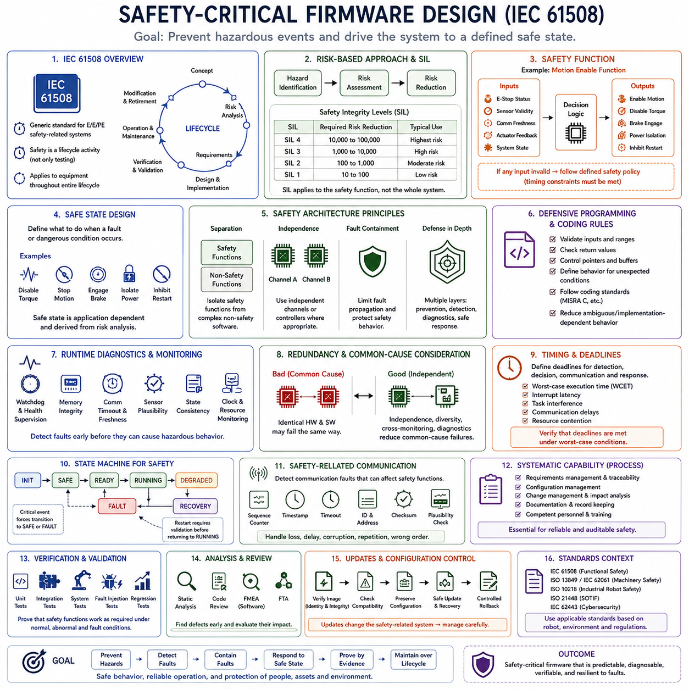{width="7.268055555555556in" height="7.268055555555556in"}

Safety-critical firmware is designed so that software behavior does not allow foreseeable faults to create unacceptable risk. IEC 61508 provides a generic functional-safety framework for electrical, electronic, and programmable electronic safety-related systems and treats safety as a lifecycle activity rather than a final testing step. Within the supplied structure, this firmware topic also serves as a bridge to the later dedicated treatment of safety-critical embedded software.

Functional safety focuses on safety functions that detect hazardous conditions, maintain controlled operation, or move equipment toward a safe state when faults occur. In robotic firmware, these functions may supervise motion permission, actuator enable signals, emergency stopping, communication health, sensor validity, or power conditions. The architecture must distinguish safety-related behavior from ordinary functionality so that failures in noncritical features cannot unpredictably compromise required safety actions.

IEC 61508 uses a risk-based approach in which hazards are identified, risks are evaluated, and necessary risk reduction is assigned to safety functions. Safety Integrity Levels, or SILs, express the required integrity of those safety functions, with SIL 1 through SIL 4 representing increasing levels of required risk reduction. SIL applies to the safety function and its implementation requirements rather than acting as a general performance grade for the complete robot or controller.

Safety requirements should originate from hazard and risk analysis rather than from convenient firmware features. Engineers first determine hazardous events, initiating faults, possible consequences, exposure, and available protective measures. From this analysis, safety requirements define what must be detected, what response is required, how quickly the response must occur, and which safe state must be reached. Firmware architecture then implements these requirements with traceable links back to the identified hazards.

A safety function should have explicit inputs, decision logic, outputs, timing constraints, fault responses, and diagnostic assumptions. For example, a motion-enable function may depend on valid emergency-stop status, sensor health, communication freshness, actuator feedback, and system state. If any required condition becomes invalid, the firmware should transition according to a defined safety policy rather than continuing operation based on stale data or undocumented assumptions.

Safe-state design is fundamental because fault detection has little value unless the system knows how to respond. Depending on the robot and hazard, a safe response may disable torque, stop commanded motion, engage a brake, isolate power, inhibit restart, or enter controlled degraded operation. A safe state is therefore application dependent and must be derived from risk analysis; simply resetting the processor is not automatically equivalent to achieving functional safety.

Safety-critical architecture should minimize unnecessary coupling between safety functions and complex non-safety software. Critical monitoring and shutdown logic can be separated through dedicated modules, protected execution contexts, independent channels, or separate controllers where appropriate. This separation limits fault propagation and makes safety behavior easier to analyze. The broader embedded-software structure reinforces this principle through mixed-criticality design and redundant safety-channel topics.

Defensive programming supports systematic fault containment. Safety-related firmware should validate inputs, check ranges, detect invalid states, verify return values, control pointer and buffer usage, and define behavior for unexpected conditions. Coding rules should reduce ambiguous language behavior and implementation-dependent constructs. The supplied material also connects embedded coding standards with IEC 61508 and emphasizes deterministic software, fault detection, safe-state handling, analysis, and traceability.

Runtime diagnostics are necessary because many dangerous failures cannot be prevented solely through static design. Firmware can supervise execution progress, memory integrity, communication freshness, sensor plausibility, actuator feedback, clock behavior, and internal state consistency. Watchdogs, checksums, memory protection, timeout monitors, redundant calculations, and reasonableness checks provide mechanisms for detecting faults before they propagate into uncontrolled physical behavior.

A watchdog should monitor meaningful execution health rather than merely confirm that some code is still running. Critical tasks or state machines can periodically demonstrate progress, while a health supervisor determines whether all required safety-related activities remain operational. If execution stalls or required health conditions disappear, the watchdog or safety supervisor can initiate the defined recovery or safe-state response instead of allowing a partially functioning controller to continue issuing commands.

Redundancy can reduce dependence on a single failure point, but duplicated components are useful only when common-cause failures are considered. Two channels executing identical software on identical hardware may fail in the same way under the same defect or environmental disturbance. Safety architecture therefore considers independence, diversity, diagnostic coverage, cross-monitoring, and common-cause failure mechanisms when redundant sensors, processors, communication paths, or safety channels are introduced.

Deterministic timing is part of safety behavior because a correct response delivered too late may still be unsafe. Safety requirements should define deadlines for fault detection, decision making, communication supervision, and actuator response. Firmware design must account for worst-case execution time, interrupt latency, task interference, communication delays, and resource contention. Timing verification should demonstrate that required safety actions remain achievable under worst credible operating conditions.

State machines provide a useful mechanism for representing safety-related operating modes explicitly. States such as INIT, SAFE, READY, RUNNING, DEGRADED, FAULT, and RECOVERY can make legal behavior and prohibited transitions visible. Critical events may force transitions directly toward SAFE or FAULT states, while restart may require deliberate validation before returning to operation. Explicit transition rules prevent accidental reactivation after faults and support systematic verification.

Safety-related communication must detect corrupted, delayed, repeated, lost, or incorrectly sequenced information when those failures can affect a safety function. Firmware can use sequence counters, timestamps, timeouts, identifiers, checksums, plausibility checks, and defined communication-loss behavior. The safety argument must consider the complete communication path rather than assuming that a successful low-level transfer automatically means that the received command or status is trustworthy.

Systematic capability is influenced by the development process as well as runtime architecture. Requirements, design decisions, source code, tests, anomalies, changes, and verification evidence should remain controlled and traceable. Configuration management ensures that the firmware being assessed corresponds to known source, toolchain, hardware, and parameter versions. Changes to safety-related software require impact analysis because a seemingly local modification may affect assumptions or evidence elsewhere in the safety case.

Verification should be planned from the safety requirements and performed at multiple levels. Unit testing examines individual safety mechanisms, integration testing evaluates interactions, and system testing verifies complete safety functions on representative hardware. Fault-injection testing is particularly valuable because it intentionally introduces sensor failures, communication loss, corrupted data, timing violations, memory faults, or stalled execution to confirm that detection and safe responses behave as designed.

Static analysis and code review complement dynamic testing by detecting classes of defects that may be difficult to activate during execution tests. Safety-oriented analysis can examine control flow, data flow, initialization, unreachable code, arithmetic behavior, pointer use, complexity, and coding-rule compliance. The larger embedded-software structure explicitly places defensive programming, static analysis, software FMEA and FTA, runtime monitoring, and code-coverage verification within the safety-critical development discipline.

Traceability connects hazards to safety requirements, architecture, implementation, and verification evidence. When a requirement changes, engineers should be able to identify the affected design elements and tests; when a test fails, they should be able to determine which safety requirement is threatened. This bidirectional traceability supports disciplined change management and contributes to an auditable safety case rather than leaving safety knowledge distributed informally among developers.

Firmware updates require special treatment because replacing validated software changes the configuration of a safety-related system. Update mechanisms should verify image identity and integrity, enforce hardware and version compatibility, preserve required configuration, and provide controlled recovery from interrupted or unsuccessful installation. Rollback must also respect safety and security constraints, since restoring an older binary is acceptable only when its software, data, and hardware combination remains valid.

For robotic systems, IEC 61508 provides a generic functional-safety foundation that can coexist with more application-specific standards. The supplied material places it alongside standards such as ISO 13849 and IEC 62061 for machinery-related safety and identifies IEC 61508 as a broader functional-safety framework. The applicable compliance strategy therefore depends on the robot, machinery category, operating environment, safety functions, and regulatory context rather than on firmware technology alone.

Safety-critical firmware design ultimately combines risk-driven requirements, architectural separation, deterministic execution, defensive programming, runtime diagnostics, explicit safe states, controlled development, and evidence-based verification. IEC 61508 frames these activities across the safety lifecycle so that safety is continuously engineered from hazard analysis through implementation, validation, operation, modification, and retirement. Reliable firmware is therefore not merely code that rarely fails, but software whose faults are systematically prevented, detected, contained, and driven toward defined safe behavior.

안전 필수 펌웨어(Safety-Critical Firmware)는 소프트웨어의 동작으로 인해 예측 가능한 고장(Foreseeable Fault)이 허용할 수 없는 위험(Unacceptable Risk)을 발생시키지 않도록 설계됩니다. IEC 61508은 전기·전자·프로그램 가능 전자 안전 관련 시스템(Electrical, Electronic and Programmable Electronic Safety-Related Systems)을 위한 일반적인 기능 안전(Functional Safety) 프레임워크를 제공하며, 안전을 최종 테스트 단계가 아니라 전체 수명주기(Lifecycle)에 걸친 활동으로 다룹니다. 제공된 구조에서 이 펌웨어 주제는 이후 별도로 다루어지는 안전 필수 임베디드 소프트웨어(Safety-Critical Embedded Software)로 연결되는 기반 역할도 합니다.

기능 안전(Functional Safety)은 위험한 상태를 감지하고, 통제된 운용을 유지하거나, 고장이 발생했을 때 장비를 안전 상태(Safe State)로 전환하는 안전 기능(Safety Function)에 초점을 둡니다. 로봇 펌웨어에서는 이러한 기능이 모션 허가(Motion Permission), 액추에이터 활성화 신호(Actuator Enable Signal), 비상 정지(Emergency Stop), 통신 상태(Communication Health), 센서 유효성(Sensor Validity), 전력 상태 등을 감시할 수 있습니다. 아키텍처는 비핵심 기능의 장애가 필요한 안전 동작을 예측할 수 없는 방식으로 손상시키지 않도록 안전 관련 동작과 일반 기능을 구분해야 합니다.

IEC 61508은 위험원(Hazard)을 식별하고 위험(Risk)을 평가한 다음 필요한 위험 감소(Risk Reduction)를 안전 기능에 할당하는 위험 기반 접근법(Risk-Based Approach)을 사용합니다. 안전 무결성 수준(Safety Integrity Level, SIL)은 이러한 안전 기능에 요구되는 무결성을 나타내며, SIL 1부터 SIL 4까지의 단계는 점점 더 높은 수준의 위험 감소 요구를 나타냅니다. SIL은 전체 로봇이나 컨트롤러의 일반적인 성능 등급이 아니라 안전 기능과 해당 기능의 구현 요구사항에 적용됩니다.

안전 요구사항(Safety Requirement)은 구현하기 편리한 펌웨어 기능에서 출발하는 것이 아니라 위험원 및 위험 분석(Hazard and Risk Analysis)에서 도출되어야 합니다. 엔지니어는 먼저 위험 사건(Hazardous Event), 고장 발생 원인, 발생 가능한 결과, 노출(Exposure), 사용 가능한 보호 조치를 파악합니다. 이후 안전 요구사항은 무엇을 감지해야 하는지, 어떤 대응이 필요한지, 어느 시간 안에 대응해야 하는지, 어떤 안전 상태에 도달해야 하는지를 정의합니다. 펌웨어 아키텍처는 이러한 요구사항을 식별된 위험원까지 추적할 수 있는 형태로 구현합니다.

안전 기능(Safety Function)은 명확한 입력(Input), 판단 로직(Decision Logic), 출력(Output), 타이밍 제약(Timing Constraint), 고장 대응(Fault Response), 진단 가정(Diagnostic Assumption)을 가져야 합니다. 예를 들어 모션 활성화 기능은 유효한 비상 정지 상태, 센서 상태, 통신 최신성(Communication Freshness), 액추에이터 피드백, 시스템 상태에 의존할 수 있습니다. 필요한 조건 가운데 하나라도 유효하지 않게 되면 펌웨어는 오래된 데이터나 문서화되지 않은 가정에 의존해 운전을 계속하는 대신 정의된 안전 정책(Safety Policy)에 따라 상태를 전환해야 합니다.

안전 상태 설계(Safe-State Design)는 고장을 감지하더라도 시스템이 어떻게 대응해야 하는지 정의되어 있지 않다면 그 효과가 제한적이므로 매우 중요합니다. 로봇과 위험원에 따라 안전 대응은 토크(Torque) 비활성화, 명령된 모션 정지, 브레이크(Brake) 작동, 전원 격리(Power Isolation), 재시작 금지(Restart Inhibition), 통제된 성능 저하 운전(Controlled Degraded Operation) 등이 될 수 있습니다. 따라서 안전 상태는 애플리케이션에 따라 결정되며 위험 분석을 통해 도출되어야 합니다. 단순히 프로세서를 리셋하는 것이 자동으로 기능 안전을 달성하는 것은 아닙니다.

안전 필수 아키텍처(Safety-Critical Architecture)는 안전 기능과 복잡한 비안전 소프트웨어(Non-Safety Software) 사이의 불필요한 결합(Coupling)을 최소화해야 합니다. 중요한 감시 및 셧다운 로직(Shutdown Logic)은 필요에 따라 전용 모듈, 보호된 실행 컨텍스트(Protected Execution Context), 독립 채널(Independent Channel), 별도의 컨트롤러를 통해 분리할 수 있습니다. 이러한 분리는 고장 전파(Fault Propagation)를 제한하고 안전 동작을 보다 쉽게 분석할 수 있도록 하며, 혼합 중요도 설계(Mixed-Criticality Design)와 이중화 안전 채널(Redundant Safety Channel)의 기반이 됩니다.

방어적 프로그래밍(Defensive Programming)은 체계적인 고장 격리(Fault Containment)를 지원합니다. 안전 관련 펌웨어는 입력을 검증하고, 범위를 확인하며, 유효하지 않은 상태를 탐지하고, 반환 값을 검사하며, 포인터와 버퍼 사용을 통제하고, 예상하지 못한 조건에 대한 동작을 정의해야 합니다. 코딩 규칙(Coding Rule)은 모호한 언어 동작이나 구현 의존적인 구조를 줄여야 하며, 결정론적 소프트웨어(Deterministic Software), 고장 탐지, 안전 상태 처리, 분석 및 추적성(Traceability)을 지원해야 합니다.

런타임 진단(Runtime Diagnostics)은 많은 위험한 고장을 정적 설계(Static Design)만으로 예방할 수 없기 때문에 필요합니다. 펌웨어는 실행 진행 상태(Execution Progress), 메모리 무결성(Memory Integrity), 통신 최신성, 센서 타당성(Sensor Plausibility), 액추에이터 피드백, 클록 동작, 내부 상태 일관성을 감시할 수 있습니다. 워치독(Watchdog), 체크섬(Checksum), 메모리 보호(Memory Protection), 타임아웃 감시기(Timeout Monitor), 중복 계산(Redundant Calculation), 타당성 검사(Reasonableness Check)는 고장이 통제되지 않은 물리적 동작으로 전파되기 전에 이를 탐지하는 메커니즘을 제공합니다.

워치독(Watchdog)은 단순히 일부 코드가 계속 실행되고 있음을 확인하는 것이 아니라 의미 있는 실행 건전성(Execution Health)을 감시해야 합니다. 중요한 태스크(Task)나 상태 머신(State Machine)은 주기적으로 정상적인 진행 상태를 나타낼 수 있으며, 상태 감시기(Health Supervisor)는 필요한 모든 안전 관련 활동이 정상적으로 동작하는지 판단합니다. 실행이 정지하거나 필요한 건전성 조건이 사라지면 워치독이나 안전 감독기(Safety Supervisor)는 부분적으로 동작하는 컨트롤러가 계속 명령을 출력하도록 두는 대신 정의된 복구 또는 안전 상태 대응을 시작할 수 있습니다.

이중화(Redundancy)는 단일 고장 지점(Single Point of Failure)에 대한 의존성을 줄일 수 있지만 공통 원인 고장(Common-Cause Failure)을 고려할 때만 효과적입니다. 동일한 하드웨어에서 동일한 소프트웨어를 실행하는 두 채널은 동일한 결함이나 환경적 교란(Environmental Disturbance)에 의해 같은 방식으로 실패할 수 있습니다. 따라서 안전 아키텍처는 중복 센서, 프로세서, 통신 경로 또는 안전 채널을 도입할 때 독립성(Independence), 다양성(Diversity), 진단 커버리지(Diagnostic Coverage), 상호 감시(Cross-Monitoring), 공통 원인 고장 메커니즘을 함께 고려해야 합니다.

결정론적 타이밍(Deterministic Timing)은 올바른 대응이라도 지나치게 늦게 수행되면 안전하지 않을 수 있기 때문에 안전 동작의 일부입니다. 안전 요구사항은 고장 감지, 의사결정, 통신 감시, 액추에이터 대응에 대한 데드라인(Deadline)을 정의해야 합니다. 펌웨어 설계에서는 최악 실행 시간(Worst-Case Execution Time), 인터럽트 지연시간(Interrupt Latency), 태스크 간섭(Task Interference), 통신 지연, 자원 경합(Resource Contention)을 고려해야 합니다. 타이밍 검증(Timing Verification)은 현실적으로 예상 가능한 최악의 운용 조건에서도 필요한 안전 동작이 수행될 수 있음을 입증해야 합니다.

상태 머신(State Machine)은 안전 관련 운용 모드를 명시적으로 표현하는 데 효과적입니다. 초기화(INIT), 안전(SAFE), 준비(READY), 실행(RUNNING), 성능 저하(DEGRADED), 고장(FAULT), 복구(RECOVERY) 등의 상태를 통해 허용되는 동작과 금지된 전이를 명확하게 나타낼 수 있습니다. 중요한 이벤트는 시스템을 즉시 안전 또는 고장 상태로 전환할 수 있으며, 재시작(Restart)은 정상 운용으로 복귀하기 전에 의도적인 검증 절차를 요구할 수 있습니다. 명시적인 전이 규칙(Transition Rule)은 고장 발생 이후 의도하지 않은 재활성화를 방지하고 체계적인 검증을 지원합니다.

안전 관련 통신(Safety-Related Communication)은 이러한 장애가 안전 기능에 영향을 줄 수 있는 경우 손상(Corruption), 지연(Delay), 반복(Repeat), 손실(Loss), 잘못된 순서(Incorrect Sequence)의 정보를 탐지해야 합니다. 펌웨어는 시퀀스 카운터(Sequence Counter), 타임스탬프(Timestamp), 타임아웃, 식별자(Identifier), 체크섬, 타당성 검사, 정의된 통신 손실 대응을 사용할 수 있습니다. 안전 논증(Safety Argument)은 단순히 저수준 데이터 전송이 성공했다는 이유로 수신된 명령이나 상태를 신뢰할 수 있다고 가정하지 않고 전체 통신 경로를 고려해야 합니다.

체계적 역량(Systematic Capability)은 런타임 아키텍처뿐 아니라 개발 프로세스의 영향을 받습니다. 요구사항, 설계 결정, 소스 코드, 테스트, 이상 현상(Anomaly), 변경사항, 검증 증거(Verification Evidence)는 통제되고 추적 가능한 상태로 유지되어야 합니다. 구성 관리(Configuration Management)는 평가 대상 펌웨어가 알려진 소스, 툴체인(Toolchain), 하드웨어, 매개변수 버전에 정확하게 대응하도록 보장합니다. 안전 관련 소프트웨어 변경은 국부적인 수정처럼 보이더라도 다른 영역의 가정이나 안전 증거에 영향을 줄 수 있으므로 영향 분석(Impact Analysis)이 필요합니다.

검증(Verification)은 안전 요구사항에서 출발하여 계획하고 여러 수준에서 수행해야 합니다. 단위 테스트(Unit Testing)는 개별 안전 메커니즘을 검증하고, 통합 테스트(Integration Testing)는 구성요소 사이의 상호작용을 평가하며, 시스템 테스트(System Testing)는 대표적인 하드웨어에서 전체 안전 기능을 검증합니다. 고장 주입 테스트(Fault-Injection Testing)는 센서 장애, 통신 손실, 손상된 데이터, 타이밍 위반, 메모리 고장, 실행 정지 등을 의도적으로 발생시켜 고장 탐지와 안전 대응이 설계대로 동작하는지 확인할 수 있기 때문에 특히 중요합니다.

정적 분석(Static Analysis)과 코드 검토(Code Review)는 실행 테스트 과정에서 발생시키기 어려운 유형의 결함을 탐지함으로써 동적 테스트(Dynamic Testing)를 보완합니다. 안전 중심 분석은 제어 흐름(Control Flow), 데이터 흐름(Data Flow), 초기화, 도달 불가능 코드(Unreachable Code), 산술 연산 동작, 포인터 사용, 복잡도(Complexity), 코딩 규칙 준수 여부를 검사할 수 있습니다. 안전 필수 개발 규율에는 방어적 프로그래밍, 정적 분석, 소프트웨어 고장 형태 및 영향 분석(Software FMEA), 결함 트리 분석(Fault Tree Analysis, FTA), 런타임 모니터링, 코드 커버리지 검증(Code-Coverage Verification)이 포함될 수 있습니다.

추적성(Traceability)은 위험원에서 안전 요구사항, 아키텍처, 구현, 검증 증거까지 연결합니다. 요구사항이 변경되면 엔지니어는 영향을 받는 설계 요소와 테스트를 식별할 수 있어야 하며, 테스트가 실패하면 어떤 안전 요구사항이 위협받고 있는지 확인할 수 있어야 합니다. 이러한 양방향 추적성(Bidirectional Traceability)은 체계적인 변경 관리(Change Management)를 지원하고 안전 관련 지식이 개발자 사이에 비공식적으로 분산되는 대신 감사 가능한 안전 논증(Safety Case)을 구축하는 데 기여합니다.

펌웨어 업데이트(Firmware Update)는 검증된 소프트웨어를 교체함으로써 안전 관련 시스템의 구성을 변경하기 때문에 특별하게 다루어야 합니다. 업데이트 메커니즘은 이미지 식별 정보(Image Identity)와 무결성을 검증하고, 하드웨어 및 버전 호환성을 강제하며, 필요한 구성을 보존하고, 설치 중단이나 실패에 대한 통제된 복구 기능을 제공해야 합니다. 롤백(Rollback) 역시 이전 바이너리와 데이터 및 하드웨어의 조합이 여전히 유효한 경우에만 허용되어야 하므로 안전 및 보안 제약을 함께 고려해야 합니다.

로봇 시스템에서 IEC 61508은 보다 애플리케이션 특화된 표준(Application-Specific Standard)과 함께 사용할 수 있는 일반적인 기능 안전 기반을 제공합니다. 제공된 구조에서는 IEC 61508을 기계 관련 안전(Machinery-Related Safety)을 위한 ISO 13849 및 IEC 62061과 함께 다루며, IEC 61508을 보다 광범위한 기능 안전 프레임워크로 위치시킵니다. 따라서 실제 적용해야 하는 규정 준수 전략(Compliance Strategy)은 펌웨어 기술 자체만으로 결정되는 것이 아니라 로봇 유형, 기계 범주, 운용 환경, 안전 기능, 규제 환경(Regulatory Context)에 따라 결정됩니다.

결국 안전 필수 펌웨어 설계(Safety-Critical Firmware Design)는 위험 기반 요구사항(Risk-Driven Requirement), 아키텍처 분리(Architectural Separation), 결정론적 실행(Deterministic Execution), 방어적 프로그래밍, 런타임 진단, 명시적인 안전 상태, 통제된 개발 프로세스, 증거 기반 검증(Evidence-Based Verification)을 결합합니다. IEC 61508은 위험 분석부터 구현, 검증, 운용, 변경, 폐기(Retirement)에 이르는 안전 수명주기(Safety Lifecycle) 전체에서 이러한 활동을 수행하도록 체계화합니다. 따라서 신뢰할 수 있는 펌웨어는 단순히 고장이 드물게 발생하는 코드가 아니라, 고장이 체계적으로 예방·탐지·격리되고 정의된 안전 동작으로 전환되도록 설계된 소프트웨어입니다.

##  

## 05.08 Firmware Logging and Diagnostic Infrastructure [w/Code]

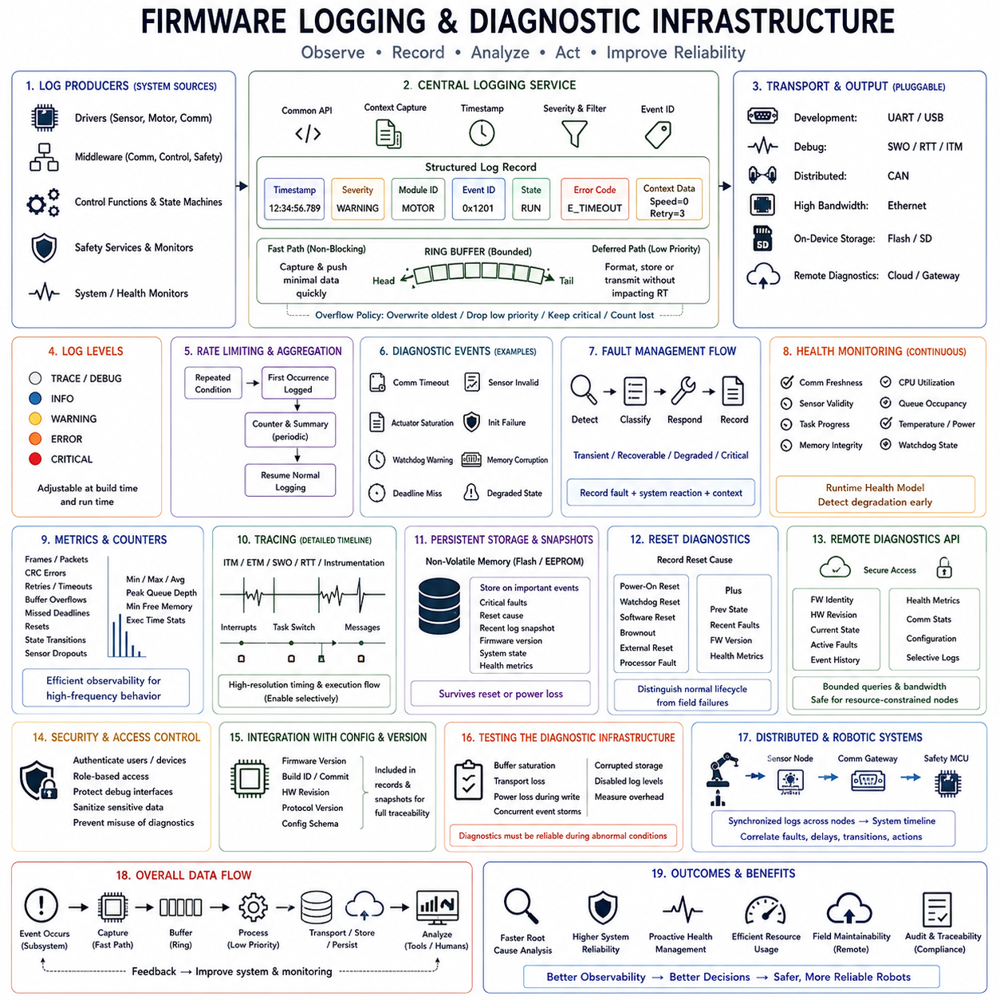{width="7.268055555555556in" height="7.268055555555556in"}

Firmware logging and diagnostic infrastructure provides systematic visibility into the internal behavior of an embedded controller during development, testing, production operation, and field maintenance. Instead of relying on temporary debug prints, a robust architecture records structured events, faults, timing information, state transitions, and health indicators through controlled interfaces. This observability is essential for identifying root causes without disrupting deterministic firmware behavior.

Logging should be treated as a reusable firmware service rather than scattered output statements embedded throughout application code. Drivers, middleware, control functions, state machines, and safety services can submit diagnostic records through a common logging interface. The infrastructure then determines formatting, buffering, filtering, timestamping, storage, and transmission. Centralization creates consistent semantics and allows logging behavior to change without modifying every producer.

A structured log record normally contains more than human-readable text. Useful fields include timestamp, severity, module identifier, event identifier, operating state, error code, and selected contextual values. Event identifiers make records machine-processable, while textual descriptions support engineers during debugging. Structured data also allows automated tools to search, correlate, aggregate, and compare events across many executions or multiple controllers.

Log severity levels provide a mechanism for separating routine information from conditions requiring immediate attention. Typical categories may distinguish trace or debug information, normal informational events, warnings, recoverable errors, and critical faults. The exact naming is less important than consistent semantics. Production firmware can suppress low-value messages while preserving important fault and lifecycle information, reducing CPU, communication, and storage overhead.

Timestamp quality determines whether logs can reconstruct causal sequences accurately. Firmware should use a stable time source appropriate to the required resolution and preserve ordering even when several events occur close together. Distributed robotic systems may additionally require synchronized clocks so records from motor controllers, sensor nodes, safety processors, and higher-level computers can be correlated into one system timeline.

Logging paths must respect real-time constraints. Formatting long strings, waiting for a serial port, writing flash synchronously, or transmitting large diagnostic packets inside a control loop or interrupt handler can create unacceptable latency and jitter. Time-critical code should normally capture compact event information quickly and place it into a bounded buffer. Lower-priority processing can later format, store, or transmit the record without delaying critical execution.

Ring buffers are well suited to firmware logging because they provide bounded memory usage and predictable insertion behavior. Buffer capacity should be selected according to event rates, available RAM, expected diagnostic bursts, and output bandwidth. Overflow behavior must be explicit: the system may overwrite the oldest records, reject new low-priority entries, preserve critical events, or increment a dropped-message counter rather than allowing uncontrolled memory growth.

Rate limiting prevents repetitive conditions from overwhelming the diagnostic infrastructure. A disconnected sensor, failed communication link, or persistent invalid input may otherwise generate thousands of identical records and obscure the original failure. Firmware can record the first occurrence, count repetitions, periodically report summaries, and restore normal logging when the condition clears. This preserves evidence while limiting resource consumption.

Diagnostic events should complement ordinary logs by representing conditions that have operational meaning. Examples include communication timeout, sensor invalidity, actuator saturation, initialization failure, watchdog warning, memory corruption indication, deadline miss, or transition into a degraded state. Such events can be assigned stable identifiers and associated with severity, subsystem, recovery action, and persistent fault information for automated analysis.

Fault management often follows a detect, classify, respond, and record sequence. A module detects an abnormal condition, determines whether it is transient, recoverable, degraded, or critical, performs the defined response, and records enough context for later investigation. Logging should capture both the fault and the system reaction because knowing that an error occurred is insufficient when engineers must determine whether retry, isolation, reset, or safe-state behavior operated correctly.

Health monitoring extends diagnostics beyond individual faults by continuously representing the condition of firmware services and hardware resources. Useful indicators can include communication freshness, sensor validity, task progress, memory integrity, CPU utilization, queue occupancy, temperature, power conditions, watchdog state, and internal state consistency. Together these indicators provide a runtime health model that can detect degradation before a complete functional failure occurs.

Counters and metrics provide efficient observability for high-frequency behavior that would be impractical to log individually. Firmware can maintain counts of received frames, CRC errors, retries, buffer overflows, missed deadlines, resets, rejected commands, sensor dropouts, or state transitions. Maximum latency, minimum free memory, peak queue depth, and execution-time statistics can reveal gradual degradation while requiring much less storage than event-by-event traces.

Tracing provides finer temporal information than conventional logging and is useful for analyzing execution timing, interrupts, task transitions, communication paths, and control-loop behavior. Embedded development environments may expose trace through mechanisms such as ITM, ETM, SWO, or RTT, while other systems use dedicated instrumentation. Trace should be selectively enabled because high-volume instrumentation can consume bandwidth and alter the timing being measured.

Diagnostic transport should be separated from diagnostic generation. The same internal logging service may send records through UART during development, SWO or RTT during debugging, CAN in distributed controllers, Ethernet for high-bandwidth systems, or persistent storage for field retrieval. This separation allows the diagnostic producers to remain unchanged when the deployment environment or available communication interface changes.

Persistent fault storage is important when a controller resets or loses external communication after a failure. Selected critical events, reset causes, fault codes, software version, operating state, and recent contextual records can be retained in nonvolatile memory. A compact fault snapshot can preserve the conditions immediately preceding a reset, watchdog expiration, or emergency shutdown and provide valuable evidence when the robot is inspected later.

Persistent logging must account for flash endurance, write latency, power interruption, and storage corruption. Continuous high-rate writes can rapidly consume write-cycle life, so firmware may aggregate records, use wear-aware storage, reserve dedicated fault regions, or write only selected events persistently. Records should include integrity protection where corruption would make diagnosis misleading, and recovery logic should tolerate incomplete writes caused by unexpected power loss.

Reset diagnostics should preserve the reason a controller restarted. Power-on reset, watchdog reset, software-requested reset, brownout, external reset, and processor fault may require different investigation paths. Capturing reset cause together with previous operating state, recent fault information, firmware version, and selected health metrics helps distinguish expected lifecycle events from recurring field failures that would otherwise appear as unexplained reboots.

Remote diagnostics allow engineers or supervisory systems to inspect controllers without physical debug access. A diagnostic API may expose firmware identity, hardware revision, current state, active faults, historical events, health metrics, communication statistics, and selected configuration information. Remote access should use bounded queries and controlled bandwidth so diagnostic activity cannot starve control traffic or destabilize a resource-constrained embedded node.

Diagnostic interfaces must also consider security and information exposure. Production logs may reveal internal states, addresses, configuration details, or operational information that should not be accessible to unauthorized users. Debug interfaces and diagnostic commands therefore require appropriate access control, and sensitive data should be excluded or protected. Diagnostic capability should improve maintainability without creating an unintended path for manipulating safety-critical behavior.

Logging infrastructure should integrate with firmware version and configuration management. Every important field record should be attributable to the exact software and relevant configuration that generated it. Including firmware version, build identifier, hardware revision, protocol version, and configuration schema in diagnostic snapshots prevents engineers from analyzing an event under incorrect assumptions about the deployed controller implementation.

Testing should verify the diagnostic infrastructure itself. Engineers should exercise buffer saturation, repeated faults, transport loss, corrupted persistent records, unexpected reset, disabled log levels, and simultaneous event generation. Tests should also measure logging overhead under realistic system load. Diagnostics are useful only when they remain dependable during abnormal conditions, which are precisely the situations in which CPU, memory, communication, and storage resources may already be stressed.

In robotic embedded systems, logging and diagnostics connect low-level firmware behavior with system-level observability. Joint controllers, sensor modules, power controllers, communication gateways, and safety MCUs can expose consistent events and health information to higher-level monitoring tools. Distributed logging becomes particularly valuable when synchronized records reveal how a sensor fault, communication delay, state transition, and actuator response propagated across several nodes.

A well-designed diagnostic infrastructure therefore combines structured logging, timestamps, severity levels, bounded buffering, rate limiting, fault records, metrics, tracing, persistent snapshots, and remote retrieval within a resource-aware architecture. Its purpose is not to record everything indiscriminately, but to preserve the information needed to reconstruct behavior and evaluate system health with minimal interference. Effective observability turns difficult field failures into traceable engineering evidence and supports reliable, maintainable robotic firmware.

펌웨어 로깅 및 진단 인프라(Firmware Logging and Diagnostic Infrastructure)는 개발, 테스트, 제품 운용, 현장 유지보수 전 과정에서 임베디드 컨트롤러(Embedded Controller)의 내부 동작을 체계적으로 관찰할 수 있도록 합니다. 일시적인 디버그 출력(Debug Print)에 의존하는 대신 견고한 아키텍처는 구조화된 이벤트(Structured Event), 고장(Fault), 타이밍 정보(Timing Information), 상태 전이(State Transition), 건전성 지표(Health Indicator)를 통제된 인터페이스를 통해 기록합니다. 이러한 관찰 가능성(Observability)은 결정론적인 펌웨어 동작을 방해하지 않으면서 근본 원인(Root Cause)을 파악하는 데 필수적입니다.

로깅(Logging)은 애플리케이션 코드 곳곳에 분산된 출력문이 아니라 재사용 가능한 펌웨어 서비스(Reusable Firmware Service)로 다루어야 합니다. 드라이버(Driver), 미들웨어(Middleware), 제어 함수(Control Function), 상태 머신(State Machine), 안전 서비스(Safety Service)는 공통 로깅 인터페이스(Common Logging Interface)를 통해 진단 레코드(Diagnostic Record)를 전달할 수 있습니다. 이후 인프라는 포맷팅(Formatting), 버퍼링(Buffering), 필터링(Filtering), 타임스탬프(Timestamp), 저장(Storage), 전송(Transmission)을 결정합니다. 이러한 중앙화(Centralization)는 일관된 의미 체계를 제공하고 각 생성 모듈을 수정하지 않고도 로깅 동작을 변경할 수 있도록 합니다.

구조화된 로그 레코드(Structured Log Record)는 일반적으로 사람이 읽을 수 있는 텍스트 이상의 정보를 포함합니다. 유용한 필드에는 타임스탬프, 심각도(Severity), 모듈 식별자(Module Identifier), 이벤트 식별자(Event Identifier), 운용 상태(Operating State), 오류 코드(Error Code), 선택된 문맥 값(Contextual Value) 등이 포함됩니다. 이벤트 식별자는 레코드를 기계적으로 처리할 수 있도록 하고 텍스트 설명은 엔지니어의 디버깅을 지원합니다. 구조화된 데이터는 자동화 도구가 여러 실행이나 여러 컨트롤러에서 발생한 이벤트를 검색하고, 상관관계를 분석하고, 집계하고, 비교할 수 있도록 합니다.

로그 심각도 수준(Log Severity Level)은 일반적인 정보와 즉각적인 주의가 필요한 상태를 구분하는 메커니즘을 제공합니다. 일반적인 범주는 추적(Trace) 또는 디버그(Debug) 정보, 정상 정보 이벤트(Informational Event), 경고(Warning), 복구 가능한 오류(Recoverable Error), 치명적 고장(Critical Fault)을 구분할 수 있습니다. 정확한 명칭보다 중요한 것은 일관된 의미입니다. 제품 펌웨어(Production Firmware)는 가치가 낮은 메시지를 억제하면서 중요한 고장과 수명주기 정보를 유지하여 CPU, 통신, 저장장치의 오버헤드를 줄일 수 있습니다.

타임스탬프 품질(Timestamp Quality)은 로그를 이용하여 인과관계 시퀀스(Causal Sequence)를 얼마나 정확하게 재구성할 수 있는지를 결정합니다. 펌웨어는 필요한 해상도(Resolution)에 적합한 안정적인 시간 소스(Time Source)를 사용하고 여러 이벤트가 짧은 시간 간격으로 발생하더라도 순서를 보존해야 합니다. 분산 로봇 시스템(Distributed Robotic System)에서는 모터 컨트롤러, 센서 노드, 안전 프로세서, 상위 수준 컴퓨터에서 생성된 기록을 하나의 시스템 타임라인(System Timeline)으로 연계하기 위해 동기화된 클록(Synchronized Clock)이 추가로 필요할 수 있습니다.

로깅 경로(Logging Path)는 실시간 제약(Real-Time Constraint)을 준수해야 합니다. 긴 문자열을 포맷팅하거나 직렬 포트(Serial Port)를 기다리거나 플래시(Flash)에 동기적으로 기록하거나 제어 루프 또는 인터럽트 처리기에서 대용량 진단 패킷을 전송하면 허용할 수 없는 지연시간(Latency)과 지터(Jitter)가 발생할 수 있습니다. 시간에 민감한 코드는 일반적으로 간결한 이벤트 정보를 신속하게 획득하여 제한된 버퍼(Bounded Buffer)에 저장해야 합니다. 이후 낮은 우선순위의 처리 과정에서 중요한 실행을 지연시키지 않고 레코드를 포맷팅하거나 저장하거나 전송할 수 있습니다.

링 버퍼(Ring Buffer)는 제한된 메모리 사용량과 예측 가능한 삽입 동작을 제공하기 때문에 펌웨어 로깅에 적합합니다. 버퍼 용량은 이벤트 발생률(Event Rate), 사용 가능한 RAM, 예상되는 진단 이벤트 집중(Diagnostic Burst), 출력 대역폭(Output Bandwidth)을 고려하여 결정해야 합니다. 오버플로 동작(Overflow Behavior)도 명확하게 정의해야 하며, 시스템은 오래된 레코드를 덮어쓰거나 새로운 낮은 우선순위 항목을 거부하거나 중요한 이벤트를 보존하거나 삭제된 메시지 카운터(Dropped-Message Counter)를 증가시키는 방법을 사용할 수 있습니다.

속도 제한(Rate Limiting)은 반복되는 상태가 진단 인프라를 압도하는 것을 방지합니다. 연결이 끊어진 센서, 실패한 통신 링크, 지속적으로 잘못된 입력은 동일한 레코드를 수천 개 생성하여 최초의 장애 원인을 찾기 어렵게 만들 수 있습니다. 펌웨어는 최초 발생을 기록하고 반복 횟수를 계산하며 주기적으로 요약 정보를 보고하고 상태가 정상으로 복구되면 일반적인 로깅으로 돌아갈 수 있습니다. 이를 통해 증거를 보존하면서 자원 소비를 제한할 수 있습니다.

진단 이벤트(Diagnostic Event)는 운용상 의미를 가지는 상태를 표현함으로써 일반 로그를 보완해야 합니다. 예를 들어 통신 타임아웃(Communication Timeout), 센서 무효(Sensor Invalidity), 액추에이터 포화(Actuator Saturation), 초기화 실패(Initialization Failure), 워치독 경고(Watchdog Warning), 메모리 손상 징후(Memory Corruption Indication), 데드라인 미준수(Deadline Miss), 성능 저하 상태(Degraded State) 전이 등이 있습니다. 이러한 이벤트에는 안정적인 식별자를 부여하고 심각도, 서브시스템(Subsystem), 복구 동작(Recovery Action), 영구 고장 정보(Persistent Fault Information)를 연결하여 자동화된 분석에 활용할 수 있습니다.

고장 관리(Fault Management)는 일반적으로 탐지(Detect), 분류(Classify), 대응(Respond), 기록(Record)의 순서를 따릅니다. 모듈은 비정상 상태를 탐지하고 일시적(Transient), 복구 가능(Recoverable), 성능 저하(Degraded), 치명적(Critical) 상태인지 판단한 다음 정의된 대응을 수행하고 이후 분석에 필요한 문맥 정보를 기록합니다. 오류가 발생했다는 사실만으로는 재시도, 격리(Isolation), 리셋(Reset), 안전 상태(Safe State) 동작이 올바르게 수행되었는지 판단할 수 없으므로 로깅은 고장뿐만 아니라 시스템의 대응도 함께 기록해야 합니다.

건전성 모니터링(Health Monitoring)은 개별 고장을 넘어 펌웨어 서비스와 하드웨어 자원의 상태를 지속적으로 표현함으로써 진단 기능을 확장합니다. 유용한 지표에는 통신 최신성(Communication Freshness), 센서 유효성, 태스크 진행 상태(Task Progress), 메모리 무결성(Memory Integrity), CPU 사용률, 큐 점유율(Queue Occupancy), 온도, 전력 상태, 워치독 상태, 내부 상태 일관성(State Consistency)이 포함될 수 있습니다. 이러한 지표들은 완전한 기능 장애가 발생하기 전에 성능 저하를 탐지할 수 있는 런타임 건전성 모델(Runtime Health Model)을 제공합니다.

카운터(Counter)와 메트릭(Metric)은 개별적으로 모두 기록하기 어려운 고주파 동작(High-Frequency Behavior)을 효율적으로 관찰할 수 있도록 합니다. 펌웨어는 수신 프레임, CRC 오류, 재시도, 버퍼 오버플로, 데드라인 미준수, 리셋, 거부된 명령, 센서 데이터 손실, 상태 전이 횟수를 유지할 수 있습니다. 최대 지연시간(Maximum Latency), 최소 가용 메모리(Minimum Free Memory), 최대 큐 깊이(Peak Queue Depth), 실행 시간 통계(Execution-Time Statistics)는 이벤트별 추적보다 훨씬 적은 저장공간을 사용하면서 점진적인 성능 저하를 발견하는 데 도움을 줍니다.

트레이싱(Tracing)은 일반적인 로깅보다 세밀한 시간 정보를 제공하며 실행 타이밍, 인터럽트, 태스크 전환(Task Transition), 통신 경로, 제어 루프 동작을 분석하는 데 유용합니다. 임베디드 개발 환경은 ITM, ETM, SWO, RTT와 같은 메커니즘을 통해 트레이스를 제공할 수 있으며 다른 시스템에서는 전용 계측(Dedicated Instrumentation)을 사용할 수 있습니다. 대용량 계측 데이터는 대역폭을 소비하고 측정 대상의 타이밍 자체를 변경할 수 있으므로 트레이스는 선택적으로 활성화해야 합니다.

진단 전송(Diagnostic Transport)은 진단 데이터 생성(Diagnostic Generation)과 분리해야 합니다. 동일한 내부 로깅 서비스가 개발 단계에서는 UART를 통해 레코드를 전송하고, 디버깅 과정에서는 SWO 또는 RTT를 사용하며, 분산 컨트롤러에서는 CAN, 고대역폭 시스템에서는 Ethernet, 현장 분석에서는 영구 저장장치를 사용할 수 있습니다. 이러한 분리를 통해 배포 환경이나 사용 가능한 통신 인터페이스가 변경되어도 진단 데이터를 생성하는 구성요소는 그대로 유지할 수 있습니다.

영구 고장 저장(Persistent Fault Storage)은 장애 이후 컨트롤러가 리셋되거나 외부 통신을 잃는 경우 중요합니다. 선택된 치명적 이벤트, 리셋 원인(Reset Cause), 고장 코드(Fault Code), 소프트웨어 버전, 운용 상태, 최근 문맥 레코드를 비휘발성 메모리(Nonvolatile Memory)에 유지할 수 있습니다. 간결한 고장 스냅샷(Fault Snapshot)은 리셋, 워치독 만료, 비상 셧다운(Emergency Shutdown) 직전의 상태를 보존하여 이후 로봇을 점검할 때 중요한 분석 증거를 제공합니다.

영구 로깅(Persistent Logging)은 플래시 내구성(Flash Endurance), 쓰기 지연시간(Write Latency), 전원 중단(Power Interruption), 저장장치 손상(Storage Corruption)을 고려해야 합니다. 지속적인 고속 쓰기는 플래시의 쓰기 수명을 빠르게 소모할 수 있으므로 펌웨어는 레코드를 집계하거나 쓰기 수명을 고려한 저장 방식을 사용하거나 전용 고장 영역을 확보하거나 선택된 이벤트만 영구적으로 기록할 수 있습니다. 데이터 손상이 진단 결과를 왜곡할 수 있다면 레코드에 무결성 보호(Integrity Protection)를 적용하고, 복구 로직은 예기치 않은 전원 차단으로 발생한 불완전한 쓰기를 처리할 수 있어야 합니다.

리셋 진단(Reset Diagnostics)은 컨트롤러가 다시 시작된 원인을 보존해야 합니다. 전원 인가 리셋(Power-On Reset), 워치독 리셋(Watchdog Reset), 소프트웨어 요청 리셋(Software-Requested Reset), 브라운아웃(Brownout), 외부 리셋(External Reset), 프로세서 고장(Processor Fault)은 서로 다른 조사 경로를 요구할 수 있습니다. 이전 운용 상태, 최근 고장 정보, 펌웨어 버전, 선택된 건전성 메트릭과 함께 리셋 원인을 기록하면 정상적인 수명주기 이벤트와 반복적인 현장 장애를 구분할 수 있습니다.

원격 진단(Remote Diagnostics)은 엔지니어나 상위 감독 시스템(Supervisory System)이 물리적인 디버그 접근 없이 컨트롤러를 검사할 수 있도록 합니다. 진단 API(Diagnostic API)는 펌웨어 식별 정보, 하드웨어 개정, 현재 상태, 활성 고장, 과거 이벤트, 건전성 메트릭, 통신 통계, 선택된 구성 정보를 제공할 수 있습니다. 원격 접근은 진단 활동이 제어 트래픽(Control Traffic)을 방해하거나 자원이 제한된 임베디드 노드를 불안정하게 만들지 않도록 제한된 질의(Bounded Query)와 통제된 대역폭을 사용해야 합니다.

진단 인터페이스(Diagnostic Interface)는 보안(Security)과 정보 노출(Information Exposure)도 고려해야 합니다. 제품 로그에는 내부 상태, 주소, 구성 세부사항, 운용 정보와 같이 권한이 없는 사용자가 접근해서는 안 되는 정보가 포함될 수 있습니다. 따라서 디버그 인터페이스(Debug Interface)와 진단 명령에는 적절한 접근 제어(Access Control)를 적용하고 민감한 데이터는 제외하거나 보호해야 합니다. 진단 기능은 안전 필수 동작을 조작할 수 있는 의도하지 않은 경로를 만들지 않으면서 유지보수성을 향상시켜야 합니다.

로깅 인프라(Logging Infrastructure)는 펌웨어 버전 및 구성 관리(Firmware Version and Configuration Management)와 통합되어야 합니다. 중요한 현장 기록은 해당 기록을 생성한 정확한 소프트웨어와 관련 구성까지 추적할 수 있어야 합니다. 진단 스냅샷에 펌웨어 버전, 빌드 식별자(Build Identifier), 하드웨어 개정, 프로토콜 버전, 구성 스키마(Configuration Schema)를 포함하면 엔지니어가 실제 배포된 컨트롤러 구현에 대해 잘못된 가정을 바탕으로 이벤트를 분석하는 것을 방지할 수 있습니다.

테스트(Test)는 진단 인프라 자체도 검증해야 합니다. 엔지니어는 버퍼 포화(Buffer Saturation), 반복 고장, 전송 손실(Transport Loss), 손상된 영구 레코드, 예상하지 못한 리셋, 비활성화된 로그 수준, 동시 이벤트 발생 등을 시험해야 합니다. 또한 실제 시스템 부하에서 로깅 오버헤드(Logging Overhead)를 측정해야 합니다. CPU, 메모리, 통신, 저장장치 자원이 이미 압박을 받을 수 있는 비정상 상황에서도 진단 기능이 신뢰할 수 있게 동작해야만 실제적인 가치를 가질 수 있습니다.

로봇 임베디드 시스템(Robotic Embedded System)에서 로깅과 진단은 저수준 펌웨어 동작을 시스템 수준 관찰 가능성(System-Level Observability)과 연결합니다. 관절 컨트롤러(Joint Controller), 센서 모듈(Sensor Module), 전력 컨트롤러(Power Controller), 통신 게이트웨이(Communication Gateway), 안전 MCU(Safety MCU)는 일관된 이벤트와 건전성 정보를 상위 수준 모니터링 도구에 제공할 수 있습니다. 특히 동기화된 기록을 이용하면 센서 고장, 통신 지연, 상태 전이, 액추에이터 대응이 여러 노드에 걸쳐 어떻게 전파되었는지를 분석할 수 있으므로 분산 로깅(Distributed Logging)의 가치가 커집니다.

따라서 잘 설계된 진단 인프라(Diagnostic Infrastructure)는 구조화된 로깅, 타임스탬프, 심각도 수준, 제한된 버퍼링, 속도 제한, 고장 레코드, 메트릭, 트레이싱, 영구 스냅샷, 원격 조회(Remote Retrieval)를 자원 인식형 아키텍처(Resource-Aware Architecture) 안에서 결합합니다. 목적은 모든 정보를 무분별하게 기록하는 것이 아니라 시스템 동작을 재구성하고 건전성을 평가하는 데 필요한 정보를 최소한의 간섭으로 보존하는 것입니다. 효과적인 관찰 가능성은 분석하기 어려운 현장 장애를 추적 가능한 엔지니어링 증거(Engineering Evidence)로 전환하고 신뢰성과 유지보수성이 높은 로봇 펌웨어를 지원합니다.

##  

## 05.09 Firmware Mock Environment and Unit Testing [w/Code]

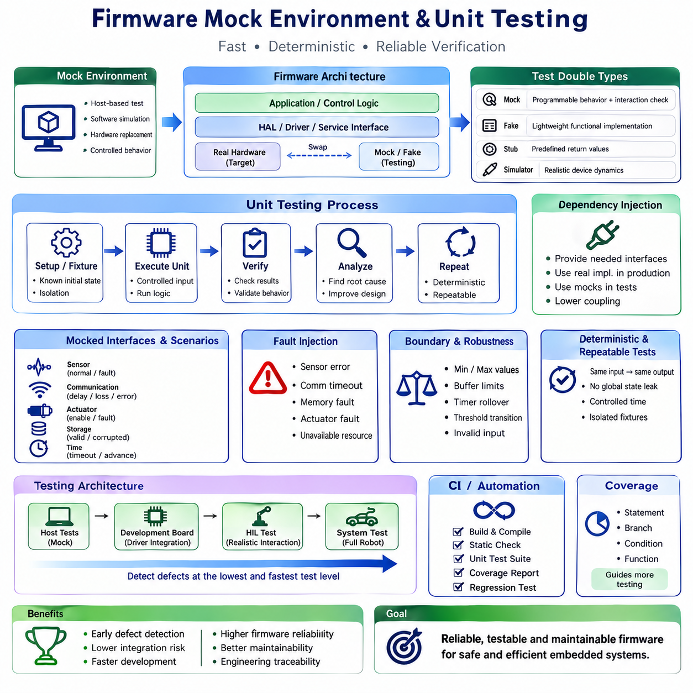{width="7.268055555555556in" height="7.268055555555556in"}

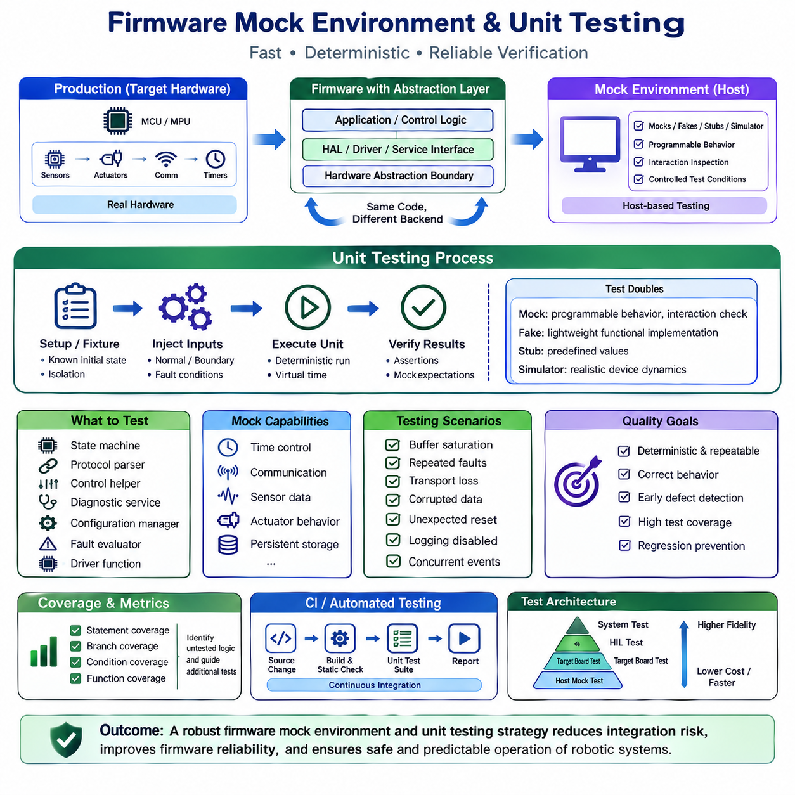{width="7.268055555555556in" height="7.268055555555556in"}

A firmware mock environment provides a controlled software representation of hardware-dependent behavior so embedded code can be tested without requiring the physical target board. Hardware registers, sensors, communication interfaces, timers, memory devices, and actuators are replaced by programmable test substitutes. This approach allows firmware logic to execute on a host computer while preserving the interfaces used by the real embedded implementation.

Mock-based testing depends strongly on architectural separation. Application logic should access hardware through HAL, device-driver, or service interfaces rather than manipulating registers directly throughout the codebase. During production builds, these interfaces connect to real hardware implementations; during host-based tests, they connect to mocks or fakes. The same application component can therefore be exercised under controlled conditions without modifying its functional logic.

A mock represents an interface whose behavior can be programmed and whose interactions can be inspected by the test. A fake provides a lightweight functional implementation, such as an in-memory configuration store replacing external Flash. A stub may return predefined values with minimal behavior, while a simulator attempts to reproduce more realistic device dynamics. Selecting the appropriate test double prevents unnecessary complexity while providing sufficient fidelity for each verification objective.

Unit testing focuses on the smallest practical firmware components in isolation. A unit may be a state machine, protocol parser, control helper, diagnostic service, configuration manager, fault evaluator, or device-independent driver function. Tests provide controlled inputs, execute the unit, and compare observable results with expected behavior. Isolation helps engineers determine whether a failure originates inside the tested component rather than from unrelated hardware or integration effects.

Dependency injection makes test substitution practical by providing a component with the interfaces it requires instead of allowing it to create hidden dependencies internally. A controller can receive abstract sensor, timer, communication, or storage interfaces during initialization. Production code supplies physical implementations, while tests supply mocks. This technique reduces coupling and makes dependencies visible as part of the component\'s architectural contract.

Hardware abstraction boundaries should expose behavior meaningful to the caller. A timer abstraction might provide current time, elapsed time, and timeout operations rather than exposing processor timer registers. A communication abstraction might provide send, receive, busy, and completion behavior. When interfaces are defined at appropriate abstraction levels, test code can reproduce important conditions without attempting to emulate every detail of the microcontroller.

Time is one of the most valuable dependencies to mock. Real delays make tests slow and nondeterministic, while a virtual clock allows test code to advance time explicitly. Timeout handling, retry intervals, watchdog supervision, communication freshness, debounce logic, and state-machine residence times can then be tested instantly. A test can move simulated time from one boundary to another and verify behavior immediately before, at, and after a deadline.

Sensor mocks allow tests to generate nominal measurements, boundary values, invalid readings, frozen values, discontinuities, noise patterns, or communication failures. Firmware can then be checked for correct filtering, plausibility validation, fault detection, and recovery behavior. For robotic controllers, this enables repeatable testing of encoder faults, IMU anomalies, temperature limits, voltage conditions, and other situations that may be difficult or unsafe to reproduce physically.

Communication mocks can reproduce successful transfers as well as delayed, missing, corrupted, duplicated, or incorrectly ordered messages. Protocol logic can be exercised without connecting multiple physical controllers. Tests may verify message parsing, sequence validation, timeout detection, retry policy, error propagation, and state transitions after communication loss. Deterministic message injection also makes intermittent communication defects easier to reproduce.

Actuator interfaces should normally be mocked so unit tests do not produce physical motion. A mock motor driver can record requested torque, velocity, position, enable, disable, or brake commands and allow the test to verify that the correct action was requested. Fault conditions can also be injected into the actuator interface, allowing application logic to demonstrate safe shutdown, degraded operation, or recovery without energizing real hardware.

Mocking persistent storage enables configuration and lifecycle logic to be tested without consuming Flash write cycles. An in-memory fake can represent valid configuration, erased memory, corrupted records, incompatible schema versions, failed writes, or interrupted updates. Tests can verify initialization defaults, parameter validation, migration, checksum handling, and recovery while executing thousands of scenarios rapidly on a development computer.

State-machine firmware is particularly suitable for unit testing because states and transitions provide explicit observable behavior. A test can initialize an FSM in a known condition, inject an event, execute one processing cycle, and verify the destination state and requested outputs. Sequences such as INIT to READY to RUNNING can be tested alongside prohibited transitions, timeout paths, FAULT entry, RECOVERY behavior, and restart conditions.

Fault injection extends ordinary unit testing by deliberately forcing dependencies to fail. A mock can return a sensor error, communication timeout, invalid CRC, memory failure, actuator fault, or unavailable resource at a precisely selected execution point. The test then verifies whether the component detects the failure, propagates the correct diagnostic information, performs the required fallback action, and avoids unsafe or undefined behavior.

Boundary-value testing is especially important in embedded software because many defects occur around limits. Tests should exercise minimum and maximum commands, buffer capacities, timer rollover, counter limits, threshold transitions, zero values, invalid enumerations, and out-of-range sensor data. Equivalence classes can reduce the total number of cases while still covering representative normal, abnormal, and boundary conditions systematically.

Unit tests should be deterministic and repeatable. The same test with the same inputs should produce the same outputs regardless of execution date, host-machine speed, or test order. Global mutable state, uncontrolled random values, real-time delays, and dependencies on external hardware reduce reproducibility. Test fixtures should establish a known initial condition before each case and restore isolation so one test cannot silently influence another.

Assertions define the expected behavior of the unit under test. They may verify return values, output data, state transitions, generated events, diagnostic codes, function calls, or call ordering. Mock frameworks can additionally verify whether an interface was invoked with expected parameters and whether forbidden operations occurred. Tests should emphasize externally observable behavior rather than depending excessively on private implementation details that may change during refactoring.

Code coverage provides evidence about which portions of firmware have been exercised, but coverage alone does not demonstrate correctness. Statement, branch, condition, and function coverage can identify untested logic and guide additional test development. Safety-related software may require stronger structural coverage objectives, but meaningful tests must still originate from requirements, boundary conditions, failure modes, and expected behavior rather than simply attempting to increase a percentage.

Host-based unit tests should be integrated into automated build and continuous integration workflows whenever possible. Each source change can trigger compilation, static checks, and the unit-test suite before firmware is accepted. Fast execution encourages frequent testing and detects regressions near the point where they are introduced. Test reports can preserve pass/fail results, coverage information, and relevant artifacts for later engineering traceability.

Mock testing cannot replace target-hardware verification because host execution does not reproduce every embedded characteristic. Register behavior, interrupt latency, DMA interaction, memory alignment, compiler differences, electrical timing, peripheral errata, cache effects, and physical sensor dynamics may only appear on the target. Unit testing should therefore form the lower level of a broader verification strategy that progresses toward integration, target-board, hardware-in-the-loop, and system testing.

A practical testing architecture separates tests according to the fidelity required. Pure logic and state behavior can execute rapidly with mocks on the host, driver integration can be verified on development boards, and hardware-in-the-loop testing can validate interactions with realistic sensors and actuators. System tests then evaluate the complete robot behavior. Defects should ideally be detected at the lowest and fastest test level capable of revealing them.

Testability should be considered during firmware design rather than added after implementation. Clear interfaces, limited global state, explicit dependencies, deterministic functions, modular state machines, and separated hardware access naturally create testable components. Architecture designed this way improves production maintainability as well, because the same boundaries that permit mocks also reduce coupling and make firmware changes easier to understand.

Firmware mock environments and unit testing therefore provide a fast, deterministic verification foundation for embedded robotic software. By replacing physical dependencies with controllable test doubles, engineers can exercise normal behavior, timing boundaries, communication failures, corrupted data, hardware faults, and recovery paths repeatedly and safely. Combined with automated execution, fault injection, coverage analysis, target testing, and HIL verification, this approach reduces integration risk and improves firmware reliability.

펌웨어 모의 환경(Firmware Mock Environment)은 물리적인 대상 보드(Target Board)가 없어도 임베디드 코드를 테스트할 수 있도록 하드웨어 의존적 동작(Hardware-Dependent Behavior)을 통제된 소프트웨어 형태로 표현합니다. 하드웨어 레지스터, 센서, 통신 인터페이스, 타이머, 메모리 장치, 액추에이터(Actuator)는 프로그래밍 가능한 테스트 대체물(Test Substitute)로 교체됩니다. 이를 통해 실제 임베디드 구현에서 사용하는 인터페이스를 유지하면서 호스트 컴퓨터(Host Computer)에서 펌웨어 로직을 실행할 수 있습니다.

모의 객체 기반 테스트(Mock-Based Testing)는 아키텍처 분리(Architectural Separation)에 크게 의존합니다. 애플리케이션 로직(Application Logic)은 코드 전체에서 레지스터를 직접 조작하는 대신 하드웨어 추상화 계층(Hardware Abstraction Layer, HAL), 장치 드라이버(Device Driver), 서비스 인터페이스(Service Interface)를 통해 하드웨어에 접근해야 합니다. 제품 빌드(Production Build)에서는 이러한 인터페이스가 실제 하드웨어 구현에 연결되고, 호스트 기반 테스트(Host-Based Test)에서는 모의 객체(Mock) 또는 가짜 객체(Fake)에 연결됩니다. 따라서 동일한 애플리케이션 구성요소를 기능 로직의 수정 없이 통제된 조건에서 시험할 수 있습니다.

모의 객체(Mock)는 동작을 프로그래밍할 수 있고 테스트에서 상호작용을 검사할 수 있는 인터페이스의 대체 구현입니다. 가짜 객체(Fake)는 외부 플래시(Flash)를 대신하는 인메모리 구성 저장소(In-Memory Configuration Store)와 같이 간소화된 기능 구현을 제공합니다. 스텁(Stub)은 최소한의 동작으로 미리 정의된 값을 반환하며, 시뮬레이터(Simulator)는 보다 현실적인 장치 동역학(Device Dynamics)을 재현하려고 합니다. 각 검증 목적에 적절한 테스트 대역(Test Double)을 선택하면 불필요한 복잡성을 피하면서 필요한 수준의 충실도(Fidelity)를 확보할 수 있습니다.

단위 테스트(Unit Testing)는 실용적으로 가능한 가장 작은 펌웨어 구성요소를 격리하여 검증하는 데 초점을 둡니다. 하나의 단위(Unit)는 상태 머신(State Machine), 프로토콜 파서(Protocol Parser), 제어 보조 함수(Control Helper), 진단 서비스(Diagnostic Service), 구성 관리자(Configuration Manager), 고장 평가기(Fault Evaluator), 장치 독립적 드라이버 함수가 될 수 있습니다. 테스트는 통제된 입력을 제공하고 해당 단위를 실행한 다음 관찰 가능한 결과를 예상 동작과 비교합니다. 이러한 격리는 장애가 관련 없는 하드웨어나 통합 효과가 아니라 테스트 대상 구성요소 내부에서 발생했는지를 판단하는 데 도움을 줍니다.

의존성 주입(Dependency Injection)은 구성요소가 내부적으로 숨겨진 의존성을 생성하도록 하지 않고 필요한 인터페이스를 외부에서 제공함으로써 테스트 대체를 실용적으로 만듭니다. 컨트롤러는 초기화 과정에서 추상화된 센서, 타이머, 통신, 저장장치 인터페이스를 전달받을 수 있습니다. 제품 코드는 실제 물리적 구현을 제공하고 테스트에서는 모의 객체를 제공합니다. 이러한 기법은 결합도(Coupling)를 낮추고 의존성을 구성요소의 아키텍처 계약(Architectural Contract)의 일부로 명확하게 드러냅니다.

하드웨어 추상화 경계(Hardware Abstraction Boundary)는 호출자에게 의미 있는 동작을 제공해야 합니다. 타이머 추상화(Timer Abstraction)는 프로세서 타이머 레지스터를 노출하는 대신 현재 시간, 경과 시간(Elapsed Time), 타임아웃(Timeout) 연산을 제공할 수 있습니다. 통신 추상화(Communication Abstraction)는 송신(Send), 수신(Receive), 사용 중(Busy), 완료(Completion) 동작을 제공할 수 있습니다. 적절한 추상화 수준에서 인터페이스를 정의하면 테스트 코드가 마이크로컨트롤러의 모든 세부사항을 에뮬레이션하지 않고도 중요한 조건을 재현할 수 있습니다.

시간(Time)은 모의 처리할 가치가 가장 높은 의존성 중 하나입니다. 실제 지연(Real Delay)을 사용하면 테스트가 느려지고 비결정적이 될 수 있지만 가상 클록(Virtual Clock)을 사용하면 테스트 코드가 시간을 명시적으로 진행시킬 수 있습니다. 따라서 타임아웃 처리, 재시도 간격(Retry Interval), 워치독 감시(Watchdog Supervision), 통신 최신성(Communication Freshness), 디바운스 로직(Debounce Logic), 상태 머신 체류 시간(State-Machine Residence Time)을 즉시 테스트할 수 있습니다. 테스트는 시뮬레이션 시간을 특정 경계로 이동시키고 데드라인(Deadline)의 직전, 정확한 시점, 직후의 동작을 검증할 수 있습니다.

센서 모의 객체(Sensor Mock)를 사용하면 정상 측정값, 경계값(Boundary Value), 잘못된 측정값, 고정된 값(Frozen Value), 불연속 값(Discontinuity), 노이즈 패턴(Noise Pattern), 통신 장애를 생성할 수 있습니다. 이후 펌웨어가 올바르게 필터링하고, 타당성 검증(Plausibility Validation)을 수행하며, 고장을 탐지하고, 복구하는지를 확인할 수 있습니다. 로봇 컨트롤러에서는 이를 통해 물리적으로 재현하기 어렵거나 위험할 수 있는 엔코더 고장, IMU 이상, 온도 한계, 전압 상태 등을 반복적으로 테스트할 수 있습니다.

통신 모의 객체(Communication Mock)는 성공적인 전송뿐만 아니라 지연, 손실, 손상, 중복 또는 잘못된 순서의 메시지를 재현할 수 있습니다. 여러 물리적 컨트롤러를 실제로 연결하지 않고도 프로토콜 로직(Protocol Logic)을 시험할 수 있습니다. 테스트에서는 메시지 파싱(Message Parsing), 시퀀스 검증(Sequence Validation), 타임아웃 탐지, 재시도 정책(Retry Policy), 오류 전파(Error Propagation), 통신 손실 이후의 상태 전이를 검증할 수 있습니다. 결정론적인 메시지 주입(Deterministic Message Injection)은 간헐적으로 발생하는 통신 결함도 쉽게 재현할 수 있도록 합니다.

단위 테스트 과정에서 물리적 움직임이 발생하지 않도록 액추에이터 인터페이스(Actuator Interface)는 일반적으로 모의 객체로 대체해야 합니다. 모의 모터 드라이버(Mock Motor Driver)는 요청된 토크, 속도, 위치, 활성화(Enable), 비활성화(Disable), 브레이크(Brake) 명령을 기록하고 테스트가 올바른 동작이 요청되었는지 검증하도록 할 수 있습니다. 액추에이터 인터페이스에 고장 조건도 주입할 수 있으므로 실제 하드웨어를 구동하지 않고 애플리케이션 로직의 안전 정지(Safe Shutdown), 성능 저하 운전(Degraded Operation), 복구 동작을 검증할 수 있습니다.

영구 저장장치(Persistent Storage)를 모의 처리하면 플래시 쓰기 수명(Flash Write Cycle)을 소비하지 않고 구성 및 수명주기 로직(Configuration and Lifecycle Logic)을 테스트할 수 있습니다. 인메모리 가짜 객체(In-Memory Fake)는 정상 구성, 삭제된 메모리(Erased Memory), 손상된 레코드(Corrupted Record), 호환되지 않는 스키마 버전(Incompatible Schema Version), 쓰기 실패, 중단된 업데이트 등을 표현할 수 있습니다. 이를 통해 초기화 기본값, 매개변수 검증, 마이그레이션(Migration), 체크섬(Checksum) 처리, 복구를 개발 컴퓨터에서 수천 개의 시나리오로 빠르게 실행할 수 있습니다.

상태 머신 기반 펌웨어(State-Machine Firmware)는 상태와 전이가 명확하게 관찰 가능한 동작을 제공하므로 단위 테스트에 특히 적합합니다. 테스트는 유한 상태 머신(Finite State Machine, FSM)을 알려진 조건으로 초기화하고 이벤트를 주입한 다음 한 번의 처리 주기를 실행하여 목적 상태(Destination State)와 요청된 출력을 확인할 수 있습니다. INIT에서 READY를 거쳐 RUNNING으로 진행하는 정상 시퀀스뿐만 아니라 금지된 전이(Prohibited Transition), 타임아웃 경로, FAULT 진입, RECOVERY 동작, 재시작 조건도 검증할 수 있습니다.

고장 주입(Fault Injection)은 의도적으로 의존성을 실패시킴으로써 일반적인 단위 테스트를 확장합니다. 모의 객체는 정확하게 선택된 실행 시점에서 센서 오류, 통신 타임아웃, 잘못된 CRC, 메모리 장애, 액추에이터 고장, 사용할 수 없는 자원(Unavailable Resource)을 반환하도록 만들 수 있습니다. 이후 테스트는 구성요소가 장애를 탐지하고, 올바른 진단 정보를 전파하고, 필요한 대체 동작(Fallback Action)을 수행하며, 안전하지 않거나 정의되지 않은 동작을 피하는지 검증합니다.

임베디드 소프트웨어에서는 많은 결함이 한계 주변에서 발생하기 때문에 경계값 테스트(Boundary-Value Testing)가 특히 중요합니다. 테스트는 최소 및 최대 명령, 버퍼 용량, 타이머 롤오버(Timer Rollover), 카운터 한계, 임계값 전이(Threshold Transition), 0 값, 잘못된 열거형(Invalid Enumeration), 범위를 벗어난 센서 데이터를 검증해야 합니다. 동등 클래스(Equivalence Class)를 이용하면 전체 테스트 수를 줄이면서도 정상, 비정상, 경계 조건을 대표하는 사례를 체계적으로 검증할 수 있습니다.

단위 테스트는 결정론적(Deterministic)이고 반복 가능(Repeatable)해야 합니다. 동일한 입력을 사용하는 동일한 테스트는 실행 날짜, 호스트 컴퓨터 속도, 테스트 실행 순서와 관계없이 동일한 출력을 생성해야 합니다. 전역 가변 상태(Global Mutable State), 통제되지 않은 난수(Random Value), 실제 시간 지연, 외부 하드웨어 의존성은 재현성을 떨어뜨립니다. 테스트 픽스처(Test Fixture)는 각 테스트 전에 알려진 초기 상태를 설정하고 하나의 테스트가 다른 테스트에 조용히 영향을 주지 않도록 격리 상태를 복원해야 합니다.

어서션(Assertion)은 테스트 대상 단위(Unit Under Test)의 예상 동작을 정의합니다. 반환 값, 출력 데이터, 상태 전이, 생성된 이벤트, 진단 코드, 함수 호출 또는 호출 순서를 검증할 수 있습니다. 모의 프레임워크(Mock Framework)는 인터페이스가 예상된 매개변수로 호출되었는지와 금지된 연산이 수행되지 않았는지를 추가로 검증할 수 있습니다. 테스트는 리팩터링(Refactoring) 과정에서 변경될 수 있는 내부 구현 세부사항에 지나치게 의존하기보다 외부에서 관찰 가능한 동작을 중심으로 검증해야 합니다.

코드 커버리지(Code Coverage)는 펌웨어의 어떤 부분이 실행되었는지를 보여주는 증거를 제공하지만 커버리지만으로 정확성(Correctness)을 입증할 수는 없습니다. 문장 커버리지(Statement Coverage), 분기 커버리지(Branch Coverage), 조건 커버리지(Condition Coverage), 함수 커버리지(Function Coverage)는 테스트되지 않은 로직을 식별하고 추가 테스트 개발을 유도할 수 있습니다. 안전 관련 소프트웨어에서는 더 강한 구조적 커버리지 목표가 요구될 수 있지만 의미 있는 테스트는 단순히 백분율을 높이는 것이 아니라 요구사항, 경계 조건, 고장 형태(Failure Mode), 예상 동작에서 도출되어야 합니다.

호스트 기반 단위 테스트(Host-Based Unit Test)는 가능한 경우 자동화된 빌드(Automated Build)와 지속적 통합(Continuous Integration, CI) 워크플로에 통합해야 합니다. 각각의 소스 변경은 펌웨어가 승인되기 전에 컴파일, 정적 검사(Static Check), 단위 테스트 스위트(Unit-Test Suite)를 자동으로 실행할 수 있습니다. 빠른 실행은 빈번한 테스트를 촉진하고 회귀 오류(Regression)를 발생 지점 가까이에서 발견하도록 합니다. 테스트 보고서는 합격·실패 결과, 커버리지 정보, 관련 산출물(Artifact)을 보존하여 이후 엔지니어링 추적성을 지원할 수 있습니다.

모의 테스트(Mock Testing)는 호스트 실행이 모든 임베디드 특성을 재현하지 못하기 때문에 대상 하드웨어 검증(Target-Hardware Verification)을 대체할 수 없습니다. 레지스터 동작, 인터럽트 지연시간(Interrupt Latency), DMA 상호작용, 메모리 정렬(Memory Alignment), 컴파일러 차이, 전기적 타이밍(Electrical Timing), 주변장치 에라타(Peripheral Errata), 캐시 효과(Cache Effect), 실제 센서 동역학은 대상 하드웨어에서만 나타날 수 있습니다. 따라서 단위 테스트는 통합 테스트, 대상 보드 테스트, 하드웨어 인 더 루프(Hardware-in-the-Loop, HIL), 시스템 테스트로 확장되는 더 광범위한 검증 전략의 하위 단계로 구성해야 합니다.

실용적인 테스트 아키텍처(Test Architecture)는 필요한 충실도에 따라 테스트를 분리합니다. 순수 로직과 상태 동작은 호스트에서 모의 객체를 사용하여 빠르게 실행하고, 드라이버 통합은 개발 보드(Development Board)에서 검증하며, HIL 테스트는 현실적인 센서 및 액추에이터와의 상호작용을 검증할 수 있습니다. 이후 시스템 테스트(System Test)는 완전한 로봇 동작을 평가합니다. 결함은 가능하면 해당 결함을 발견할 수 있는 가장 낮고 빠른 테스트 단계에서 탐지하는 것이 바람직합니다.

테스트 가능성(Testability)은 구현이 완료된 이후 추가하는 것이 아니라 펌웨어 설계 과정에서부터 고려해야 합니다. 명확한 인터페이스, 제한된 전역 상태(Global State), 명시적인 의존성(Explicit Dependency), 결정론적 함수(Deterministic Function), 모듈화된 상태 머신(Modular State Machine), 분리된 하드웨어 접근은 자연스럽게 테스트 가능한 구성요소를 만듭니다. 이러한 방식으로 설계된 아키텍처는 모의 객체 사용을 가능하게 하는 동일한 경계가 결합도를 낮추고 펌웨어 변경을 쉽게 이해하도록 하기 때문에 제품의 유지보수성(Maintainability)도 향상시킵니다.

따라서 펌웨어 모의 환경 및 단위 테스트(Firmware Mock Environment and Unit Testing)는 임베디드 로봇 소프트웨어를 위한 빠르고 결정론적인 검증 기반(Verification Foundation)을 제공합니다. 물리적 의존성을 통제 가능한 테스트 대역으로 교체함으로써 엔지니어는 정상 동작, 타이밍 경계, 통신 장애, 손상된 데이터, 하드웨어 고장, 복구 경로를 반복적이고 안전하게 시험할 수 있습니다. 이를 자동화된 실행, 고장 주입, 커버리지 분석, 대상 하드웨어 테스트, HIL 검증과 결합하면 통합 위험(Integration Risk)을 줄이고 펌웨어 신뢰성(Firmware Reliability)을 향상시킬 수 있습니다.

##  

## 05.10 Robot Joint Controller Firmware Architecture Case Study

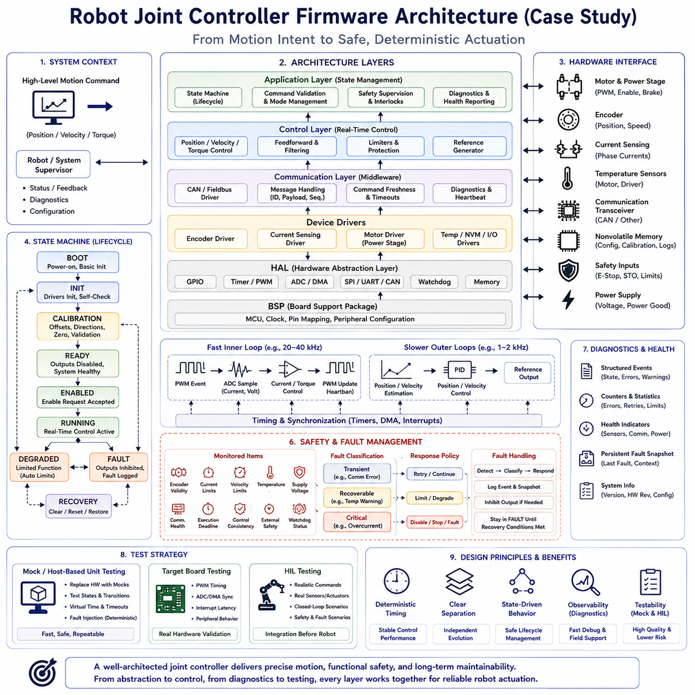{width="7.268055555555556in" height="7.268055555555556in"}

A robot joint controller is a compact example of how firmware architecture translates high-level motion intent into deterministic electrical control of a physical actuator. The controller must coordinate sensing, real-time control, communication, diagnostics, safety supervision, and hardware management within strict timing constraints. A well-structured design separates these responsibilities so that control performance can remain predictable while hardware and software components evolve independently.

At the hardware boundary, the controller typically interacts with a motor power stage, position encoder, current measurement circuitry, temperature sensors, communication transceiver, nonvolatile memory, and safety-related inputs. The microcontroller provides timers, PWM generation, ADC channels, communication peripherals, DMA, interrupts, and watchdog resources. Firmware must convert these processor-level mechanisms into stable services without exposing register-level implementation details throughout the application.

The Hardware Abstraction Layer, or HAL, forms the lowest reusable software boundary. It encapsulates GPIO, timers, PWM, ADC, DMA, SPI, UART, CAN, watchdog, and memory-access mechanisms behind consistent interfaces. A Board Support Package maps these generic capabilities onto the specific joint-controller PCB. This separation allows processor or board revisions to be accommodated primarily within HAL and BSP implementations rather than propagating changes through control and application logic.

Device drivers build on the HAL and BSP to represent concrete joint hardware. An encoder driver provides position and validity information, a current-sensing driver supplies motor-current measurements, and a motor driver controls the power stage through PWM and enable signals. Temperature, nonvolatile memory, and communication devices receive similar abstractions. Each driver converts low-level transactions into device-oriented operations while reporting hardware errors through standardized status interfaces.

The control layer transforms measured joint state and commanded targets into actuator outputs. Depending on the actuator architecture, control may include current or torque control, velocity control, position control, feedforward terms, filtering, and output limiting. Fast inner loops execute at deterministic rates, while slower outer loops provide higher-level regulation. Separating these loops from hardware drivers allows control algorithms to evolve without requiring direct knowledge of timer registers or ADC sequencing.

Sampling and actuation timing must be coordinated carefully because control quality depends on deterministic data acquisition and output updates. PWM events can trigger ADC sampling at defined points in the switching cycle, while DMA transfers move measurements with minimal CPU intervention. Timer-driven control execution ensures that calculations occur at predictable intervals. Interrupt handlers should perform only essential time-critical work and defer complex processing whenever possible.

The application layer coordinates the lifecycle of the joint rather than implementing low-level peripheral mechanisms. A finite state machine can represent states such as BOOT, INIT, CALIBRATION, READY, ENABLED, RUNNING, DEGRADED, FAULT, and RECOVERY. Each state defines which operations are permitted and which transitions are legal. This makes startup, shutdown, fault handling, and reactivation behavior explicit rather than distributing lifecycle decisions across unrelated functions.

During BOOT and INIT, firmware establishes processor resources, initializes HAL and BSP components, starts device drivers, loads configuration, and performs basic self-tests. Sensor communication, encoder validity, memory integrity, power-stage status, and communication availability can be checked before motion is permitted. The controller should not transition toward an enabled state until all mandatory dependencies have reached known and valid conditions.

Calibration establishes the relationship between raw hardware measurements and meaningful joint quantities. Encoder offsets, current-sensor biases, direction conventions, mechanical zero positions, or other actuator-specific parameters may need verification or measurement. Calibration data should be validated before use and stored with integrity protection and format information. Invalid or incompatible calibration must prevent normal motion when safe control depends on those parameters.

In READY, the controller can communicate and report health while keeping actuator output disabled. An explicit enable request can transition the system toward active control only when safety conditions, command validity, sensor health, and power-stage status permit operation. Separating READY from RUNNING prevents communication activity or successful initialization from being interpreted automatically as authorization to energize the actuator.

The RUNNING state coordinates command processing with real-time control execution. Position, velocity, or torque targets may arrive through a communication interface and are validated before becoming active setpoints. Range limits, command freshness, operating mode, acceleration constraints, and safety conditions can be checked before commands reach the control loops. The real-time controller then uses validated targets rather than consuming raw network data directly.

Communication middleware separates network protocol behavior from actuator control. A CAN or other fieldbus driver handles physical frame transfer, while middleware manages message identifiers, payload interpretation, sequence information, timeouts, diagnostics, and command validity. Application logic receives domain-level commands such as requested position, velocity, torque, enable, or stop rather than parsing communication frames inside the control algorithm.

Command freshness is particularly important because a previously valid motion command can become unsafe if communication is lost. Firmware can associate commands with timestamps, counters, or watchdog-style timeout supervision. If new commands do not arrive within the permitted interval, the application transitions according to a defined policy, such as controlled stopping, torque disable, or FAULT entry. Communication success is therefore evaluated as an ongoing condition rather than a one-time connection event.

Safety supervision operates alongside normal control and evaluates whether continued actuator operation remains acceptable. It may monitor encoder validity, current limits, velocity limits, temperature, supply voltage, communication health, execution deadlines, control consistency, and external safety signals. Safety checks should lead to explicitly defined responses rather than merely generating log messages. Critical conditions can override ordinary motion commands and force the joint toward a safe state.

Fault management classifies abnormal conditions according to their operational significance. A transient communication error may permit retry, while persistent sensor invalidity may require degraded operation or shutdown. Overcurrent, invalid position feedback, watchdog expiration, or power-stage faults may require immediate actuator disable. Each fault should have a defined detection condition, diagnostic identifier, response, persistence behavior, and recovery requirement.

The FAULT state provides controlled behavior after a condition makes normal operation unacceptable. Motor output can be inhibited, fault information preserved, and commands rejected until predefined recovery conditions are satisfied. Some faults may clear automatically after a verified transient condition disappears, while others should require an explicit reset or power cycle. Recovery policy must prevent repeated uncontrolled transitions between active operation and faulted states.

Diagnostics provide visibility into the joint controller without interfering with its real-time responsibilities. Structured events can record state transitions, communication failures, sensor errors, current limiting, temperature warnings, resets, and safety interventions. Counters can summarize high-frequency conditions, while persistent fault snapshots preserve critical information across resets. Firmware version, hardware revision, configuration identity, and calibration status should accompany diagnostic information used for field analysis.

The joint controller should expose clear interfaces between application, control, middleware, drivers, and HAL components. Data ownership, execution context, timing assumptions, units, valid ranges, and error semantics should be defined explicitly. Control code should receive normalized or engineering-unit measurements instead of raw register values, while hardware drivers should remain unaware of application states. These boundaries reduce coupling and make individual components independently testable.

A mock environment can replace sensors, timers, communication interfaces, storage, and actuator drivers during host-based unit testing. State-machine behavior can then be tested across initialization, enable, running, fault, and recovery sequences without moving physical hardware. Virtual time allows timeout behavior to be verified instantly, while fault injection can reproduce encoder failure, communication loss, overtemperature, invalid configuration, or actuator faults deterministically.

Target-board testing complements mock testing by validating characteristics that host execution cannot reproduce. PWM timing, ADC synchronization, DMA operation, interrupt latency, encoder interfaces, power-stage behavior, communication timing, and processor-specific effects must be evaluated on actual hardware. Hardware-in-the-loop testing can then exercise realistic commands and sensor responses while preserving controlled conditions before full integration into a robotic mechanism.

The architecture should also support firmware updates and long-term compatibility. The controller can report firmware version, hardware revision, protocol version, and configuration schema so supervisory software can determine compatibility. Bootloader validation, image integrity checks, controlled rollback, and persistent configuration migration become important when many joint controllers are deployed across robots with different manufacturing histories.

A complete robot joint controller firmware architecture therefore forms a chain from hardware abstraction through device drivers, real-time control, communication services, application state management, diagnostics, and safety supervision. Deterministic timing keeps sensing and actuation predictable, explicit interfaces isolate dependencies, and state-driven behavior controls lifecycle and faults. Combined with mock testing and target verification, this architecture provides a scalable foundation for reliable and maintainable robotic actuation.

로봇 관절 컨트롤러(Robot Joint Controller)는 상위 수준의 모션 의도(Motion Intent)가 물리적 액추에이터(Actuator)의 결정론적 전기 제어(Deterministic Electrical Control)로 변환되는 과정을 보여주는 대표적인 펌웨어 아키텍처 사례입니다. 컨트롤러는 엄격한 타이밍 제약(Timing Constraint) 안에서 센싱(Sensing), 실시간 제어(Real-Time Control), 통신(Communication), 진단(Diagnostics), 안전 감독(Safety Supervision), 하드웨어 관리(Hardware Management)를 조정해야 합니다. 잘 구조화된 설계는 이러한 책임을 분리하여 하드웨어와 소프트웨어 구성요소가 독립적으로 발전하더라도 제어 성능을 예측 가능하게 유지합니다.

하드웨어 경계(Hardware Boundary)에서 컨트롤러는 일반적으로 모터 전력단(Motor Power Stage), 위치 엔코더(Position Encoder), 전류 측정 회로(Current Measurement Circuitry), 온도 센서(Temperature Sensor), 통신 트랜시버(Communication Transceiver), 비휘발성 메모리(Nonvolatile Memory), 안전 관련 입력(Safety-Related Input)과 상호작용합니다. 마이크로컨트롤러(Microcontroller)는 타이머, PWM 생성, ADC 채널, 통신 주변장치, DMA, 인터럽트(Interrupt), 워치독(Watchdog) 자원을 제공합니다. 펌웨어는 이러한 프로세서 수준 메커니즘을 안정적인 서비스로 변환하여 레지스터 수준 구현 세부사항이 애플리케이션 전체에 노출되지 않도록 해야 합니다.

하드웨어 추상화 계층(Hardware Abstraction Layer, HAL)은 가장 낮은 수준의 재사용 가능한 소프트웨어 경계를 형성합니다. HAL은 GPIO, 타이머, PWM, ADC, DMA, SPI, UART, CAN, 워치독, 메모리 접근 메커니즘을 일관된 인터페이스 뒤에 캡슐화(Encapsulation)합니다. 보드 지원 패키지(Board Support Package, BSP)는 이러한 일반 기능을 특정 관절 컨트롤러 PCB에 매핑합니다. 이러한 분리를 통해 프로세서나 보드가 변경되더라도 제어 및 애플리케이션 로직 전체를 변경하는 대신 HAL과 BSP 구현을 중심으로 대응할 수 있습니다.

장치 드라이버(Device Driver)는 HAL과 BSP를 기반으로 실제 관절 하드웨어를 표현합니다. 엔코더 드라이버(Encoder Driver)는 위치와 유효성 정보를 제공하고, 전류 센싱 드라이버(Current-Sensing Driver)는 모터 전류 측정값을 제공하며, 모터 드라이버(Motor Driver)는 PWM과 활성화 신호(Enable Signal)를 통해 전력단을 제어합니다. 온도, 비휘발성 메모리, 통신 장치도 유사한 추상화를 적용합니다. 각각의 드라이버는 저수준 트랜잭션(Low-Level Transaction)을 장치 중심 연산으로 변환하면서 표준화된 상태 인터페이스를 통해 하드웨어 오류를 보고합니다.

제어 계층(Control Layer)은 측정된 관절 상태(Measured Joint State)와 명령된 목표값(Commanded Target)을 액추에이터 출력으로 변환합니다. 액추에이터 아키텍처에 따라 전류 또는 토크 제어(Current or Torque Control), 속도 제어(Velocity Control), 위치 제어(Position Control), 피드포워드(Feedforward), 필터링(Filtering), 출력 제한(Output Limiting)이 포함될 수 있습니다. 빠른 내부 루프(Inner Loop)는 결정론적인 주기로 실행되고 상대적으로 느린 외부 루프(Outer Loop)는 상위 수준의 조절을 담당합니다. 이러한 제어 루프를 하드웨어 드라이버와 분리하면 제어 알고리즘이 타이머 레지스터나 ADC 시퀀싱을 직접 이해하지 않고도 발전할 수 있습니다.

제어 품질은 결정론적인 데이터 획득과 출력 갱신에 의존하기 때문에 샘플링과 액추에이션 타이밍(Sampling and Actuation Timing)을 세밀하게 조정해야 합니다. PWM 이벤트는 스위칭 주기의 정의된 시점에서 ADC 샘플링을 트리거할 수 있으며, DMA 전송은 CPU 개입을 최소화하면서 측정 데이터를 이동시킬 수 있습니다. 타이머 기반 제어 실행(Timer-Driven Control Execution)은 계산이 예측 가능한 간격으로 수행되도록 합니다. 인터럽트 처리기(Interrupt Handler)는 필수적인 시간 임계 작업만 수행하고 복잡한 처리는 가능한 경우 지연 실행해야 합니다.

애플리케이션 계층(Application Layer)은 저수준 주변장치 메커니즘을 구현하는 대신 관절의 수명주기(Lifecycle)를 조정합니다. 유한 상태 머신(Finite State Machine, FSM)은 BOOT, INIT, CALIBRATION, READY, ENABLED, RUNNING, DEGRADED, FAULT, RECOVERY 등의 상태를 표현할 수 있습니다. 각각의 상태는 허용되는 연산과 합법적인 상태 전이(State Transition)를 정의합니다. 이를 통해 시작, 종료, 고장 처리, 재활성화 동작을 서로 관련 없는 여러 함수에 분산시키지 않고 명시적으로 관리할 수 있습니다.

BOOT와 INIT 단계에서 펌웨어는 프로세서 자원을 설정하고 HAL과 BSP 구성요소를 초기화하며 장치 드라이버를 시작하고 구성(Configuration)을 불러온 후 기본적인 자체 진단(Self-Test)을 수행합니다. 모션이 허용되기 전에 센서 통신, 엔코더 유효성, 메모리 무결성(Memory Integrity), 전력단 상태, 통신 가용성을 검사할 수 있습니다. 모든 필수 의존성(Mandatory Dependency)이 알려진 정상 상태에 도달하기 전에는 컨트롤러가 활성화 상태로 전환되지 않아야 합니다.

보정(Calibration)은 원시 하드웨어 측정값과 의미 있는 관절 물리량 사이의 관계를 설정합니다. 엔코더 오프셋(Encoder Offset), 전류 센서 바이어스(Current-Sensor Bias), 방향 규칙(Direction Convention), 기계적 영점(Mechanical Zero Position), 기타 액추에이터별 매개변수의 검증이나 측정이 필요할 수 있습니다. 보정 데이터는 사용 전에 검증하고 무결성 보호(Integrity Protection)와 형식 정보를 함께 저장해야 합니다. 안전한 제어가 이러한 매개변수에 의존하는 경우 잘못되거나 호환되지 않는 보정 데이터는 정상 모션을 허용해서는 안 됩니다.

READY 상태에서 컨트롤러는 액추에이터 출력을 비활성화한 상태로 통신하고 건전성(Health)을 보고할 수 있습니다. 명시적인 활성화 요청(Enable Request)이 발생하더라도 안전 조건, 명령 유효성(Command Validity), 센서 건전성(Sensor Health), 전력단 상태가 운전을 허용하는 경우에만 활성 제어 상태로 전환해야 합니다. READY와 RUNNING을 분리하면 통신이 가능하거나 초기화가 성공했다는 사실이 액추에이터에 전력을 인가할 수 있는 권한으로 자동 해석되는 것을 방지합니다.

RUNNING 상태는 명령 처리(Command Processing)와 실시간 제어 실행을 조정합니다. 위치, 속도 또는 토크 목표값이 통신 인터페이스를 통해 전달될 수 있으며, 활성 설정값(Active Setpoint)이 되기 전에 검증됩니다. 범위 제한(Range Limit), 명령 최신성(Command Freshness), 운용 모드(Operating Mode), 가속도 제약(Acceleration Constraint), 안전 조건 등을 확인한 후 명령을 제어 루프에 전달할 수 있습니다. 따라서 실시간 컨트롤러는 원시 네트워크 데이터를 직접 사용하는 것이 아니라 검증된 목표값을 사용합니다.

통신 미들웨어(Communication Middleware)는 네트워크 프로토콜 동작과 액추에이터 제어를 분리합니다. CAN 또는 기타 필드버스(Fieldbus) 드라이버가 물리적 프레임 전송을 처리하고 미들웨어는 메시지 식별자(Message Identifier), 페이로드 해석(Payload Interpretation), 시퀀스 정보(Sequence Information), 타임아웃, 진단, 명령 유효성을 관리합니다. 애플리케이션 로직은 제어 알고리즘 내부에서 통신 프레임을 직접 파싱하는 대신 요청 위치, 속도, 토크, 활성화, 정지와 같은 도메인 수준 명령(Domain-Level Command)을 전달받습니다.

명령 최신성(Command Freshness)은 이전에 유효했던 모션 명령이라도 통신이 끊어지면 위험해질 수 있기 때문에 특히 중요합니다. 펌웨어는 명령에 타임스탬프(Timestamp), 카운터(Counter), 워치독 방식의 타임아웃 감시(Timeout Supervision)를 연결할 수 있습니다. 허용된 시간 내에 새로운 명령이 도착하지 않으면 애플리케이션은 통제된 정지(Controlled Stop), 토크 비활성화(Torque Disable), FAULT 진입 등의 정의된 정책에 따라 상태를 전환합니다. 따라서 통신 성공 여부는 일회성 연결 이벤트가 아니라 지속적으로 평가되는 운용 조건입니다.

안전 감독(Safety Supervision)은 정상 제어와 병행하여 액추에이터 운전을 계속하는 것이 허용 가능한지를 평가합니다. 엔코더 유효성, 전류 제한(Current Limit), 속도 제한(Velocity Limit), 온도, 공급 전압(Supply Voltage), 통신 건전성, 실행 데드라인(Execution Deadline), 제어 일관성(Control Consistency), 외부 안전 신호 등을 감시할 수 있습니다. 안전 검사는 단순히 로그 메시지를 생성하는 데 그치지 않고 명시적으로 정의된 대응으로 연결되어야 합니다. 치명적인 조건은 일반적인 모션 명령보다 높은 우선순위를 가지고 관절을 안전 상태(Safe State)로 강제 전환할 수 있습니다.

고장 관리(Fault Management)는 비정상적인 조건을 운용상의 중요도에 따라 분류합니다. 일시적인 통신 오류는 재시도를 허용할 수 있지만 지속적인 센서 무효 상태는 성능 저하 운전(Degraded Operation)이나 셧다운(Shutdown)을 요구할 수 있습니다. 과전류(Overcurrent), 잘못된 위치 피드백, 워치독 만료(Watchdog Expiration), 전력단 고장은 즉각적인 액추에이터 비활성화를 요구할 수 있습니다. 각각의 고장은 명확한 탐지 조건, 진단 식별자(Diagnostic Identifier), 대응, 지속성 동작(Persistence Behavior), 복구 요구사항을 가져야 합니다.

FAULT 상태는 정상적인 운전을 계속할 수 없게 만드는 조건이 발생한 이후 통제된 동작을 제공합니다. 모터 출력을 차단하고 고장 정보를 보존하며 사전에 정의된 복구 조건이 충족될 때까지 명령을 거부할 수 있습니다. 일부 고장은 검증된 일시적 조건이 사라지면 자동으로 해제할 수 있지만 다른 고장은 명시적인 리셋(Explicit Reset)이나 전원 재인가(Power Cycle)를 요구해야 합니다. 복구 정책(Recovery Policy)은 활성 운전과 고장 상태 사이에서 통제되지 않은 반복적인 전환이 발생하지 않도록 해야 합니다.

진단(Diagnostics)은 관절 컨트롤러의 실시간 책임을 방해하지 않으면서 내부 동작에 대한 관찰 가능성(Observability)을 제공합니다. 구조화된 이벤트(Structured Event)는 상태 전이, 통신 장애, 센서 오류, 전류 제한, 온도 경고, 리셋, 안전 개입(Safety Intervention)을 기록할 수 있습니다. 카운터는 고주파 조건을 요약하고 영구 고장 스냅샷(Persistent Fault Snapshot)은 리셋 이후에도 중요한 정보를 보존할 수 있습니다. 현장 분석에 사용되는 진단 정보에는 펌웨어 버전, 하드웨어 개정(Hardware Revision), 구성 식별 정보(Configuration Identity), 보정 상태도 함께 포함되어야 합니다.

관절 컨트롤러는 애플리케이션, 제어, 미들웨어, 드라이버, HAL 구성요소 사이에 명확한 인터페이스를 제공해야 합니다. 데이터 소유권(Data Ownership), 실행 컨텍스트(Execution Context), 타이밍 가정(Timing Assumption), 단위(Unit), 유효 범위(Valid Range), 오류 의미(Error Semantics)를 명시적으로 정의해야 합니다. 제어 코드는 원시 레지스터 값이 아니라 정규화된 값 또는 공학 단위(Engineering Unit)의 측정값을 전달받아야 하며, 하드웨어 드라이버는 애플리케이션 상태를 알 필요가 없어야 합니다. 이러한 경계는 결합도(Coupling)를 낮추고 각각의 구성요소를 독립적으로 테스트할 수 있도록 합니다.

모의 환경(Mock Environment)은 호스트 기반 단위 테스트(Host-Based Unit Testing)에서 센서, 타이머, 통신 인터페이스, 저장장치, 액추에이터 드라이버를 대체할 수 있습니다. 물리적 하드웨어를 움직이지 않고 초기화, 활성화, 실행, 고장, 복구 과정에 걸친 상태 머신 동작을 테스트할 수 있습니다. 가상 시간(Virtual Time)을 이용하면 타임아웃 동작을 즉시 검증할 수 있으며, 고장 주입(Fault Injection)을 통해 엔코더 장애, 통신 손실, 과열, 잘못된 구성, 액추에이터 고장을 결정론적으로 재현할 수 있습니다.

대상 보드 테스트(Target-Board Testing)는 호스트 실행으로 재현할 수 없는 특성을 검증하여 모의 테스트를 보완합니다. PWM 타이밍, ADC 동기화, DMA 동작, 인터럽트 지연시간(Interrupt Latency), 엔코더 인터페이스, 전력단 동작, 통신 타이밍, 프로세서별 특성은 실제 하드웨어에서 평가해야 합니다. 이후 하드웨어 인 더 루프(Hardware-in-the-Loop, HIL) 테스트를 통해 완전한 로봇 기구에 통합하기 전에 통제된 환경에서 현실적인 명령과 센서 응답을 검증할 수 있습니다.

아키텍처는 펌웨어 업데이트(Firmware Update)와 장기적인 호환성(Long-Term Compatibility)도 지원해야 합니다. 컨트롤러는 펌웨어 버전, 하드웨어 개정, 프로토콜 버전(Protocol Version), 구성 스키마(Configuration Schema)를 보고하여 상위 감독 소프트웨어(Supervisory Software)가 호환성을 판단할 수 있도록 합니다. 서로 다른 제조 이력(Manufacturing History)을 가진 다수의 관절 컨트롤러가 로봇에 배포되는 경우 부트로더 검증(Bootloader Validation), 이미지 무결성 검사(Image Integrity Check), 통제된 롤백(Controlled Rollback), 영구 구성 마이그레이션(Persistent Configuration Migration)이 중요해집니다.

따라서 완전한 로봇 관절 컨트롤러 펌웨어 아키텍처(Robot Joint Controller Firmware Architecture)는 하드웨어 추상화에서 장치 드라이버, 실시간 제어, 통신 서비스, 애플리케이션 상태 관리, 진단, 안전 감독까지 이어지는 하나의 체계를 형성합니다. 결정론적 타이밍(Deterministic Timing)은 센싱과 액추에이션을 예측 가능하게 유지하고, 명시적인 인터페이스(Explicit Interface)는 의존성을 격리하며, 상태 기반 동작(State-Driven Behavior)은 수명주기와 고장을 통제합니다. 이러한 구조를 모의 테스트, 대상 하드웨어 검증과 결합하면 신뢰성(Reliability)과 유지보수성(Maintainability)을 갖춘 로봇 액추에이션을 위한 확장 가능한 기반을 구축할 수 있습니다.
