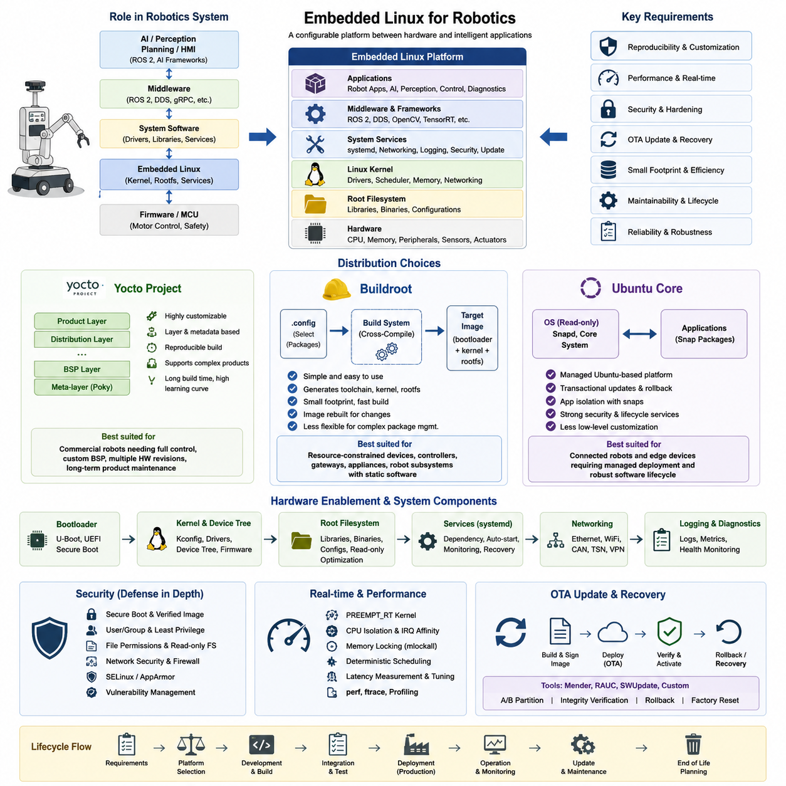
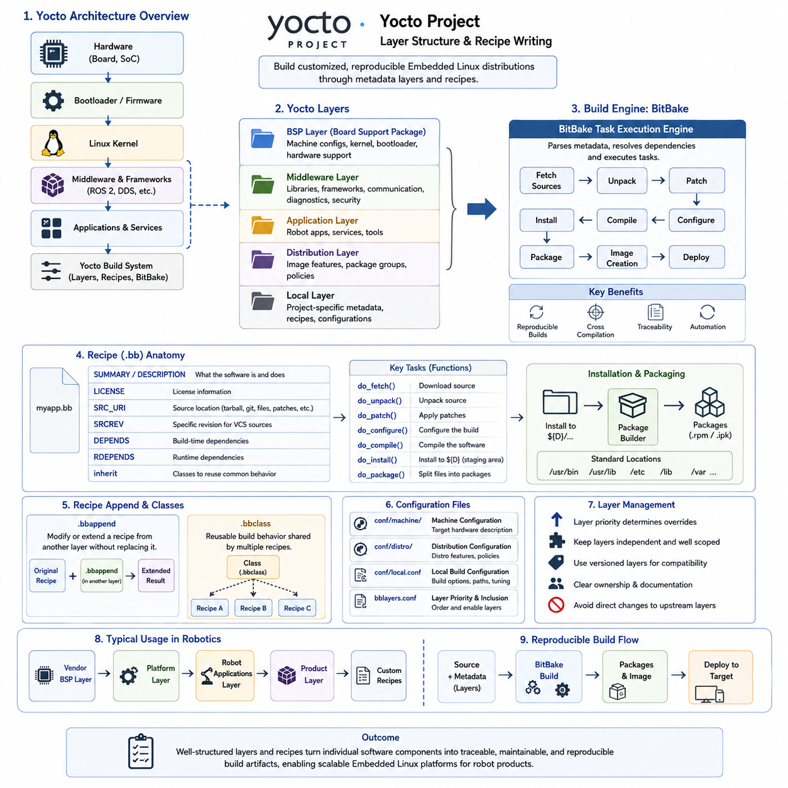
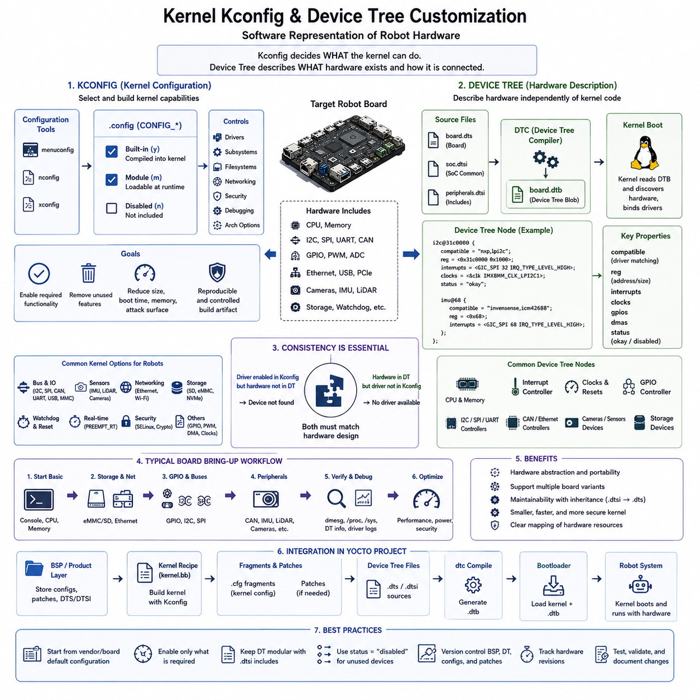
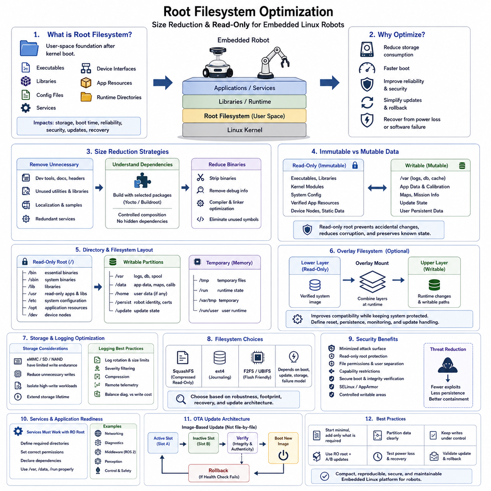
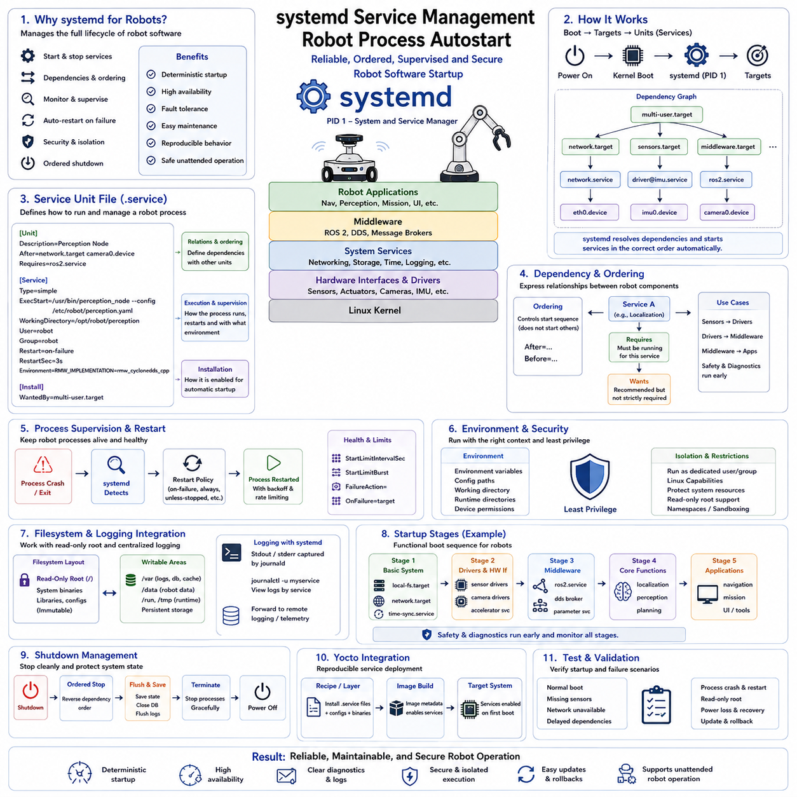
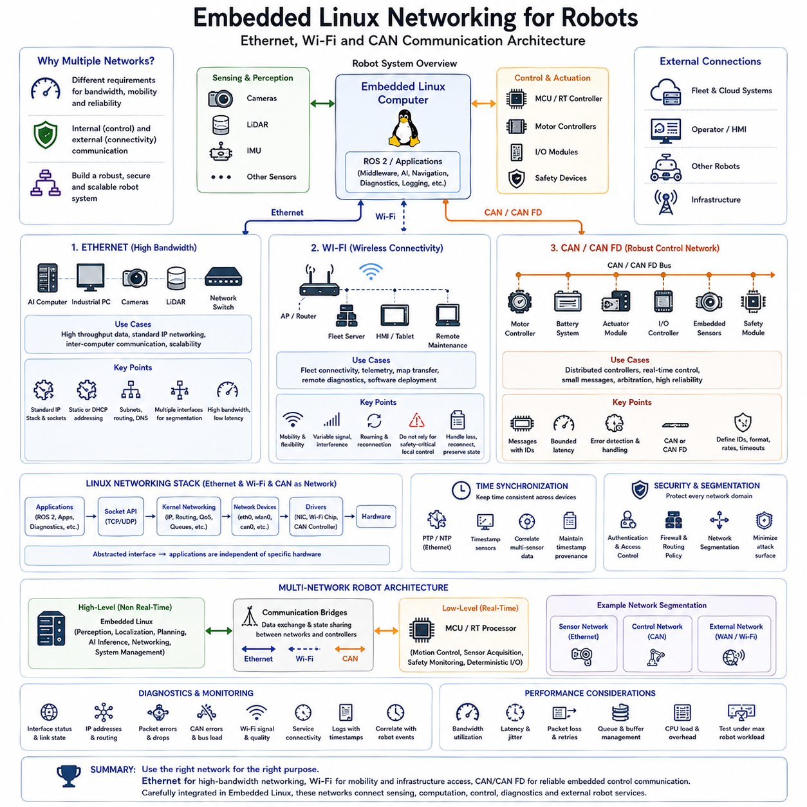
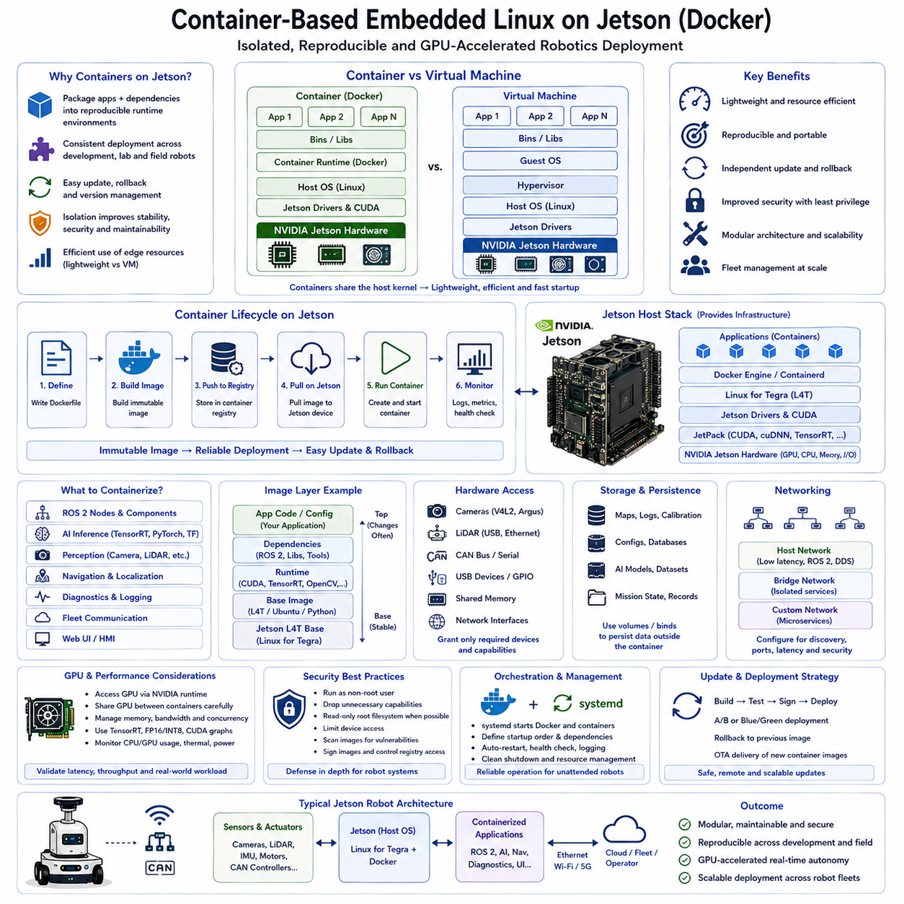
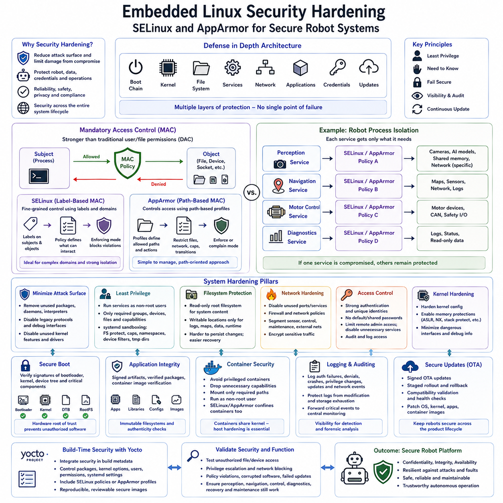
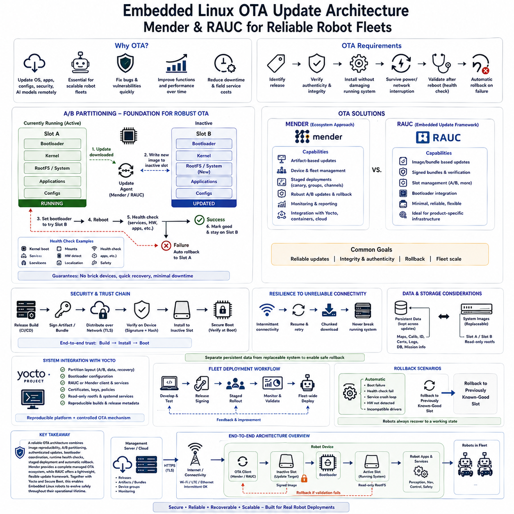
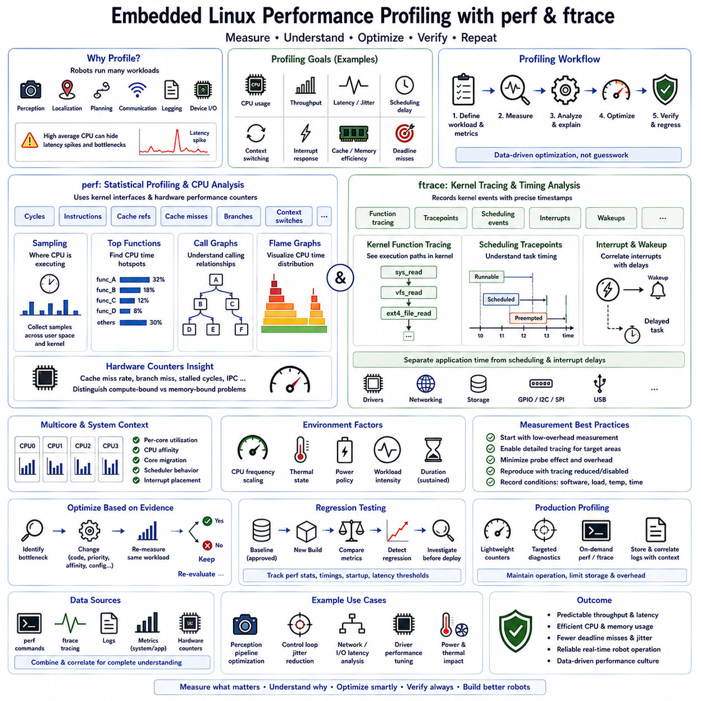

**Volume 02 Embedded Software Engineering**

# 06. Embedded Linux

## 06.01 Embedded Linux Distributions: Yocto, Buildroot, Ubuntu Core

{width="7.268055555555556in" height="7.268055555555556in"}

임베디드 리눅스(Embedded Linux)는 하나의 운영체제(Operating System)를 의미하는 것이 아니라, 리눅스 커널(Linux Kernel), 부트로더(Bootloader), 시스템 라이브러리(System Libraries), 장치 관리(Device Management), 미들웨어(Middleware), 응용 소프트웨어(Application Software)를 중심으로 구성되는 설정 가능한 소프트웨어 플랫폼(Software Platform)이다. 로보틱스(Robotics)에서는 배포판 전략(Distribution Strategy)이 이러한 구성요소를 제품 수명주기(Product Lifecycle) 전체에 걸쳐 어떻게 조립하고, 재현하며, 보안하고, 업데이트하고, 유지관리할지를 결정한다.

임베디드 리눅스 배포판(Embedded Linux Distribution)의 선택은 개발 생산성(Development Productivity), 이미지 크기(Image Size), 부팅 시간(Boot Time), 하드웨어 지원(Hardware Support), 보안 유지관리(Security Maintenance), 장기 재현성(Long-Term Reproducibility)에 큰 영향을 미친다. Yocto Project, Buildroot, Ubuntu Core는 각각 고도로 맞춤화된 제품 플랫폼을 구축하거나, 소형 임베디드 시스템을 생성하거나, 보다 강력한 응용 프로그램 중심의 수명주기 서비스를 갖춘 관리형 리눅스 환경을 채택하는 서로 다른 접근 방식을 대표한다.

Yocto Project는 리눅스 소프트웨어 스택(Linux Software Stack)의 거의 모든 구성요소를 정밀하게 제어해야 하는 조직을 위해 설계되었다. Yocto는 하나의 고정된 배포판을 제공하는 대신 메타데이터(Metadata), 빌드 도구(Build Tools), 레시피(Recipes), 클래스(Classes), 레이어(Layers)를 제공하며, 이를 통해 개발자는 특정 제품, 프로세서 아키텍처(Processor Architecture), 보드(Board), 응용 환경(Application Environment)에 맞는 재현 가능한 배포판을 정의할 수 있다.

일반적인 Yocto 기반 플랫폼은 레이어 아키텍처(Layer Architecture)를 통해 하드웨어별 보드 지원 패키지(Board Support Package, BSP) 정보를 배포판 정책(Distribution Policies) 및 제품별 소프트웨어(Product-Specific Software)와 분리한다. 레시피(Recipe)는 소프트웨어의 출처, 설정 및 컴파일 방법, 필요한 의존성(Dependencies), 생성된 패키지의 설치 방법을 기술한다. 이러한 구조는 여러 로봇 모델이 공통 소프트웨어 플랫폼을 공유할 때 특히 유용하다.

Yocto의 유연성은 상당한 엔지니어링 복잡성(Engineering Complexity)을 동반한다. 초기 설정, 레시피 개발, 의존성 해결(Dependency Resolution), 빌드 디버깅(Build Debugging), 레이어 호환성(Layer Compatibility), 긴 빌드 시간(Build Time)을 처리하기 위해 전문적인 지식이 필요하다. 그러나 이러한 투자는 여러 하드웨어 개정판(Hardware Revision)과 장기간의 현장 운용에 걸쳐 통제된 소프트웨어 구성을 유지해야 하는 상용 로봇에서 상당한 수명주기상의 이점을 제공할 수 있다.

Buildroot는 보다 단순한 철학을 따른다. Buildroot는 크로스 컴파일 툴체인(Cross-Compilation Toolchain), 리눅스 커널(Linux Kernel), 부트로더(Bootloader), 루트 파일시스템(Root Filesystem), 선택된 사용자 공간 패키지(User-Space Packages)를 생성하는 설정 기반 빌드 시스템(Configuration-Driven Build System)을 제공한다. 개발자는 설정 인터페이스(Configuration Interface)를 통해 필요한 구성요소를 선택하고 Yocto와 같은 광범위한 메타데이터 및 패키지 관리 아키텍처를 구축하지 않고도 완전한 대상 이미지(Target Image)를 생성할 수 있다.

이러한 단순성으로 인해 Buildroot는 소프트웨어 이미지가 비교적 고정된 자원 제약형 장치(Resource-Constrained Device), 전용 제어기(Dedicated Controller), 게이트웨이(Gateway), 어플라이언스(Appliance), 로봇 하위 시스템(Robot Subsystem)에 적합하다. 신중하게 선택된 소수의 패키지만으로 저장 공간과 메모리 요구량이 낮은 소형 루트 파일시스템을 구성할 수 있다. 또한 낮은 개념적 복잡성은 보드 초기 구동(Board Bring-Up)에서 실제 동작하는 임베디드 제품으로 전환하는 시간을 단축할 수 있다.

Buildroot는 일반적으로 대상 파일시스템(Target Filesystem)을 런타임 패키지 관리(Runtime Package Management)를 통해 조립하고 유지하는 전통적인 배포판이라기보다 하나의 통합 이미지(Integrated Image)로 취급한다. 따라서 변경 사항은 전체 펌웨어 이미지(Firmware Image)를 다시 빌드하고 배포하는 방식으로 적용되는 경우가 많다. 이 모델은 결정론적인 제품 릴리스(Deterministic Product Release)를 지원하지만, 복잡한 제품에서 광범위한 패키지 단위 수명주기 관리나 독립적으로 유지되는 여러 소프트웨어 변형(Software Variant)이 필요할 경우 불편해질 수 있다.

Ubuntu Core는 다른 방향에서 임베디드 배포(Embedded Deployment)에 접근한다. Ubuntu Core는 트랜잭션 기반 소프트웨어 패키징(Transactional Software Packaging)과 격리(Isolation)를 중심으로 하는 관리형 Ubuntu 기반 환경을 제공한다. 엔지니어링 팀이 대부분의 운영체제 구성요소를 소스에서 직접 구축하도록 요구하는 대신 표준화된 플랫폼 구성요소와 독립적으로 관리되는 응용 프로그램 패키지를 강조하므로 체계적인 배포 및 수명주기 관리가 필요한 연결형 장치(Connected Device)에 적합하다.

이미 Ubuntu 생태계(Ubuntu Ecosystem)를 사용하고 있는 로보틱스 개발자에게 이러한 접근 방식은 개발 환경과 실제 배포 환경의 차이를 줄일 수 있다. 익숙한 Linux 도구와 응용 프레임워크(Application Framework)를 활용하여 네트워킹(Networking), 로보틱스 미들웨어(Robotics Middleware), 진단(Diagnostics), 엣지 서비스(Edge Services)의 통합을 단순화할 수 있다. 반면 목적에 맞게 구축된 Yocto 또는 Buildroot 시스템과 비교하면 일부 저수준 맞춤화(Low-Level Customization)와 설치 용량(Footprint)에 대한 제어를 포기해야 한다.

따라서 배포판 선택은 개발자의 익숙함보다 제품 요구사항(Product Requirements)에서 시작해야 한다. 소형 고정 기능 임베디드 제어기(Fixed-Function Embedded Controller)는 Buildroot의 이점을 얻을 수 있으며, 맞춤형 BSP와 엄격한 구성 소유권(Configuration Ownership)이 필요한 정교한 상용 로봇은 Yocto를 선택할 충분한 이유가 있다. 관리형 응용 프로그램과 강력한 소프트웨어 수명주기 메커니즘을 중요하게 고려하는 연결형 엣지 장치(Connected Edge Device)는 Ubuntu Core가 적합할 수 있다.

하드웨어 활성화(Hardware Enablement) 역시 중요한 고려사항이다. 임베디드 리눅스는 부트로더 설정(Bootloader Configuration), 커널 드라이버(Kernel Drivers), 디바이스 트리(Device Tree), 펌웨어 블롭(Firmware Blobs), 그래픽 또는 가속기 스택(Accelerator Stack), 보드별 초기화(Board-Specific Initialization)를 통합해야 한다. 배포판 선택은 이러한 구성요소가 어떻게 구성되고 유지되는지에 영향을 미치며, 이후 커널 Kconfig와 디바이스 트리 맞춤화(Device Tree Customization)는 로봇 하드웨어에 맞게 운영체제를 조정하는 메커니즘을 제공한다.

루트 파일시스템 설계(Root Filesystem Design)는 배포판 전략을 실제 제품 동작과 연결한다. 개발자는 어떤 라이브러리(Libraries), 셸(Shells), 진단 유틸리티(Diagnostic Utilities), 서비스(Services), 인증서(Certificates), 설정 파일(Configuration Files), 응용 프로그램 의존성(Application Dependencies)을 대상 시스템에 포함할 것인지 결정해야 한다. 불필요한 구성요소를 제거하면 저장 공간 사용량과 공격 표면(Attack Surface)을 줄일 수 있으며, 읽기 전용 파일시스템(Read-Only Filesystem) 전략은 손상이나 통제되지 않은 현장 변경에 대한 복원력(Resilience)을 향상시킬 수 있다.

서비스 관리(Service Management)는 부팅 이후 로봇 응용 프로그램이 어떻게 시작되고 감독되는지를 결정한다. 임베디드 리눅스 시스템에서는 네트워킹, 센서 인터페이스(Sensor Interface), 미들웨어, 로깅(Logging), 위치추정(Localization), 제어(Control), 응용 프로세스(Application Process)에 대한 결정론적인 시작 순서(Deterministic Startup Ordering)가 필요한 경우가 많다. 따라서 배포판 아키텍처는 무인 로봇 운용에 적합한 서비스 의존성(Service Dependencies), 재시작 정책(Restart Policies), 상태 모니터링(Health Monitoring), 복구 동작(Recovery Behavior)을 안정적으로 지원해야 한다.

보안(Security) 역시 개별 응용 프로그램에만 추가하는 것이 아니라 배포판 수준에서 고려해야 한다. 패키지 출처(Package Provenance), 취약점 유지관리(Vulnerability Maintenance), 사용자 권한(User Privileges), 파일시스템 권한(Filesystem Permissions), 네트워크 서비스(Network Services), 보안 부팅(Secure Boot) 통합, 강제 접근 제어(Mandatory Access Control), 업데이트 인증(Update Authenticity)은 모두 운영체제 이미지가 어떻게 구축되고 유지되는지에 영향을 받는다. 장기간 운용되는 로봇에는 새롭게 발견되는 취약점을 지속적으로 처리할 수 있는 실용적인 전략이 필요하다.

무선 업데이트(Over-the-Air, OTA) 기능은 현장 로봇을 수동으로 정비하는 것이 어렵거나 비용이 많이 들 수 있기 때문에 배포판 선택 기준을 더욱 변화시킨다. 생산용 배포판은 통제된 이미지 생성(Controlled Image Generation), 버전 식별(Version Identification), 무결성 검증(Integrity Verification), 롤백(Rollback), 복구(Recovery)를 지원해야 한다. Mender와 RAUC 같은 프레임워크(Framework)는 맞춤형 임베디드 리눅스 플랫폼을 보완할 수 있으며, 관리형 환경은 자체적인 트랜잭션 업데이트 메커니즘(Transactional Update Mechanism)을 제공할 수 있다.

실시간 요구사항(Real-Time Requirements)은 배포판의 이름과 별도로 평가해야 한다. Yocto, Buildroot, Ubuntu 기반 시스템 모두 커널 옵션(Kernel Options), 스케줄링 정책(Scheduling Policies), CPU 격리(CPU Isolation), 인터럽트 처리(Interrupt Handling), 메모리 동작(Memory Behavior), PREEMPT_RT 요구사항에 따라 서로 다르게 구성할 수 있다. 배포판 선택은 통합 프레임워크(Integration Framework)를 결정하지만, 결정론적인 로봇 제어(Deterministic Robot Control)는 궁극적으로 세부적인 커널 및 시스템 수준의 실시간 엔지니어링(Real-Time Engineering)에 의해 결정된다.

현대 로봇에서 임베디드 리눅스는 저수준 펌웨어(Low-Level Firmware)와 상위 수준의 로보틱스 또는 인공지능 소프트웨어(AI Software) 사이에서 동작하는 경우가 많다. 마이크로컨트롤러(Microcontroller, MCU)는 하드 실시간(Hard Real-Time) 모터 제어와 안전 기능을 수행하고, Linux 컴퓨터는 인식(Perception), 위치추정, 계획(Planning), 통신(Communication), 진단, ROS 2 처리를 수행할 수 있다. 따라서 선택된 배포판은 하드웨어 특화 임베디드 구성요소와 빠르게 발전하는 응용 소프트웨어 사이에 안정적인 경계(Stable Boundary)를 제공해야 한다.

가장 적합한 플랫폼은 궁극적으로 로봇 제품의 수명주기 모델(Lifecycle Model)과 일치하는 플랫폼이다. Yocto는 맞춤화(Customization), 재현성(Reproducibility), 플랫폼 소유권(Platform Ownership)을 강조하고, Buildroot는 단순성(Simplicity)과 소형 이미지 생성(Compact Image Generation)을 강조하며, Ubuntu Core는 관리형 배포(Managed Deployment)와 응용 프로그램 수명주기 관리(Application Lifecycle Management)를 강조한다. 이러한 아키텍처적 차이를 이해하면 임베디드 리눅스를 단순히 로봇 컴퓨터에 설치되는 운영체제가 아니라 의도적으로 설계된 제품 기반(Product Foundation)으로 활용할 수 있다.

## 06.02 Yocto Project Layer Structure and Recipe Writing [w/Code]

{width="7.268055555555556in" height="7.268055555555556in"}

Yocto Project는 하나의 사전 정의된 운영체제(Operating System)를 제공하는 대신 맞춤형 임베디드 리눅스(Embedded Linux) 배포판을 구축하기 위한 구조화된 프레임워크(Framework)를 제공한다. Yocto의 아키텍처는 하드웨어 지원(Hardware Support), 배포판 정책(Distribution Policies), 미들웨어(Middleware), 응용 프로그램(Applications), 제품별 설정(Product-Specific Configuration)을 재사용 가능한 메타데이터 레이어(Metadata Layer)로 구성한다. 이러한 분리는 임베디드 개발팀이 여러 보드와 로봇 제품 변형(Product Variant)에 걸쳐 재현 가능한 Linux 플랫폼을 유지하는 데 도움을 준다.

일반적인 Yocto 빌드(Build)는 여러 개의 레이어(Layer)로 구성되며, 각 레이어는 특정 역할을 담당하는 메타데이터(Metadata)를 포함한다. 보드 지원 패키지 레이어(Board Support Package Layer)는 머신 설정(Machine Configuration), 커널 통합(Kernel Integration), 부트로더 설정(Bootloader Settings), 하드웨어별 구성요소를 정의할 수 있으며, 별도의 레이어에는 미들웨어, 보안 정책(Security Policies), 로보틱스 응용 프로그램(Robotics Applications), 제품 설정(Product Configuration)을 포함할 수 있다. 레이어를 사용하면 이러한 요소들을 독립적으로 발전시키면서 빌드 시스템(Build System)을 통해 통합할 수 있다.

Poky라고 알려진 참조 메타데이터 모음(Reference Metadata Collection)은 Yocto 개발을 위한 실용적인 시작 환경을 제공한다. Poky는 BitBake 빌드 엔진(Build Engine), OpenEmbedded-Core 메타데이터, 참조 배포판 설정(Reference Distribution Configuration), 지원 도구(Supporting Tools)를 결합한다. 제품 개발팀은 일반적으로 참조 메타데이터를 직접 수정하는 대신 추가적인 레이어를 이용하여 이를 확장하며, 사용자 정의 콘텐츠(Custom Content)를 분리하면 유지보수성(Maintainability)이 향상되고 Yocto 릴리스 간 마이그레이션(Migration)이 단순해진다.

BitBake는 Yocto 메타데이터를 해석하고 최종 소프트웨어 이미지(Software Image)를 구성하는 작업 실행 엔진(Task Execution Engine)이다. BitBake는 소스 코드 가져오기(Source Fetching), 패키지 설정(Configuration), 소프트웨어 컴파일(Compilation), 파일 설치(Installation), 패키지 생성(Package Generation), 루트 파일시스템(Root Filesystem) 조립과 같은 작업을 실행하기 전에 레시피(Recipes), 설정 파일(Configuration Files), 클래스(Classes), 의존성(Dependencies), 작업 관계(Task Relationships)를 분석한다. 이러한 의존성 기반 실행(Dependency-Driven Execution)은 반복 가능한 자동화 빌드를 가능하게 한다.

레시피(Recipe)는 Yocto 메타데이터의 핵심 단위이며 일반적으로 \`.bb\` 파일 확장자를 사용한다. 레시피는 소프트웨어 구성요소가 Linux 배포판에 어떻게 포함되는지를 기술하며, 소스 위치(Source Location), 버전(Version), 라이선스 정보(License Information), 의존성, 설정 매개변수(Configuration Parameters), 컴파일 절차(Compilation Procedure), 설치 동작(Installation Behavior), 패키징 규칙(Packaging Rules)을 포함한다. 따라서 레시피는 업스트림 소프트웨어(Upstream Software)와 통제된 임베디드 제품 이미지 사이의 선언적 연결(Declarative Bridge)을 제공한다.

레시피는 일반적으로 \`SRC_URI\`를 통해 소스 자료(Source Material)를 지정하며, 여기에는 소스 아카이브(Source Archives), Git 저장소(Git Repositories), 패치(Patches), 설정 파일, 로컬에서 관리되는 리소스(Resources) 등이 포함될 수 있다. 버전 관리 저장소를 사용하는 경우 \`SRCREV\`를 통해 특정 소스 리비전(Source Revision)을 선택할 수 있다. 명시적인 소스 버전과 체크섬(Checksum)을 사용하면 통제되지 않은 개발 상태에 의존하지 않고 알려진 소프트웨어 입력을 가져오고 검증할 수 있기 때문에 재현성(Reproducibility)이 향상된다.

Yocto 레시피는 소스 가져오기(Fetching), 압축 해제(Unpacking), 패치 적용(Patching), 설정(Configuration), 컴파일, 설치, 패키징(Packaging), 이미지 통합(Image Integration)과 같은 작업(Task)을 실행한다. 표준 빌드 클래스(Standard Build Classes)는 일반적인 빌드 시스템에서 필요한 동작 대부분을 구현하며, 레시피는 구성요소별 매개변수를 제공한다. 개발자는 가능한 경우 표준 작업과 클래스를 재사용하고 기존 빌드 패턴과 다른 동작만 사용자 정의해야 한다.

의존성(Dependencies)은 컴파일 과정에서 필요한 소프트웨어와 실제 대상 시스템(Target System)에 배포된 이후 필요한 소프트웨어를 구분해야 한다. 빌드 시간 의존성(Build-Time Dependencies)을 정의하면 BitBake가 컴파일 전에 필요한 구성요소를 준비할 수 있으며, 런타임 의존성(Runtime Dependencies)은 설치된 구성요소와 함께 제공되어야 하는 패키지를 정의한다. 정확한 의존성 모델링(Dependency Modeling)은 개발자의 워크스테이션(Workstation)이나 이전 빌드 상태에 우연히 존재했던 소프트웨어에 의존하는 문제를 방지한다.

설치 로직(Installation Logic)은 생성된 실행 파일(Executables), 라이브러리(Libraries), 설정 파일, 서비스 정의(Service Definitions), 펌웨어(Firmware), 기타 리소스를 임시 대상 영역(Temporary Destination)에 배치하며, 이 영역은 이후 하나 이상의 패키지 일부가 된다. 레시피는 최종 루트 파일시스템을 직접 조작하는 대신 표준화된 파일시스템 위치(Standardized Filesystem Locations)에 파일을 설치해야 한다. 이후 Yocto의 패키징 단계가 파일의 소유 관계를 결정하고 통제되고 추적 가능한 형태의 배포 패키지를 생성할 수 있다.

일반적으로 \`.bbappend\` 확장자를 사용하는 레시피 추가 파일(Recipe Append File)은 하나의 레이어가 다른 레이어에 정의된 레시피를 복사하거나 원본 전체를 다시 작성하지 않고 수정 또는 확장할 수 있도록 한다. 따라서 하드웨어 또는 제품 레이어는 원래 메타데이터와의 분리를 유지하면서 업스트림 구성요소에 패치, 설정 파일, 컴파일 옵션(Compile Options), 설치 동작을 추가할 수 있다. 이러한 메커니즘은 지속 가능한 제품 맞춤화(Product Customization)에 중요하다.

\`.bbclass\` 형식을 사용하는 클래스(Class)는 여러 레시피가 공유할 수 있는 재사용 가능한 빌드 동작(Build Behavior)을 제공한다. 여러 구성요소에서 동일한 작업 구현이나 설정 로직을 반복하는 대신 개발자는 공통 기능을 하나의 클래스에 배치하고 필요한 위치에서 이를 상속(Inherit)할 수 있다. 이를 통해 중복을 줄이고 패키지 생성, 시스템 통합(System Integration), 서비스 처리(Service Handling), 특수 빌드 절차와 같은 반복 작업에 일관된 규칙을 적용할 수 있다.

설정 파일(Configuration File)은 전역 빌드 동작(Global Build Behavior)을 정의하여 레시피와 레이어를 보완한다. 머신 설정(Machine Configuration)은 대상 하드웨어(Target Hardware)의 특성을 정의하며, 배포판 설정(Distribution Configuration)은 운영체제 환경에 영향을 주는 정책을 결정한다. 로컬 빌드 설정(Local Build Configuration)은 특정 개발 환경에 필요한 옵션을 선택한다. 머신, 배포판, 응용 프로그램의 관심사를 분리하면 제품 정의가 개별 개발자의 워크스테이션과 강하게 결합되는 것을 방지할 수 있다.

Yocto 플랫폼이 커질수록 레이어 우선순위(Layer Priority)와 메타데이터 호환성(Metadata Compatibility)을 신중하게 관리해야 한다. 여러 레이어가 관련 레시피, 추가 파일(Append Files), 머신 정의(Machine Definitions), 설정값을 제공할 수 있으며, 통제되지 않은 오버라이드(Override)는 빌드 동작을 이해하기 어렵게 만들 수 있다. 제품 개발팀은 메타데이터 아키텍처를 예측 가능한 상태로 유지하기 위해 명확한 소유권 경계(Ownership Boundaries), 호환 가능한 릴리스 버전, 명명 규칙(Naming Conventions), 레이어 간 문서화된 의존성을 확립해야 한다.

로보틱스(Robotics)에서는 실리콘 공급업체(Silicon Vendor)의 BSP 메타데이터를 로봇 플랫폼 소프트웨어(Robot Platform Software) 및 개별 제품 응용 프로그램과 분리하는 실용적인 레이어 전략을 사용할 수 있다. 공통 ROS 2 통합, 통신 미들웨어(Communication Middleware), 진단(Diagnostics), 보안 설정(Security Configuration), 하드웨어 추상화(Hardware Abstraction), 배포 서비스(Deployment Services)는 재사용 가능한 플랫폼 레이어에 배치하고, 로봇별 인식(Perception), 제어(Control), 내비게이션(Navigation), 장치 설정(Device Configuration)은 제품 레이어에 유지할 수 있다. 이를 통해 하나의 로봇 제품군(Robot Family)에서 소프트웨어를 효과적으로 재사용할 수 있다.

사용자 정의 레시피(Custom Recipe)는 독점 로봇 응용 프로그램(Proprietary Robot Application)을 배포하는 데 특히 유용하다. 레시피는 통제된 응용 프로그램 리비전을 가져오고, 필요한 라이브러리를 선언하며, 해당 빌드 시스템을 실행하고, 바이너리(Binary)와 설정 리소스를 설치하며, 생성된 산출물(Artifacts)을 대상 이미지에 포함되는 패키지로 구성할 수 있다. 이러한 방식을 서비스 정의와 결합하면 로봇 프로세스를 생산 장치에 수동으로 복사하는 대신 운영체제 빌드 과정에 직접 통합할 수 있다.

재현성(Reproducibility)은 체계적인 Yocto 메타데이터를 채택하는 가장 중요한 이유 중 하나이다. 목표는 단순히 Linux를 성공적으로 컴파일하는 것이 아니라, 다른 통제된 빌드 환경에서도 의도한 제품 이미지를 다시 생성할 수 있을 정도로 전체 소프트웨어 구성을 충분히 기술하는 것이다. 고정된 소스 리비전(Fixed Source Revisions), 명시적인 의존성, 버전 관리되는 레이어(Versioned Layers), 설정 관리(Configuration Management), 자동화된 빌드 인프라(Automated Build Infrastructure)가 이러한 목표를 함께 지원한다.

따라서 Yocto의 레이어 및 레시피 설계(Layer and Recipe Design)는 임베디드 제품 아키텍처(Embedded Product Architecture) 자체의 일부가 된다. 잘 구조화된 메타데이터는 하드웨어 활성화(Hardware Enablement)를 배포판 정책 및 응용 프로그램 개발(Application Development)과 분리하며, 레시피는 개별 소프트웨어 구성요소를 추적 가능한 빌드 산출물(Traceable Build Artifacts)로 변환한다. 이러한 메커니즘을 일관되게 유지하면 개발팀은 설정(Configuration), 재현성, 수명주기 유지관리(Lifecycle Maintenance)에 대한 통제력을 잃지 않으면서 초기 보드 구동(Board Bring-Up) 단계에서 여러 양산 로봇 플랫폼(Production Robot Platforms)으로 확장할 수 있다.

## 06.03 Kernel Kconfig and Device Tree Customization [w/Code]

{width="7.268055555555556in" height="7.268055555555556in"}

임베디드 로봇(Embedded Robot)의 리눅스 커널(Linux Kernel)은 대상 하드웨어(Target Hardware)의 정확한 프로세서(Processor), 메모리 아키텍처(Memory Architecture), 주변장치(Peripherals), 통신 인터페이스(Communication Interfaces), 보안 요구사항(Security Requirements), 런타임 동작(Runtime Behavior)에 맞게 설정되어야 한다. 커널 Kconfig(Kernel Kconfig)와 디바이스 트리(Device Tree)는 이러한 맞춤화를 위한 두 가지 상호 보완적인 메커니즘으로, Kconfig는 어떤 커널 기능을 빌드할 것인지 결정하고 디바이스 트리는 해당 기능이 동작해야 하는 물리적 하드웨어를 기술한다.

Kconfig는 기능(Features), 서브시스템(Subsystems), 드라이버(Drivers), 파일시스템(Filesystems), 네트워킹 기능(Networking Functions), 디버깅 기능(Debugging Facilities), 아키텍처별 옵션(Architecture-Specific Options)을 선택하는 데 사용되는 리눅스 커널 설정 프레임워크(Linux Kernel Configuration Framework)이다. 설정 심볼(Configuration Symbol)은 일반적으로 생성되는 \`.config\` 파일에서 \`CONFIG_\*\` 항목으로 나타난다. 옵션에 따라 기능을 커널에 직접 포함하거나 로드 가능한 모듈(Loadable Module)로 빌드하거나 대상 시스템에서 완전히 제외할 수 있다.

\`menuconfig\`와 같은 대화형 도구(Interactive Tool)는 커널 설정 옵션과 그 의존성(Dependencies)을 탐색할 수 있는 구조화된 인터페이스를 제공한다. 개발자는 필요한 드라이버를 활성화하면서 이미지 크기(Image Size), 부팅 시간(Boot Time), 메모리 소비(Memory Consumption), 공격 표면(Attack Surface)을 증가시키는 불필요한 서브시스템을 제거할 수 있다. 임베디드 제품에서는 결과로 생성된 커널 설정을 개발 장비에서 수동으로 설정하는 대신 통제된 빌드 산출물(Controlled Build Artifact)로 관리해야 한다.

커널 옵션(Kernel Options)은 맞춤화 전에 이해해야 하는 의존성을 가지고 있다. 센서 드라이버(Sensor Driver), 네트워크 프로토콜(Network Protocol), 파일시스템, 보안 메커니즘(Security Mechanism), 버스 컨트롤러(Bus Controller)를 활성화하려면 다른 커널 서브시스템을 먼저 활성화해야 할 수 있다. Kconfig는 의존성 및 선택 규칙(Selection Rules)을 통해 이러한 관계를 표현하며, 논리적으로 잘못된 설정을 방지하면서 아키텍처와 플랫폼 요구사항에 따라 사용 가능한 옵션이 결정되도록 한다.

양산용 임베디드 리눅스(Production Embedded Linux)에서는 일반적으로 공급업체(Vendor) 또는 보드별 기본 설정(Board-Specific Default Configuration)에서 시작한 후 제품에 필요한 변경 사항을 통제된 방식으로 적용한다. 로봇은 CAN, Ethernet, USB, GPIO, I2C, SPI, 카메라(Camera), 워치독(Watchdog), 저장장치(Storage), 네트워킹(Networking), 실시간 관련 기능(Real-Time Related Functionality)을 필요로 할 수 있으며 사용하지 않는 소비자용 기능은 제외할 수 있다. 최소화된 설정을 유지하면 불필요한 복잡성이 감소하고 커널 동작을 보다 쉽게 검증할 수 있다.

디바이스 트리(Device Tree)는 대부분의 커널 소스 코드와 독립적으로 하드웨어를 기술함으로써 다른 문제를 해결한다. 프로세서, 메모리 영역(Memory Regions), 버스(Buses), 인터럽트 컨트롤러(Interrupt Controllers), 클록(Clocks), GPIO 컨트롤러, 통신 주변장치(Communication Peripherals), 센서(Sensors), 저장장치 및 기타 하드웨어 자원을 계층적 데이터 구조(Hierarchical Data Structure)로 표현한다. 이를 통해 하나의 커널 드라이버 구현이 물리적 연결과 자원 할당이 서로 다른 여러 보드를 지원할 수 있다.

디바이스 트리 소스(Device Tree Source) 파일은 일반적으로 \`.dts\` 확장자를 사용하며, 재사용 가능한 포함 단편(Reusable Included Fragment)은 주로 \`.dtsi\`를 사용한다. 디바이스 트리 컴파일러(Device Tree Compiler)는 소스 표현을 바이너리 디바이스 트리 블롭(Device Tree Blob)으로 변환하며, 일반적으로 \`.dtb\` 파일로 생성되어 부팅 과정에서 커널에 전달된다. 커널은 이 하드웨어 기술 정보를 해석하여 장치를 검색하고 적절한 드라이버와 연결한다.

디바이스 트리 노드(Device Tree Node)는 장치와 관련된 하드웨어 속성(Hardware Properties)을 기술한다. 일반적인 정보에는 호환 식별자(Compatible Identifiers), 레지스터 주소 범위(Register Address Ranges), 인터럽트 할당(Interrupt Assignments), 클록, GPIO 연결, 버스 주소(Bus Addresses), DMA 자원(DMA Resources), 핀 설정(Pin Configuration), 동작 상태(Operational Status)가 포함된다. 특히 \`compatible\` 속성은 Linux가 하드웨어 노드와 해당 장치를 제어할 수 있는 드라이버를 연결하는 핵심 메커니즘으로 사용되기 때문에 중요하다.

버스 연결 장치(Bus-Connected Devices)는 이러한 관계를 명확하게 보여준다. I2C 센서 노드는 적절한 I2C 컨트롤러 아래에 배치하고 슬레이브 주소(Slave Address)를 지정할 수 있으며, SPI 장치는 SPI 컨트롤러 아래에서 칩 선택(Chip Select) 정보와 동작 매개변수(Operating Parameters)를 정의할 수 있다. 이러한 물리적 관계가 하드웨어 기술 정보에 표현되므로 커널은 장치를 검색하기 위해 제품별 응용 프로그램 코드(Product-Specific Application Code)를 필요로 하지 않는다.

\`status\` 속성은 특정 보드 설정에서 하드웨어 노드를 활성화하거나 비활성화하는 데 자주 사용된다. 공통 SoC 수준의 \`.dtsi\` 파일은 프로세서에서 사용할 수 있는 모든 컨트롤러를 기술할 수 있으며, 보드별 \`.dts\`는 실제 제품에 물리적으로 연결되어 필요한 주변장치만 활성화한다. 이러한 상속 모델(Inheritance Model)은 중복을 줄이고 동일한 프로세서 제품군을 기반으로 하는 여러 하드웨어 변형(Hardware Variants)을 지원한다.

핀 멀티플렉싱(Pin Multiplexing)과 GPIO 설정 역시 디바이스 트리의 주요 역할이다. 현대적인 SoC(System-on-Chip)는 물리적 핀이 여러 대체 기능을 수행할 수 있도록 설계되는 경우가 많으므로, 보드 정의(Board Definition)에서는 핀이 UART, SPI, I2C, CAN, PWM, GPIO 또는 다른 인터페이스 중 어떤 기능으로 동작할지를 지정해야 한다. 핀 제어 설정(Pin Control Settings)이 잘못되면 커널 드라이버가 올바르게 설정되어 있어도 실제 하드웨어와 통신하지 못할 수 있다.

따라서 Kconfig와 디바이스 트리는 서로 일관성을 유지해야 한다. 디바이스 트리에서 장치를 활성화하더라도 해당 커널 드라이버가 컴파일되지 않았다면 충분하지 않으며, Kconfig에서 드라이버를 활성화하더라도 실제 하드웨어가 기술되거나 검색되지 않으면 장치를 사용할 수 없다. 성공적인 보드 통합(Board Integration)을 위해서는 소프트웨어 기능(Software Capability)과 하드웨어 기술(Hardware Description)이 모두 대상 플랫폼의 전기적 설계(Electrical Design)와 일치해야 한다.

이러한 관계는 로봇 보드 초기 구동(Robot Board Bring-Up) 과정에서 특히 중요하다. 엔지니어는 먼저 시리얼 콘솔(Serial Console), 저장장치, Ethernet, 기본 GPIO를 검증한 다음 CAN 인터페이스, 관성 측정 장치(Inertial Measurement Unit, IMU), LiDAR 통신, 카메라, 모터 제어 버스(Motor-Control Buses), 워치독 및 기타 주변장치를 단계적으로 활성화할 수 있다. 이후 커널 로그(Kernel Logs), 드라이버 프로브 메시지(Driver Probe Messages), \`/proc\`, \`/sys\`, 디바이스 트리 정보를 검사하여 각 하드웨어 구성요소가 올바르게 인식되었는지 확인할 수 있다.

Yocto는 이러한 맞춤화를 임베디드 리눅스 제품 빌드에 체계적으로 통합할 수 있는 방법을 제공한다. 커널 설정 단편(Kernel Configuration Fragments), 패치(Patches), 디바이스 트리 소스, 보드별 메타데이터(Board-Specific Metadata)를 이미지 생성 후 수동으로 수정하는 대신 BSP 또는 제품 레이어(Product Layers)에서 관리할 수 있다. 레시피(Recipes)와 추가 파일(Append Files)을 사용하여 자동화된 빌드 과정에서 이러한 리소스를 적용하면 개발 환경과 양산 환경에서 하드웨어 활성화(Hardware Enablement)의 재현성을 유지할 수 있다.

하드웨어 개정(Hardware Revision) 역시 통제된 디바이스 트리 및 커널 메타데이터에 반영되어야 한다. 로봇의 Ethernet PHY, 센서 주소, GPIO 할당, 카메라 인터페이스, 저장장치 또는 주변장치 컨트롤러가 변경되면 해당 소프트웨어 기술 정보도 전기적 설계와 함께 발전해야 한다. 버전 관리되는 보드 정의(Version-Controlled Board Definitions)는 PCB 개정(PCB Revision), BSP 릴리스, 커널 버전, 배포된 소프트웨어 이미지 사이의 추적성(Traceability)을 제공한다.

맞춤화 과정에서는 자원이 충분하다는 이유만으로 사용 가능한 모든 커널 기능을 활성화해서는 안 된다. 불필요한 드라이버, 프로토콜(Protocols), 파일시스템, 디버깅 인터페이스(Debugging Interfaces), 레거시 서브시스템(Legacy Subsystems)은 각각 코드 크기를 증가시키고 잠재적으로 보안 공격 표면을 확대한다. 양산 커널(Production Kernel)은 운영, 진단, 복구, 유지보수에 필요한 기능을 포함하되 제품에서 정당한 역할이 없는 기능은 의도적으로 제외해야 한다.

실시간 로봇 플랫폼(Real-Time Robot Platform)은 커널 설정이 스케줄링 지연시간(Scheduling Latency)과 인터럽트 동작(Interrupt Behavior)에 영향을 미치므로 추가적인 주의가 필요하다. PREEMPT_RT 지원, 타이머 설정(Timer Configuration), CPU 동작, 인터럽트 스레딩(Interrupt Threading) 및 관련 기능은 이후 CPU 격리(CPU Isolation)와 IRQ 친화도(IRQ Affinity) 전략과 함께 조정해야 할 수 있다. 디바이스 트리 역시 인터럽트 토폴로지(Interrupt Topology), DMA 설정, 클록, 하드웨어 자원 정의를 통해 런타임 성능에 영향을 줄 수 있다.

보안 중심 설정(Security-Oriented Configuration)에서도 마찬가지로 커널과 하드웨어 기술에 대한 결정이 결합된다. 커널 옵션은 보안 프레임워크(Security Frameworks), 메모리 보호 메커니즘(Memory Protection Mechanisms), 암호화 기능(Cryptographic Functionality), 제한된 인터페이스(Restricted Interfaces)를 활성화할 수 있으며, 디바이스 트리는 신뢰 하드웨어(Trusted Hardware), 보안 메모리 영역(Secure Memory Regions), 워치독 또는 플랫폼별 보안 구성요소를 기술할 수 있다. 이러한 설정은 보안 부팅(Secure Boot), 파일시스템 강화(Filesystem Hardening), 전체 임베디드 리눅스 보안 아키텍처와 일관성을 유지해야 한다.

궁극적으로 커널 Kconfig와 디바이스 트리 맞춤화(Kernel Kconfig and Device Tree Customization)는 로봇 컴퓨팅 하드웨어(Robot Computing Hardware)의 소프트웨어적 표현을 구성한다. Kconfig는 Linux 커널이 무엇을 수행할 수 있는지를 정의하고, 디바이스 트리는 어떤 하드웨어가 존재하며 그것이 어떻게 연결되어 있는지를 정의한다. 두 요소를 버전 관리되는 BSP 레이어(Version-Controlled BSP Layers)와 재현 가능한 빌드(Reproducible Builds)를 통해 함께 관리하면 설정 제어(Configuration Control), 유지보수성(Maintainability), 배포 신뢰성(Deployment Reliability)을 유지하면서 다양한 하드웨어 변형을 지속적으로 발전시킬 수 있다.

## 06.04 Root Filesystem Optimization: Size Reduction / Read-Only

{width="7.268055555555556in" height="7.268055555555556in"}

루트 파일시스템(Root Filesystem)은 임베디드 리눅스(Embedded Linux) 시스템의 사용자 공간(User Space)을 구성하는 기반으로, 커널(Kernel)이 시작된 이후 필요한 라이브러리(Libraries), 실행 파일(Executables), 설정 파일(Configuration Files), 서비스(Services), 장치 인터페이스(Device Interfaces), 응용 프로그램 리소스(Application Resources), 런타임 디렉터리(Runtime Directories)를 포함한다. 로봇에서 루트 파일시스템 설계는 저장 공간 사용량(Storage Consumption), 부팅 시간(Boot Time), 신뢰성(Reliability), 보안(Security), 업데이트 동작(Update Behavior), 예기치 않은 전원 차단이나 소프트웨어 장애로부터의 복구 능력에 직접적인 영향을 미친다.

데스크톱 리눅스(Desktop Linux) 설치와 달리 임베디드 루트 파일시스템(Embedded Root Filesystem)은 일반적으로 명확하게 정의된 제품 기능을 수행하는 구성요소만 포함해야 한다. 개발 도구(Development Tools), 사용하지 않는 명령줄 유틸리티(Command-Line Utilities), 불필요한 라이브러리, 문서, 지역화 데이터(Localization Data), 예제 프로그램(Sample Programs), 중복 서비스(Redundant Services)는 로봇 동작을 개선하지 않으면서 이미지 크기를 증가시킨다. 따라서 체계적인 패키지 선택 과정(Package-Selection Process)이 파일시스템 최적화의 첫 번째 단계가 된다.

크기 축소(Size Reduction)는 완성된 이미지에서 단순히 파일을 삭제하는 것이 아니라 의존성(Dependencies)을 이해하는 것에서 시작한다. Yocto와 Buildroot 같은 빌드 시스템(Build System)은 명시적으로 선택된 패키지를 기반으로 루트 파일시스템을 생성할 수 있으므로 배포 전에 불필요한 구성요소를 제거할 수 있다. 이러한 접근 방식은 통제된 소프트웨어 구성(Controlled Software Composition)을 생성하고 개발자가 설치 이후 대상 장치를 수동으로 수정할 때 발생할 수 있는 숨겨진 의존성(Hidden Dependencies)을 방지한다.

공유 라이브러리(Shared Libraries)는 작은 응용 프로그램 하나가 간접적으로 많은 추가 패키지를 포함시킬 수 있기 때문에 특별한 주의가 필요하다. 사용하지 않는 프레임워크(Frameworks), 선택적 플러그인(Optional Plugins), 디버깅 라이브러리(Debugging Libraries), 그래픽 구성요소(Graphical Components), 스크립팅 환경(Scripting Environments), 개발용 헤더(Development Headers)를 제거하면 저장 공간 요구량을 크게 줄일 수 있다. 필요한 경우 컴파일러 및 링커 최적화(Compiler and Linker Optimization)를 통해 응용 프로그램의 동작을 변경하지 않으면서 사용하지 않는 심볼(Symbol)을 제거하고 바이너리 크기를 줄일 수도 있다.

디버그 정보(Debug Information)는 개발 과정에서는 중요하지만 양산 이미지(Production Image)에서 상당한 저장 공간을 사용할 수 있다. 심볼 테이블(Symbol Tables), 스트립되지 않은 바이너리(Unstripped Binaries), 정적 라이브러리(Static Libraries), 헤더 파일(Header Files), 패키지 메타데이터(Package Metadata), 테스트 유틸리티(Test Utilities), 소스 산출물(Source Artifacts)은 현장 진단(Field Diagnostics)에서 명시적으로 필요하지 않은 경우 배포 이미지와 분리해야 한다. 양산 바이너리는 스트립(Strip)하고 해당 디버그 심볼(Debug Symbols)은 충돌 분석(Crash Analysis)과 사후 디버깅(Postmortem Debugging)을 위해 별도로 보관할 수 있다.

파일시스템 레이아웃(Filesystem Layout)은 변경되지 않는 시스템 콘텐츠(Immutable System Content)와 운용 중 실제로 변경되어야 하는 데이터를 구분해야 한다. 실행 파일, 라이브러리, 커널 모듈(Kernel Modules), 시스템 설정(System Configuration), 검증된 응용 프로그램 리소스는 안정적으로 유지할 수 있지만 로그(Logs), 데이터베이스(Databases), 보정값(Calibration Values), 다운로드된 업데이트, 임시 파일(Temporary Files), 런타임 상태(Runtime State)는 쓰기 가능한 저장 공간을 필요로 한다. 이러한 범주를 분리하면 신뢰성 높은 읽기 전용 루트 파일시스템(Read-Only Root Filesystem)을 설계할 수 있는 기반이 마련된다.

읽기 전용 루트 파일시스템(Read-Only Root Filesystem)은 일반적인 응용 프로그램과 서비스가 런타임 중 운영체제 이미지(Operating-System Image)를 수정하지 못하도록 한다. 이를 통해 우발적인 손상(Accidental Corruption), 통제되지 않은 설정 변경(Configuration Drift), 소프트웨어 결함으로 발생하는 영구적인 변경을 줄일 수 있다. 지속적인 사람의 감독 없이 동작하는 자율 로봇(Autonomous Robot)에서는 알려진 시스템 상태(Known System State)를 보존함으로써 반복성을 크게 향상시키고 충돌이나 예기치 않은 전원 차단 이후의 복구를 단순화할 수 있다.

읽기 전용 동작(Read-Only Operation)이 전체 저장장치(Storage Device)가 변경 불가능해야 한다는 의미는 아니다. \`/var\`, 영구 응용 프로그램 데이터(Persistent Application Data), 로그, 보정 매개변수(Calibration Parameters), 지도(Maps), 임무 정보(Mission Information), 업데이트 상태(Update State)를 위해 쓰기 가능한 파티션(Partition)이나 파일시스템을 제공할 수 있다. \`/tmp\`와 \`/run\`의 일부와 같은 임시 런타임 위치는 필요한 경우 메모리 기반 파일시스템(Memory-Backed Filesystem)을 사용하여 보호된 루트 이미지에 쓰지 않고도 일반적인 Linux 서비스를 동작시킬 수 있다.

영구 데이터(Persistent Data)와 임시 데이터(Temporary Data)의 구분은 명시적으로 설계되어야 한다. 로봇 식별 정보(Robot Identity), 인증서(Certificates), 보정 매개변수, 네트워크 프로비저닝(Network Provisioning), 학습된 설정(Learned Configuration), 운영 데이터베이스(Operational Databases), 유지보수 기록(Maintenance Records)은 재부팅 후에도 유지되어야 할 수 있다. 반면 임시 소켓(Sockets), 프로세스 식별자(Process Identifiers), 캐시(Caches), 중간 파일(Intermediate Files), 단기 진단 데이터(Short-Lived Diagnostic Data)는 일반적으로 유지할 필요가 없다. 잘못 분류하면 필수 정보가 손실되거나 불필요한 영구 쓰기(Persistent Writes)가 증가할 수 있다.

오버레이 파일시스템(Overlay Filesystem)은 기본 루트 파일시스템을 보호하면서도 응용 프로그램이 쓰기 가능한 경로를 요구할 때 사용할 수 있는 또 다른 전략이다. 읽기 전용 하위 레이어(Read-Only Lower Layer)에 검증된 시스템 이미지를 배치하고 쓰기 가능한 상위 레이어(Writable Upper Layer)에 런타임 변경 사항을 기록할 수 있다. 이를 통해 기존 Linux 소프트웨어와의 호환성을 향상시킬 수 있지만, 쓰기 가능한 오버레이(Overlay)를 어떻게 초기화하고 보존하며 모니터링하고 소프트웨어 업데이트 과정에서 처리할 것인지를 명확하게 정의해야 한다.

저장 기술(Storage Technology) 역시 최적화 결정에 영향을 미친다. eMMC, SD 카드(SD Card), NAND 플래시(NAND Flash) 및 기타 임베디드 저장장치는 제한된 쓰기 내구성(Write Endurance)을 가지며 반복적인 로깅(Logging), 캐싱(Caching), 데이터베이스 트랜잭션(Database Transactions), 통제되지 않은 임시 쓰기의 영향을 받을 수 있다. 불필요한 쓰기를 줄이고 쓰기 빈도가 높은 작업을 격리하면 저장장치 수명을 향상시키는 동시에 파일시스템 손상이 운영체제에 영향을 미칠 가능성을 낮출 수 있다.

따라서 로깅(Logging)은 의도적으로 설계해야 한다. 제한 없이 증가하는 로그는 루트 파일시스템 자체가 보호되어 있더라도 쓰기 가능한 저장 공간을 모두 소비할 수 있다. 로그 순환 정책(Rotation Policies), 크기 제한(Size Limits), 보존 규칙(Retention Rules), 압축(Compression), 심각도 필터링(Severity Filtering), 원격 텔레메트리(Remote Telemetry)를 진단 요구사항과 함께 조정해야 한다. 중요한 로봇 장애는 반드시 관찰 가능해야 하지만 일반적인 메시지가 장기적인 신뢰성을 위협할 정도로 지속적인 쓰기를 발생시켜서는 안 된다.

파일시스템 선택(Filesystem Choice) 역시 견고성(Robustness)과 설치 용량(Footprint)에 영향을 미친다. 플랫폼에 따라 압축된 읽기 전용 형식(Compressed Read-Only Formats)을 사용하여 저장 공간을 줄일 수 있으며, 쓰기 가능한 파일시스템은 저널링(Journaling), 복구 특성(Recovery Characteristics), 플래시 동작(Flash Behavior), 호환성(Compatibility)을 고려하여 선택할 수 있다. 적절한 선택은 부팅 요구사항, 업데이트 아키텍처(Update Architecture), 저장 하드웨어, 장애 모드(Failure Modes), 완전한 소프트웨어 업데이트와 독립적으로 배포 이미지를 변경해야 하는지 여부에 따라 달라진다.

루트 파일시스템을 최소화하고 보호하면 보안(Security)도 향상된다. 불필요한 실행 파일, 인터프리터(Interpreter), 서비스, 라이브러리, 특권 유틸리티(Privileged Utility)는 잠재적으로 공격 표면을 확대한다. 읽기 전용 마운트(Read-Only Mounting)는 많은 비인가 영구 변경(Unauthorized Persistent Modification)을 방지할 수 있으며, 파일 권한(File Permissions), 사용자 분리(User Separation), 기능 제한(Capability Restrictions), 보안 부팅(Secure Boot), 무결성 검증(Integrity Verification), SELinux 또는 AppArmor, 통제된 쓰기 영역을 통해 추가적인 보호 계층을 구성할 수 있다.

루트 파일시스템 최적화는 systemd 서비스와 응용 프로그램 시작 동작(Application Startup Behavior)도 고려해야 한다. 쓰기 가능한 디렉터리를 전제로 하는 서비스는 런타임 및 영구 저장 경로가 올바르게 준비되지 않으면 루트 파일시스템이 읽기 전용으로 마운트될 때 실패할 수 있다. 로봇 프로세스는 필요한 디렉터리, 권한, 의존성, 저장 동작을 명확하게 정의하여 파일시스템 보호가 네트워킹, 진단, 미들웨어(Middleware), 인식(Perception), 제어(Control) 서비스와 충돌하지 않도록 해야 한다.

무선 업데이트 아키텍처(Over-the-Air Architecture, OTA Architecture)는 불변 파일시스템 설계(Immutable Filesystem Design)와 밀접하게 연결된다. 실행 중인 로봇에서 수천 개의 파일을 개별적으로 수정하는 대신 업데이트 시스템은 완전하게 검증된 파일시스템 이미지(Verified Filesystem Image)를 비활성 파티션(Inactive Partition)이나 슬롯(Slot)에 설치할 수 있다. 무결성 및 진위성 검사(Authenticity Checks)를 통과하면 새로운 이미지로 부팅하고, 시작 검증(Startup Validation)에 실패할 경우 이전 버전을 롤백(Rollback)용으로 유지할 수 있다.

A/B 파티션 전략(A/B Partition Strategy)은 높은 신뢰성이 필요한 로봇에 특히 효과적이다. 슬롯 A(Slot A)에서 현재의 읽기 전용 시스템을 실행하는 동안 새로운 이미지를 슬롯 B(Slot B)에 기록할 수 있다. 이후 부트로더(Bootloader)가 업데이트된 슬롯을 선택하고 상태 검사(Health Checks)를 통해 해당 릴리스의 정상 여부를 판단한다. 새로운 시스템이 실패하면 손상된 루트 파일시스템을 복구하는 과정 없이 이전의 정상 상태 이미지(Known-Good Image)로 복귀할 수 있다.

Yocto는 이미지 콘텐츠(Image Contents), 패키지 선택(Package Selection), 파일시스템 기능(Filesystem Features), 설정 파일, 배포 산출물(Deployment Artifacts)을 빌드 메타데이터(Build Metadata)로 정의할 수 있도록 하여 이러한 원칙을 지원한다. 제품 개발팀은 범용 배포판(General-Purpose Distribution)을 수동으로 정리하는 대신 최소화된 이미지를 반복적으로 생성할 수 있다. 이를 통제된 BSP 및 응용 프로그램 레이어(Application Layers)와 결합하면 하드웨어 및 소프트웨어 릴리스 전반에 걸쳐 파일시스템 구성의 추적성(Traceability)과 재현성(Reproducibility)을 유지할 수 있다.

최적화는 단순히 이미지 크기만을 기준으로 판단하지 않고 실제 로봇에서 최종적으로 검증해야 한다. 엔지니어는 저장 공간 사용량, 부팅 동작, 메모리 소비, 서비스 시작(Service Startup), 영구 쓰기 빈도(Persistent Write Rates), 갑작스러운 전원 차단으로부터의 복구, 업데이트 성공 여부, 롤백 동작, 장시간 안정성(Long-Duration Stability)을 측정해야 한다. 필요한 운영, 진단, 안전, 유지보수 기능이 모두 유지될 때에만 작은 이미지가 실질적인 가치를 갖는다.

따라서 잘 설계된 루트 파일시스템은 단순한 Linux 파일의 집합이 아니라 로봇 신뢰성 아키텍처(Robot Reliability Architecture)의 일부가 된다. 최소 패키지 구성(Minimal Package Composition)은 자원 사용량과 공격 표면을 줄이고, 변경 가능한 데이터(Mutable Data)의 분리는 설정 변경을 방지하며, 읽기 전용 동작은 배포된 시스템을 보호하고, 이미지 기반 업데이트(Image-Based Updates)는 예측 가능한 복구를 제공한다. 이러한 메커니즘을 함께 적용하면 소형(Compact), 재현 가능(Reproducible), 보안성 높은(Secure), 유지보수 가능한(Maintainable) 임베디드 리눅스 플랫폼을 구축할 수 있다.

## 06.05 Systemd Service Management: Robot Process Autostart [w/Code]

{width="7.268055555555556in" height="7.268055555555556in"}

systemd는 로봇에 배포되는 많은 최신 리눅스 배포판(Linux Distribution)과 임베디드 리눅스(Embedded Linux) 플랫폼에서 사용되는 주요 서비스 및 시스템 관리자(Service and System Manager)이다. 운영체제 서비스(Operating-System Services)를 시작하고 감독하며, 프로세스 간 의존성(Dependencies)을 설정하고, 시작 순서(Startup Ordering)를 관리하며, 프로세스 상태(Process State)를 모니터링하고, 시스템 종료(Shutdown)를 조정한다. 로봇에서는 이러한 기능을 통해 운영체제 부팅 이후 필수 소프트웨어를 자동으로 실행할 수 있는 구조화된 메커니즘을 제공한다.

로봇 컴퓨터(Robotic Computer)는 하나의 응용 프로그램만 실행하는 경우가 거의 없다. 네트워킹(Networking), 하드웨어 인터페이스(Hardware Interfaces), 센서 드라이버(Sensor Drivers), 미들웨어(Middleware), 위치추정(Localization), 인식(Perception), 내비게이션(Navigation), 진단(Diagnostics), 로깅(Logging), 안전 감독(Safety Supervision), 사용자 응용 프로그램(User Applications)이 모두 자동으로 시작되어야 할 수 있다. 이러한 프로그램을 셸 스크립트(Shell Scripts)만으로 실행하면 시작 순서와 장애 처리가 어려워질 수 있지만, systemd는 각각의 관리 기능을 명시적인 수명주기(Lifecycle)와 의존성 정보를 가진 유닛(Unit)으로 표현한다.

서비스 유닛(Service Unit)은 일반적으로 \`.service\` 확장자를 사용하는 파일로 기술된다. 유닛 정의(Unit Definition)는 서비스에 대한 정보, 다른 유닛과의 관계, 프로세스를 시작하기 위한 명령, 실행 환경(Execution Environment), 재시작 동작(Restart Behavior), 사용자 권한(User Privileges), 설치 대상(Installation Target)을 지정한다. 이러한 정보를 버전 관리되는 설정(Version-Controlled Configuration)에 유지하면 로봇의 시작 동작을 재현 가능한 임베디드 리눅스 플랫폼의 일부로 만들 수 있다.

서비스 파일(Service File)은 일반적으로 \`[Unit]\`, \`[Service]\`, \`[Install]\` 섹션으로 구분된다. \`[Unit]\` 섹션은 서비스를 설명하고 다른 시스템 구성요소와의 관계를 정의한다. \`[Service]\` 섹션은 로봇 프로세스가 어떻게 실행되고 감독되는지를 결정한다. \`[Install]\` 섹션은 서비스가 자동 시작을 위해 활성화(Enable)될 때 어떤 타깃(Target)과 연결되는지를 지정한다.

시작 의존성(Startup Dependencies)은 많은 프로세스가 독립적으로 동작할 수 없는 로봇 시스템에서 특히 중요하다. 내비게이션 응용 프로그램은 네트워킹과 위치추정을 필요로 할 수 있고, 위치추정은 센서 드라이버에 의존할 수 있으며, 인식은 카메라 또는 가속기 서비스(Accelerator Services)에 의존할 수 있다. systemd의 \`After\`, \`Before\`, \`Requires\`, \`Wants\`와 같은 지시어(Directives)를 사용하면 임의의 시작 지연보다 이러한 관계를 더욱 명확하게 표현할 수 있다.

순서 지정(Ordering)과 의존성 요구사항(Dependency Requirements)은 서로 혼동해서는 안 된다. \`After\` 관계는 상대적인 시작 순서를 제어하지만 반드시 다른 서비스를 시작시키는 것은 아니다. 강한 의존 관계(Strong Dependency)는 다른 유닛이 동작에 반드시 필요하다는 것을 표현할 수 있으며, 약한 의존 관계(Weak Dependency)는 지원 서비스의 실행을 요청하면서 해당 서비스의 실패를 치명적인 장애로 만들지 않을 수 있다. 올바른 모델링은 로봇 시작 과정이 신뢰하기 어려운 대기 시간 기반 초기화 스크립트(Sleep-Based Initialization Scripts)에 의존하는 것을 방지한다.

자동 시작(Automatic Startup)은 적절한 systemd 타깃에 서비스를 활성화하여 설정한다. 부팅 과정에서 systemd는 타깃을 활성화하고 관련된 의존성 그래프(Dependency Graph)를 따라 필요한 유닛을 시작한다. 이를 통해 로봇 응용 프로그램은 매번 전원이 켜진 후 운영자가 로그인하여 프로세스를 수동으로 실행할 필요 없이 정상적인 운영체제 초기화 과정의 일부로 실행될 수 있다.

프로세스 감독(Process Supervision)은 systemd의 또 다른 주요 장점이다. 로봇 프로세스가 예기치 않게 종료되면 재시작 정책(Restart Policies)을 통해 다시 실행할 것인지와 재시도 간격을 결정할 수 있다. 적절한 재시작 동작은 통신 게이트웨이(Communication Gateways), 진단, 미들웨어 및 기타 장시간 실행되는 프로세스의 가용성(Availability)을 향상시키지만, 지속적으로 충돌하는 소프트웨어 문제를 무제한 재시작 반복(Unlimited Restart Loops)으로 숨겨서는 안 된다.

따라서 재시작 전략(Restart Strategies)은 일시적인 장애(Temporary Faults)와 지속적인 장애(Persistent Failures)를 구분해야 한다. 외부 의존성을 일시적으로 잃은 프로세스는 재시작 후 정상적으로 복구될 수 있지만, 손상된 설정이나 호환되지 않는 하드웨어를 사용하는 응용 프로그램은 계속 실패할 수 있다. 재시작 지연(Restart Delays), 속도 제한(Rate Limits), 장애 타깃(Failure Targets), 상태 모니터링(Health Monitoring), 에스컬레이션 메커니즘(Escalation Mechanisms)을 설계하여 반복되는 장애가 로봇 진단 시스템에서 계속 확인될 수 있도록 해야 한다.

각 서비스의 실행 환경(Execution Environment) 역시 명시적으로 제어해야 한다. 로봇 응용 프로그램에는 환경 변수(Environment Variables), 설정 경로(Configuration Paths), 작업 디렉터리(Working Directories), 런타임 디렉터리(Runtime Directories), 장치 권한(Device Permissions), 미들웨어별 설정(Middleware-Specific Settings)이 필요할 수 있다. 이러한 요구사항을 서비스 설정에 정의하면 대화형 셸 프로파일(Interactive Shell Profiles)에 대한 의존성을 줄이고 자동 실행, 원격 실행, 양산 테스트(Production Testing) 상황에서도 응용 프로그램이 일관되게 동작하도록 할 수 있다.

서비스의 사용자 신원(Service Identity)과 권한(Privileges)은 임베디드 리눅스 보안에서 중요하다. 개발이 편리하다는 이유만으로 로봇 응용 프로그램을 자동으로 루트 사용자(Root User) 권한으로 실행해서는 안 된다. systemd는 전용 사용자(Dedicated Users)와 그룹(Group)을 사용하여 프로세스를 실행하고 파일시스템 접근, Linux 기능(Capabilities), 장치(Devices), 네임스페이스(Namespaces), 기타 자원에 대한 제한을 적용할 수 있다. 최소 권한 실행(Least-Privilege Execution)은 응용 프로그램 결함이나 침해된 프로세스가 시스템에 미치는 영향을 제한한다.

파일시스템 설계(Filesystem Design)와 서비스 관리(Service Management)는 특히 로봇이 읽기 전용 루트 파일시스템(Read-Only Root Filesystem)을 사용할 경우 함께 조정되어야 한다. 서비스는 로그, 소켓(Sockets), 캐시(Caches), 데이터베이스(Databases), 보정 데이터(Calibration Data), 임시 파일을 위한 쓰기 가능한 위치를 필요로 할 수 있다. 이러한 경로는 응용 프로그램이 보호된 운영체제 디렉터리를 수정하도록 허용하는 대신 의도적으로 쓰기 가능한 영구 저장장치(Persistent Storage) 또는 메모리 기반 런타임 영역(Memory-Backed Runtime Areas)에 연결해야 한다.

로깅(Logging)은 systemd와 통합하여 로봇 서비스의 출력을 임의의 파일에 분산시키는 대신 일관된 방식으로 수집할 수 있다. 중앙 집중식 서비스 로그(Centralized Service Logs)는 엔지니어가 프로세스 메시지를 운영체제 이벤트와 함께 확인할 수 있기 때문에 시작 과정 디버깅(Startup Debugging)과 장애 분석(Failure Analysis)을 단순화한다. 양산 시스템에서는 통제되지 않는 로그 증가를 방지하기 위해 보존 정책(Retention), 필터링(Filtering), 저장 용량 제한(Storage Limits), 원격 텔레메트리(Remote Telemetry) 정책을 적용해야 한다.

로봇 시작 과정(Robot Startup)은 일반적으로 모든 프로세스를 동시에 실행하기보다 기능 단계(Functional Stages)에 따라 진행해야 한다. 기본 저장장치와 네트워킹이 먼저 준비되고, 이후 하드웨어 인터페이스와 드라이버, 미들웨어, 센싱 서비스(Sensing Services), 위치추정, 인식, 계획(Planning), 상위 수준 응용 프로그램(Higher-Level Applications)이 순차적으로 실행될 수 있다. 초기화 과정에서 발생하는 장애를 감지하고 보고하기 위해 안전 감독과 진단 기능은 더 이른 단계에서 시작해야 할 수도 있다.

하드웨어 가용성(Hardware Availability)은 Linux 부팅 완료가 모든 센서, 네트워크 인터페이스, 이동식 장치(Removable Devices), 외부 제어기(External Controllers)의 동작 준비 완료를 의미하지 않기 때문에 자동 시작을 복잡하게 만들 수 있다. 서비스는 가능한 경우 고정된 지연 시간 대신 의미 있는 의존성, 장치 유닛(Device Units), 준비 상태 검사(Readiness Checks), 응용 프로그램 수준의 상태 조건(Application-Level Health Conditions)을 사용해야 한다. 이를 통해 부팅마다 하드웨어 초기화 시간이 달라지더라도 더욱 견고한 시작 과정을 구현할 수 있다.

ROS 2 로봇에서는 systemd가 로봇 미들웨어와 응용 프로그램의 런타임 환경(Runtime Environment)을 구성하는 프로세스를 감독할 수 있다. 개별 노드(Nodes), 실행 프로세스(Launch Processes), 하드웨어 인터페이스 또는 그룹화된 로봇 기능(Grouped Robot Functions)을 제품 아키텍처에 따라 관리할 수 있다. 목표는 반드시 모든 노드마다 하나의 서비스를 만드는 것이 아니라 배포된 로봇에 적합한 관리 가능한 장애 및 수명주기 경계(Failure and Lifecycle Boundaries)를 정의하는 것이다.

서비스 그룹화(Service Grouping)는 복구 동작(Recovery Behavior)에도 영향을 미친다. 인식 기능이 실패한 경우 내비게이션, 네트워킹, 관련 없는 진단 기능까지 재시작하기보다 영향을 받은 인식 스택(Perception Stack)만 재시작하는 것이 바람직할 수 있다. 반대로 내부 상태가 서로 의존하는 긴밀하게 결합된 프로세스(Tightly Coupled Processes)는 함께 재시작해야 할 수 있다. 따라서 systemd 서비스 아키텍처는 로봇 소프트웨어 아키텍처의 기능적 격리(Functional Isolation)와 장애 격리 경계(Fault-Containment Boundaries)를 반영해야 한다.

종료 동작(Shutdown Behavior)은 시작 과정과 동일한 수준의 주의가 필요하다. 로봇은 전원이 차단되기 전에 움직임 관련 응용 프로그램을 정지하고, 운영 상태(Operational State)를 저장하며, 데이터베이스를 종료하고, 로그를 기록하며, 미들웨어 연결을 해제하고, 하드웨어 통신을 종료해야 할 수 있다. systemd는 순서가 지정된 서비스 종료(Ordered Service Termination)와 타임아웃 처리(Timeout Handling)를 제공하여 모든 프로세스를 갑자기 종료하는 대신 임베디드 리눅스 플랫폼이 통제된 상태 전환(Controlled Transition)을 수행하도록 한다.

Yocto 통합(Yocto Integration)을 사용하면 배포된 장치 전체에서 systemd 서비스 설정을 재현 가능하게 유지할 수 있다. 로봇 응용 프로그램 레시피(Robot Application Recipes)는 실행 파일 및 설정 리소스와 함께 서비스 유닛 파일을 설치할 수 있으며, 이미지 메타데이터(Image Metadata)는 제품에서 어떤 서비스를 활성화할지를 결정한다. 이를 통해 양산 시작 설정이 설치 후 수행되는 수동 명령에 의존하지 않도록 하고 서비스 동작을 소프트웨어 릴리스와 동기화할 수 있다.

테스트(Testing)는 정상적인 부팅 과정에서 서비스가 시작되는지만 확인하는 것 이상을 포함해야 한다. 엔지니어는 센서 누락(Missing Sensors), 네트워크 사용 불가(Unavailable Networks), 지연된 의존성(Delayed Dependencies), 응용 프로그램 충돌(Application Crashes), 반복적인 재시작 조건, 손상된 설정(Corrupted Configuration), 읽기 전용 파일시스템 동작, 갑작스러운 종료(Abrupt Shutdown), 소프트웨어 업데이트 상황을 평가해야 한다. 부팅 로그(Boot Logs)와 서비스 상태(Service State)는 프로세스가 왜 시작되거나 실패하거나 재시작되거나 비활성 상태로 유지되었는지를 설명할 수 있는 충분한 진단 정보를 제공해야 한다.

잘 설계된 systemd 관리(Systemd Management)는 로봇 프로세스 자동 시작(Robot Process Autostart)을 단순한 시작 스크립트 모음에서 통제된 런타임 아키텍처(Controlled Runtime Architecture)로 전환한다. 명시적인 의존성은 결정론적인 초기화(Deterministic Initialization)를 가능하게 하고, 프로세스 감독은 가용성을 향상시키며, 권한 제한(Privilege Restrictions)은 보안을 강화하고, 구조화된 로깅(Structured Logging)은 진단 성능을 향상시키며, 조정된 종료(Coordinated Shutdown)는 시스템 상태를 보호한다. 재현 가능한 임베디드 리눅스 빌드(Reproducible Embedded Linux Builds)와 결합된 systemd는 신뢰성 높은 무인 로봇 운용(Unattended Robot Operation)을 위한 유지보수 가능한 기반을 제공한다.

## 06.06 Embedded Linux Networking: Ethernet, WiFi, CAN

{width="7.268055555555556in" height="7.268055555555556in"}

임베디드 리눅스 네트워킹(Embedded Linux Networking)은 로봇 컴퓨터를 센서(Sensors), 제어기(Controllers), 다른 로봇, 운영자 시스템(Operator Systems), 엣지 서버(Edge Servers), 클라우드 인프라(Cloud Infrastructure)와 연결하는 통신 기반을 제공한다. Ethernet, Wi-Fi, CAN은 서로 다른 통신 요구사항을 담당한다. Ethernet은 고대역폭 패킷 네트워킹(High-Bandwidth Packet Networking)을 제공하고, Wi-Fi는 이동형 무선 연결(Mobile Wireless Connectivity)을 추가하며, CAN은 분산 임베디드 제어기(Distributed Embedded Controllers)와 실시간 지향 로봇 하위 시스템(Real-Time-Oriented Robot Subsystems)을 위한 견고한 메시지 기반 통신(Message-Based Communication)을 제공한다.

로봇 통신 아키텍처(Robot Communication Architecture)는 일반적으로 하나의 범용 인터페이스에 의존하기보다 내부 네트워크(Internal Network)와 외부 네트워크(External Network)를 함께 구성한다. 내부 통신은 CAN, Ethernet, UART, SPI 또는 관련 버스를 통해 Linux 컴퓨터, MCU, 모터 제어기(Motor Controllers), 센서, 안전 장치(Safety Devices)를 연결할 수 있으며, 외부 통신은 Ethernet과 무선 네트워크를 통해 로봇을 플릿 시스템(Fleet Systems), 인간-기계 인터페이스(Human-Machine Interface, HMI), 다른 로봇 또는 인프라와 연결한다.

Ethernet은 로봇에서 높은 처리량(High Throughput), 표준 IP 네트워킹(Standard IP Networking), 상호운용성(Interoperability), 컴퓨팅 장치 간 확장 가능한 통신(Scalable Communication)이 필요할 때 일반적으로 사용된다. 카메라, LiDAR 처리 장치, 산업용 PC(Industrial PC), AI 컴퓨터, 네트워크 스위치(Network Switches)는 Ethernet을 통해 대량의 데이터를 교환할 수 있다. Linux는 네트워킹 서브시스템(Networking Subsystem)을 통해 이러한 인터페이스를 제공하므로 응용 프로그램과 미들웨어(Middleware)는 물리적 네트워크 하드웨어를 직접 제어하는 대신 표준 소켓(Standard Sockets)을 사용할 수 있다.

Linux 네트워킹 스택(Networking Stack)은 응용 프로그램을 Ethernet 드라이버와 하드웨어로부터 분리한다. 사용자 공간(User Space) 소프트웨어는 소켓 API(Socket API)를 통해 통신하며, 커널 네트워킹 구성요소는 프로토콜(Protocols), 라우팅(Routing), 패킷 큐(Packet Queues), 네트워크 장치 동작(Network-Device Operations)을 처리한다. 이후 장치 드라이버(Device Drivers)가 이 소프트웨어 스택을 Ethernet 제어기 또는 어댑터(Adapter)와 연결한다. 이러한 계층형 아키텍처(Layered Architecture)를 통해 로봇 응용 프로그램은 플랫폼에 설치된 특정 네트워크 인터페이스 하드웨어에 크게 의존하지 않을 수 있다.

IP 설정(IP Configuration)은 로봇 제품 아키텍처의 일부로 관리되어야 한다. 결정론적인 식별(Deterministic Identification)이 중요한 경우 인터페이스에 고정 주소(Static Address)를 사용할 수 있으며, 인프라가 주소를 할당하는 환경에서는 동적 설정(Dynamic Configuration)을 사용할 수 있다. 서브넷(Subnets), 게이트웨이(Gateways), DNS, 라우팅 규칙(Routing Rules), 인터페이스 이름(Interface Names)을 일관되게 관리하여 로봇 서비스가 개발 과정에서 수동으로 생성된 문서화되지 않은 네트워크 설정에 의존하지 않도록 해야 한다.

여러 개의 Ethernet 인터페이스를 사용하면 통신 도메인(Communication Domains)을 분리할 수 있다. 로봇은 하나의 네트워크를 센서용으로, 다른 네트워크를 제어 또는 산업 장비용으로, 또 다른 네트워크를 외부 플릿 연결(Fleet Connectivity)용으로 사용할 수 있다. 이러한 세분화(Segmentation)는 불필요한 트래픽 간섭을 줄이고 보다 명확한 보안 경계(Security Boundaries)를 구성할 수 있다. 현대적인 로보틱스 하드웨어는 고대역폭, 결정론적 또는 격리된 통신 경로를 지원하기 위해 여러 Ethernet 인터페이스를 제공할 수 있다.

Wi-Fi는 Linux 네트워킹 모델을 이동형 무선 운용(Mobile Wireless Operation)으로 확장한다. 특히 플릿 연결, 텔레메트리(Telemetry), 지도 전송(Map Transfer), 원격 진단(Remote Diagnostics), 운영자 인터페이스(Operator Interfaces), 소프트웨어 배포(Software Deployment), 현장 인프라와의 통신에 유용하다. 그러나 로봇은 변화하는 무선 환경에서 이동하므로 Wi-Fi는 영구적인 유선 네트워크 특성을 가정하는 대신 가변적인 신호 품질(Signal Quality), 간섭(Interference), 로밍 동작(Roaming Behavior), 일시적인 연결 끊김(Temporary Disconnection), 변동하는 지연시간(Latency)을 고려하여 설계해야 한다.

따라서 무선 연결(Wireless Connectivity)이 안전 필수 로컬 로봇 동작(Safety-Critical Local Robot Behavior)의 통제되지 않은 의존성이 되어서는 안 된다. 핵심 모션 제어(Motion Control), 비상 처리(Emergency Handling), 필수 로컬 자율 기능(Local Autonomy)은 액세스 포인트(Access Point)에 연결할 수 없는 상황에서도 적절하게 계속 동작해야 한다. Wi-Fi를 사용하는 응용 프로그램은 연결 손실을 허용하고 정상적으로 재연결하며 필요한 경우 중요한 상태를 보존하고 일시적인 통신 성능 저하와 로봇이 통제된 운용 상태(Controlled Operational State)로 전환해야 하는 장애를 구분해야 한다.

CAN은 Ethernet 및 Wi-Fi와 상당히 다른 역할을 수행한다. CAN은 메시지 크기는 비교적 작지만 견고성(Robustness), 중재(Arbitration), 제한된 버스 동작(Bounded Bus Behavior), 분산 제어(Distributed Control)가 중요한 임베디드 제어기 간 통신에 적합하다. 로봇 플랫폼은 CAN 또는 CAN FD를 모터 제어기, 배터리 시스템(Battery Systems), 액추에이터 모듈(Actuator Modules), 입출력 제어기(I/O Controllers), 임베디드 센서 및 물리적 제어 계층(Physical Control Layer)에 가까운 기타 장치에 사용할 수 있다.

임베디드 리눅스에서는 모든 응용 프로그램이 독점 드라이버 인터페이스(Proprietary Driver Interface)를 사용하도록 하는 대신 Linux 네트워킹 아키텍처를 통해 CAN을 통합할 수 있다. 이를 통해 CAN 프레임(CAN Frames)과 식별자(Identifiers)의 특성을 유지하면서 CAN 인터페이스를 네트워크 지향 방식(Network-Oriented Manner)으로 처리할 수 있다. 응용 프로그램은 표준화된 Linux 메커니즘을 통해 CAN 장치와 통신할 수 있으므로 하드웨어 개정(Hardware Revisions)에 따른 진단 도구(Diagnostic Tools)와 미들웨어 통합을 보다 쉽게 유지할 수 있다.

CAN 통신은 식별자, 메시지 형식(Message Formats), 업데이트 주기(Update Rates), 타임아웃(Timeouts), 오류 처리(Error Handling), 소유권(Ownership)을 명확하게 정의해야 한다. 기술적으로 동작하는 버스라 하더라도 여러 개발팀이 독립적으로 식별자를 할당하거나 과도한 주기적 트래픽(Periodic Traffic)을 생성하면 신뢰성이 저하될 수 있다. 따라서 어떤 제어기가 각 메시지를 발행(Publish)하고 어떤 구성요소가 이를 소비(Consume)하며 통신 장애를 어떻게 감지할 것인지를 정의하는 통제된 통신 명세(Controlled Communication Specification)가 필요하다.

CAN FD는 기존 CAN의 전반적인 분산 버스 개념(Distributed Bus Concept)을 유지하면서 더 큰 데이터 페이로드(Data Payload)와 더 높은 데이터 구간 전송률(Data-Phase Rate)을 지원한다. 이는 기존 CAN 중심 아키텍처를 교체하지 않고도 로봇 제어기가 메시지당 더 많은 정보를 필요로 하거나 처리량을 증가시켜야 할 때 유용하다. 고성능 로보틱스 컴퓨팅 플랫폼은 Ethernet, 무선 연결 및 기타 결정론적 인터페이스(Deterministic Interfaces)와 함께 여러 CAN FD 채널을 제공하는 경우가 증가하고 있다.

Ethernet과 CAN은 서로 다른 문제를 해결하기 때문에 하나의 로봇에서 함께 사용되는 경우가 많다. 대용량 인식 데이터(High-Volume Perception Data)와 고성능 컴퓨터 간 통신에는 Ethernet이 적합하고, 분산 액추에이터(Distributed Actuators)와 제어기 트래픽에는 CAN을 사용할 수 있다. 임베디드 리눅스 컴퓨터는 이러한 도메인 사이의 브리지(Bridge) 역할을 수행하여 저수준 제어기 정보를 수신하고 선택된 상태 정보를 ROS 2, 진단, 내비게이션, 로깅 또는 플릿 응용 프로그램에서 사용할 수 있도록 제공할 수 있다.

이러한 다중 네트워크 설계(Multi-Network Design)는 상위 수준 컴퓨팅(High-Level Computing)과 실시간 제어(Real-Time Control) 사이에 중요한 아키텍처 경계를 형성한다. 임베디드 리눅스는 인식(Perception), 위치추정(Localization), 계획(Planning), AI 추론(AI Inference), 네트워킹, 시스템 관리(System Management)를 수행할 수 있으며, MCU 또는 실시간 프로세서(Real-Time Processor)는 모터 제어, 센서 획득(Sensor Acquisition), 안전 모니터링(Safety Monitoring), 결정론적 입출력(Deterministic I/O)을 담당할 수 있다. Ethernet, CAN, UART 또는 관련 메커니즘이 이러한 컴퓨팅 도메인을 연결한다.

네트워크 인터페이스 초기화(Network Interface Initialization)는 시스템 시작(System Startup) 과정과도 조정되어야 한다. Linux 커널이 인터페이스 하드웨어를 감지했다고 해서 응용 프로그램이 해당 인터페이스를 즉시 사용할 수 있다고 가정해서는 안 된다. 주소 할당(Address Assignment), 무선 연결(Wireless Association), 라우팅 경로 설정(Route Installation), 시간 동기화(Time Synchronization), CAN 설정이 아직 완료되지 않았을 수 있다. systemd 의존 관계와 준비 상태 검사(Readiness Checks)를 사용하면 필요한 통신 환경이 실제로 준비되기 전에 로봇 응용 프로그램이 시작되는 것을 방지할 수 있다.

네트워크로 연결된 센서와 컴퓨터가 인식 및 위치추정 과정에 참여할수록 시간 동기화(Time Synchronization)의 중요성이 증가한다. 카메라 프레임(Camera Frames), LiDAR 측정값, IMU 데이터, 오도메트리(Odometry), 분산 연산(Distributed Computation)은 정확하게 상호 연관시킬 수 있는 타임스탬프(Timestamps)를 필요로 할 수 있다. Ethernet 기반 시스템은 네트워크 시간 동기화 전략(Network Time Synchronization Strategies)을 지원할 수 있으며, 응용 프로그램 아키텍처는 정보가 CAN, MCU, Linux, 미들웨어 경계를 통과할 때에도 타임스탬프의 출처(Timestamp Provenance)를 유지해야 한다.

보안(Security)은 각 네트워크의 노출 수준(Exposure)에 따라 적용해야 한다. 외부 Ethernet과 Wi-Fi 인터페이스에는 인증(Authentication), 접근 제어(Access Control), 방화벽 정책(Firewall Policy), 필요한 경우 암호화 통신(Encrypted Communication), 불필요한 서비스에 대한 엄격한 제한이 필요하다. 내부 네트워크도 침해된 구성요소가 중요한 로봇 기능으로 측면 이동(Lateral Access)할 수 있기 때문에 보호가 필요하다. 네트워크 세분화(Network Segmentation)는 하나의 통신 경로가 모든 하위 시스템을 자동으로 노출시키는 것을 방지하는 데 도움이 된다.

통신 장애는 간헐적으로 나타나는 경우가 많기 때문에 진단(Diagnostics)이 필수적이다. 엔지니어는 인터페이스 상태(Interface State), 링크 상태(Link Status), 주소, 라우팅, 패킷 오류(Packet Errors), 프레임 손실(Dropped Frames), CAN 오류 상태, 버스 사용률(Bus Utilization), 무선 신호 동작(Wireless Signal Behavior), 서비스 연결 상태(Service Connectivity)를 검사할 수 있어야 한다. 이러한 상태를 로봇 타임스탬프와 함께 기록하면 장애를 인식 문제, 제어기 장애 또는 실제 운용 환경의 변화와 연관시킬 수 있다.

성능 엔지니어링(Performance Engineering)은 단순한 명목 링크 속도(Nominal Link Speed)뿐 아니라 대역폭(Bandwidth), 지연시간, 지터(Jitter), CPU 오버헤드(CPU Overhead), 패킷 손실(Packet Loss), 큐 동작(Queue Behavior)을 고려해야 한다. 고대역폭 Ethernet 링크에서도 여러 센서가 큐 용량을 초과하는 버스트 트래픽(Burst Traffic)을 생성하면 성능이 저하될 수 있으며, Wi-Fi 성능은 무선 환경에 따라 변화할 수 있다. CAN 역시 메시지 주기가 잘못 설계되면 과부하될 수 있으므로 통신 용량은 실제 로봇의 최대 부하 조건에서 검증해야 한다.

Linux는 이러한 서로 다른 통신 기술 전반에 걸쳐 공통 소프트웨어 환경(Common Software Environment)을 제공한다. 응용 프로그램은 표준화된 네트워킹 인터페이스(Standardized Networking Interfaces)를 사용할 수 있으며, 장치 드라이버와 프로토콜별 구성요소(Protocol-Specific Components)가 하위 하드웨어를 처리한다. 이러한 추상화(Abstraction)는 ARM, x86 및 기타 임베디드 리눅스 플랫폼 사이의 이식성(Portability)을 지원하고, 모든 상위 수준 로봇 응용 프로그램을 다시 작성하지 않고도 통신 인터페이스를 발전시킬 수 있도록 한다.

궁극적으로 견고한 로봇 네트워크(Robust Robot Network)는 하나의 선호 버스를 선택하는 것이 아니라 각각의 물리적 특성과 타이밍 특성(Timing Characteristics)에 따라 여러 통신 기술을 조합한다. Ethernet은 확장 가능한 고대역폭 네트워킹을 제공하고, Wi-Fi는 이동성과 인프라 접근(Infrastructure Access)을 제공하며, CAN은 신뢰성 높은 임베디드 제어기 통신을 제공한다. 이러한 네트워크를 임베디드 리눅스 내부에서 체계적으로 통합하면 센싱(Sensing), 연산(Computation), 제어(Control), 진단, 외부 로봇 서비스를 연결하는 통신 백본(Communication Backbone)을 구축할 수 있다.

## 06.07 Container-Based Embedded Linux: Docker on Jetson [w/Code]

{width="7.268055555555556in" height="7.268055555555556in"}

컨테이너 기반 임베디드 리눅스(Container-Based Embedded Linux)는 로봇 응용 프로그램과 그 의존성(Dependencies)을 격리되고 재현 가능한 런타임 환경(Isolated and Reproducible Runtime Environment)으로 패키징하는 배포 모델(Deployment Model)을 제공한다. NVIDIA Jetson 플랫폼에서는 로보틱스 소프트웨어가 일반적으로 ROS 2, CUDA 런타임 구성요소(CUDA Runtime Components), TensorRT 추론 엔진(Inference Engines), AI 프레임워크(AI Frameworks), 미들웨어(Middleware), 응용 프로그램 라이브러리를 결합하며, 개발 환경과 실제 배포된 로봇 전체에서 이러한 구성요소의 버전 호환성을 유지해야 하므로 이러한 접근 방식이 특히 유용하다.

컨테이너(Container)는 일반적으로 완전한 게스트 운영체제(Guest Operating System)를 실행하는 대신 호스트 운영체제(Host Operating System)의 Linux 커널을 공유한다는 점에서 가상 머신(Virtual Machine)과 근본적으로 다르다. Linux 네임스페이스(Namespaces)는 프로세스, 네트워킹, 마운트(Mounts), 기타 자원을 격리하고, 제어 그룹(Control Groups)은 자원 사용량을 조절한다. 이러한 아키텍처는 컨테이너를 비교적 경량으로 유지하므로 완전한 가상화가 불필요한 오버헤드를 발생시키는 자원 제약형 엣지 컴퓨터(Resource-Constrained Edge Computer)에 적합하다.

Docker는 이러한 컨테이너를 구축하고 배포하며 실행하기 위한 실용적인 도구 체인(Toolchain)을 제공한다. 개발자는 Dockerfile을 통해 응용 프로그램 환경을 기술하고, 불변 컨테이너 이미지(Immutable Container Image)를 빌드하여 레지스트리(Registry)에 저장한 후 Jetson 장치에서 실행 중인 컨테이너 인스턴스(Container Instance)로 생성한다. 결과 패키지에는 응용 프로그램 바이너리(Application Binaries), 런타임 라이브러리(Runtime Libraries), 기본 설정(Configuration Defaults), 미들웨어 구성요소, 로봇 워크로드(Robot Workload)에 필요한 지원 도구를 포함할 수 있다.

컨테이너 이미지(Container Image)는 레이어(Layers) 형태로 구성되므로 관련 응용 프로그램 사이에서 공통 소프트웨어 구성요소를 재사용할 수 있다. 로보틱스 이미지는 호환 가능한 Linux 및 Jetson 런타임 환경에서 시작하여 ROS 2와 응용 프로그램 의존성을 추가하고, 인식(Perception) 또는 내비게이션(Navigation) 소프트웨어를 설치한 후 최종적으로 제품별 설정(Product-Specific Configuration)을 복사할 수 있다. 레이어 재사용은 반복적인 저장 및 전송을 줄이는 동시에 안정적인 플랫폼 의존성과 자주 변경되는 응용 프로그램 코드를 분리하도록 한다.

Jetson 컨테이너 배포(Container Deployment)에서는 호스트 운영체제와 NVIDIA 가속 소프트웨어(Acceleration Software) 사이의 관계에 특별한 주의가 필요하다. GPU 기반 응용 프로그램은 호환 가능한 호스트 드라이버(Host Drivers)와 플랫폼 구성요소에 의존하며, 컨테이너 런타임 통합(Container Runtime Integration)을 통해 컨테이너 내부에서 GPU 자원을 사용할 수 있다. 따라서 컨테이너는 사용자 공간 소프트웨어 스택(User-Space Software Stack)의 상당 부분을 격리하지만, 컨테이너와 하위 Jetson 플랫폼 사이의 호환성 요구사항까지 제거하지는 않는다.

이러한 구분은 CUDA 기반 로보틱스 워크로드에서 특히 중요하다. 응용 프로그램 컨테이너는 AI 프레임워크, CUDA 의존 라이브러리(CUDA-Dependent Libraries), TensorRT 관련 구성요소 또는 추론 소프트웨어(Inference Software)를 패키징할 수 있지만, 실제 GPU 접근은 궁극적으로 Jetson 호스트 플랫폼에 의존한다. 따라서 임의의 데스크톱 GPU 컨테이너를 임베디드 하드웨어에 그대로 이전할 수 있다고 가정하기보다 배포된 JetPack 및 Linux for Tegra 환경과 컨테이너 설계를 조정해야 한다.

하드웨어 접근(Hardware Access)은 클라우드 컨테이너와 로봇 컨테이너를 구분하는 또 다른 중요한 차이이다. 로보틱스 응용 프로그램은 카메라, LiDAR 인터페이스, CAN 장치, 시리얼 포트(Serial Ports), GPIO, USB 주변장치, 공유 메모리(Shared Memory), 네트워크 인터페이스를 필요로 하는 경우가 많다. 전체 하드웨어 플랫폼을 불필요하게 노출하지 않으면서 컨테이너에 필요한 호스트 장치와 자원에 대한 접근 권한을 제공해야 한다. 이는 응용 프로그램 기능과 격리(Isolation) 사이의 균형을 요구한다.

네트워킹(Networking)은 로봇의 통신 모델(Communication Model)에 따라 설정할 수 있다. 컨테이너는 내부 서비스를 위해 격리된 가상 네트워크(Isolated Virtual Networks)를 사용할 수 있으며, ROS 2, DDS 검색(Discovery), 멀티캐스트 통신(Multicast Communication), 센서 스트림(Sensor Streams), 저지연 인터페이스(Low-Latency Interfaces)가 필요할 경우 호스트 네트워크와 보다 밀접하게 통합할 수도 있다. 컨테이너 경계가 검색, 라우팅(Routing), 포트(Ports), 지연시간(Latency), 서비스 접근성(Service Accessibility)에 영향을 줄 수 있으므로 네트워크 설정을 배포 아키텍처의 일부로 관리해야 한다.

영구 데이터(Persistent Data)는 컨테이너 이미지와 분리해야 한다. 컨테이너는 일반적으로 영구적인 저장 위치가 아니라 교체 가능한 런타임 인스턴스(Replaceable Runtime Instance)로 사용해야 하기 때문이다. 로봇 지도(Maps), 보정 데이터(Calibration Data), 로그(Logs), 설정(Configuration), 데이터베이스(Databases), AI 모델(AI Models), 임무 상태(Mission State), 진단 기록(Diagnostic Records)은 통제된 호스트 디렉터리(Host Directories) 또는 영구 볼륨(Persistent Volumes)에서 마운트할 수 있다. 이를 통해 응용 프로그램 컨테이너를 교체하더라도 운영 데이터를 의도하지 않게 삭제하는 것을 방지할 수 있다.

이러한 분리는 소프트웨어 업데이트 아키텍처(Software Update Architecture)도 향상시킨다. 실행 중인 Jetson에서 라이브러리와 실행 파일을 직접 수정하는 대신 새로운 컨테이너 이미지를 빌드하고 테스트하며 버전을 부여한 후 완전한 산출물(Artifact)로 배포할 수 있다. 검증에 실패하면 이전에 승인된 이미지로 복귀할 수 있다. 따라서 컨테이너 기반 배포는 유지보수성(Maintainability), 소프트웨어 이식성(Software Portability), 원격 업데이트 관리(Remote Update Management), 다수 로봇에 대한 확장 가능한 운용을 지원한다.

버전 관리(Version Control)는 소스 코드뿐 아니라 컨테이너 정의(Container Definitions)와 이미지 산출물(Image Artifacts)까지 확장되어야 한다. 양산 로봇(Production Robot)은 현재 실행 중인 응용 프로그램 버전, 기본 이미지(Base Image), 미들웨어 릴리스(Middleware Release), AI 모델, 설정, 의존성 집합을 식별할 수 있어야 한다. 불변 이미지 태그(Immutable Image Tags) 또는 콘텐츠 다이제스트(Content Digests)는 지속적으로 변경되는 레이블보다 강력한 추적성(Traceability)을 제공하며, 현장 장애를 정확한 배포 소프트웨어 구성과 연관시킬 수 있다.

컨테이너는 복잡한 로봇 워크로드를 기능별 서비스(Functional Services)로 분리하는 데 특히 유용하다. 인식, 위치추정(Localization), 내비게이션, AI 추론, 진단(Diagnostics), 플릿 통신(Fleet Communication), 사용자 인터페이스(User Interfaces)는 수명주기 경계(Lifecycle Boundaries)가 분리를 정당화하는 경우 독립적으로 패키징할 수 있다. 이러한 모듈형 아키텍처(Modular Architecture)를 통해 전체 Linux 루트 파일시스템(Root Filesystem)을 다시 빌드하거나 관련 없는 로봇 기능을 방해하지 않고 하나의 하위 시스템을 업데이트하거나 재시작할 수 있다.

그러나 지나친 컨테이너 분할(Container Fragmentation)은 그 자체로 복잡성을 증가시킬 수 있다. 컨테이너가 추가될 때마다 설정, 네트워킹, 로깅, 의존성, 시작 과정, 자원, 버전 관리 요구사항도 증가한다. 따라서 실용적인 로봇 아키텍처에서는 모든 ROS 2 노드를 자동으로 별도의 컨테이너에 배치하기보다 기능적 소유권(Functional Ownership), 장애 격리(Failure Isolation), 업데이트 빈도(Update Frequency), 자원 요구사항(Resource Requirements), 인터페이스 안정성(Interface Stability)을 기준으로 컨테이너 경계를 결정해야 한다.

ROS 2 통합은 많은 Jetson 로봇이 분산 발행-구독 통신(Distributed Publish-Subscribe Communication)을 사용하기 때문에 특히 중요하다. 컨테이너화된 ROS 2 구성요소는 컨테이너 경계를 넘어 적절한 DDS 검색 및 데이터 전송 동작(Data Transport Behavior)을 유지해야 한다. 성능에 민감한 인식 파이프라인(Perception Pipeline)에서는 불필요한 직렬화(Serialization)와 메모리 이동(Memory Movement)을 방지하기 위해 공유 메모리, 프로세스 내부 통신(Intra-Process Communication), 제로 카피 메커니즘(Zero-Copy Mechanisms), GPU 인식형 데이터 처리(GPU-Aware Data Handling)가 필요할 수도 있다.

여러 컨테이너가 동시에 AI 워크로드를 실행하는 경우 GPU 자원 관리(GPU Resource Management)가 중요해진다. 인식, 객체 검출(Object Detection), 세그멘테이션(Segmentation), 언어 모델(Language Models), 기타 추론 서비스가 GPU 연산 자원, 메모리 대역폭(Memory Bandwidth), 장치 메모리(Device Memory)를 놓고 경쟁할 수 있다. 컨테이너 격리만으로 결정론적인 GPU 스케줄링(Deterministic GPU Scheduling)이 보장되는 것은 아니므로 워크로드 아키텍처에서는 동시성(Concurrency), 메모리 사용량, 추론 우선순위(Inference Priorities), 전력 제한(Power Limits), 지속적인 열 동작(Thermal Behavior)을 고려해야 한다.

따라서 성능 검증(Performance Validation)은 컨테이너화된 실행 환경을 실제 로봇의 타이밍 요구사항(Timing Requirements)과 비교해야 한다. CPU 사용률, GPU 사용률, 메모리 설치 용량(Memory Footprint), 시작 시간(Startup Time), 네트워크 지연시간, 센서 처리량(Sensor Throughput), 추론 지연시간(Inference Latency), 저장장치 오버헤드(Storage Overhead)를 실제 운용 워크로드에서 측정해야 한다. 컨테이너화는 배포 일관성(Deployment Consistency)을 제공하지만 잘못 설계된 자원 공유 또는 통신 경계는 실시간 자율주행(Real-Time Autonomy)에 영향을 주는 지연을 발생시킬 수 있다.

컨테이너를 무제한 호스트 접근 권한으로 실행하는 대신 제한된 권한(Restricted Privileges)으로 운영하면 보안을 향상시킬 수 있다. 응용 프로그램에는 해당 기능에 필요한 장치, 파일시스템 경로, Linux 기능(Linux Capabilities), 네트워크 접근, 사용자 권한만 제공해야 한다. 모든 로봇 컨테이너를 특권 모드(Privileged Mode)로 실행하면 격리의 장점 대부분이 사라지며, 침해된 응용 프로그램이 호스트 운영체제나 다른 로봇 서비스에 영향을 미칠 수 있다.

컨테이너 이미지 자체도 소프트웨어 공급망(Software Supply Chain)의 일부가 되므로 다른 양산 산출물과 동일하게 통제해야 한다. 신뢰할 수 있는 기본 이미지(Trusted Base Images), 취약점 스캐닝(Vulnerability Scanning), 의존성 추적(Dependency Tracking), 소프트웨어 자재 명세서(Software Bill of Materials, SBOM), 이미지 서명(Image Signing), 레지스트리 접근 제어(Registry Access Control), 검증된 배포(Verified Deployment)를 통해 침해되거나 오래된 구성요소가 유입될 위험을 줄일 수 있다. 양산 시스템에서는 보안 패치(Security Patches)와 장기적인 이미지 유지관리 정책도 정의해야 한다.

시작 및 감독(Startup and Supervision)은 컨테이너를 임베디드 리눅스 서비스 아키텍처(Embedded Linux Service Architecture)와 통합해야 한다. systemd 또는 다른 서비스 관리자(Service Manager)는 컨테이너 런타임과 로봇 컨테이너를 정의된 순서에 따라 시작하고, 의존성을 적용하며, 장애를 모니터링하고, 종료 과정을 조정할 수 있다. 특히 무인 로봇 시스템(Unattended Robot Systems)에서는 응용 프로그램 컨테이너가 시작되기 전에 센서 인터페이스, 네트워킹, 영구 저장장치, GPU 서비스가 준비되어야 할 수 있다.

컨테이너화(Containerization)는 기반 임베디드 리눅스 플랫폼을 대체하는 것이 아니라 보완한다. 호스트에는 여전히 신뢰할 수 있는 부트로더(Bootloader), 커널(Kernel), 디바이스 트리(Device Tree), 하드웨어 드라이버(Hardware Drivers), 네트워킹 설정, 보안 정책(Security Policy), 파일시스템 아키텍처(Filesystem Architecture), 진단, 무선 업데이트 전략(OTA Strategy)이 필요하다. 컨테이너는 주로 이러한 기반 위에 응용 프로그램 배포 및 격리 계층(Application Deployment and Isolation Layer)을 제공하여 빠르게 발전하는 로보틱스 및 AI 소프트웨어를 저수준 플랫폼 구성요소와 분리하여 관리할 수 있도록 한다.

Jetson 기반 로봇에서는 이러한 분리를 통해 유용한 수명주기 경계(Lifecycle Boundary)를 구성할 수 있다. 호스트 Jetson 플랫폼은 JetPack, 드라이버, 커널, 하드웨어 지원, 보안을 중심으로 신중하게 발전시키는 반면, ROS 2 응용 프로그램, TensorRT 추론 서비스, 미들웨어, 제품 기능(Product Functions)은 독립적으로 버전 관리되는 컨테이너를 통해 발전시킬 수 있다. 이 모델은 임베디드 GPU 가속(Embedded GPU Acceleration)에 대한 접근성을 유지하면서 플릿(Fleet) 전체에서 재현 가능한 소프트웨어 환경을 지원한다.

따라서 성공적인 컨테이너 기반 임베디드 리눅스 아키텍처(Container-Based Embedded Linux Architecture)는 격리와 의도적인 하드웨어 통합(Hardware Integration)을 결합한다. Docker는 응용 프로그램과 의존성을 재현 가능한 산출물로 패키징하고, Jetson은 가속형 엣지 컴퓨팅(Accelerated Edge Computing)을 제공하며, 영구 볼륨은 로봇 상태를 보존하고, 통제된 장치 접근(Controlled Device Access)은 컨테이너를 물리적 하드웨어와 연결하며, 서비스 관리(Service Management)는 런타임 동작을 조정한다. 이러한 메커니즘을 함께 사용하면 유지보수 가능하고 원격 배포가 가능하며 GPU 가속을 활용하는 로봇 소프트웨어를 위한 확장 가능한 기반을 구축할 수 있다.

## 06.08 Embedded Linux Security Hardening: SELinux / AppArmor

{width="7.268055555555556in" height="7.268055555555556in"}

임베디드 리눅스 보안 강화(Embedded Linux Security Hardening)는 공격자, 결함이 있는 응용 프로그램(Defective Application), 침해된 서비스(Compromised Service)가 배포된 로봇에 영향을 미칠 수 있는 경로를 줄이는 것을 목표로 한다. 보안(Security)은 하나의 단일 기능으로 추가되는 것이 아니라 부트 체인(Boot Chain), 커널(Kernel), 파일시스템(Filesystem), 서비스(Services), 네트워킹(Networking), 응용 프로그램(Applications), 자격 증명(Credentials), 업데이트 메커니즘(Update Mechanisms) 전반에 걸쳐 설계되어야 한다. SELinux와 AppArmor는 기존 Linux 사용자 및 파일 권한을 넘어 강제적인 제한을 적용함으로써 이러한 보안 아키텍처를 강화한다.

전통적인 Linux 보안은 주로 임의 접근 제어(Discretionary Access Control, DAC)를 사용하며, 사용자(Users), 그룹(Groups), 소유권(Ownership), 권한 비트(Permission Bits)를 통해 파일과 자원에 대한 접근을 결정한다. 이러한 모델은 여전히 중요하지만 과도한 권한을 가진 프로세스는 필요한 범위를 넘어 시스템에 접근할 수 있다. 강제 접근 제어(Mandatory Access Control, MAC)는 일반적인 파일시스템 권한이 작업을 허용하더라도 프로세스가 접근할 수 있는 범위를 중앙에서 정의된 정책을 통해 제한한다.

SELinux는 Linux 보안 아키텍처 내부에서 강력한 레이블 기반 강제 접근 제어(Label-Based Mandatory Access Control) 프레임워크를 구현한다. 파일, 프로세스, 소켓(Sockets), 장치(Devices), 기타 객체에는 보안 레이블(Security Labels)이 부여되고, 정책 규칙(Policy Rules)은 어떤 레이블을 가진 주체(Subject)가 어떤 레이블을 가진 객체(Object)와 상호작용할 수 있는지를 정의한다. 이를 통해 로봇 프로세스가 실행되는 Linux 계정에만 의존하지 않고 해당 프로세스의 역할(Role)과 도메인(Domain)을 기반으로 보안 결정을 내릴 수 있다.

예를 들어 로봇 인식 서비스(Robot Perception Service)는 카메라 장치(Camera Devices), AI 모델 파일(AI Model Files), 공유 메모리(Shared Memory), 특정 네트워크 통신에 접근해야 할 수 있지만 부팅 설정(Boot Configuration), 인증 자격 증명(Authentication Credentials), 모터 제어 장치(Motor-Control Devices), 관련 없는 응용 프로그램 데이터에는 접근할 필요가 없을 수 있다. SELinux 정책은 인식 프로세스를 의도된 자원 범위로 제한할 수 있다. 해당 서비스가 침해되더라도 정책을 통해 공격자가 그 기능적 경계(Functional Boundary)를 넘어 이동할 수 있는 능력을 제한할 수 있다.

SELinux는 일반적으로 강제 모드(Enforcing), 허용 모드(Permissive), 비활성화 상태(Disabled)로 동작한다. 강제 모드는 정책을 위반하는 작업을 실제로 차단하고, 허용 모드는 정책 위반을 차단하지 않고 기록하기 때문에 정책 개발 과정에서 유용하다. 양산 로봇(Production Robot)은 보안 제어 기능을 진단 전용 상태로 영구적으로 유지하기보다 정책 관찰과 개선 과정을 거쳐 최종적으로 강제 모드에서 동작하도록 하는 것이 일반적이다.

SELinux 정책 개발(Policy Development)을 위해서는 응용 프로그램 동작을 정확하게 이해해야 한다. 지나치게 제한적인 정책은 정상적인 로봇 기능을 방해할 수 있고, 지나치게 광범위한 규칙은 격리(Isolation)를 약화시킨다. 엔지니어는 접근 요구사항을 관찰하고, 거부 이벤트(Denial Events)를 분석하며, 최소한의 권한을 정의하고, 정상 및 비정상 운용 조건을 반복적으로 시험해야 한다. 거부된 모든 작업을 자동으로 허용하면 기술적으로 동작하더라도 실질적인 보안 기능이 거의 없는 정책이 만들어질 수 있다.

AppArmor는 또 다른 강제 접근 제어 방식을 제공하며 일반적으로 경로 기반 프로파일(Path-Oriented Profiles)을 사용하여 응용 프로그램이 접근할 수 있는 범위를 정의한다. 프로파일(Profile)은 파일시스템 경로(Filesystem Paths), 실행 파일 전환(Executable Transitions), 네트워크 동작(Network Operations), 기능(Capabilities), 프로세스와 관련된 기타 자원에 대한 접근을 제한할 수 있다. 응용 프로그램 경계와 파일시스템 경로가 명확하게 구성된 시스템에서는 이러한 설정 모델이 비교적 이해하기 쉬울 수 있다.

AppArmor 프로파일은 컴플레인 모드(Complain Mode)와 강제 모드(Enforce Mode)를 활용하여 개발할 수 있다. 컴플레인 모드에서는 응용 프로그램의 실행을 허용하면서 정책 위반을 기록하므로 개발자가 통합 과정에서 필요한 접근 권한을 파악하는 데 도움이 된다. 프로파일이 정상적인 동작을 정확하게 표현하게 되면 강제 모드에서 비인가 작업(Unauthorized Operations)을 차단할 수 있다. SELinux와 마찬가지로 실제 양산 보안은 단순히 프레임워크를 활성화하는 것이 아니라 세심하게 설계된 프로파일에 의해 결정된다.

SELinux와 AppArmor는 일반적으로 동시에 반드시 배포해야 하는 보안 메커니즘이라기보다 서로 다른 정책 프레임워크(Policy Frameworks)로 이해해야 한다. SELinux는 복잡한 보안 도메인(Security Domains)에 적합한 표현력이 높은 레이블 기반 제어를 제공하고, AppArmor는 비교적 단순한 경로 기반 정책 관리(Path-Based Policy Management)를 제공한다. 적절한 선택은 Linux 배포판(Distribution), 빌드 시스템(Build System), 조직의 전문성(Organizational Expertise), 인증 요구사항(Certification Requirements), 응용 프로그램 아키텍처, 장기 유지관리 전략(Long-Term Maintenance Strategy)에 따라 결정된다.

보안 강화는 강제 접근 제어 정책을 적용하기 이전부터 시작된다. 불필요한 패키지(Packages), 인터프리터(Interpreters), 셸(Shells), 개발 도구(Development Tools), 디버그 인터페이스(Debug Interfaces), 네트워크 데몬(Network Daemons), 레거시 프로토콜(Legacy Protocols), 커널 기능(Kernel Features)은 정당한 운용 목적이 없는 경우 양산 이미지에서 제거해야 한다. 소프트웨어 구성을 축소하면 공격 표면(Attack Surface)이 감소하고 패치, 설정, 모니터링 및 보안 정책에 포함해야 하는 구성요소의 수도 줄어든다.

Linux 서비스는 최소 권한 원칙(Principle of Least Privilege)을 따라야 한다. 로봇 응용 프로그램은 가능한 경우 전용 비루트 사용자(Dedicated Non-Root Users)로 실행하고 해당 기능에 필요한 그룹, 장치, 파일, 네트워크 접근, Linux 기능(Linux Capabilities)만 제공해야 한다. systemd는 파일시스템 보호(Filesystem Protection), 기능 제어(Capability Controls), 네임스페이스 격리(Namespace Isolation), 장치 제한(Device Restrictions), 임시 디렉터리(Temporary Directories), 기타 샌드박싱 메커니즘(Sandboxing Mechanisms)을 통해 서비스를 추가로 제한할 수 있다.

중요한 시스템 콘텐츠를 읽기 전용(Read-Only)으로 마운트하면 루트 파일시스템(Root Filesystem)이 또 다른 보안 경계를 제공할 수 있다. 실행 파일, 라이브러리(Libraries), 설정, 검증된 응용 프로그램 리소스는 변경 불가능한 상태로 유지하고 로그(Logs), 지도(Maps), 보정 데이터(Calibration Data), 데이터베이스(Databases), 런타임 상태(Runtime State)는 명시적으로 쓰기 가능한 위치에 저장할 수 있다. 이를 통해 영구적인 변경(Persistent Modification)을 어렵게 만들고 예기치 않은 장애나 침해 시도 이후 알려진 소프트웨어 상태(Known Software State)로 복구할 수 있도록 한다.

네트워크 강화(Network Hardening)는 Ethernet, Wi-Fi, 플릿 연결(Fleet Connectivity), 원격 유지보수(Remote Maintenance), 클라우드 통신(Cloud Communication)이 외부 진입점을 생성하기 때문에 필수적이다. 사용하지 않는 포트와 서비스를 비활성화하고, 방화벽 규칙(Firewall Rules)을 통해 통신 경로를 제한하며, 관리 인터페이스(Administrative Interfaces)에 인증을 적용하고, 민감한 트래픽에는 적절한 암호화(Encryption)를 사용해야 한다. 센서, 제어, 유지보수, 외부 통신 네트워크를 분할하여 로봇 하위 시스템 사이의 측면 이동(Lateral Movement)을 줄일 수도 있다.

원격 접근(Remote Access)은 특히 신중하게 통제해야 한다. 양산 로봇은 기본 비밀번호(Default Passwords), 공유 자격 증명(Shared Credentials), 불필요한 비밀번호 기반 관리자 로그인, 영구적으로 노출된 디버깅 서비스를 피해야 한다. 장치별 신원(Device-Specific Identities), 보호된 암호화 키(Cryptographic Keys), 인증된 유지보수 채널(Authenticated Maintenance Channels), 제한된 관리자 권한, 자격 증명 순환(Credential Rotation), 감사 가능한 접근 메커니즘(Auditable Access Mechanisms)은 통제된 개발 환경 외부에 배포된 로봇을 관리하기 위한 보다 강력한 기반을 제공한다.

커널 강화(Kernel Hardening)는 응용 프로그램 계층 아래에서 발생할 수 있는 권한 상승(Privilege Escalation)과 취약점 악용 가능성을 줄인다. 양산 설정에서는 사용하지 않는 드라이버와 프로토콜을 제거하고, 위험한 인터페이스를 제한하며, 적절한 메모리 보호 메커니즘(Memory-Protection Mechanisms)을 활성화하고, 민감한 커널 상태를 노출하는 디버깅 기능을 최소화해야 한다. 커널 설정(Kernel Configuration)은 양산 릴리스 전체에서 보안 강화 설정을 재현할 수 있도록 보안이 통제되는 빌드 산출물(Security-Controlled Build Artifact)로 관리해야 한다.

보안 부팅(Secure Boot)은 Linux가 시작되기 전에 신뢰(Trust)를 확립함으로써 운영체제 보안 강화를 보완한다. 부팅 과정에서는 부트로더 단계(Bootloader Stages), 커널, 디바이스 트리(Device Tree), 기타 중요 산출물에 대한 암호학적 서명(Cryptographic Signatures)이나 무결성 메타데이터(Integrity Metadata)를 검증할 수 있다. 하드웨어 기반 신뢰 루트(Hardware-Backed Root of Trust)는 승인되지 않은 소프트웨어가 실행 시스템의 기반이 되는 것을 방지하여 신뢰할 수 없는 플랫폼 위에서 응용 프로그램 수준의 보안 기능이 실행되는 위험을 줄일 수 있다.

응용 프로그램 무결성(Application Integrity)은 부팅 이후에도 계속 유지되어야 한다. 검증되거나 변경 불가능한 파일시스템 전략(Verified or Immutable Filesystem Strategies), 서명된 응용 프로그램 산출물(Signed Application Artifacts), 컨테이너 이미지 검증(Container Image Verification), 패키지 진위성 검사(Package Authenticity Checks), 통제된 설정을 통해 배포된 소프트웨어가 승인된 릴리스와 일치하도록 할 수 있다. 보안 메타데이터(Security Metadata)는 응용 프로그램 소프트웨어와 함께 버전 관리하여 정책, 바이너리, 설정, 플랫폼 구성요소가 하나의 배포 시스템으로 추적 가능하도록 해야 한다.

컨테이너화된 로봇 응용 프로그램(Containerized Robot Applications)도 여전히 호스트 수준의 보안 강화(Host-Level Hardening)를 필요로 한다. 컨테이너는 호스트 Linux 커널을 공유하므로 완전히 분리된 보안 머신(Security Machine)과 동일하게 간주해서는 안 된다. 컨테이너는 불필요한 특권 모드(Privileged Mode)를 피하고 필요한 장치와 기능만 제공받으며, 통제된 파일시스템 마운트(Filesystem Mounts)를 사용하고 가능한 경우 비루트 신원(Non-Root Identities)으로 실행해야 한다. SELinux 또는 AppArmor를 통해 컨테이너 프로세스와 호스트 자원 간 상호작용에 추가적인 격리 계층(Confinement Layer)을 적용할 수도 있다.

로봇의 하드웨어 접근(Hardware Access)은 최소 권한 설계를 특히 중요하게 만든다. 진단 응용 프로그램(Diagnostic Application)은 CAN 모니터링이 필요할 수 있지만 제한 없는 액추에이터 제어(Actuator Control) 권한까지 자동으로 가져서는 안 된다. 인식 컨테이너(Perception Container)는 카메라와 GPU 자원이 필요할 수 있지만 보안 자격 증명에는 접근할 필요가 없다. 기능적 책임에 따라 하드웨어 권한을 분리하면 센싱(Sensing), 연산(Computation), 모션 제어(Motion Control), 진단, 플릿 통신, 유지보수 기능 사이에 격리 경계(Containment Boundaries)를 구축할 수 있다.

로깅 및 감사(Logging and Auditing)는 보안 동작에 대한 가시성(Visibility)을 제공한다. 인증 실패(Authentication Failures), 정책에 의해 거부된 작업, 서비스 충돌(Service Crashes), 권한 변경(Privilege Changes), 업데이트 시도(Update Attempts), 관리자 접근(Administrative Access), 비정상적인 네트워크 이벤트(Abnormal Network Events)는 운용 요구사항에 따라 기록해야 한다. 로그는 통제되지 않은 수정과 저장 공간 고갈(Storage Exhaustion)로부터 보호해야 하며, 중요한 보안 이벤트는 외부 모니터링 시스템(External Monitoring System)이나 플릿 관리 시스템(Fleet-Management System)으로 전송할 수도 있다.

보안 업데이트(Security Updates)는 예외적인 유지보수가 아니라 제품 수명주기(Product Lifecycle)의 일부로 설계되어야 한다. 배포 이후 커널, 라이브러리, 미들웨어, 컨테이너 이미지, 드라이버 또는 응용 프로그램에서 취약점(Vulnerabilities)이 발견될 수 있다. 서명된 무선 업데이트(Signed OTA Updates), 통제된 배포(Controlled Rollout), 호환성 검증(Compatibility Validation), 상태 검사(Health Checking), 롤백 메커니즘(Rollback Mechanisms)을 통해 시스템 가용성(System Availability)이나 소프트웨어 무결성을 손상시키지 않으면서 현장 로봇에 보안 패치를 전달할 수 있다.

Yocto는 보안 설정을 재현 가능한 임베디드 리눅스 빌드(Reproducible Embedded Linux Builds)에 직접 통합할 수 있다. 패키지 선택(Package Selection), 커널 옵션(Kernel Options), 사용자, 파일시스템 권한(Filesystem Permissions), systemd 설정, SELinux 정책, 기타 보안 강화 리소스를 통제된 메타데이터(Controlled Metadata)와 제품 레이어(Product Layers)에서 관리할 수 있다. 이를 통해 보안이 설치 이후 수행되는 수동 설정에 의존하지 않도록 하고 개발 이미지와 양산 이미지 사이의 차이를 명확하고 검토 가능한 형태로 유지할 수 있다.

보안 강화는 보안 요구사항과 로봇 기능 모두를 기준으로 검증해야 한다. 엔지니어는 비인가 파일 접근(Unauthorized File Access), 제한된 장치 접근, 권한 상승 시도(Privilege Escalation Attempts), 차단된 네트워크 경로(Blocked Network Paths), 정책 위반(Policy Violations), 손상된 소프트웨어(Corrupted Software), 실패한 업데이트, 누락된 자격 증명(Missing Credentials), 서비스 침해(Service Compromise) 시나리오를 시험해야 한다. 동시에 인식, 위치추정(Localization), 내비게이션(Navigation), 제어(Control), 진단, 복구(Recovery), 유지보수 기능이 안전한 운용에 정당하게 필요한 자원을 계속 사용할 수 있어야 한다.

따라서 안전한 임베디드 리눅스 로봇(Secure Embedded Linux Robot)은 하나의 보호 메커니즘이 아니라 심층 방어(Defense in Depth)에 의존한다. 최소화된 소프트웨어(Minimal Software)는 공격 표면을 줄이고, 최소 권한(Least Privilege)은 권한 범위를 제한하며, SELinux 또는 AppArmor는 프로세스를 격리하고, 읽기 전용 파일시스템(Read-Only Filesystem)은 영구적인 변경을 억제한다. 네트워크 제어(Network Controls)는 외부 노출을 줄이고, 보안 부팅은 플랫폼 신뢰를 확립하며, 서명된 업데이트(Signed Updates)는 제품 수명주기 전체에서 무결성을 유지한다. 이러한 제어를 함께 적용하면 신뢰성 높은 자율 로봇 배포(Reliable Autonomous Robot Deployment)를 위한 강화된 기반(Hardened Foundation)을 구축할 수 있다.

## 06.09 Embedded Linux OTA: Mender / RAUC [w/Code]

{width="7.268055555555556in" height="7.268055555555556in"}

무선 업데이트(Over-the-Air, OTA) 아키텍처는 임베디드 리눅스(Embedded Linux) 로봇이 배포된 모든 장치에 기술자가 직접 접근하지 않고도 운영체제(Operating System), 응용 프로그램(Application), 설정(Configuration), 보안 업데이트(Security Updates)를 받을 수 있도록 한다. 로봇 플릿(Robot Fleet)의 규모가 커질수록 소프트웨어 결함, 보안 취약점(Security Vulnerabilities), AI 모델(AI Models), 미들웨어(Middleware), 운영 기능(Operational Functions)이 배포 이후에도 지속적으로 변화하기 때문에 OTA의 중요성은 더욱 커진다. Mender와 RAUC는 임베디드 시스템에 신뢰성 높은 업데이트를 전달하기 위한 체계적인 접근 방식을 제공한다.

OTA 시스템은 단순히 새로운 파일을 로봇으로 전송하는 것 이상의 기능을 수행해야 한다. 대상 소프트웨어 릴리스(Software Release)를 식별하고, 진위성(Authenticity)과 무결성(Integrity)을 검증하며, 현재 정상적으로 동작하는 시스템을 손상시키지 않고 업데이트를 설치해야 한다. 또한 전원 또는 통신 중단을 견디고, 재부팅 후 새로운 소프트웨어를 검증하며, 배포가 실패하면 자동으로 복구할 수 있어야 한다. 이러한 요구사항으로 인해 OTA는 단순한 원격 파일 복사 메커니즘(Remote File-Copy Mechanism)이 아니라 플랫폼 신뢰성 아키텍처(Platform Reliability Architecture)의 일부가 된다.

이미지 기반 업데이트(Image-Based Updating)는 통제된 임베디드 리눅스 제품에 특히 적합하다. 실행 중인 시스템에서 개별 패키지와 설정 파일을 교체하는 대신, 알려진 소프트웨어 상태(Known Software State)를 나타내는 완전한 파일시스템 또는 시스템 이미지(System Image)를 배포한다. 이러한 접근 방식은 설정 드리프트(Configuration Drift)를 줄이고, 성공적으로 업데이트된 모든 장치가 본질적으로 동일하게 검증된 소프트웨어 구성(Software Composition)으로 부팅되도록 하여 배포된 로봇의 재현성(Reproducibility)을 높인다.

A/B 파티셔닝(A/B Partitioning)은 견고한 OTA 동작을 위한 가장 강력한 기반 중 하나를 제공한다. 저장장치(Storage)는 일반적으로 A와 B로 구분되는 두 개의 시스템 슬롯(System Slots)을 포함한다. 로봇이 슬롯 A(Slot A)에서 동작하는 동안 업데이터(Updater)는 새로운 시스템 이미지를 비활성 슬롯 B(Inactive Slot B)에 기록한다. 설치 중 현재 실행 중인 파일시스템은 변경되지 않으므로 새로운 릴리스의 다운로드나 기록이 실패하더라도 로봇은 알려진 정상 소프트웨어 환경(Known-Good Software Environment)을 유지할 수 있다.

비활성 슬롯 업데이트가 완료되면 부트로더(Bootloader)는 다음 재시작에서 새로운 시스템을 시도하도록 설정된다. 플랫폼이 새로운 릴리스가 정상적으로 동작하는지를 판단할 수 있도록 부팅 상태(Boot State)와 재시도 정보(Retry Information)를 유지해야 한다. 새로운 이미지가 성공적으로 부팅되고 필요한 검증을 통과하면 해당 이미지를 승인된 상태(Accepted State)로 표시할 수 있다. 그렇지 않으면 부팅 과정에서 이전의 알려진 정상 슬롯(Known-Good Slot)으로 복귀할 수 있다.

롤백(Rollback)은 이미지 전송의 성공이 로봇의 정상 동작을 보장하지 않기 때문에 필수적이다. 새로운 릴리스에는 호환되지 않는 드라이버(Incompatible Drivers), 잘못된 설정, 미들웨어 장애(Middleware Failures), 응용 프로그램 충돌(Application Crashes), 하드웨어별 문제(Hardware-Specific Problems)가 포함될 수 있다. 자동 롤백(Automatic Rollback)은 업데이트된 로봇이 허용 가능한 상태(Health State)에 도달하지 못할 경우 복구 경로를 제공하여 원격 소프트웨어 배포로 인해 현장 장치가 영구적으로 동작 불능 상태가 되는 것을 방지한다.

상태 검사(Health Checking)는 OTA 인프라와 로봇의 런타임 동작(Runtime Behavior)을 연결한다. 검증 과정에서는 커널(Kernel)이 정상적으로 부팅되었는지, 필요한 파일시스템이 마운트되었는지, 네트워킹(Networking)이 사용 가능한 상태가 되었는지, 핵심 systemd 서비스가 시작되었는지, 하드웨어 인터페이스가 감지되었는지, 필수 로봇 프로세스가 정상 운용 상태에 도달했는지를 확인할 수 있다. 보다 고도화된 로봇은 업데이트를 확정하기 전에 위치추정(Localization), 센서 가용성(Sensor Availability), 안전 감독(Safety Supervision), 통신 또는 응용 프로그램별 준비 상태(Application-Specific Readiness)까지 추가로 검증할 수 있다.

Mender는 임베디드 장치를 위해 설계된 OTA 생태계(Ecosystem)를 제공하며, 아티팩트 기반 소프트웨어 배포(Artifact-Based Software Deployment), 장치 관리(Device Management), 업데이트 제어(Update Control), 롤백 중심 워크플로(Rollback-Oriented Workflows)를 지원한다. Mender 아티팩트(Mender Artifact)는 장치 호환성 정보(Device Compatibility Information)와 배포 메타데이터(Deployment Metadata)가 연결된 버전 관리형 업데이트(Versioned Update)를 나타낼 수 있다. 이를 통해 조직은 익명의 파일시스템 이미지를 로봇에 배포하는 대신 소프트웨어 릴리스를 식별 가능한 배포 객체(Deployment Objects)로 관리할 수 있다.

Mender는 중복 시스템 파티션(Redundant System Partitions)을 사용하여 견고한 루트 파일시스템 업데이트(Root Filesystem Updates)를 지원할 수 있다. 업데이트 클라이언트(Update Client)는 아티팩트를 수신하고 검증한 후 새로운 이미지를 비활성 파티션에 기록하고 부팅 상태를 변경하며 재부팅 및 커밋 과정(Commit Process)을 조정한다. 업데이트된 시스템이 예상된 확인 절차(Confirmation Sequence)를 완료하지 못하면 설정된 통합 방식에 따라 부팅 환경이 이전에 정상적으로 동작하던 소프트웨어를 유지하거나 복원할 수 있다.

플릿 배포(Fleet Deployment)에서는 중앙 집중식 업데이트 관리(Centralized Update Management)가 특히 중요하다. 로봇은 제품 세대(Product Generation), 하드웨어 개정(Hardware Revision), 사이트(Site), 고객(Customer), 운영 역할(Operational Role), 소프트웨어 채널(Software Channel)에 따라 그룹화할 수 있다. 릴리스를 전체 플릿으로 확대하기 전에 개발 장치 또는 소규모 카나리 그룹(Canary Group)에 먼저 배포할 수 있다. 이러한 단계적 배포(Staged Rollout)는 예상하지 못한 장애의 영향을 제한하고 전체 플릿 배포 전에 검증 근거를 제공한다.

RAUC는 신뢰성 높은 임베디드 리눅스 시스템을 위한 업데이트 프레임워크(Update Framework)를 제공하며 이미지 기반 및 중복 파티션 설계와 자연스럽게 통합된다. RAUC는 서명된 업데이트 번들(Signed Update Bundles)과 슬롯(Slots)이라고 불리는 설치 대상을 관리한다. 시스템 설계자는 루트 파일시스템 슬롯, 부팅 구성요소(Boot Components), 응용 프로그램 파티션(Application Partitions), 기타 업데이트 가능한 자원(Updateable Resources) 사이의 관계를 정의하여 플랫폼의 저장장치 아키텍처에 따라 RAUC가 통제된 번들을 설치할 수 있도록 한다.

RAUC 번들(RAUC Bundle)은 업데이트 콘텐츠를 메타데이터 및 암호학적 검증 정보(Cryptographic Verification Information)와 함께 패키징한다. 설치 전에 시스템은 번들의 진위성을 확인하고 해당 번들이 대상 플랫폼을 위한 것인지 검증할 수 있다. 이는 기술적으로 유효하더라도 호환되지 않는 이미지를 잘못된 하드웨어 개정판에 설치하는 것이 손상된 소프트웨어를 설치하는 것만큼 로봇에 심각한 영향을 미칠 수 있기 때문에 중요하다.

RAUC는 일반적으로 중복 부팅 대상(Redundant Boot Targets)을 선택하고 부팅 성공 여부를 추적할 수 있는 부트로더와 통합된다. RAUC는 슬롯의 설치 상태(Installation State)를 관리하고, 부트로더 통합(Bootloader Integration)은 시작 과정에서 어떤 시스템을 시도할지를 결정한다. 정확한 아키텍처는 하드웨어 플랫폼, 부트로더, 파티션 레이아웃(Partition Layout), 임베디드 리눅스 배포판(Embedded Linux Distribution)에 따라 달라지므로 OTA 동작은 이후에 추가되는 기능이 아니라 부트 체인(Boot Chain)과 함께 설계되어야 한다.

따라서 Mender와 RAUC는 신뢰성 높은 업데이트 기능에서 서로 겹치는 부분이 있지만 서로 다른 통합 모델(Integration Models)을 강조한다. Mender는 OTA 워크플로를 중심으로 보다 광범위한 장치 및 배포 관리 생태계를 제공할 수 있으며, RAUC는 제품별 인프라에 통합되는 집중적인 임베디드 업데이트 메커니즘(Embedded Update Mechanism)으로 사용되는 경우가 많다. 선택 시에는 플릿 관리 요구사항, 백엔드 전략(Backend Strategy), 저장장치 아키텍처, 보안 모델(Security Model), 엔지니어링 소유권(Engineering Ownership)을 고려해야 한다.

업데이트 보안(Update Security)은 진위성 검증에서 시작된다. 로봇은 승인된 릴리스 프로세스(Authorized Release Process)에서 생성된 소프트웨어와 네트워크를 통해 전달된 임의의 데이터를 구분할 수 있어야 한다. 서명된 아티팩트(Signed Artifacts) 또는 번들(Bundle)을 사용하면 장치는 설치 전에 업데이트의 출처(Provenance)를 검증할 수 있다. 추가적인 무결성 검사는 저장이나 전송 과정에서 발생한 손상을 탐지하여 손상된 소프트웨어가 다음 부팅 시스템이 되는 것을 방지한다.

보안 부팅(Secure Boot)과 OTA 서명(OTA Signing)은 연속적인 신뢰 체인(Chain of Trust)을 구성해야 한다. OTA 검증은 업데이트가 설치 권한을 가진 것인지 판단하고, 보안 부팅은 로봇이 시작될 때 중요한 소프트웨어를 검증한다. 두 메커니즘을 올바르게 결합하면 공격자가 다른 경로를 통해 부팅 구성요소를 교체하거나 승인되지 않은 커널을 설치하여 서명된 OTA 메커니즘을 우회하는 것을 어렵게 만들 수 있다. 따라서 신뢰는 릴리스 생성부터 설치와 실제 실행까지 연속적으로 유지된다.

OTA 시스템은 불안정한 연결(Unreliable Connectivity)도 견딜 수 있어야 한다. 이동 로봇(Mobile Robot)은 Wi-Fi 액세스 포인트 사이를 이동하거나 외부 통신을 잃고, 전파 음영 지역(Radio Shadows)에 진입하거나 제한된 대역폭으로 동작할 수 있다. 따라서 다운로드는 통제된 재시도(Controlled Retries)를 지원해야 하며 현재 실행 중인 시스템이 지속적인 네트워크 연결에 의존하도록 만들어서는 안 된다. 전송이 중단되어도 로봇은 계속 동작하거나 이후 안전하게 업데이트를 재개할 수 있어야 한다.

영구 응용 프로그램 데이터(Persistent Application Data)는 일반적으로 교체 가능한 시스템 이미지와 분리해야 한다. 지도, 보정 매개변수(Calibration Parameters), 로봇 신원(Robot Identity), 인증서(Certificates), 임무 정보(Mission Information), 로그(Logs), 데이터베이스(Databases), 사이트별 설정(Site-Specific Configuration)은 운영체제 롤백 이후에도 유지되어야 할 수 있다. 변경 불가능한 시스템 소프트웨어(Immutable System Software)와 영구 운영 데이터를 명확하게 분리하면 로봇에 필요한 정보를 손상시키지 않고 슬롯 A와 슬롯 B를 교체할 수 있다.

그러나 데이터 호환성(Data Compatibility)은 별도로 신중하게 계획해야 한다. 새로운 응용 프로그램이 데이터베이스 또는 설정 형식(Configuration Format)을 마이그레이션한 경우 롤백 이후의 이전 소프트웨어가 새로운 형식을 이해하지 못할 수 있다. 따라서 OTA 아키텍처에서는 하위 호환 스키마(Backward-Compatible Schemas), 마이그레이션 체크포인트(Migration Checkpoints), 버전 관리형 영구 데이터(Versioned Persistent Data), 롤백 인식 변환(Rollback-Aware Transformations)을 고려해야 한다. 이전 소프트웨어 이미지가 정상적으로 부팅되더라도 새로운 릴리스가 남긴 데이터를 해석할 수 없다면 시스템 롤백은 완전하지 않다.

저장 용량(Storage Capacity)과 플래시 내구성(Flash Endurance)은 파티션 설계에 영향을 미친다. A/B 업데이트에는 영구 데이터와 복구 자원(Recovery Resources)을 위한 공간 이외에도 최소 두 개의 부팅 가능한 시스템 이미지를 저장할 수 있는 용량이 필요하다. 반복적인 전체 이미지 업데이트는 상당한 쓰기 작업도 발생시킨다. 따라서 엔지니어는 초기 소프트웨어 크기뿐 아니라 이미지 증가(Image Growth), 업데이트 빈도(Update Frequency), 로그, AI 모델, 복구 여유 공간(Recovery Margins), 예상 제품 수명(Expected Product Lifetime)을 고려하여 eMMC 또는 NVMe 저장장치 용량을 결정해야 한다.

Yocto는 업데이트 아키텍처와 업데이트 산출물(Update Artifacts)을 재현 가능한 제품 빌드(Reproducible Product Builds)에 통합할 수 있다. 파티션 레이아웃, 부트로더 설정, 파일시스템 이미지, 업데이트 클라이언트, 인증서, 서비스 정의(Service Definitions), 릴리스 메타데이터(Release Metadata)를 빌드 레이어(Build Layers)와 레시피(Recipes)를 통해 관리할 수 있다. 이를 통해 OTA 메커니즘을 통제된 플랫폼 설정(Controlled Platform Configuration)의 일부로 만들고 실험실 이미지와 실제 양산 로봇에 배포되는 소프트웨어 사이의 차이를 줄일 수 있다.

릴리스 자동화(Release Automation)는 소스 제어(Source Control), 지속적 통합(Continuous Integration, CI), 테스트(Testing), 서명(Signing), 아티팩트 생성(Artifact Generation), 배포 승인(Deployment Approval)을 연결해야 한다. 소스 빌드가 성공했다고 해서 자동으로 플릿 배포 권한이 부여되어서는 안 된다. 양산 파이프라인(Production Pipeline)은 소스 리비전(Source Revisions), 빌드 출력(Build Outputs), 테스트 결과(Test Results), 서명(Signatures), 하드웨어 호환성(Hardware Compatibility), 릴리스 식별자(Release Identifiers), 배포 그룹(Deployment Groups) 사이의 추적성(Traceability)을 확립하여 모든 현장 이미지가 승인된 릴리스까지 추적될 수 있도록 해야 한다.

따라서 신뢰성 높은 로봇 OTA 전략(Reliable Robot OTA Strategy)은 이미지 재현성(Image Reproducibility), 중복 저장장치(Redundant Storage), 인증된 업데이트(Authenticated Updates), 부트로더 조정(Bootloader Coordination), 런타임 상태 검사(Runtime Health Checking), 단계적 배포, 자동 롤백을 결합한다. Mender는 관리형 OTA와 플릿 중심 배포를 위한 광범위한 프레임워크를 제공하고, RAUC는 서명된 번들 설치와 슬롯 관리를 위한 집중적인 메커니즘을 제공한다. 이를 Yocto, 보안 부팅, 읽기 전용 파일시스템(Read-Only Filesystems), 체계적인 릴리스 엔지니어링(Disciplined Release Engineering)과 통합하면 임베디드 리눅스 로봇이 전체 운용 수명주기(Operational Lifetime)에 걸쳐 안전하게 발전할 수 있다.

## 06.10 Embedded Linux Performance Profiling: perf / ftrace

{width="7.268055555555556in" height="7.268055555555556in"}

임베디드 리눅스(Embedded Linux)에서 성능 프로파일링(Performance Profiling)은 로봇이 동작하는 동안 소프트웨어, 커널(Kernel), 하드웨어 자원이 어떻게 동작하는지를 체계적으로 측정하는 과정이다. 프로파일링은 엔지니어가 CPU 병목현상(CPU Bottlenecks), 스케줄링 지연(Scheduling Delays), 과도한 문맥 전환(Context Switching), 캐시 비효율(Cache Inefficiency), 인터럽트 활동(Interrupt Activity), 예상하지 못한 지연시간(Latency)을 식별하도록 돕는다. perf와 ftrace 같은 도구는 시스템 동작을 상호 보완적인 관점에서 분석하여 추측이 아닌 측정된 근거를 바탕으로 최적화할 수 있도록 한다.

로봇 워크로드(Robot Workloads)에서는 인식(Perception), 위치추정(Localization), 계획(Planning), 통신(Communication), 로깅(Logging), 장치 처리(Device Handling)가 동시에 실행되므로 성능 분석이 특히 중요하다. 시스템의 평균 CPU 사용률이 적절하게 보이더라도 짧은 지연시간 급증(Latency Spikes)이 센서 처리나 제어 타이밍(Control Timing)을 방해할 수 있다. 따라서 프로파일링은 전체 자원 소비량뿐 아니라 연산이 언제 발생하고, 어떤 프로세스가 지연을 발생시키며, 실제 워크로드에서 실행 특성이 어떻게 변화하는지를 분석한다.

프로파일링의 첫 번째 단계는 반복 가능한 워크로드(Repeatable Workload)와 측정 가능한 성능 목표(Performance Objective)를 설정하는 것이다. 엔지니어는 카메라 처리율(Camera Processing Rate), LiDAR 파이프라인 지연시간(Pipeline Latency), 내비게이션 주기 시간(Navigation Cycle Time), CPU 사용률, 인터럽트 응답(Interrupt Response), 스케줄링 지연 또는 응용 프로그램 데드라인 미스(Application Deadline Misses)를 평가할 수 있다. 유휴 상태의 개발 시스템에서는 실제 로봇 운용 중 발생하는 자원 경쟁(Contention), 열적 동작(Thermal Behavior), 타이밍 문제를 발견하기 어려우므로 대표적인 운용 조건에서 측정해야 한다.

perf는 커널 기능과 하드웨어 성능 카운터(Hardware Performance Counters)를 사용하여 응용 프로그램과 시스템 실행을 관찰하는 Linux 성능 분석 도구이다. CPU 사이클(CPU Cycles), 명령어(Instructions), 캐시 참조(Cache References), 캐시 미스(Cache Misses), 분기(Branches), 문맥 전환 및 기타 프로세서별 활동을 측정할 수 있다. 이를 통해 CPU 시간이 어디에서 소비되는지, 비효율적인 실행이 소프트웨어 구조, 메모리 동작 또는 프로세서 활용 문제에서 발생하는지를 판단할 수 있다.

기본적인 perf 분석은 프로세스 또는 전체 워크로드에 대한 통계적 측정(Statistical Measurements)으로 시작할 수 있다. 개별 함수를 즉시 분석하기보다 서로 다른 소프트웨어 버전이나 운용 조건 사이에서 명령어 수, CPU 사이클, 캐시 동작, 문맥 전환 활동을 먼저 비교할 수 있다. 이러한 측정은 정량적 기준선(Quantitative Baseline)을 설정하고 성능 회귀(Performance Regression)가 연산량 증가, 메모리 비효율, 스케줄링 활동 또는 다른 시스템 수준 변화에서 발생하는지를 판단하는 데 도움을 준다.

샘플링(Sampling)은 프로세서가 어느 위치에서 실행되고 있는지를 주기적으로 기록하여 더욱 깊은 분석을 제공한다. perf는 사용자 공간(User Space) 응용 프로그램과 커널 함수(Kernel Functions) 전반에서 샘플을 수집하고 CPU 시간을 가장 많이 사용하는 함수를 요약할 수 있다. 이는 이미지 처리(Image Processing), 포인트 클라우드 연산(Point-Cloud Operations), 직렬화(Serialization), 미들웨어 통신, AI 전처리(AI Preprocessing), 반복적인 메모리 연산 등이 소스 코드만으로는 명확하지 않지만 실제 연산의 대부분을 차지하는 로보틱스 파이프라인을 분석할 때 특히 유용하다.

호출 그래프(Call Graphs)는 비용이 높은 함수에 어떤 실행 경로를 통해 도달하는지를 보여줌으로써 개별 핫 함수(Hot Functions)를 넘어 분석 범위를 확장한다. 어떤 함수는 한 번의 실행 자체가 느려서가 아니라 여러 응용 프로그램 경로에서 반복적으로 호출되기 때문에 높은 비용을 나타낼 수 있다. 호출 관계를 분석하면 불필요한 변환(Unnecessary Conversions), 반복적인 메모리 할당(Repeated Allocation), 중복 연산(Duplicated Computation), 과도한 복사(Excessive Copying), 비효율적인 추상화 계층(Abstraction Layers)과 같은 구조적 원인을 식별할 수 있다.

플레임 그래프(Flame Graphs)는 프로파일링 데이터에서 수집된 샘플링 호출 스택(Sampled Call Stacks)을 압축된 시각적 형태로 표현할 수 있다. 넓은 영역은 샘플링된 CPU 시간을 더 많이 소비하는 실행 경로를 나타내므로 엔지니어가 지배적인 처리 경로(Dominant Processing Paths)를 빠르게 파악할 수 있다. 복잡한 로봇 응용 프로그램에서는 연산이 인식 알고리즘, 미들웨어 직렬화, 메모리 관리, 드라이버 상호작용 또는 커널 네트워킹 중 어디에 집중되는지를 확인하는 데 활용할 수 있다.

하드웨어 성능 카운터는 일반적인 응용 프로그램 타이머(Application Timers)로는 확인할 수 없는 마이크로아키텍처 정보(Microarchitectural Information)를 제공한다. 높은 캐시 미스율(Cache-Miss Rate), 분기 예측 실패(Branch Misprediction), 실행 정체(Stalled Execution), 낮은 사이클당 명령어 처리량(Instructions Per Cycle)은 알고리즘이 순수한 산술 연산 성능보다 메모리 접근에 의해 제한되고 있음을 나타낼 수 있다. 실제 병목이 데이터 배치(Data Layout), 메모리 대역폭(Memory Bandwidth), 캐시 지역성(Cache Locality)에 있다면 소스 수준의 연산만 최적화해도 성능 개선 효과가 제한적일 수 있다.

ftrace는 커널 추적(Kernel Tracing)의 관점에서 성능 문제를 분석한다. 커널 함수 실행, 스케줄링 이벤트(Scheduling Events), 인터럽트(Interrupts), 웨이크업(Wakeups), 기타 트레이스포인트(Tracepoints)를 정밀한 시간 관계와 함께 기록할 수 있다. perf가 주로 처리 자원이 어디에서 소비되는지를 분석하는 데 사용된다면, ftrace는 커널 이벤트가 언제 발생하고 작업(Task)이 왜 스케줄링 또는 실행 지연을 경험하는지를 이해하는 데 특히 유용하다.

함수 추적(Function Tracing)을 사용하면 시스템 동작에 관여하는 커널 연산의 실행 순서를 확인할 수 있다. 엔지니어는 드라이버(Drivers), 네트워킹, 저장장치(Storage), 스케줄링 또는 기타 하위 시스템과 관련된 커널 함수를 관찰하여 예상보다 오래 실행되는 경로를 조사할 수 있다. 모든 커널 함수를 추적하면 상당한 데이터와 오버헤드(Overhead)가 발생할 수 있으므로 일반적으로 분석하려는 성능 문제와 관련된 함수와 하위 시스템으로 추적 범위를 제한해야 한다.

트레이스포인트는 제한 없는 함수 추적 없이 중요한 커널 이벤트에 대한 구조화된 계측(Structured Instrumentation)을 제공한다. 예를 들어 스케줄러 트레이스포인트(Scheduler Tracepoints)를 사용하면 작업이 언제 실행 가능 상태(Runnable)가 되고, 언제 스케줄링되며, 언제 선점(Preemption)되고, 문맥 전환이 언제 발생하는지를 확인할 수 있다. 이는 응용 프로그램 수준의 실행 시간 자체는 정상적으로 보이지만 로봇 스레드(Thread)가 간헐적으로 예상 처리 주기를 놓치는 상황을 분석할 때 매우 유용하다.

스케줄링 지연은 실시간 지향 로봇 소프트웨어(Real-Time-Oriented Robot Software)에서 특히 중요하다. 제어 또는 센서 처리 스레드는 실행을 시작한 이후 빠르게 완료되더라도 다른 작업, 인터럽트 또는 커널 활동 때문에 스케줄링 자체가 지연되면 너무 늦게 실행될 수 있다. ftrace는 응용 프로그램 실행 시간(Application Execution Time)을 웨이크업 및 스케줄링 지연과 분리하여 분석할 수 있으므로 응용 함수의 실행 시간만 측정하는 것보다 타이밍 장애(Timing Failures)의 원인을 더욱 정확하게 설명할 수 있다.

인터럽트와 드라이버 동작(Driver Behavior)도 로봇의 타이밍에 영향을 줄 수 있다. 고주파 센서(High-Frequency Sensors), Ethernet 트래픽, CAN 인터페이스, 저장장치 활동, USB 장치는 응용 프로그램 처리와 경쟁하는 인터럽트를 생성할 수 있다. 추적을 통해 인터럽트 활동과 지연된 스레드 또는 지터(Jitter)의 상관관계를 분석할 수 있다. 이를 통해 지연 문제가 응용 프로그램 코드, 커널 스케줄링, 장치 드라이버 또는 과도한 하드웨어 이벤트 활동 중 어디에서 발생하는지를 판단할 수 있다.

따라서 perf와 ftrace는 서로 경쟁하는 도구가 아니라 상호 보완적인 도구이다. perf는 통계적 CPU 프로파일링(Statistical CPU Profiling), 하드웨어 카운터 분석(Hardware Counter Analysis), 비용이 높은 실행 경로 식별에 적합하고, ftrace는 커널 함수, 스케줄링, 인터럽트, 트레이스 이벤트의 상세한 타이밍 정보를 제공한다. 실제 분석에서는 perf를 사용하여 연산 병목을 찾은 후 ftrace를 사용하여 남아 있는 타이밍 변동이 커널이나 스케줄링 동작에서 발생하는지를 확인할 수 있다.

프로파일링 결과는 멀티코어 프로세서(Multicore Processors)의 특성을 고려하여 해석해야 한다. 임베디드 로봇 컴퓨터는 일반적으로 인식, 미들웨어, 제어, 시스템 서비스를 여러 CPU 코어에 분산한다. 전체 CPU 사용률만 확인하면 하나의 포화된 코어(Saturated Core), 코어 간 이동(Core Migration), 중요 작업과 백그라운드 작업 사이의 경쟁을 발견하지 못할 수 있다. 따라서 엄격한 타이밍 요구사항이 있는 경우 코어별 측정(Per-Core Measurements), CPU 친화도(CPU Affinity), 스케줄러 동작, 인터럽트 배치(Interrupt Placement)를 함께 분석해야 한다.

동적 주파수 스케일링(Dynamic Frequency Scaling)과 열 관리(Thermal Management)는 측정을 더욱 복잡하게 만들 수 있다. 임베디드 프로세서는 워크로드, 전력 정책(Power Policy), 온도에 따라 CPU 주파수를 변경할 수 있으므로 동일한 소프트웨어라도 시간에 따라 서로 다른 타이밍 특성을 보일 수 있다. GPU 집약적인 AI 워크로드도 시스템 전력 및 열 제한(Thermal Limits)에 영향을 줄 수 있다. 따라서 프로파일링에서는 관련 운용 조건을 기록하고 짧은 벤치마크뿐 아니라 지속적인 테스트(Sustained Tests)를 수행해야 한다.

계측(Instrumentation) 자체도 측정 대상 시스템에 영향을 줄 수 있다. 상세한 추적은 이벤트를 생성하고 메모리를 소비하며 처리 오버헤드를 증가시킬 수 있고, 고주파 샘플링(High-Frequency Sampling)은 타이밍에 민감한 워크로드를 교란할 수 있다. 엔지니어는 비교적 오버헤드가 낮은 측정부터 시작하여 의심되는 문제 영역을 중심으로 점차 상세한 추적을 활성화해야 한다. 또한 관찰된 동작이 측정 메커니즘 자체로 인해 발생한 것이 아닌지 확인하기 위해 추적을 줄이거나 비활성화한 상태에서도 결과를 재현해야 한다.

성능 최적화(Performance Optimization)는 직관보다 측정 결과를 기반으로 수행해야 한다. 병목을 식별한 후 엔지니어는 알고리즘, 메모리 접근 패턴(Memory Access Patterns), 스레드 우선순위(Thread Priorities), CPU 친화도, 통신 경로(Communication Paths), 드라이버 설정, 시스템 서비스 동작을 변경하고 동일한 워크로드를 다시 실행할 수 있다. 변경 전후의 측정값을 비교하면 실제로 처리량(Throughput)이나 지연시간이 개선되었는지를 확인하고 단순히 병목을 다른 위치로 이동시키는 최적화를 방지할 수 있다.

회귀 테스트(Regression Testing)를 활용하면 프로파일링을 소프트웨어 수명주기(Software Lifecycle) 전체로 확장할 수 있다. 승인된 릴리스에 대해 선택된 perf 통계, 응용 프로그램 타이밍 지표(Application Timing Metrics), 시작 시간 측정값, 지연시간 임계값(Latency Thresholds)을 기록하고 이후 빌드와 비교할 수 있다. 커널 업데이트, 미들웨어 변경, 새로운 센서 드라이버 또는 추가적인 AI 기능은 응용 프로그램 인터페이스가 변하지 않더라도 시스템 성능을 변경할 수 있으므로 이러한 방식은 임베디드 리눅스 로봇에서 특히 중요하다.

양산 환경 프로파일링(Production Profiling)은 배포된 로봇이 계속 정상적으로 운용되어야 하고 추적 데이터가 상당한 저장 공간을 사용할 수 있기 때문에 추가적인 주의가 필요하다. 경량 카운터(Lightweight Counters)와 목표 지향적인 진단(Targeted Diagnostics)은 현장 문제 해결을 위해 유지할 수 있으며, 상세한 perf 기록 또는 ftrace 세션은 필요한 경우 선택적으로 활성화할 수 있다. 현장 측정 결과를 엔지니어링 환경에서 재현할 수 있도록 로그에는 소프트웨어 버전, 워크로드 조건, 타임스탬프(Timestamps), 하드웨어 상태를 포함해야 한다.

체계적인 임베디드 리눅스 성능 워크플로(Embedded Linux Performance Workflow)는 관찰(Observation), 위치 식별(Localization), 원인 설명(Explanation), 최적화(Optimization), 검증(Verification)의 순서로 진행된다. 시스템 지표(System Metrics)는 문제의 증상을 식별하고, perf는 연산이 집중되는 위치를 보여주며, 하드웨어 카운터는 프로세서와 메모리 동작을 분석하고, ftrace는 커널 타이밍, 스케줄링, 인터럽트 상호작용을 설명한다. 이러한 도구를 함께 활용하면 예측 가능한 처리량, 통제된 지연시간, 신뢰성 높은 실시간 지향 동작(Reliable Real-Time-Oriented Behavior)을 갖춘 로봇 플랫폼을 구축하기 위한 객관적인 근거를 확보할 수 있다.
