**Volume 02 Embedded Software Engineering**

# 07. Jetson and Edge Computing

## 07.01 NVIDIA Jetson Platform Architecture: Orin Series

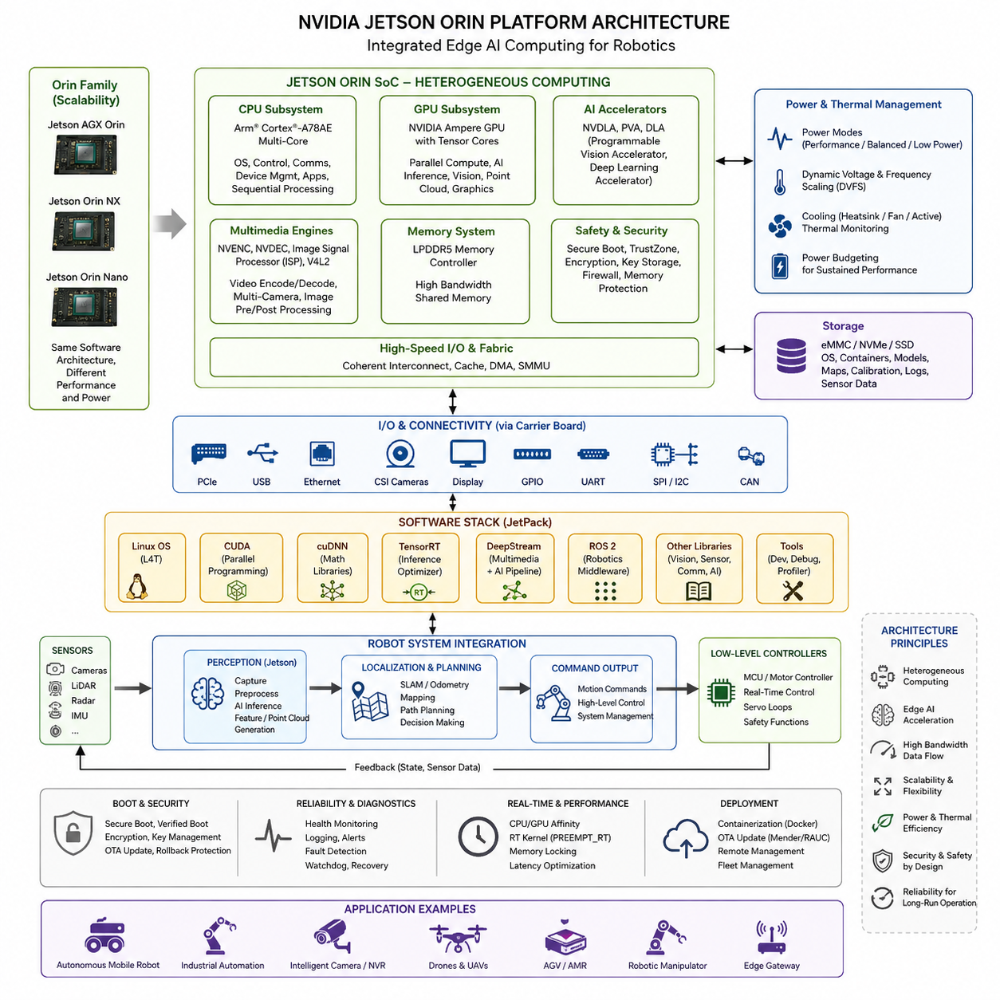{width="7.268055555555556in" height="7.268055555555556in"}

The NVIDIA Jetson platform is designed as an embedded heterogeneous computing architecture that combines general-purpose processing, massively parallel GPU acceleration, dedicated AI engines, multimedia processing, and high-speed I/O within a compact system-on-module. In the Orin generation, this architecture enables robots and autonomous machines to execute perception, sensor fusion, localization, planning, and neural-network inference directly at the edge instead of continuously depending on remote cloud infrastructure.

Jetson Orin is based on NVIDIA's system-on-chip approach, in which CPU cores, an NVIDIA Ampere-architecture GPU, memory controllers, accelerators, security functions, and peripheral interfaces are integrated into a tightly coupled computing platform. Rather than treating the GPU as an external accelerator, the architecture makes CPU and GPU resources part of the same embedded computing environment, reducing communication overhead and supporting data-intensive robotic pipelines.

The Orin family spans several performance and power classes, including Jetson AGX Orin, Jetson Orin NX, and Jetson Orin Nano configurations. This scalability allows developers to preserve a broadly consistent software architecture while selecting hardware appropriate for different robot classes. High-performance autonomous robots can employ AGX Orin, while smaller mobile robots, intelligent cameras, gateways, and compact edge devices can use Orin NX or Orin Nano according to workload and energy constraints.

The CPU subsystem performs operating-system services, device management, communication, application orchestration, and sequential computation that does not efficiently map to massively parallel hardware. The GPU complements these functions by processing workloads such as neural-network inference, image transformation, point-cloud processing, feature extraction, and parallel numerical operations. Effective Jetson software therefore partitions workloads according to computational characteristics rather than simply transferring every algorithm to the GPU.

A major architectural advantage of Orin is its support for accelerated artificial-intelligence execution. GPU Tensor Cores and associated NVIDIA software libraries allow neural networks to exploit reduced-precision computation and optimized matrix operations. Models for object detection, semantic segmentation, depth estimation, pose estimation, traversability analysis, and other robotic perception tasks can consequently execute with significantly greater throughput than would normally be practical using an embedded CPU alone.

Memory architecture is especially important because robotic applications continuously move large quantities of camera, LiDAR, radar, and intermediate neural-network data. Jetson provides a shared system memory environment accessible by multiple processing components, although actual performance still depends strongly on memory bandwidth, access patterns, synchronization, and unnecessary copying. Efficient applications therefore attempt to maintain accelerated data paths and minimize repeated transfers between processing stages.

The multimedia subsystem makes Jetson particularly suitable for vision-centered robotics. Hardware-assisted video encoding and decoding can reduce CPU and GPU consumption when processing compressed camera streams, while camera interfaces and NVIDIA multimedia frameworks support multi-camera acquisition pipelines. A robot can therefore capture images, preprocess frames, perform inference, generate metadata, and encode diagnostic or recorded video without assigning every operation to general-purpose CPU execution.

Jetson modules expose interfaces required to integrate the AI computer with the remainder of an embedded robotic system. Depending on the carrier-board implementation, these may include PCI Express, USB, Ethernet, camera interfaces, storage connections, GPIO, UART, SPI, I2C, and CAN-related connectivity. The module consequently operates as a high-level computational node while microcontrollers and dedicated controllers continue handling deterministic motor control, safety functions, power management, and low-level sensor interfaces.

The module-and-carrier-board architecture separates the compute module from much of the application-specific physical interface design. Commercial development kits provide convenient reference platforms, while production robots can employ customized carrier boards tailored to required cameras, Ethernet ports, CAN interfaces, storage devices, power supplies, and mechanical constraints. This separation improves platform reuse because the core computing architecture can remain relatively stable across several robot products.

Storage is another important architectural consideration because edge robots require operating-system images, containers, neural-network models, maps, calibration files, logs, and temporary sensor data. High-performance storage such as NVMe can be valuable when applications continuously record multiple cameras or large point clouds. Storage bandwidth, endurance, filesystem behavior, and available capacity must therefore be treated as system-design parameters rather than as secondary deployment concerns.

The Jetson software stack connects this heterogeneous hardware to application development. JetPack provides the foundation around which Linux, CUDA, acceleration libraries, multimedia components, TensorRT, and development tools are integrated. Higher-level robotics software can then use these components without directly programming every hardware accelerator. This layered organization also explains why Jetson development involves both conventional embedded Linux engineering and GPU-oriented parallel computing.

CUDA provides the general programming model for executing parallel workloads on the GPU, while TensorRT specializes in optimizing trained neural networks for efficient inference. DeepStream can organize accelerated multimedia and inference pipelines, and ROS 2 can provide the distributed robotics middleware connecting perception, localization, planning, control, and external systems. These technologies occupy different architectural layers and should be integrated according to workload requirements rather than treated as interchangeable components.

Power management is fundamental because an Orin-based robot rarely operates under unlimited electrical and thermal budgets. Performance depends on the selected power mode, CPU and GPU frequencies, accelerator utilization, memory traffic, and cooling capability. Maximum theoretical AI throughput therefore does not automatically represent sustained application performance. Engineers must evaluate the complete workload under realistic power conditions and determine whether inference deadlines and control-related timing requirements remain satisfied.

Thermal design is closely connected to power configuration. Sustained GPU inference, multi-camera processing, mapping, and neural-network execution can generate substantial heat, particularly inside sealed industrial enclosures. If thermal limits are reached, frequency reduction can decrease processing performance even when an application initially satisfies its timing targets. Heat sinks, airflow, enclosure design, ambient-temperature range, sensor monitoring, and workload scheduling therefore become part of embedded software architecture decisions.

Jetson should not normally replace deterministic microcontroller or real-time control subsystems. Linux and GPU workloads are optimized for computational flexibility and throughput, whereas servo loops, emergency responses, watchdog functions, and safety-critical actuator control often require stronger timing guarantees. A robust robot consequently uses Jetson for computationally intensive intelligence while dedicated MCUs, motor controllers, safety controllers, or real-time processors preserve deterministic low-level behavior.

This separation creates a practical hierarchical architecture. Sensors provide high-bandwidth environmental information to Jetson, accelerated perception transforms that information into usable representations, and localization or planning components generate higher-level commands. Those commands are transmitted to lower-level controllers that execute motion under deterministic constraints. Feedback then returns through the communication interfaces, forming a closed robotic computation chain from sensing through intelligence to physical action.

For production deployment, architecture must also address boot reliability, security, diagnostics, software updates, and fault recovery. An edge AI computer that delivers high inference throughput but cannot recover from corrupted software, detect hardware degradation, or maintain stable long-duration operation is unsuitable for autonomous industrial service. Jetson should therefore be engineered as an embedded subsystem with controlled startup, health monitoring, persistent logging, secure software management, and defined recovery behavior.

The Orin architecture is ultimately valuable because it consolidates several computing domains that previously required separate processors or accelerator boards. CPU computing, GPU parallelism, AI acceleration, multimedia processing, high-speed sensor interfaces, and embedded Linux can coexist within one edge platform. This consolidation reduces communication boundaries while enabling sophisticated autonomous functions to execute physically close to sensors and actuators, where latency, bandwidth, privacy, and connectivity constraints favor local processing.

Within the broader embedded software structure, Jetson and edge computing therefore form a bridge between conventional embedded Linux and advanced robotic AI. The platform does not eliminate firmware, device drivers, real-time controllers, or safety systems; instead, it adds a powerful heterogeneous intelligence layer above them. Understanding this architectural role provides the foundation for subsequent topics such as JetPack configuration, CUDA programming, TensorRT optimization, DeepStream pipelines, power management, ROS 2 integration, multi-camera design, and long-run reliability.

## 07.02 JetPack SDK Setup and Development Environment [w/Code]

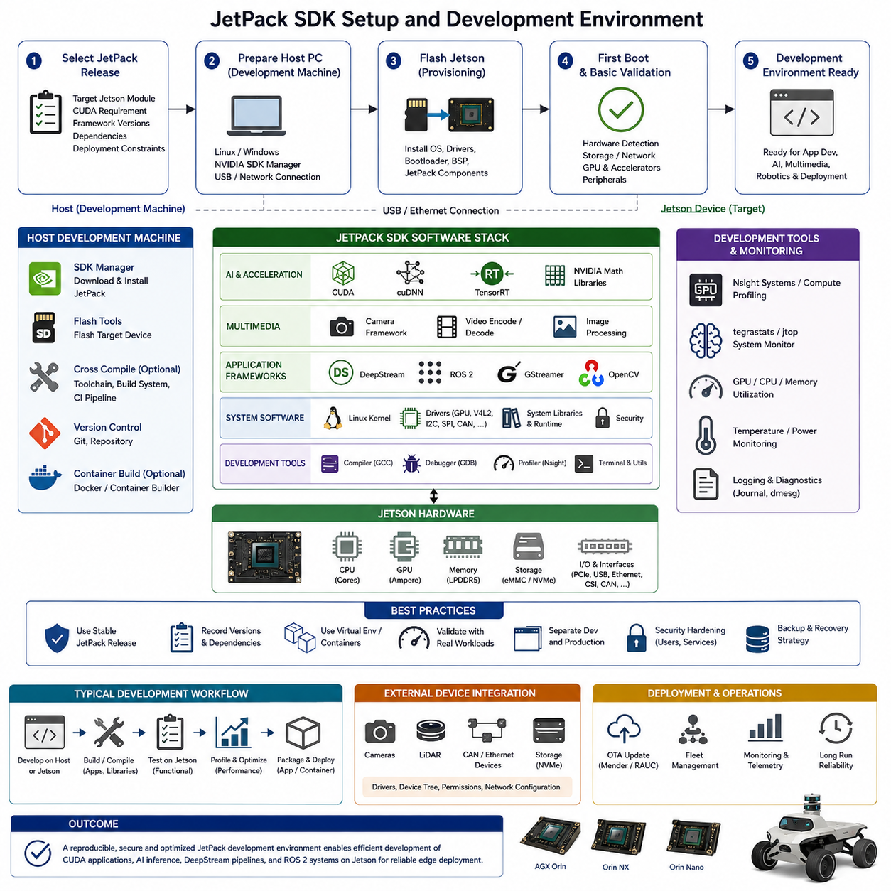{width="7.268055555555556in" height="7.268055555555556in"}

JetPack SDK provides the primary software environment for developing and deploying accelerated applications on NVIDIA Jetson platforms. Within the embedded software structure, it forms the foundation of the Jetson and Edge Computing chapter, connecting the underlying Jetson hardware with CUDA programming, TensorRT inference optimization, DeepStream pipelines, ROS 2 integration, and production-oriented edge applications.

A JetPack development environment should be understood as more than a collection of AI libraries. It integrates the operating system, hardware drivers, GPU computing runtime, multimedia components, acceleration libraries, debugging utilities, and deployment tools required by Jetson applications. Maintaining compatible versions across these layers is important because the Linux kernel, NVIDIA drivers, CUDA runtime, and higher-level frameworks depend on one another.

The initial development workflow normally begins by selecting a JetPack release that supports the target Jetson module and the requirements of the intended application. Developers should determine the target hardware, software dependencies, CUDA requirements, framework versions, and deployment constraints before installation. Fixing these versions early improves reproducibility and reduces compatibility problems when development moves from evaluation hardware to production systems.

Jetson software can be installed and managed through NVIDIA-supported provisioning mechanisms, with development commonly involving a separate host computer and the target Jetson device. The host environment is used to prepare or flash the target system and install development components, while Jetson executes the resulting embedded Linux environment. This host-target relationship is an important characteristic of professional embedded development and deployment workflows.

Flashing establishes the low-level software environment required for the Jetson platform to boot and operate correctly. The process installs the platform software and operating-system image appropriate for the target hardware configuration. Developers should treat flashing as a controlled provisioning operation because changing system images can affect device configuration, application dependencies, stored data, network settings, and previously installed development packages.

After the target system boots, the development environment should be validated before application development begins. Basic validation includes confirming that the operating system recognizes the Jetson hardware, storage, network interfaces, cameras, and required peripheral devices. GPU availability and installed acceleration components should also be checked so that later failures can be distinguished from fundamental platform configuration problems.

CUDA provides the GPU programming foundation used by many accelerated Jetson applications. A correctly configured development environment allows applications and supporting libraries to execute computational workloads on the embedded NVIDIA GPU. CUDA development becomes particularly important when conventional CPU processing cannot satisfy the throughput requirements of image processing, point-cloud computation, neural-network operations, or other highly parallel robotic workloads.

JetPack also provides the software foundation required by optimized AI inference frameworks. TensorRT can transform and optimize trained neural-network models for efficient execution on Jetson hardware, while supporting libraries provide optimized mathematical and deep-learning operations. Establishing these components during environment setup ensures that later model conversion and inference development can use the available GPU and AI acceleration capabilities effectively.

Multimedia support is equally important for robotic systems because camera data often represents one of the largest continuous data streams processed by the edge computer. JetPack provides access to NVIDIA multimedia capabilities that can support camera acquisition, image conversion, video decoding, encoding, and accelerated processing. A properly configured environment therefore allows developers to construct efficient camera pipelines without forcing every multimedia operation through general-purpose CPU processing.

DeepStream builds on this accelerated multimedia foundation by supporting pipelines that combine video processing with AI inference. Although detailed DeepStream development belongs to a later topic in the chapter structure, JetPack setup establishes the libraries, runtime components, and hardware support required for those pipelines. Environment validation should therefore consider future camera topology and inference requirements rather than only verifying that a simple demonstration application executes.

ROS 2 integration introduces another software layer to the Jetson development environment. Jetson may execute perception, localization, mapping, or AI nodes while communicating with motor controllers, sensors, navigation processes, and external computers through ROS 2. Developers must consequently manage dependencies between the JetPack environment and ROS 2 packages carefully, especially when GPU-accelerated libraries and conventional Linux packages are combined within the same robotic software system.

Development tools are needed to determine whether performance problems originate from application logic, CPU scheduling, GPU execution, memory transfers, storage, or sensor pipelines. Profiling and monitoring should therefore be incorporated into the development environment from the beginning rather than added only after performance problems appear. Measurements of CPU utilization, GPU load, memory consumption, temperatures, power state, and application latency provide essential evidence for optimization.

Package management requires particular discipline on long-lived robotic platforms. Installing packages without controlling versions can gradually produce systems that differ between developers, robots, and production batches. Teams should record JetPack versions, operating-system packages, Python environments, CUDA-dependent libraries, ROS 2 dependencies, and application revisions so that a known software configuration can be reconstructed when debugging or replacing a robot computer.

Python virtual environments can isolate application-level dependencies, while containers can provide stronger separation between application software and the underlying Jetson operating environment. Containerization is particularly useful when several AI applications require different framework versions or when the same software must be deployed repeatedly across multiple robots. However, containers still depend on compatible host GPU drivers and platform components, so they do not eliminate the need for controlled JetPack configuration.

Native compilation directly on Jetson is convenient during early development because source code, libraries, and hardware are available on the same device. Larger projects may instead use host-based build systems, cross-compilation, automated CI pipelines, or containerized builders. The appropriate approach depends on project scale, build time, dependency complexity, and deployment requirements, but the resulting binaries must always be compatible with the target architecture and Jetson runtime environment.

External devices should be integrated only after the base environment has been validated. Cameras, LiDAR sensors, CAN adapters, Ethernet devices, NVMe storage, and other peripherals may introduce kernel drivers, device-tree requirements, permissions, network configuration, or vendor libraries. Integrating them incrementally makes troubleshooting easier because failures can be associated with specific hardware or software changes rather than an uncontrolled combination of modifications.

A production-oriented JetPack environment should separate development convenience from deployed runtime requirements. Compilers, source trees, temporary datasets, debugging packages, and experimental libraries may be useful during engineering but unnecessary on deployed robots. Reducing the production software footprint can simplify maintenance, lower storage consumption, reduce attack surface, and make software versions easier to control across a fleet of autonomous systems.

Security must also be considered during setup because the Jetson computer often stores models, credentials, calibration information, maps, and operational software. Development practices should avoid uncontrolled administrative access, unnecessary network services, unprotected credentials, and unverified software sources. These measures complement broader embedded security mechanisms and prepare the platform for secure boot, protected updates, access control, and managed production deployment.

The completed development environment should be validated with representative workloads rather than installation checks alone. A useful validation sequence exercises GPU computation, AI inference, camera or sensor input, storage, networking, and application middleware under sustained operation. Thermal behavior and memory consumption should also be observed because a configuration that works for a short demonstration may fail when multiple robotic workloads execute concurrently for extended periods.

JetPack setup ultimately establishes the reproducible software baseline on which the remaining Jetson development workflow depends. Once Linux, GPU acceleration, multimedia support, development libraries, middleware dependencies, profiling tools, and deployment conventions are consistently configured, developers can progress systematically toward CUDA programming, TensorRT optimization, DeepStream camera AI, power tuning, ROS 2 integration, multi-camera processing, and reliable long-duration edge operation.

## 07.03 CUDA Programming Basics for Embedded GPU [w/Code]

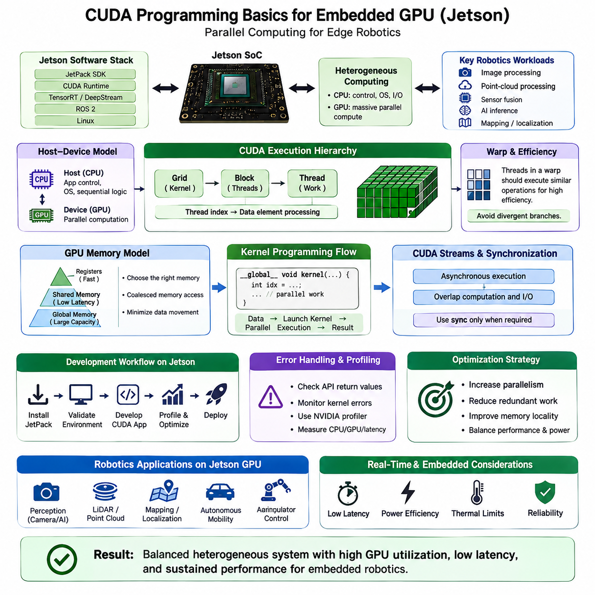{width="7.268055555555556in" height="7.268055555555556in"}

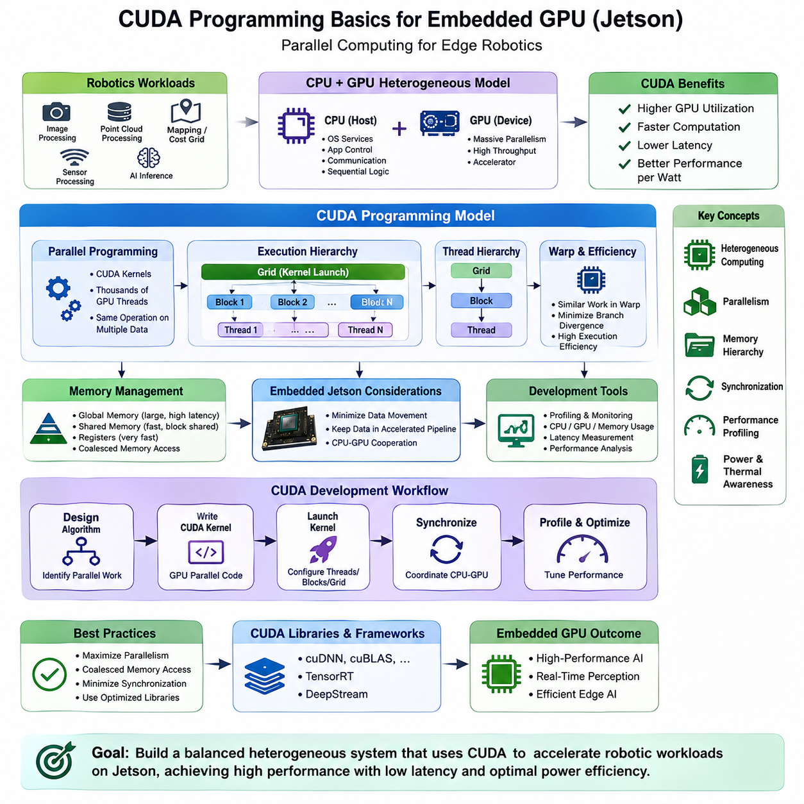{width="7.268055555555556in" height="7.268055555555556in"}

CUDA programming provides the fundamental method for using the NVIDIA GPU as a parallel computing engine inside Jetson-based embedded systems. Within the Jetson and Edge Computing software structure, CUDA sits between application algorithms and GPU hardware, enabling developers to accelerate computationally intensive robotics workloads such as image processing, point-cloud operations, sensor processing, and mathematical computation.

A CUDA application follows a heterogeneous computing model in which the CPU and GPU cooperate rather than perform identical roles. The CPU, commonly called the host, executes operating-system services, application control, communication, and sequential logic. The GPU, called the device, executes highly parallel portions of the workload. Effective embedded GPU programming therefore begins by identifying algorithms containing large amounts of independent or repeated computation.

GPU functions executed in parallel are implemented as CUDA kernels. A kernel represents code that can be launched across many GPU threads simultaneously, allowing the same operation to process different elements of an image, vector, matrix, point cloud, or other dataset. Instead of explicitly creating thousands of individual threads, the programmer defines the kernel and specifies the parallel execution configuration used when launching it.

CUDA organizes execution through a hierarchy of threads, blocks, and grids. Individual threads perform the smallest units of work, groups of threads form blocks, and multiple blocks form a grid associated with a kernel launch. Thread and block indices allow each thread to determine which data element it should process. Understanding this hierarchy is essential because execution configuration directly influences GPU utilization, memory behavior, and application performance.

Threads inside the GPU are scheduled in groups known as warps. Efficient CUDA code attempts to keep threads within a warp performing similar operations so that the GPU can exploit its parallel execution architecture effectively. When different threads repeatedly follow different branches, execution efficiency can decrease. Consequently, algorithm structure and control-flow behavior can be as important as the raw number of parallel operations available in a workload.

Memory management is one of the most important aspects of CUDA programming. GPU computation interacts with several forms of memory that differ in capacity, latency, scope, and intended usage. Global memory provides large storage accessible by GPU threads, while registers provide very fast thread-local storage. Shared memory enables threads within the same block to exchange frequently reused data with substantially lower access overhead than repeated global-memory operations.

Memory access patterns strongly affect practical performance. Adjacent threads should generally access data in patterns that allow memory transactions to be combined efficiently, a behavior commonly associated with coalesced memory access. Poorly arranged accesses can waste memory bandwidth even when the arithmetic portion of a kernel is simple. Data layout should therefore be designed together with kernel execution rather than treated as an independent implementation detail.

Jetson introduces an important embedded consideration because CPU and GPU resources exist within a tightly integrated system-on-chip architecture. Applications should still minimize unnecessary data movement and copying between processing stages, even when the physical memory architecture differs from systems using discrete GPUs. Maintaining data in accelerated pipelines can be especially valuable for continuous camera, perception, and AI workloads where repeated frame copies consume bandwidth and increase latency.

Kernel design should expose enough parallel work to keep GPU resources occupied without consuming excessive registers or shared memory per thread block. Very small workloads may not justify GPU execution because launch and synchronization overhead can outweigh parallel-computing benefits. Conversely, large independent workloads can achieve substantial acceleration when their computation and memory-access patterns align well with GPU execution characteristics.

Synchronization is required when parallel threads or processing stages depend on one another. Threads within a block can coordinate at defined synchronization points, while host-device synchronization may be necessary when the CPU requires results produced by the GPU. Excessive synchronization reduces concurrency and can serialize otherwise parallel work, so dependencies should be minimized and synchronization should be introduced only where correctness requires it.

CUDA streams provide a mechanism for organizing asynchronous operations and enabling greater overlap between computation and other work. Independent kernels or data operations can potentially progress without forcing the host to wait after every operation. In robotic pipelines, this concept can help overlap processing stages associated with successive sensor frames or independent computational tasks, although concurrency must be designed carefully to avoid hidden dependencies and resource contention.

Error handling is essential in embedded GPU applications because CUDA operations may fail due to invalid memory access, incorrect launch configuration, resource limitations, or runtime conditions. Developers should check API return values and kernel execution errors during development and testing. Silent GPU failures are particularly dangerous in robotic systems because downstream components may continue operating with missing, delayed, or invalid perception and planning data.

Profiling should guide CUDA optimization rather than relying on assumptions about where execution time is spent. Developers need to distinguish CPU bottlenecks, kernel execution time, memory-access limitations, synchronization delays, and data-transfer overhead. NVIDIA profiling tools available within the Jetson development ecosystem can help reveal GPU utilization and execution behavior, allowing optimization effort to focus on the portions of the pipeline that actually constrain performance.

Optimization should normally begin with algorithm structure before progressing to low-level kernel tuning. Increasing useful parallelism, reducing redundant computation, minimizing unnecessary memory movement, improving data locality, and eliminating avoidable synchronization often produce larger benefits than isolated instruction-level changes. Once these fundamentals are correct, block dimensions, memory usage, occupancy, and kernel organization can be tuned for the target Jetson platform.

Robotics workloads provide many natural opportunities for CUDA acceleration because sensor data commonly contains large numbers of independently processed elements. Image filtering can assign computation across pixels, point-cloud processing can distribute operations across points, and map or cost-grid calculations can process cells in parallel. These patterns make GPU acceleration valuable for perception and preprocessing pipelines that would otherwise consume substantial CPU resources.

CUDA should nevertheless be applied selectively. Device communication, state-machine logic, ROS 2 orchestration, low-frequency supervisory functions, and small sequential algorithms may remain better suited to CPU execution. Moving unsuitable workloads to the GPU can increase complexity without improving performance. A well-designed Jetson application therefore partitions processing according to parallelism, latency requirements, memory behavior, and communication overhead.

Real-time robotics introduces additional constraints beyond average throughput. A CUDA implementation that produces high frames per second may still be unsuitable if individual kernel executions occasionally create excessive latency. Developers should measure end-to-end timing under representative CPU, GPU, memory, and thermal loads. GPU acceleration must therefore be evaluated as part of the complete robotic pipeline rather than through isolated benchmark performance alone.

Power and thermal behavior are also relevant because sustained GPU utilization directly affects an embedded system\'s energy consumption and heat generation. Aggressive CUDA workloads may initially achieve high performance but later encounter frequency limitations when the thermal system reaches steady state. Optimization on Jetson should consequently consider performance per watt and sustained latency in addition to maximum short-duration computational throughput.

CUDA libraries can reduce the need to implement every operation manually. Optimized NVIDIA libraries provide reusable implementations for common mathematical, image-processing, and deep-learning operations, while higher-level frameworks such as TensorRT build upon GPU acceleration to execute neural networks efficiently. Custom CUDA kernels are most valuable when application-specific computation cannot be expressed efficiently through existing optimized libraries or frameworks.

In the broader Jetson software architecture, CUDA serves as the general parallel-computing foundation beneath specialized technologies such as TensorRT and GPU-accelerated perception pipelines. Developers who understand kernels, execution hierarchy, memory behavior, synchronization, streams, profiling, and heterogeneous workload partitioning can reason more effectively about the performance of higher-level frameworks instead of treating GPU acceleration as an opaque subsystem.

The objective of CUDA programming on an embedded GPU is therefore not simply to move computation from the CPU to the GPU. It is to construct a balanced heterogeneous system in which CPU control, GPU parallelism, memory bandwidth, accelerator utilization, power consumption, and latency are coordinated according to robotic requirements. This foundation prepares Jetson development for TensorRT optimization, DeepStream processing, ROS 2 perception, multi-camera workloads, and sustained edge AI operation.

## 07.04 TensorRT Engine Conversion and Optimization [w/Code]

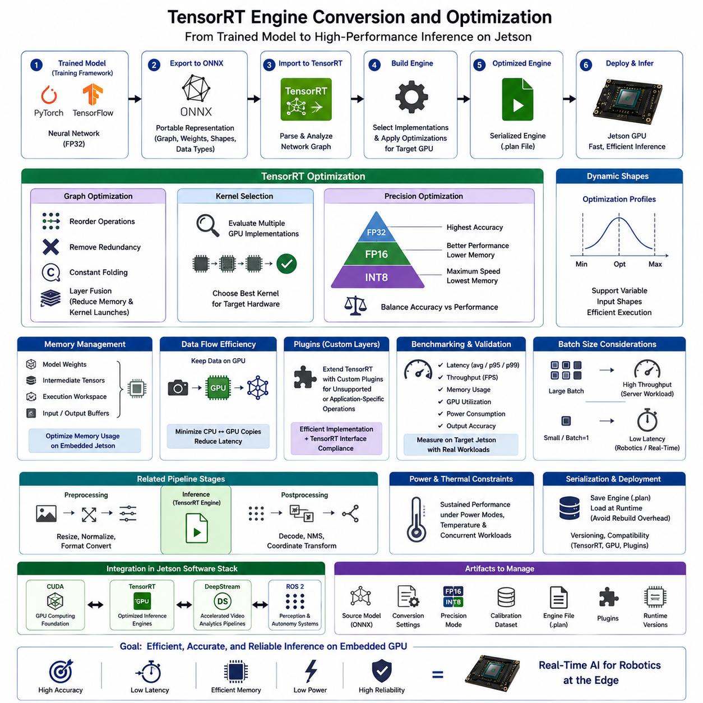{width="7.268055555555556in" height="7.268055555555556in"}

TensorRT is NVIDIA's inference optimization and runtime framework for transforming trained neural networks into highly efficient execution engines for NVIDIA GPUs. On Jetson platforms, it provides the transition from a general training-oriented model to a deployment-oriented representation optimized for embedded inference. Within the Jetson software stack, TensorRT builds on CUDA acceleration and prepares AI models for low-latency robotic operation.

A typical TensorRT workflow begins with a neural network trained in a framework such as PyTorch or TensorFlow and exported into a portable representation such as ONNX. The exported model describes network topology, operators, parameters, tensor dimensions, and data types independently from the original training code. TensorRT imports this representation, analyzes the graph, selects executable implementations, and constructs an optimized inference engine for the target GPU.

Engine conversion is fundamentally different from simply copying a trained model onto Jetson. During engine construction, TensorRT evaluates the network structure and applies transformations intended to reduce inference cost while preserving the required numerical behavior. The resulting engine contains optimized execution decisions associated with the target hardware, precision configuration, tensor shapes, and available computational resources.

Graph optimization reduces unnecessary computational overhead before runtime execution. Operations may be reorganized, redundant transformations eliminated, constants precomputed, and compatible layers combined when appropriate. Layer fusion is especially valuable because combining consecutive operations can reduce intermediate memory traffic and kernel-launch overhead. These optimizations improve performance without requiring application developers to manually rewrite every neural-network operation as CUDA code.

TensorRT performance also depends strongly on selecting efficient computational kernels. A neural-network operation may have several possible GPU implementations with different characteristics depending on tensor dimensions, precision, memory usage, and hardware capabilities. During engine building, TensorRT evaluates suitable execution strategies and chooses implementations intended to provide efficient inference for the configured target environment.

Precision optimization is one of the most important mechanisms for improving inference performance. Models commonly begin with FP32 floating-point computation, while supported workloads can often execute using FP16 or INT8 representations. Reduced precision decreases memory traffic and can increase arithmetic throughput by using GPU acceleration capabilities more effectively, making it particularly useful for Jetson systems constrained by power, thermal capacity, and memory bandwidth.

FP16 optimization generally provides a practical balance between performance and numerical accuracy when the model and target GPU support half-precision execution effectively. It can reduce memory consumption and accelerate many neural-network operations without requiring the calibration process associated with INT8. Nevertheless, developers must validate output quality because sensitivity to reduced precision varies according to network architecture, operators, and application requirements.

INT8 inference can provide further reductions in computation and memory requirements, but converting a model to lower numerical precision requires careful treatment of tensor ranges. Calibration data should represent the operating distribution of the deployed model so that quantization parameters reflect realistic inputs. Poor calibration can produce significant accuracy degradation even when benchmark inference performance improves, making representative validation data essential.

Explicit quantization approaches can also encode quantization behavior as part of the model transformation process. Regardless of the selected method, optimization must be evaluated against application-level accuracy rather than computational speed alone. For robotics, a small change in an aggregate AI metric may have a larger operational effect if it changes obstacle detection, segmentation boundaries, pose estimates, or other outputs used by downstream decision systems.

Dynamic input shapes introduce additional considerations because many networks do not always operate on a single fixed tensor dimension. TensorRT can use optimization profiles to describe expected minimum, optimum, and maximum input shapes. Correctly defining these profiles allows an engine to support required runtime variations while still optimizing execution. Excessively broad profiles may increase complexity, whereas incorrect profiles can prevent valid inputs from executing.

Memory management is another major part of TensorRT optimization. Neural-network inference requires model weights, intermediate tensors, execution workspace, input buffers, and output buffers. On an embedded Jetson platform, these resources share the system's finite memory capacity with Linux, ROS 2, camera pipelines, mapping software, and other applications. Engine configuration should therefore consider peak memory consumption as well as inference speed.

TensorRT execution should minimize unnecessary data copies between application components. Camera frames or preprocessed tensors may already exist in GPU-accessible memory after earlier CUDA or multimedia operations. Keeping these data within an accelerated processing path can avoid repeated CPU-GPU transfers and reduce latency. This becomes particularly important in multi-camera systems where several inference pipelines continuously process high-bandwidth image streams.

Engine serialization allows a built TensorRT engine to be stored and loaded later without repeating the complete optimization process during every application startup. This can significantly reduce deployment initialization time. However, serialized engines should be managed as hardware- and software-dependent deployment artifacts because compatibility can depend on TensorRT versions, GPU architecture, engine configuration, plugins, and other runtime conditions.

Some neural networks contain operators that TensorRT cannot directly execute using built-in implementations. Custom plugins can extend TensorRT by providing application-specific or unsupported operations. A plugin must implement the required computation efficiently while respecting TensorRT tensor formats and execution requirements. Plugins increase deployment flexibility but also introduce additional code that must be versioned, tested, profiled, and maintained with the engine.

Benchmarking is essential during conversion because optimization decisions should be based on measured behavior. Developers should evaluate latency, throughput, memory consumption, GPU utilization, power consumption, and output accuracy under representative workloads. Measuring only average inference time can hide latency spikes that matter to robotics, so percentile behavior and end-to-end pipeline timing should also be considered when real-time responsiveness is required.

Batch size affects the balance between throughput and latency. Larger batches can improve GPU utilization by processing multiple inputs together, which is valuable for server-oriented workloads. Embedded robots frequently prioritize immediate processing of each sensor frame, making small batches or batch size one more appropriate. The correct configuration therefore depends on whether the system prioritizes throughput, individual-frame latency, or concurrent processing from multiple sensors.

Optimization must also account for preprocessing and postprocessing because neural-network inference is only one stage of the complete AI pipeline. Image resizing, normalization, format conversion, decoding model outputs, non-maximum suppression, and coordinate transformations may consume substantial time. Accelerating the engine while leaving surrounding stages inefficient can produce little improvement in end-to-end latency, so profiling should cover the complete sensor-to-result path.

Power and thermal constraints influence sustained TensorRT performance on Jetson. An optimized engine may achieve excellent short-duration latency while continuous inference drives the GPU toward thermal or power limits. Developers should test the engine under realistic Jetson power modes, environmental temperatures, and simultaneous workloads. Sustained performance is more important to autonomous robots than a peak benchmark obtained under temporary ideal conditions.

TensorRT integrates naturally with the broader Jetson software environment. CUDA provides the underlying GPU execution foundation, while DeepStream can incorporate TensorRT engines into accelerated video analytics pipelines. ROS 2 nodes can use optimized inference results as part of perception and autonomy systems. These relationships place TensorRT between trained AI models and production robotic applications rather than treating it as an isolated model-conversion utility.

Production deployment requires controlled management of source models, conversion settings, precision modes, calibration datasets, engine files, plugins, and runtime versions. These artifacts should be traceable so that a deployed inference result can be associated with the model and optimization process that produced it. Reproducibility becomes especially important when the same AI capability is deployed across multiple robots or updated through a fleet software lifecycle.

Validation should therefore compare the optimized engine against the reference model using representative datasets and operational scenarios. Numerical differences must be evaluated in terms of their effect on the robotic task, while latency and resource measurements should be collected on the actual target Jetson hardware. Successful optimization means satisfying accuracy, latency, memory, power, and reliability requirements simultaneously rather than maximizing a single benchmark metric.

TensorRT engine conversion ultimately transforms a general neural-network representation into a target-oriented inference implementation suitable for embedded GPU deployment. By combining graph optimization, kernel selection, precision reduction, memory management, serialization, profiling, and hardware-aware validation, developers can create efficient Jetson inference pipelines that support real-time perception and edge AI while remaining within embedded resource constraints.

## 07.05 DeepStream Pipeline: Camera AI Inference [w/Code]

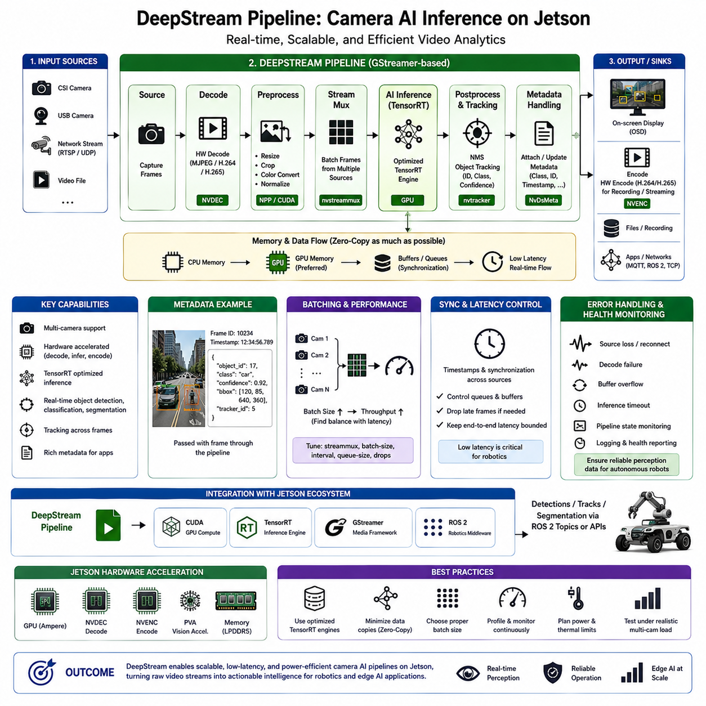{width="7.268055555555556in" height="7.268055555555556in"}

DeepStream is NVIDIA's accelerated streaming analytics framework for building camera-centered AI pipelines on Jetson and other NVIDIA GPU platforms. Within the Jetson software stack, it connects multimedia processing with TensorRT inference so that video acquisition, decoding, preprocessing, neural-network execution, tracking, metadata handling, and output processing can operate as a coordinated pipeline rather than as isolated application stages.

DeepStream is built around a streaming pipeline model closely associated with GStreamer. Camera frames or video streams enter through source elements and then pass through a sequence of processing components responsible for decoding, conversion, batching, inference, tracking, visualization, encoding, or application-specific output. This architecture allows developers to compose complex camera AI applications from reusable processing elements while preserving efficient movement of video data through the system.

Input sources can originate from CSI cameras, USB cameras, network streams, recorded video, or other supported multimedia sources. The acquisition stage must establish resolution, frame rate, pixel format, synchronization requirements, and buffering behavior appropriate for the application. In robotics, these parameters directly affect perception latency because delays introduced before inference propagate into localization, obstacle detection, navigation, and other downstream functions.

Compressed streams require decoding before neural-network processing, and Jetson provides hardware multimedia engines that can perform video decoding without assigning the entire workload to CPU software. DeepStream can use these accelerated capabilities as part of the pipeline. Hardware-assisted decoding becomes particularly important when multiple high-resolution cameras operate simultaneously because software decoding can consume CPU resources needed by ROS 2, planning, communication, and system-management tasks.

After acquisition or decoding, frames commonly require preprocessing before entering the neural network. Operations may include resizing, cropping, color-space conversion, normalization, or transformation into the tensor representation expected by the model. Efficient DeepStream pipelines attempt to perform these operations through accelerated paths and avoid unnecessary movement between CPU and GPU memory, because repeated copies increase memory bandwidth consumption and end-to-end latency.

Stream multiplexing is an important concept when processing multiple camera or video sources. Frames from several streams can be organized for downstream processing and inference, allowing GPU resources to be shared efficiently. The batching strategy must reflect application requirements because larger batches can improve throughput, while robotics applications frequently require low latency for each individual camera frame. The optimal configuration therefore depends on the number of streams and timing constraints.

AI inference is typically performed using an optimized TensorRT engine integrated into the DeepStream pipeline. The inference stage receives prepared tensors, executes the neural network on NVIDIA GPU resources, and generates outputs such as detected objects, classifications, segmentation maps, or other model-specific results. TensorRT therefore provides the optimized inference engine, while DeepStream provides the surrounding streaming architecture required to continuously deliver camera data to that engine.

Primary inference may be followed by additional inference stages when an application requires hierarchical analysis. For example, an initial detector can identify regions of interest, after which another model analyzes selected objects in greater detail. Such architectures can reduce unnecessary computation by applying expensive models only to relevant regions, although additional stages also introduce scheduling, buffering, memory, and latency considerations that must be evaluated at the complete pipeline level.

Object tracking can associate detections across successive frames and generate persistent identities for observed objects. Tracking can reduce the need to interpret every frame independently and provides temporal information useful for robotic perception. Depending on the application, tracked metadata may support motion estimation, behavior analysis, obstacle monitoring, or downstream planning. The tracker should be selected and configured according to accuracy, computational cost, and latency requirements.

Metadata is a central mechanism for passing AI results through a DeepStream pipeline. Detection coordinates, object classes, confidence values, tracking identifiers, frame information, and application-specific attributes can accompany the video buffers as metadata. Downstream components can inspect or transform these results without requiring the original neural network to understand the complete robotic application, supporting separation between perception inference and higher-level decision logic.

Visualization can overlay bounding boxes, labels, tracking identifiers, or other information onto video frames for debugging, operator interfaces, and recorded diagnostics. However, production robots may not require continuous visualization. Rendering and display components consume computational and memory resources, so headless deployments should avoid unnecessary visualization when AI metadata is the actual required output. Development and production pipeline configurations may therefore differ significantly.

Processed video can also be encoded for recording, remote monitoring, or transmission. Jetson hardware encoding can reduce CPU load when compressed output is required. Recording policies should nevertheless consider storage bandwidth, capacity, and endurance, particularly in multi-camera robots operating continuously. It is often more efficient to record selected events, reduced-resolution streams, or metadata rather than storing every raw frame generated during long-duration operation.

DeepStream pipeline performance is strongly influenced by buffering and synchronization behavior. Buffers are necessary to absorb timing variation between stages, but excessive buffering increases latency and may cause the AI result to describe an environment that has already changed. Real-time robotics therefore requires careful control of queue sizes, frame dropping, processing rates, and backpressure so that maintaining throughput does not unintentionally create unacceptable perception delay.

Multi-camera systems introduce additional synchronization issues when observations from several viewpoints must represent approximately the same physical instant. DeepStream can organize streams for parallel processing, but system-level synchronization still depends on camera triggering, timestamps, drivers, and acquisition architecture. Applications performing sensor fusion or geometric multi-camera reasoning must preserve reliable temporal information as frames move through preprocessing and inference stages.

A practical camera AI pipeline should distinguish throughput from latency. Frames per second measures the amount of video processed over time, whereas latency measures how long an individual observation takes to produce a usable result. A pipeline can report high throughput while still accumulating buffers that make its output too old for autonomous control. Robotics optimization should therefore prioritize bounded end-to-end latency in addition to aggregate processing performance.

Profiling must examine the complete pipeline rather than the neural network alone. Developers should measure acquisition, decoding, preprocessing, batching, TensorRT inference, tracking, postprocessing, encoding, and application output. CPU utilization, GPU utilization, memory consumption, power, temperature, and queue behavior should also be observed. Jetson monitoring and profiling tools provide the surrounding environment required to identify where pipeline resources are actually consumed.

DeepStream applications must also handle failures that occur outside the AI model. A camera can disconnect, a network stream can stall, decoding can fail, buffers can overflow, or inference may stop producing valid results. Production systems therefore require explicit error handling, source recovery, pipeline state monitoring, logging, and health reporting. Autonomous robots should never assume that the continued existence of an application process guarantees that valid perception data is being produced.

Integration with ROS 2 allows DeepStream results to become part of a broader robotic perception architecture. Instead of publishing every raw image, an application may publish detections, tracked objects, segmentation results, or other derived information required by localization, planning, and autonomy components. This can reduce unnecessary data movement while allowing DeepStream to remain focused on accelerated camera processing and ROS 2 to coordinate distributed robotic functions.

Pipeline configuration should be treated as a deployable software artifact. Source definitions, camera parameters, model files, TensorRT engines, tracker settings, batching configuration, output behavior, and runtime versions should be recorded and controlled. Reproducibility becomes especially important when the same perception capability must operate across multiple Jetson devices, robot variants, or production fleets with predictable performance and output behavior.

Power and thermal constraints remain important because continuous camera processing can keep multimedia engines, memory interfaces, GPU resources, and AI accelerators active for long periods. A pipeline that performs well during a short test may experience reduced performance after thermal equilibrium is reached. Validation should therefore use representative camera counts, resolutions, inference models, Jetson power modes, ambient conditions, and concurrent robotic workloads.

DeepStream ultimately provides the streaming orchestration layer that connects camera input with accelerated multimedia processing and AI inference on Jetson. By combining efficient video handling, TensorRT inference, metadata flow, tracking, batching, hardware encoding and decoding, monitoring, and application integration, it enables scalable real-time perception pipelines that transform continuous camera streams into actionable information for embedded robotics and edge AI systems.

## 07.06 Jetson AGX Orin Power Management and Performance Profiles

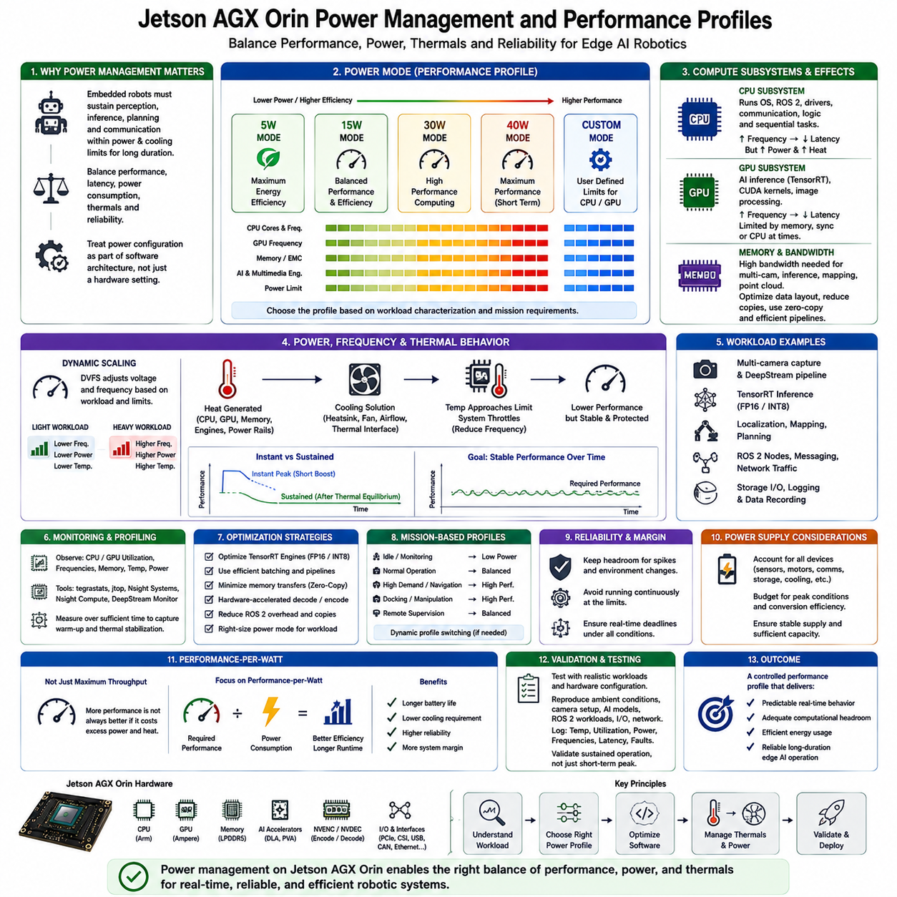{width="7.268055555555556in" height="7.268055555555556in"}

Jetson AGX Orin power management is designed to balance AI performance, CPU and GPU utilization, memory bandwidth, thermal behavior, and electrical consumption within the constraints of an embedded robotic platform. Unlike desktop systems that often emphasize maximum performance, Jetson must sustain perception, inference, planning, and communication workloads while operating within defined power and cooling limits for long periods.

A Jetson application should therefore treat power configuration as part of the software architecture rather than as a hardware setting applied after development. Neural-network inference, CUDA kernels, camera processing, ROS 2 nodes, storage activity, and communication workloads compete for shared platform resources. Their combined behavior determines whether the system can maintain required latency and throughput without exceeding its power or thermal envelope.

Jetson AGX Orin provides configurable power modes that define operating limits for major computing resources. A power mode establishes constraints that influence CPU cores, CPU frequencies, GPU frequencies, memory-related resources, and other processing components. Selecting an appropriate mode allows the same Jetson platform to support different deployment priorities, ranging from energy-conscious operation to computationally intensive autonomous workloads.

The appropriate power profile depends on the actual robotic mission. A robot performing lightweight monitoring may not require the highest available computing capability, while a system executing multiple camera networks, LiDAR processing, localization, mapping, and planning concurrently may require a substantially larger performance envelope. Power mode selection should therefore follow workload characterization rather than simply choosing the maximum setting.

The CPU subsystem contributes significantly to system power because it executes Linux services, ROS 2 middleware, device drivers, communication, application orchestration, and sequential algorithms. Increasing CPU frequency can reduce execution time for CPU-bound tasks, but it also consumes additional power and generates heat. Developers should determine whether latency originates from CPU processing before increasing CPU performance parameters unnecessarily.

GPU behavior is especially important for AI and parallel workloads. TensorRT inference, CUDA processing, image transformations, and other accelerated operations can maintain high GPU utilization for extended periods. Higher GPU frequencies can reduce processing latency, but the improvement may be limited when the application is constrained by memory bandwidth, preprocessing, synchronization, or CPU execution rather than raw GPU computation.

Memory bandwidth must be considered alongside CPU and GPU performance. Multi-camera systems, neural-network inference, mapping, and point-cloud processing continuously move large quantities of data through shared memory. Increasing computational frequency cannot fully improve performance when memory traffic is the limiting factor. Efficient data layout, reduced copying, zero-copy techniques, and accelerated pipelines can therefore improve both performance and energy efficiency.

Dynamic voltage and frequency scaling allows the platform to adjust operating conditions according to computational demand and configured limits. When workloads are light, lower frequencies can reduce power consumption, while demanding workloads can use higher performance states when permitted. This behavior makes instantaneous frequency measurements less meaningful than sustained workload measurements when evaluating the real performance of an autonomous robot.

Maximum-performance operation can be useful during benchmarking and performance characterization because it helps reveal the computational capability of the platform. However, continuously forcing high frequencies may increase power consumption and thermal stress without providing proportional application benefits. Production configuration should therefore distinguish between diagnostic maximum-performance settings and the operating profile intended for continuous field deployment.

Thermal management is inseparable from power management. CPU, GPU, memory, multimedia engines, storage, and power-conversion components generate heat during sustained operation. When temperatures approach defined limits, the system may reduce operating frequencies to protect the hardware. As a result, an application that achieves excellent performance immediately after startup can become slower after the system reaches thermal equilibrium.

Cooling design consequently determines how much computational performance can be sustained. Heat sinks, fans, thermal interfaces, enclosure airflow, ambient temperature, and nearby heat-generating electronics influence the final operating condition of Jetson. Software performance testing performed on an open development kit cannot automatically predict behavior inside a sealed robot enclosure, so thermal validation should use hardware configurations representative of the production system.

Power profiles should be evaluated using representative workloads rather than synthetic GPU benchmarks alone. A realistic test may execute camera acquisition, DeepStream processing, TensorRT inference, ROS 2 communication, localization, navigation, logging, and network traffic simultaneously. Such testing reveals resource interactions that isolated benchmarks cannot show and provides a more reliable estimate of actual system power and sustained computational performance.

Monitoring tools are essential for understanding these interactions. Developers should observe CPU and GPU utilization, operating frequencies, memory usage, temperatures, power state, and application latency while representative workloads execute. Measurements should be collected over sufficient time to capture warm-up behavior and thermal stabilization rather than relying on a short observation period that may represent only temporary peak performance.

Performance profiling should connect hardware measurements with application-level timing. High GPU utilization is not automatically desirable if sensor-to-decision latency remains excessive, and low utilization does not necessarily indicate a problem if timing requirements are already satisfied. The important question is whether the selected power profile provides sufficient computational headroom while meeting latency, throughput, thermal, and energy requirements.

TensorRT optimization can reduce the power required for AI inference by completing neural-network operations more efficiently. FP16 or INT8 execution, suitable engine configuration, efficient batching, and minimized memory transfers can reduce computational cost relative to an inefficient inference implementation. Power management and model optimization should therefore be considered together rather than treating higher hardware frequency as the primary solution to slow inference.

DeepStream pipelines similarly influence the platform power profile because camera decoding, preprocessing, inference, tracking, and encoding can activate several hardware engines simultaneously. Hardware-accelerated multimedia processing can reduce CPU consumption, while efficient GPU memory paths can reduce unnecessary transfers. The resulting power requirement depends on camera count, resolution, frame rate, model complexity, batching strategy, and output processing.

ROS 2 systems add another dimension because many distributed nodes can generate CPU scheduling, serialization, communication, and memory overhead even when GPU inference is highly optimized. Developers should profile the complete robotic software graph and identify unnecessary message copies, excessive publication rates, or computational duplication. Efficient system architecture can sometimes provide more usable performance than simply selecting a higher Jetson power mode.

Different mission phases may also have different computational requirements. A stationary robot may perform relatively light monitoring, while navigation through a complex environment may activate additional perception and planning workloads. Docking, manipulation, mapping, or remote supervision can create other workload combinations. System designers can use this understanding to define operational profiles appropriate to different robot states when dynamic management is justified.

Reliability requires sufficient performance margin. Configuring the system so that CPU, GPU, memory, and thermal resources remain continuously near their limits leaves little capacity for temporary workload spikes or environmental changes. A production robot should maintain headroom for unexpected sensor activity, communication bursts, recovery processes, and variations in ambient temperature while continuing to satisfy critical timing requirements.

Power supply design must also support the selected performance profile. The Jetson module is only one consumer within a robot that may include sensors, storage, communication devices, motor controllers, cooling systems, and other electronics. Power budgeting should consider simultaneous peak conditions, conversion efficiency, supply stability, and battery limitations so that computational load does not create voltage instability or reduce mission duration unexpectedly.

Performance-per-watt is therefore often a more meaningful optimization target than absolute computing throughput. An efficient configuration executes the required perception and autonomy workload within its deadline while consuming the minimum practical electrical and thermal budget. This approach can extend battery operation, reduce cooling requirements, improve component reliability, and provide additional system margin for other robotic subsystems.

A production performance profile should ultimately be validated through long-duration testing on the target hardware. Testing should reproduce realistic ambient conditions, camera configurations, AI models, ROS 2 workloads, storage activity, networking, and mission behavior. Logs should capture temperatures, utilization, frequencies, power behavior, latency, and faults so that the selected configuration can be evaluated for sustained operation rather than short-term benchmark success.

Jetson AGX Orin power management is therefore a system-level optimization problem connecting software workload, hardware acceleration, thermal design, electrical power, and robotic mission requirements. The objective is not to operate every component at maximum frequency, but to establish a controlled performance profile that delivers predictable real-time behavior, adequate computational headroom, efficient energy use, and reliable long-duration edge AI operation.

## 07.07 ROS2 and Jetson Integration: Real-Time Perception [w/Code]

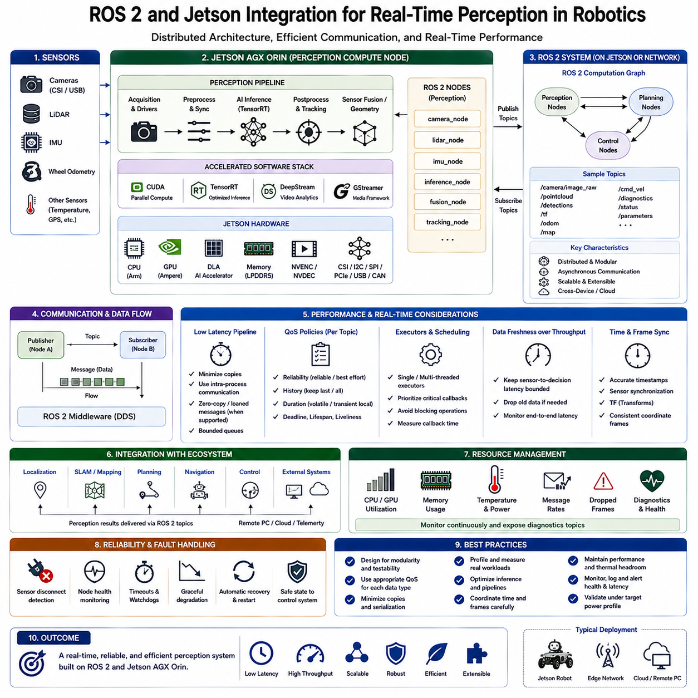{width="7.268055555555556in" height="7.268055555555556in"}

ROS 2 provides the distributed communication and software integration layer that connects Jetson-accelerated perception with the wider robotic system. On Jetson, GPU-based camera processing, neural-network inference, localization, mapping, and sensor processing can operate as ROS 2 nodes while exchanging information with planning, control, navigation, and external computers. This combination creates a practical foundation for real-time perception in autonomous robots.

The architecture should separate computational responsibilities according to their execution characteristics. Jetson handles high-bandwidth and computationally intensive perception using CUDA, TensorRT, and accelerated multimedia processing, while ROS 2 organizes communication between functional components. Low-level deterministic motor control and safety functions can remain on dedicated controllers, allowing ROS 2 and Jetson to concentrate on higher-level sensing, intelligence, and autonomy.

A typical perception flow begins when cameras, LiDAR, IMU, or other sensors provide measurements to acquisition nodes or hardware interfaces. The data may then pass through preprocessing, synchronization, neural-network inference, geometric processing, tracking, or sensor-fusion nodes. ROS 2 topics transport the resulting information toward localization, mapping, planning, and decision modules, creating a modular data path from physical sensing to autonomous behavior.

Node decomposition is important because dividing every small function into a separate process can introduce unnecessary communication and serialization overhead. Conversely, placing all perception functions inside one large process reduces modularity and fault isolation. A practical design groups operations that exchange large data volumes or require tightly coupled acceleration while separating components that benefit from independent lifecycle management, testing, or deployment.

ROS 2 publishers and subscribers provide the basic mechanism for exchanging perception data. Camera images, point clouds, poses, detections, occupancy information, and diagnostic states can be represented as messages and distributed between nodes. However, high-bandwidth sensor messages require careful design because repeatedly copying large images or point clouds between processes can consume CPU time, memory bandwidth, and latency that would otherwise be available for perception computation.

Intra-process communication and composition can reduce communication overhead when several ROS 2 components execute within the same process. This is especially useful for Jetson perception pipelines where image acquisition, preprocessing, inference, and postprocessing may exchange large buffers at high frequency. Reducing serialization and unnecessary memory copies helps preserve the benefits obtained from GPU acceleration instead of losing them at middleware boundaries.

Zero-copy or loaned-message concepts can further reduce data movement where supported by the selected ROS 2 middleware and application architecture. The objective is to allow processing stages to share or transfer ownership of data buffers without repeatedly duplicating their contents. This approach is particularly valuable for high-resolution cameras and point clouds, although actual support and behavior must be validated for the chosen ROS 2 distribution and middleware implementation.

Quality of Service (QoS) policies determine how ROS 2 communication behaves under timing variation, packet loss, slow consumers, or temporary disconnection. Reliability, durability, history depth, and delivery behavior should be selected according to the meaning of each data stream. A high-rate camera pipeline may prefer fresh frames over guaranteed delivery of old data, while configuration, state, or mission information may require stronger delivery guarantees.

Real-time perception depends on data freshness rather than throughput alone. A system processing thirty frames per second can still be unsuitable for autonomous control if frames accumulate in queues and inference results describe conditions from hundreds of milliseconds earlier. ROS 2 queue depth, executor scheduling, callback behavior, sensor buffers, GPU pipelines, and application synchronization must therefore be configured to maintain bounded sensor-to-decision latency.

Executors determine how ROS 2 callbacks are scheduled within a process. Perception systems may contain callbacks for sensors, inference results, timers, diagnostics, and communication events, each with different timing requirements. Poor executor configuration can allow low-priority work to delay critical perception callbacks. Developers should therefore examine callback duration, scheduling relationships, thread allocation, and blocking operations when designing latency-sensitive Jetson applications.

Multi-threaded execution can increase concurrency when independent callbacks can safely operate simultaneously. However, adding threads does not automatically improve performance because CPU contention, locking, memory traffic, and synchronization can introduce additional delays. Jetson systems already share resources among Linux, ROS 2, CUDA, TensorRT, and sensor drivers, so concurrency should be measured under realistic workload conditions rather than optimized solely by increasing thread counts.

GPU acceleration introduces asynchronous execution into the ROS 2 processing model. A node may launch CUDA or TensorRT work and receive the result later, allowing CPU processing to continue during GPU execution. Efficient implementations avoid unnecessary synchronization that forces the CPU to wait after every accelerated operation. Carefully designed asynchronous pipelines can overlap sensor acquisition, GPU inference, postprocessing, and communication while maintaining correct data dependencies.

DeepStream can serve as the accelerated camera pipeline beneath or alongside ROS 2. Camera frames can be decoded, preprocessed, inferred, and tracked within DeepStream, after which compact metadata such as detections, classes, confidence values, and tracking identifiers can be published through ROS 2. This architecture can substantially reduce middleware traffic compared with repeatedly transmitting full-resolution images between independent processing nodes.

TensorRT provides optimized neural-network execution inside perception nodes or accelerated pipelines. Detection, segmentation, depth estimation, pose estimation, and other models can execute on the Jetson GPU while ROS 2 distributes their outputs to downstream functions. Model inference should nevertheless be profiled together with preprocessing, message handling, postprocessing, and publication because optimizing the TensorRT engine alone does not guarantee low end-to-end perception latency.

Time synchronization becomes critical when perception combines multiple sensors. Camera frames, LiDAR scans, IMU measurements, wheel odometry, and other observations must carry meaningful timestamps so that fusion algorithms can associate measurements representing approximately the same physical state. Synchronization errors can degrade localization or scene understanding even when each individual sensor and neural network operates correctly.

Coordinate frames provide the spatial counterpart to timestamp synchronization. ROS 2 robotic systems commonly maintain relationships between sensor frames, robot body frames, odometry frames, and map frames through transform information. Perception outputs must use clearly defined coordinate frames so that detections, point clouds, poses, and maps can be interpreted consistently by navigation and planning components. Calibration quality therefore directly affects integration accuracy.

Memory management becomes a system-level concern when multiple ROS 2 nodes and GPU applications execute simultaneously. Camera buffers, point clouds, TensorRT engines, CUDA workspaces, maps, and message queues all consume the Jetson platform\'s finite shared memory. Excessive queue depths or duplicated sensor data can create memory pressure and unpredictable latency, so buffer ownership and memory lifetime should be considered explicitly during architecture design.

Real-time behavior should be evaluated statistically and end-to-end rather than inferred from average processing time. Developers should measure sensor timestamp to perception output, perception output to planning input, callback execution time, queue delay, inference latency, and worst-case or percentile behavior. Occasional latency spikes may be more dangerous to autonomous operation than a slightly slower but predictable average processing rate.

System monitoring should accompany perception execution. CPU and GPU utilization, memory consumption, temperatures, ROS 2 message rates, dropped frames, callback delays, sensor status, and inference health provide evidence about whether the system remains within its intended operating envelope. Diagnostics should expose degraded conditions so that higher-level autonomy can distinguish valid perception from stale, incomplete, or unavailable information.

Fault handling is essential because perception components can fail independently. A camera may disconnect, a ROS 2 node may stop publishing, TensorRT inference may fail, or timestamps may become invalid. The architecture should define timeouts, health states, recovery procedures, and degraded operating modes rather than allowing downstream planning components to continue assuming that perception data remains valid simply because communication interfaces still exist.

Power and thermal management also affect ROS 2 perception because sustained CPU scheduling and GPU inference share the Jetson power envelope. A system that meets deadlines during a short laboratory test may miss them after thermal stabilization or when navigation, logging, and communication workloads are activated simultaneously. Real-time validation should therefore use the intended Jetson performance profile and realistic concurrent robotic workloads.

The resulting architecture combines ROS 2 modularity with Jetson heterogeneous acceleration. Sensors feed synchronized data into efficient processing paths, CUDA and TensorRT accelerate computationally intensive operations, DeepStream can organize camera AI pipelines, and ROS 2 distributes compact perception results toward localization, planning, and control. Careful management of QoS, memory, scheduling, synchronization, and diagnostics preserves low latency across these layers.

ROS 2 and Jetson integration is therefore not simply a matter of running ROS nodes on an embedded GPU computer. The engineering objective is to create a predictable perception architecture in which middleware communication, CPU scheduling, GPU acceleration, sensor timing, memory movement, power, and fault management operate as one coordinated system. This foundation enables reliable real-time perception for autonomous robots while preserving the modularity required for development, testing, deployment, and future expansion.

## 07.08 Jetson-Based Multi-Camera System Design

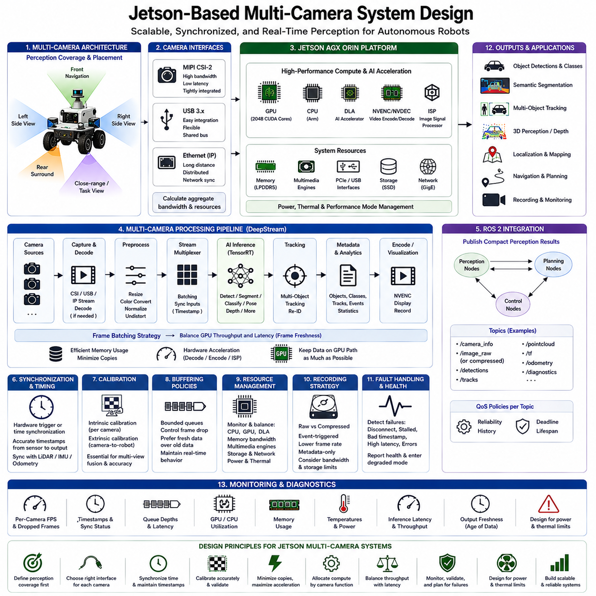{width="7.268055555555556in" height="7.268055555555556in"}

A Jetson-based multi-camera system is an embedded perception architecture in which several cameras operate concurrently while sharing the computing, memory, multimedia, and AI acceleration resources of a Jetson platform. The objective is not simply to connect multiple image sensors, but to create a coordinated pipeline that acquires, synchronizes, processes, and interprets visual information within predictable latency, bandwidth, power, and thermal limits.

Multi-camera architecture begins with defining the perception coverage required by the robot. Cameras may provide forward, rear, lateral, panoramic, close-range, or task-specific views, and each viewpoint creates different requirements for resolution, field of view, frame rate, exposure, and synchronization. Camera placement should therefore be determined by perception objectives and geometric coverage rather than by the number of interfaces available on the Jetson platform.

Camera interfaces strongly influence the system architecture. Jetson systems can integrate cameras through interfaces such as MIPI CSI-2, USB, or network-based connections depending on the hardware configuration and application. Each interface has different bandwidth, latency, cabling, synchronization, and driver characteristics. A scalable design must calculate the aggregate data rate rather than evaluating the bandwidth requirement of each camera independently.

CSI camera architectures can provide tightly integrated image acquisition through the Jetson camera subsystem and are useful when compact embedded connectivity and efficient image paths are required. USB cameras provide flexible peripheral integration but share host-controller and bus resources. Ethernet-based cameras can support longer cable distances and distributed placement, although network bandwidth, packet behavior, timestamping, and synchronization must become explicit parts of system design.

Image sensors frequently produce raw or partially processed data that passes through camera drivers and image-processing stages before AI inference. Depending on the sensor architecture, image signal processing may perform operations such as demosaicing, exposure-related processing, color conversion, noise reduction, and format generation. These stages consume resources and introduce latency, so the complete camera-to-AI path must be considered when estimating system performance.

Synchronization becomes increasingly important as the number of cameras grows. Independent cameras operating at similar frame rates do not necessarily capture the environment at the same physical instant. For applications involving multi-view geometry, depth reconstruction, visual localization, object association, or sensor fusion, hardware triggering or accurately coordinated timestamps may be required so that observations from different viewpoints can be interpreted as a consistent scene.

Timestamp integrity must be preserved after acquisition. A correctly synchronized camera system can still produce incorrect fusion results if timestamps are changed, delayed, or interpreted inconsistently as frames move through drivers, buffers, ROS 2 messages, or AI pipelines. The architecture should establish a clear time source and maintain traceable timing information from sensor exposure through perception output, particularly when cameras are combined with LiDAR, IMU, or odometry.

Memory bandwidth is one of the primary constraints in multi-camera processing. Several high-resolution streams can continuously generate large volumes of data, and resizing, color conversion, inference, visualization, and recording may cause the same frames to be read or copied repeatedly. Efficient systems minimize redundant memory movement and attempt to keep video data inside accelerated processing paths whenever possible rather than repeatedly transferring buffers between CPU and GPU processing stages.

Jetson hardware multimedia capabilities can reduce CPU load by accelerating suitable video operations. Hardware decoding becomes important when compressed network or recorded streams are used, while hardware encoding can support recording or remote monitoring without assigning the complete workload to CPU software. The design should use specialized hardware engines where appropriate so that CPU and GPU resources remain available for robotics and AI workloads.

DeepStream provides a practical framework for organizing multiple camera streams into accelerated video analytics pipelines. Camera sources can pass through decoding, preprocessing, stream multiplexing, TensorRT inference, tracking, metadata processing, and optional visualization or encoding. This allows several video streams to share GPU inference resources while maintaining a structured pipeline rather than requiring every camera to operate as an independent application.

Batching can improve inference efficiency by grouping frames from multiple cameras for TensorRT execution. However, waiting for a batch to become complete can introduce additional latency, particularly when cameras have different frame timing or when one stream is delayed. Multi-camera robotics therefore requires a balance between GPU throughput and frame freshness. Batch configuration should reflect real-time deadlines rather than simply maximizing the number of images processed per inference call.

Different cameras do not necessarily require identical AI models or processing rates. Forward navigation cameras may require high-frequency obstacle or semantic perception, while rear or peripheral cameras may tolerate lower inference rates. A manipulation camera may use a specialized pose-estimation model only during task execution. Assigning computation according to camera function can significantly reduce GPU load compared with executing every model on every frame from every camera.

Tracking can also reduce unnecessary inference workload when appropriate. Neural-network detections can be associated across successive frames, allowing temporal information to complement repeated detection. In multi-camera systems, tracking may occur independently within each stream or become part of a more complex cross-camera association architecture. The selected approach should reflect camera overlap, calibration quality, timing accuracy, and the requirements of downstream perception.

Geometric calibration is fundamental when information from multiple cameras must be combined spatially. Intrinsic calibration describes the optical characteristics of each camera, while extrinsic calibration defines the spatial relationship between cameras and the robot coordinate system. Calibration errors can cause inconsistent object positions, inaccurate projection, or poor sensor fusion even when neural-network inference itself is highly accurate.

ROS 2 can provide the integration layer between the multi-camera perception subsystem and the rest of the robot. Raw images, compressed streams, camera information, detections, tracks, and other perception outputs can be represented through ROS 2 interfaces. However, transmitting every full-resolution image between independent nodes can create significant serialization and memory overhead, so high-bandwidth processing should remain localized whenever practical.

A useful architecture is to perform acquisition, preprocessing, TensorRT inference, and tracking close to the accelerated camera pipeline, then publish compact perception results to other ROS 2 components. Instead of moving every image through the complete ROS graph, the system can distribute detections, semantic information, object states, or selected images when required. This preserves modularity while reducing communication traffic and memory copying.

Buffering policies strongly affect real-time behavior. Deep queues can prevent frame loss when temporary processing delays occur, but they can also accumulate old images and create perception outputs that no longer represent the robot\'s current environment. Autonomous systems often benefit from bounded queues and controlled frame dropping so that recent observations are prioritized when processing cannot keep pace with incoming camera data.

System designers should calculate resource requirements across the complete pipeline. Camera bandwidth, memory consumption, preprocessing cost, inference latency, tracker workload, CPU utilization, GPU utilization, multimedia-engine activity, storage bandwidth, and network traffic interact with one another. A configuration that works with two cameras cannot automatically be assumed to scale linearly to four, six, or eight cameras because shared-resource contention may become dominant.

Recording introduces another substantial resource requirement. Continuous storage of several high-resolution streams can consume large amounts of bandwidth and capacity while competing with perception workloads. Production robots should define whether they require raw video, compressed video, event-triggered recording, reduced frame rates, or metadata-only logging. Recording policy should be designed as part of the perception architecture rather than added after the system is completed.

Power and thermal constraints become more significant as camera count increases. Sensors, interface electronics, memory traffic, multimedia engines, CPU processing, and GPU inference all contribute to total system power and heat generation. Performance should therefore be measured after the Jetson and camera hardware reach thermal equilibrium, using the intended enclosure, cooling configuration, power mode, camera count, and concurrent robotic workloads.

Fault isolation is essential because one failed camera should not necessarily disable the entire perception system. The architecture should detect disconnected sources, stalled streams, invalid timestamps, corrupted frames, excessive latency, or failed inference paths. Camera health should be reported to higher-level software so that the robot can enter a degraded operating mode, change its behavior, or stop safely when required visual coverage is no longer available.

Monitoring should expose both system-level and per-camera information. Useful measurements include incoming frame rate, dropped frames, capture timestamps, queue depth, inference latency, GPU and CPU utilization, memory consumption, temperatures, and output freshness. Per-camera measurements are particularly important because aggregate throughput can appear normal even when one stream is delayed or repeatedly losing frames.

Validation should reproduce realistic worst-case operating conditions rather than testing cameras individually. All required cameras should operate simultaneously with TensorRT inference, DeepStream processing, ROS 2 communication, localization, navigation, recording, and other expected workloads. Long-duration testing can reveal memory pressure, thermal throttling, synchronization drift, queue accumulation, or intermittent failures that are difficult to observe during short functional tests.

A well-designed Jetson multi-camera architecture therefore combines camera interfaces, synchronization, calibration, accelerated multimedia processing, TensorRT inference, DeepStream orchestration, ROS 2 integration, efficient memory movement, monitoring, and fault management as one coordinated system. The engineering goal is predictable perception from multiple viewpoints while preserving data freshness, computational headroom, power efficiency, and reliability under sustained robotic operation.

The resulting platform can support increasingly sophisticated robotic perception without treating each additional camera as an isolated processing channel. By assigning workloads according to camera purpose, minimizing unnecessary copies, exploiting Jetson hardware acceleration, controlling buffering, and validating the complete sensor-to-decision path, the multi-camera system becomes a scalable perception foundation for autonomous navigation, mapping, monitoring, manipulation, and edge AI applications.

## 07.09 Jetson Thermal Management and Long-Run Reliability

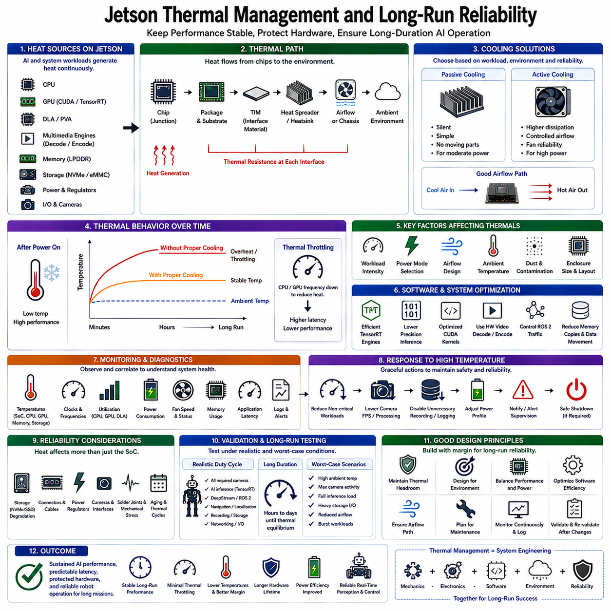{width="7.268055555555556in" height="7.268055555555556in"}

Thermal management is a fundamental part of Jetson system design because sustained AI workloads continuously generate heat across the CPU, GPU, memory subsystem, multimedia engines, storage, and power circuitry. In robotic platforms, the objective is not merely to prevent overheating but to maintain predictable computing performance throughout long missions while protecting hardware reliability and preserving real-time perception and control behavior.

Jetson thermal behavior must be evaluated as a dynamic interaction between workload, electrical power, cooling capacity, enclosure design, and ambient environment. TensorRT inference, CUDA kernels, DeepStream pipelines, ROS 2 processes, camera acquisition, and storage activity can operate simultaneously for hours. Their combined thermal load determines whether the system maintains its intended frequencies or gradually reaches conditions where performance must be reduced.

Heat generated inside the Jetson module must travel through several thermal paths before reaching the surrounding environment. Energy moves from semiconductor junctions through package materials, thermal interface materials, heat spreaders, heat sinks, and finally into airflow or the robot enclosure. Any excessive thermal resistance along this path can raise component temperatures even when the nominal cooling device appears sufficiently large.

The cooling architecture should therefore be designed around sustained thermal dissipation rather than short-duration peak performance. Passive heat sinks can provide simple and reliable cooling for moderate workloads, while active cooling adds fans or forced airflow when greater heat removal is required. The appropriate solution depends on expected power consumption, available enclosure volume, ambient temperature, contamination exposure, acoustic constraints, and reliability targets.

Airflow design is especially important inside compact robotic enclosures. A high-performance fan provides limited benefit if hot air recirculates around the Jetson module or if cables and neighboring components obstruct the intended flow path. Cooling design should establish a controlled route for cool air to reach heat-generating components and for heated air to leave the enclosure without repeatedly passing through the same thermal region.

Thermal interface materials play an important role because microscopic gaps between surfaces can create substantial thermal resistance. Properly selected pads, compounds, or interface layers improve heat transfer between the Jetson assembly and its cooling structure. Mechanical pressure, material thickness, surface flatness, aging, and assembly tolerances should be controlled because inconsistent installation can produce significant temperature differences between nominally identical robots.

Ambient temperature must be included in the thermal budget. A system validated in an air-conditioned laboratory may behave differently inside a warehouse, outdoor enclosure, vehicle compartment, or robot exposed to direct environmental heating. As ambient temperature rises, the temperature difference available for transferring heat away from the electronics decreases, reducing cooling margin and increasing the probability of thermal performance limitation.

Thermal throttling is a protective mechanism that reduces operating performance when component temperatures approach defined limits. CPU or GPU frequencies may decrease to reduce heat generation, which protects the hardware but can increase application latency. In autonomous robots, this behavior can become a system-level problem because slower inference or processing may cause perception, localization, mapping, or planning pipelines to miss their intended timing requirements.

Short benchmarks can therefore provide misleading conclusions about system capability. A Jetson platform may initially execute AI inference at high speed while the heat sink and enclosure remain relatively cool. After tens of minutes or several hours, temperatures may stabilize at a higher level and frequencies may change. Long-run evaluation should focus on performance after thermal equilibrium rather than reporting only the best measurements obtained immediately after startup.

Workload composition strongly influences thermal behavior. A GPU-intensive neural network produces a different resource profile from a pipeline that simultaneously uses CPU processing, GPU inference, hardware decoding, encoding, memory bandwidth, and NVMe storage. Multi-camera robotic systems often activate several of these resources together, so thermal validation should reproduce the complete application rather than relying on isolated GPU stress tests.

Power mode selection and thermal management should be designed together. Operating Jetson at the highest available performance mode may provide additional computational headroom, but it also increases the thermal load that the cooling system must dissipate. If the application already satisfies its latency requirements at a lower power profile, reducing unnecessary power can lower temperatures, improve thermal margin, reduce fan demand, and potentially improve long-duration stability.

Software optimization is therefore also a thermal optimization technique. Efficient TensorRT engines, reduced precision inference, optimized CUDA kernels, hardware video processing, controlled ROS 2 message traffic, and minimized memory copying can reduce the amount of energy required to complete useful work. Improving performance per watt can be more effective than increasing cooling capacity while leaving inefficient software continuously consuming unnecessary computational resources.

Fan control requires a balance between temperature regulation and mechanical reliability. Higher fan speeds can improve cooling but increase noise, electrical consumption, dust movement, and bearing wear. A controlled fan strategy can adjust airflow according to thermal conditions instead of operating continuously at maximum speed. However, control policies should react early enough to prevent large temperature excursions during rapidly increasing computational workloads.

Robotic environments introduce contamination challenges that are less significant on laboratory development benches. Dust, fibers, oil mist, and other particles can accumulate on heat sinks, filters, vents, and fan blades, gradually reducing airflow and heat-transfer efficiency. Thermal design should therefore consider how cooling performance changes after months of operation rather than assuming that the system permanently retains its clean, newly assembled condition.

Long-run reliability extends beyond semiconductor temperature. Continuous heat can affect storage devices, connectors, power converters, cables, camera interfaces, and surrounding electronics. Repeated heating and cooling cycles also create mechanical expansion and contraction that may stress solder joints and interfaces over time. A reliable Jetson design should consequently evaluate the thermal environment of the complete computing assembly rather than monitoring only GPU temperature.

NVMe storage deserves particular attention in data-intensive robots because continuous logging, video recording, mapping, and dataset collection can generate substantial storage activity and heat. Storage performance may degrade if the device reaches its own thermal limits. The SSD should therefore receive appropriate airflow or thermal coupling, and logging policies should avoid unnecessary writes that increase both thermal load and storage wear.

Temperature monitoring should be integrated with system diagnostics. Developers should observe relevant thermal sensors together with CPU and GPU frequencies, utilization, power state, memory usage, fan behavior, and application latency. Correlating these measurements makes it possible to determine whether increasing perception latency originates from computational load, resource contention, thermal throttling, or another system condition.

Monitoring becomes more useful when temperature trends are analyzed over time rather than compared only with a single maximum threshold. A gradually increasing steady-state temperature can indicate deteriorating airflow, contamination, fan degradation, changes in workload, or higher environmental temperature. Long-term operational logs can therefore support preventive maintenance and reveal thermal problems before they develop into visible system failures.

The software architecture should define responses to abnormal thermal conditions. When temperature rises beyond the normal operating region, the system may reduce noncritical AI workloads, lower camera processing rates, disable unnecessary recording, change the Jetson power profile, or notify higher-level supervision. If thermal conditions continue to deteriorate, the robot may need to enter a degraded operating state or perform a controlled safe shutdown.

Fault detection should distinguish between temporary thermal excursions and persistent cooling-system problems. A short increase during a demanding perception task may be acceptable, while sustained abnormal temperatures or a failed cooling fan require stronger intervention. Diagnostic logic should therefore combine temperature, duration, workload, fan status, and performance information instead of treating every temperature increase as an identical fault condition.

Long-duration validation should reproduce the expected operational duty cycle of the robot. Tests should include representative AI models, camera counts, ROS 2 nodes, networking, navigation, recording, storage activity, and environmental conditions. Running the system for extended periods allows engineers to identify thermal equilibrium, frequency changes, memory growth, intermittent device failures, and performance degradation that short functional tests cannot reveal.

Worst-case testing should also consider conditions beyond the nominal mission profile. High ambient temperature, maximum camera activity, simultaneous inference workloads, intensive storage use, reduced airflow, and temporary computational bursts may occur together. The objective is not necessarily to operate indefinitely under every extreme condition, but to verify that the system detects reduced margin and responds predictably before timing or hardware safety requirements are violated.

Reliability engineering should preserve thermal headroom rather than designing the platform to remain continuously near its maximum allowable temperature. Margin accommodates manufacturing variation, aging, contamination, environmental changes, and future software updates that may increase computational demand. A design that operates comfortably within its thermal envelope is generally easier to maintain and more tolerant of unexpected real-world conditions.

Production systems should document the validated relationship between Jetson power mode, cooling configuration, workload, ambient temperature, and sustained application performance. This configuration becomes part of the deployment baseline alongside JetPack, TensorRT engines, ROS 2 software, and application versions. Hardware or software changes that alter power consumption should trigger renewed thermal validation rather than being assumed to preserve previous reliability.

Jetson thermal management and long-run reliability are therefore system-level engineering disciplines connecting mechanical cooling, electrical power, software efficiency, workload scheduling, environmental conditions, diagnostics, and fault response. A successful design maintains predictable perception and AI performance after thermal equilibrium while retaining sufficient margin for environmental variation, component aging, workload peaks, and extended autonomous operation.

The final objective is sustained edge intelligence rather than temporary benchmark performance. By combining efficient software, appropriate power profiles, controlled heat-transfer paths, adequate airflow, continuous monitoring, graceful degradation, and long-duration validation, a Jetson-based robot can maintain dependable computing behavior across real missions while reducing thermal throttling, unexpected downtime, and premature hardware degradation.

## 07.10 Edge AI Compute Comparison: Jetson vs Hailo vs Intel NCS2

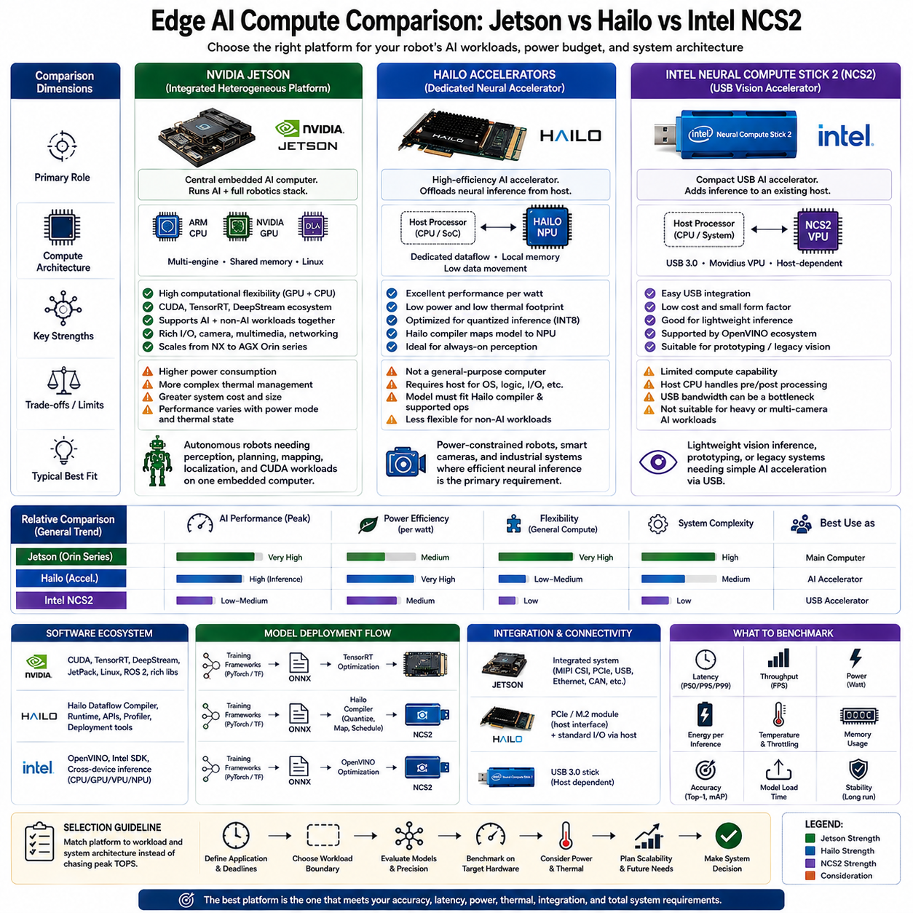{width="7.268055555555556in" height="7.268055555555556in"}

Edge AI compute platforms should be compared according to the role they perform inside an embedded system rather than by accelerator throughput alone. NVIDIA Jetson, Hailo accelerators, and Intel Neural Compute Stick 2 represent different architectural approaches: Jetson is an integrated heterogeneous computing platform, Hailo emphasizes dedicated low-power neural inference, and NCS2 represents a compact USB-attached vision accelerator.

NVIDIA Jetson combines general-purpose ARM CPUs with NVIDIA GPU acceleration and a broad embedded software environment. The platform can execute CUDA kernels, TensorRT inference, multimedia processing, ROS 2 applications, sensor interfaces, and conventional Linux software on the same computing system. This makes Jetson suitable when edge intelligence requires more than neural inference and must coordinate perception, localization, mapping, planning, and application logic.

The major advantage of Jetson is computational flexibility. GPU resources can execute many parallel algorithms beyond neural networks, including image processing, point-cloud operations, geometric transformations, mapping, and custom CUDA workloads. TensorRT provides optimized neural inference, while DeepStream supports camera-centered AI pipelines. This flexibility allows Jetson to serve as the primary computer of an autonomous robot rather than functioning only as an inference coprocessor.

That flexibility also introduces higher system complexity and power requirements. CPU, GPU, memory, storage, camera pipelines, and other resources share the Jetson power and thermal envelope. Applications must therefore manage power modes, cooling, memory bandwidth, software scheduling, and sustained utilization carefully. A high theoretical AI capability is useful only when the deployed system can maintain required latency after reaching realistic thermal and workload conditions.

Hailo follows a more specialized accelerator-oriented approach. Its neural processing architecture is designed around efficient dataflow execution, local memory utilization, parallel processing elements, and reduced data movement. Instead of acting as a complete general-purpose robot computer, a Hailo device commonly operates as an AI accelerator connected to a host processor that remains responsible for operating-system services, application logic, sensor coordination, and other workloads.

This specialization gives Hailo an important advantage in performance per watt. Neural-network workloads can be compiled and mapped to the accelerator using the Hailo software stack, with optimization focused on efficient inference execution. For robots, smart cameras, industrial systems, and other power-constrained devices, this approach can provide high inference throughput while consuming substantially less electrical and thermal budget than a more general-purpose GPU computing platform.

The tradeoff is that Hailo does not replace every function provided by Jetson. CUDA-style general-purpose GPU processing, arbitrary robotics computation, large software workloads, and complete system orchestration still require suitable host computing resources. The architecture therefore becomes a division of responsibilities: the host performs general computing while the Hailo accelerator executes supported neural-network inference efficiently. This can be advantageous when the workload boundary is clearly defined.

Model deployment on Hailo also requires an accelerator-specific preparation process. A trained model is exported into an appropriate intermediate representation and processed by Hailo compilation tools, which optimize, quantize, map, schedule, and generate a hardware-executable model representation. The resulting deployment path can provide highly efficient execution, but model compatibility and supported operations must be considered during development rather than assumed after training.

Intel Neural Compute Stick 2 represents another accelerator model but with a different scale and integration philosophy. NCS2 is based on Intel Movidius vision-processing technology and connects through USB, allowing neural-network acceleration to be added to an existing host without redesigning the complete computing platform. Its compact form and straightforward physical integration historically made it useful for prototyping and lightweight edge vision applications.

NCS2 depends on a host system because it is not an independent general-purpose computing platform. Camera acquisition, preprocessing, application logic, communication, robotics middleware, and other software remain on the host CPU, while suitable inference operations are transferred to the accelerator. Consequently, total application performance depends not only on the accelerator but also on USB communication, host processing, memory movement, preprocessing, and postprocessing.

Intel's broader edge AI software strategy uses OpenVINO to optimize and execute neural networks across supported Intel hardware. OpenVINO provides hardware-aware inference capabilities for CPUs, integrated GPUs, VPUs, NPUs, and other supported devices, enabling applications to use an inference-oriented runtime rather than remaining tied to the original training framework. NCS2 should therefore be understood within this wider Intel inference ecosystem rather than as an isolated neural accelerator.

The three approaches become clearer when viewed through system responsibility. Jetson can act as the central embedded AI computer, Hailo commonly serves as a high-efficiency neural accelerator beside a host, and NCS2 provides a compact USB-connected inference accelerator for compatible workloads. The correct comparison is therefore not simply GPU versus NPU versus VPU, but integrated compute platform versus dedicated accelerator versus lightweight external accelerator.

Power efficiency can favor dedicated accelerators when the workload consists primarily of supported neural inference. Hailo is specifically designed around low-power dataflow execution and can be attractive for always-on perception where electrical and thermal budgets are restrictive. Jetson generally consumes more power because it provides broader computing capability, while NCS2 targets a smaller acceleration envelope suitable for less demanding inference scenarios.

Performance comparisons must nevertheless avoid relying on nominal operations-per-second figures alone. Different vendors calculate accelerator capability under different precisions, sparsity assumptions, workloads, and execution conditions. A meaningful benchmark should use the same neural model, input resolution, precision target, preprocessing, postprocessing, batch configuration, and accuracy requirement while measuring actual latency, throughput, power consumption, and sustained thermal behavior on each target system.

Latency and throughput must also be evaluated separately. An accelerator may achieve high aggregate inference throughput while introducing buffering or batching delay that is undesirable for robotics. Conversely, a lower-throughput device may satisfy the deadline of a lightweight detector with much lower power consumption. Edge AI selection should therefore begin with the application\'s sensor-to-decision deadline rather than attempting to maximize a single hardware benchmark score.

Model compatibility is another critical differentiator. Jetson benefits from the CUDA and TensorRT ecosystem and supports a broad range of GPU-oriented AI workflows. Hailo requires models to fit its compiler and accelerator execution model, while Intel devices rely on supported OpenVINO execution paths. Unsupported operators, unusual architectures, dynamic behavior, or custom processing can significantly affect deployment effort even when theoretical accelerator performance appears sufficient.

Precision support also influences practical performance. INT8 quantization is particularly important for dedicated edge accelerators because lower precision can substantially improve computational and energy efficiency. Jetson can support multiple precision modes through TensorRT depending on hardware and model characteristics, while Hailo emphasizes optimized quantized inference. Accuracy must always be validated after conversion because identical numerical precision does not guarantee identical model behavior across platforms.

Multi-model robotics workloads expose another important architectural difference. A robot may simultaneously execute object detection, segmentation, pose estimation, depth processing, localization, and planning. Jetson can distribute diverse workloads across its heterogeneous computing resources, whereas a dedicated accelerator is strongest when supported neural operations dominate. The host-plus-accelerator architecture must therefore be evaluated as a complete system rather than measuring the AI accelerator independently.

Software ecosystem maturity affects engineering cost as much as raw inference performance. Jetson integrates CUDA, TensorRT, DeepStream, Linux, multimedia acceleration, and robotics software into a broad development environment. Hailo provides its compiler, runtime, APIs, profiling, and deployment tools around its NPU architecture. Intel provides OpenVINO for hardware-aware inference across its supported computing devices. Each ecosystem creates different development, debugging, optimization, and maintenance requirements.

Physical integration also matters. Jetson modules can become the central compute subsystem and therefore require appropriate carrier boards, cooling, power delivery, storage, and I/O design. Hailo accelerators can be integrated through module-oriented interfaces such as PCIe-based configurations depending on the product. NCS2 uses USB connectivity, simplifying attachment but making USB bandwidth, connectors, mechanical retention, and host dependency part of deployment reliability.

Scalability should be considered from both computing and product perspectives. A prototype requiring one lightweight model may operate effectively with a small accelerator, while a future robot may add multiple cameras, larger networks, mapping, multimodal perception, or more sophisticated autonomy. Selecting hardware solely for the initial model can create an early architectural ceiling, whereas excessive compute capability can unnecessarily increase cost, power consumption, and thermal design complexity.

Benchmarking should therefore use representative robotic scenarios. Useful measurements include P50, P95, and P99 inference latency, throughput, power consumption, energy per inference, peak memory usage, accelerator and CPU utilization, temperature, throttling behavior, model loading time, stability, and task accuracy. Testing should continue long enough to reveal sustained behavior rather than reporting only short-duration peak performance.

For complex autonomous robots, Jetson is generally architecturally attractive when one embedded computer must perform AI inference together with GPU processing, camera pipelines, ROS 2, localization, mapping, and planning. Hailo becomes attractive when efficient neural inference is the dominant requirement and a host processor already provides the remaining system functions. NCS2 is better understood as a compact accelerator option for comparatively lightweight or legacy vision-inference architectures.

These platforms should consequently be selected by matching architecture to workload rather than declaring one universally superior. Jetson emphasizes flexibility and integrated heterogeneous computing, Hailo emphasizes specialized neural inference and performance per watt, and NCS2 emphasizes compact host-attached acceleration within the Intel vision inference ecosystem. The best platform is the one whose computational role, software stack, power envelope, model compatibility, and integration requirements match the complete edge system.

The final engineering decision should be based on target-hardware validation using identical application conditions wherever possible. Neural accuracy, end-to-end latency, sustained throughput, electrical power, temperature, host overhead, software complexity, physical integration, and future scalability should be measured together. Edge AI computing is ultimately a system-design problem in which the accelerator is only one component of a complete sensor-to-intelligence-to-action architecture.
