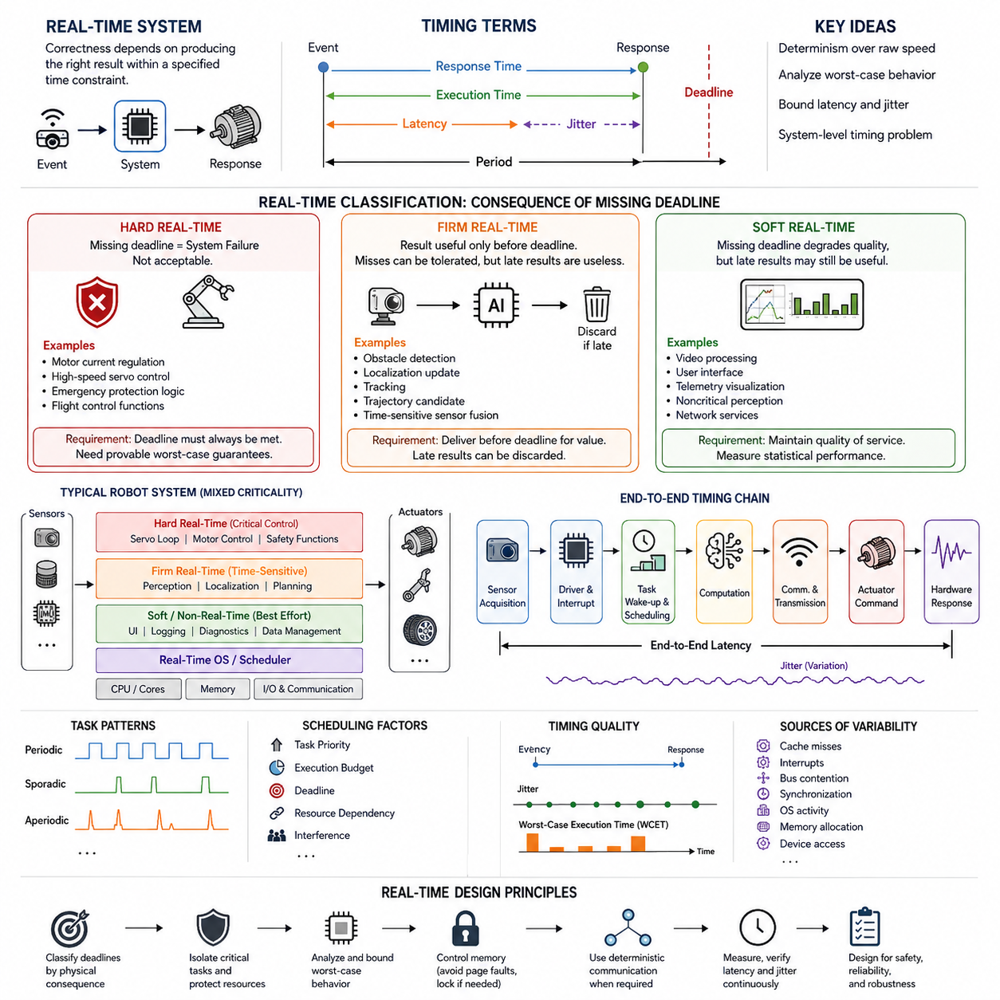
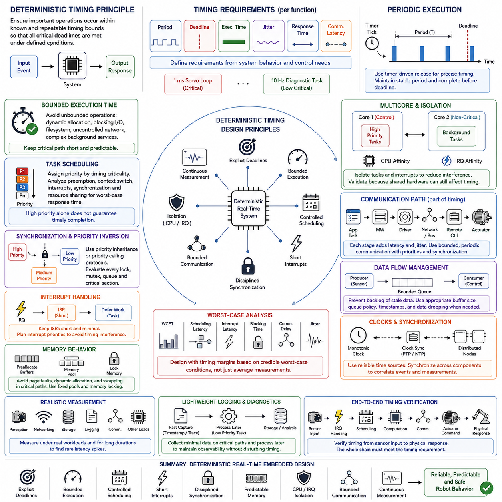
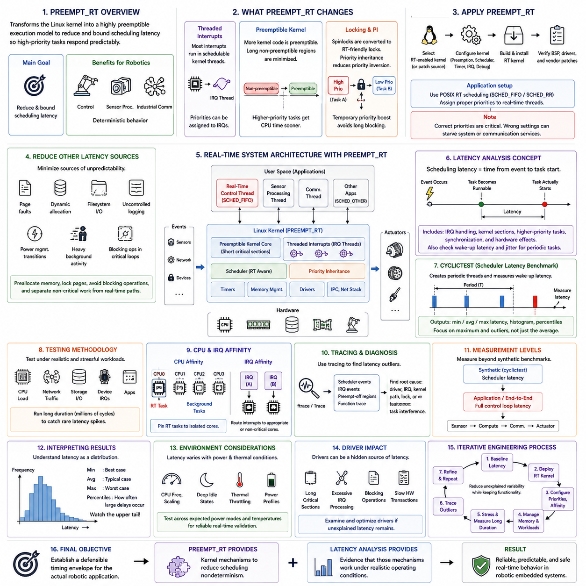
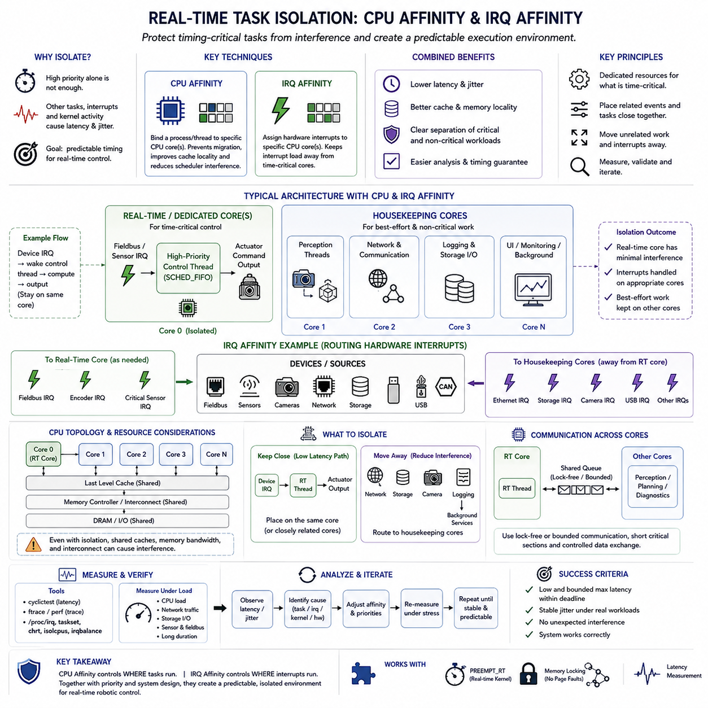
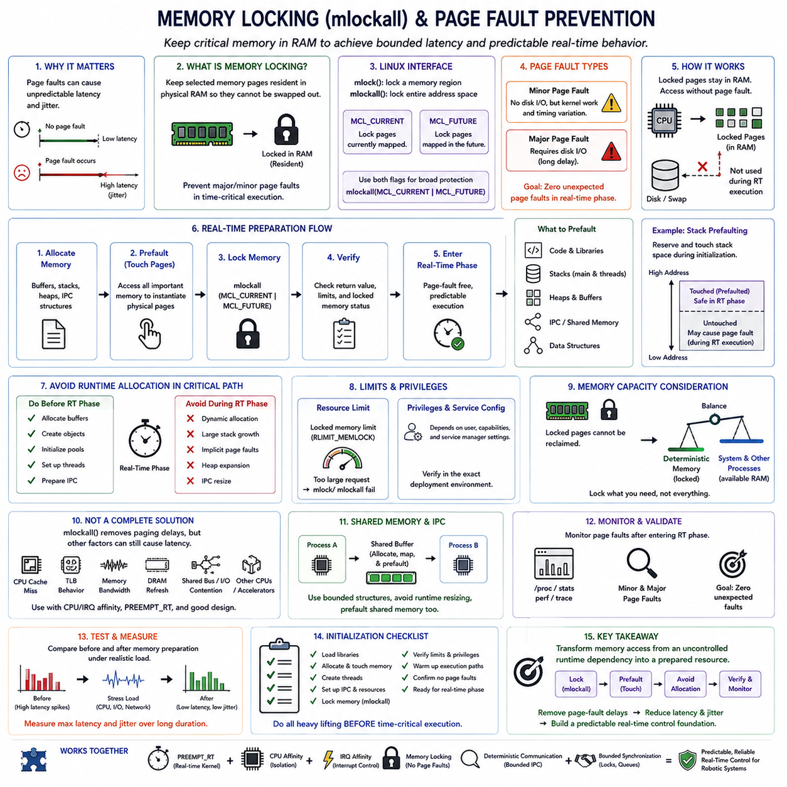
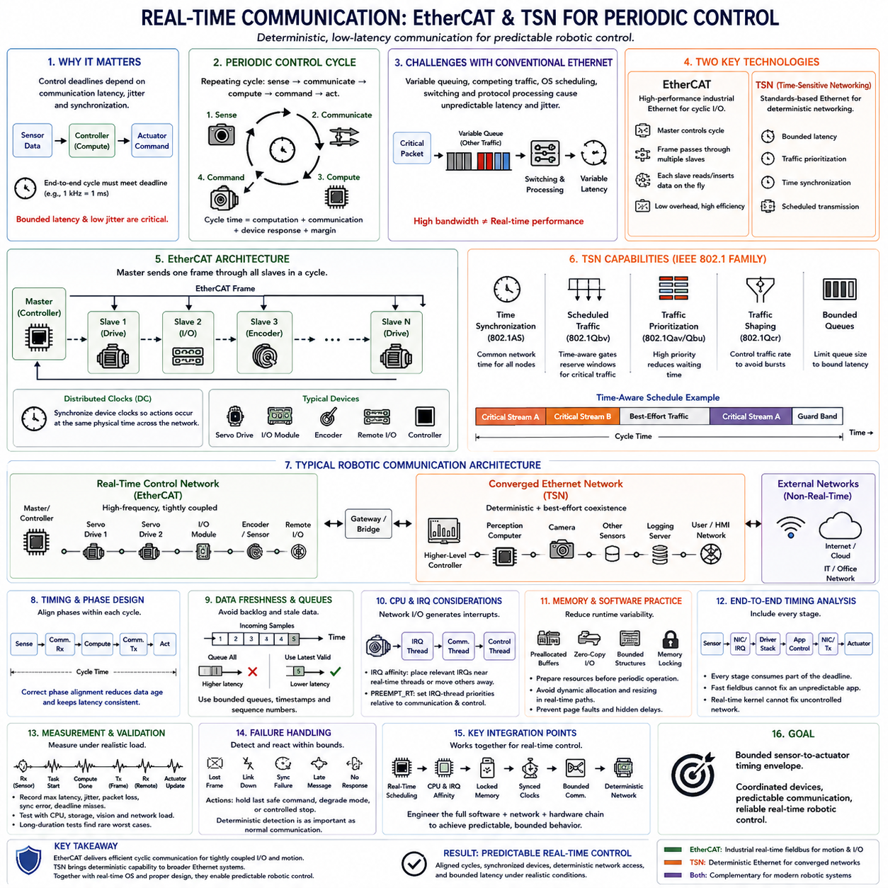
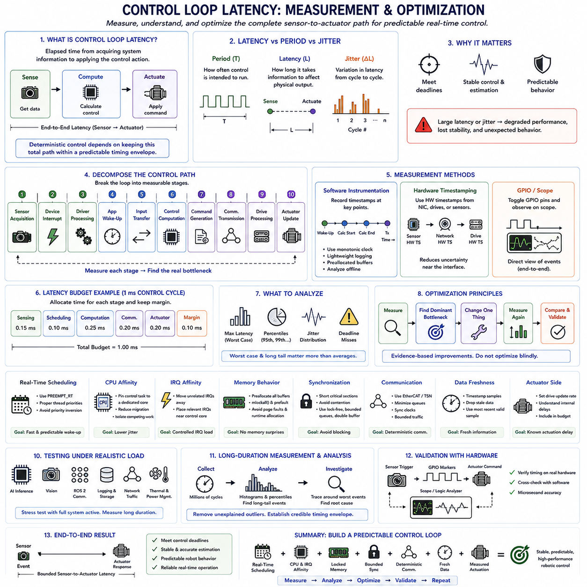
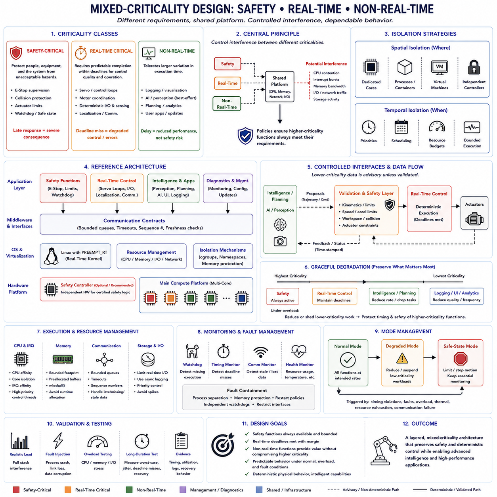
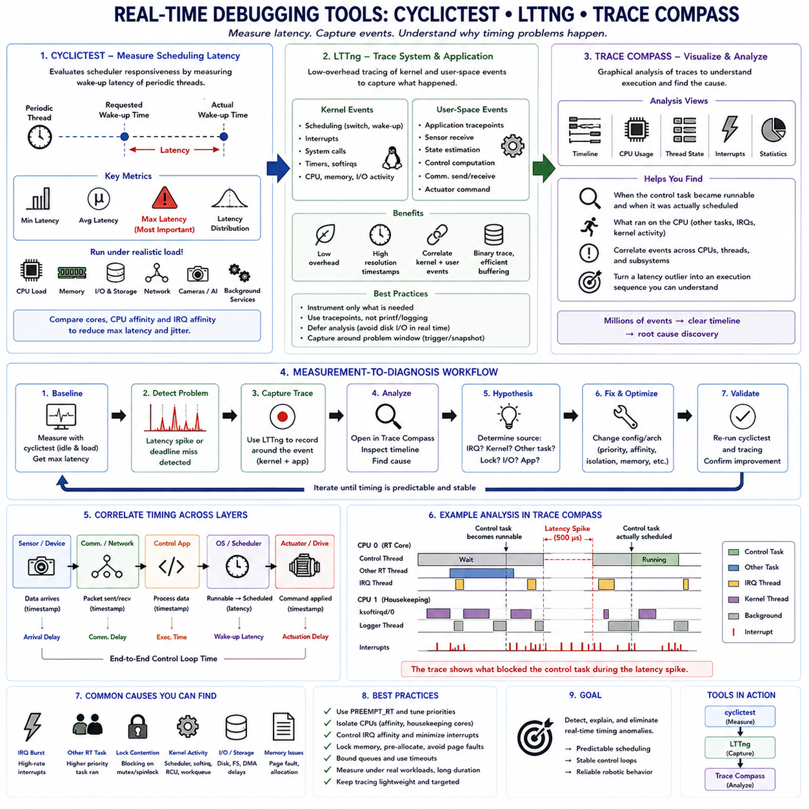
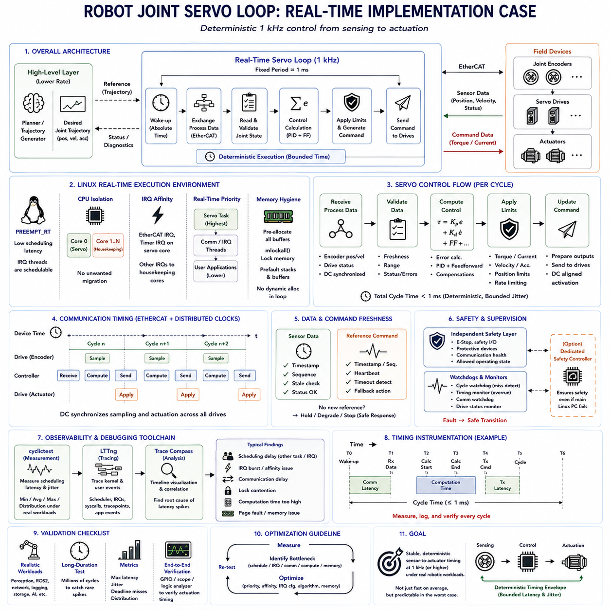

**Volume 02 Embedded Software Engineering**


# 08. Real-Time Embedded Design

##  

## 08.01 Real-Time System Definitions: Hard, Soft, Firm

{width="7.268055555555556in" height="7.268055555555556in"}

Real-time systems are computing systems in which correctness depends not only on producing the logically correct result but also on producing that result within a specified time constraint. In embedded robotics, this distinction is fundamental because software interacts directly with motors, sensors, communication buses, safety devices, and physical environments. A calculation that is mathematically correct but delivered too late can therefore be operationally incorrect.

A real-time requirement is normally expressed through timing constraints associated with an event, task, or control cycle. When an input event occurs, the system must detect it, execute the required computation, and produce an output before an associated deadline. Important quantities include response time, execution time, period, deadline, latency, and jitter. Real-time engineering focuses on bounding these quantities rather than simply maximizing average computational performance.

Determinism is consequently more important than raw speed in many real-time embedded systems. A processor that normally completes a control task in 100 microseconds but occasionally requires several milliseconds may be less suitable than a slower processor whose execution time remains predictably bounded. Robot controllers therefore require analysis of worst-case behavior, including scheduling delays, interrupt latency, memory access, communication delays, and interference from other software components.

A hard real-time system is one in which missing a specified deadline is considered a system failure. The deadline represents a strict correctness condition rather than a performance preference. Such requirements commonly appear where delayed computation can produce unsafe physical behavior, loss of control, or violation of a critical protection function. Motor current regulation, high-speed servo control, emergency protection logic, and some flight-control functions can therefore require hard real-time guarantees.

Hard real-time design requires engineers to establish credible upper bounds on execution and response times. Scheduling policies, interrupt architecture, memory behavior, synchronization mechanisms, communication paths, and operating-system services must all be evaluated for their worst-case effects. Dynamic behavior that introduces unpredictable latency is often restricted. The objective is not zero latency, which is physically impossible, but bounded latency that remains below every critical deadline under defined operating conditions.

A soft real-time system has timing requirements, but an occasional deadline miss does not make the entire system incorrect or unsafe. Instead, late results usually reduce service quality, responsiveness, smoothness, or user experience. Video processing, graphical interfaces, telemetry visualization, noncritical perception pipelines, and some network services often operate under soft real-time constraints. Their performance remains timing-sensitive even though isolated delays can normally be tolerated.

Soft real-time does not mean that timing is unimportant. A perception pipeline that repeatedly delivers camera frames too late may cause navigation quality to deteriorate even if no individual deadline miss immediately causes failure. Engineers therefore measure latency distributions, frame rates, jitter, queue depth, dropped data, and processing throughput. Statistical performance can be meaningful here because occasional outliers may be acceptable within a defined quality-of-service envelope.

Firm real-time systems occupy an important middle category. A result has useful value only when it arrives before its deadline, but occasional deadline misses can be tolerated without causing catastrophic system failure. Once the deadline has passed, completing the computation may provide little or no benefit, so the obsolete result can often be discarded. This behavior distinguishes firm real-time processing from many soft real-time workloads, where delayed output may still retain partial usefulness.

Robot perception provides useful examples of firm timing behavior. Suppose an obstacle-detection result corresponds to a sensor observation captured significantly earlier. If the robot has already moved and newer observations are available, finishing the old inference may be less useful than dropping it and processing current information. Similar reasoning applies to localization updates, tracking results, trajectory candidates, and time-sensitive sensor fusion when stale outputs should not propagate into downstream decisions.

The difference among hard, firm, and soft real-time systems is therefore primarily determined by the consequence of missing a deadline. In hard real-time operation, a missed deadline constitutes unacceptable failure. In firm real-time operation, occasional misses are tolerable, but late results lose their usefulness. In soft real-time operation, late results may still be useful, although system quality degrades as timing violations become more frequent or severe.

These categories should be assigned to individual functions rather than casually applied to an entire robot. A modern autonomous robot is typically a mixed system containing several timing classes simultaneously. A servo loop may have hard timing constraints, obstacle perception may behave as firm real-time processing, and diagnostic logging may have soft or even non-real-time requirements. System architecture must preserve these distinctions so that low-criticality workloads cannot disrupt time-critical execution.

Periodicity also influences real-time behavior. Periodic tasks execute at regular intervals, such as a motor-control loop running every millisecond. Sporadic tasks occur irregularly but have a known minimum separation, while aperiodic tasks may arrive without such predictable timing. Real-time scheduling must account for these activation patterns together with task priorities, execution budgets, deadlines, resource dependencies, and interference among concurrently executing functions.

Latency describes the elapsed time between an initiating event and the corresponding system response, while jitter describes variation in timing from one execution to another. Both matter in physical control. Even when every control cycle technically satisfies its deadline, excessive jitter can disturb sampling regularity and actuator timing. This can degrade control stability or estimation quality, making temporal consistency an engineering property that must be measured alongside average response time.

Worst-case execution time is particularly important for hard real-time analysis because average execution time cannot prove that every deadline will be satisfied. Cache misses, interrupts, bus contention, synchronization, operating-system activity, memory allocation, and device access can create rare but significant delays. Engineers must identify these sources of nondeterminism and either bound them, isolate them, eliminate them, or include sufficient timing margin in the system design.

Real-time behavior also depends on the complete execution chain rather than on application code alone. Sensor acquisition, device drivers, interrupt handling, task wake-up, scheduling, computation, inter-process communication, network transmission, actuator commands, and hardware response all contribute to end-to-end latency. Optimizing one component cannot guarantee a deadline if another layer introduces unpredictable delay. Real-time design must therefore be approached as a system-level timing problem.

In robotics, the classification of deadlines should ultimately follow physical consequences. Engineers should ask what happens if a result is delivered late, whether the result remains useful, how frequently lateness can be tolerated, and whether timing failure can create hazardous behavior. These questions transform hard, firm, and soft real-time from abstract definitions into practical architectural decisions governing scheduling, isolation, communication, validation, and safety mechanisms.

A well-designed real-time embedded robot consequently combines deterministic execution for critical control with appropriately flexible computation for less critical workloads. Hard real-time functions receive protected resources and rigorously bounded timing, firm functions prioritize freshness and may discard obsolete work, and soft functions optimize responsiveness without requiring absolute guarantees. This layered approach provides the foundation for the deterministic timing, task isolation, memory control, real-time communication, and servo-loop implementation topics that follow in real-time embedded design.

실시간 시스템(Real-Time System)은 논리적으로 올바른 결과를 생성하는 것뿐만 아니라, 지정된 시간 제약(Time Constraint) 안에 그 결과를 생성해야 정확성이 성립하는 컴퓨팅 시스템(Computing System)이다. 임베디드 로보틱스(Embedded Robotics)에서는 소프트웨어가 모터, 센서, 통신 버스(Communication Bus), 안전 장치, 물리적 환경과 직접 상호작용하기 때문에 이러한 구분이 매우 중요하다. 따라서 수학적으로 정확한 계산이라도 너무 늦게 전달되면 운영 관점에서는 잘못된 결과가 될 수 있다.

실시간 요구사항(Real-Time Requirement)은 일반적으로 이벤트(Event), 태스크(Task), 제어 주기(Control Cycle)와 연관된 타이밍 제약(Timing Constraint)으로 표현된다. 입력 이벤트가 발생하면 시스템은 이를 감지하고 필요한 계산을 수행한 뒤 관련 마감시간(Deadline) 이전에 출력을 생성해야 한다. 중요한 요소에는 응답 시간(Response Time), 실행 시간(Execution Time), 주기(Period), 마감시간(Deadline), 지연시간(Latency), 지터(Jitter)가 포함된다. 실시간 공학(Real-Time Engineering)은 단순히 평균 계산 성능을 높이는 것이 아니라 이러한 값들의 상한을 제한하는 데 초점을 둔다.

따라서 많은 실시간 임베디드 시스템(Real-Time Embedded System)에서는 단순한 처리 속도보다 결정성(Determinism)이 더욱 중요하다. 일반적으로 제어 태스크를 100마이크로초 안에 완료하지만 간혹 수 밀리초가 필요한 프로세서는, 조금 느리더라도 실행 시간이 예측 가능한 범위 안에서 유지되는 프로세서보다 적합하지 않을 수 있다. 따라서 로봇 제어기(Robot Controller)는 스케줄링 지연(Scheduling Delay), 인터럽트 지연(Interrupt Latency), 메모리 접근(Memory Access), 통신 지연(Communication Delay), 다른 소프트웨어 구성요소의 간섭 등을 포함한 최악 조건의 동작을 분석해야 한다.

하드 실시간 시스템(Hard Real-Time System)은 지정된 마감시간(Deadline)을 놓치는 것이 시스템 실패(System Failure)로 간주되는 시스템이다. 여기서 마감시간은 단순한 성능 목표가 아니라 엄격한 정확성 조건(Correctness Condition)을 의미한다. 계산 지연으로 인해 위험한 물리적 동작, 제어 상실, 핵심 보호 기능의 위반이 발생할 수 있는 영역에서 이러한 요구사항이 적용된다. 모터 전류 제어(Motor Current Regulation), 고속 서보 제어(High-Speed Servo Control), 비상 보호 로직(Emergency Protection Logic), 일부 비행 제어(Flight Control) 기능에는 하드 실시간 보장(Hard Real-Time Guarantee)이 요구될 수 있다.

하드 실시간 설계(Hard Real-Time Design)에서는 실행 시간과 응답 시간에 대해 신뢰할 수 있는 상한을 설정해야 한다. 스케줄링 정책(Scheduling Policy), 인터럽트 아키텍처(Interrupt Architecture), 메모리 동작(Memory Behavior), 동기화 메커니즘(Synchronization Mechanism), 통신 경로(Communication Path), 운영체제 서비스(Operating System Service)가 최악 조건에서 어떤 영향을 미치는지 평가해야 한다. 예측할 수 없는 지연을 발생시키는 동적 동작은 일반적으로 제한된다. 목표는 물리적으로 불가능한 제로 지연(Zero Latency)이 아니라, 정의된 운용 조건에서 모든 핵심 마감시간보다 짧게 유지되는 제한된 지연(Bounded Latency)을 확보하는 것이다.

소프트 실시간 시스템(Soft Real-Time System)에도 타이밍 요구사항(Timing Requirement)이 존재하지만, 간헐적인 마감시간 초과(Deadline Miss)가 전체 시스템을 잘못되거나 위험한 상태로 만들지는 않는다. 대신 늦은 결과는 일반적으로 서비스 품질(Quality of Service), 응답성(Responsiveness), 동작의 부드러움(Smoothness), 사용자 경험(User Experience)을 저하시킨다. 영상 처리(Video Processing), 그래픽 사용자 인터페이스(Graphical User Interface), 텔레메트리 시각화(Telemetry Visualization), 비핵심 인지 파이프라인(Noncritical Perception Pipeline), 일부 네트워크 서비스(Network Service)는 소프트 실시간 제약(Soft Real-Time Constraint)으로 동작하는 경우가 많다.

소프트 실시간(Soft Real-Time)은 타이밍이 중요하지 않다는 의미가 아니다. 인지 파이프라인(Perception Pipeline)이 카메라 프레임(Camera Frame)을 반복적으로 너무 늦게 전달하면 개별적인 마감시간 초과가 즉시 시스템 실패를 일으키지 않더라도 내비게이션 품질(Navigation Quality)이 저하될 수 있다. 따라서 엔지니어는 지연시간 분포(Latency Distribution), 프레임률(Frame Rate), 지터(Jitter), 큐 깊이(Queue Depth), 데이터 손실(Dropped Data), 처리량(Throughput)을 측정한다. 일정한 서비스 품질 범위(Quality-of-Service Envelope) 안에서 일부 이상값(Outlier)을 허용할 수 있기 때문에 통계적 성능 평가도 의미를 갖는다.

펌 실시간 시스템(Firm Real-Time System)은 하드 실시간과 소프트 실시간 사이의 중요한 중간 범주에 해당한다. 결과는 마감시간 이전에 도착할 때만 유용한 가치를 가지지만, 간헐적인 마감시간 초과는 치명적인 시스템 실패 없이 허용될 수 있다. 마감시간이 지나면 계산을 완료하더라도 결과의 가치가 거의 없거나 완전히 사라질 수 있으므로 오래된 결과는 폐기할 수 있다. 이러한 특성은 지연된 출력도 일부 가치를 유지할 수 있는 많은 소프트 실시간 워크로드(Soft Real-Time Workload)와 펌 실시간 처리를 구분한다.

로봇 인지(Robot Perception)는 펌 실시간 타이밍(Firm Real-Time Timing)을 설명하는 좋은 사례다. 장애물 감지 결과(Obstacle-Detection Result)가 상당히 이전에 획득된 센서 관측값(Sensor Observation)에 대응한다고 가정해 보자. 로봇이 이미 이동했고 새로운 관측 데이터가 존재한다면 오래된 추론(Inference)을 끝까지 수행하는 것보다 해당 작업을 폐기하고 최신 정보를 처리하는 것이 더 유용할 수 있다. 위치 추정 업데이트(Localization Update), 추적 결과(Tracking Result), 궤적 후보(Trajectory Candidate), 시간에 민감한 센서 융합(Sensor Fusion)에서도 오래된 결과가 후속 의사결정으로 전달되지 않아야 한다면 동일한 원리가 적용된다.

따라서 하드 실시간(Hard Real-Time), 펌 실시간(Firm Real-Time), 소프트 실시간(Soft Real-Time)의 차이는 주로 마감시간을 놓쳤을 때 발생하는 결과에 의해 결정된다. 하드 실시간에서는 마감시간 초과가 허용할 수 없는 실패를 의미한다. 펌 실시간에서는 간헐적인 초과가 허용되지만 늦은 결과는 유용성을 잃는다. 소프트 실시간에서는 늦은 결과도 여전히 사용할 수 있지만, 타이밍 위반의 빈도나 정도가 증가할수록 시스템 품질이 저하된다.

이러한 분류는 전체 로봇에 일괄적으로 적용하기보다 개별 기능(Function)에 적용해야 한다. 현대의 자율 로봇(Autonomous Robot)은 일반적으로 여러 타이밍 등급(Timing Class)을 동시에 포함하는 혼합 시스템(Mixed System)이다. 서보 루프(Servo Loop)는 하드 실시간 제약을 가질 수 있고, 장애물 인지(Obstacle Perception)는 펌 실시간으로 동작할 수 있으며, 진단 로깅(Diagnostic Logging)은 소프트 실시간 또는 비실시간(Non-Real-Time) 요구사항을 가질 수 있다. 시스템 아키텍처(System Architecture)는 낮은 중요도의 워크로드가 시간에 민감한 실행을 방해하지 않도록 이러한 차이를 보존해야 한다.

주기성(Periodicity) 역시 실시간 동작에 영향을 미친다. 주기 태스크(Periodic Task)는 1밀리초마다 실행되는 모터 제어 루프와 같이 일정한 간격으로 실행된다. 산발적 태스크(Sporadic Task)는 불규칙하게 발생하지만 알려진 최소 발생 간격을 가지며, 비주기 태스크(Aperiodic Task)는 이러한 예측 가능한 타이밍 없이 발생할 수 있다. 실시간 스케줄링(Real-Time Scheduling)은 이러한 활성화 패턴과 함께 태스크 우선순위(Task Priority), 실행 예산(Execution Budget), 마감시간, 자원 의존성(Resource Dependency), 동시 실행 기능 사이의 간섭을 고려해야 한다.

지연시간(Latency)은 이벤트가 발생한 시점부터 해당 시스템 응답이 생성될 때까지의 경과 시간을 의미하며, 지터(Jitter)는 실행마다 발생하는 타이밍의 변동을 의미한다. 두 요소 모두 물리적 제어(Physical Control)에서 중요하다. 모든 제어 주기가 기술적으로 마감시간을 만족하더라도 과도한 지터는 샘플링 규칙성(Sampling Regularity)과 액추에이터 타이밍(Actuator Timing)을 방해할 수 있다. 이는 제어 안정성(Control Stability)이나 상태 추정 품질(Estimation Quality)을 저하시킬 수 있으므로 시간적 일관성(Temporal Consistency)은 평균 응답 시간과 함께 측정해야 하는 중요한 공학적 특성이다.

최악 실행 시간(Worst-Case Execution Time, WCET)은 평균 실행 시간만으로 모든 마감시간의 충족을 보장할 수 없기 때문에 하드 실시간 분석(Hard Real-Time Analysis)에서 특히 중요하다. 캐시 미스(Cache Miss), 인터럽트(Interrupt), 버스 경합(Bus Contention), 동기화(Synchronization), 운영체제 동작, 메모리 할당(Memory Allocation), 장치 접근(Device Access)은 드물지만 상당한 지연을 발생시킬 수 있다. 엔지니어는 이러한 비결정성(Nondeterminism)의 원인을 찾아 제한하거나, 격리하거나, 제거하거나, 시스템 설계에 충분한 타이밍 여유(Timing Margin)를 포함해야 한다.

실시간 동작은 애플리케이션 코드(Application Code)만이 아니라 전체 실행 체인(Execution Chain)에 의해 결정된다. 센서 데이터 획득(Sensor Acquisition), 디바이스 드라이버(Device Driver), 인터럽트 처리(Interrupt Handling), 태스크 기동(Task Wake-Up), 스케줄링(Scheduling), 계산(Computation), 프로세스 간 통신(Inter-Process Communication), 네트워크 전송(Network Transmission), 액추에이터 명령(Actuator Command), 하드웨어 응답(Hardware Response)이 모두 종단 간 지연시간(End-to-End Latency)에 영향을 미친다. 한 구성요소를 최적화하더라도 다른 계층에서 예측할 수 없는 지연이 발생하면 마감시간을 보장할 수 없다. 따라서 실시간 설계는 시스템 수준의 타이밍 문제(System-Level Timing Problem)로 접근해야 한다.

로보틱스(Robotics)에서 마감시간의 분류는 궁극적으로 물리적 결과(Physical Consequence)를 기준으로 결정해야 한다. 엔지니어는 결과가 늦게 전달되었을 때 어떤 일이 발생하는지, 늦은 결과가 여전히 유용한지, 어느 정도의 지연 빈도를 허용할 수 있는지, 타이밍 실패가 위험한 동작을 발생시킬 수 있는지를 판단해야 한다. 이러한 질문을 통해 하드 실시간, 펌 실시간, 소프트 실시간이라는 추상적인 정의가 스케줄링, 격리(Isolation), 통신, 검증(Validation), 안전 메커니즘(Safety Mechanism)을 결정하는 실제 아키텍처 설계 기준으로 전환된다.

잘 설계된 실시간 임베디드 로봇(Real-Time Embedded Robot)은 핵심 제어 기능을 위한 결정적 실행(Deterministic Execution)과 중요도가 낮은 워크로드를 위한 적절한 유연성을 결합한다. 하드 실시간 기능에는 보호된 자원(Protected Resource)과 엄격하게 제한된 타이밍이 제공되고, 펌 실시간 기능은 정보의 최신성(Freshness)을 우선하면서 오래된 작업을 폐기할 수 있으며, 소프트 실시간 기능은 절대적인 보장 없이 응답성을 최적화한다. 이러한 계층적 접근은 이후의 실시간 임베디드 설계에서 다루게 될 결정적 타이밍(Deterministic Timing), 태스크 격리(Task Isolation), 메모리 제어(Memory Control), 실시간 통신(Real-Time Communication), 서보 루프 구현(Servo-Loop Implementation)의 기반을 제공한다.

##  

## 08.02 Real-Time Embedded Design Principles: Deterministic Timing

{width="7.268055555555556in" height="7.268055555555556in"}

A deterministic real-time embedded system is designed so that important operations occur within known and repeatable timing bounds. Deterministic timing does not require every execution to consume exactly the same number of microseconds. Instead, the system must provide sufficiently predictable upper bounds for response time, execution latency, and scheduling delay so that critical deadlines can be demonstrated to remain satisfied under defined operating conditions.

This principle is especially important in robotics because software timing directly affects physical behavior. A motor controller may calculate the correct command, but a command delivered after the intended control instant can reduce stability or produce undesirable motion. Sensor acquisition, state estimation, actuator updates, and safety monitoring therefore need temporal correctness as well as logical correctness, making timing behavior an architectural property rather than a final-stage performance optimization.

Deterministic design begins by identifying the timing requirements of individual functions. Engineers define task periods, deadlines, expected execution times, allowable jitter, communication latency, and response-time limits according to the physical function being controlled. A one-millisecond servo loop and a ten-hertz diagnostic task should not receive identical treatment because their timing consequences differ substantially. Timing requirements must therefore originate from system behavior and control needs.

Periodic execution is commonly used for control functions because it establishes a predictable temporal structure. A periodic task is released at defined intervals, performs its computation, and should complete before the next relevant deadline. Maintaining a stable period reduces sampling-time variation and simplifies control analysis. Timer-driven activation is generally preferable to arbitrary polling when precise timing is required, because the intended execution instant becomes explicitly associated with a hardware or operating-system timing source.

Execution time must also remain bounded. Dynamic memory allocation, unpredictable blocking calls, filesystem access, uncontrolled network operations, and complex background services can introduce large variations into otherwise fast software. Critical paths should minimize operations whose completion time cannot be reliably constrained. Where such operations are necessary, they can be moved to lower-criticality tasks, executed asynchronously, or isolated so that their delays do not propagate into time-critical control loops.

Task scheduling is another central element of deterministic timing. The scheduler decides when runnable tasks receive processor time, so priority assignment must reflect timing criticality rather than convenience. High-priority control functions should be protected from excessive interference by lower-priority computation. At the same time, engineers must analyze how preemption, context switching, interrupts, synchronization, and shared resources affect worst-case response time rather than assuming that a high priority automatically guarantees timely completion.

Priority inversion illustrates why scheduling must be considered together with synchronization. A high-priority task can be indirectly delayed when it waits for a resource held by a lower-priority task while intermediate-priority work continues executing. Real-time synchronization mechanisms such as priority inheritance or priority ceiling protocols can limit this effect. The broader principle is that every shared lock, mutex, queue, and critical section should be evaluated according to its possible contribution to blocking time.

Interrupt handling requires similar discipline. Hardware interrupts provide rapid response to external events, but long or excessive interrupt service routines can disturb scheduled tasks and increase latency. Interrupt handlers should generally perform only the work required for immediate hardware servicing and defer longer processing to an appropriate task context. Interrupt priorities must also be planned carefully because uncontrolled interrupt activity can create timing interference that is difficult to observe through application-level profiling alone.

Memory behavior is a major source of nondeterminism in advanced embedded platforms. Page faults, swapping, cache effects, memory allocation, and contention for shared memory resources can produce execution-time variation. Real-time processes may therefore preallocate required buffers, reuse fixed memory pools, lock important memory regions, and avoid allocation inside critical loops. The objective is to prevent an apparently simple memory operation from unexpectedly extending the response time of a deadline-sensitive task.

Multicore processors provide additional computing capacity but introduce new timing interactions. Tasks executing on different cores can compete for caches, memory bandwidth, buses, interrupts, and I/O resources. Real-time design can use processor affinity to place critical tasks on selected CPU cores and interrupt affinity to control where important device interrupts execute. Isolation reduces interference, but it should be validated because shared hardware below the CPU-core level can still affect execution timing.

Communication paths must be treated as part of the timing architecture. A control command may travel through an application task, middleware, device driver, network interface, communication bus, remote controller, and actuator before producing physical action. Each stage contributes latency and jitter. Deterministic communication therefore requires attention to queueing, message priorities, transmission periods, synchronization, and bounded delivery behavior, particularly when technologies such as EtherCAT or time-sensitive networking are used for periodic control.

Data-flow design should also prevent stale information from accumulating. Queues that grow without bounds can convert temporary processing delays into progressively increasing latency. For time-sensitive sensor or control data, the newest information may be more valuable than a backlog of obsolete samples. Buffer sizes, queue policies, timestamps, and data-dropping strategies should therefore reflect whether every message must be processed or whether temporal freshness is the more important requirement.

Clock selection and synchronization are equally important because timing measurements are meaningful only when timestamps and execution intervals refer to reliable time sources. Monotonic clocks are generally appropriate for measuring elapsed time because they are not affected by ordinary wall-clock corrections. Distributed robot components may additionally require synchronized clocks so that sensor observations, control commands, and communication events can be correlated accurately across processors and networked devices.

Worst-case analysis distinguishes deterministic engineering from optimization based only on averages. An average latency of 200 microseconds provides little assurance if occasional operations require several milliseconds and violate a critical deadline. Engineers therefore examine worst-case execution time, maximum scheduling latency, interrupt latency, blocking time, communication delay, and observed jitter. Timing margins should account for credible operating extremes rather than measurements obtained only when the system is lightly loaded.

Measurement must reproduce realistic system conditions. Real-time performance should be tested while perception, networking, storage, logging, communication, and other expected workloads are active because resource contention often appears only under load. Long-duration measurements are also valuable for discovering rare latency spikes. A system that behaves deterministically for several seconds but experiences severe outliers during hours of operation may still be unsuitable for continuous robotic deployment.

Logging and diagnostics must themselves respect timing requirements. Excessive console output, synchronous file writes, or detailed tracing inside critical loops can alter the behavior being measured. Real-time systems therefore commonly separate fast event capture from slower formatting and storage. Lightweight timestamps or trace records can be collected on critical paths and processed later by lower-priority tasks, allowing observability without introducing unacceptable interference into the function under observation.

Deterministic timing should ultimately be verified from sensor input to physical response rather than only at individual software boundaries. Sensor acquisition, interrupt handling, scheduling, computation, communication, actuator command generation, and hardware response form a complete end-to-end chain. Local timing guarantees are valuable, but the robot succeeds only when the entire chain satisfies the timing requirement associated with the physical operation.

A robust real-time embedded architecture therefore combines explicit deadlines, bounded execution, controlled scheduling, short interrupt paths, disciplined synchronization, predictable memory usage, CPU and IRQ isolation, bounded communication, and continuous latency measurement. These techniques transform real-time behavior from an assumption into an engineered property. They also establish the foundation for practical mechanisms such as PREEMPT_RT, CPU affinity, IRQ affinity, memory locking, deterministic industrial communication, and control-loop latency optimization addressed in subsequent real-time embedded design topics.

결정론적 실시간 임베디드 시스템(Deterministic Real-Time Embedded System)은 중요한 동작이 알려져 있고 반복 가능한 타이밍 범위(Timing Bound) 내에서 수행되도록 설계된 시스템이다. 결정론적 타이밍(Deterministic Timing)은 모든 실행이 정확히 동일한 마이크로초를 소비해야 한다는 의미가 아니다. 대신 시스템은 응답 시간(Response Time), 실행 지연(Execution Latency), 스케줄링 지연(Scheduling Delay)에 대해 충분히 예측 가능한 상한을 제공하여 정의된 운용 조건에서 핵심 마감시간(Deadline)이 항상 충족됨을 입증할 수 있어야 한다.

이 원칙은 소프트웨어 타이밍이 물리적 동작(Physical Behavior)에 직접적인 영향을 미치는 로보틱스(Robotics)에서 특히 중요하다. 모터 제어기(Motor Controller)가 올바른 명령을 계산하더라도 의도된 제어 시점 이후에 명령이 전달되면 안정성이 저하되거나 원하지 않는 움직임이 발생할 수 있다. 따라서 센서 획득(Sensor Acquisition), 상태 추정(State Estimation), 액추에이터 업데이트(Actuator Update), 안전 모니터링(Safety Monitoring)에는 논리적 정확성뿐 아니라 시간적 정확성(Temporal Correctness)도 필요하며, 타이밍 동작은 최종 단계의 성능 최적화가 아니라 아키텍처적 속성(Architectural Property)으로 다루어져야 한다.

결정론적 설계(Deterministic Design)는 개별 기능의 타이밍 요구사항(Timing Requirement)을 식별하는 것에서 시작한다. 엔지니어는 제어되는 물리적 기능에 따라 태스크 주기(Task Period), 마감시간(Deadline), 예상 실행 시간(Expected Execution Time), 허용 지터(Allowable Jitter), 통신 지연(Communication Latency), 응답 시간 한계(Response-Time Limit)를 정의한다. 1밀리초 서보 루프(Servo Loop)와 10헤르츠 진단 태스크(Diagnostic Task)는 타이밍 실패의 결과가 크게 다르기 때문에 동일하게 취급해서는 안 된다. 따라서 타이밍 요구사항은 시스템의 물리적 동작과 제어 요구로부터 도출되어야 한다.

주기적 실행(Periodic Execution)은 예측 가능한 시간 구조(Temporal Structure)를 제공하기 때문에 제어 기능에서 일반적으로 사용된다. 주기 태스크(Periodic Task)는 정의된 간격마다 실행되고 필요한 계산을 수행한 뒤 관련 마감시간 이전에 완료되어야 한다. 안정적인 주기(Stable Period)를 유지하면 샘플링 시간 변동(Sampling-Time Variation)을 줄이고 제어 분석을 단순화할 수 있다. 정밀한 타이밍이 필요한 경우 임의의 폴링(Polling)보다 타이머 기반 활성화(Timer-Driven Activation)가 일반적으로 적합하다. 의도된 실행 시점을 하드웨어 또는 운영체제의 타이밍 소스(Timing Source)와 명확하게 연계할 수 있기 때문이다.

실행 시간(Execution Time) 역시 제한된 범위 안에서 유지되어야 한다. 동적 메모리 할당(Dynamic Memory Allocation), 예측하기 어려운 블로킹 호출(Blocking Call), 파일시스템 접근(Filesystem Access), 통제되지 않은 네트워크 동작(Network Operation), 복잡한 백그라운드 서비스(Background Service)는 빠르게 동작하는 소프트웨어에서도 큰 실행 시간 변동을 발생시킬 수 있다. 핵심 실행 경로(Critical Path)에서는 완료 시간을 신뢰성 있게 제한하기 어려운 연산을 최소화해야 한다. 필요한 경우 이러한 작업을 낮은 중요도의 태스크로 이동하거나 비동기식으로 실행하거나 격리하여 시간에 민감한 제어 루프로 지연이 전파되지 않도록 해야 한다.

태스크 스케줄링(Task Scheduling)은 결정론적 타이밍의 또 다른 핵심 요소이다. 스케줄러(Scheduler)는 실행 가능한 태스크가 언제 프로세서 시간을 사용할지를 결정하므로 우선순위(Priority)는 편의성이 아니라 타이밍 중요도(Timing Criticality)에 따라 설정되어야 한다. 높은 우선순위의 제어 기능은 낮은 우선순위 계산 작업의 과도한 간섭으로부터 보호되어야 한다. 동시에 높은 우선순위만으로 적시 실행이 자동으로 보장된다고 가정하지 말고 선점(Preemption), 문맥 전환(Context Switching), 인터럽트(Interrupt), 동기화(Synchronization), 공유 자원(Shared Resource)이 최악 응답 시간(Worst-Case Response Time)에 미치는 영향을 분석해야 한다.

우선순위 역전(Priority Inversion)은 스케줄링을 동기화와 함께 고려해야 하는 이유를 보여준다. 높은 우선순위 태스크가 낮은 우선순위 태스크가 보유한 자원을 기다리는 동안 중간 우선순위 작업이 계속 실행되면 높은 우선순위 태스크가 간접적으로 지연될 수 있다. 우선순위 상속(Priority Inheritance)이나 우선순위 상한 프로토콜(Priority Ceiling Protocol)과 같은 실시간 동기화 메커니즘(Real-Time Synchronization Mechanism)은 이러한 영향을 제한할 수 있다. 핵심 원칙은 모든 공유 잠금(Lock), 뮤텍스(Mutex), 큐(Queue), 임계 구역(Critical Section)이 블로킹 시간(Blocking Time)에 얼마나 영향을 미칠 수 있는지 평가하는 것이다.

인터럽트 처리(Interrupt Handling)에도 동일한 규율이 필요하다. 하드웨어 인터럽트(Hardware Interrupt)는 외부 이벤트에 빠르게 대응할 수 있게 하지만 지나치게 길거나 빈번한 인터럽트 서비스 루틴(Interrupt Service Routine, ISR)은 예약된 태스크를 방해하고 지연시간을 증가시킬 수 있다. 인터럽트 핸들러는 일반적으로 즉각적인 하드웨어 처리에 필요한 작업만 수행하고 시간이 오래 걸리는 처리는 적절한 태스크 문맥(Task Context)으로 넘겨야 한다. 통제되지 않은 인터럽트 활동은 애플리케이션 수준 프로파일링(Application-Level Profiling)만으로 발견하기 어려운 타이밍 간섭을 만들 수 있으므로 인터럽트 우선순위도 신중하게 설계해야 한다.

메모리 동작(Memory Behavior)은 고급 임베디드 플랫폼(Embedded Platform)에서 비결정성(Nondeterminism)을 발생시키는 주요 원인이다. 페이지 폴트(Page Fault), 스와핑(Swapping), 캐시 효과(Cache Effect), 메모리 할당(Memory Allocation), 공유 메모리 자원에 대한 경합(Contention)은 실행 시간 변동을 발생시킬 수 있다. 따라서 실시간 프로세스(Real-Time Process)는 필요한 버퍼를 미리 할당하고 고정 메모리 풀(Fixed Memory Pool)을 재사용하며 중요한 메모리 영역을 잠그고 핵심 루프 내부의 메모리 할당을 피할 수 있다. 목적은 단순해 보이는 메모리 연산이 마감시간에 민감한 태스크의 응답 시간을 예상치 못하게 증가시키는 것을 방지하는 것이다.

멀티코어 프로세서(Multicore Processor)는 추가적인 계산 능력을 제공하지만 새로운 타이밍 상호작용(Timing Interaction)을 발생시킨다. 서로 다른 코어에서 실행되는 태스크는 캐시(Cache), 메모리 대역폭(Memory Bandwidth), 버스(Bus), 인터럽트, 입출력 자원(I/O Resource)을 놓고 경쟁할 수 있다. 실시간 설계에서는 프로세서 친화성(Processor Affinity)을 사용하여 핵심 태스크를 지정된 CPU 코어에 배치하고, 인터럽트 친화성(Interrupt Affinity)을 통해 중요한 장치 인터럽트가 실행되는 위치를 제어할 수 있다. 격리(Isolation)는 간섭을 줄이지만 CPU 코어 아래 계층에서 공유되는 하드웨어 자원도 실행 타이밍에 영향을 줄 수 있으므로 실제 검증이 필요하다.

통신 경로(Communication Path)는 타이밍 아키텍처(Timing Architecture)의 일부로 다루어야 한다. 제어 명령은 애플리케이션 태스크(Application Task), 미들웨어(Middleware), 디바이스 드라이버(Device Driver), 네트워크 인터페이스(Network Interface), 통신 버스(Communication Bus), 원격 제어기(Remote Controller), 액추에이터(Actuator)를 거쳐 실제 물리적 동작을 발생시킬 수 있다. 각 단계는 지연시간과 지터에 영향을 준다. 따라서 결정론적 통신(Deterministic Communication)을 위해서는 큐잉(Queueing), 메시지 우선순위(Message Priority), 전송 주기(Transmission Period), 동기화, 제한된 전달 시간(Bounded Delivery Behavior)을 고려해야 하며, 특히 이더캣(EtherCAT)이나 시간 민감형 네트워킹(Time-Sensitive Networking, TSN)을 주기 제어에 사용할 때 중요하다.

데이터 흐름 설계(Data-Flow Design)는 오래된 정보가 누적되는 것도 방지해야 한다. 제한 없이 증가하는 큐는 일시적인 처리 지연을 점진적으로 증가하는 지연시간으로 변화시킬 수 있다. 시간에 민감한 센서 또는 제어 데이터에서는 오래된 샘플의 누적보다 최신 정보가 더 중요할 수 있다. 따라서 버퍼 크기(Buffer Size), 큐 정책(Queue Policy), 타임스탬프(Timestamp), 데이터 폐기 전략(Data-Dropping Strategy)은 모든 메시지를 반드시 처리해야 하는지 또는 시간적 최신성(Temporal Freshness)이 더 중요한지를 기준으로 설계해야 한다.

클록 선택(Clock Selection)과 동기화(Synchronization) 역시 중요하다. 타임스탬프와 실행 간격이 신뢰할 수 있는 시간 소스(Time Source)를 기준으로 하지 않으면 타이밍 측정 자체의 의미가 약해지기 때문이다. 단조 클록(Monotonic Clock)은 일반적인 실제 시각 보정(Wall-Clock Correction)의 영향을 받지 않으므로 경과 시간을 측정하는 데 적합하다. 분산 로봇 구성요소(Distributed Robot Component)는 여러 프로세서와 네트워크 장치에서 센서 관측, 제어 명령, 통신 이벤트를 정확하게 연계하기 위해 추가적인 클록 동기화(Clock Synchronization)가 필요할 수 있다.

최악 조건 분석(Worst-Case Analysis)은 평균값만을 기반으로 하는 최적화와 결정론적 공학(Deterministic Engineering)을 구분하는 중요한 요소이다. 평균 지연시간이 200마이크로초라고 하더라도 일부 연산이 간헐적으로 수 밀리초를 요구하여 핵심 마감시간을 위반한다면 충분한 보장이 되지 않는다. 따라서 엔지니어는 최악 실행 시간(Worst-Case Execution Time, WCET), 최대 스케줄링 지연(Maximum Scheduling Latency), 인터럽트 지연(Interrupt Latency), 블로킹 시간, 통신 지연, 관측된 지터를 분석한다. 타이밍 여유(Timing Margin)는 시스템 부하가 낮은 상태에서 얻은 측정값이 아니라 실제 발생 가능한 극한 운용 조건을 고려해야 한다.

측정(Measurement)은 현실적인 시스템 운용 조건을 재현해야 한다. 실시간 성능(Real-Time Performance)은 인지(Perception), 네트워킹(Networking), 저장장치(Storage), 로깅(Logging), 통신 및 예상되는 다른 워크로드가 활성화된 상태에서 시험해야 한다. 자원 경합(Resource Contention)은 시스템 부하가 증가했을 때만 나타나는 경우가 많기 때문이다. 장시간 측정(Long-Duration Measurement)은 드물게 발생하는 지연시간 급증(Latency Spike)을 발견하는 데도 유용하다. 몇 초 동안 결정론적으로 동작하지만 수 시간의 운용 과정에서 심각한 이상 지연이 발생한다면 지속적인 로봇 운용에는 적합하지 않을 수 있다.

로깅(Logging)과 진단(Diagnostics) 자체도 타이밍 요구사항을 준수해야 한다. 과도한 콘솔 출력(Console Output), 동기식 파일 쓰기(Synchronous File Write), 핵심 루프 내부의 상세한 추적(Tracing)은 측정 대상 시스템의 동작 자체를 변화시킬 수 있다. 따라서 실시간 시스템은 빠른 이벤트 수집(Fast Event Capture)과 상대적으로 느린 형식 변환 및 저장 작업을 분리하는 경우가 많다. 핵심 경로에서는 가벼운 타임스탬프나 추적 레코드(Trace Record)만 수집하고 이후 낮은 우선순위 태스크에서 처리함으로써 관측 가능성(Observability)을 확보하면서 핵심 기능에 대한 간섭을 최소화할 수 있다.

결정론적 타이밍은 개별 소프트웨어 경계에서만 검증하는 것이 아니라 센서 입력에서 물리적 응답까지 전체 구간을 대상으로 검증해야 한다. 센서 획득, 인터럽트 처리, 스케줄링, 계산(Computation), 통신, 액추에이터 명령 생성(Actuator Command Generation), 하드웨어 응답(Hardware Response)은 하나의 완전한 종단 간 실행 체인(End-to-End Execution Chain)을 구성한다. 각 구간의 개별적인 타이밍 보장도 중요하지만, 로봇 시스템은 전체 실행 체인이 해당 물리적 동작에 요구되는 타이밍 조건을 만족할 때 비로소 실시간 요구사항을 충족한다.

따라서 견고한 실시간 임베디드 아키텍처(Robust Real-Time Embedded Architecture)는 명확한 마감시간, 제한된 실행 시간(Bounded Execution), 통제된 스케줄링(Controlled Scheduling), 짧은 인터럽트 경로(Short Interrupt Path), 규율화된 동기화(Disciplined Synchronization), 예측 가능한 메모리 사용(Predictable Memory Usage), CPU 및 IRQ 격리(Isolation), 제한된 통신 지연, 지속적인 지연시간 측정을 결합한다. 이러한 기법은 실시간 동작을 단순한 가정이 아니라 설계되고 검증되는 시스템 속성으로 전환하며, 이후 다루게 될 PREEMPT_RT, CPU 친화성(CPU Affinity), IRQ 친화성(IRQ Affinity), 메모리 잠금(Memory Locking), 결정론적 산업 통신(Deterministic Industrial Communication), 제어 루프 지연 최적화(Control-Loop Latency Optimization)의 기반을 제공한다.

##  

## 08.03 PREEMPT RT Patch Application and Latency Analysis [w/Code]

{width="7.268055555555556in" height="7.268055555555556in"}

PREEMPT_RT is a Linux real-time technology that transforms the general-purpose kernel toward a highly preemptible execution model. Its purpose is not simply to make Linux faster, but to reduce and bound scheduling latency so that high-priority tasks can respond predictably to events. In embedded robotics, this makes Linux more suitable for control, sensor processing, industrial communication, and other timing-sensitive workloads that require deterministic behavior.

A standard Linux kernel prioritizes throughput, fairness, and overall system efficiency, which can allow kernel activities to delay a time-critical application. PREEMPT_RT changes this behavior by making significantly more kernel execution preemptible. Operations that previously prevented task scheduling for relatively long intervals are reorganized so that a higher-priority real-time task can obtain CPU time sooner, reducing worst-case scheduling latency and improving temporal predictability.

One important mechanism is threaded interrupt handling. In conventional configurations, substantial interrupt processing may execute in interrupt context and temporarily prevent normal tasks from running. PREEMPT_RT moves most interrupt handling into schedulable kernel threads, allowing priorities to be assigned to interrupt activity. Engineers can therefore coordinate the priority relationship among hardware interrupts, device processing, and application-level real-time tasks rather than treating interrupt execution as largely uncontrollable interference.

PREEMPT_RT also changes kernel locking behavior to reduce long non-preemptible regions. Many traditional spinlock-based critical sections are converted into mechanisms compatible with real-time preemption, while priority-inheritance techniques help reduce priority inversion. When a high-priority task waits for a lock held by a lower-priority task, priority inheritance temporarily raises the effective priority of the lock owner so that the blocking resource can be released sooner.

Applying PREEMPT_RT begins with selecting a compatible Linux kernel and real-time configuration. Depending on the kernel generation and distribution, real-time support may be provided through an RT-enabled kernel package or appropriate kernel source and configuration. The resulting kernel must enable the required preemption model together with relevant scheduling, timer, interrupt, and debugging options. Embedded deployment additionally requires verifying compatibility with board-support packages, device drivers, and vendor-specific kernel modifications.

Kernel configuration alone does not make an application real-time. The application must use an appropriate scheduling policy and priority, commonly through POSIX real-time scheduling facilities such as SCHED_FIFO or SCHED_RR. A critical control thread can then preempt ordinary SCHED_OTHER workloads when it becomes runnable. Priority values should be assigned according to system timing requirements because incorrectly prioritized real-time threads can starve essential operating-system or communication services.

The system should also minimize sources of latency outside the scheduler. Page faults, dynamic allocation, filesystem operations, uncontrolled logging, power-management transitions, and heavy background activity can produce timing variation even with an RT kernel. Real-time applications commonly preallocate memory, lock required pages into RAM, avoid blocking operations inside critical loops, and separate noncritical processing from deadline-sensitive execution paths. PREEMPT_RT should therefore be considered one component of a complete deterministic design.

Latency analysis focuses on the delay between an event that makes a real-time task runnable and the point at which that task actually begins executing. Scheduling latency includes interference from interrupt handling, kernel critical sections, higher-priority tasks, synchronization, and hardware effects. For periodic control applications, engineers also examine wake-up latency and jitter because variation in the actual activation time can disturb sampling intervals even when the average execution time remains low.

Cyclictest is widely used to characterize Linux real-time scheduling latency. It creates periodic threads, requests wake-ups at defined intervals, and measures the difference between the intended wake-up time and actual execution time. The resulting minimum, average, and maximum latency values provide a practical indication of scheduler behavior. For real-time qualification, maximum observed latency and the distribution of outliers are usually more significant than a favorable average value.

A meaningful latency test should run under realistic or deliberately stressful workloads. CPU-intensive computation, network traffic, storage access, graphics activity, device interrupts, and application processes can expose interference that remains invisible on an idle system. Tests should also run for sufficiently long periods because rare latency spikes may appear only after millions of scheduling cycles. A short benchmark with an excellent maximum value cannot establish robust long-duration behavior.

CPU affinity can improve PREEMPT_RT behavior by controlling where important threads execute. A real-time control task can be assigned to a selected CPU core while background services are directed toward other cores. This reduces scheduler interference and cache disruption. However, CPU isolation alone is insufficient because interrupts, kernel threads, memory traffic, and shared hardware resources may still affect the isolated core unless the complete resource topology is considered.

IRQ affinity complements CPU affinity by controlling the processor cores that handle hardware interrupts. High-frequency network, storage, camera, or sensor interrupts can disturb a real-time task if they execute on the same CPU. Engineers can route selected interrupts away from critical cores or deliberately place a required device IRQ near its corresponding real-time thread. The correct strategy depends on whether minimizing interference or minimizing device-to-task handoff latency is the dominant requirement.

Tracing tools are required when cyclictest or application measurements reveal unexpected latency spikes. Kernel tracing mechanisms such as ftrace can expose scheduler events, interrupt execution, preemption-disabled regions, and function activity surrounding an outlier. Rather than merely observing that a deadline was nearly missed, engineers can reconstruct what the CPU was executing during the delay and identify whether the cause originated in a driver, interrupt, kernel path, synchronization operation, or competing task.

Application-level latency should be measured in addition to synthetic scheduler latency. A robot control loop includes timer activation, task wake-up, sensor access, computation, communication, actuator command transmission, and potentially remote device processing. Excellent cyclictest results demonstrate useful kernel behavior but do not guarantee that this complete chain satisfies the control deadline. End-to-end measurements must therefore accompany kernel-level benchmarks when validating an actual robotic system.

Latency results should be interpreted as distributions rather than as a single performance number. Minimum latency describes favorable behavior, average latency describes typical operation, and maximum latency reveals the most severe observed delay. Percentiles can show how frequently larger delays occur, while histograms expose long-tail behavior. For hard or highly critical real-time functions, engineering attention naturally shifts toward the upper tail because rare outliers can determine whether a deadline guarantee is credible.

Testing should also consider thermal and power-management conditions. CPU frequency scaling, deep idle states, thermal throttling, and changing power profiles can modify wake-up and execution latency. An embedded robot may operate for hours while temperature and computational load change substantially. Real-time qualification should therefore reproduce expected power modes and thermal conditions instead of relying only on measurements collected immediately after boot under favorable laboratory conditions.

Drivers are another important source of real-time latency. A poorly behaving device driver can contain long critical sections, excessive interrupt processing, blocking operations, or hardware transactions that interfere with high-priority execution. PREEMPT_RT reduces many kernel-level sources of nondeterminism, but it cannot automatically transform every driver into a predictable component. Driver behavior must therefore be examined when unexplained latency remains after scheduler and CPU configuration have been optimized.

A practical PREEMPT_RT deployment is consequently an iterative engineering process rather than a single patching operation. Engineers establish baseline latency, enable or deploy the real-time kernel, configure application priorities, control CPU and IRQ placement, manage memory and background workloads, apply stress, measure long-duration behavior, trace outliers, and refine the configuration. Each iteration should reduce unexplained timing variability while preserving required system functionality.

For robotic embedded systems, the final objective is not to obtain the smallest benchmark number but to establish a defensible timing envelope for the actual application. PREEMPT_RT provides the kernel mechanisms needed to reduce scheduling nondeterminism, while latency analysis determines whether those mechanisms are effective under realistic operating conditions. Together they provide the practical bridge between deterministic real-time design principles and subsequent techniques such as CPU affinity, IRQ affinity, memory locking, and control-loop latency optimization.

PREEMPT_RT는 범용 리눅스 커널(General-Purpose Linux Kernel)을 높은 수준의 선점 가능 실행 모델(Highly Preemptible Execution Model)로 전환하기 위한 리눅스 실시간 기술(Linux Real-Time Technology)이다. 목적은 단순히 리눅스를 더 빠르게 만드는 것이 아니라 스케줄링 지연(Scheduling Latency)을 줄이고 제한하여 높은 우선순위 태스크(High-Priority Task)가 이벤트에 예측 가능하게 대응하도록 하는 것이다. 임베디드 로보틱스(Embedded Robotics)에서는 이를 통해 리눅스를 제어(Control), 센서 처리(Sensor Processing), 산업 통신(Industrial Communication) 및 결정론적 동작(Deterministic Behavior)이 필요한 시간 민감형 워크로드(Timing-Sensitive Workload)에 더욱 적합하게 만들 수 있다.

표준 리눅스 커널(Standard Linux Kernel)은 처리량(Throughput), 공정성(Fairness), 전체 시스템 효율(System Efficiency)을 우선하므로 커널 내부 동작이 시간에 민감한 애플리케이션(Time-Critical Application)의 실행을 지연시킬 수 있다. PREEMPT_RT는 훨씬 더 많은 커널 실행 영역을 선점 가능(Preemptible)하게 만들어 이러한 동작을 변경한다. 이전에는 비교적 긴 시간 동안 태스크 스케줄링을 방해하던 동작을 재구성하여 높은 우선순위의 실시간 태스크가 CPU 시간을 더 빠르게 확보하도록 하고, 최악 조건의 스케줄링 지연(Worst-Case Scheduling Latency)을 줄여 시간적 예측 가능성(Temporal Predictability)을 향상시킨다.

중요한 메커니즘 가운데 하나는 스레드 기반 인터럽트 처리(Threaded Interrupt Handling)이다. 일반적인 구성에서는 상당한 인터럽트 처리가 인터럽트 문맥(Interrupt Context)에서 실행되면서 정상적인 태스크의 실행을 일시적으로 방해할 수 있다. PREEMPT_RT는 대부분의 인터럽트 처리를 스케줄링 가능한 커널 스레드(Kernel Thread)로 이동시켜 인터럽트 작업에 우선순위를 부여할 수 있도록 한다. 따라서 엔지니어는 인터럽트 실행을 통제하기 어려운 간섭으로 취급하는 대신 하드웨어 인터럽트, 장치 처리, 애플리케이션 수준 실시간 태스크 사이의 우선순위 관계를 조정할 수 있다.

PREEMPT_RT는 긴 비선점 영역(Non-Preemptible Region)을 줄이기 위해 커널 잠금 동작(Kernel Locking Behavior)도 변경한다. 기존의 많은 스핀락(Spinlock) 기반 임계 구역(Critical Section)은 실시간 선점(Real-Time Preemption)과 호환되는 메커니즘으로 전환되며, 우선순위 상속(Priority Inheritance) 기법은 우선순위 역전(Priority Inversion)을 줄이는 데 도움을 준다. 높은 우선순위 태스크가 낮은 우선순위 태스크가 보유한 잠금(Lock)을 기다리는 경우 잠금 소유자의 유효 우선순위를 일시적으로 높여 해당 자원이 더 빠르게 해제될 수 있도록 한다.

PREEMPT_RT 적용은 호환 가능한 리눅스 커널(Linux Kernel)과 실시간 구성(Real-Time Configuration)을 선택하는 것에서 시작한다. 커널 세대와 배포판(Distribution)에 따라 실시간 지원은 RT 활성화 커널 패키지(RT-Enabled Kernel Package) 또는 적절한 커널 소스와 설정을 통해 제공될 수 있다. 생성되는 커널에서는 필요한 선점 모델(Preemption Model)과 관련 스케줄링, 타이머(Timer), 인터럽트, 디버깅(Debugging) 옵션을 활성화해야 한다. 임베디드 배포에서는 보드 지원 패키지(Board Support Package, BSP), 디바이스 드라이버(Device Driver), 공급업체별 커널 수정 사항과의 호환성도 검증해야 한다.

커널 설정만으로 애플리케이션이 자동으로 실시간화되는 것은 아니다. 애플리케이션은 일반적으로 SCHED_FIFO 또는 SCHED_RR과 같은 POSIX 실시간 스케줄링(POSIX Real-Time Scheduling) 기능을 사용하여 적절한 스케줄링 정책(Scheduling Policy)과 우선순위를 설정해야 한다. 그러면 핵심 제어 스레드(Critical Control Thread)가 실행 가능한 상태가 되었을 때 일반적인 SCHED_OTHER 워크로드보다 우선하여 실행될 수 있다. 실시간 스레드의 우선순위를 잘못 설정하면 필수 운영체제 서비스나 통신 서비스를 기아 상태(Starvation)로 만들 수 있으므로 시스템 타이밍 요구사항에 따라 우선순위를 설계해야 한다.

시스템은 스케줄러 외부에서 발생하는 지연 원인도 최소화해야 한다. 페이지 폴트(Page Fault), 동적 메모리 할당(Dynamic Memory Allocation), 파일시스템 동작(Filesystem Operation), 통제되지 않은 로깅(Logging), 전력 관리 상태 전환(Power-Management Transition), 높은 백그라운드 부하(Background Activity)는 RT 커널을 사용하더라도 타이밍 변동을 발생시킬 수 있다. 실시간 애플리케이션은 일반적으로 메모리를 미리 할당하고 필요한 페이지를 RAM에 잠그며 핵심 루프 내부에서 블로킹 동작(Blocking Operation)을 피하고 비핵심 처리를 마감시간에 민감한 실행 경로와 분리한다. 따라서 PREEMPT_RT는 완전한 결정론적 설계(Deterministic Design)를 구성하는 하나의 요소로 이해해야 한다.

지연시간 분석(Latency Analysis)은 실시간 태스크를 실행 가능한 상태로 만드는 이벤트가 발생한 시점부터 해당 태스크가 실제로 실행을 시작하는 시점까지의 지연을 중심으로 수행된다. 스케줄링 지연에는 인터럽트 처리, 커널 임계 구역(Kernel Critical Section), 더 높은 우선순위 태스크, 동기화(Synchronization), 하드웨어 영향으로 발생하는 간섭이 포함된다. 주기적 제어 애플리케이션에서는 평균 실행 시간이 낮더라도 실제 활성화 시점의 변동이 샘플링 간격을 방해할 수 있으므로 기상 지연(Wake-Up Latency)과 지터(Jitter)도 함께 분석한다.

사이클릭테스트(Cyclictest)는 리눅스 실시간 스케줄링 지연을 평가하는 데 널리 사용된다. 주기적인 스레드를 생성하고 정의된 간격으로 기상(Wake-Up)을 요청한 다음 의도된 기상 시점과 실제 실행 시점 사이의 차이를 측정한다. 측정된 최소, 평균, 최대 지연시간은 스케줄러 동작을 실질적으로 평가할 수 있는 정보를 제공한다. 실시간 적합성을 평가할 때는 좋은 평균값보다 최대 관측 지연(Maximum Observed Latency)과 이상값(Outlier)의 분포가 일반적으로 더욱 중요하다.

의미 있는 지연시간 시험(Latency Test)은 현실적인 워크로드 또는 의도적으로 높은 스트레스 조건에서 수행해야 한다. CPU 집약적 계산, 네트워크 트래픽(Network Traffic), 저장장치 접근(Storage Access), 그래픽 처리(Graphics Activity), 장치 인터럽트(Device Interrupt), 애플리케이션 프로세스는 유휴 상태에서는 나타나지 않는 간섭을 노출할 수 있다. 또한 드문 지연시간 급증(Latency Spike)은 수백만 번의 스케줄링 주기 이후에 나타날 수도 있으므로 충분한 시간 동안 시험해야 한다. 짧은 벤치마크에서 우수한 최대값이 측정되었다고 해서 장시간 운용에서의 견고한 동작이 입증되는 것은 아니다.

CPU 친화성(CPU Affinity)은 중요한 스레드가 실행되는 위치를 제어함으로써 PREEMPT_RT 동작을 향상시킬 수 있다. 실시간 제어 태스크를 특정 CPU 코어에 할당하고 백그라운드 서비스를 다른 코어로 이동시키면 스케줄러 간섭과 캐시 교란(Cache Disruption)을 줄일 수 있다. 그러나 CPU 격리(CPU Isolation)만으로는 충분하지 않다. 인터럽트, 커널 스레드, 메모리 트래픽, 공유 하드웨어 자원이 여전히 격리된 코어에 영향을 줄 수 있으므로 전체 자원 토폴로지(Resource Topology)를 함께 고려해야 한다.

IRQ 친화성(IRQ Affinity)은 하드웨어 인터럽트를 처리할 프로세서 코어를 제어하여 CPU 친화성을 보완한다. 고빈도 네트워크, 저장장치, 카메라 또는 센서 인터럽트가 실시간 태스크와 동일한 CPU에서 처리되면 해당 태스크의 실행을 방해할 수 있다. 엔지니어는 선택된 인터럽트를 핵심 코어에서 다른 코어로 이동시키거나 필요한 장치 IRQ를 관련 실시간 스레드와 가까운 위치에 배치할 수 있다. 적절한 전략은 간섭 최소화와 장치에서 태스크까지의 전달 지연(Device-to-Task Handoff Latency) 최소화 가운데 어느 것이 더 중요한지에 따라 달라진다.

사이클릭테스트나 애플리케이션 측정에서 예상하지 못한 지연시간 급증이 발견되면 추적 도구(Tracing Tool)가 필요하다. ftrace와 같은 커널 추적 메커니즘(Kernel Tracing Mechanism)은 이상 지연이 발생한 시점 주변의 스케줄러 이벤트(Scheduler Event), 인터럽트 실행, 선점 비활성화 영역(Preemption-Disabled Region), 함수 실행 정보를 보여줄 수 있다. 이를 통해 단순히 마감시간을 거의 놓쳤다는 사실을 확인하는 데 그치지 않고 지연 중 CPU가 무엇을 실행했는지 재구성하여 원인이 드라이버, 인터럽트, 커널 경로, 동기화 작업 또는 경쟁 태스크에서 발생했는지 파악할 수 있다.

합성 스케줄러 지연(Synthetic Scheduler Latency)뿐 아니라 애플리케이션 수준 지연(Application-Level Latency)도 측정해야 한다. 로봇 제어 루프(Robot Control Loop)는 타이머 활성화, 태스크 기상, 센서 접근, 계산, 통신, 액추에이터 명령 전송, 경우에 따라 원격 장치 처리까지 포함한다. 우수한 사이클릭테스트 결과는 커널의 동작이 양호하다는 중요한 증거이지만 전체 실행 체인이 제어 마감시간을 충족한다는 것을 보장하지 않는다. 따라서 실제 로봇 시스템을 검증할 때는 커널 수준 벤치마크와 함께 종단 간 측정(End-to-End Measurement)을 수행해야 한다.

지연시간 결과는 하나의 성능 수치가 아니라 분포(Distribution)로 해석해야 한다. 최소 지연시간은 유리한 조건의 동작을 나타내고 평균 지연시간은 일반적인 동작을 나타내며 최대 지연시간은 관측된 가장 심각한 지연을 보여준다. 백분위수(Percentile)는 큰 지연이 얼마나 자주 발생하는지를 나타낼 수 있고 히스토그램(Histogram)은 롱테일 동작(Long-Tail Behavior)을 보여준다. 하드 실시간 또는 높은 중요도를 가진 기능에서는 드문 이상값이 마감시간 보장의 신뢰성을 결정할 수 있으므로 분포의 상위 꼬리(Upper Tail)에 특히 주의를 기울여야 한다.

시험에서는 열 및 전력 관리 조건(Thermal and Power-Management Condition)도 고려해야 한다. CPU 주파수 스케일링(CPU Frequency Scaling), 깊은 유휴 상태(Deep Idle State), 열 스로틀링(Thermal Throttling), 전력 프로파일(Power Profile)의 변화는 기상 및 실행 지연시간을 변화시킬 수 있다. 임베디드 로봇은 온도와 계산 부하가 크게 변하는 환경에서 수 시간 동안 동작할 수 있다. 따라서 실시간 적합성 검증은 부팅 직후의 유리한 실험실 조건에서 얻은 측정값에만 의존하지 말고 실제 예상되는 전력 모드와 열적 조건을 재현해야 한다.

드라이버(Driver) 역시 실시간 지연의 중요한 원인이 될 수 있다. 적절하게 설계되지 않은 디바이스 드라이버는 긴 임계 구역, 과도한 인터럽트 처리, 블로킹 동작 또는 하드웨어 트랜잭션(Hardware Transaction)을 포함하여 높은 우선순위 실행을 방해할 수 있다. PREEMPT_RT는 커널 수준의 많은 비결정성 원인을 줄여주지만 모든 드라이버를 자동으로 예측 가능한 구성요소로 변화시키지는 않는다. 따라서 스케줄러와 CPU 설정을 최적화한 이후에도 원인을 알 수 없는 지연이 남아 있다면 드라이버 동작을 분석해야 한다.

실제 PREEMPT_RT 배포는 단순히 패치(Patch)를 한 번 적용하는 작업이 아니라 반복적인 엔지니어링 과정(Iterative Engineering Process)이다. 엔지니어는 기준 지연시간(Baseline Latency)을 설정하고 실시간 커널을 활성화하거나 배포한 뒤 애플리케이션 우선순위를 구성하고 CPU 및 IRQ 배치를 제어하며 메모리와 백그라운드 워크로드를 관리한다. 이후 스트레스 부하를 적용하고 장시간 동작을 측정하며 이상값을 추적한 다음 설정을 반복적으로 개선한다. 각 반복 과정은 필수 시스템 기능을 유지하면서 설명되지 않는 타이밍 변동을 줄이는 방향으로 진행되어야 한다.

로봇 임베디드 시스템(Robotic Embedded System)의 최종 목표는 단순히 가장 작은 벤치마크 수치를 얻는 것이 아니라 실제 애플리케이션에 대해 방어 가능하고 검증 가능한 타이밍 범위(Defensible Timing Envelope)를 확립하는 것이다. PREEMPT_RT는 스케줄링의 비결정성(Scheduling Nondeterminism)을 줄이기 위한 커널 메커니즘을 제공하고, 지연시간 분석은 이러한 메커니즘이 현실적인 운용 조건에서 효과적으로 동작하는지를 검증한다. 두 요소의 결합은 결정론적 실시간 설계 원칙(Deterministic Real-Time Design Principle)을 CPU 친화성, IRQ 친화성, 메모리 잠금(Memory Locking), 제어 루프 지연 최적화(Control-Loop Latency Optimization)와 같은 후속 실시간 기술로 연결하는 실질적인 기반을 제공한다.

##  

## 08.04 Real-Time Task Isolation: CPU Affinity / IRQ Affinity [w/Code]

{width="7.268055555555556in" height="7.268055555555556in"}

Real-time task isolation is the practice of protecting timing-critical software from interference caused by other tasks, interrupts, kernel activity, and shared computing resources. On multicore embedded Linux platforms, simply assigning a high scheduling priority is often insufficient. A critical control thread can still experience latency when unrelated workloads execute on the same CPU or when hardware interrupts unexpectedly consume processor time.

CPU affinity provides a mechanism for controlling which processor cores are allowed to execute a process or thread. Instead of allowing the Linux scheduler to migrate a real-time task among all available cores, engineers can bind that task to a selected CPU. This reduces migration overhead, improves cache locality, and creates a more predictable execution environment in which the timing behavior of critical control functions can be analyzed more reliably.

A common architecture reserves one or more cores primarily for real-time execution while assigning general application workloads to the remaining cores. For example, a multicore robot computer may dedicate one CPU to a high-frequency servo or motion-control thread while perception, logging, user interfaces, and background services execute elsewhere. This separation reduces direct scheduling competition and provides a clearer boundary between timing-critical and best-effort computation.

CPU affinity by itself does not create complete isolation because the operating system can still schedule kernel threads or other allowed processes on the selected core. Real-time designs may therefore combine affinity with CPU-isolation mechanisms and carefully configured scheduler behavior. The objective is to minimize unexpected execution on the critical CPU while retaining enough kernel functionality for timers, synchronization, communication, and other services required by the real-time application.

IRQ affinity addresses another major source of interference: hardware interrupts. Devices such as network adapters, cameras, storage controllers, USB interfaces, CAN controllers, and sensor interfaces generate interrupts that must be serviced by the processor. If these interrupts execute on the same CPU as a time-critical task, they can introduce additional latency and jitter even when ordinary application workloads have already been moved to other cores.

Linux allows many hardware interrupt requests to be associated with selected CPU cores. By configuring IRQ affinity, engineers can route high-frequency or unrelated device interrupts away from a core dedicated to real-time control. Network, storage, graphics, and camera interrupts may be handled on housekeeping CPUs, while the real-time CPU is protected from unnecessary disturbance. This arrangement can significantly reduce interrupt-induced latency variation.

However, moving every interrupt away from a real-time CPU is not always optimal. A control task may depend directly on an interrupt from a specific sensor, communication interface, or industrial fieldbus device. Placing that IRQ and its associated real-time thread on the same CPU can reduce handoff latency and improve cache locality. The correct configuration therefore depends on the relationship between the device event and the deadline-sensitive computation.

With PREEMPT_RT, many interrupt handlers execute as schedulable IRQ threads, making priority and affinity configuration particularly important. An IRQ thread can compete with application-level real-time threads according to scheduling priority. Engineers must establish a deliberate priority hierarchy among critical device interrupts, control tasks, communication threads, and background activities so that an important event is serviced quickly without allowing excessive interrupt activity to dominate processor execution.

Task isolation should therefore be designed as a coordinated combination of CPU placement, IRQ placement, and scheduling priority. Consider a robot in which a fieldbus interrupt activates a servo-control task. The device IRQ may execute on the same dedicated core, wake a high-priority control thread, and allow that thread to compute the actuator command immediately. Unrelated Ethernet, storage, camera, and logging activity can then be directed toward separate housekeeping cores.

CPU topology must be considered when selecting isolated cores. Modern processors may share last-level caches, memory controllers, interconnects, and other resources even when software executes on separate CPU cores. Simultaneous multithreading, where applicable, can also create interference between logical processors sharing execution resources. Physical separation at the scheduler level therefore does not necessarily imply complete temporal isolation at the hardware level.

Memory bandwidth contention can remain particularly important in robotic systems. A GPU-assisted perception pipeline, camera processing task, or large memory copy can consume substantial memory bandwidth while a supposedly isolated control core accesses its own data. Although the tasks run on different CPUs, shared memory infrastructure can increase execution time. Real-time validation must therefore examine resource contention beyond the scheduler and processor-affinity configuration.

Cache behavior is another reason to keep critical tasks on stable CPU assignments. Frequent migration between cores can invalidate useful cache locality and introduce variable memory-access delays. Pinning a real-time thread to a specific core allows its instructions and working data to remain more consistently associated with that processor\'s caches. This does not eliminate cache misses, but it removes one avoidable source of execution-time variability.

Housekeeping CPUs provide a useful architectural pattern for managing non-real-time work. Operating-system services, logging, monitoring, shell activity, storage operations, network management, and other background tasks can be concentrated on selected housekeeping cores. Dedicated real-time cores can then execute a much smaller and more controlled workload. This division simplifies analysis because engineers know which classes of activity are intentionally permitted on each processor.

Isolation should not accidentally starve essential kernel services. Some timers, kernel threads, communication mechanisms, and deferred work remain necessary for correct system operation. Aggressive isolation without understanding these dependencies can create unexpected failures or even increase latency. Engineers should therefore progressively configure isolation, verify functionality after each change, and measure actual timing behavior rather than assuming that stronger isolation automatically produces better results.

NUMA behavior can become relevant on larger embedded or industrial computing platforms. When memory is physically associated with different processor regions, a real-time task may experience additional latency if its CPU repeatedly accesses remote memory. CPU placement and memory placement should then be considered together. Even on smaller systems without explicit NUMA organization, locality remains useful because shared caches and memory paths can influence deterministic execution.

Affinity configuration must also account for communication between real-time and non-real-time components. A control task may exchange data with perception, planning, diagnostics, or network processes running on other CPUs. Poorly designed shared queues, locks, or memory structures can reintroduce blocking across the isolation boundary. Lock-free or bounded communication mechanisms, short critical sections, and carefully controlled data exchange help preserve the timing benefits gained from CPU isolation.

The effectiveness of isolation must be demonstrated through measurement. Tools such as cyclictest can compare scheduling latency before and after CPU and IRQ affinity changes, while tracing mechanisms can reveal which task or interrupt caused an unexpected delay. Measurements should record maximum latency and jitter under realistic CPU, network, storage, sensor, and communication loads rather than evaluating only average latency on an otherwise idle computer.

Stress testing is especially important because an affinity configuration that appears effective during light operation may fail when the complete robotic workload is active. Camera streams, AI inference, ROS2 communication, fieldbus traffic, storage logging, and network transfers can simultaneously generate processor, memory, and interrupt pressure. Long-duration testing helps reveal rare interference patterns that short laboratory benchmarks may not expose.

Isolation strategies should ultimately be derived from the timing-critical data path. Engineers first identify the sensor events, communication interfaces, control threads, and actuator outputs associated with a deadline. They then determine which resources must remain close together for low latency and which workloads should be moved away to reduce interference. CPU affinity and IRQ affinity become architectural tools for shaping this physical-to-software execution path rather than isolated tuning parameters.

A robust real-time robot computer consequently uses layered isolation. Scheduling priorities determine which runnable work executes first, CPU affinity controls where critical threads execute, IRQ affinity controls where hardware events are serviced, and housekeeping cores absorb most noncritical activity. Memory, caches, communication, and shared hardware resources are then analyzed to identify interference that processor placement alone cannot remove.

The objective is not to maximize CPU utilization but to create a predictable timing environment for critical functions. Reserving computational capacity may appear inefficient from a throughput perspective, yet that unused margin can provide essential protection against latency spikes. For real-time robotics, predictable response is often more valuable than keeping every processor core continuously busy, because physical control depends on meeting deadlines rather than maximizing average computational throughput.

Real-time task isolation therefore extends deterministic design from software scheduling into the physical organization of multicore computing resources. CPU affinity establishes stable execution locations, IRQ affinity controls interrupt interference, and systematic isolation separates critical control from best-effort workloads. Together with PREEMPT_RT, memory locking, deterministic communication, and latency measurement, these techniques form a practical foundation for predictable embedded robotic control.

실시간 태스크 격리(Real-Time Task Isolation)는 다른 태스크, 인터럽트(Interrupt), 커널 활동(Kernel Activity), 공유 컴퓨팅 자원(Shared Computing Resource)으로 인해 발생하는 간섭으로부터 시간에 민감한 핵심 소프트웨어를 보호하는 기법이다. 멀티코어 임베디드 리눅스(Multicore Embedded Linux) 플랫폼에서는 단순히 높은 스케줄링 우선순위(Scheduling Priority)를 할당하는 것만으로 충분하지 않은 경우가 많다. 관련 없는 워크로드가 동일한 CPU에서 실행되거나 하드웨어 인터럽트가 예상치 못하게 프로세서 시간을 사용하면 핵심 제어 스레드(Critical Control Thread)에 여전히 지연이 발생할 수 있다.

CPU 친화성(CPU Affinity)은 프로세스 또는 스레드를 실행할 수 있는 프로세서 코어를 제어하는 메커니즘을 제공한다. 리눅스 스케줄러(Linux Scheduler)가 실시간 태스크를 사용 가능한 모든 코어 사이에서 이동시키도록 허용하는 대신 특정 CPU에 해당 태스크를 고정할 수 있다. 이를 통해 코어 이동 오버헤드(Migration Overhead)를 줄이고 캐시 지역성(Cache Locality)을 향상시키며, 핵심 제어 기능의 타이밍 동작을 더욱 신뢰성 있게 분석할 수 있는 예측 가능한 실행 환경을 구성할 수 있다.

일반적인 아키텍처에서는 하나 이상의 코어를 주로 실시간 실행(Real-Time Execution)을 위해 예약하고 일반 애플리케이션 워크로드는 나머지 코어에 할당한다. 예를 들어 멀티코어 로봇 컴퓨터(Multicore Robot Computer)는 하나의 CPU를 고주파 서보 또는 모션 제어 스레드(Motion-Control Thread)에 전용으로 할당하고, 인지(Perception), 로깅(Logging), 사용자 인터페이스(User Interface), 백그라운드 서비스(Background Service)는 다른 코어에서 실행할 수 있다. 이러한 분리는 직접적인 스케줄링 경쟁을 줄이고 시간 핵심 연산과 최선 노력형 연산(Best-Effort Computation) 사이에 명확한 경계를 제공한다.

CPU 친화성만으로 완전한 격리(Complete Isolation)가 이루어지는 것은 아니다. 운영체제는 선택된 코어에서 여전히 커널 스레드(Kernel Thread)나 실행이 허용된 다른 프로세스를 스케줄링할 수 있다. 따라서 실시간 설계에서는 CPU 친화성과 CPU 격리 메커니즘(CPU-Isolation Mechanism), 그리고 신중하게 구성된 스케줄러 동작을 함께 사용할 수 있다. 목표는 실시간 애플리케이션에 필요한 타이머, 동기화(Synchronization), 통신 등의 커널 기능을 유지하면서 핵심 CPU에서 예상하지 못한 실행을 최소화하는 것이다.

IRQ 친화성(IRQ Affinity)은 또 다른 주요 간섭 원인인 하드웨어 인터럽트(Hardware Interrupt)를 다룬다. 네트워크 어댑터(Network Adapter), 카메라(Camera), 저장장치 제어기(Storage Controller), USB 인터페이스, CAN 제어기(CAN Controller), 센서 인터페이스(Sensor Interface) 등의 장치는 프로세서가 처리해야 하는 인터럽트를 발생시킨다. 이러한 인터럽트가 시간에 민감한 태스크와 동일한 CPU에서 실행되면 일반 애플리케이션 워크로드를 이미 다른 코어로 이동시킨 경우에도 추가적인 지연시간(Latency)과 지터(Jitter)가 발생할 수 있다.

리눅스에서는 많은 하드웨어 인터럽트 요청(Interrupt Request)을 특정 CPU 코어와 연결할 수 있다. IRQ 친화성을 구성하면 높은 빈도로 발생하거나 실시간 제어와 관련 없는 장치 인터럽트를 실시간 제어 전용 코어에서 다른 코어로 이동시킬 수 있다. 네트워크, 저장장치, 그래픽(Graphics), 카메라 인터럽트를 하우스키핑 CPU(Housekeeping CPU)에서 처리하고 실시간 CPU를 불필요한 간섭으로부터 보호할 수 있다. 이러한 구성은 인터럽트로 인해 발생하는 지연시간 변동(Latency Variation)을 크게 줄일 수 있다.

그러나 모든 인터럽트를 실시간 CPU에서 제거하는 것이 항상 최적의 방법은 아니다. 제어 태스크가 특정 센서, 통신 인터페이스 또는 산업용 필드버스(Industrial Fieldbus) 장치의 인터럽트에 직접 의존할 수 있기 때문이다. 해당 IRQ와 관련 실시간 스레드를 동일한 CPU에 배치하면 전달 지연(Handoff Latency)을 줄이고 캐시 지역성을 향상시킬 수 있다. 따라서 올바른 구성은 장치 이벤트(Device Event)와 마감시간에 민감한 연산 사이의 관계에 따라 결정되어야 한다.

PREEMPT_RT에서는 많은 인터럽트 핸들러(Interrupt Handler)가 스케줄링 가능한 IRQ 스레드(IRQ Thread)로 실행되므로 우선순위와 친화성 설정이 특히 중요하다. IRQ 스레드는 스케줄링 우선순위에 따라 애플리케이션 수준의 실시간 스레드와 CPU 자원을 경쟁할 수 있다. 엔지니어는 중요한 장치 인터럽트, 제어 태스크, 통신 스레드(Communication Thread), 백그라운드 작업 사이에 의도적인 우선순위 계층(Priority Hierarchy)을 구성하여 중요한 이벤트가 빠르게 처리되면서도 과도한 인터럽트 활동이 프로세서 실행을 지배하지 않도록 해야 한다.

따라서 태스크 격리는 CPU 배치(CPU Placement), IRQ 배치(IRQ Placement), 스케줄링 우선순위를 조정하여 결합하는 방식으로 설계해야 한다. 예를 들어 필드버스 인터럽트(Fieldbus Interrupt)가 서보 제어 태스크(Servo-Control Task)를 활성화하는 로봇을 생각할 수 있다. 장치 IRQ를 전용 코어에서 실행하고 높은 우선순위의 제어 스레드를 즉시 기상시켜 액추에이터 명령(Actuator Command)을 계산하도록 할 수 있다. 관련 없는 이더넷(Ethernet), 저장장치, 카메라, 로깅 작업은 별도의 하우스키핑 코어(Housekeeping Core)로 이동시킬 수 있다.

격리할 코어를 선택할 때는 CPU 토폴로지(CPU Topology)를 고려해야 한다. 현대 프로세서는 소프트웨어가 서로 다른 CPU 코어에서 실행되더라도 최종 레벨 캐시(Last-Level Cache), 메모리 제어기(Memory Controller), 인터커넥트(Interconnect) 등의 자원을 공유할 수 있다. 동시 멀티스레딩(Simultaneous Multithreading)이 적용된 경우에는 실행 자원을 공유하는 논리 프로세서 사이에서도 간섭이 발생할 수 있다. 따라서 스케줄러 수준의 물리적 분리가 반드시 하드웨어 수준의 완전한 시간적 격리(Temporal Isolation)를 의미하지는 않는다.

메모리 대역폭 경합(Memory Bandwidth Contention)은 로봇 시스템에서 특히 중요한 문제로 남을 수 있다. GPU 기반 인지 파이프라인(GPU-Assisted Perception Pipeline), 카메라 처리 태스크, 대규모 메모리 복사 작업은 격리된 제어 코어가 자체 데이터에 접근하는 동안에도 상당한 메모리 대역폭을 사용할 수 있다. 태스크가 서로 다른 CPU에서 실행되더라도 공유 메모리 인프라(Shared Memory Infrastructure)로 인해 실행 시간이 증가할 수 있다. 따라서 실시간 검증에서는 스케줄러와 프로세서 친화성 설정을 넘어 자원 경합(Resource Contention)을 분석해야 한다.

캐시 동작(Cache Behavior)은 핵심 태스크를 안정적인 CPU에 배치해야 하는 또 다른 이유이다. 코어 사이의 빈번한 이동은 유용한 캐시 지역성을 무효화하고 가변적인 메모리 접근 지연(Memory-Access Delay)을 발생시킬 수 있다. 실시간 스레드를 특정 코어에 고정하면 명령어와 작업 데이터가 해당 프로세서의 캐시와 보다 일관되게 연계될 수 있다. 이것이 캐시 미스(Cache Miss)를 완전히 제거하지는 않지만 실행 시간 변동을 발생시키는 불필요한 원인 하나를 제거할 수 있다.

하우스키핑 CPU는 비실시간 작업(Non-Real-Time Work)을 관리하는 데 유용한 아키텍처 패턴(Architectural Pattern)을 제공한다. 운영체제 서비스, 로깅, 모니터링(Monitoring), 셸 작업(Shell Activity), 저장장치 동작, 네트워크 관리(Network Management), 기타 백그라운드 태스크를 선택된 하우스키핑 코어에 집중시킬 수 있다. 그러면 전용 실시간 코어에서는 훨씬 적고 통제된 워크로드만 실행된다. 이러한 분리는 각 프로세서에서 어떤 종류의 작업이 의도적으로 허용되는지를 명확하게 하므로 분석을 단순화한다.

격리로 인해 필수적인 커널 서비스(Kernel Service)가 의도하지 않게 기아 상태(Starvation)에 빠지지 않도록 해야 한다. 일부 타이머, 커널 스레드, 통신 메커니즘, 지연 처리 작업(Deferred Work)은 올바른 시스템 동작을 위해 계속 필요하다. 이러한 의존성을 이해하지 않고 지나치게 공격적으로 격리하면 예상하지 못한 장애가 발생하거나 오히려 지연시간이 증가할 수 있다. 따라서 엔지니어는 격리 수준을 점진적으로 구성하고 각 변경 이후 기능을 검증하며, 강한 격리가 자동으로 더 좋은 결과를 만든다고 가정하지 말고 실제 타이밍 동작을 측정해야 한다.

NUMA 동작(NUMA Behavior)은 더 큰 임베디드 또는 산업용 컴퓨팅 플랫폼(Industrial Computing Platform)에서 중요해질 수 있다. 메모리가 물리적으로 서로 다른 프로세서 영역과 연결되어 있다면 실시간 태스크의 CPU가 원격 메모리(Remote Memory)에 반복적으로 접근할 때 추가적인 지연이 발생할 수 있다. 이 경우 CPU 배치와 메모리 배치(Memory Placement)를 함께 고려해야 한다. 명시적인 NUMA 구조가 없는 소형 시스템에서도 공유 캐시와 메모리 경로가 결정론적 실행(Deterministic Execution)에 영향을 줄 수 있으므로 지역성(Locality)은 여전히 중요하다.

친화성 구성(Affinity Configuration)은 실시간 구성요소와 비실시간 구성요소 사이의 통신도 고려해야 한다. 제어 태스크는 다른 CPU에서 실행되는 인지, 계획(Planning), 진단(Diagnostics), 네트워크 프로세스와 데이터를 교환할 수 있다. 공유 큐(Shared Queue), 잠금(Lock), 메모리 구조가 적절하게 설계되지 않으면 격리 경계를 넘어 다시 블로킹(Blocking)이 발생할 수 있다. 잠금 없는 통신(Lock-Free Communication), 제한된 통신 메커니즘(Bounded Communication Mechanism), 짧은 임계 구역(Critical Section), 신중하게 통제된 데이터 교환은 CPU 격리를 통해 확보한 타이밍 이점을 유지하는 데 도움이 된다.

격리의 효과는 반드시 측정을 통해 입증해야 한다. 사이클릭테스트(Cyclictest)와 같은 도구를 사용하여 CPU 및 IRQ 친화성을 변경하기 전후의 스케줄링 지연(Scheduling Latency)을 비교할 수 있으며, 추적 메커니즘(Tracing Mechanism)을 이용하면 예상하지 못한 지연을 발생시킨 태스크나 인터럽트를 확인할 수 있다. 측정에서는 유휴 상태 컴퓨터의 평균 지연시간만 평가하는 것이 아니라 실제 CPU, 네트워크, 저장장치, 센서, 통신 부하에서 최대 지연시간(Maximum Latency)과 지터를 기록해야 한다.

스트레스 시험(Stress Testing)은 특히 중요하다. 낮은 부하에서는 효과적으로 보이는 친화성 구성이 전체 로봇 워크로드가 활성화되면 제대로 동작하지 않을 수 있기 때문이다. 카메라 스트림(Camera Stream), AI 추론(AI Inference), ROS2 통신(ROS2 Communication), 필드버스 트래픽(Fieldbus Traffic), 저장장치 로깅, 네트워크 전송이 동시에 프로세서, 메모리, 인터럽트에 부하를 발생시킬 수 있다. 장시간 시험(Long-Duration Testing)은 짧은 실험실 벤치마크에서 발견하기 어려운 드문 간섭 패턴을 확인하는 데 도움이 된다.

격리 전략(Isolation Strategy)은 궁극적으로 시간에 민감한 데이터 경로(Timing-Critical Data Path)를 기준으로 도출해야 한다. 엔지니어는 먼저 마감시간과 연관된 센서 이벤트, 통신 인터페이스, 제어 스레드, 액추에이터 출력을 식별한다. 이후 낮은 지연시간을 위해 서로 가까이 배치해야 하는 자원과 간섭을 줄이기 위해 다른 위치로 이동해야 하는 워크로드를 결정한다. CPU 친화성과 IRQ 친화성은 단순한 개별 튜닝 매개변수가 아니라 물리적 입력에서 소프트웨어 실행과 출력으로 이어지는 경로를 구성하는 아키텍처 도구가 된다.

견고한 실시간 로봇 컴퓨터(Robust Real-Time Robot Computer)는 결과적으로 계층적 격리(Layered Isolation)를 사용한다. 스케줄링 우선순위는 실행 가능한 작업 가운데 무엇을 먼저 실행할지를 결정하고, CPU 친화성은 핵심 스레드가 어디에서 실행되는지를 제어하며, IRQ 친화성은 하드웨어 이벤트가 어디에서 처리되는지를 결정한다. 하우스키핑 코어는 대부분의 비핵심 작업을 담당하고, 이후 메모리, 캐시, 통신, 공유 하드웨어 자원을 분석하여 프로세서 배치만으로 제거할 수 없는 간섭을 식별한다.

목표는 CPU 사용률(CPU Utilization)을 최대화하는 것이 아니라 핵심 기능을 위한 예측 가능한 타이밍 환경(Predictable Timing Environment)을 만드는 것이다. 계산 자원을 예약하면 처리량 관점에서는 비효율적으로 보일 수 있지만 이러한 사용되지 않는 여유 자원은 지연시간 급증(Latency Spike)을 방지하는 중요한 보호 수단이 될 수 있다. 실시간 로보틱스에서는 물리적 제어가 평균 계산 처리량을 최대화하는 것이 아니라 마감시간 충족에 의존하기 때문에 모든 프로세서 코어를 지속적으로 바쁘게 유지하는 것보다 예측 가능한 응답이 더욱 중요하다.

따라서 실시간 태스크 격리는 결정론적 설계(Deterministic Design)를 소프트웨어 스케줄링에서 멀티코어 컴퓨팅 자원의 물리적 구성까지 확장한다. CPU 친화성은 안정적인 실행 위치를 설정하고, IRQ 친화성은 인터럽트 간섭을 제어하며, 체계적인 격리는 핵심 제어 작업을 최선 노력형 워크로드로부터 분리한다. PREEMPT_RT, 메모리 잠금(Memory Locking), 결정론적 통신(Deterministic Communication), 지연시간 측정(Latency Measurement)과 함께 이러한 기술은 예측 가능한 임베디드 로봇 제어(Predictable Embedded Robotic Control)를 구현하기 위한 실질적인 기반을 형성한다.

##  

## 08.05 Memory Locking: mlockall and Page Fault Prevention [w/Code]

{width="7.268055555555556in" height="7.268055555555556in"}

Memory locking is a real-time memory-management technique used to keep critical process pages resident in physical RAM and prevent unpredictable delays caused by demand paging or swapping. In a conventional virtual-memory system, a process may access a page that is not immediately resident, forcing the operating system to resolve a page fault. For ordinary applications this behavior is acceptable, but for a deadline-sensitive control task it can create unacceptable latency and jitter.

Linux provides the mlock() and mlockall() system calls to lock selected memory regions or an entire process address space into RAM. For real-time applications, mlockall() is particularly useful because it can protect the process from paging-related delays across multiple memory regions. When correctly configured, the kernel keeps the locked pages resident so that critical execution does not unexpectedly wait for storage-backed memory recovery during a control cycle.

The mlockall() interface commonly uses the MCL_CURRENT and MCL_FUTURE flags. MCL_CURRENT requests that pages currently mapped into the process address space be locked, while MCL_FUTURE requests that memory mapped later also be locked. Using both flags provides broad protection for a real-time process, but successful locking depends on operating-system limits, process privileges, available physical memory, and the total amount of memory that the application attempts to reserve.

Memory locking should be understood in relation to page faults. A major page fault may require data to be retrieved from storage, producing delays that are completely unsuitable for a tightly bounded real-time loop. Minor page faults do not normally require storage I/O, but they can still invoke kernel memory-management work and introduce timing variation. Preventing both types from occurring inside critical execution paths improves temporal predictability even when their average cost appears small.

Calling mlockall() alone does not guarantee that every required page has already been physically instantiated. Some virtual pages may remain untouched until the application first accesses them. Real-time software therefore commonly performs memory prefaulting during initialization. Buffers, stacks, and other required memory are allocated and deliberately accessed before the time-critical phase begins so that necessary page mappings and physical pages are established in advance.

Stack memory deserves particular attention because a real-time thread may expand its stack while executing deeper function calls or using larger local variables. If previously untouched stack pages are accessed during the control loop, page faults can occur despite otherwise careful memory preparation. A common strategy is to reserve sufficient stack space and touch the expected stack region during initialization, ensuring that the pages required by normal real-time execution are already resident.

Heap allocation can introduce similar unpredictability. Dynamic allocation functions may request additional pages, modify allocator metadata, acquire internal locks, or trigger memory-management activity. Real-time programs therefore tend to allocate buffers, message objects, control structures, and working memory before entering their critical execution phase. Reusing preallocated objects or fixed-size memory pools reduces both page-fault risk and allocator-induced execution-time variability.

The objective is not to prohibit dynamic memory throughout the entire application. Initialization, configuration, diagnostics, and noncritical worker threads may still use flexible allocation when appropriate. The architectural goal is to remove unpredictable memory behavior from deadline-sensitive paths. Separating real-time and non-real-time memory activity allows the system to retain general-purpose functionality while preserving deterministic behavior where physical control deadlines must be satisfied.

Memory locking also interacts with process resource limits. Linux can restrict the amount of memory that a process is permitted to lock through the locked-memory resource limit, commonly associated with RLIMIT_MEMLOCK. If the requested amount exceeds the permitted limit, mlock() or mlockall() can fail. Real-time applications must therefore check return values and verify configuration rather than assuming that a memory-locking request has succeeded simply because the program continues running.

Privileges and service configuration must be considered during deployment. A program that works when executed manually with elevated privileges may fail to lock the same memory when launched through a production service manager under a restricted account. Real-time deployment should therefore verify locked-memory limits, capabilities, service settings, and application startup behavior in the exact environment used by the robot rather than relying only on development-shell tests.

Physical memory capacity becomes important because locked pages cannot be reclaimed in the normal way while they remain locked. Excessive memory locking can reduce the RAM available to other processes and may negatively affect overall system behavior. Engineers should lock the memory needed for deterministic execution without unnecessarily reserving the complete memory footprint of large noncritical components, particularly on systems that simultaneously run perception, planning, logging, and user applications.

Large robotic applications often contain both lightweight real-time control and memory-intensive AI workloads. Locking the entire address space of a process containing large models or extensive image buffers may therefore be inappropriate. A cleaner architecture can separate critical control into a smaller process with a bounded memory footprint while perception or AI inference runs independently. This makes memory residency easier to control and reinforces isolation between deterministic and best-effort workloads.

Memory locking does not eliminate every form of memory-related latency. CPU cache misses, translation lookaside buffer behavior, memory-controller contention, DRAM refresh, shared-memory traffic, and bandwidth competition from other CPUs or accelerators can still affect execution time. mlockall() specifically addresses virtual-memory paging behavior; it should not be interpreted as a guarantee that every memory access will have constant latency.

For multicore robotic computers, memory bandwidth interference can remain significant after page faults have been removed. Camera pipelines, GPU transfers, AI inference, network processing, and large data copies can generate heavy traffic through shared memory resources. A real-time control task may therefore experience timing variation even though all of its pages are locked. CPU isolation and memory-access discipline should complement memory locking when strict latency bounds are required.

Shared memory and inter-process communication also require preparation. If a real-time process communicates through shared buffers, those buffers should be allocated, mapped, and accessed before critical operation when possible. Communication structures should have bounded sizes, and runtime resizing should be avoided on the critical path. This extends the prefaulting principle from private application memory to the data structures used between cooperating real-time components.

Page-fault monitoring provides an important validation mechanism. Engineers can examine process statistics, tracing information, or performance counters to determine whether minor or major page faults occur after the system enters its real-time operating phase. The desired result is not merely a low average fault rate but ideally zero unexpected page faults within the deadline-sensitive execution interval. Any remaining fault should be investigated because it identifies memory that was not prepared as intended.

Latency testing should compare system behavior before and after memory preparation. A periodic control loop or cyclictest-style workload can be exercised under CPU, storage, network, and memory pressure while maximum latency and jitter are recorded. If page faults were contributing to long-tail delays, memory locking and prefaulting should reduce those outliers. Measurements should be performed over long durations because rare memory-related events may not appear during short tests.

Initialization consequently becomes a deliberate real-time preparation phase. The application loads required libraries, allocates buffers, creates threads, establishes communication resources, locks memory, touches relevant pages, warms important execution paths, and verifies configuration before enabling time-critical control. Work that might unpredictably invoke the memory subsystem is intentionally moved out of the operational phase and into this controlled startup period.

Error handling must also avoid reintroducing uncontrolled allocation. A real-time path that normally performs no dynamic allocation may suddenly allocate memory when constructing an exception message, expanding a log buffer, or handling an unusual condition. Critical error paths should therefore be reviewed with the same discipline as normal execution. Preallocated diagnostic structures and deferred logging can prevent exceptional behavior from becoming a hidden source of page faults.

Memory locking is most effective when combined with the broader real-time architecture. PREEMPT_RT reduces kernel scheduling nondeterminism, CPU affinity limits task interference, IRQ affinity controls interrupt placement, and memory locking removes paging-related uncertainty. Deterministic communication and bounded synchronization further constrain the execution path. No single technique provides real-time guarantees independently; predictable behavior emerges from controlling multiple sources of latency together.

The practical goal of mlockall() and page-fault prevention is therefore to transform memory access from an uncontrolled runtime dependency into a prepared system resource. By locking required pages, prefaulting stacks and buffers, avoiding critical-path allocation, validating resource limits, and monitoring page faults under realistic load, engineers can remove one major source of long-tail latency and build a more predictable foundation for high-frequency embedded robotic control.

메모리 잠금(Memory Locking)은 중요한 프로세스 페이지(Process Page)를 물리적 RAM에 상주시켜 요구 페이징(Demand Paging)이나 스와핑(Swapping)으로 인해 발생하는 예측 불가능한 지연을 방지하는 실시간 메모리 관리(Real-Time Memory Management) 기법이다. 일반적인 가상 메모리 시스템(Virtual-Memory System)에서는 프로세스가 즉시 상주하지 않은 페이지에 접근하면 운영체제가 페이지 폴트(Page Fault)를 처리해야 한다. 일반 애플리케이션에서는 허용될 수 있지만 마감시간에 민감한 제어 태스크에서는 허용하기 어려운 지연시간(Latency)과 지터(Jitter)를 발생시킬 수 있다.

리눅스(Linux)는 선택된 메모리 영역 또는 프로세스의 전체 주소 공간(Address Space)을 RAM에 잠그기 위해 mlock()과 mlockall() 시스템 호출(System Call)을 제공한다. 실시간 애플리케이션에서는 여러 메모리 영역에서 발생할 수 있는 페이징 관련 지연(Paging-Related Delay)을 방지할 수 있기 때문에 mlockall()이 특히 유용하다. 올바르게 구성하면 커널은 잠긴 페이지를 메모리에 상주시켜 핵심 실행 과정에서 제어 주기(Control Cycle) 도중 저장장치 기반 메모리 복구를 예상치 못하게 기다리는 상황을 방지한다.

mlockall() 인터페이스에서는 일반적으로 MCL_CURRENT와 MCL_FUTURE 플래그(Flag)를 사용한다. MCL_CURRENT는 현재 프로세스 주소 공간에 매핑된 페이지를 잠그도록 요청하고, MCL_FUTURE는 이후에 매핑되는 메모리도 잠그도록 요청한다. 두 플래그를 함께 사용하면 실시간 프로세스(Real-Time Process)를 광범위하게 보호할 수 있지만 성공적인 잠금 여부는 운영체제 제한, 프로세스 권한(Process Privilege), 사용 가능한 물리 메모리, 애플리케이션이 예약하려는 전체 메모리 크기에 따라 달라진다.

메모리 잠금은 페이지 폴트와의 관계를 중심으로 이해해야 한다. 메이저 페이지 폴트(Major Page Fault)는 저장장치에서 데이터를 가져와야 할 수 있으므로 엄격하게 제한된 실시간 루프에서는 전혀 적합하지 않은 수준의 지연을 발생시킬 수 있다. 마이너 페이지 폴트(Minor Page Fault)는 일반적으로 저장장치 입출력을 요구하지 않지만 커널의 메모리 관리 작업을 유발하여 타이밍 변동(Timing Variation)을 발생시킬 수 있다. 핵심 실행 경로에서 두 종류의 페이지 폴트를 모두 방지하면 평균 비용이 작아 보이는 경우에도 시간적 예측 가능성(Temporal Predictability)을 향상시킬 수 있다.

mlockall()을 호출하는 것만으로 필요한 모든 페이지가 이미 물리적으로 생성되어 있다고 보장할 수는 없다. 일부 가상 페이지(Virtual Page)는 애플리케이션이 처음 접근할 때까지 실제로 사용되지 않은 상태로 남아 있을 수 있다. 따라서 실시간 소프트웨어에서는 초기화 과정에서 메모리 사전 폴트(Memory Prefaulting)를 수행하는 경우가 많다. 버퍼(Buffer), 스택(Stack), 기타 필요한 메모리를 할당하고 시간 핵심 단계가 시작되기 전에 의도적으로 접근하여 필요한 페이지 매핑(Page Mapping)과 물리 페이지를 미리 생성한다.

스택 메모리(Stack Memory)는 실시간 스레드가 더 깊은 함수 호출을 수행하거나 더 큰 지역 변수(Local Variable)를 사용하면서 실행 중 확장될 수 있기 때문에 특히 주의해야 한다. 제어 루프에서 이전에 접근하지 않았던 스택 페이지를 사용하면 다른 메모리를 신중하게 준비했더라도 페이지 폴트가 발생할 수 있다. 일반적인 전략은 충분한 스택 공간을 예약하고 초기화 단계에서 예상되는 스택 영역에 미리 접근하여 정상적인 실시간 실행에 필요한 페이지가 이미 메모리에 상주하도록 만드는 것이다.

힙 할당(Heap Allocation)도 비슷한 예측 불가능성을 발생시킬 수 있다. 동적 할당 함수(Dynamic Allocation Function)는 추가 페이지를 요청하거나 할당자 메타데이터(Allocator Metadata)를 변경하고 내부 잠금(Internal Lock)을 획득하거나 메모리 관리 작업을 발생시킬 수 있다. 따라서 실시간 프로그램은 핵심 실행 단계에 진입하기 전에 버퍼, 메시지 객체(Message Object), 제어 구조(Control Structure), 작업 메모리(Working Memory)를 할당하는 경향이 있다. 사전 할당 객체(Preallocated Object) 또는 고정 크기 메모리 풀(Fixed-Size Memory Pool)을 재사용하면 페이지 폴트 위험과 할당자로 인한 실행 시간 변동을 모두 줄일 수 있다.

목표는 애플리케이션 전체에서 동적 메모리(Dynamic Memory)를 완전히 금지하는 것이 아니다. 초기화(Initialization), 구성(Configuration), 진단(Diagnostics), 비핵심 작업 스레드(Noncritical Worker Thread)는 필요한 경우 유연한 메모리 할당을 계속 사용할 수 있다. 아키텍처의 핵심 목표는 마감시간에 민감한 실행 경로에서 예측할 수 없는 메모리 동작을 제거하는 것이다. 실시간과 비실시간 메모리 활동을 분리하면 일반적인 기능을 유지하면서 물리적 제어 마감시간을 충족해야 하는 영역에서 결정론적 동작(Deterministic Behavior)을 보존할 수 있다.

메모리 잠금은 프로세스 자원 제한(Process Resource Limit)과도 관련된다. 리눅스에서는 일반적으로 RLIMIT_MEMLOCK과 연관된 잠금 메모리 자원 제한(Locked-Memory Resource Limit)을 통해 프로세스가 잠글 수 있는 메모리 크기를 제한할 수 있다. 요청한 크기가 허용된 제한을 초과하면 mlock() 또는 mlockall()이 실패할 수 있다. 따라서 실시간 애플리케이션은 프로그램이 계속 실행된다는 이유만으로 메모리 잠금 요청이 성공했다고 가정하지 말고 반환값(Return Value)을 확인하고 시스템 설정을 검증해야 한다.

배포(Deployment) 과정에서는 권한(Privilege)과 서비스 구성(Service Configuration)도 고려해야 한다. 개발 환경에서 높은 권한으로 수동 실행했을 때 정상적으로 동작하는 프로그램이 제한된 계정으로 운영 서비스 관리자(Service Manager)를 통해 실행될 때 동일한 메모리를 잠그지 못할 수 있다. 따라서 실시간 배포에서는 개발 셸(Development Shell)의 시험 결과에만 의존하지 말고 실제 로봇에서 사용하는 정확한 실행 환경을 기준으로 잠금 메모리 제한, 권한(Capability), 서비스 설정, 애플리케이션 시작 동작을 검증해야 한다.

잠긴 페이지는 잠금 상태가 유지되는 동안 일반적인 방식으로 회수(Reclaim)할 수 없기 때문에 물리 메모리 용량(Physical Memory Capacity)이 중요해진다. 과도한 메모리 잠금은 다른 프로세스에서 사용할 수 있는 RAM을 감소시키고 전체 시스템 동작에 부정적인 영향을 줄 수 있다. 특히 인지(Perception), 계획(Planning), 로깅, 사용자 애플리케이션을 동시에 실행하는 시스템에서는 대규모 비핵심 구성요소의 전체 메모리 영역을 불필요하게 예약하지 않고 결정론적 실행에 필요한 메모리만 잠그는 것이 중요하다.

대규모 로봇 애플리케이션에는 경량 실시간 제어(Lightweight Real-Time Control)와 메모리를 많이 사용하는 AI 워크로드(AI Workload)가 함께 포함되는 경우가 많다. 따라서 대형 모델이나 방대한 이미지 버퍼를 포함한 프로세스의 전체 주소 공간을 잠그는 것은 적절하지 않을 수 있다. 더 명확한 아키텍처에서는 핵심 제어 기능을 제한된 메모리 사용량을 가진 작은 프로세스로 분리하고 인지 또는 AI 추론(AI Inference)은 독립적으로 실행할 수 있다. 이를 통해 메모리 상주성(Memory Residency)을 더욱 쉽게 제어하고 결정론적 워크로드와 최선 노력형 워크로드(Best-Effort Workload) 사이의 격리를 강화할 수 있다.

메모리 잠금이 모든 형태의 메모리 관련 지연을 제거하는 것은 아니다. CPU 캐시 미스(Cache Miss), 변환 색인 버퍼(Translation Lookaside Buffer, TLB)의 동작, 메모리 제어기 경합(Memory-Controller Contention), DRAM 리프레시(DRAM Refresh), 공유 메모리 트래픽(Shared-Memory Traffic), 다른 CPU나 가속기(Accelerator)와의 대역폭 경쟁은 여전히 실행 시간에 영향을 줄 수 있다. mlockall()은 구체적으로 가상 메모리 페이징(Virtual-Memory Paging) 동작을 제어하는 것이며 모든 메모리 접근이 일정한 지연시간을 갖도록 보장하는 기술로 해석해서는 안 된다.

멀티코어 로봇 컴퓨터(Multicore Robot Computer)에서는 페이지 폴트를 제거한 이후에도 메모리 대역폭 간섭(Memory Bandwidth Interference)이 중요한 문제가 될 수 있다. 카메라 파이프라인(Camera Pipeline), GPU 전송(GPU Transfer), AI 추론, 네트워크 처리(Network Processing), 대규모 데이터 복사는 공유 메모리 자원을 통해 높은 트래픽을 발생시킬 수 있다. 따라서 실시간 제어 태스크의 모든 페이지가 잠겨 있더라도 타이밍 변동이 발생할 수 있다. 엄격한 지연시간 한계가 요구된다면 CPU 격리(CPU Isolation)와 규율화된 메모리 접근(Memory-Access Discipline)을 메모리 잠금과 함께 적용해야 한다.

공유 메모리(Shared Memory)와 프로세스 간 통신(Inter-Process Communication, IPC) 역시 사전 준비가 필요하다. 실시간 프로세스가 공유 버퍼(Shared Buffer)를 통해 통신한다면 가능한 경우 핵심 동작이 시작되기 전에 해당 버퍼를 할당하고 매핑한 뒤 미리 접근해야 한다. 통신 구조(Communication Structure)는 제한된 크기를 가져야 하며 핵심 실행 경로에서 런타임 크기 변경(Runtime Resizing)을 피해야 한다. 이를 통해 사전 폴트 원칙(Prefaulting Principle)을 애플리케이션의 전용 메모리뿐 아니라 서로 협력하는 실시간 구성요소 사이의 데이터 구조까지 확장할 수 있다.

페이지 폴트 모니터링(Page-Fault Monitoring)은 중요한 검증 메커니즘(Validation Mechanism)을 제공한다. 엔지니어는 프로세스 통계(Process Statistics), 추적 정보(Tracing Information), 성능 카운터(Performance Counter)를 분석하여 시스템이 실시간 운용 단계에 진입한 이후 마이너 또는 메이저 페이지 폴트가 발생하는지를 확인할 수 있다. 목표는 단순히 평균 페이지 폴트 발생률을 낮추는 것이 아니라 마감시간에 민감한 실행 구간에서 예상하지 못한 페이지 폴트를 이상적으로 제로(Zero)로 만드는 것이다. 남아 있는 페이지 폴트는 의도한 대로 준비되지 않은 메모리를 의미할 수 있으므로 원인을 분석해야 한다.

지연시간 시험(Latency Testing)은 메모리 준비 전후의 시스템 동작을 비교해야 한다. 주기적 제어 루프(Periodic Control Loop) 또는 사이클릭테스트(Cyclictest) 형태의 워크로드를 CPU, 저장장치, 네트워크, 메모리 부하 조건에서 실행하면서 최대 지연시간(Maximum Latency)과 지터를 기록할 수 있다. 페이지 폴트가 롱테일 지연(Long-Tail Latency)에 영향을 주고 있었다면 메모리 잠금과 사전 폴트 적용 이후 이상 지연이 감소해야 한다. 드문 메모리 관련 이벤트는 짧은 시험에서 나타나지 않을 수 있으므로 장시간 측정이 필요하다.

따라서 초기화(Initialization)는 의도적으로 설계된 실시간 준비 단계(Real-Time Preparation Phase)가 된다. 애플리케이션은 시간에 민감한 제어를 활성화하기 전에 필요한 라이브러리(Library)를 로드하고, 버퍼를 할당하고, 스레드를 생성하고, 통신 자원을 설정하고, 메모리를 잠그고, 관련 페이지에 접근하고, 중요한 실행 경로를 워밍업(Warm-Up)하며, 시스템 구성을 검증한다. 메모리 서브시스템을 예측할 수 없게 호출할 가능성이 있는 작업을 의도적으로 실제 운용 단계에서 제거하여 통제된 시작 단계로 이동시키는 것이다.

오류 처리(Error Handling) 역시 통제되지 않은 메모리 할당을 다시 발생시키지 않도록 설계해야 한다. 일반적인 실행에서는 동적 할당을 수행하지 않는 실시간 경로도 예외 메시지(Exception Message)를 생성하거나 로그 버퍼(Log Buffer)를 확장하거나 비정상적인 상황을 처리할 때 갑자기 메모리를 할당할 수 있다. 따라서 핵심 오류 경로(Critical Error Path)는 정상적인 실행 경로와 동일한 수준으로 검토해야 한다. 사전 할당된 진단 구조(Preallocated Diagnostic Structure)와 지연 로깅(Deferred Logging)을 사용하면 예외적인 동작이 숨겨진 페이지 폴트의 원인이 되는 것을 방지할 수 있다.

메모리 잠금은 더 넓은 실시간 아키텍처(Real-Time Architecture)와 결합할 때 가장 효과적이다. PREEMPT_RT는 커널 스케줄링의 비결정성(Kernel Scheduling Nondeterminism)을 줄이고, CPU 친화성(CPU Affinity)은 태스크 간섭을 제한하며, IRQ 친화성(IRQ Affinity)은 인터럽트 배치를 제어하고, 메모리 잠금은 페이징으로 인한 불확실성을 제거한다. 결정론적 통신(Deterministic Communication)과 제한된 동기화(Bounded Synchronization)는 실행 경로의 변동성을 더욱 제한한다. 하나의 기술만으로 독립적인 실시간 보장을 제공할 수 있는 것이 아니라 여러 지연 원인을 함께 통제함으로써 예측 가능한 동작을 구현할 수 있다.

따라서 mlockall()과 페이지 폴트 방지(Page-Fault Prevention)의 실질적인 목표는 메모리 접근을 통제되지 않는 런타임 의존성(Runtime Dependency)에서 사전에 준비된 시스템 자원(Prepared System Resource)으로 전환하는 것이다. 필요한 페이지를 잠그고, 스택과 버퍼를 사전 폴트(Prefault)하며, 핵심 경로의 동적 할당을 피하고, 자원 제한을 검증하고, 실제 부하 조건에서 페이지 폴트를 모니터링함으로써 엔지니어는 롱테일 지연을 발생시키는 주요 원인 하나를 제거하고 고주파 임베디드 로봇 제어(High-Frequency Embedded Robotic Control)를 위한 더욱 예측 가능한 기반을 구축할 수 있다.

##  

## 08.06 Real-Time Communication: EtherCAT, TSN, Periodic Control

{width="7.268055555555556in" height="7.268055555555556in"}

Real-time communication extends deterministic computing beyond a single processor by ensuring that sensor data, control commands, and synchronization information are exchanged within predictable timing bounds. In robotic systems, a control task may execute precisely on schedule yet still fail its deadline if network transmission is delayed. Communication latency, jitter, synchronization accuracy, and bounded delivery must therefore be treated as integral parts of the real-time control architecture.

Periodic control communication is organized around repeating cycles in which sensors are sampled, data is transmitted, control algorithms execute, and actuator commands are delivered. A 1 kHz servo system, for example, provides only one millisecond for the relevant end-to-end sequence. The communication subsystem must fit inside this timing budget together with computation and device response, leaving sufficient margin for worst-case variations rather than merely satisfying the average cycle.

Conventional Ethernet was originally optimized for flexible data networking rather than deterministic industrial control. Variable queueing, competing traffic, operating-system scheduling, switch behavior, and protocol processing can introduce unpredictable latency. High bandwidth alone therefore does not imply real-time performance. A gigabit network can transmit data rapidly while still producing unacceptable jitter if critical packets must unpredictably wait behind unrelated traffic.

EtherCAT addresses this problem through an industrial Ethernet architecture designed for fast cyclic communication. Instead of treating every device exchange as an independent conventional Ethernet transaction, an EtherCAT master transmits frames that pass through multiple slave devices. Each slave can read or insert relevant process data while the frame passes through it, reducing protocol overhead and enabling efficient exchange of distributed input and output data within a periodic control cycle.

The EtherCAT master establishes the communication cycle and coordinates process-data exchange with connected slaves such as servo drives, I/O modules, encoders, and distributed controllers. A real-time application can wake periodically, exchange process data through the master, compute control outputs, and prepare commands for the next transmission cycle. Predictable master execution is therefore closely related to Linux scheduling latency, CPU affinity, IRQ handling, and memory behavior.

Distributed Clocks are an important EtherCAT mechanism for coordinating timing among networked devices. Local device clocks can be synchronized so that sampling and actuation occur with a consistent temporal relationship across the network. This is particularly valuable for coordinated multi-axis motion because several servo drives may need to apply commands at nearly the same physical instant rather than merely receiving packets in approximately the correct order.

Clock synchronization and deterministic transmission solve different but complementary problems. Deterministic communication controls when information arrives, while synchronized clocks establish a common temporal reference for when distributed actions occur. A robot with several actuators can therefore separate packet arrival from precise execution time. Commands may be communicated during a defined window and then applied by synchronized devices at an agreed control instant.

Time-Sensitive Networking, or TSN, extends standard Ethernet with mechanisms intended to provide bounded latency, traffic prioritization, time synchronization, and scheduled transmission for critical traffic. TSN is not a single protocol but a family of IEEE 802.1 technologies that can be combined according to system requirements. Its broader goal is to allow deterministic and best-effort traffic to coexist on converged Ethernet infrastructure while preserving timing guarantees for selected streams.

Precise time synchronization is commonly associated with IEEE 802.1AS in TSN environments. Devices establish a shared notion of network time that can support coordinated scheduling, timestamping, sensing, and actuation. Accurate synchronization is especially important in distributed robotic systems where cameras, sensors, controllers, and actuators may reside on different computing nodes yet their data must be interpreted as belonging to a common physical timeline.

Scheduled traffic can be controlled using time-aware mechanisms such as IEEE 802.1Qbv. Transmission gates associated with network queues can open and close according to a defined schedule, creating windows for critical traffic. Instead of allowing an urgent control frame to compete unpredictably with ordinary packets, the network can reserve transmission opportunities for time-sensitive streams. This converts part of Ethernet communication from contention-based behavior into planned temporal behavior.

Traffic prioritization alone should not be confused with complete determinism. Assigning a high priority to control packets can reduce average waiting time, but a critical frame may still encounter interference from other transmissions or implementation-specific delays. Deterministic networking therefore combines prioritization with synchronization, scheduling, traffic shaping, bounded queueing, and suitable switch behavior so that worst-case delivery can be analyzed rather than merely expected to be fast.

EtherCAT and TSN address overlapping real-time communication requirements but are commonly associated with different architectural scopes. EtherCAT is particularly effective for tightly coupled machine control, distributed I/O, and high-frequency servo networks with a master-controlled cyclic structure. TSN provides deterministic capabilities within more general Ethernet infrastructures and is attractive when multiple traffic classes, distributed computers, sensors, and conventional network services must coexist.

A robotic architecture may therefore use both technologies at different layers. EtherCAT can connect a real-time motion controller to servo drives and distributed I/O, while TSN-capable Ethernet can connect higher-level controllers, perception computers, synchronized sensors, and other network nodes. The appropriate boundary depends on control frequency, topology, required synchronization accuracy, interoperability, bandwidth, hardware support, and the acceptable worst-case latency.

Periodic control requires careful phase design in addition to selecting the network technology. Sensor acquisition, communication, control computation, and actuator update should occur in a defined temporal order. If these phases drift relative to each other, a task may process old sensor data or miss the intended transmission window. Coordinating task wake-up times with communication cycles can reduce data age and create a more consistent sensor-to-actuator latency.

Data freshness is particularly important when communication cycles are faster than some computational workloads. If a control process receives several sensor samples while processing an older one, blindly queueing every message can increase latency. Depending on the application, using the most recent valid sample may be preferable. Bounded queues, timestamps, sequence counters, and explicit stale-data policies help prevent communication backlogs from turning temporary overload into persistent timing failure.

Network interface interrupts also influence real-time communication. Packet reception and transmission completion generate IRQ activity that must be handled by the CPU. IRQ affinity can place relevant network interrupts near the associated real-time communication thread or move unrelated network traffic away from a dedicated control core. With PREEMPT_RT, IRQ-thread priorities can additionally be coordinated with communication and control-thread priorities to create a controlled execution sequence.

Zero-copy and preallocated communication buffers can further reduce runtime variability. Repeated allocation, copying, buffer resizing, and unpredictable middleware processing can add latency even when the physical network is deterministic. Real-time communication software should therefore use bounded data structures and prepare required resources before periodic operation begins. Memory locking can prevent communication buffers and associated working memory from generating page faults during critical cycles.

End-to-end timing analysis must include more than network transmission time. A sensor event may pass through device electronics, an interface controller, an IRQ, a driver, a communication stack, a user-space task, a control algorithm, another network transfer, and finally an actuator. Each stage consumes part of the deadline. A fast fieldbus cannot compensate for an unpredictable application scheduler, just as a real-time kernel cannot compensate for an uncontrolled network.

Measurement should therefore observe complete communication cycles under realistic load. Engineers can timestamp sensor reception, task activation, computation completion, frame transmission, remote reception, and actuator update. Maximum latency, cycle jitter, packet loss, synchronization error, and deadline misses should be recorded while CPU, storage, perception, and background network traffic are active. Long-duration tests are necessary because rare contention patterns may dominate worst-case behavior.

Failure handling must also respect real-time requirements. Lost frames, broken links, synchronization failures, late messages, or unresponsive devices should be detected within bounded intervals. The control architecture should define what happens when valid communication is not available, such as holding a safe command, transitioning to a degraded mode, or initiating a controlled stop. Deterministic failure detection can be as important as deterministic communication during normal operation.

A robust periodic-control architecture consequently coordinates real-time scheduling, CPU and IRQ affinity, locked memory, synchronized clocks, bounded communication, and deterministic network access. EtherCAT provides an efficient cyclic mechanism for tightly coupled industrial control, while TSN introduces scheduled and synchronized behavior into broader Ethernet networks. Neither technology alone guarantees real-time control unless the complete software, network, and hardware execution chain is engineered together.

The central objective is a bounded sensor-to-actuator timing envelope rather than simply a fast network. Communication cycles must align with computation, distributed devices must share suitable timing references, critical traffic must receive predictable access to network resources, and latency must remain bounded under realistic interference. These principles allow distributed robotic components to behave as a coordinated real-time system instead of a collection of independently fast devices.

실시간 통신(Real-Time Communication)은 센서 데이터, 제어 명령(Control Command), 동기화 정보(Synchronization Information)가 예측 가능한 타이밍 범위(Timing Bound) 내에서 교환되도록 함으로써 결정론적 컴퓨팅(Deterministic Computing)을 단일 프로세서 외부로 확장한다. 로봇 시스템에서는 제어 태스크가 정확한 일정에 따라 실행되더라도 네트워크 전송이 지연되면 마감시간(Deadline)을 놓칠 수 있다. 따라서 통신 지연시간(Communication Latency), 지터(Jitter), 동기화 정확도(Synchronization Accuracy), 제한된 전달 시간(Bounded Delivery)은 실시간 제어 아키텍처(Real-Time Control Architecture)의 필수 요소로 다루어야 한다.

주기적 제어 통신(Periodic Control Communication)은 센서를 샘플링하고, 데이터를 전송하고, 제어 알고리즘(Control Algorithm)을 실행하고, 액추에이터 명령(Actuator Command)을 전달하는 반복 주기(Cycle)를 중심으로 구성된다. 예를 들어 1kHz 서보 시스템(Servo System)은 관련된 종단 간 실행 과정(End-to-End Sequence) 전체에 단 1밀리초만을 제공한다. 통신 서브시스템(Communication Subsystem)은 계산과 장치 응답을 포함한 전체 타이밍 예산(Timing Budget) 안에 들어와야 하며, 평균적인 주기를 만족하는 데 그치지 않고 최악 조건의 변동을 위한 충분한 여유를 확보해야 한다.

기존 이더넷(Conventional Ethernet)은 본래 결정론적 산업 제어(Deterministic Industrial Control)가 아니라 유연한 데이터 네트워킹(Data Networking)을 위해 최적화되었다. 가변적인 큐잉(Queueing), 경쟁 트래픽(Competing Traffic), 운영체제 스케줄링(Operating-System Scheduling), 스위치 동작(Switch Behavior), 프로토콜 처리(Protocol Processing)는 예측할 수 없는 지연을 발생시킬 수 있다. 따라서 높은 대역폭(High Bandwidth) 자체가 실시간 성능을 의미하지 않는다. 기가비트 네트워크(Gigabit Network)도 핵심 패킷이 관련 없는 트래픽 뒤에서 예측할 수 없이 대기한다면 허용하기 어려운 지터를 발생시킬 수 있다.

이더캣(EtherCAT)은 빠른 주기적 통신(Cyclic Communication)을 위해 설계된 산업용 이더넷 아키텍처(Industrial Ethernet Architecture)를 통해 이러한 문제를 해결한다. 각 장치와의 데이터 교환을 독립적인 일반 이더넷 트랜잭션(Ethernet Transaction)으로 처리하는 대신, 이더캣 마스터(EtherCAT Master)는 여러 슬레이브 장치(Slave Device)를 통과하는 프레임(Frame)을 전송한다. 각 슬레이브는 프레임이 통과하는 동안 필요한 프로세스 데이터(Process Data)를 읽거나 삽입할 수 있어 프로토콜 오버헤드(Protocol Overhead)를 줄이고 하나의 주기적 제어 사이클 안에서 분산 입출력 데이터를 효율적으로 교환할 수 있다.

이더캣 마스터는 통신 주기를 설정하고 서보 드라이브(Servo Drive), 입출력 모듈(I/O Module), 엔코더(Encoder), 분산 제어기(Distributed Controller)와 같은 연결된 슬레이브와 프로세스 데이터 교환을 조정한다. 실시간 애플리케이션은 주기적으로 기상(Wake-Up)하여 마스터를 통해 프로세스 데이터를 교환하고 제어 출력을 계산한 다음 다음 전송 주기를 위한 명령을 준비할 수 있다. 따라서 예측 가능한 마스터 실행은 리눅스 스케줄링 지연(Linux Scheduling Latency), CPU 친화성(CPU Affinity), IRQ 처리(IRQ Handling), 메모리 동작(Memory Behavior)과 밀접하게 연관된다.

분산 클록(Distributed Clocks)은 네트워크로 연결된 장치들의 타이밍을 조정하기 위한 중요한 이더캣 메커니즘이다. 각 장치의 로컬 클록(Local Clock)을 동기화하여 네트워크 전체에서 샘플링과 액추에이션(Actuation)이 일관된 시간 관계를 유지하도록 할 수 있다. 이는 여러 서보 드라이브가 단순히 대략적인 순서로 패킷을 수신하는 것이 아니라 거의 동일한 물리적 시점에 명령을 적용해야 하는 다축 협조 모션(Coordinated Multi-Axis Motion)에서 특히 중요하다.

클록 동기화(Clock Synchronization)와 결정론적 전송(Deterministic Transmission)은 서로 다른 문제를 해결하지만 상호 보완적으로 동작한다. 결정론적 통신은 정보가 언제 도착하는지를 제어하고, 동기화된 클록은 분산된 동작이 언제 수행되는지를 결정하기 위한 공통 시간 기준(Common Temporal Reference)을 제공한다. 따라서 여러 액추에이터를 가진 로봇에서는 패킷 도착 시점과 정확한 실행 시점을 분리할 수 있다. 명령은 정의된 시간 구간에서 통신되고 동기화된 장치는 합의된 제어 시점(Control Instant)에 명령을 실행할 수 있다.

시간 민감형 네트워킹(Time-Sensitive Networking, TSN)은 핵심 트래픽에 대해 제한된 지연시간, 트래픽 우선순위(Traffic Prioritization), 시간 동기화(Time Synchronization), 예약된 전송(Scheduled Transmission)을 제공하기 위한 메커니즘을 표준 이더넷(Standard Ethernet)에 확장한다. TSN은 하나의 단일 프로토콜이 아니라 시스템 요구사항에 따라 결합할 수 있는 IEEE 802.1 기술군이다. 핵심 목표는 선택된 스트림(Stream)의 타이밍 보장을 유지하면서 결정론적 트래픽과 최선 노력형 트래픽(Best-Effort Traffic)이 통합 이더넷 인프라(Converged Ethernet Infrastructure)에서 공존할 수 있도록 하는 것이다.

정밀 시간 동기화(Precise Time Synchronization)는 TSN 환경에서 일반적으로 IEEE 802.1AS와 연관된다. 장치들은 공유된 네트워크 시간(Network Time)을 설정하여 조정된 스케줄링, 타임스탬프(Timestamp), 센싱(Sensing), 액추에이션을 지원할 수 있다. 정확한 동기화는 카메라, 센서, 제어기, 액추에이터가 서로 다른 컴퓨팅 노드(Computing Node)에 위치하면서도 해당 데이터가 동일한 물리적 시간선(Physical Timeline)에 속하는 것으로 해석되어야 하는 분산 로봇 시스템(Distributed Robotic System)에서 특히 중요하다.

예약 트래픽(Scheduled Traffic)은 IEEE 802.1Qbv와 같은 시간 인식 메커니즘(Time-Aware Mechanism)을 통해 제어할 수 있다. 네트워크 큐(Network Queue)와 연결된 전송 게이트(Transmission Gate)를 정의된 스케줄에 따라 열고 닫아 핵심 트래픽을 위한 전송 구간을 만들 수 있다. 긴급한 제어 프레임이 일반 패킷과 예측할 수 없는 방식으로 경쟁하도록 두는 대신 시간 민감형 스트림을 위한 전송 기회를 네트워크가 예약할 수 있다. 이를 통해 이더넷 통신의 일부를 경쟁 기반 동작(Contention-Based Behavior)에서 계획된 시간적 동작(Planned Temporal Behavior)으로 전환할 수 있다.

트래픽 우선순위만으로 완전한 결정성(Determinism)이 확보된다고 보아서는 안 된다. 제어 패킷에 높은 우선순위를 할당하면 평균 대기 시간을 줄일 수 있지만 핵심 프레임은 여전히 다른 전송이나 구현에 따른 지연의 영향을 받을 수 있다. 따라서 결정론적 네트워킹(Deterministic Networking)은 우선순위뿐 아니라 동기화, 스케줄링, 트래픽 셰이핑(Traffic Shaping), 제한된 큐잉(Bounded Queueing), 적절한 스위치 동작을 결합하여 최악 조건의 전달 시간을 단순히 빠를 것으로 기대하는 것이 아니라 실제로 분석할 수 있도록 한다.

이더캣과 TSN은 일부 중복되는 실시간 통신 요구사항을 해결하지만 일반적으로 서로 다른 아키텍처 범위(Architectural Scope)에서 활용된다. 이더캣은 마스터 제어형 주기 구조(Master-Controlled Cyclic Structure)를 기반으로 긴밀하게 결합된 기계 제어(Machine Control), 분산 입출력(Distributed I/O), 고주파 서보 네트워크(High-Frequency Servo Network)에 특히 효과적이다. TSN은 보다 일반적인 이더넷 인프라에 결정론적 기능을 제공하며 여러 트래픽 등급, 분산 컴퓨터, 센서, 기존 네트워크 서비스가 함께 동작해야 하는 환경에 적합하다.

따라서 로봇 아키텍처에서는 두 기술을 서로 다른 계층에서 함께 사용할 수 있다. 이더캣은 실시간 모션 제어기(Real-Time Motion Controller)를 서보 드라이브 및 분산 입출력 장치와 연결하고, TSN 지원 이더넷(TSN-Capable Ethernet)은 상위 수준 제어기(Higher-Level Controller), 인지 컴퓨터(Perception Computer), 동기화된 센서, 기타 네트워크 노드를 연결할 수 있다. 적절한 경계는 제어 주파수(Control Frequency), 토폴로지(Topology), 요구되는 동기화 정확도, 상호운용성(Interoperability), 대역폭, 하드웨어 지원, 허용 가능한 최악 지연시간에 따라 결정된다.

주기적 제어에서는 네트워크 기술의 선택뿐 아니라 신중한 위상 설계(Phase Design)가 필요하다. 센서 획득(Sensor Acquisition), 통신, 제어 계산(Control Computation), 액추에이터 업데이트(Actuator Update)는 정의된 시간적 순서에 따라 수행되어야 한다. 이러한 단계들의 상대적인 시점이 서로 어긋나면 태스크가 오래된 센서 데이터를 처리하거나 의도된 전송 구간을 놓칠 수 있다. 태스크 기상 시점(Task Wake-Up Time)을 통신 주기와 조정하면 데이터 연령(Data Age)을 줄이고 더욱 일관된 센서-액추에이터 지연시간(Sensor-to-Actuator Latency)을 만들 수 있다.

통신 주기가 일부 계산 워크로드보다 빠른 경우 데이터 최신성(Data Freshness)이 특히 중요하다. 제어 프로세스가 이전 센서 샘플을 처리하는 동안 여러 개의 새로운 샘플을 수신한다면 모든 메시지를 무조건 큐에 쌓는 방식은 지연시간을 증가시킬 수 있다. 애플리케이션에 따라서는 가장 최근의 유효한 샘플을 사용하는 것이 더 적절할 수 있다. 제한된 큐(Bounded Queue), 타임스탬프, 시퀀스 카운터(Sequence Counter), 명시적인 오래된 데이터 정책(Stale-Data Policy)을 사용하면 일시적인 과부하가 지속적인 타이밍 실패로 전환되는 것을 방지할 수 있다.

네트워크 인터페이스 인터럽트(Network Interface Interrupt)도 실시간 통신에 영향을 준다. 패킷 수신과 전송 완료는 CPU에서 처리해야 하는 IRQ 활동을 발생시킨다. IRQ 친화성(IRQ Affinity)을 사용하면 관련 네트워크 인터럽트를 대응하는 실시간 통신 스레드 가까이에 배치하거나, 관련 없는 네트워크 트래픽을 전용 제어 코어에서 다른 위치로 이동시킬 수 있다. PREEMPT_RT 환경에서는 IRQ 스레드 우선순위(IRQ-Thread Priority)를 통신 및 제어 스레드 우선순위와 조정하여 통제된 실행 순서(Controlled Execution Sequence)를 구성할 수도 있다.

제로 카피(Zero-Copy)와 사전 할당된 통신 버퍼(Preallocated Communication Buffer)는 런타임 변동(Runtime Variability)을 더욱 줄일 수 있다. 반복적인 메모리 할당, 데이터 복사, 버퍼 크기 변경, 예측하기 어려운 미들웨어 처리(Middleware Processing)는 물리적 네트워크가 결정론적으로 동작하더라도 추가적인 지연을 발생시킬 수 있다. 따라서 실시간 통신 소프트웨어는 제한된 데이터 구조(Bounded Data Structure)를 사용하고 주기적 동작이 시작되기 전에 필요한 자원을 준비해야 한다. 메모리 잠금(Memory Locking)은 통신 버퍼와 관련 작업 메모리가 핵심 주기에서 페이지 폴트(Page Fault)를 발생시키는 것을 방지할 수 있다.

종단 간 타이밍 분석(End-to-End Timing Analysis)은 단순한 네트워크 전송 시간 이상의 범위를 포함해야 한다. 센서 이벤트는 장치 전자회로(Device Electronics), 인터페이스 제어기(Interface Controller), IRQ, 드라이버(Driver), 통신 스택(Communication Stack), 사용자 공간 태스크(User-Space Task), 제어 알고리즘, 또 다른 네트워크 전송을 거쳐 최종적으로 액추에이터에 도달할 수 있다. 각 단계가 전체 마감시간의 일부를 소비한다. 빠른 필드버스(Fieldbus)가 예측 불가능한 애플리케이션 스케줄러를 보완할 수 없는 것처럼 실시간 커널(Real-Time Kernel)도 통제되지 않는 네트워크를 보완할 수 없다.

따라서 측정은 현실적인 부하 조건에서 전체 통신 주기를 관찰해야 한다. 엔지니어는 센서 수신, 태스크 활성화, 계산 완료, 프레임 전송, 원격 수신(Remote Reception), 액추에이터 업데이트 시점에 타임스탬프를 기록할 수 있다. CPU, 저장장치, 인지 처리, 백그라운드 네트워크 트래픽이 활성화된 상태에서 최대 지연시간, 주기 지터(Cycle Jitter), 패킷 손실(Packet Loss), 동기화 오차(Synchronization Error), 마감시간 초과(Deadline Miss)를 기록해야 한다. 드문 경합 패턴이 최악 조건의 동작을 결정할 수 있으므로 장시간 시험(Long-Duration Test)이 필요하다.

장애 처리(Failure Handling) 역시 실시간 요구사항을 준수해야 한다. 프레임 손실(Lost Frame), 링크 단절(Broken Link), 동기화 실패(Synchronization Failure), 지연된 메시지(Late Message), 응답하지 않는 장치(Unresponsive Device)는 제한된 시간 안에 감지되어야 한다. 제어 아키텍처는 유효한 통신을 사용할 수 없을 때 안전 명령(Safe Command)을 유지하거나 성능 저하 모드(Degraded Mode)로 전환하거나 제어된 정지(Controlled Stop)를 시작하는 등의 동작을 정의해야 한다. 정상 운용에서의 결정론적 통신만큼 결정론적인 장애 감지(Deterministic Failure Detection)도 중요할 수 있다.

견고한 주기적 제어 아키텍처(Robust Periodic-Control Architecture)는 결과적으로 실시간 스케줄링(Real-Time Scheduling), CPU 및 IRQ 친화성, 잠긴 메모리(Locked Memory), 동기화된 클록(Synchronized Clock), 제한된 통신(Bounded Communication), 결정론적 네트워크 접근(Deterministic Network Access)을 함께 조정한다. 이더캣은 긴밀하게 결합된 산업 제어를 위한 효율적인 주기적 메커니즘을 제공하고, TSN은 더 광범위한 이더넷 네트워크에 예약되고 동기화된 동작을 도입한다. 그러나 전체 소프트웨어, 네트워크, 하드웨어 실행 체인이 함께 설계되지 않는다면 어느 기술도 단독으로 실시간 제어를 보장하지 않는다.

핵심 목표는 단순히 빠른 네트워크를 구축하는 것이 아니라 제한된 센서-액추에이터 타이밍 범위(Bounded Sensor-to-Actuator Timing Envelope)를 확립하는 것이다. 통신 주기는 계산 과정과 정렬되어야 하고, 분산 장치는 적절한 공통 시간 기준을 공유해야 하며, 핵심 트래픽은 네트워크 자원에 예측 가능한 방식으로 접근할 수 있어야 하고, 실제 간섭 조건에서도 지연시간이 제한된 범위 안에 유지되어야 한다. 이러한 원칙을 통해 분산된 로봇 구성요소는 단순히 개별적으로 빠른 장치들의 집합이 아니라 하나의 조정된 실시간 시스템(Coordinated Real-Time System)으로 동작할 수 있다.

##  

## 08.07 Control Loop Latency Measurement and Optimization [w/Code]

{width="7.268055555555556in" height="7.268055555555556in"}

Control-loop latency is the elapsed time between acquiring information about a physical system and applying the corresponding control action. In an embedded robot, this path may include sensor sampling, interrupt handling, task wake-up, data transfer, state estimation, control computation, communication, and actuator response. Reliable control therefore depends not only on algorithm quality but also on keeping this complete sensor-to-actuator path within a predictable timing envelope.

Latency must be distinguished from control-loop period. A controller may be configured to execute every one millisecond, but its actual response to each sensor event can vary within or beyond that interval. The period defines how frequently control is intended to occur, while latency describes how long information takes to influence the physical output. Both quantities matter, and excessive variation in either can degrade deterministic control.

Jitter represents variation in timing from one control cycle to another. Even when average latency is small, occasional large deviations can disturb sampling intervals and actuator update timing. Control algorithms often assume reasonably consistent temporal spacing between observations and commands. Large jitter can therefore reduce estimation accuracy, alter effective loop dynamics, consume stability margin, and make the physical behavior more difficult to predict.

Control-loop analysis should begin by decomposing the complete timing path into measurable stages. A typical sequence is sensor acquisition, device interrupt, driver processing, application wake-up, input transfer, control calculation, command generation, network transmission, drive processing, and actuator update. Measuring only the control algorithm hides delays elsewhere. End-to-end decomposition allows engineers to determine which component actually dominates the timing budget.

Accurate timestamps are essential for this analysis. Monotonic clocks are generally appropriate for measuring elapsed time because ordinary wall-clock corrections do not disturb their progression. When events occur across multiple processors or devices, synchronized clocks are required so timestamps can be compared meaningfully. Hardware timestamps can further reduce uncertainty by recording events close to the actual sensor, network, or actuator interface rather than after software processing.

Software instrumentation can record timestamps at important boundaries such as task wake-up, sensor-data availability, control calculation start and completion, and command transmission. The instrumentation itself should remain lightweight because detailed logging can modify the timing being measured. A practical design stores compact trace records in preallocated buffers and performs formatting, visualization, or disk writing later in a lower-priority context.

Hardware-assisted measurement can provide an independent view of end-to-end timing. GPIO pins may be toggled at selected points in the control path and observed with an oscilloscope or logic analyzer. A sensor trigger and actuator command can then be compared directly without depending entirely on software clocks. This technique is particularly valuable when validating microsecond-scale timing or investigating discrepancies between application timestamps and physical behavior.

Latency should be expressed as a budget rather than as one undifferentiated number. If a one-millisecond control cycle is required, portions of that interval can be allocated to sensing, scheduling, computation, communication, and actuator processing while preserving a safety margin. A timing budget makes architectural tradeoffs explicit and prevents one component from consuming nearly the entire deadline while leaving no capacity for normal variation elsewhere.

Worst-case behavior is more important than favorable average performance for critical control. A loop with an average latency of 200 microseconds but occasional two-millisecond spikes cannot reliably satisfy a one-millisecond deadline. Engineers should therefore examine maximum latency, high percentiles, jitter distributions, and deadline misses in addition to averages. Long-tail events frequently reveal scheduling, memory, interrupt, communication, or driver problems hidden by aggregate statistics.

Optimization should first target the largest and least predictable contributors rather than simply reducing computation time. If the controller itself requires only 50 microseconds but scheduling occasionally adds 500 microseconds, optimizing arithmetic provides little benefit. Measurements should guide engineering effort toward the dominant source, whether it is task wake-up, an interrupt storm, page faults, lock contention, network queues, device drivers, or actuator-side processing.

PREEMPT_RT can reduce scheduling-related latency by making Linux kernel execution more preemptible and moving much interrupt processing into schedulable threads. A high-priority control task can therefore respond more quickly when it becomes runnable. However, the real-time kernel should be combined with carefully selected scheduling priorities because poorly configured application or IRQ priorities can still produce excessive blocking or starvation.

CPU affinity can reduce control-loop jitter by assigning the critical thread to a stable processor core. This limits migration and reduces competition with unrelated application workloads. IRQ affinity can complement this arrangement by moving unnecessary interrupts away from the control core or deliberately placing a relevant device interrupt near the control task. The optimal arrangement depends on whether interference reduction or minimum device-to-task handoff latency is more important.

Memory behavior should also be removed from the critical timing path where possible. Page faults and runtime allocation can introduce unpredictable delays, so buffers and control structures should be allocated before periodic execution begins. Memory locking with mechanisms such as mlockall(), combined with prefaulting of stacks and buffers, helps ensure that required pages are resident before the controller enters its real-time operating phase.

Synchronization mechanisms must be examined because locks can introduce blocking that is difficult to see from computation profiles alone. Critical sections should remain short, resource ownership should be predictable, and priority inversion should be controlled. Where appropriate, bounded queues, lock-free data exchange, double buffering, or carefully designed shared-memory structures can reduce coupling between high-priority control and lower-priority perception, planning, logging, or diagnostic tasks.

Communication latency becomes part of the control loop whenever sensors or actuators are networked. EtherCAT can provide efficient cyclic exchange for tightly coupled motion and I/O, while TSN mechanisms can provide synchronized and scheduled traffic within broader Ethernet architectures. Regardless of technology, queueing, network interrupts, synchronization error, transmission windows, and remote processing must be included in the sensor-to-actuator timing measurement.

Data freshness should be considered alongside latency. A control calculation completed quickly can still be ineffective if it operates on an old sensor sample that waited in a queue. Each important sample should therefore carry timing information that allows the system to estimate its age. For some real-time pipelines, discarding obsolete data and processing the newest valid sample provides better control behavior than processing every queued observation in sequence.

The actuator side of the loop should not be treated as instantaneous. A command may be received by a motor drive, buffered until the next internal cycle, processed by local control electronics, and only then applied to the power stage. These delays can be substantial relative to a high-frequency control period. End-to-end optimization must therefore include device configuration and internal update rates rather than stopping measurement at network transmission.

Testing must reproduce realistic interference. AI inference, camera processing, ROS2 communication, storage logging, network transfers, background services, and thermal or power-management behavior can all affect control-loop timing. Stress testing under representative workloads reveals whether the timing architecture remains stable when the complete robotic software stack is active rather than only when the controller is tested in isolation.

Long-duration measurement is necessary because rare latency spikes may occur only after millions of cycles. Histograms and percentile statistics help characterize the latency distribution, while traces surrounding the worst events can identify their causes. The objective is to progressively eliminate unexplained outliers and establish a timing envelope that remains credible over the intended operating duration and workload range.

Optimization should be iterative. Engineers establish a baseline, identify the dominant latency source, make one controlled architectural or configuration change, repeat the measurement, and compare the resulting distribution. This approach avoids attributing improvements to unrelated modifications and produces evidence for each optimization. Changes that reduce average latency but worsen the maximum or increase jitter should be evaluated carefully for real-time control.

A well-optimized control loop therefore combines predictable scheduling, isolated CPU resources, controlled IRQ placement, prepared memory, bounded synchronization, deterministic communication, fresh data, and measured actuator behavior. The final objective is not the smallest possible latency under ideal conditions, but a stable and defensible sensor-to-actuator response bound that remains below the control deadline during realistic robotic operation.

제어 루프 지연시간(Control-Loop Latency)은 물리 시스템(Physical System)에 대한 정보를 획득한 시점부터 이에 대응하는 제어 동작(Control Action)이 적용될 때까지 경과하는 시간을 의미한다. 임베디드 로봇(Embedded Robot)에서는 이 경로에 센서 샘플링(Sensor Sampling), 인터럽트 처리(Interrupt Handling), 태스크 기상(Task Wake-Up), 데이터 전송(Data Transfer), 상태 추정(State Estimation), 제어 계산(Control Computation), 통신(Communication), 액추에이터 응답(Actuator Response)이 포함될 수 있다. 따라서 신뢰할 수 있는 제어는 알고리즘의 품질뿐만 아니라 전체 센서-액추에이터 경로(Sensor-to-Actuator Path)를 예측 가능한 타이밍 범위(Timing Envelope) 안에서 유지하는 것에도 의존한다.

지연시간(Latency)은 제어 루프 주기(Control-Loop Period)와 구분해야 한다. 제어기가 1밀리초마다 실행되도록 구성되어 있더라도 각 센서 이벤트에 대한 실제 응답 시간은 해당 주기 내부 또는 주기를 넘어 변동할 수 있다. 주기(Period)는 제어가 의도적으로 얼마나 자주 수행되는지를 정의하고, 지연시간은 정보가 물리적 출력에 영향을 미칠 때까지 얼마나 오래 걸리는지를 나타낸다. 두 요소 모두 중요하며 어느 하나라도 과도하게 변동하면 결정론적 제어(Deterministic Control)의 성능이 저하될 수 있다.

지터(Jitter)는 하나의 제어 주기에서 다음 제어 주기로 넘어갈 때 발생하는 타이밍 변동(Timing Variation)을 의미한다. 평균 지연시간이 작더라도 간헐적으로 큰 편차가 발생하면 샘플링 간격과 액추에이터 업데이트 타이밍(Actuator Update Timing)이 불안정해질 수 있다. 제어 알고리즘은 일반적으로 관측값과 명령 사이에 비교적 일정한 시간 간격이 존재한다고 가정한다. 따라서 큰 지터는 상태 추정 정확도(Estimation Accuracy)를 저하시키고, 유효 루프 동역학(Effective Loop Dynamics)을 변화시키며, 안정성 여유(Stability Margin)를 감소시키고, 물리적 동작을 예측하기 어렵게 만들 수 있다.

제어 루프 분석(Control-Loop Analysis)은 전체 타이밍 경로를 측정 가능한 단계로 분해하는 것에서 시작해야 한다. 일반적인 순서는 센서 획득(Sensor Acquisition), 장치 인터럽트(Device Interrupt), 드라이버 처리(Driver Processing), 애플리케이션 기상(Application Wake-Up), 입력 전송(Input Transfer), 제어 계산, 명령 생성(Command Generation), 네트워크 전송(Network Transmission), 드라이브 처리(Drive Processing), 액추에이터 업데이트이다. 제어 알고리즘만 측정하면 다른 영역에서 발생하는 지연이 숨겨진다. 종단 간 분해(End-to-End Decomposition)를 통해 전체 타이밍 예산에서 실제로 어떤 구성요소가 가장 큰 영향을 주는지 파악할 수 있다.

정확한 타임스탬프(Timestamp)는 이러한 분석에 필수적이다. 단조 클록(Monotonic Clock)은 일반적인 실제 시각 보정(Wall-Clock Correction)이 시간 진행에 영향을 주지 않으므로 경과 시간을 측정하는 데 적합하다. 이벤트가 여러 프로세서나 장치에 걸쳐 발생한다면 타임스탬프를 의미 있게 비교할 수 있도록 동기화된 클록(Synchronized Clock)이 필요하다. 하드웨어 타임스탬프(Hardware Timestamp)를 사용하면 소프트웨어 처리 이후가 아니라 실제 센서, 네트워크 또는 액추에이터 인터페이스에 가까운 위치에서 이벤트를 기록하여 측정 불확실성을 더욱 줄일 수 있다.

소프트웨어 계측(Software Instrumentation)은 태스크 기상, 센서 데이터 사용 가능 시점, 제어 계산 시작과 완료, 명령 전송과 같은 중요한 경계에서 타임스탬프를 기록할 수 있다. 그러나 상세한 로깅(Logging)이 측정 대상의 타이밍 자체를 변화시킬 수 있으므로 계측 기능은 가볍게 유지해야 한다. 실용적인 설계에서는 사전 할당된 버퍼(Preallocated Buffer)에 간결한 추적 레코드(Trace Record)를 저장하고, 형식 변환(Formatting), 시각화(Visualization), 디스크 기록은 이후 낮은 우선순위 문맥(Lower-Priority Context)에서 수행한다.

하드웨어 지원 측정(Hardware-Assisted Measurement)은 종단 간 타이밍을 독립적인 관점에서 확인할 수 있도록 한다. 제어 경로의 특정 지점에서 GPIO 핀을 토글(Toggle)하고 오실로스코프(Oscilloscope) 또는 로직 분석기(Logic Analyzer)를 사용하여 이를 관측할 수 있다. 이를 통해 소프트웨어 클록에만 의존하지 않고 센서 트리거(Sensor Trigger)와 액추에이터 명령을 직접 비교할 수 있다. 이러한 방법은 특히 마이크로초 단위의 타이밍을 검증하거나 애플리케이션 타임스탬프와 실제 물리적 동작 사이의 차이를 분석할 때 유용하다.

지연시간은 하나의 구분되지 않은 숫자가 아니라 타이밍 예산(Timing Budget)으로 표현해야 한다. 예를 들어 1밀리초의 제어 주기가 요구된다면 해당 시간의 일부를 센싱(Sensing), 스케줄링(Scheduling), 계산, 통신, 액추에이터 처리에 할당하면서 안전 여유(Safety Margin)를 확보할 수 있다. 타이밍 예산을 설정하면 아키텍처의 트레이드오프(Tradeoff)가 명확해지고 하나의 구성요소가 전체 마감시간을 거의 모두 소비하여 다른 부분의 정상적인 변동을 수용할 여유가 사라지는 것을 방지할 수 있다.

핵심 제어(Critical Control)에서는 유리한 평균 성능보다 최악 조건의 동작(Worst-Case Behavior)이 더욱 중요하다. 평균 지연시간이 200마이크로초이지만 간헐적으로 2밀리초의 지연시간 급증(Latency Spike)이 발생하는 루프는 1밀리초 마감시간을 신뢰성 있게 충족할 수 없다. 따라서 엔지니어는 평균값뿐만 아니라 최대 지연시간(Maximum Latency), 높은 백분위수(High Percentile), 지터 분포(Jitter Distribution), 마감시간 초과(Deadline Miss)를 분석해야 한다. 롱테일 이벤트(Long-Tail Event)는 종합 통계에서 숨겨지는 스케줄링, 메모리, 인터럽트, 통신 또는 드라이버 문제를 발견하는 데 중요한 단서를 제공한다.

최적화(Optimization)는 단순히 계산 시간을 줄이는 것보다 가장 크고 예측하기 어려운 지연 원인을 먼저 대상으로 해야 한다. 제어기 자체의 계산 시간이 50마이크로초에 불과하지만 스케줄링으로 인해 간헐적으로 500마이크로초의 지연이 추가된다면 산술 연산을 최적화하는 것은 큰 효과가 없다. 따라서 측정 결과를 기반으로 태스크 기상, 인터럽트 폭주(Interrupt Storm), 페이지 폴트(Page Fault), 잠금 경합(Lock Contention), 네트워크 큐(Network Queue), 디바이스 드라이버(Device Driver), 액추에이터 측 처리 가운데 지배적인 지연 원인을 찾아야 한다.

PREEMPT_RT는 리눅스 커널 실행을 더욱 선점 가능(Preemptible)하게 만들고 상당한 인터럽트 처리를 스케줄링 가능한 스레드로 이동시켜 스케줄링 관련 지연을 줄일 수 있다. 따라서 높은 우선순위의 제어 태스크가 실행 가능한 상태가 되었을 때 더 빠르게 응답할 수 있다. 그러나 실시간 커널(Real-Time Kernel)은 신중하게 선택된 스케줄링 우선순위(Scheduling Priority)와 함께 사용해야 한다. 애플리케이션 또는 IRQ 우선순위를 잘못 구성하면 여전히 과도한 블로킹(Blocking)이나 기아 상태(Starvation)가 발생할 수 있다.

CPU 친화성(CPU Affinity)은 핵심 스레드를 안정적인 프로세서 코어에 할당하여 제어 루프 지터를 줄일 수 있다. 이를 통해 코어 이동(Migration)을 제한하고 관련 없는 애플리케이션 워크로드와의 경쟁을 줄일 수 있다. IRQ 친화성(IRQ Affinity)은 불필요한 인터럽트를 제어 코어에서 제거하거나 필요한 장치 인터럽트를 제어 태스크와 가까운 위치에 배치하여 이를 보완할 수 있다. 최적의 구성은 간섭 감소(Interference Reduction)와 최소 장치-태스크 전달 지연(Device-to-Task Handoff Latency) 가운데 어느 것이 더 중요한지에 따라 달라진다.

가능한 경우 메모리 동작(Memory Behavior) 역시 핵심 타이밍 경로에서 제거해야 한다. 페이지 폴트와 런타임 메모리 할당(Runtime Allocation)은 예측할 수 없는 지연을 발생시킬 수 있으므로 주기적 실행이 시작되기 전에 버퍼와 제어 구조(Control Structure)를 할당해야 한다. mlockall()과 같은 메커니즘을 이용한 메모리 잠금(Memory Locking)과 스택 및 버퍼의 사전 폴트(Prefaulting)를 결합하면 제어기가 실시간 운용 단계(Real-Time Operating Phase)에 들어가기 전에 필요한 페이지를 메모리에 상주시킬 수 있다.

동기화 메커니즘(Synchronization Mechanism)도 분석해야 한다. 잠금(Lock)은 단순한 계산 프로파일(Computation Profile)에서는 발견하기 어려운 블로킹을 발생시킬 수 있기 때문이다. 임계 구역(Critical Section)은 짧게 유지하고 자원 소유권(Resource Ownership)을 예측 가능하게 관리하며 우선순위 역전(Priority Inversion)을 제어해야 한다. 필요한 경우 제한된 큐(Bounded Queue), 잠금 없는 데이터 교환(Lock-Free Data Exchange), 이중 버퍼링(Double Buffering), 신중하게 설계된 공유 메모리 구조(Shared-Memory Structure)를 사용하여 높은 우선순위 제어와 낮은 우선순위의 인지, 계획(Planning), 로깅, 진단(Diagnostics) 태스크 사이의 결합을 줄일 수 있다.

센서 또는 액추에이터가 네트워크에 연결되면 통신 지연(Communication Latency)도 제어 루프의 일부가 된다. 이더캣(EtherCAT)은 긴밀하게 결합된 모션 제어(Motion Control)와 입출력을 위한 효율적인 주기적 데이터 교환을 제공할 수 있고, 시간 민감형 네트워킹(Time-Sensitive Networking, TSN)은 보다 광범위한 이더넷 아키텍처에서 동기화되고 예약된 트래픽을 제공할 수 있다. 어떤 기술을 사용하더라도 큐잉, 네트워크 인터럽트, 동기화 오차(Synchronization Error), 전송 시간창(Transmission Window), 원격 장치 처리(Remote Processing)를 센서-액추에이터 타이밍 측정에 포함해야 한다.

데이터 최신성(Data Freshness)은 지연시간과 함께 고려해야 한다. 제어 계산이 빠르게 완료되더라도 큐에서 오랫동안 대기한 오래된 센서 샘플을 사용한다면 효과적인 제어가 이루어지지 않을 수 있다. 따라서 중요한 각 샘플에는 시스템이 데이터의 연령(Data Age)을 평가할 수 있도록 타이밍 정보를 포함해야 한다. 일부 실시간 파이프라인에서는 큐에 쌓인 모든 관측값을 순서대로 처리하는 것보다 오래된 데이터를 폐기하고 가장 최근의 유효한 샘플을 처리하는 것이 더 나은 제어 동작을 제공한다.

제어 루프의 액추에이터 측(Actuator Side)을 순간적으로 동작하는 것으로 간주해서는 안 된다. 명령은 모터 드라이브(Motor Drive)에 수신된 뒤 다음 내부 주기까지 버퍼링되고 로컬 제어 전자장치(Local Control Electronics)에서 처리된 후에야 실제 전력단(Power Stage)에 적용될 수 있다. 이러한 지연은 고주파 제어 주기와 비교하면 상당한 비중을 차지할 수 있다. 따라서 종단 간 최적화는 네트워크 전송 시점에서 측정을 종료하는 것이 아니라 장치 구성(Device Configuration)과 내부 업데이트 속도(Internal Update Rate)까지 포함해야 한다.

시험(Testing)은 실제 운용에서 발생할 수 있는 간섭을 재현해야 한다. AI 추론(AI Inference), 카메라 처리(Camera Processing), ROS2 통신(ROS2 Communication), 저장장치 로깅(Storage Logging), 네트워크 전송, 백그라운드 서비스, 열 및 전력 관리 동작(Thermal and Power-Management Behavior)은 모두 제어 루프 타이밍에 영향을 줄 수 있다. 대표적인 워크로드에서 스트레스 시험(Stress Testing)을 수행하면 제어기만 독립적으로 시험하는 것이 아니라 전체 로봇 소프트웨어 스택(Robotic Software Stack)이 활성화된 상태에서도 타이밍 아키텍처가 안정적으로 유지되는지 확인할 수 있다.

드문 지연시간 급증은 수백만 번의 제어 주기가 지난 이후에만 발생할 수도 있기 때문에 장시간 측정(Long-Duration Measurement)이 필요하다. 히스토그램(Histogram)과 백분위수 통계(Percentile Statistics)를 사용하면 지연시간 분포를 분석할 수 있으며, 최악의 이벤트 주변에 대한 추적(Trace)을 통해 원인을 식별할 수 있다. 목표는 설명할 수 없는 이상값(Outlier)을 점진적으로 제거하고 의도된 운용 시간과 워크로드 범위 전체에서 신뢰할 수 있는 타이밍 범위를 확립하는 것이다.

최적화는 반복적(Iterative)으로 수행해야 한다. 엔지니어는 기준 성능(Baseline)을 설정하고 가장 큰 지연 원인을 식별한 다음 하나의 통제된 아키텍처 또는 설정 변경을 적용하고 다시 측정하여 결과 분포를 비교한다. 이러한 접근 방식은 서로 관련 없는 여러 변경 사항 때문에 성능이 개선된 것으로 잘못 판단하는 것을 방지하고 각각의 최적화에 대한 근거를 제공한다. 평균 지연시간은 줄이지만 최대 지연시간을 증가시키거나 지터를 악화시키는 변경은 실시간 제어 관점에서 신중하게 평가해야 한다.

잘 최적화된 제어 루프(Control Loop)는 결과적으로 예측 가능한 스케줄링(Predictable Scheduling), 격리된 CPU 자원(Isolated CPU Resource), 통제된 IRQ 배치(Controlled IRQ Placement), 사전 준비된 메모리(Prepared Memory), 제한된 동기화(Bounded Synchronization), 결정론적 통신(Deterministic Communication), 최신 데이터(Fresh Data), 측정된 액추에이터 동작(Measured Actuator Behavior)을 결합한다. 최종 목표는 이상적인 조건에서 가능한 가장 작은 지연시간을 얻는 것이 아니라 실제 로봇 운용 환경에서도 제어 마감시간보다 낮게 유지되는 안정적이고 검증 가능한 센서-액추에이터 응답 한계(Sensor-to-Actuator Response Bound)를 확립하는 것이다.

##  

## 08.08 Mixed Criticality Design: Safety, Realtime, Non-Realtime

{width="7.268055555555556in" height="7.268055555555556in"}

Mixed-criticality design is an architectural approach for systems in which functions with different timing, reliability, and safety requirements share the same computing platform. A robotic controller may simultaneously execute safety monitoring, hard real-time motion control, perception, planning, diagnostics, logging, and user applications. These workloads should not receive identical treatment because the consequences of delay or failure differ substantially across functions.

Criticality describes how strongly system correctness depends on a function operating within its required behavioral and timing limits. A safety shutdown mechanism may have severe consequences if it responds late, while delayed telemetry may merely reduce observability. Mixed-criticality architecture therefore classifies functions according to their operational importance and assigns scheduling, isolation, resource, monitoring, and failure-response policies that correspond to their consequences.

Safety-critical functions protect people, equipment, or the physical system from unacceptable hazards. Examples include emergency-stop supervision, collision protection, actuator limit enforcement, watchdog functions, and safety-state transitions. Their design emphasizes bounded response, independence from noncritical workloads, controlled failure behavior, and evidence that required actions remain available even when other software becomes overloaded or behaves unexpectedly.

Real-time critical functions require predictable completion within defined deadlines because timing directly affects control quality or system operation. Servo loops, motor-control coordination, deterministic sensor acquisition, localization updates, and industrial communication may belong to this category. These functions are not automatically safety-critical, but deadline violations can destabilize control, reduce accuracy, or propagate errors into safety-related parts of the robotic system.

Non-real-time functions usually tolerate greater variation in execution time. Logging, visualization, software updates, analytics, user interfaces, background data processing, and some AI workloads may continue to provide value even when temporarily delayed. Their performance can be optimized for throughput or responsiveness, but they should not consume resources in ways that prevent safety-critical or real-time functions from meeting their timing and availability requirements.

The central mixed-criticality principle is controlled interference. Sharing processors, memory, networks, and operating-system services creates opportunities for one workload to disturb another. A large AI inference task may consume CPU and memory bandwidth, a camera pipeline may generate interrupt bursts, and logging may produce storage activity. Architecture must ensure that these activities cannot unpredictably delay the execution path of higher-criticality functions.

Spatial isolation separates workloads through processors, cores, processes, memory regions, containers, virtual machines, or physically independent controllers. A robot may dedicate a CPU core to deterministic control while perception and planning execute on other cores. Stronger safety boundaries may place emergency or certified safety logic on an independent safety controller so that failure of the main Linux computer cannot disable essential protective behavior.

Temporal isolation controls when and for how long workloads may consume processing resources. Real-time priorities, CPU affinity, bounded execution, periodic scheduling, and resource budgets can prevent lower-criticality software from dominating processor time. Temporal isolation is particularly important when several functions must share a multicore Linux platform because physical separation between processes alone does not guarantee that their execution times will remain independent.

PREEMPT_RT can support the real-time portion of a mixed-criticality Linux architecture by reducing scheduling nondeterminism and making interrupt processing more controllable. High-priority control threads can receive predictable scheduling while lower-priority services operate in the remaining capacity. However, scheduling priority is only one layer of protection. CPU, IRQ, memory, communication, and synchronization interference must also be considered when establishing criticality boundaries.

CPU affinity and core isolation provide useful mechanisms for separating critical execution from best-effort computation. Dedicated real-time cores can host control tasks and selected IRQ threads, while housekeeping cores execute logging, networking, graphical interfaces, AI support services, and operating-system activity. This structure reduces interference and also makes the timing architecture easier to reason about because expected workloads on each core are explicitly defined.

Memory isolation is equally important because separate CPU cores may still share caches, memory controllers, and DRAM bandwidth. Large image processing or AI workloads can interfere with small deterministic control tasks through shared memory infrastructure. Critical software should therefore use bounded memory footprints, preallocated buffers, memory locking where appropriate, and controlled communication structures rather than relying on unrestricted runtime allocation or large shared data structures.

Communication between criticality domains must be carefully constrained. A safety or real-time process should not become unpredictably blocked because a lower-criticality producer holds a lock or fills an unbounded queue. Bounded queues, shared-memory buffers, double buffering, timeouts, sequence counters, and freshness checks can create explicit communication contracts. The interface should define what happens when data is late, missing, invalid, duplicated, or stale.

Data from lower-criticality intelligence functions should generally be treated as advisory unless the architecture explicitly validates it before it influences critical control. Perception, AI inference, or high-level planning may propose trajectories or commands, while a deterministic control or safety layer checks velocity, acceleration, workspace, collision, and actuator constraints. This separation prevents sophisticated but timing-variable computation from directly bypassing essential physical protections.

Graceful degradation is a fundamental mixed-criticality behavior. When computational demand exceeds available resources, the system should preserve the most important functions rather than allowing all workloads to degrade equally. Visualization quality may be reduced, logging frequency lowered, AI processing skipped, or planning rates decreased while safety monitoring and motion-control deadlines continue to be protected. Resource reduction should follow an intentional criticality hierarchy.

Mode transitions provide a structured way to respond to overload or faults. During normal operation, all functions may execute at their intended rates. If timing violations, communication failures, thermal limits, or resource exhaustion are detected, the system can enter a degraded operating mode in which lower-criticality workloads are reduced or suspended. Severe conditions can trigger a safe-state transition in which motion is limited or stopped while essential monitoring remains active.

Watchdogs and runtime monitors provide evidence that critical functions continue to operate correctly. A watchdog can detect missing execution, while timing monitors can identify deadline overruns and communication monitors can detect stale or absent data. Monitoring should itself be designed according to the criticality of the behavior being supervised. A monitor that depends entirely on the failed component may provide little protection against common-mode failure.

Failure containment prevents faults from propagating across criticality boundaries. A perception process that crashes should not corrupt the memory of a motor controller, and a blocked logging service should not prevent a safety task from executing. Process separation, memory protection, restricted interfaces, bounded resource ownership, restart policies, and independent watchdogs can reduce propagation. The stronger the required assurance, the stronger the containment boundary should generally become.

Resource reservations should preserve timing margin rather than maximizing utilization. A processor operating continuously near full capacity may achieve high throughput but leave little protection against transient workloads or execution-time variation. Mixed-criticality systems deliberately reserve computational capacity for important functions and abnormal conditions. From a real-time perspective, unused capacity can represent safety and timing margin rather than wasted computing performance.

Validation must test interactions among criticality classes rather than evaluating each function only in isolation. Safety and control tasks should be measured while perception, AI inference, networking, storage, logging, and user applications create realistic interference. Fault injection and overload testing can examine whether lower-criticality failures remain contained and whether the system performs the intended degradation or safe-state transition when resource assumptions are violated.

Timing evidence should include worst-case latency, jitter, deadline misses, resource utilization, communication delays, and recovery behavior under representative operating conditions. Long-duration testing is important because rare interference may emerge only after extended execution. The objective is to demonstrate that higher-criticality functions retain their required timing envelope even when lower-criticality workloads experience peak demand, faults, or temporary overload.

A practical robotic architecture therefore forms a hierarchy rather than a single uniform software environment. Safety functions occupy the strongest protection boundary, deterministic real-time control receives tightly managed execution resources, and non-real-time intelligence and application functions use the remaining computational capacity. Explicit interfaces connect these domains while monitors, validation, and degradation policies prevent lower-criticality behavior from compromising higher-criticality requirements.

Mixed-criticality design ultimately recognizes that modern robots combine fundamentally different kinds of computation on interconnected hardware. Safety logic requires dependable protection, real-time control requires bounded timing, and perception, AI, logging, and user services often require flexible high-throughput computing. By separating these requirements and controlling their interactions, the architecture can preserve deterministic physical behavior without sacrificing the computational capabilities needed for intelligent robotic systems.

혼합 중요도 설계(Mixed-Criticality Design)는 서로 다른 타이밍(Timing), 신뢰성(Reliability), 안전성(Safety) 요구사항을 가진 기능들이 동일한 컴퓨팅 플랫폼(Computing Platform)을 공유하는 시스템을 위한 아키텍처 접근 방식이다. 로봇 제어기(Robotic Controller)는 안전 모니터링(Safety Monitoring), 하드 실시간 모션 제어(Hard Real-Time Motion Control), 인지(Perception), 계획(Planning), 진단(Diagnostics), 로깅(Logging), 사용자 애플리케이션(User Application)을 동시에 실행할 수 있다. 이러한 워크로드는 지연이나 실패가 각 기능에 미치는 결과가 크게 다르기 때문에 동일한 방식으로 처리해서는 안 된다.

중요도(Criticality)는 특정 기능이 요구되는 동작 및 타이밍 한계(Timing Limit) 안에서 올바르게 동작하는 것이 전체 시스템의 정확성(System Correctness)에 얼마나 중요한지를 나타낸다. 안전 정지 메커니즘(Safety Shutdown Mechanism)이 늦게 응답하면 심각한 결과가 발생할 수 있지만 텔레메트리(Telemetry)가 지연되는 경우에는 단순히 시스템 관측 가능성(Observability)이 감소할 수 있다. 따라서 혼합 중요도 아키텍처는 기능을 운용상의 중요도에 따라 분류하고 그 결과의 심각성에 대응하는 스케줄링, 격리(Isolation), 자원(Resource), 모니터링(Monitoring), 장애 대응(Failure Response) 정책을 할당한다.

안전 핵심 기능(Safety-Critical Function)은 사람, 장비 또는 물리 시스템을 허용할 수 없는 위험(Hazard)으로부터 보호한다. 대표적인 예로 비상 정지 감시(Emergency-Stop Supervision), 충돌 보호(Collision Protection), 액추에이터 한계 적용(Actuator Limit Enforcement), 워치독 기능(Watchdog Function), 안전 상태 전환(Safety-State Transition)이 있다. 이러한 기능의 설계에서는 제한된 응답시간(Bounded Response), 비핵심 워크로드로부터의 독립성, 통제된 장애 동작(Controlled Failure Behavior), 그리고 다른 소프트웨어가 과부하되거나 예상하지 못한 동작을 하더라도 필요한 보호 기능을 계속 사용할 수 있다는 근거를 중요하게 다룬다.

실시간 핵심 기능(Real-Time Critical Function)은 타이밍이 제어 품질이나 시스템 운용에 직접 영향을 미치기 때문에 정의된 마감시간(Deadline) 안에서 예측 가능하게 완료되어야 한다. 서보 루프(Servo Loop), 모터 제어 조정(Motor-Control Coordination), 결정론적 센서 획득(Deterministic Sensor Acquisition), 위치 추정 업데이트(Localization Update), 산업 통신(Industrial Communication) 등이 이 범주에 포함될 수 있다. 이러한 기능이 반드시 안전 핵심 기능인 것은 아니지만 마감시간 위반은 제어를 불안정하게 만들고 정확도를 감소시키거나 오류를 로봇 시스템의 안전 관련 영역으로 전파할 수 있다.

비실시간 기능(Non-Real-Time Function)은 일반적으로 실행 시간의 더 큰 변동을 허용할 수 있다. 로깅, 시각화(Visualization), 소프트웨어 업데이트(Software Update), 분석(Analytics), 사용자 인터페이스(User Interface), 백그라운드 데이터 처리(Background Data Processing), 일부 AI 워크로드는 일시적으로 지연되더라도 계속 가치를 제공할 수 있다. 이러한 기능은 처리량(Throughput)이나 응답성을 중심으로 최적화할 수 있지만 안전 핵심 또는 실시간 기능이 요구되는 타이밍과 가용성(Availability)을 충족하지 못하게 할 정도로 시스템 자원을 소비해서는 안 된다.

혼합 중요도 설계의 핵심 원칙은 통제된 간섭(Controlled Interference)이다. 프로세서, 메모리, 네트워크, 운영체제 서비스를 공유하면 하나의 워크로드가 다른 워크로드를 방해할 가능성이 생긴다. 대규모 AI 추론(AI Inference)은 CPU와 메모리 대역폭(Memory Bandwidth)을 소비할 수 있고, 카메라 파이프라인(Camera Pipeline)은 인터럽트 폭주(Interrupt Burst)를 발생시킬 수 있으며, 로깅은 저장장치 활동(Storage Activity)을 증가시킬 수 있다. 아키텍처는 이러한 활동이 더 높은 중요도의 기능 실행 경로를 예측할 수 없게 지연시키지 못하도록 보장해야 한다.

공간적 격리(Spatial Isolation)는 프로세서, 코어(Core), 프로세스(Process), 메모리 영역(Memory Region), 컨테이너(Container), 가상 머신(Virtual Machine) 또는 물리적으로 독립된 제어기(Controller)를 이용하여 워크로드를 분리한다. 로봇은 하나의 CPU 코어를 결정론적 제어(Deterministic Control)에 전용으로 할당하고 인지 및 계획을 다른 코어에서 실행할 수 있다. 더 강력한 안전 경계(Safety Boundary)가 필요하다면 비상 또는 인증된 안전 로직(Certified Safety Logic)을 독립된 안전 제어기(Safety Controller)에 배치하여 주 리눅스 컴퓨터(Main Linux Computer)의 장애가 필수 보호 기능을 비활성화하지 못하도록 할 수 있다.

시간적 격리(Temporal Isolation)는 워크로드가 언제 그리고 얼마나 오랫동안 처리 자원을 사용할 수 있는지를 제어한다. 실시간 우선순위(Real-Time Priority), CPU 친화성(CPU Affinity), 제한된 실행(Bounded Execution), 주기적 스케줄링(Periodic Scheduling), 자원 예산(Resource Budget)을 통해 낮은 중요도의 소프트웨어가 프로세서 시간을 과도하게 점유하는 것을 방지할 수 있다. 프로세스 사이의 물리적 분리만으로 실행 시간이 서로 독립적이라고 보장할 수 없기 때문에 여러 기능이 하나의 멀티코어 리눅스 플랫폼(Multicore Linux Platform)을 공유하는 환경에서는 시간적 격리가 특히 중요하다.

PREEMPT_RT는 스케줄링 비결정성(Scheduling Nondeterminism)을 줄이고 인터럽트 처리를 보다 통제 가능하게 함으로써 혼합 중요도 리눅스 아키텍처의 실시간 영역을 지원할 수 있다. 높은 우선순위의 제어 스레드(Control Thread)는 예측 가능한 스케줄링을 제공받고 낮은 우선순위 서비스는 남아 있는 처리 용량을 사용할 수 있다. 그러나 스케줄링 우선순위는 보호를 구성하는 하나의 계층일 뿐이다. 중요도 경계를 확립하려면 CPU, IRQ, 메모리, 통신, 동기화(Synchronization)에서 발생하는 간섭도 함께 고려해야 한다.

CPU 친화성과 코어 격리(Core Isolation)는 핵심 실행을 최선 노력형 연산(Best-Effort Computation)에서 분리하는 데 유용한 메커니즘을 제공한다. 전용 실시간 코어(Dedicated Real-Time Core)는 제어 태스크와 선택된 IRQ 스레드를 실행하고, 하우스키핑 코어(Housekeeping Core)는 로깅, 네트워킹(Networking), 그래픽 사용자 인터페이스, AI 지원 서비스, 운영체제 활동을 처리할 수 있다. 이러한 구조는 간섭을 줄이는 동시에 각 코어에서 예상되는 워크로드를 명확하게 정의할 수 있으므로 타이밍 아키텍처를 분석하기 쉽게 만든다.

메모리 격리(Memory Isolation)도 중요하다. 서로 다른 CPU 코어에서 실행되더라도 캐시(Cache), 메모리 제어기(Memory Controller), DRAM 대역폭을 공유할 수 있기 때문이다. 대규모 이미지 처리(Image Processing)나 AI 워크로드는 공유 메모리 인프라(Shared Memory Infrastructure)를 통해 작은 결정론적 제어 태스크에 간섭할 수 있다. 따라서 핵심 소프트웨어는 제한된 메모리 사용량(Bounded Memory Footprint), 사전 할당된 버퍼(Preallocated Buffer), 필요한 경우 메모리 잠금(Memory Locking), 통제된 통신 구조를 사용해야 하며 제한 없는 런타임 할당(Runtime Allocation)이나 대규모 공유 데이터 구조에 의존해서는 안 된다.

서로 다른 중요도 영역(Criticality Domain) 사이의 통신은 신중하게 제한해야 한다. 안전 또는 실시간 프로세스가 낮은 중요도의 생산자(Producer)가 잠금(Lock)을 보유하거나 제한 없는 큐(Unbounded Queue)를 가득 채웠다는 이유로 예측할 수 없이 블로킹(Blocking)되어서는 안 된다. 제한된 큐(Bounded Queue), 공유 메모리 버퍼(Shared-Memory Buffer), 이중 버퍼링(Double Buffering), 타임아웃(Timeout), 시퀀스 카운터(Sequence Counter), 데이터 최신성 검사(Freshness Check)를 통해 명시적인 통신 계약(Communication Contract)을 구성할 수 있다. 인터페이스는 데이터가 늦거나 누락되거나 잘못되거나 중복되거나 오래된 경우의 처리 방법을 정의해야 한다.

낮은 중요도의 지능 기능(Intelligence Function)에서 생성되는 데이터는 아키텍처가 핵심 제어에 영향을 주기 전에 명시적으로 검증하도록 설계되지 않은 경우 일반적으로 권고 정보(Advisory Information)로 취급해야 한다. 인지, AI 추론 또는 상위 수준 계획(High-Level Planning)은 궤적(Trajectory)이나 명령을 제안하고, 결정론적 제어 또는 안전 계층(Safety Layer)은 속도, 가속도, 작업 공간(Workspace), 충돌, 액추에이터 제약조건을 검사할 수 있다. 이러한 분리는 정교하지만 타이밍 변동성이 있는 연산이 필수적인 물리적 보호 기능을 직접 우회하는 것을 방지한다.

점진적 성능 저하(Graceful Degradation)는 혼합 중요도 시스템의 기본적인 동작이다. 계산 요구량이 사용 가능한 자원을 초과할 경우 모든 워크로드가 동일하게 성능 저하를 겪도록 하는 대신 가장 중요한 기능을 보존해야 한다. 시각화 품질을 낮추고, 로깅 주파수를 감소시키고, AI 처리를 건너뛰거나, 계획 주기를 낮추면서 안전 모니터링과 모션 제어(Motion Control)의 마감시간은 계속 보호할 수 있다. 자원 감소는 의도적으로 설계된 중요도 계층(Criticality Hierarchy)에 따라 수행되어야 한다.

모드 전환(Mode Transition)은 과부하나 장애에 대응하는 구조화된 방법을 제공한다. 정상 운용에서는 모든 기능이 의도된 주기로 실행될 수 있다. 타이밍 위반(Timing Violation), 통신 장애(Communication Failure), 열적 한계(Thermal Limit), 자원 고갈(Resource Exhaustion)이 감지되면 시스템은 낮은 중요도의 워크로드를 축소하거나 중지하는 성능 저하 운용 모드(Degraded Operating Mode)로 전환할 수 있다. 심각한 상황에서는 동작을 제한하거나 정지시키면서 필수 모니터링을 유지하는 안전 상태 전환(Safe-State Transition)을 수행할 수 있다.

워치독(Watchdog)과 런타임 모니터(Runtime Monitor)는 핵심 기능이 계속 올바르게 동작하고 있다는 근거를 제공한다. 워치독은 실행 누락(Missing Execution)을 감지할 수 있고, 타이밍 모니터(Timing Monitor)는 마감시간 초과를 확인하며, 통신 모니터(Communication Monitor)는 오래되거나 누락된 데이터를 탐지할 수 있다. 모니터링 기능 자체도 감시 대상 동작의 중요도에 맞게 설계되어야 한다. 감시 대상 구성요소에 완전히 의존하는 모니터는 공통 원인 장애(Common-Mode Failure)에 대해 충분한 보호를 제공하지 못할 수 있다.

장애 격리(Failure Containment)는 오류가 중요도 경계를 넘어 전파되는 것을 방지한다. 인지 프로세스가 충돌(Crash)하더라도 모터 제어기의 메모리를 손상시켜서는 안 되며, 로깅 서비스가 블로킹되더라도 안전 태스크 실행을 방해해서는 안 된다. 프로세스 분리(Process Separation), 메모리 보호(Memory Protection), 제한된 인터페이스, 제한된 자원 소유권(Bounded Resource Ownership), 재시작 정책(Restart Policy), 독립적인 워치독을 통해 장애 전파를 줄일 수 있다. 요구되는 보증 수준(Assurance Level)이 높을수록 일반적으로 더 강력한 격리 경계가 필요하다.

자원 예약(Resource Reservation)은 사용률(Utilization)을 최대화하기보다 타이밍 여유(Timing Margin)를 보존해야 한다. 프로세서가 지속적으로 최대 용량에 가깝게 동작하면 높은 처리량을 얻을 수 있지만 일시적인 워크로드 증가나 실행 시간 변동에 대응할 여유가 거의 남지 않는다. 혼합 중요도 시스템은 중요한 기능과 비정상 상황을 위해 의도적으로 계산 자원을 예약한다. 실시간 관점에서는 사용되지 않는 처리 용량이 낭비되는 컴퓨팅 성능이 아니라 안전성과 타이밍을 위한 여유 자원으로 볼 수 있다.

검증(Validation)은 각각의 기능을 독립적으로 평가하는 데 그치지 않고 중요도 등급 사이의 상호작용을 시험해야 한다. 인지, AI 추론, 네트워킹, 저장장치, 로깅, 사용자 애플리케이션이 현실적인 간섭을 발생시키는 동안 안전 및 제어 태스크를 측정해야 한다. 장애 주입(Fault Injection)과 과부하 시험(Overload Testing)을 통해 낮은 중요도의 장애가 해당 영역에 격리되는지, 그리고 자원에 대한 가정이 위반될 때 시스템이 의도된 성능 저하 또는 안전 상태 전환을 수행하는지를 확인할 수 있다.

타이밍 검증 자료(Timing Evidence)는 대표적인 운용 조건에서 최악 지연시간(Worst-Case Latency), 지터, 마감시간 초과, 자원 사용률(Resource Utilization), 통신 지연(Communication Delay), 복구 동작(Recovery Behavior)을 포함해야 한다. 드문 간섭은 장시간 실행 이후에만 나타날 수 있으므로 장시간 시험(Long-Duration Testing)이 중요하다. 목표는 낮은 중요도의 워크로드가 최대 부하, 장애 또는 일시적인 과부하 상태에 놓이더라도 높은 중요도의 기능이 요구되는 타이밍 범위를 계속 유지한다는 것을 입증하는 것이다.

따라서 실용적인 로봇 아키텍처(Practical Robotic Architecture)는 하나의 균일한 소프트웨어 환경이 아니라 계층 구조(Hierarchy)를 형성한다. 안전 기능은 가장 강력한 보호 경계(Protection Boundary)에 위치하고, 결정론적 실시간 제어는 엄격하게 관리되는 실행 자원을 할당받으며, 비실시간 지능 및 애플리케이션 기능은 남아 있는 계산 자원을 사용한다. 명시적인 인터페이스가 이러한 영역을 연결하고, 모니터링, 검증, 성능 저하 정책을 통해 낮은 중요도의 동작이 높은 중요도의 요구사항을 침해하지 못하도록 한다.

혼합 중요도 설계는 궁극적으로 현대 로봇이 서로 근본적으로 다른 종류의 연산을 상호 연결된 하드웨어에서 함께 수행한다는 사실을 반영한다. 안전 로직(Safety Logic)은 신뢰할 수 있는 보호가 필요하고, 실시간 제어는 제한된 타이밍(Bounded Timing)이 필요하며, 인지, AI, 로깅, 사용자 서비스는 일반적으로 유연한 고처리량 컴퓨팅(High-Throughput Computing)을 요구한다. 이러한 요구사항을 분리하고 상호작용을 통제함으로써 지능형 로봇 시스템(Intelligent Robotic System)에 필요한 계산 능력을 유지하면서도 결정론적인 물리적 동작(Deterministic Physical Behavior)을 보존할 수 있다.

##  

## 08.09 Real-Time Debugging Tools: Cyclictest, LTTng, Trace Compass

{width="7.268055555555556in" height="7.268055555555556in"}

Real-time debugging focuses on finding rare timing violations that may not appear during ordinary functional testing. A robot can execute correctly for millions of cycles and still experience an occasional scheduling delay large enough to violate a control deadline. Tools such as cyclictest, LTTng, and Trace Compass provide complementary views of these problems by measuring latency, recording system events, and reconstructing the execution sequence that produced an abnormal timing event.

Cyclictest is widely used to evaluate scheduling latency in Linux real-time environments. It creates periodic threads that sleep until predetermined wake-up times and measures the difference between the requested wake-up time and the actual time at which each thread resumes execution. This difference provides a practical indication of scheduler responsiveness and helps characterize whether a kernel and system configuration are suitable for deadline-sensitive workloads.

The most important cyclictest result is usually not the average latency but the maximum observed latency. A system may show an excellent average while occasionally producing a large outlier that threatens a hard or firm real-time deadline. Minimum, average, maximum, and latency-distribution information should therefore be considered together. Long-duration measurements are especially valuable because rare interference patterns may emerge only after many millions of scheduling events.

Cyclictest should be executed under realistic system stress rather than only on an idle computer. CPU-intensive workloads, memory pressure, storage operations, network traffic, camera processing, AI inference, and background services can expose interference that remains invisible during simple tests. Comparing idle and loaded measurements helps determine whether the timing architecture maintains predictable scheduling when the complete embedded robotic workload is operating.

CPU affinity is useful when performing cyclictest experiments because latency can differ significantly between processor cores. A core dedicated to real-time execution may produce different results from a housekeeping core handling operating-system services and device interrupts. Repeating measurements with different CPU and IRQ affinity configurations allows engineers to evaluate whether isolation policies actually reduce maximum latency and jitter rather than merely changing average performance.

Cyclictest identifies that a latency problem exists, but it does not always explain why the delay occurred. When a large latency spike is detected, system tracing becomes necessary to reconstruct what happened around the event. The investigation may need to determine which task was running, whether an interrupt occurred, whether a higher-priority thread preempted execution, or whether kernel activity prevented the real-time thread from running when expected.

Linux Tracing Toolkit next generation, commonly known as LTTng, provides low-overhead tracing for Linux systems. It can capture kernel and user-space events while an application is running, producing a detailed temporal record of system behavior. Kernel scheduling, interrupts, system calls, process activity, and application-defined tracepoints can be correlated to understand interactions between the real-time application and the operating system.

Kernel tracing is particularly useful for analyzing scheduler behavior. Events associated with task switches, wake-ups, interrupts, and related kernel activity can reveal the interval between a real-time thread becoming runnable and actually receiving CPU time. If this interval unexpectedly increases, the trace can show what occupied the processor and help distinguish scheduling interference from delays occurring inside the application itself.

User-space tracepoints extend the analysis into the control software. Developers can place trace events around sensor reception, state estimation, control computation, communication, and actuator-command generation. These application events can then be correlated with kernel events. This creates a unified timeline connecting physical-control processing with operating-system behavior and makes it possible to investigate the complete execution path instead of examining isolated functions.

Tracing must be designed carefully because measurement itself can perturb the system. Excessive event generation, synchronous logging, text formatting, or disk writes can alter the latency being investigated. Real-time tracing therefore favors compact binary events, efficient buffering, selective instrumentation, and deferred analysis. Engineers should capture enough information to explain abnormal behavior without turning the tracing mechanism into a new source of timing interference.

Trace Compass provides a graphical environment for analyzing traces collected from Linux and other tracing frameworks. Large traces can contain millions of events that are difficult to interpret manually. Trace Compass organizes this information into timelines, state views, statistics, and analysis perspectives that help engineers understand CPU utilization, thread execution, scheduling transitions, interrupts, and interactions among software components.

A timeline view is particularly valuable for real-time debugging because timing failures are fundamentally temporal events. Engineers can inspect the period surrounding a latency spike and observe which thread occupied a CPU, when the control task became runnable, when it was scheduled, and what interrupt or kernel activity occurred nearby. This transforms a numerical latency outlier into an execution sequence that can be investigated systematically.

The three tools therefore support different stages of the debugging process. Cyclictest answers whether unacceptable scheduling latency exists. LTTng records detailed evidence about system and application execution. Trace Compass helps organize and interpret that evidence. Used together, they form a measurement-to-diagnosis workflow in which latency anomalies are first detected, then captured with sufficient context, and finally analyzed to identify their likely cause.

A useful workflow begins by establishing a baseline on the target hardware and kernel configuration. Cyclictest can measure scheduling behavior before optimization, including maximum latency under both idle and stressed conditions. Engineers can then apply changes such as PREEMPT_RT configuration, CPU isolation, scheduling-priority adjustment, IRQ affinity, memory locking, or service reduction and repeat exactly the same workload to determine whether the timing distribution actually improves.

When an unexplained outlier remains, tracing should focus on the time interval surrounding that event. LTTng can record scheduler and interrupt activity while application tracepoints mark the control cycle. The trace can reveal whether the delay corresponds to an IRQ burst, another real-time task, kernel execution, lock contention, communication processing, or application behavior. Optimization can then target measured evidence rather than assumptions about the source of latency.

Correlation between multiple timing layers is essential. A control loop may appear late because its thread was scheduled late, because sensor data arrived late, because communication was delayed, or because computation took longer than expected. Application timestamps combined with kernel tracing help separate wake-up latency, execution time, communication delay, and blocking time. This decomposition prevents unrelated timing effects from being incorrectly attributed to the scheduler.

Real-time debugging should also examine interrupt behavior. High-rate network, storage, USB, camera, CAN, or other device interrupts can interfere with critical execution. With PREEMPT_RT, many interrupt handlers execute as schedulable threads, allowing their priorities and CPU placement to be analyzed. Traces can reveal whether IRQ activity is concentrated on the real-time core and whether changing IRQ affinity reduces interference without increasing device-to-control latency.

Memory-related events must be considered when timing spikes cannot be explained by scheduling alone. Page faults, runtime allocation, lock contention, and memory pressure can produce delays inside otherwise deterministic code. Memory locking with mlockall(), prefaulting, preallocated buffers, and bounded data structures can remove some of these sources. Measurements should then be repeated to confirm that the change reduces long-tail latency under representative memory pressure.

The same methodology applies to communication-heavy control systems. EtherCAT cycles, TSN traffic, ROS2 communication, or other network events can be marked with application tracepoints and correlated with CPU scheduling. Engineers can determine whether a missed control deadline originated in the network, driver, IRQ path, middleware, application scheduler, or control computation. End-to-end timing analysis is more informative than optimizing each subsystem independently.

Long-duration tracing requires a balance between visibility and data volume. Recording every possible event for many hours can generate enormous traces and make analysis difficult. Selective event sets, rotating buffers, snapshots, triggers, and focused trace sessions can preserve information around abnormal conditions while limiting overhead. The tracing strategy should be designed around the specific timing hypothesis being tested rather than collecting unlimited data without a diagnostic objective.

Real-time debugging is therefore an iterative engineering process. Establish a reproducible workload, measure latency, identify an outlier, collect targeted traces, inspect the execution timeline, form a hypothesis, modify one configuration or architectural element, and repeat the measurement. Maintaining consistent test conditions is essential because simultaneous changes make it difficult to determine which modification actually improved or degraded timing behavior.

The final objective is not simply to produce attractive benchmark numbers. Engineers need evidence that the complete robotic control platform maintains its required timing envelope under realistic CPU, memory, I/O, communication, and application loads. Cyclictest provides quantitative latency evidence, LTTng exposes detailed execution events, and Trace Compass supports temporal diagnosis. Together they provide a practical foundation for finding, explaining, and systematically eliminating real-time timing anomalies.

실시간 디버깅(Real-Time Debugging)은 일반적인 기능 시험(Functional Testing)에서는 나타나지 않을 수 있는 드문 타이밍 위반(Timing Violation)을 찾아내는 데 초점을 맞춘다. 로봇은 수백만 번의 주기를 정상적으로 실행한 이후에도 제어 마감시간(Control Deadline)을 위반할 만큼 큰 스케줄링 지연(Scheduling Delay)을 간헐적으로 경험할 수 있다. 사이클릭테스트(Cyclictest), LTTng, 트레이스 컴퍼스(Trace Compass)와 같은 도구는 지연시간을 측정하고 시스템 이벤트를 기록하며 비정상적인 타이밍 이벤트를 발생시킨 실행 순서를 재구성함으로써 이러한 문제를 서로 보완적인 관점에서 분석한다.

사이클릭테스트(Cyclictest)는 리눅스 실시간 환경(Linux Real-Time Environment)의 스케줄링 지연시간(Scheduling Latency)을 평가하는 데 널리 사용된다. 미리 결정된 기상 시점(Wake-Up Time)까지 대기하는 주기적 스레드(Periodic Thread)를 생성하고, 요청된 기상 시점과 각 스레드가 실제 실행을 재개한 시점 사이의 차이를 측정한다. 이러한 차이는 스케줄러 응답성(Scheduler Responsiveness)을 실질적으로 보여주며 커널과 시스템 구성이 마감시간에 민감한 워크로드에 적합한지를 평가하는 데 도움을 준다.

사이클릭테스트에서 가장 중요한 결과는 일반적으로 평균 지연시간(Average Latency)이 아니라 최대 관측 지연시간(Maximum Observed Latency)이다. 시스템의 평균값이 매우 우수하더라도 간헐적으로 하드 또는 펌 실시간 마감시간(Hard or Firm Real-Time Deadline)을 위협하는 큰 이상값(Outlier)이 발생할 수 있다. 따라서 최소, 평균, 최대 지연시간과 지연시간 분포(Latency Distribution)를 함께 고려해야 한다. 드문 간섭 패턴은 수백만 번의 스케줄링 이벤트 이후에 나타날 수 있으므로 장시간 측정(Long-Duration Measurement)이 특히 중요하다.

사이클릭테스트는 유휴 상태의 컴퓨터에서만 수행하지 말고 실제 시스템 스트레스(System Stress) 조건에서 실행해야 한다. CPU 집약적 워크로드(CPU-Intensive Workload), 메모리 압력(Memory Pressure), 저장장치 동작(Storage Operation), 네트워크 트래픽(Network Traffic), 카메라 처리(Camera Processing), AI 추론(AI Inference), 백그라운드 서비스(Background Service)는 단순한 시험에서는 보이지 않는 간섭을 노출할 수 있다. 유휴 상태와 부하 상태의 측정값을 비교하면 전체 임베디드 로봇 워크로드가 동작할 때에도 타이밍 아키텍처가 예측 가능한 스케줄링을 유지하는지 판단할 수 있다.

CPU 친화성(CPU Affinity)은 프로세서 코어에 따라 지연시간이 크게 달라질 수 있기 때문에 사이클릭테스트 실험에서 유용하다. 실시간 실행을 위해 전용으로 구성된 코어는 운영체제 서비스와 장치 인터럽트(Device Interrupt)를 처리하는 하우스키핑 코어(Housekeeping Core)와 다른 결과를 나타낼 수 있다. 서로 다른 CPU 및 IRQ 친화성(IRQ Affinity) 구성으로 측정을 반복하면 격리 정책(Isolation Policy)이 단순히 평균 성능만 변화시키는 것이 아니라 실제로 최대 지연시간과 지터(Jitter)를 감소시키는지를 평가할 수 있다.

사이클릭테스트는 지연시간 문제가 존재한다는 사실을 확인할 수 있지만 지연이 왜 발생했는지를 항상 설명해 주는 것은 아니다. 큰 지연시간 급증(Latency Spike)이 발견되면 해당 이벤트 주변에서 어떤 일이 발생했는지를 재구성하기 위한 시스템 추적(System Tracing)이 필요하다. 어떤 태스크가 실행되고 있었는지, 인터럽트가 발생했는지, 더 높은 우선순위의 스레드가 실행을 선점했는지, 또는 커널 활동(Kernel Activity)이 실시간 스레드의 예정된 실행을 방해했는지를 조사해야 할 수 있다.

차세대 리눅스 추적 도구(Linux Tracing Toolkit next generation), 일반적으로 LTTng이라고 하는 도구는 리눅스 시스템을 위한 낮은 오버헤드 추적(Low-Overhead Tracing)을 제공한다. 애플리케이션이 실행되는 동안 커널과 사용자 공간 이벤트(User-Space Event)를 캡처하여 시스템 동작에 대한 상세한 시간적 기록(Temporal Record)을 생성할 수 있다. 커널 스케줄링(Kernel Scheduling), 인터럽트, 시스템 호출(System Call), 프로세스 활동(Process Activity), 애플리케이션 정의 트레이스포인트(Application-Defined Tracepoint)를 서로 연관시켜 실시간 애플리케이션과 운영체제 사이의 상호작용을 이해할 수 있다.

커널 추적(Kernel Tracing)은 특히 스케줄러 동작(Scheduler Behavior)을 분석하는 데 유용하다. 태스크 전환(Task Switch), 기상(Wake-Up), 인터럽트 및 관련 커널 활동과 연관된 이벤트를 통해 실시간 스레드가 실행 가능한 상태(Runnable State)가 된 시점부터 실제 CPU 시간을 할당받은 시점까지의 구간을 확인할 수 있다. 이 구간이 예상보다 증가한다면 추적 결과를 통해 어떤 작업이 프로세서를 점유했는지 확인하고 스케줄링 간섭과 애플리케이션 내부에서 발생한 지연을 구분할 수 있다.

사용자 공간 트레이스포인트(User-Space Tracepoint)는 분석 범위를 제어 소프트웨어 내부까지 확장한다. 개발자는 센서 수신(Sensor Reception), 상태 추정(State Estimation), 제어 계산(Control Computation), 통신(Communication), 액추에이터 명령 생성(Actuator-Command Generation)의 전후에 추적 이벤트를 배치할 수 있다. 이후 이러한 애플리케이션 이벤트를 커널 이벤트와 연관시킬 수 있다. 이를 통해 물리적 제어 처리와 운영체제 동작을 연결하는 통합 타임라인(Unified Timeline)을 생성하고 개별 함수만 분석하는 대신 전체 실행 경로를 조사할 수 있다.

추적 자체가 측정 대상 시스템에 영향을 줄 수 있으므로 추적 기능은 신중하게 설계해야 한다. 과도한 이벤트 생성, 동기식 로깅(Synchronous Logging), 텍스트 형식 변환(Text Formatting), 디스크 기록(Disk Write)은 조사하려는 지연시간 자체를 변화시킬 수 있다. 따라서 실시간 추적에서는 간결한 바이너리 이벤트(Binary Event), 효율적인 버퍼링(Efficient Buffering), 선택적 계측(Selective Instrumentation), 지연 분석(Deferred Analysis)을 선호한다. 엔지니어는 추적 메커니즘 자체가 새로운 타이밍 간섭의 원인이 되지 않는 범위에서 비정상 동작을 설명하기에 충분한 정보를 수집해야 한다.

트레이스 컴퍼스(Trace Compass)는 리눅스 및 기타 추적 프레임워크(Tracing Framework)에서 수집된 트레이스를 분석하기 위한 그래픽 환경(Graphical Environment)을 제공한다. 대규모 트레이스에는 수백만 개의 이벤트가 포함될 수 있으므로 수동으로 해석하기 어렵다. 트레이스 컴퍼스는 이러한 정보를 타임라인(Timeline), 상태 뷰(State View), 통계(Statistics), 분석 관점(Analysis Perspective)으로 구성하여 CPU 사용률, 스레드 실행(Thread Execution), 스케줄링 전환(Scheduling Transition), 인터럽트, 소프트웨어 구성요소 사이의 상호작용을 이해하도록 지원한다.

타임라인 뷰(Timeline View)는 타이밍 장애가 본질적으로 시간에 따른 이벤트이기 때문에 실시간 디버깅에서 특히 유용하다. 엔지니어는 지연시간 급증 주변의 시간 구간을 확인하여 어떤 스레드가 CPU를 점유했는지, 제어 태스크가 언제 실행 가능한 상태가 되었는지, 실제로 언제 스케줄링되었는지, 주변에서 어떤 인터럽트 또는 커널 활동이 발생했는지를 관찰할 수 있다. 이를 통해 하나의 수치로 나타난 지연시간 이상값을 체계적으로 조사할 수 있는 실제 실행 순서(Execution Sequence)로 변환할 수 있다.

따라서 세 가지 도구는 디버깅 과정의 서로 다른 단계를 지원한다. 사이클릭테스트는 허용할 수 없는 스케줄링 지연이 존재하는지를 확인한다. LTTng는 시스템과 애플리케이션 실행에 대한 상세한 증거를 기록한다. 트레이스 컴퍼스는 이러한 증거를 구조화하고 해석하는 데 도움을 준다. 세 도구를 함께 사용하면 먼저 지연시간 이상을 탐지하고, 충분한 문맥(Context)을 포함하여 이벤트를 기록한 다음, 원인을 식별하기 위해 분석하는 측정-진단 워크플로(Measurement-to-Diagnosis Workflow)를 구성할 수 있다.

실용적인 워크플로는 대상 하드웨어(Target Hardware)와 커널 구성(Kernel Configuration)에서 기준 성능(Baseline)을 설정하는 것으로 시작한다. 사이클릭테스트를 통해 최적화 이전의 스케줄링 동작을 측정하고 유휴 상태와 스트레스 상태 모두에서 최대 지연시간을 확인할 수 있다. 이후 PREEMPT_RT 구성, CPU 격리(CPU Isolation), 스케줄링 우선순위 조정, IRQ 친화성, 메모리 잠금(Memory Locking), 서비스 축소 등의 변경을 적용하고 동일한 워크로드를 다시 실행하여 타이밍 분포가 실제로 개선되었는지 판단할 수 있다.

설명되지 않는 이상값이 남아 있다면 추적은 해당 이벤트 주변의 시간 구간에 집중해야 한다. LTTng를 사용하여 스케줄러와 인터럽트 활동을 기록하면서 애플리케이션 트레이스포인트로 제어 주기(Control Cycle)를 표시할 수 있다. 추적 결과는 해당 지연이 IRQ 폭주(IRQ Burst), 다른 실시간 태스크, 커널 실행, 잠금 경합(Lock Contention), 통신 처리 또는 애플리케이션 동작과 연관되는지를 보여줄 수 있다. 이를 통해 추측이 아니라 실제 측정 근거를 기반으로 지연 원인을 최적화할 수 있다.

여러 타이밍 계층(Timing Layer) 사이의 상관관계 분석(Correlation)은 필수적이다. 제어 루프가 늦어진 이유는 스레드가 늦게 스케줄링되었기 때문일 수도 있고, 센서 데이터가 늦게 도착했거나 통신이 지연되었거나 계산 시간이 예상보다 길어졌기 때문일 수도 있다. 애플리케이션 타임스탬프(Application Timestamp)와 커널 추적을 결합하면 기상 지연(Wake-Up Latency), 실행 시간(Execution Time), 통신 지연(Communication Delay), 블로킹 시간(Blocking Time)을 분리할 수 있다. 이러한 분해를 통해 서로 다른 타이밍 영향을 잘못 스케줄러 문제로 판단하는 것을 방지할 수 있다.

실시간 디버깅에서는 인터럽트 동작(Interrupt Behavior)도 분석해야 한다. 고빈도 네트워크, 저장장치, USB, 카메라, CAN 및 기타 장치 인터럽트가 핵심 실행을 방해할 수 있다. PREEMPT_RT에서는 많은 인터럽트 핸들러(Interrupt Handler)가 스케줄링 가능한 스레드로 실행되므로 해당 우선순위와 CPU 배치를 분석할 수 있다. 추적 결과를 통해 IRQ 활동이 실시간 코어에 집중되어 있는지 확인하고 IRQ 친화성을 변경했을 때 장치-제어 지연(Device-to-Control Latency)을 증가시키지 않으면서 간섭이 감소하는지 검증할 수 있다.

스케줄링만으로 타이밍 급증을 설명할 수 없다면 메모리 관련 이벤트(Memory-Related Event)도 고려해야 한다. 페이지 폴트(Page Fault), 런타임 메모리 할당(Runtime Allocation), 잠금 경합, 메모리 압력은 결정론적으로 보이는 코드 내부에서도 지연을 발생시킬 수 있다. mlockall()을 이용한 메모리 잠금, 사전 폴트(Prefaulting), 사전 할당 버퍼(Preallocated Buffer), 제한된 데이터 구조(Bounded Data Structure)를 통해 이러한 원인 일부를 제거할 수 있다. 이후 대표적인 메모리 압력 조건에서 다시 측정하여 변경 사항이 롱테일 지연(Long-Tail Latency)을 실제로 감소시키는지 확인해야 한다.

동일한 방법론은 통신 중심 제어 시스템(Communication-Heavy Control System)에도 적용된다. 이더캣(EtherCAT) 주기, TSN 트래픽(TSN Traffic), ROS2 통신 또는 기타 네트워크 이벤트를 애플리케이션 트레이스포인트로 표시하고 CPU 스케줄링과 연관시킬 수 있다. 이를 통해 마감시간 초과가 네트워크, 드라이버, IRQ 경로, 미들웨어(Middleware), 애플리케이션 스케줄러 또는 제어 계산 가운데 어디에서 발생했는지를 판단할 수 있다. 각 서브시스템을 독립적으로 최적화하는 것보다 종단 간 타이밍 분석(End-to-End Timing Analysis)이 더 유용한 정보를 제공한다.

장시간 추적(Long-Duration Tracing)에서는 가시성(Visibility)과 데이터 크기(Data Volume) 사이의 균형이 필요하다. 수 시간 동안 가능한 모든 이벤트를 기록하면 막대한 크기의 트레이스가 생성되어 분석이 어려워질 수 있다. 선택적 이벤트 집합(Selective Event Set), 순환 버퍼(Rotating Buffer), 스냅샷(Snapshot), 트리거(Trigger), 집중 추적 세션(Focused Trace Session)을 사용하면 오버헤드를 제한하면서 비정상 상황 주변의 정보를 보존할 수 있다. 추적 전략은 진단 목표 없이 무제한으로 데이터를 수집하는 것이 아니라 검증하려는 구체적인 타이밍 가설(Timing Hypothesis)을 중심으로 설계해야 한다.

따라서 실시간 디버깅은 반복적인 엔지니어링 과정(Iterative Engineering Process)이다. 재현 가능한 워크로드를 설정하고, 지연시간을 측정하고, 이상값을 식별하고, 목표 지향적인 트레이스를 수집하고, 실행 타임라인을 분석하고, 가설을 수립하고, 하나의 설정 또는 아키텍처 요소를 변경한 다음 다시 측정한다. 동시에 여러 사항을 변경하면 어떤 수정이 실제로 타이밍 동작을 개선하거나 악화시켰는지 판단하기 어렵기 때문에 일관된 시험 조건(Consistent Test Condition)을 유지하는 것이 중요하다.

최종 목표는 단순히 보기 좋은 벤치마크 수치(Benchmark Number)를 만드는 것이 아니다. 엔지니어에게 필요한 것은 전체 로봇 제어 플랫폼(Robotic Control Platform)이 실제 CPU, 메모리, 입출력(I/O), 통신 및 애플리케이션 부하에서도 요구되는 타이밍 범위를 유지한다는 근거이다. 사이클릭테스트는 정량적인 지연시간 증거(Quantitative Latency Evidence)를 제공하고, LTTng는 상세한 실행 이벤트를 보여주며, 트레이스 컴퍼스는 시간적 진단(Temporal Diagnosis)을 지원한다. 이들을 함께 사용하면 실시간 타이밍 이상(Real-Time Timing Anomaly)을 발견하고 원인을 설명하며 체계적으로 제거하기 위한 실질적인 기반을 구축할 수 있다.

##  

## 08.10 Robot Joint Servo Loop Real-Time Implementation Case

{width="7.268055555555556in" height="7.268055555555556in"}

A robot joint servo loop is a closed-loop real-time control mechanism that repeatedly measures joint motion, compares the measured state with a commanded reference, calculates corrective action, and updates the actuator. Unlike high-level planning, servo control operates directly on physical dynamics and must satisfy strict timing constraints. Predictable execution is therefore as important as the mathematical accuracy of the controller itself.

A typical joint control architecture separates trajectory generation from the high-frequency servo loop. A planner or trajectory generator produces desired joint position, velocity, and possibly acceleration references at a moderate rate. The real-time servo task consumes these references and executes at a much higher fixed frequency, maintaining smooth actuator behavior between planning updates while isolating motion control from variable planning computation.

For this implementation case, consider a Linux-based robot controller connected to distributed servo drives through EtherCAT. Joint encoders provide measured position and velocity, while the controller sends torque or current-related commands to each drive. A 1 kHz servo frequency gives the complete control cycle approximately one millisecond, requiring sensing, communication, computation, synchronization, and command delivery to fit within a bounded timing budget.

The periodic task should use a deterministic time base rather than repeatedly sleeping for a relative duration. An absolute wake-up schedule prevents accumulated timing drift because each activation is referenced to the intended cycle timeline. The task wakes at the beginning of each period, exchanges process data, evaluates joint states, calculates control output, prepares the next command, and then waits for the following absolute activation point.

PREEMPT_RT can improve the Linux execution environment by reducing kernel scheduling latency and allowing much interrupt processing to operate as schedulable threads. The servo task should run with an appropriate real-time scheduling policy and priority so that ordinary applications cannot unpredictably delay it. Priority design must also consider EtherCAT, timer, and device IRQ threads that participate in the same end-to-end control path.

CPU isolation further improves predictability by reducing interference from unrelated workloads. A dedicated processor core can execute the servo task and selected communication activity, while housekeeping cores handle logging, graphical interfaces, AI inference, networking, and background operating-system services. CPU affinity prevents unwanted migration, and IRQ affinity controls whether device interrupts execute near the control task or are deliberately moved away from it.

Memory preparation should occur before the robot enters active servo operation. Joint-state arrays, command buffers, communication structures, diagnostic records, and temporary calculation storage should be allocated during initialization. Memory locking with mlockall() can keep required pages resident, while prefaulting stacks and buffers reduces the probability of page faults occurring during the periodic loop. Dynamic allocation should be avoided in the critical execution path.

The EtherCAT communication cycle should be synchronized with the servo execution cycle. At each period, the controller obtains fresh process data containing encoder measurements and drive status, performs the control calculation, and prepares output process data for the actuators. Distributed Clocks can coordinate device timing so that multiple joint drives sample and apply commands with a consistent temporal relationship, which is essential for coordinated multi-axis motion.

The measured joint state must be validated before it is used by the controller. Position and velocity values should be checked for validity, freshness, range, and communication status. Sequence information or timestamps can identify stale measurements, while drive status flags can reveal communication or hardware faults. Invalid input should not silently propagate into the control law because a numerically correct controller can still generate dangerous output from corrupted state information.

The control calculation may use position, velocity, and torque feedback according to the actuator and robot architecture. A common structure combines position error and velocity error with feedforward terms derived from the desired motion. More advanced implementations may include gravity compensation, friction compensation, inverse dynamics, or model-based torque terms. Regardless of algorithm complexity, worst-case execution time must remain comfortably inside the allocated computation budget.

Command generation requires explicit physical limits. Torque, current, velocity, acceleration, and position constraints should be applied before actuator commands are transmitted. Rate limiting can prevent abrupt command changes, while joint limits protect the mechanical workspace. These constraints form an important boundary between high-level references and physical actuation and should execute deterministically within every control cycle rather than depending on slower supervisory software.

Multi-joint robots require coherent updates across all controlled axes. Calculating one joint significantly earlier than another can introduce temporal inconsistency, particularly in coordinated manipulation. A practical implementation reads the complete joint state, computes the relevant control vector, applies limits, and updates output commands as a synchronized set. EtherCAT Distributed Clocks can further align physical command application across distributed drives.

Communication and computation should be arranged as an explicit pipeline. One cycle may receive state data generated at a known device time, compute the corresponding command, and schedule that command for a defined actuator update instant. This structured relationship makes sensor-to-actuator latency easier to analyze. Without explicit phase alignment, apparently fast components can still create inconsistent data age and variable end-to-end response.

Shared information from planning or perception should cross into the servo domain through bounded interfaces. A trajectory process should not hold a mutex required by the high-priority servo task or fill an unlimited command queue. Double buffering, lock-free exchange, bounded queues, or carefully controlled shared memory can transfer references without unpredictable blocking. The servo loop should always have a defined response when no new high-level command is available.

Command freshness is as important as sensor freshness. If the trajectory generator stops updating because of overload or failure, the servo loop should detect that condition rather than indefinitely executing an obsolete command. A timestamp, sequence counter, or heartbeat can identify stale references. Depending on the robot design, the response may hold a safe position, reduce motion, transition to a degraded mode, or request a controlled stop.

Safety supervision should remain logically distinct from ordinary servo computation. The servo controller may enforce local position, velocity, and torque constraints, while an independent safety layer monitors emergency-stop signals, protective devices, communication health, and permitted operating states. Higher assurance requirements may justify a separate safety controller so that failure of the main Linux computer cannot eliminate essential protective functions.

Watchdogs can monitor whether the periodic task continues executing at the required frequency. Each successful cycle can update a heartbeat observed by another component, while internal timing monitors record cycle duration and deadline status. Repeated overruns, missing communication cycles, invalid drive states, or stale data should produce explicit fault transitions. The objective is to detect loss of deterministic behavior before it develops into uncontrolled physical motion.

Timing instrumentation should be incorporated into the implementation from the beginning. Lightweight timestamps can mark cycle wake-up, EtherCAT reception, control calculation start, calculation completion, command transmission, and cycle completion. These measurements allow engineers to separate scheduling latency, communication delay, computation time, and residual timing margin rather than treating the complete loop as one unexplained latency value.

Cyclictest can first characterize the underlying Linux scheduling environment before the servo application is evaluated. Measurements should be performed with the intended PREEMPT_RT configuration, CPU isolation, priorities, and IRQ placement. Testing under CPU, memory, storage, network, and AI workloads helps determine whether the platform provides sufficient scheduling margin before control-specific timing is added to the system.

LTTng can then trace kernel and application events when unexplained timing spikes appear during servo execution. Scheduler switches, wake-ups, IRQ activity, and application tracepoints can reveal whether a late cycle originated from kernel scheduling, another real-time thread, communication processing, lock contention, or the controller itself. Trace Compass can reconstruct these events on a timeline and support systematic root-cause analysis.

Validation should reproduce the complete operating environment rather than testing the servo task only on an idle processor. Perception pipelines, ROS2 nodes, network communication, logging, storage activity, and AI workloads should execute simultaneously when they represent realistic robot operation. Long-duration tests are required because a servo loop running at 1 kHz executes millions of cycles quickly, and rare latency spikes may dominate real-time reliability.

The implementation should be evaluated using maximum latency, jitter, execution-time distribution, deadline misses, communication errors, stale-data events, and actuator response rather than average loop time alone. Hardware measurements using GPIO signals, an oscilloscope, or a logic analyzer can independently verify important software timestamps. This provides stronger evidence that the measured control timing corresponds to actual physical command application.

Optimization should proceed from measured bottlenecks. If scheduling dominates latency, priority and CPU isolation should be investigated. If IRQ activity causes spikes, affinity and interrupt configuration require attention. If computation approaches its budget, algorithms should be optimized or divided appropriately. If page faults or locking appear in traces, memory and synchronization architecture should be redesigned rather than simply increasing processor performance.

A robust robot joint servo implementation ultimately forms a deterministic chain from synchronized sensing to bounded physical actuation. PREEMPT_RT provides a controllable execution environment, CPU and IRQ isolation reduce interference, memory locking removes avoidable runtime uncertainty, EtherCAT supports cyclic multi-axis communication, and timing instrumentation verifies the result. The goal is not merely a 1 kHz nominal rate, but a stable sensor-to-actuator timing envelope that remains valid under realistic robotic workloads.

로봇 관절 서보 루프(Robot Joint Servo Loop)는 관절의 움직임을 반복적으로 측정하고, 측정된 상태를 명령 기준값(Commanded Reference)과 비교하고, 보정 동작(Corrective Action)을 계산한 다음 액추에이터(Actuator)를 업데이트하는 폐루프 실시간 제어(Closed-Loop Real-Time Control) 메커니즘이다. 상위 수준 계획(High-Level Planning)과 달리 서보 제어(Servo Control)는 물리적 동역학(Physical Dynamics)에 직접 작용하므로 엄격한 타이밍 제약조건(Timing Constraint)을 충족해야 한다. 따라서 제어기의 수학적 정확성만큼 예측 가능한 실행(Predictable Execution)이 중요하다.

일반적인 관절 제어 아키텍처(Joint Control Architecture)는 궤적 생성(Trajectory Generation)과 고주파 서보 루프(High-Frequency Servo Loop)를 분리한다. 플래너(Planner) 또는 궤적 생성기(Trajectory Generator)는 중간 수준의 주기로 원하는 관절 위치, 속도, 필요한 경우 가속도 기준값을 생성한다. 실시간 서보 태스크(Real-Time Servo Task)는 이러한 기준값을 받아 훨씬 높은 고정 주파수로 실행되며, 계획 업데이트 사이에서도 부드러운 액추에이터 동작을 유지하면서 가변적인 계획 연산으로부터 모션 제어(Motion Control)를 격리한다.

이 구현 사례에서는 분산 서보 드라이브(Distributed Servo Drive)와 이더캣(EtherCAT)을 통해 연결된 리눅스 기반 로봇 제어기(Linux-Based Robot Controller)를 고려한다. 관절 엔코더(Joint Encoder)는 측정된 위치와 속도를 제공하고, 제어기는 각 드라이브에 토크(Torque) 또는 전류 관련 명령(Current-Related Command)을 전송한다. 1kHz 서보 주파수는 전체 제어 사이클에 약 1밀리초를 제공하므로 센싱, 통신, 계산, 동기화, 명령 전달을 제한된 타이밍 예산(Bounded Timing Budget) 안에서 완료해야 한다.

주기적 태스크(Periodic Task)는 상대적인 시간만큼 반복적으로 대기하는 방식이 아니라 결정론적 시간 기준(Deterministic Time Base)을 사용해야 한다. 절대 기상 스케줄(Absolute Wake-Up Schedule)은 각 활성화 시점을 의도된 주기 타임라인(Cycle Timeline)을 기준으로 설정하므로 누적 타이밍 드리프트(Accumulated Timing Drift)를 방지한다. 태스크는 각 주기 시작 시 기상하고 프로세스 데이터를 교환하며 관절 상태를 평가하고 제어 출력을 계산한 다음 다음 명령을 준비하고 이후 절대 활성화 시점까지 대기한다.

PREEMPT_RT는 커널 스케줄링 지연(Kernel Scheduling Latency)을 줄이고 상당한 인터럽트 처리를 스케줄링 가능한 스레드(Schedulable Thread)로 동작하게 함으로써 리눅스 실행 환경을 개선할 수 있다. 서보 태스크는 일반 애플리케이션이 예측할 수 없는 방식으로 실행을 지연시키지 못하도록 적절한 실시간 스케줄링 정책(Real-Time Scheduling Policy)과 우선순위(Priority)로 실행해야 한다. 우선순위 설계에서는 동일한 종단 간 제어 경로(End-to-End Control Path)에 참여하는 이더캣, 타이머(Timer), 장치 IRQ 스레드(Device IRQ Thread)도 함께 고려해야 한다.

CPU 격리(CPU Isolation)는 관련 없는 워크로드로부터의 간섭을 줄여 예측 가능성을 더욱 향상시킨다. 전용 프로세서 코어(Dedicated Processor Core)는 서보 태스크와 선택된 통신 작업을 실행하고, 하우스키핑 코어(Housekeeping Core)는 로깅(Logging), 그래픽 인터페이스(Graphical Interface), AI 추론(AI Inference), 네트워킹(Networking), 백그라운드 운영체제 서비스를 처리할 수 있다. CPU 친화성(CPU Affinity)은 불필요한 코어 이동(Migration)을 방지하고, IRQ 친화성(IRQ Affinity)은 장치 인터럽트를 제어 태스크 가까이에서 실행할지 또는 의도적으로 다른 코어로 이동시킬지를 제어한다.

메모리 준비(Memory Preparation)는 로봇이 실제 서보 운용에 진입하기 전에 수행해야 한다. 관절 상태 배열(Joint-State Array), 명령 버퍼(Command Buffer), 통신 구조(Communication Structure), 진단 레코드(Diagnostic Record), 임시 계산 저장공간을 초기화 단계에서 할당해야 한다. mlockall()을 이용한 메모리 잠금(Memory Locking)은 필요한 페이지를 메모리에 상주시킬 수 있으며, 스택과 버퍼의 사전 폴트(Prefaulting)는 주기적 루프에서 페이지 폴트(Page Fault)가 발생할 가능성을 줄인다. 핵심 실행 경로에서는 동적 메모리 할당(Dynamic Allocation)을 피해야 한다.

이더캣 통신 주기(EtherCAT Communication Cycle)는 서보 실행 주기와 동기화되어야 한다. 각 주기마다 제어기는 엔코더 측정값과 드라이브 상태를 포함하는 최신 프로세스 데이터(Process Data)를 획득하고 제어 계산을 수행한 후 액추에이터를 위한 출력 프로세스 데이터를 준비한다. 분산 클록(Distributed Clocks)은 장치의 타이밍을 조정하여 여러 관절 드라이브가 일관된 시간적 관계를 유지하면서 샘플링하고 명령을 적용하도록 할 수 있으며, 이는 협조 다축 모션(Coordinated Multi-Axis Motion)에 필수적이다.

측정된 관절 상태(Measured Joint State)는 제어기에서 사용하기 전에 검증해야 한다. 위치와 속도 값의 유효성(Validity), 최신성(Freshness), 범위(Range), 통신 상태(Communication Status)를 확인해야 한다. 시퀀스 정보(Sequence Information)나 타임스탬프(Timestamp)를 이용하여 오래된 측정값(Stale Measurement)을 식별할 수 있으며, 드라이브 상태 플래그(Drive Status Flag)는 통신 또는 하드웨어 장애를 나타낼 수 있다. 손상된 상태 정보로도 수학적으로 올바른 제어기는 위험한 출력을 생성할 수 있으므로 유효하지 않은 입력이 제어 법칙(Control Law)으로 그대로 전달되어서는 안 된다.

제어 계산(Control Calculation)은 액추에이터와 로봇 아키텍처에 따라 위치, 속도, 토크 피드백(Torque Feedback)을 사용할 수 있다. 일반적인 구조는 위치 오차(Position Error)와 속도 오차(Velocity Error)를 원하는 움직임에서 계산된 피드포워드 항(Feedforward Term)과 결합한다. 더욱 발전된 구현에서는 중력 보상(Gravity Compensation), 마찰 보상(Friction Compensation), 역동역학(Inverse Dynamics), 모델 기반 토크 항(Model-Based Torque Term)을 포함할 수 있다. 알고리즘의 복잡성과 관계없이 최악 실행 시간(Worst-Case Execution Time)은 할당된 계산 예산(Computation Budget) 안에 충분한 여유를 두고 유지되어야 한다.

명령 생성(Command Generation)에는 명시적인 물리적 한계(Physical Limit)가 필요하다. 액추에이터 명령을 전송하기 전에 토크, 전류, 속도, 가속도, 위치 제약조건을 적용해야 한다. 변화율 제한(Rate Limiting)은 급격한 명령 변화를 방지하고 관절 한계(Joint Limit)는 기계적 작업 공간(Mechanical Workspace)을 보호할 수 있다. 이러한 제약조건은 상위 수준 기준값과 물리적 액추에이션(Physical Actuation) 사이의 중요한 경계를 형성하며, 느린 감독 소프트웨어(Supervisory Software)에 의존하지 않고 모든 제어 주기에서 결정론적으로 실행되어야 한다.

다관절 로봇(Multi-Joint Robot)은 모든 제어 축에 걸쳐 일관된 업데이트(Coherent Update)를 필요로 한다. 하나의 관절에 대한 계산이 다른 관절보다 상당히 먼저 이루어지면 특히 협조 조작(Coordinated Manipulation)에서 시간적 불일치(Temporal Inconsistency)가 발생할 수 있다. 실용적인 구현에서는 전체 관절 상태를 읽고 관련 제어 벡터(Control Vector)를 계산하며 제한조건을 적용한 다음 출력 명령을 동기화된 하나의 집합으로 업데이트한다. 이더캣 분산 클록은 분산된 드라이브에서 실제 명령 적용 시점을 더욱 정밀하게 정렬할 수 있다.

통신과 계산은 명시적인 파이프라인(Explicit Pipeline)으로 구성해야 한다. 하나의 주기에서 알려진 장치 시점(Device Time)에 생성된 상태 데이터를 수신하고 이에 대응하는 명령을 계산한 다음 정의된 액추에이터 업데이트 시점(Actuator Update Instant)에 해당 명령이 적용되도록 스케줄링할 수 있다. 이러한 구조적인 관계를 설정하면 센서-액추에이터 지연시간(Sensor-to-Actuator Latency)을 더욱 쉽게 분석할 수 있다. 명시적인 위상 정렬(Phase Alignment)이 없으면 각각의 구성요소가 빠르게 동작하더라도 데이터 연령(Data Age)이 일정하지 않고 종단 간 응답시간이 변동할 수 있다.

계획 또는 인지(Perception)에서 제공되는 공유 정보는 제한된 인터페이스(Bounded Interface)를 통해 서보 영역(Servo Domain)으로 전달되어야 한다. 궤적 프로세스가 높은 우선순위의 서보 태스크에 필요한 뮤텍스(Mutex)를 장시간 보유하거나 제한 없는 명령 큐(Unbounded Command Queue)를 채워서는 안 된다. 이중 버퍼링(Double Buffering), 잠금 없는 데이터 교환(Lock-Free Exchange), 제한된 큐(Bounded Queue), 신중하게 제어된 공유 메모리를 사용하면 예측할 수 없는 블로킹 없이 기준값을 전달할 수 있다. 새로운 상위 수준 명령이 제공되지 않는 경우에도 서보 루프는 항상 정의된 대응 동작을 가져야 한다.

명령 최신성(Command Freshness)은 센서 데이터의 최신성만큼 중요하다. 궤적 생성기가 과부하 또는 장애로 업데이트를 중단하면 서보 루프는 오래된 명령을 무기한 실행하는 대신 해당 상태를 감지해야 한다. 타임스탬프, 시퀀스 카운터(Sequence Counter), 하트비트(Heartbeat)를 사용하여 오래된 기준값(Stale Reference)을 식별할 수 있다. 로봇 설계에 따라 안전한 위치(Safe Position)를 유지하거나 움직임을 감소시키고 성능 저하 모드(Degraded Mode)로 전환하거나 제어된 정지(Controlled Stop)를 요청할 수 있다.

안전 감독(Safety Supervision)은 일반적인 서보 계산과 논리적으로 분리되어야 한다. 서보 제어기는 로컬 위치, 속도, 토크 제약조건을 적용할 수 있으며, 독립적인 안전 계층(Safety Layer)은 비상 정지 신호(Emergency-Stop Signal), 보호 장치(Protective Device), 통신 상태, 허용된 운용 상태(Permitted Operating State)를 감시한다. 더 높은 보증 수준(Assurance Level)이 요구되는 경우에는 주 리눅스 컴퓨터의 장애로 필수적인 보호 기능이 제거되지 않도록 별도의 안전 제어기(Safety Controller)를 사용하는 것이 적절할 수 있다.

워치독(Watchdog)은 주기적 태스크가 요구되는 주파수로 계속 실행되는지를 감시할 수 있다. 성공적으로 완료된 각 주기는 다른 구성요소가 관찰하는 하트비트를 업데이트할 수 있으며, 내부 타이밍 모니터(Timing Monitor)는 주기 실행 시간과 마감시간 상태(Deadline Status)를 기록할 수 있다. 반복되는 실행시간 초과(Overrun), 누락된 통신 주기, 유효하지 않은 드라이브 상태 또는 오래된 데이터는 명시적인 장애 상태 전환(Fault Transition)을 발생시켜야 한다. 목표는 결정론적 동작의 상실이 통제되지 않은 물리적 움직임으로 발전하기 전에 이를 감지하는 것이다.

타이밍 계측(Timing Instrumentation)은 구현 초기부터 포함되어야 한다. 가벼운 타임스탬프를 사용하여 주기 기상(Cycle Wake-Up), 이더캣 수신, 제어 계산 시작, 계산 완료, 명령 전송, 주기 완료 시점을 기록할 수 있다. 이러한 측정을 통해 전체 루프를 하나의 설명되지 않는 지연시간 값으로 취급하는 대신 스케줄링 지연, 통신 지연(Communication Delay), 계산 시간(Computation Time), 잔여 타이밍 여유(Residual Timing Margin)를 각각 분리하여 분석할 수 있다.

사이클릭테스트(Cyclictest)를 사용하면 서보 애플리케이션을 평가하기 전에 기본적인 리눅스 스케줄링 환경을 먼저 특성화할 수 있다. 의도된 PREEMPT_RT 구성, CPU 격리, 우선순위, IRQ 배치를 적용한 상태에서 측정을 수행해야 한다. CPU, 메모리, 저장장치, 네트워크, AI 워크로드를 동시에 부하로 적용하면 제어 관련 타이밍을 시스템에 추가하기 전에 플랫폼 자체가 충분한 스케줄링 여유(Scheduling Margin)를 제공하는지 판단할 수 있다.

서보 실행 중 설명되지 않는 타이밍 급증(Timing Spike)이 발생하면 LTTng를 사용하여 커널과 애플리케이션 이벤트를 추적할 수 있다. 스케줄러 전환(Scheduler Switch), 기상 이벤트, IRQ 활동, 애플리케이션 트레이스포인트(Application Tracepoint)를 통해 지연된 주기가 커널 스케줄링, 다른 실시간 스레드, 통신 처리, 잠금 경합(Lock Contention), 또는 제어기 자체에서 발생했는지 파악할 수 있다. 트레이스 컴퍼스(Trace Compass)는 이러한 이벤트를 하나의 타임라인으로 재구성하여 체계적인 근본 원인 분석(Root-Cause Analysis)을 지원한다.

검증(Validation)은 유휴 상태의 프로세서에서 서보 태스크만 시험하는 것이 아니라 전체 운용 환경을 재현해야 한다. 인지 파이프라인(Perception Pipeline), ROS2 노드(ROS2 Node), 네트워크 통신, 로깅, 저장장치 활동, AI 워크로드가 실제 로봇 운용을 대표한다면 동시에 실행되어야 한다. 1kHz로 동작하는 서보 루프는 짧은 시간에도 수백만 번의 주기를 실행할 수 있고 드문 지연시간 급증이 실시간 신뢰성을 결정할 수 있으므로 장시간 시험(Long-Duration Test)이 필요하다.

구현 결과는 평균 루프 시간만으로 평가해서는 안 되며 최대 지연시간(Maximum Latency), 지터(Jitter), 실행시간 분포(Execution-Time Distribution), 마감시간 초과(Deadline Miss), 통신 오류(Communication Error), 오래된 데이터 이벤트(Stale-Data Event), 액추에이터 응답을 함께 평가해야 한다. GPIO 신호, 오실로스코프(Oscilloscope), 로직 분석기(Logic Analyzer)를 이용한 하드웨어 측정은 중요한 소프트웨어 타임스탬프를 독립적으로 검증할 수 있다. 이를 통해 측정된 제어 타이밍이 실제 물리적인 명령 적용 시점과 일치한다는 더욱 강력한 근거를 확보할 수 있다.

최적화(Optimization)는 측정된 병목(Bottleneck)을 기준으로 진행해야 한다. 스케줄링이 지연시간의 주요 원인이라면 우선순위와 CPU 격리를 분석해야 한다. IRQ 활동이 지연시간 급증을 발생시키면 친화성과 인터럽트 구성을 검토해야 한다. 계산 시간이 할당된 예산에 가까워지면 알고리즘을 최적화하거나 적절하게 분할해야 한다. 추적 결과에서 페이지 폴트나 잠금이 확인된다면 단순히 프로세서 성능을 높이는 것이 아니라 메모리 및 동기화 아키텍처를 재설계해야 한다.

견고한 로봇 관절 서보 구현(Robust Robot Joint Servo Implementation)은 궁극적으로 동기화된 센싱(Synchronized Sensing)에서 제한된 물리적 액추에이션(Bounded Physical Actuation)까지 이어지는 결정론적 체인(Deterministic Chain)을 형성한다. PREEMPT_RT는 통제 가능한 실행 환경을 제공하고, CPU 및 IRQ 격리는 간섭을 줄이며, 메모리 잠금은 피할 수 있는 런타임 불확실성을 제거하고, 이더캣은 주기적인 다축 통신(Cyclic Multi-Axis Communication)을 지원하며, 타이밍 계측은 그 결과를 검증한다. 최종 목표는 단순히 명목상 1kHz의 실행 속도를 달성하는 것이 아니라 실제 로봇 워크로드에서도 유효하게 유지되는 안정적인 센서-액추에이터 타이밍 범위(Sensor-to-Actuator Timing Envelope)를 확립하는 것이다.
