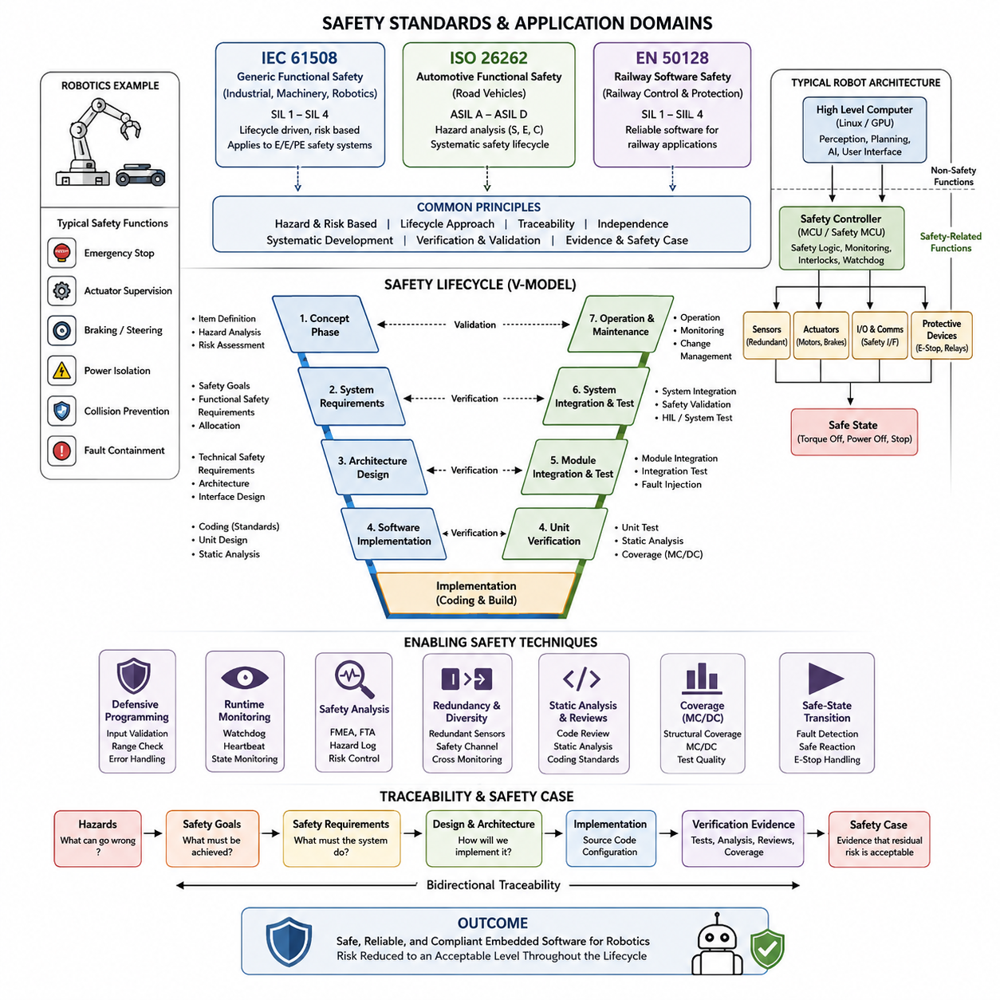
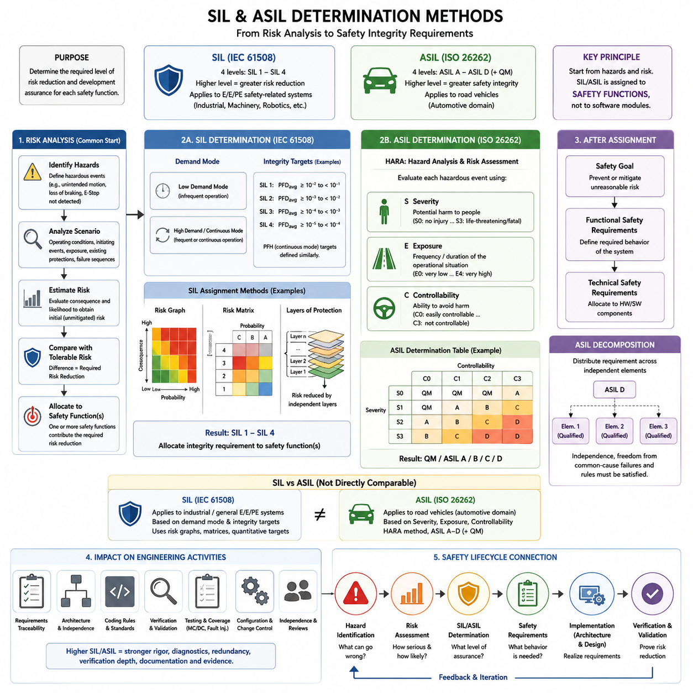
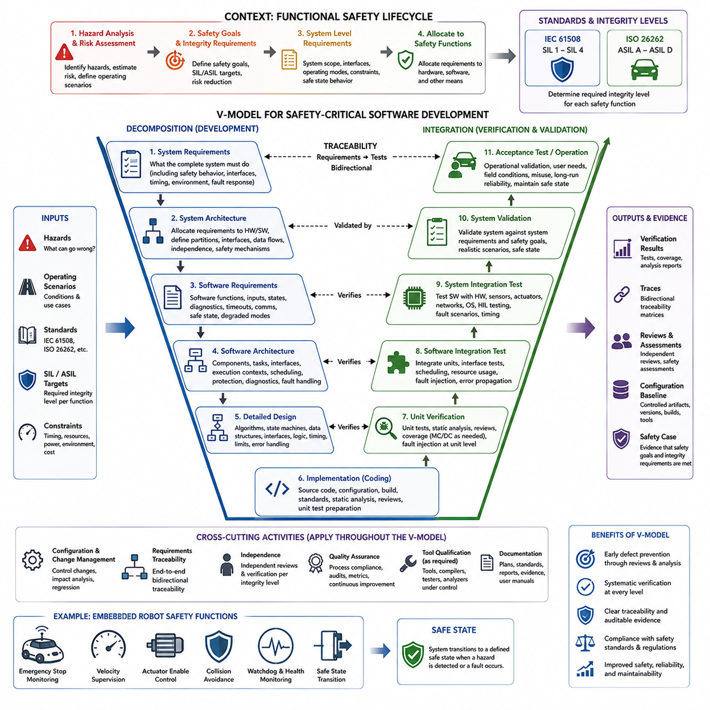
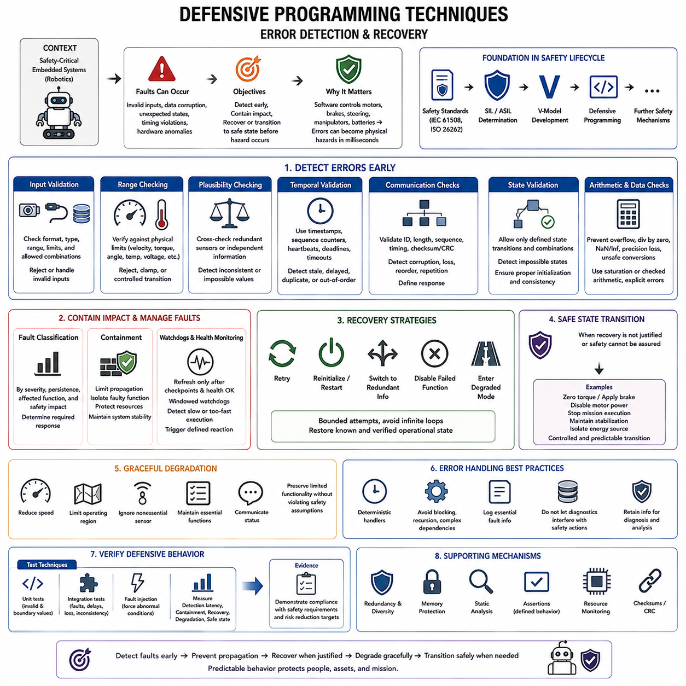
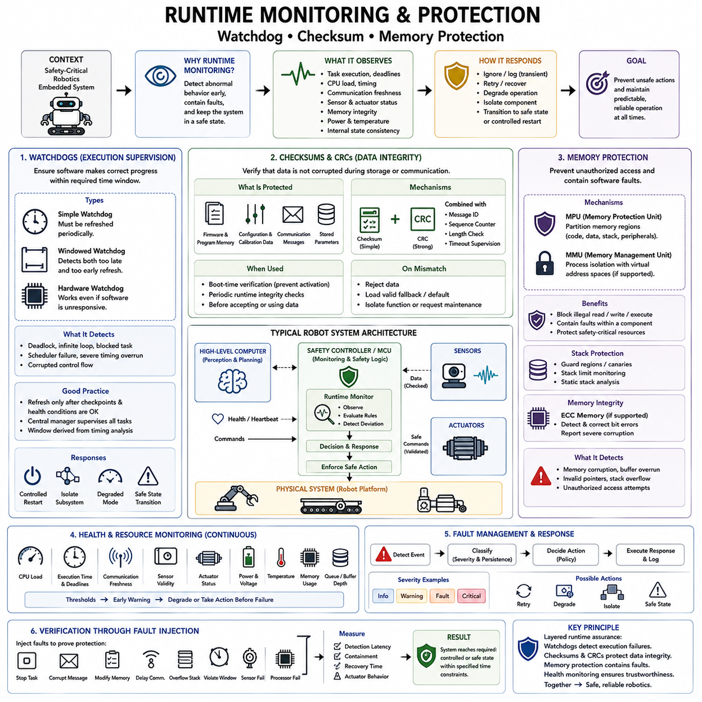
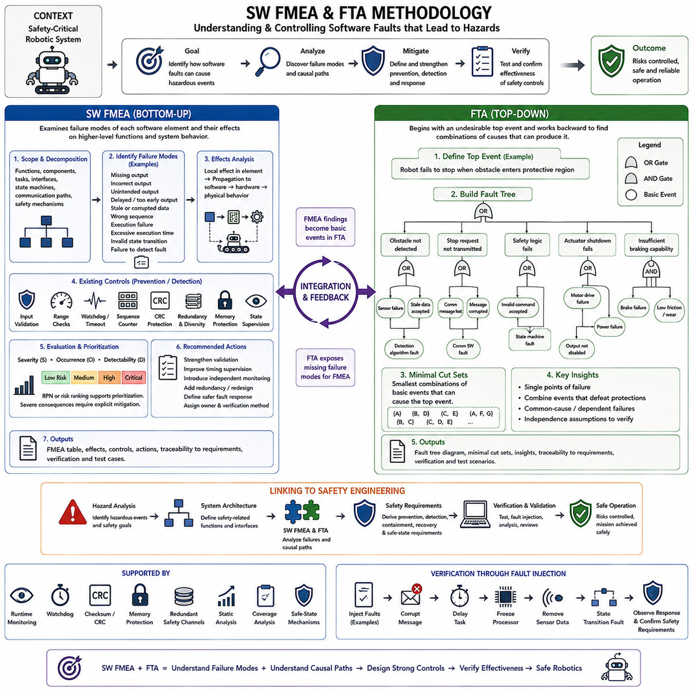
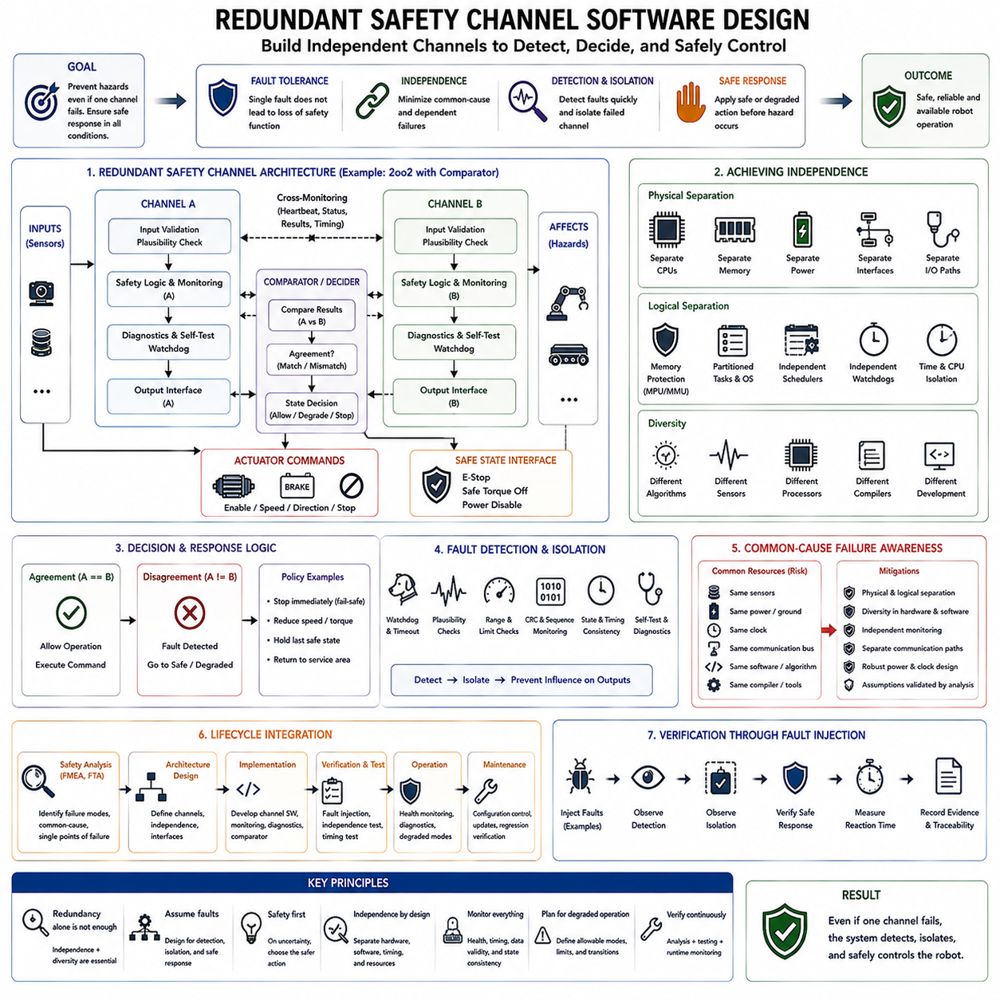
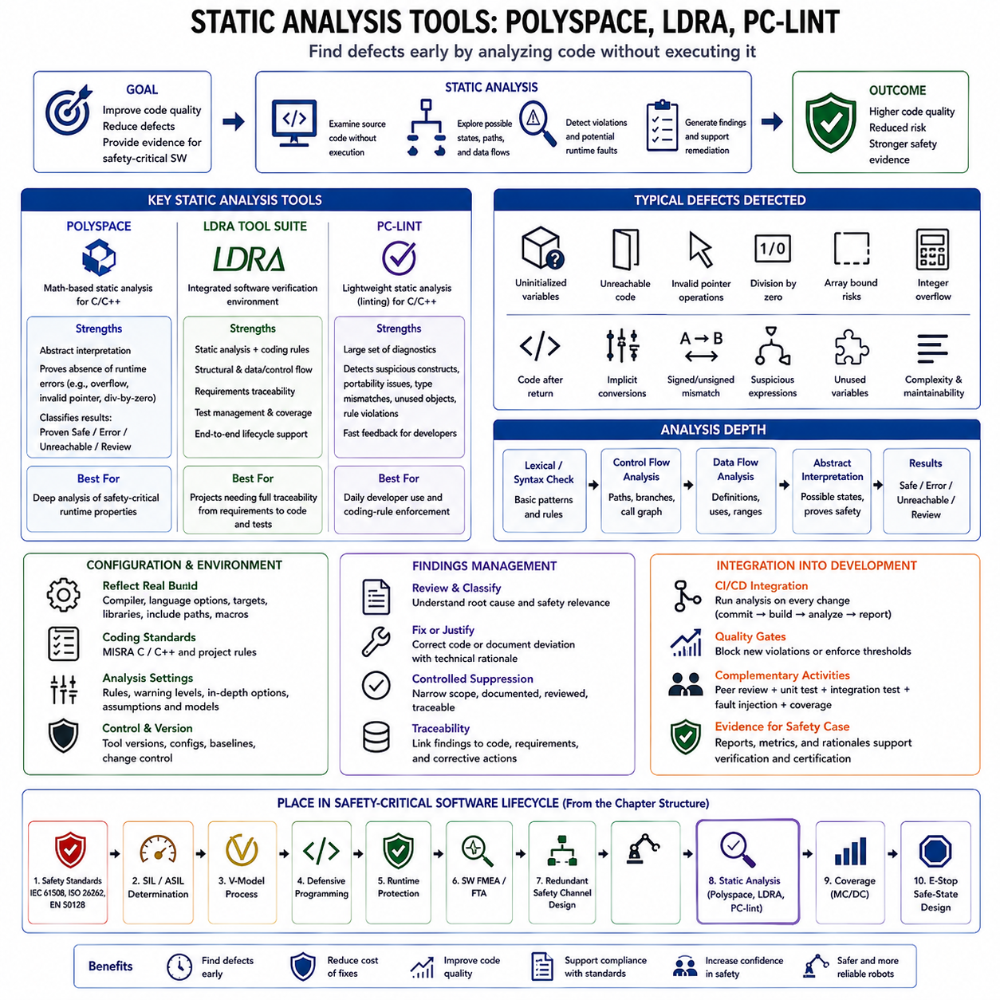
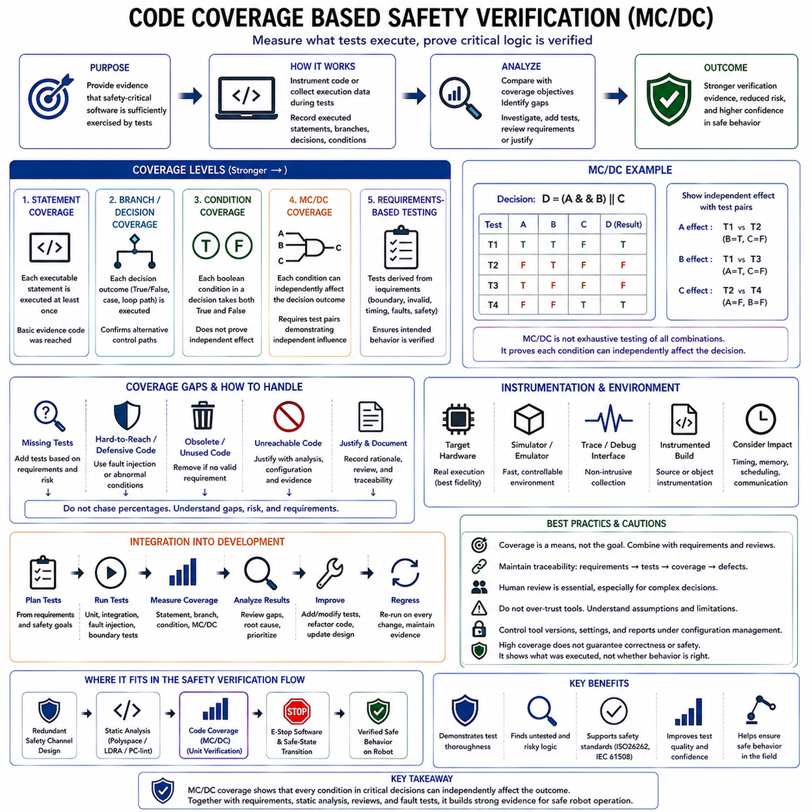
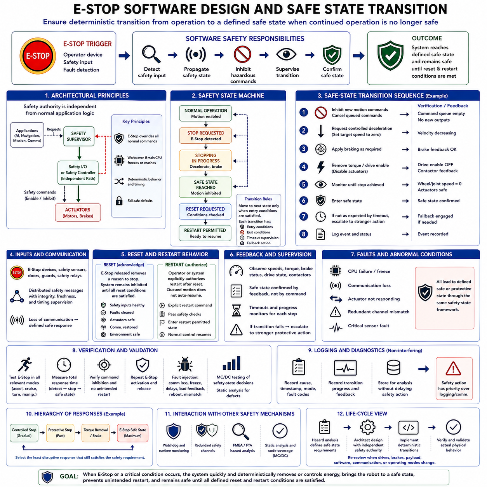

**Volume 02 Embedded Software Engineering**

# 09. Safety-Critical Embedded Software

## 09.01 Safety-Critical SW Standards: IEC 61508, ISO 26262, EN 50128

{width="7.268055555555556in" height="7.268055555555556in"}

안전 필수 소프트웨어(Safety-Critical Software)는 고장이 사람, 장비, 기반 시설 또는 환경에 허용할 수 없는 피해를 초래할 수 있는 소프트웨어를 의미한다. 임베디드 로보틱스(Embedded Robotics)에서는 비상 정지(Emergency Stop), 액추에이터 감시(Actuator Supervision), 제동(Braking), 조향(Steering), 전원 차단(Power Isolation), 충돌 방지(Collision Prevention), 결함 격리(Fault Containment) 등이 이에 해당한다. 첨부된 구조에서는 이러한 내용을 안전 필수 임베디드 소프트웨어(Safety Critical Embedded Software) 장에 배치하고, 이후 무결성 수준 결정(Integrity-Level Determination), V 모델(V-Model), 방어적 프로그래밍(Defensive Programming), 런타임 모니터링(Runtime Monitoring), 안전 분석(Safety Analysis), 이중화(Redundancy), 정적 분석(Static Analysis), 커버리지(Coverage), 안전 상태 전환(Safe-State Transition)으로 확장한다.

IEC 61508은 전기·전자·프로그램 가능 전자 안전 관련 시스템(Electrical, Electronic and Programmable Electronic Safety-Related Systems)의 기능 안전(Functional Safety)을 위한 일반적인 프레임워크(Framework)를 제공한다. 특정 기계 아키텍처(Machine Architecture)를 규정하기보다는 위험원(Hazard)을 식별하고, 위험(Risk)을 평가하며, 안전 무결성 요구사항(Safety Integrity Requirements)을 할당하고, 안전 기능(Safety Function)을 구현한 뒤 잔여 위험(Residual Risk)이 충분히 감소되었음을 입증하는 수명주기(Lifecycle) 중심의 원칙을 정의한다. 이러한 범용성 때문에 산업 자동화(Industrial Automation), 기계, 로보틱스 및 관련 제어 시스템의 안전 필수 임베디드 소프트웨어에 중요한 개념적 기반을 제공한다.

IEC 61508의 핵심 개념은 완성된 실행 소프트웨어(Executable Software)를 단순히 시험하는 것만으로 안전을 확립할 수 없다는 것이다. 안전은 위험원 및 위험 분석(Hazard and Risk Analysis)에서 시작하여 안전 요구사항(Safety Requirements), 아키텍처(Architecture), 상세 구현(Detailed Implementation), 검증(Verification), 유효성 확인(Validation), 운영(Operation), 변경(Modification), 최종 폐기(Decommissioning)에 이르는 전체 수명주기에서 설계되어야 한다. 따라서 소프트웨어 개발에서는 위험원, 안전 요구사항, 설계 요소, 소스 코드(Source Code), 검증 활동 및 안전 메커니즘(Safety Mechanism)이 의도한 대로 동작한다는 증거 사이의 추적성(Traceability)이 요구된다.

IEC 61508은 필요한 위험 감소 수준을 일반적으로 SIL 1부터 SIL 4까지의 안전 무결성 수준(Safety Integrity Level, SIL)으로 표현하며, 단계가 높아질수록 더욱 엄격한 무결성 요구가 적용된다. SIL 개념은 개발 방법의 엄격성, 검증 독립성(Verification Independence), 아키텍처 제약(Architectural Constraints), 진단 방법(Diagnostic Measures), 형상 관리(Configuration Management), 문서화 수준에 영향을 준다. 높은 SIL은 단순히 더 좋은 소프트웨어를 의미하는 것이 아니라, 위험한 체계적 고장(Systematic Failure)과 무작위 고장(Random Failure)을 적절히 통제하기 위해 더 강력한 보증(Assurance)이 요구되는 안전 기능을 의미한다.

ISO 26262는 도로 차량(Road Vehicle)의 전기·전자 시스템(Electrical and Electronic Systems)을 대상으로 기능 안전 공학(Functional Safety Engineering)을 특화한 표준이다. 자동차 개발 환경에 맞게 안전 수명주기(Safety Lifecycle) 개념을 적용하며, 자동차 안전 무결성 수준(Automotive Safety Integrity Level, ASIL)을 ASIL A에서 ASIL D까지 정의한다. 위험원 분석(Hazard Analysis)에서는 심각도(Severity), 노출도(Exposure), 제어 가능성(Controllability) 등의 요소를 고려하여 위험한 차량 상황(Hazardous Vehicle Situation)으로부터 안전 목표(Safety Goal)를 도출하고, 이를 기능 및 기술 안전 요구사항(Functional and Technical Safety Requirements)으로 구체화한다.

임베디드 소프트웨어(Embedded Software)의 관점에서 ISO 26262는 체계적인 요구사항 공학(Requirements Engineering), 아키텍처 분해(Architectural Decomposition), 인터페이스 정의(Interface Definition), 구현 규칙(Implementation Rules), 검증(Verification), 통합 시험(Integration Testing), 안전 유효성 확인(Safety Validation)을 강조한다. 제동, 조향, 추진, 차량 운동 제어 또는 자율주행 기능과 관련된 소프트웨어 컴포넌트(Software Component)는 일반 응용 소프트웨어보다 훨씬 강력한 공학적 증거가 요구될 수 있다. 특히 서로 다른 중요도를 가진 기능이 프로세서, 메모리, 통신 자원, 운영체제 또는 실행 환경을 공유하는 경우 간섭으로부터의 독립성(Freedom from Interference)이 중요하다.

EN 50128은 역사적으로 철도 제어 및 보호 애플리케이션(Railway Control and Protection Applications)의 소프트웨어를 대상으로 하며, 안전 관련 철도 시스템에서 신뢰할 수 있는 소프트웨어를 구현하기 위한 프로세스와 기법을 정의해 왔다. 철도 소프트웨어는 높은 가용성(Availability)과 보증(Assurance)이 요구되는 환경에서 장기간 운용되는 경우가 많기 때문에 체계적인 명세(Specification), 아키텍처 설계, 검증, 유효성 확인, 형상 관리 및 변경 관리(Change Control)가 중요하다. 현대 프로젝트에서는 과거의 표준 명칭만으로 인증 기준을 판단하지 않고, 현재 적용되는 철도 소프트웨어 표준과 계약상의 요구사항을 함께 확인해야 한다.

IEC 61508, ISO 26262 및 철도 안전 표준(Railway Safety Standards)은 서로 다른 용어와 산업별 메커니즘을 사용하지만, 기본적인 공학 철학에는 상당한 공통점이 있다. 이들 표준은 모두 안전을 단순히 소스 코드(Source Code)에 부여할 수 있는 속성이 아니라 위험원(Hazard)으로부터 도출되는 시스템 속성(System Property)으로 취급한다. 요구사항에는 추적성이 있어야 하고, 아키텍처는 고장을 명시적으로 처리해야 하며, 구현은 통제된 개발 절차를 따라야 하고, 검증은 객관적인 증거(Objective Evidence)를 생성해야 한다. 따라서 인증 지향 개발(Certification-Oriented Development)은 시스템 안전 분석(System Safety Analysis)과 소프트웨어 공학(Software Engineering)을 서로 독립된 활동으로 취급하지 않고 연결한다.

이러한 구분은 로봇이 센싱(Sensing), 연산(Computation), 통신(Communication), 구동(Actuation), 저장 에너지(Stored Energy), 물리적 움직임(Physical Motion)을 결합하기 때문에 특히 중요하다. 인지(Perception) 또는 계획(Planning) 기능은 고성능 리눅스(Linux)나 GPU 컴퓨터에서 실행될 수 있지만, 독립된 MCU 또는 안전 제어기(Safety Controller)가 속도, 액추에이터 활성화 신호(Actuator Enable Signal), 보호 장치, 워치독(Watchdog), 비상 정지 회로(Emergency-Stop Circuit)를 감시할 수 있다. 적용되는 안전 표준은 산업 영역에 따라 달라지지만, 위험한 동작이 제한되지 않은 응용 소프트웨어의 정상 동작에만 전적으로 의존해서는 안 된다는 아키텍처 원칙은 공통적이다.

따라서 안전 요구사항(Safety Requirements)은 정상 상태뿐만 아니라 비정상 상태에서도 측정 가능한 동작을 정의해야 한다. 소프트웨어가 단순히 "안전하게 동작해야 한다"라고 표현하는 대신 검출 임계값(Detection Threshold), 응답 시간(Response Time), 허용 운전 상태(Permitted Operating State), 성능 저하 모드(Degraded Mode), 결함 대응(Fault Reaction), 진단 커버리지(Diagnostic Coverage), 통신 타임아웃(Communication Timeout), 정의된 안전 상태(Safe State)로 강제 전환되는 조건 등을 명시해야 한다. 이러한 요구사항은 이후 아키텍처, 구현, 단위 검증(Unit Verification), 통합 시험, 결함 주입(Fault Injection), 하드웨어 인 더 루프 시험(Hardware-in-the-Loop Testing), 시스템 수준 안전 유효성 확인(System-Level Safety Validation)의 입력이 된다.

소프트웨어 아키텍처(Software Architecture)는 이러한 요구사항을 만족시키기 위한 가장 강력한 수단 중 하나이다. 안전 관련 기능(Safety-Related Function)을 비안전 기능(Non-Safety Function)과 격리하고, 통신 인터페이스를 제한하고 감시하며, 중요한 상태 전환을 결정론적 상태 머신(Deterministic State Machine)으로 구현할 수 있다. 워치독, 메모리 보호(Memory Protection), 중복 측정(Redundant Measurement), 타당성 검사(Plausibility Check), 시퀀스 카운터(Sequence Counter), CRC 메커니즘, 타임아웃 감시(Timeout Supervision), 범위 검사(Range Check), 독립적인 종료 경로(Independent Shutdown Path)는 단일 소프트웨어 결함이나 통신 장애가 위험한 물리적 동작으로 조용히 전파되는 것을 방지할 수 있다.

구현 규율(Implementation Discipline)은 이러한 아키텍처 보호를 보완한다. 안전 필수 임베디드 코드(Safety-Critical Embedded Code)는 일반적으로 명시적인 제어 흐름(Control Flow), 제한된 실행 시간(Bounded Execution), 결정론적 자원 사용(Deterministic Resource Usage), 통제된 동적 메모리(Dynamic Memory), 명확하게 정의된 정수 연산(Integer Behavior), 방어적 인터페이스 검증(Defensive Interface Validation), 제한된 언어 구성(Language Construct)을 선호한다. 코딩 표준(Coding Standard)과 정적 분석(Static Analysis)은 실행 이전에 결함을 발견하도록 지원하며, 컴파일러 설정, 재현 가능한 빌드(Reproducible Build), 버전 관리(Version Control), 변경 검토(Change Review), 형상 관리는 검증된 바이너리(Binary)가 실제 검토된 소스 및 설정과 일치하도록 한다.

검증(Verification)은 정상적인 시험 사례(Test Case)가 성공하는 것 이상을 입증해야 한다. 리뷰(Review)와 정적 분석은 소프트웨어를 실행하지 않고 요구사항, 아키텍처, 설계 및 코드를 검사하며, 동적 시험(Dynamic Testing)은 정상 조건, 경계 조건(Boundary Condition), 오류 조건 및 결함 주입 조건에서의 동작을 검사한다. 단위 시험(Unit Testing), 통합 시험(Integration Testing), 하드웨어 인 더 루프(Hardware-in-the-Loop), 시스템 시험(System Testing)을 통해 단계적으로 신뢰도를 확보한다. 구조적 커버리지(Structural Coverage)는 실행되지 않은 구현 영역을 식별하고, 높은 중요도를 가진 소프트웨어의 더욱 엄격한 검증 목표를 지원할 수 있다.

추적성(Traceability)은 이러한 활동을 서로 연결하여 감사 가능한 안전 사례(Safety Case)를 구성한다. 평가자는 위험한 조건(Hazardous Condition)에서 출발하여 관련 안전 목표 또는 요구사항을 확인하고, 소프트웨어 아키텍처와 상세 요구사항으로의 할당 과정을 추적하며, 실제 구현 위치를 확인한 후 요구사항 준수를 입증하는 검증 증거(Verification Evidence)를 검토할 수 있어야 한다. 반대로 안전 관련 소스 코드는 설명되지 않은 기능으로 존재해서는 안 되며 정당한 요구사항을 가져야 한다. 이러한 양방향 추적성(Bidirectional Traceability)은 임베디드 로봇 소프트웨어가 펌웨어 업데이트(Firmware Update)와 제품 파생형(Product Variant)을 통해 지속적으로 변화하는 경우 특히 중요하다.

따라서 세 표준은 서로 교환 가능한 체크리스트(Checklist)가 아니라 산업 영역별 안전 프레임워크(Domain-Specific Safety Framework)로 이해해야 한다. IEC 61508은 광범위한 기능 안전 원칙을 제공하고, ISO 26262는 자동차에 특화된 안전 수명주기와 ASIL 프레임워크를 적용하며, 철도 표준은 철도 신호 및 제어 환경에 적합한 보증 방법을 제공한다. 로보틱스 프로젝트는 여러 산업 영역의 개념을 참고할 수 있지만, 실제 규정 준수(Compliance)는 해당 제품, 운용 환경, 안전 기능 및 인증 체계(Certification Regime)에 적용되는 표준을 기반으로 판단해야 한다.

첨부된 책의 구조에서 이러한 안전 표준 개요는 이후의 안전 필수 소프트웨어 주제를 이해하기 위한 기반을 형성한다. 다음에 이어지는 SIL 및 ASIL 결정(SIL and ASIL Determination), V 모델 기반 개발(V-Model Development), 방어적 프로그래밍, 런타임 모니터링, 고장 형태 및 영향 분석(Failure Mode and Effects Analysis, FMEA)과 결함 트리 분석(Fault Tree Analysis, FTA), 이중화 안전 채널(Redundant Safety Channel), 정적 분석, 수정 조건/결정 커버리지(Modified Condition/Decision Coverage, MC/DC), 비상 정지와 안전 상태 전환(Emergency-Stop Safe-State Transition)은 안전 요구사항을 실제 공학적 증거로 변환하는 구체적인 방법을 다룬다. 이들을 종합함으로써 기능 안전은 추상적인 요구사항이 아니라 체계적으로 관리되고 검증되는 임베디드 소프트웨어 수명주기(Embedded Software Lifecycle)로 구현된다.

## 09.02 SIL/ASIL Determination Methods

{width="7.268055555555556in" height="7.268055555555556in"}

안전 무결성 수준(Safety Integrity Level, SIL)과 자동차 안전 무결성 수준(Automotive Safety Integrity Level, ASIL)은 위험 분석(Risk Analysis)을 구체적인 기능 안전 요구사항(Functional Safety Requirements)으로 변환하기 위해 사용되는 분류 체계이다. 이들은 소프트웨어 품질 자체를 독립적으로 나타내는 것이 아니라, 안전 관련 기능(Safety-Related Function)에 요구되는 위험 감소(Risk Reduction)와 개발 보증(Development Assurance)의 수준을 표현한다. 임베디드 로보틱스(Embedded Robotics)에서는 이러한 분류를 이해함으로써 센싱(Sensing), 제어(Control), 감시(Supervision), 정지(Shutdown), 결함 처리(Fault Handling) 기능을 어느 정도의 엄격성으로 설계하고 검증해야 하는지를 결정할 수 있다.

SIL은 주로 IEC 61508 및 관련 기능 안전 표준(Functional Safety Standards)과 연관된다. SIL 1부터 SIL 4까지 네 단계는 점차 증가하는 안전 무결성 요구사항을 나타내며, SIL 4가 가장 높은 수준의 위험 감소를 요구한다. 적절한 수준은 고장으로 인해 발생할 수 있는 위험한 결과와 안전 기능에 요구되는 위험 감소량을 기반으로 결정한다. 따라서 이러한 분류는 소프트웨어 모듈이나 개별 소스 코드(Source Code) 구성요소가 아니라 시스템 위험원(System Hazard)에서 시작한다.

일반적인 SIL 결정 과정(SIL Determination Process)은 위험 사건(Hazardous Event)을 식별하고 그 결과와 발생 가능성을 추정하는 것에서 시작한다. 엔지니어는 운용 조건(Operating Condition), 유발 사건(Initiating Event), 노출(Exposure), 기존 보호 수단(Protection Measure), 가능한 고장 진행 과정(Failure Sequence)을 분석한다. 초기 위험 또는 완화되지 않은 위험(Unmitigated Risk)을 시스템에서 허용 가능한 위험(Tolerable Risk)과 비교하며, 두 위험 수준의 차이를 통해 필요한 위험 감소량을 결정하고 이를 기반으로 하나 이상의 안전 기능에 적절한 무결성 요구사항을 할당한다.

IEC 61508에서는 서로 다른 요구 모드(Demand Mode)로 동작하는 안전 기능을 구분한다. 저요구 기능(Low-Demand Function)은 비교적 드물게 작동하지만, 고요구 또는 연속 기능(High-Demand or Continuous Function)은 빈번하게 또는 지속적으로 동작할 수 있다. 따라서 정량적인 무결성 목표(Quantitative Integrity Target)는 요구 시 위험 고장 확률(Probability of Dangerous Failure on Demand)이나 위험 고장 빈도(Dangerous Failure Frequency)와 같이 운용 모드에 적합한 측정값을 사용한다. 이러한 수치적 목표는 체계적인 안전 분석과 엄격한 개발 절차를 대체하는 것이 아니라 이를 보완한다.

SIL 할당(SIL Assignment)을 지원하기 위해 여러 가지 방법을 사용할 수 있다. 위험 그래프(Risk Graph)는 결과의 심각성(Consequence), 노출 빈도(Exposure Frequency), 위험 회피 가능성(Possibility of Avoiding the Hazard), 원하지 않는 사건의 발생 가능성(Probability of Unwanted Occurrence)과 같은 매개변수를 이용하여 무결성 요구사항을 도출한다. 위험 매트릭스(Risk Matrix)는 심각도와 발생 가능성 범주를 결합하며, 보호 계층 분석(Layers of Protection Analysis)은 독립적인 보호 계층(Independent Protection Layer)이 위험을 얼마나 감소시키는지를 평가한다. 충분한 고장 및 운용 데이터가 있는 경우에는 정량적 위험 평가(Quantitative Risk Assessment)를 통해 보다 수치적인 분석을 수행할 수 있다.

ASIL 결정(ASIL Determination)은 ISO 26262에서 자동차 기능 안전(Automotive Functional Safety)을 위해 정의한 별도의 산업 특화 방법을 따른다. 일반적으로 HARA라고 하는 위험원 분석 및 위험 평가(Hazard Analysis and Risk Assessment)는 관련 운용 상황에서 오동작(Malfunctioning Behavior)에 의해 발생하는 위험 사건을 식별한다. 각각의 위험 사건은 심각도(Severity), 노출도(Exposure), 제어 가능성(Controllability)이라는 세 가지 주요 매개변수를 사용하여 평가한다. 이들의 조합을 통해 해당 사건을 일반 품질 관리(Quality Management) 대상으로 처리할 것인지, 또는 ASIL A, B, C, D 중 하나를 할당할 것인지 결정한다.

심각도(Severity)는 위험 사건으로 인해 발생할 수 있는 피해의 잠재적 크기를 나타낸다. 평가는 차량 자체의 손상보다는 주로 사람에게 발생할 수 있는 상해 가능성을 중심으로 이루어진다. 심각도 등급이 높아질수록 더욱 심각한 결과를 의미한다. 엔지니어는 현실적인 사고 시나리오(Accident Scenario), 차량의 거동, 운행 속도, 주변 도로 사용자(Road User), 그리고 오동작과 특정 운용 상황이 동시에 발생했을 때 나타날 수 있는 물리적 결과를 고려해야 한다.

노출도(Exposure)는 위험과 관련된 운용 상황(Operational Situation)이 얼마나 자주 또는 얼마나 오랫동안 발생할 것으로 예상되는지를 나타낸다. 어떤 오동작은 기술적으로 발생할 수 있지만 매우 드문 운용 조건에서만 위험해질 수 있는 반면, 다른 오동작은 일상적인 주행 환경에서 위험해질 수 있다. 따라서 노출도 분류는 전자 부품이나 소프트웨어 기능 자체가 고장날 확률만을 의미하는 것이 아니라, 해당 위험과 관련된 운용 상황을 실제로 마주칠 가능성을 평가한다.

제어 가능성(Controllability)은 위험 사건이 시작된 이후 운전자 또는 관련된 다른 사람이 결과적으로 발생할 수 있는 피해를 합리적으로 회피할 수 있는 정도를 평가한다. 여기에는 사용 가능한 반응 시간(Reaction Time), 차량 동역학(Vehicle Dynamics), 경고 정보(Warning Information), 환경 조건(Environmental Condition), 일반적인 도로 사용자에게 기대할 수 있는 행동 등이 포함된다. 일반적으로 통제할 수 있는 상황은 상해를 회피하기 매우 어렵거나 사실상 불가능한 상황보다 낮은 등급으로 분류될 수 있다.

심각도(Severity), 노출도(Exposure), 제어 가능성(Controllability)의 조합을 통해 ASIL 등급이 결정된다. ASIL A는 ASIL 범위에서 가장 낮은 안전 무결성 범주이며 ASIL D는 가장 높은 요구 수준을 나타낸다. 일부 조합은 품질 관리(Quality Management, QM)로 분류되며, 이는 해당 위험 사건에 ISO 26262의 ASIL 기반 안전 요구사항이 할당되지 않는다는 것을 의미한다. 따라서 ASIL D는 낮은 ASIL보다 개발, 검증, 독립성(Independence), 아키텍처 및 안전 증거(Safety Evidence)에 대해 훨씬 강한 요구사항을 가진다.

위험 사건에 ASIL이 할당되면 관련된 불합리한 위험(Unreasonable Risk)을 방지하거나 완화하기 위한 안전 목표(Safety Goal)가 도출된다. 기능 안전 요구사항(Functional Safety Requirements)은 안전 목표를 시스템 동작으로 구체화하고, 기술 안전 요구사항(Technical Safety Requirements)은 다시 하드웨어와 소프트웨어 요소에 책임을 할당한다. 따라서 ASIL은 안전 수명주기(Safety Lifecycle)를 따라 전달되며 아키텍처, 구현, 검증, 유효성 확인(Validation), 형상 관리(Configuration Management), 특정 활동에서 요구되는 독립성 수준에 영향을 미친다.

ASIL 분해(ASIL Decomposition)를 사용하면 경우에 따라 하나의 안전 요구사항을 충분히 독립적인 여러 아키텍처 요소에 분배할 수 있다. 하나의 요소가 전체 무결성 요구사항을 담당하도록 하는 대신, 정의된 분해 규칙(Decomposition Rules)에 따라 독립적인 요소들이 상호 보완적인 안전 메커니즘(Safety Mechanism)을 제공하도록 구성할 수 있다. 그러나 이는 단순한 이중화(Redundancy)를 의미하지 않는다. 목표로 하는 안전 무결성을 주장하려면 독립성, 공통 원인 고장(Common-Cause Failure)으로부터의 자유, 인터페이스 가정(Interface Assumption), 관련 분해 제약조건의 준수를 입증해야 한다.

SIL과 ASIL을 직접적으로 서로 변환해서는 안 된다. SIL은 IEC 61508 기능 안전 프레임워크에 속하고, ASIL은 자동차에 특화된 ISO 26262 프레임워크에 속하며 서로 다른 위험 분류 방법론을 사용하여 도출된다. 두 체계 모두 단계가 높아질수록 더 높은 안전 보증을 요구하지만, "ASIL D는 SIL 3과 같다"와 같은 표현은 표준의 차이를 지나치게 단순화한다. 적용 산업 영역, 수명주기, 운용 모드, 위험 모델(Risk Model), 정량적 목표, 인증 요구사항(Certification Requirements)을 각각 별도로 고려해야 한다.

로보틱스(Robotics)에서는 전체 로봇에 하나의 무결성 수준을 부여하는 것이 아니라 위험한 로봇 동작(Hazardous Robot Behavior)을 정의하는 것에서 결정 과정이 시작된다. 예를 들어 의도하지 않은 움직임(Unintended Motion), 과도한 속도(Excessive Velocity), 제동 기능 상실(Loss of Braking), 예상하지 못한 액추에이터 토크(Unexpected Actuator Torque), 보호 정지 요청(Protective Stop Request)의 감지 실패, 안전 상태 진입 실패 등이 있다. 이후 각각의 안전 기능을 적용 가능한 산업, 자동차, 철도, 기계 또는 로봇 특화 안전 프레임워크에 따라 분석할 수 있다.

예를 들어 이동 로봇(Mobile Robot)은 인지 및 내비게이션 소프트웨어(Perception and Navigation Software)를 이용하여 정상적인 이동 명령을 생성하는 동시에, 독립적인 안전 기능이 허용 속도(Permitted Velocity), 보호 센서(Protective Sensor), 비상 정지 신호(Emergency-Stop Signal), 통신 상태(Communication Health), 액추에이터 활성화 조건(Actuator Enable Condition)을 감시하도록 구성할 수 있다. 위험 분석을 통해 이러한 안전 기능에 필요한 무결성이 결정되며, 높은 무결성 요구사항은 더 강력한 진단 커버리지(Diagnostic Coverage), 이중화, 독립성, 결정론적 실행(Deterministic Execution), 결함 검출(Fault Detection), 검증 수준 및 안전 상태 메커니즘(Safe-State Mechanism)으로 이어질 수 있다.

무결성 분류(Integrity Classification)는 소프트웨어 공학 활동에도 영향을 미친다. 높은 중요도를 가진 소프트웨어는 일반적으로 더욱 강력한 요구사항 추적성(Requirements Traceability), 아키텍처 검토(Architecture Review), 코딩 제한(Coding Restrictions), 정적 분석(Static Analysis), 단위 검증(Unit Verification), 통합 시험(Integration Testing), 구조적 커버리지 분석(Structural Coverage Analysis), 결함 주입(Fault Injection), 형상 관리(Configuration Control), 독립적인 평가(Independent Assessment)를 요구한다. 목적은 무결성 수준에 비례하여 문서 작업을 증가시키는 것이 아니라, 체계적 소프트웨어 결함(Systematic Software Fault)이 개발 과정 전체에서 예방, 검출 또는 통제되었다는 설득력 있는 증거를 축적하는 것이다.

따라서 SIL 또는 ASIL 결정은 전체 안전 수명주기(Safety Lifecycle)와 지속적으로 연결되어야 한다. 위험원 식별(Hazard Identification)은 무엇이 잘못될 수 있는지를 정의하고, 위험 평가(Risk Assessment)는 그 결과가 얼마나 심각해질 수 있는지를 판단하며, 무결성 분류는 필요한 안전 보증 수준을 결정한다. 안전 요구사항은 필요한 동작을 정의하고, 아키텍처와 구현은 이러한 요구사항을 실현하며, 검증과 유효성 확인(Verification and Validation)은 결과 시스템이 의도한 위험 감소를 달성한다는 것을 입증한다.

첨부된 구조에서 SIL 및 ASIL 결정(SIL and ASIL Determination)은 안전 표준에 대한 개요와 이후에 이어지는 구체적인 안전 공학 실무 사이를 연결하는 분석적 가교 역할을 한다. 이후의 V 모델 개발(V-Model Development), 방어적 프로그래밍(Defensive Programming), 런타임 모니터링(Runtime Monitoring), 소프트웨어 FMEA 및 FTA(Software FMEA and FTA), 이중화 안전 채널(Redundant Safety Channel), 정적 분석, MC/DC 기반 커버리지(MC/DC-Based Coverage), 비상 정지 안전 상태 전환(Emergency-Stop Safe-State Transition)은 위험 분류 과정에서 결정된 무결성을 실제 시스템에 구현하고 이를 입증하기 위한 구체적인 메커니즘을 제공한다.

## 09.03 Safety-Critical SW Development Process: V-Model

{width="7.268055555555556in" height="7.268055555555556in"}

V 모델(V-Model)은 안전 필수 소프트웨어 공학(Safety-Critical Software Engineering)에서 널리 사용되는 구조화된 개발 프레임워크(Structured Development Framework)로, 명세(Specification), 구현(Implementation), 통합(Integration), 검증(Verification), 유효성 확인(Validation) 사이의 명확한 관계를 형성한다. 테스트를 코딩 이후에 수행하는 활동으로만 취급하지 않고, 요구사항과 설계가 작성되는 단계에서 이에 대응하는 검증 활동을 함께 정의한다. 이를 통해 전체 안전 수명주기(Safety Lifecycle)에 걸쳐 체계적인 증거 생성(Evidence Generation)을 지원한다.

특징적인 V자 형태는 왼쪽의 분해(Decomposition) 과정과 오른쪽의 통합(Integration) 과정을 나타낸다. 개발은 시스템 및 안전 요구사항(System and Safety Requirements)에서 시작하여 점차 상세한 소프트웨어 아키텍처(Software Architecture), 컴포넌트 설계(Component Design), 구현으로 진행된다. 구현 이후에는 반대 방향으로 소프트웨어를 단계적으로 통합하고 시험한다. 따라서 각각의 개발 수준에는 의도된 요구사항이 충족되었음을 입증하는 대응 검증 또는 유효성 확인 단계가 존재한다.

안전 필수 개발(Safety-Critical Development)은 소프트웨어 요구사항이 작성되기 이전부터 시작된다. 위험원 분석 및 위험 평가(Hazard Analysis and Risk Assessment)는 잠재적으로 위험한 시스템 동작을 식별하고 안전 목표(Safety Goal), 무결성 요구사항(Integrity Requirement), 필요한 위험 감소 수단(Risk-Reduction Measure)을 설정한다. 이러한 시스템 수준의 안전 결정은 소프트웨어 책임을 할당하는 기반이 된다. 따라서 V 모델은 소프트웨어 개발이 시스템 안전 분석과 독립적으로 수행되지 않도록 소프트웨어 공학을 더 광범위한 기능 안전 수명주기(Functional Safety Lifecycle)와 연결한다.

V 모델의 왼쪽 상단에서 시스템 요구사항(System Requirements)은 안전 동작(Safety Behavior), 운용 모드(Operating Mode), 환경 가정(Environmental Assumption), 인터페이스(Interface), 타이밍 제약(Timing Constraint), 결함 대응(Fault Response)을 포함하여 전체 임베디드 시스템이 수행해야 할 기능을 정의한다. 위험원으로부터 도출된 안전 요구사항은 식별 및 추적 가능해야 한다. 요구사항은 정확하고 시험 가능하며 내부적으로 일관되어야 하고, 최종 시험 단계에서 주관적인 해석에 의존하지 않고 객관적인 검증이 가능할 정도로 충분히 상세해야 한다.

시스템 아키텍처(System Architecture)는 요구사항을 하드웨어, 소프트웨어, 통신, 센서, 액추에이터 및 독립적인 안전 메커니즘(Independent Safety Mechanism)에 할당한다. 로봇에서는 일반적인 모션 계획(Motion Planning)이 고성능 컴퓨터에서 실행되는 반면, 비상 정지(Emergency Stop), 속도 감시(Velocity Supervision), 액추에이터 활성화 제어(Actuator Enable Control), 워치독(Watchdog) 기능은 더욱 독립된 안전 관련 컴포넌트(Safety-Related Component)에 배치될 수 있다. 이러한 아키텍처 분리는 간섭을 줄이고 결함 검출 및 정의된 안전 상태(Safe State)로의 전환 책임을 명확하게 한다.

소프트웨어 요구사항(Software Requirements)은 시스템에서 할당된 동작을 구현 가능한 기능으로 구체화한다. 여기에는 입력 유효성 조건(Input Validity Condition), 상태 전환(State Transition), 진단 대응(Diagnostic Reaction), 타임아웃 제한(Timeout Limit), 통신 감시(Communication Supervision), 액추에이터 명령(Actuator Command), 초기화 순서(Initialization Sequence), 성능 저하 운전 모드(Degraded Operating Mode), 안전 상태 동작(Safe-State Behavior) 등이 포함될 수 있다. 모든 안전 관련 소프트웨어 요구사항은 상위 요구사항과의 추적성을 유지해야 하며, 계획된 검증 활동을 통해 준수 여부를 어떻게 입증할 것인지 정의해야 한다.

소프트웨어 아키텍처는 이러한 요구사항을 컴포넌트(Component), 태스크(Task), 인터페이스, 데이터 흐름(Data Flow), 실행 컨텍스트(Execution Context), 안전 메커니즘으로 구성한다. 설계자는 독립성(Independence), 파티셔닝(Partitioning), 메모리 보호(Memory Protection), 스케줄링(Scheduling), 통신 무결성(Communication Integrity), 자원 제한(Resource Limit), 결함 격리(Fault Containment), 진단 커버리지(Diagnostic Coverage)를 고려한다. 안전 필수 아키텍처에서는 비정상 동작을 명시적으로 다루어야 하며, 워치독, 중복 측정(Redundant Measurement), 타당성 검사(Plausibility Check), CRC 보호, 시퀀스 감시(Sequence Monitoring), 독립적인 종료 메커니즘(Independent Shutdown Mechanism) 등이 아키텍처 요소가 될 수 있다.

상세 설계(Detailed Design)는 아키텍처 컴포넌트를 알고리즘(Algorithm), 상태 머신(State Machine), 데이터 구조(Data Structure), 인터페이스, 타이밍 동작(Timing Behavior), 구현 수준 로직(Implementation-Level Logic)으로 변환한다. V 모델의 아래쪽으로 이동할수록 모호성은 감소해야 한다. 임베디드 제어 소프트웨어에서는 정확한 전환 조건, 범위 제한(Range Limit), 실행 주기(Execution Period), 타임아웃 값, 수치 연산 동작(Numerical Behavior), 초기화 규칙, 오류 대응(Error Response) 등을 정의할 수 있다. 상세 설계는 소프트웨어 요구사항과 소스 코드 구현 사이의 직접적인 공학적 연결을 제공한다.

구현(Implementation)은 V 모델의 가장 아래에 위치하며 상세 설계를 실행 가능한 소프트웨어로 변환한다. 안전 필수 코딩(Safety-Critical Coding)은 일반적으로 결정론적 동작(Deterministic Behavior), 제한된 실행 시간(Bounded Execution), 명시적인 제어 흐름(Explicit Control Flow), 방어적 입력 처리(Defensive Input Handling), 예측 가능한 메모리 사용(Predictable Memory Usage), 통제된 언어 기능(Controlled Language Features)을 강조한다. 코딩 표준(Coding Standards), 컴파일러 규칙(Compiler Rules), 정적 분석(Static Analysis), 동료 검토(Peer Review), 형상 관리(Configuration Management), 재현 가능한 빌드(Reproducible Build)는 구현 과정에서 통제되지 않은 동작이나 승인된 설계로부터 문서화되지 않은 이탈이 발생하는 것을 방지하도록 지원한다.

V 모델의 오른쪽은 단위 검증(Unit Verification)에서 시작한다. 개별 소프트웨어 유닛(Software Unit)은 리뷰, 정적 분석, 단위 시험(Unit Test), 경계값 시험(Boundary-Value Test), 견고성 시험(Robustness Test), 필요한 경우 구조적 커버리지 측정(Structural Coverage Measurement)을 통해 상세 설계와 소프트웨어 요구사항에 대해 검증된다. 예상된 입력만 시험하는 것이 아니라 결함 조건도 의도적으로 실행해야 한다. 목적은 단순한 실행 성공이 아니라 각 유닛이 명세된 동작을 만족하고 관련된 고장을 올바르게 처리한다는 증거를 제공하는 것이다.

소프트웨어 통합 시험(Software Integration Testing)은 이미 시험된 유닛 간의 상호작용을 검증한다. 인터페이스, 데이터 교환(Data Exchange), 스케줄링 의존성(Scheduling Dependency), 공유 자원(Shared Resource), 초기화 순서, 통신 장애, 오류 전파(Error Propagation)가 주요 검증 대상이 된다. 점진적 통합(Incremental Integration)은 고장이 발생했을 때 해당 문제가 도입된 단계 가까이에서 원인을 식별할 수 있도록 한다. 결함 주입(Fault Injection)은 타임아웃 처리, 손상된 통신 데이터 검출, 워치독 동작, 이중화 채널 불일치(Redundant-Channel Disagreement), 성능 저하 또는 안전 운전 모드로의 전환을 검증하는 데 특히 유용하다.

시스템 통합 시험(System Integration Testing)은 임베디드 소프트웨어를 프로세서, 센서, 액추에이터, 통신 네트워크, 운영체제 및 기타 하드웨어와 결합하여 평가한다. 하드웨어 인 더 루프 시험(Hardware-in-the-Loop Testing, HIL)은 통제된 환경을 유지하면서 실제 환경에서 재현하기 어려운 운전 조건을 시험할 수 있도록 한다. 엔지니어는 센서 결함, 통신 지연, 액추에이터 이상, 프로세서 과부하, 전원 관련 사건 또는 타이밍 교란(Timing Disturbance)을 주입하여 통합된 안전 메커니즘이 지정된 제한 시간 내에 대응하는지를 확인할 수 있다.

유효성 확인(Validation)은 V 모델의 오른쪽 상단에서 수행되며 완성된 시스템이 의도된 안전 목표와 운용 요구를 충족하는지를 확인한다. 검증(Verification)이 주로 각각의 개발 산출물이 명세에 따라 올바르게 만들어졌는지를 확인한다면, 유효성 확인은 결과 시스템이 의도된 용도(Intended Use)에 적합한지를 평가한다. 따라서 안전 유효성 확인(Safety Validation)은 현실적인 운용 시나리오, 환경 조건, 합리적으로 예측 가능한 오용(Foreseeable Misuse), 위험 사건(Hazardous Event), 구현된 위험 통제 수단(Risk-Control Measure)의 효과를 고려한다.

추적성(Traceability)은 V 모델의 양쪽을 서로 연결한다. 하나의 안전 목표는 시스템 요구사항, 소프트웨어 요구사항, 아키텍처, 상세 설계, 구현 및 이에 대응하는 검증 증거(Verification Evidence)까지 연결되어야 한다. 또한 시험 결과나 소스 코드 요소에서 그 존재를 정당화하는 요구사항까지 역방향으로 추적할 수 있어야 한다. 이러한 양방향 추적성(Bidirectional Traceability)은 누락된 요구사항, 시험되지 않은 기능, 의도하지 않은 구현, 불완전한 검증을 훨씬 쉽게 발견하도록 한다.

형상 관리 및 변경 관리(Configuration and Change Management)는 특정 개발 단계에만 적용되는 것이 아니라 전체 V 모델에 걸쳐 수행된다. 요구사항, 아키텍처 문서, 소스 코드, 시험 명세(Test Specification), 도구 설정(Tool Configuration), 캘리브레이션 데이터(Calibration Data), 컴파일러 버전, 생성된 바이너리(Binary), 검증 결과는 통제된 형상으로 유지되어야 한다. 요구사항이나 구현이 변경되면 영향 분석(Impact Analysis)을 통해 어떤 상위 및 하위 산출물에 수정, 검토, 회귀 시험(Regression Testing), 재안전 평가(Renewed Safety Assessment)가 필요한지를 결정한다.

독립성(Independence) 역시 높은 무결성 수준의 개발에서 중요한 특성이다. 적용되는 표준과 무결성 수준에 따라 특정 리뷰, 검증 활동 또는 안전 평가(Safety Assessment)는 최초 개발자로부터 충분히 독립된 인력이 수행해야 할 수 있다. 독립성은 동일한 가정이나 오해가 구현과 검증 모두에 영향을 미칠 가능성을 줄인다. 따라서 필요한 독립성의 정도는 모든 활동에 일률적으로 적용하는 것이 아니라 해당 안전 프로세스(Safety Process)에 따라 결정해야 한다.

V 모델을 경직된 단일 통과 폭포수 프로세스(One-Pass Waterfall Process)로 해석해서는 안 된다. 시험 과정에서 잘못된 가정, 불완전한 요구사항, 아키텍처의 취약점 또는 이전에 식별하지 못했던 위험원이 발견되면 반복(Iteration)이 발생할 수 있다. 중요한 원칙은 변경이 통제된 요구사항, 설계, 구현, 검증 활동을 다시 거치면서 추적성과 안전 증거를 유지해야 한다는 것이다. 수명주기 규율(Lifecycle Discipline)이 유지된다면 반복적 개발(Iterative Development) 역시 V 모델과 양립할 수 있다.

임베디드 로보틱스에서 V 모델은 일반 기능(Normal Functionality)과 안전 보증(Safety Assurance)을 분리하면서도 두 영역을 추적 가능하게 연결하는 실용적인 구조를 제공한다. 모션 제어 기능(Motion-Control Feature)을 요구사항과 구현으로 분해하고, 이에 대응하는 시험을 통해 타이밍, 제한값, 결함 대응, 안전 상태 동작을 입증할 수 있다. 이는 소프트웨어가 궁극적으로 물리적 에너지, 움직임, 제동, 조향, 조작(Manipulation) 또는 실제 환경에서 위험을 발생시킬 수 있는 기타 동작을 제어한다는 점에서 특히 중요하다.

첨부된 구조에서 V 모델 개발 프로세스(V-Model Development Process)는 안전 표준(Safety Standards)과 SIL/ASIL 결정(SIL/ASIL Determination)에 대한 개요 이후에 위치하며, 뒤이어 다루는 구현 중심 안전 공학 주제의 수명주기 기반을 형성한다. 방어적 프로그래밍(Defensive Programming), 런타임 모니터링(Runtime Monitoring), 소프트웨어 FMEA 및 FTA(Software FMEA and FTA), 이중화 안전 채널(Redundant Safety Channel), 정적 분석, MC/DC 기반 커버리지(MC/DC-Oriented Coverage), 비상 정지 안전 상태 전환(Emergency-Stop Safe-State Transition)은 모두 V 모델의 개발 및 검증 활동 안에서 체계적으로 배치될 수 있다.

## 09.04 Defensive Programming Techniques: Error Detection / Recovery [w/Code]

{width="7.268055555555556in" height="7.268055555555556in"}

방어적 프로그래밍(Defensive Programming)은 결함(Fault), 잘못된 입력(Invalid Input), 손상된 데이터(Corrupted Data), 예상하지 못한 상태(Unexpected State), 타이밍 위반(Timing Violation), 하드웨어 이상(Hardware Anomaly)이 운용 중에 발생할 수 있다고 가정하는 소프트웨어 공학 원칙이다. 안전 필수 임베디드 시스템(Safety-Critical Embedded System)에서 목적은 단순히 코딩 결함을 예방하는 것이 아니라 비정상 상태를 조기에 감지하고 그 영향을 격리하며, 위험한 물리적 동작이 발생하기 전에 시스템을 예측 가능한 복구 상태 또는 안전 상태(Safe State)로 유도하는 것이다.

이러한 접근 방식은 소프트웨어가 모터, 브레이크, 조향 장치, 매니퓰레이터(Manipulator), 배터리 및 기타 에너지를 발생시키는 장치에 직접적인 영향을 미치는 로보틱스(Robotics)에서 특히 중요하다. 손상된 센서 값이나 잘못된 명령은 수 밀리초 이내에 물리적 위험으로 발전할 수 있다. 방어적 소프트웨어(Defensive Software)는 중요한 정보와 동작 주변에 명시적인 검사를 배치하여 결함이 인지(Perception), 계획(Planning), 통신(Communication), 제어(Control) 계층을 통해 조용히 전파되지 않고 발생 지점 가까이에서 검출되도록 한다.

입력 유효성 검사(Input Validation)는 가장 기본적인 방어 기법 중 하나이다. 모든 외부 값은 안전 관련 로직(Safety-Related Logic)에 영향을 미치기 전에 명확하게 정의된 유효성 계약(Validity Contract)에 따라 처리되어야 한다. 센서 측정값은 물리적 범위와 비교하고, 명령 값은 허용된 운용 한계와 비교하며, 메시지 필드는 예상 형식과 비교하고, 설정 매개변수(Configuration Parameter)는 허용 가능한 조합인지 확인할 수 있다. 유효하지 않은 정보는 암묵적으로 수용하는 대신 정의된 대응을 발생시켜야 한다.

범위 검사(Range Checking)는 물리적 한계가 알려진 경우 특히 중요하다. 로봇의 속도, 가속도, 조향각, 모터 전류, 액추에이터 토크, 온도, 배터리 전압, 관절 위치(Joint Position)는 일반적으로 의미 있는 운용 경계(Operating Boundary)를 가진다. 소프트웨어는 불가능한 값을 거부하거나, 안전 개념(Safety Concept)에서 허용하는 경우 명령을 제한(Clamp)하거나, 한계를 초과했을 때 통제된 상태 전환을 시작할 수 있다. 이러한 검사는 구현 코드 내부에 임의로 숨겨진 상수가 아니라 시스템 요구사항(System Requirements)을 반영해야 한다.

타당성 검사(Plausibility Checking)는 하나의 값이 다른 이용 가능한 정보와 논리적으로 일관되는지를 평가한다. 휠 인코더(Wheel Encoder)는 높은 속도를 보고하지만 독립적인 관성 센서(Inertial Sensor)는 이에 대응하는 움직임을 나타내지 않을 수 있으며, 두 개의 중복 위치 센서(Redundant Position Sensor)가 허용 오차를 초과하여 서로 다른 값을 제공할 수도 있다. 각각의 값은 개별적으로 정상처럼 보이더라도 서로 비교하면 의심스러울 수 있다. 따라서 독립적인 정보를 교차 검사(Cross-Checking)하면 단순한 범위 검사보다 강력한 오류 검출(Error Detection)이 가능하다.

시간적 유효성 검사(Temporal Validation)는 정확성 판단에 시간이라는 차원을 추가한다. 센서 데이터의 수치 자체가 유효하더라도 오래되었거나(Stale), 지연되거나, 중복되거나, 잘못된 순서로 수신되면 안전하지 않을 수 있다. 타임스탬프(Timestamp), 시퀀스 카운터(Sequence Counter), 하트비트 메시지(Heartbeat Message), 데드라인 감시(Deadline Supervision), 통신 타임아웃(Communication Timeout)을 통해 이러한 상태를 식별할 수 있다. 제어기는 신뢰할 수 있는 최신 정보와 단순히 메모리에 남아 있는 오래된 데이터를 구별해야 한다.

통신 인터페이스(Communication Interface)에도 유사한 보호가 필요하다. 임베디드 로봇은 MCU, 안전 제어기(Safety Controller), 모터 드라이브, 센서, 상위 컴퓨터 사이에 기능이 분산되는 경우가 많기 때문이다. 데이터가 사용되기 전에 메시지 길이, 식별자, 시퀀스, 타이밍, 무결성(Integrity)을 검사할 수 있다. 체크섬(Checksum)이나 순환 중복 검사(Cyclic Redundancy Check, CRC)는 데이터 손상을 검출하고, 카운터와 타임아웃은 메시지 손실, 반복 또는 순서 변경을 감지할 수 있다. 수신 컴포넌트는 통신 결함이 시스템 운용에 어떤 영향을 미치는지를 명확하게 정의해야 한다.

내부 상태(Internal State) 역시 보호되어야 한다. 상태 머신(State Machine)은 명시적으로 정의된 상태 전환만 허용하고 불가능한 운용 상태 조합을 거부해야 한다. 예를 들어 액추에이터가 비활성화된 상태로 표현되면서 동시에 토크를 생성하도록 명령되어서는 안 된다. 초기화(Initialization)는 제어 출력을 활성화하기 전에 알려진 상태(Known State)를 확립해야 하며, 예상하지 못한 상태 값은 결정론적인 결함 처리(Deterministic Fault Handling)로 이어져야 한다. 이를 통해 메모리 손상이나 논리 결함이 통제되지 않은 실행 경로를 만드는 것을 방지한다.

방어적 산술 연산(Defensive Arithmetic)은 수치 오류가 제어 알고리즘을 통해 빠르게 전파될 수 있기 때문에 필요하다. 정수 오버플로(Integer Overflow), 언더플로(Underflow), 0으로 나누기(Division by Zero), 잘못된 시프트 연산, 부동소수점 NaN, 무한대(Infinity), 정밀도 손실(Loss of Precision), 안전하지 않은 형 변환(Type Conversion)을 명시적으로 고려해야 한다. 액추에이터 명령이나 안전 한계와 관련된 계산은 유효 영역(Valid Domain)과 경계 동작을 정의해야 한다. 통제되지 않은 결과를 허용하기보다 포화 처리(Saturation), 검사된 산술 연산(Checked Arithmetic), 명시적인 오류 경로(Error Path)를 사용하는 것이 적절할 수 있다.

메모리 관련 방어 기법(Memory-Related Defensive Techniques)은 잘못된 포인터, 버퍼 오버런(Buffer Overrun), 초기화되지 않은 데이터, 스택 고갈(Stack Exhaustion), 메모리 손상으로 발생하는 고장을 감소시킨다. 예측 가능한 자원 동작이 필요한 경우 정적 할당(Static Allocation)과 크기가 제한된 데이터 구조(Bounded Data Structure)가 선호되는 경우가 많다. 메모리 보호 장치(Memory Protection Unit), 스택 가드(Stack Guard), 초기화 패턴(Initialization Pattern), 소유권 규칙(Ownership Rule), 런타임 일관성 검사(Runtime Consistency Check)는 추가적인 결함 격리를 제공할 수 있다. 적절한 메커니즘은 프로세서, 운영체제, 중요도(Criticality), 아키텍처에 따라 달라진다.

오류 검출은 이후 소프트웨어가 어떤 동작을 수행할 것인지 정의되어 있을 때 의미가 있다. 검출된 결함은 심각도(Severity), 지속성(Persistence), 영향을 받는 기능, 안전에 미치는 영향에 따라 분류할 수 있다. 일부 결함은 수정 이후 정상 운전을 계속할 수 있지만, 다른 결함은 성능 저하 운전(Degraded Operation)을 요구하며, 치명적인 결함은 즉시 안전 상태로 전환해야 할 수 있다. 따라서 대응 방식은 개별 오류 처리기(Error Handler) 내부에서 임의로 결정하는 것이 아니라 안전 요구사항(Safety Requirements)에 의해 결정되어야 한다.

복구 전략(Recovery Strategy)에는 작업 재시도(Retry), 주변장치 재초기화(Peripheral Reinitialization), 중복 정보로 전환, 소프트웨어 컴포넌트 재시작, 고장 기능 비활성화, 성능 저하 모드(Degraded Mode) 진입 등이 포함될 수 있다. 무제한 재시도는 예측할 수 없는 타이밍을 발생시키거나 지속적인 결함을 은폐할 수 있으므로 복구 과정은 제한되어야 한다. 또한 복구 메커니즘이 시스템을 반복적으로 위험한 상태로 되돌려서는 안 된다. 성공적인 복구는 알려지고 검증된 운용 상태(Known and Verified Operational State)를 복원해야 한다.

점진적 성능 저하(Graceful Degradation)는 완전한 성능을 더 이상 보장할 수 없는 상황에서도 시스템이 제한된 기능을 유지하도록 한다. 이동 로봇(Mobile Robot)은 중요도가 낮은 센서를 상실한 후 속도를 낮추거나, 위치 추정 신뢰도(Localization Confidence)가 감소하면 운용 영역을 제한하거나, 제어된 제동과 통신 기능을 유지하면서 자율 임무(Autonomous Mission)를 종료할 수 있다. 성능 저하 정책(Degradation Policy)은 감소된 기능이 다른 안전 메커니즘에서 사용하는 가정을 위반하지 않도록 명시적으로 설계해야 한다.

지속적인 운전을 정당화할 수 없는 경우 소프트웨어는 정의된 안전 상태 전환(Safe-State Transition)을 시작해야 한다. 로봇에 따라 이는 토크 0 명령, 브레이크 적용, 모터 전원 차단, 임무 실행 중단, 자세 안정화(Stabilization), 에너지원 격리(Energy Source Isolation) 등을 포함할 수 있다. 안전 상태는 애플리케이션에 따라 달라지며 단순히 전원을 제거하는 것을 항상 의미하지는 않는다. 갑작스러운 종료가 추가적인 위험을 발생시킬 수도 있으므로 안전 상태로 전환하는 과정 자체도 통제되어야 한다.

워치독(Watchdog)은 소프트웨어가 정상적으로 실행되지 않는 상태를 검출하기 위한 독립적인 메커니즘을 제공한다. 단순히 태스크(Task)가 살아 있다는 이유만으로 워치독을 갱신해서는 안 되며, 더 강력한 설계에서는 필요한 실행 체크포인트(Execution Checkpoint)와 상태 조건이 충족된 이후에만 워치독을 갱신한다. 윈도우형 워치독(Windowed Watchdog)은 실행이 지나치게 느린 경우뿐만 아니라 예상보다 비정상적으로 빠른 경우도 검출할 수 있다. 워치독 만료(Watchdog Expiration)는 통제된 리셋, 서브시스템 격리 또는 보다 안전한 운전 상태로의 전환과 같은 정의된 대응을 시작해야 한다.

오류 처리(Error Handling)는 추가적인 고장을 발생시키지 않아야 한다. 로깅(Logging), 진단 통신(Diagnostic Communication), 복구 코드는 중요한 실행 경로에서 제한되지 않은 시간이나 자원을 소비해서는 안 된다. 오류 처리기는 결정론적 동작을 유지해야 하며 가능한 경우 재귀(Recursion), 통제되지 않은 동적 메모리 할당(Dynamic Allocation), 복잡한 의존성을 피해야 한다. 안전 관련 결함 정보는 진단을 지원할 수 있을 정도로 유지되어야 하지만, 진단 활동이 즉각적인 위험 완화(Hazard Mitigation)보다 우선해서는 안 된다.

어서션(Assertion)은 개발 과정과 적절하게 설계된 경우 실제 운용 중에도 위반된 가정(Violated Assumption)을 검출할 수 있다. 불가능한 상태, 유효하지 않은 매개변수, 깨진 불변 조건(Broken Invariant), 잘못된 API 사용을 식별하는 데 유용하다. 그러나 안전 필수 소프트웨어에서는 어서션 발생 시 동작을 명확하게 정의해야 한다. 단순히 프로세스를 종료하는 어서션 자체가 위험을 발생시킬 수 있으므로, 양산 환경의 처리 방식은 시스템에 정의된 결함 관리(Fault Management) 및 안전 상태 전략과 연결되어야 한다.

이중화 및 다양성(Redundancy and Diversity)은 하나의 정보원이나 알고리즘만으로 충분한 신뢰성을 확보할 수 없는 경우 방어적 프로그래밍을 강화한다. 독립적인 센서, 별도의 감시 채널(Monitoring Channel), 복제된 계산(Replicated Calculation), 서로 다르게 구현된 검사 로직은 위험한 명령이 액추에이터에 도달하기 전에 불일치를 검출할 수 있다. 그러나 중복 요소가 자동으로 독립적이라고 가정해서는 안 된다. 공통 입력, 공유 전원, 공유 메모리, 동일한 소프트웨어 결함 또는 공통 통신 경로는 외형적인 이중화의 효과를 무력화할 수 있다.

진단 정보(Diagnostic Information)는 즉각적인 결함 처리뿐만 아니라 이후의 공학적 분석도 지원해야 한다. 결함 식별자(Fault Identifier), 타임스탬프, 운용 상태, 관련 센서 값, 명령 이력(Command History), 리셋 원인(Reset Cause), 진단 카운터(Diagnostic Counter)는 사건을 재구성하는 데 도움이 된다. 영구 저장 장치(Persistent Storage)는 과도한 쓰기 사이클이나 타이밍 간섭을 방지하도록 신중하게 관리해야 한다. 진단 기록은 검증, 결함 주입, 현장 조사(Field Investigation), 안전 평가(Safety Assessment)에서 특히 중요하다.

방어적 프로그래밍은 소스 코드에 검사 로직이 존재한다는 이유만으로 효과가 있다고 가정해서는 안 되며 의도적으로 검증해야 한다. 단위 시험(Unit Test)은 잘못된 값과 경계 조건을 시험할 수 있고, 통합 시험(Integration Test)은 손상된 메시지, 센서 손실, 통신 지연, 일관되지 않은 측정값, 컴포넌트 리셋 등을 발생시킬 수 있다. 결함 주입은 비정상 조건을 강제로 생성하고 검출 지연(Detection Latency), 결함 격리, 복구, 성능 저하, 안전 상태 전환이 명시된 요구사항을 만족하는지를 관찰함으로써 이러한 검증을 확장한다.

첨부된 구조에서 방어적 프로그래밍(Defensive Programming)은 안전 표준(Safety Standards), SIL/ASIL 결정(SIL/ASIL Determination), V 모델 개발 프로세스(V-Model Development Process) 이후에 위치하며, 뒤이어 등장하는 안전 메커니즘의 구현 수준 기반을 제공한다. 런타임 모니터링(Runtime Monitoring), 워치독, 체크섬, 메모리 보호, 소프트웨어 FMEA 및 FTA(Software FMEA and FTA), 이중화 안전 채널(Redundant Safety Channel), 정적 분석, 구조적 커버리지(Structural Coverage), 비상 정지 안전 상태 전환(Emergency-Stop Safe-State Transition)은 모두 동일한 원칙을 확장한다. 즉, 결함을 조기에 검출하고 전파를 방지하며, 정당한 경우 복구하고, 복구를 보장할 수 없는 경우에는 예측 가능한 방식으로 시스템을 안전 상태로 전환하는 것이다.

## 09.05 Runtime Monitoring: Watchdog, Checksum, Memory Protection [w/Code]

{width="7.268055555555556in" height="7.268055555555556in"}

런타임 모니터링(Runtime Monitoring)은 임베디드 시스템이 동작하는 동안 소프트웨어 실행, 시스템 상태(System Health), 통신, 메모리 및 중요 데이터를 지속적으로 관찰하는 안전 메커니즘(Safety Mechanism)이다. 개발 단계에서 수행되는 검증(Verification)과 달리 런타임 모니터링은 실제 운용 중에 발생하는 결함(Fault)을 대상으로 한다. 안전 필수 로보틱스(Safety-Critical Robotics)에서는 소프트웨어 고장이 안전하지 않은 액추에이터 명령이나 통제되지 않은 물리적 움직임으로 전파되기 전에 비정상 동작을 검출할 수 있는 추가적인 방어 계층(Defensive Layer)을 제공한다.

런타임 모니터(Runtime Monitor)는 임의의 진단 정보를 수집하기보다 안전 요구사항(Safety Requirements)과 직접적으로 연결된 속성을 관찰해야 한다. 대표적인 감시 대상에는 태스크 실행 주기(Task Execution Frequency), 데드라인 준수(Deadline Compliance), 프로세서 부하, 통신 최신성(Communication Freshness), 센서 유효성, 액추에이터 상태, 메모리 무결성(Memory Integrity), 전원 상태 및 내부 상태 일관성(Internal State Consistency)이 포함된다. 모니터링 규칙은 허용 가능한 운용 범위(Operating Envelope)를 정의하고 시스템이 이 범위를 벗어났을 때 필요한 대응을 결정한다.

상태 모니터링(Health Monitoring)은 여러 지표를 결합하여 소프트웨어 컴포넌트 또는 서브시스템(Subsystem)이 계속 신뢰할 수 있는 상태인지를 판단한다. 태스크가 계속 실행되고 있더라도 오래된 출력을 생성하거나 과도한 실행 시간을 소비하거나 잘못된 내부 상태에 갇혀 있을 수 있다. 따라서 효과적인 상태 모니터링은 진행 상태(Progress), 타이밍, 데이터 유효성(Data Validity), 기능 상태(Functional State)를 함께 고려한다. 하트비트 메시지(Heartbeat Message)와 상태 카운터(Health Counter)는 분산된 컴포넌트가 응답성과 동기화를 유지하고 있다는 간결한 증거를 제공할 수 있다.

워치독 타이머(Watchdog Timer)는 소프트웨어 실행을 감시하기 위해 가장 널리 사용되는 메커니즘 중 하나이다. 소프트웨어는 정의된 시간 간격 내에 주기적으로 워치독을 갱신해야 하며, 그렇지 않으면 워치독은 실행에 문제가 발생했다고 판단하고 사전에 정의된 대응을 시작한다. 대표적인 검출 대상에는 교착 상태(Deadlock), 무한 루프(Infinite Loop), 스케줄러 고장(Scheduler Failure), 블로킹된 태스크(Blocked Task), 심각한 타이밍 초과(Timing Overrun), 손상된 제어 흐름(Corrupted Control Flow)이 포함된다. 하드웨어 워치독(Hardware Watchdog)은 감시 대상 소프트웨어 자체가 응답하지 않는 상황에서도 동작할 수 있다.

단순한 워치독 설계는 중요한 기능이 올바르게 완료되었다는 사실을 확인하지 않은 상태에서 소프트웨어가 타이머만 갱신하면 잘못된 신뢰(False Confidence)를 만들 수 있다. 더 강력한 방식에서는 필요한 태스크들이 정의된 실행 체크포인트(Execution Checkpoint)에 도달하고 유효한 상태 조건을 보고한 이후에만 워치독 갱신을 허용한다. 중앙 집중형 워치독 관리자(Centralized Watchdog Manager)는 이러한 확인 결과를 수집하고 안전 관련 전체 실행 체인이 정상일 때만 하드웨어 워치독을 갱신할 수 있다. 이를 통해 워치독 갱신을 단순한 활동 표시가 아니라 통제된 실행 진행의 증거로 사용할 수 있다.

윈도우형 워치독(Windowed Watchdog)은 최소 및 최대 갱신 시간을 모두 정의함으로써 감시 기능을 더욱 강화한다. 갱신이 너무 늦으면 실행 정지를 의미할 수 있으며, 예상보다 지나치게 빠른 갱신은 손상된 제어 흐름, 잘못된 스케줄링 또는 의도하지 않은 반복 실행을 나타낼 수 있다. 허용 가능한 워치독 윈도우(Watchdog Window)는 타이밍 분석(Timing Analysis)과 최악 실행 시간(Worst-Case Execution Behavior)을 기반으로 결정해야 한다. 만료 이후의 복구 역시 결정론적이어야 하며 시스템 안전 개념(System Safety Concept)과 일치해야 한다.

워치독 대응(Watchdog Response)이 반드시 전체 로봇을 즉시 리셋하는 것을 의미하지는 않는다. 검출된 결함과 아키텍처에 따라 시스템은 액추에이터 명령을 비활성화하거나, 제어권을 독립적인 안전 제어기(Safety Controller)로 이전하거나, 성능 저하 운전(Degraded Operation)에 진입하거나, 고장난 프로세서를 격리하거나, 통제된 재시작(Controlled Restart)을 수행할 수 있다. 액추에이터에 전원이 공급된 상태에서 프로세서를 단순히 리셋하면 그 자체가 위험을 발생시킬 수 있다. 따라서 워치독 설계에서는 결함 검출뿐만 아니라 복구 동작의 물리적 결과도 고려해야 한다.

체크섬(Checksum)은 정보 블록으로부터 압축된 값을 계산하고 이를 예상값 또는 전송된 값과 비교하여 데이터 무결성(Data Integrity)을 감시한다. 설정 데이터(Configuration Data), 저장된 매개변수, 펌웨어 영역(Firmware Region), 통신 메시지 및 기타 안전 관련 정보가 우발적으로 변경되었는지를 검출할 수 있다. 불일치가 발생하면 해당 데이터를 신뢰해서는 안 된다는 것을 의미하며, 수신 또는 감시 컴포넌트는 이를 거부하고 적절한 진단 또는 복구 대응을 시작할 수 있다.

일반적으로 CRC라고 하는 순환 중복 검사(Cyclic Redundancy Check)는 단순 가산 체크섬보다 일반적인 통신 및 저장 데이터 손상 패턴을 더욱 강력하게 검출한다. 임베디드 통신 프로토콜(Embedded Communication Protocol)은 CRC와 함께 메시지 식별자(Message Identifier), 시퀀스 카운터(Sequence Counter), 길이 검사(Length Check), 타이밍 감시(Timing Supervision)를 사용하는 경우가 많다. 각각은 서로 다른 고장 모드를 처리한다. CRC는 내용 무결성을 보호하고, 카운터는 반복이나 손실을 검출하며, 식별자는 메시지의 정체성을 확인하고, 타임아웃 감시는 정보가 사용하기에 충분히 최신 상태인지를 판단한다.

저장된 소프트웨어와 설정 정보 역시 무결성 검사가 필요할 수 있다. 부팅 시 검증(Boot-Time Verification)은 시스템 운용을 활성화하기 전에 프로그램 메모리, 캘리브레이션 데이터(Calibration Data), 안전 관련 설정에 대해 체크섬 또는 CRC를 계산할 수 있다. 타이밍 제약이 허용하는 경우 런타임 검사에서 선택된 메모리 영역을 주기적으로 확인할 수도 있다. 손상이 검출되면 소프트웨어는 시스템 활성화를 방지하거나 검증된 대체 설정(Fallback Configuration)을 로드하거나 영향을 받은 기능을 격리하거나 불확실한 매개변수로 계속 운용하는 대신 유지보수를 요청할 수 있다.

메모리 보호(Memory Protection)는 특정 소프트웨어 컴포넌트가 접근할 수 있는 메모리 영역을 제한하여 또 다른 주요 런타임 고장 유형을 처리한다. 메모리 보호 장치(Memory Protection Unit, MPU)는 설정된 접근 권한에 따라 코드, 데이터, 스택(Stack), 주변장치(Peripheral), 안전 관련 자원을 분리할 수 있다. 허가되지 않은 읽기, 쓰기 또는 실행 시도는 보호 결함(Protection Fault)을 발생시킨다. 이를 통해 하나의 결함 있는 태스크가 다른 컴포넌트의 메모리를 자유롭게 손상시키는 것을 방지하고 소프트웨어 고장을 아키텍처 수준에서 격리할 수 있다.

가상 메모리(Virtual Memory)를 지원하는 프로세서를 사용하는 시스템에서는 메모리 관리 장치(Memory Management Unit, MMU)를 이용하여 더욱 강력한 주소 공간 격리(Address-Space Isolation)를 제공할 수 있다. 각각의 프로세스는 별도의 가상 주소 공간에서 실행될 수 있으며 운영체제 메커니즘은 커널 메모리, 장치 레지스터(Device Register), 다른 프로세스에 대한 접근을 제한한다. 혼합 중요도 임베디드 리눅스(Mixed-Criticality Embedded Linux) 시스템에서는 이러한 격리를 통해 상위 수준 인지 또는 계획 애플리케이션을 더 중요한 감시 컴포넌트와 분리할 수 있지만, 전체 안전 논증(Safety Argument)에서는 운영체제와 플랫폼 아키텍처도 함께 고려해야 한다.

스택 보호(Stack Protection)는 스택 오버플로(Stack Overflow)가 제어 데이터를 손상시키고 예측할 수 없는 실행을 발생시킬 수 있기 때문에 특히 중요하다. 가드 영역(Guard Region), 스택 카나리(Stack Canary), MPU 경계, 최대 사용량 감시(High-Water Monitoring), 정적 스택 사용량 분석(Static Stack-Usage Analysis)을 통해 과도한 스택 증가를 검출하거나 방지할 수 있다. 런타임 시스템은 남아 있는 스택 여유 공간(Stack Margin)을 주기적으로 측정하고 손상이 발생하기 전에 한계 접근 상태를 보고할 수 있다. 안전 관련 태스크의 스택 크기는 분석을 통해 정당화되고 최악 조건의 실행 환경에서 검증되어야 한다.

하드웨어가 지원하는 경우 일반적으로 ECC 메모리(ECC Memory)라고 하는 오류 정정 코드 메모리(Error Correcting Code Memory)를 통해 메모리 무결성을 더욱 강화할 수 있다. ECC는 특정 메모리 비트 오류를 검출하고 수정하며 더욱 심각한 손상을 시스템 소프트웨어에 보고할 수 있다. 런타임 모니터링은 ECC 이벤트를 관찰하여 증가하는 오류 발생률이 하드웨어 열화(Deteriorating Hardware)를 의미하는지를 식별할 수 있다. 반복적으로 수정되는 오류는 발생 중인 물리적 고장의 중요한 징후가 될 수 있으므로 수정되었다는 이유만으로 무시해서는 안 된다.

런타임 자원 모니터링(Runtime Resource Monitoring)은 메모리 이외의 영역으로도 확장된다. CPU 사용률, 실행 시간, 큐 깊이(Queue Depth), 통신 대역폭, 파일 시스템 용량, 온도, 전압 및 기타 자원의 고갈이 중요한 태스크의 데드라인 위반을 초래할 경우 안전에 영향을 줄 수 있다. 모니터링은 자원이 완전히 소진되기 전에 임계값(Threshold)을 설정해야 한다. 이후 통제된 성능 저하 또는 부하 차단 전략(Load-Shedding Strategy)을 통해 비필수 기능을 비활성화하면서 안전 감시와 필수 제어에 필요한 연산 능력을 보존할 수 있다.

가능한 경우 결함 검출 메커니즘 자체도 감시되어야 한다. 정지된 모니터(Frozen Monitor), 손상된 워치독 관리자, 비활성화된 MPU 설정 또는 고장난 진단 채널(Diagnostic Channel)은 아키텍처가 정상적으로 존재한다고 가정하는 보호 기능을 제거할 수 있다. 독립적인 하드웨어, 교차 감시(Cross-Monitoring), 주기적인 자체 시험(Periodic Self-Test), 시작 시 시험(Startup Test), 설정 검증(Configuration Verification)을 통해 이러한 메커니즘에 대한 신뢰도를 높일 수 있다. 안전 분석에서는 다른 결함이 발생할 때까지 잠재적으로 드러나지 않을 수 있는 감시 기능의 고장을 식별해야 한다.

런타임 모니터링은 서로 연결되지 않은 경보를 생성하는 데 그치지 않고 구조화된 결함 관리 메커니즘(Structured Fault-Management Mechanism)에 정보를 제공해야 한다. 검출된 사건은 심각도(Severity), 지속성(Persistence), 영향을 받는 서브시스템, 필요한 대응에 따라 분류할 수 있다. 일시적인 결함(Transient Fault)은 재시도 또는 지속적인 운전을 허용할 수 있고, 지속적인 결함(Persistent Fault)은 성능 저하 모드를 요구할 수 있으며, 안전에 중요한 위반은 즉각적인 안전 상태 전환(Safe-State Transition)을 요구할 수 있다. 따라서 진단 상태는 검출 메커니즘과 안전 요구사항에서 정의한 결정론적 상태 전환(Deterministic State Transition)을 직접 연결해야 한다.

이동 로봇(Mobile Robot)에서는 고성능 컴퓨터가 인지(Perception)와 계획(Planning)을 실행하고, 독립적인 MCU 또는 안전 제어기가 움직임과 관련된 중요 조건을 감시하도록 이러한 아키텍처를 구성할 수 있다. 모니터는 명령 최신성(Command Freshness), 최대 속도, 비상 정지 상태(Emergency-Stop Status), 센서 하트비트(Sensor Heartbeat), 통신 무결성, 액추에이터 피드백(Actuator Feedback), 제어기 상태를 확인할 수 있다. 상위 컴퓨터가 정지하거나 잘못된 명령을 전송하면 안전 경로(Safety Path)가 이러한 명령으로 인해 통제되지 않은 움직임이 발생하는 것을 방지할 수 있다.

런타임 보호(Runtime Protection)의 검증에는 의도적인 결함 주입(Fault Injection)이 필요하다. 엔지니어는 태스크를 정지시키고, 메시지를 손상시키고, 메모리를 변경하고, 통신을 지연시키고, 스택 한계를 초과시키고, 워치독 윈도우를 위반하거나 센서 및 프로세서 고장을 시뮬레이션할 수 있다. 시험에서는 검출 지연(Detection Latency), 결함 격리(Fault Containment), 복구 시간(Recovery Time), 결과적인 액추에이터 동작을 측정해야 한다. 목적은 단순히 경보가 발생한다는 것을 확인하는 것이 아니라 시스템이 지정된 시간 제약 내에서 요구되는 통제 상태 또는 안전 상태에 도달한다는 것을 입증하는 것이다.

첨부된 구조에서 런타임 모니터링(Runtime Monitoring)은 방어적 프로그래밍(Defensive Programming) 이후에 위치하며 그 원칙을 지속적인 운용 감시(Continuous Operational Supervision)로 확장한다. 워치독은 실행 고장을 검출하고, 체크섬과 CRC는 정보 무결성을 보호하며, 메모리 보호는 허가되지 않은 접근의 영향을 격리하고, 상태 모니터링은 중요한 컴포넌트가 계속 신뢰 가능한지를 평가한다. 이후의 FMEA, FTA, 이중화 안전 채널(Redundant Safety Channel), 정적 분석(Static Analysis), 커버리지(Coverage), 안전 상태 메커니즘(Safe-State Mechanism)과 함께 이러한 기법들은 안전 필수 임베디드 소프트웨어를 위한 계층화된 런타임 보증(Layered Runtime Assurance)을 구성한다.

## 09.06 SW FMEA and FTA Methodology

{width="7.268055555555556in" height="7.268055555555556in"}

소프트웨어 고장 형태 및 영향 분석(Software Failure Mode and Effects Analysis, SW FMEA)과 결함 트리 분석(Fault Tree Analysis, FTA)은 소프트웨어 결함이 어떻게 위험한 시스템 동작에 기여할 수 있는지를 이해하기 위해 사용되는 상호 보완적인 안전 분석(Safety Analysis) 방법이다. SW FMEA는 주로 개별 소프트웨어 기능과 컴포넌트(Component)의 관점에서 고장을 분석하는 반면, FTA는 바람직하지 않은 시스템 수준 사건(System-Level Event)에서 시작하여 가능한 원인을 역방향으로 추론한다. 두 방법을 함께 사용하면 소프트웨어 관련 위험을 상향식(Bottom-Up)과 하향식(Top-Down) 관점에서 모두 분석할 수 있다.

SW FMEA는 일반적인 고장 형태 및 영향 분석(Failure Mode and Effects Analysis) 방법을 소프트웨어 동작에 적용한 것이다. 소프트웨어는 일반적으로 기계 하드웨어처럼 마모되지 않기 때문에 체계적 결함(Systematic Fault), 잘못된 로직, 손상된 정보(Corrupted Information), 타이밍 위반(Timing Violation), 인터페이스 고장(Interface Failure), 의도하지 않은 상태 전환(Unintended State Transition), 부적절한 결함 처리(Fault Handling)를 중심으로 분석한다. 목적은 소프트웨어 동작의 편차가 임베디드 시스템을 통해 어떻게 전파되어 안전 관련 기능에 영향을 미치는지를 파악하는 것이다.

분석은 소프트웨어의 범위(Scope)와 분해 구조(Decomposition)를 정의하는 것에서 시작한다. 기능(Function), 컴포넌트, 태스크(Task), 인터페이스, 상태 머신(State Machine), 통신 경로(Communication Path), 안전 메커니즘(Safety Mechanism)을 분석 요소로 사용할 수 있다. 식별된 고장 형태를 요구사항 및 구현까지 추적할 수 있도록 분해 구조는 소프트웨어 아키텍처(Software Architecture)와 충분히 대응되어야 한다. 분석 수준이 지나치게 거칠면 중요한 전파 경로를 놓칠 수 있으며, 지나치게 상세하면 분석 결과를 지속적으로 유지하기 어려워질 수 있다.

각각의 분석 요소에 대해 엔지니어는 발생 가능한 고장 형태(Failure Mode)를 식별한다. 대표적인 예에는 출력 누락(Missing Output), 잘못된 출력(Incorrect Output), 의도하지 않은 출력(Unintended Output), 지연된 출력(Delayed Output), 지나치게 이른 출력, 오래된 데이터(Stale Data), 손상된 데이터(Corrupted Data), 잘못된 순서(Incorrect Sequence), 실행 실패, 과도한 실행 시간(Excessive Execution Time), 잘못된 상태 전환, 다른 결함을 검출하지 못하는 경우 등이 있다. 이러한 범주는 모든 소프트웨어 고장이 단순한 기능의 완전한 상실로만 나타난다고 가정하지 않고 체계적으로 분석하도록 한다.

국부 영향(Local Effect)은 영향을 받은 컴포넌트 내부에서 즉각적으로 발생하는 결과를 설명하고, 상위 수준 영향(Higher-Level Effect)은 해당 고장이 소프트웨어, 하드웨어 및 물리적 동작을 통해 어떻게 전파되는지를 설명한다. 잘못된 속도 명령(Incorrect Velocity Command)은 먼저 통신 인터페이스에 영향을 주고, 이후 모터 제어기(Motor Controller)를 거쳐 최종적으로 로봇 움직임에 영향을 미칠 수 있다. 분석은 고장이 위험 사건(Hazardous Event)에 기여하거나 안전 목표(Safety Goal)를 위반하거나 기존 안전 메커니즘의 효과를 저하시킬 수 있는지를 판단할 수 있을 정도까지 진행되어야 한다.

SW FMEA는 기존의 예방 및 검출 제어(Prevention and Detection Controls)도 식별한다. 입력 유효성 검사(Input Validation), 범위 검사(Range Check), 워치독(Watchdog), 시퀀스 카운터(Sequence Counter), CRC 보호(CRC Protection), 중복 센싱(Redundant Sensing), 메모리 보호(Memory Protection), 상태 감시(State Supervision), 타임아웃 모니터링(Timeout Monitoring), 독립적인 안전 제어기(Independent Safety Controller) 등이 특정 고장 형태를 예방하거나 검출할 수 있다. 분석자는 이러한 메커니즘이 고장을 충분히 빠르게 검출하는지, 그리고 대응 동작이 안전하지 않은 동작으로의 전파를 실제로 방지하는지를 평가해야 한다. 적절한 대응이 없는 검출만으로는 충분한 안전 보호가 되지 않는다.

적용되는 조직의 프로세스와 표준에 따라 심각도(Severity), 발생 가능성과 관련된 요소(Occurrence-Related Considerations), 검출 가능성(Detectability)을 사용하여 분석 결과의 우선순위를 결정할 수 있다. 전통적인 FMEA에서는 이러한 등급을 결합하여 위험 우선순위 수(Risk Priority Number, RPN)를 사용하기도 하지만, 안전 필수 분석에서는 하나의 수치 점수만으로 위험의 허용 가능성을 입증해서는 안 된다. 예상 발생 가능성이 낮더라도 결과의 심각도가 매우 높다면 명시적인 완화 조치(Mitigation)가 필요할 수 있다. 안전 요구사항과 적용되는 무결성 목표(Integrity Target)가 최종 판단 기준이 되어야 한다.

기존 제어가 충분하지 않은 경우 권고 조치(Recommended Action)를 도출한다. 여기에는 유효성 검사의 강화, 독립적인 모니터링(Independent Monitoring) 도입, 인터페이스 재설계, 타이밍 감시(Timing Supervision) 개선, 안전 관련 기능의 분리, 이중화(Redundancy) 추가, 상태 머신 동작 수정, 보다 안전한 결함 대응 정의 등이 포함될 수 있다. 각 조치에는 담당자와 검증 방법(Verification Method)을 지정하여 FMEA가 단순히 문서화를 위해 작성된 정적인 워크시트가 아니라 지속적으로 관리되는 공학적 산출물(Living Engineering Artifact)이 되도록 해야 한다.

FTA는 반대 방향에서 문제에 접근한다. 먼저 "필요한 상황에서 로봇이 정지하지 못함", "명령되지 않은 움직임 발생", "안전하지 않은 액추에이터 토크 발생"과 같은 바람직하지 않은 조건을 나타내는 명확한 최상위 사건(Top Event)을 정의한다. 이후 분석자는 최상위 사건을 발생시킬 수 있는 하위 수준 사건(Lower-Level Event)의 조합으로 단계적으로 분해한다. 이러한 하향식 추론은 여러 결함과 보호 메커니즘 사이의 상호작용을 이해하는 데 특히 효과적이다.

결함 트리(Fault Tree)는 기여 사건들이 어떻게 결합하는지를 논리적 관계(Logical Relationship)를 이용하여 표현한다. OR 관계는 여러 사건 중 하나만 발생해도 상위 사건을 발생시킬 수 있음을 의미하며, AND 관계는 여러 사건이 함께 발생해야 상위 사건이 발생함을 의미한다. 필요한 경우 보다 특수한 논리를 사용할 수 있지만 트리는 이해 가능하고 추적 가능해야 한다. 목적은 시각적으로 복잡한 트리를 만드는 것이 아니라 위험한 조건의 발생을 가능하게 하는 인과 구조(Causal Structure)를 명확하게 드러내는 것이다.

예를 들어 장애물이 보호 영역(Protective Region)에 진입했을 때 반드시 정지해야 하는 로봇을 고려할 수 있다. 최상위 사건은 요구된 정지를 달성하지 못하는 것일 수 있다. 가능한 분기에는 장애물 검출 실패, 정지 요청 전송 실패, 안전 로직(Safety Logic) 실패, 액추에이터 정지 실패, 불충분한 제동 능력(Insufficient Braking Capability) 등이 포함될 수 있다. 각각의 분기는 다시 센서, 통신, 소프트웨어, 하드웨어, 타이밍, 전원 및 공통 원인(Common-Cause) 요소로 세분화할 수 있다.

FTA에서 소프트웨어 사건은 "소프트웨어 오류(Software Error)"와 같이 모호하게 표현하기보다 관찰 가능한 고장 동작(Observable Failure Behavior)으로 기술해야 한다. 예를 들어 "정지 요청이 생성되지 않음", "잘못된 명령이 수용됨", "워치독이 정지된 태스크를 검출하지 못함", "오래된 센서 데이터가 유효한 것으로 처리됨", "안전 상태 전환(Safe-State Transition)이 실행되지 않음"과 같이 표현할 수 있다. 정확한 기술은 결함 트리를 요구사항 도출, 검증 활동 식별, 실제 소프트웨어 아키텍처와의 연결에 더욱 유용하게 만든다.

최소 컷셋(Minimal Cut Set)은 최상위 사건을 발생시키기에 충분한 기본 사건(Basic Event)의 최소 조합이다. 이를 식별하면 단일 고장점(Single Point of Failure)과 기존 안전 메커니즘을 무력화하는 고장 조합을 발견하는 데 도움이 된다. 하나의 소프트웨어 고장만으로 위험 사건이 발생할 수 있다면 추가적인 독립성 또는 보호 기능이 필요할 수 있다. 독립적이라고 가정했던 두 채널이 동일한 컷셋에 나타난다면 공통 자원이나 공통 원인 고장이 해당 독립성을 훼손하는지를 분석해야 한다.

공통 원인 및 종속 고장(Common-Cause and Dependent Failure)은 이중화를 사용할 때 특히 중요하다. 두 개의 모니터링 채널(Monitoring Channel)이 동일한 센서, 클록(Clock), 전원 공급 장치, 통신 버스, 메모리, 운영체제 또는 소프트웨어 알고리즘을 공유할 수 있다. 따라서 하나의 근본적인 결함이 두 채널을 동시에 무력화할 수 있다. SW FMEA와 FTA에서는 단순히 컴포넌트가 중복되어 있다는 이유만으로 충분한 안전 무결성이 확보되었다고 판단하지 않고 독립성에 대한 가정을 적극적으로 검증해야 한다.

두 분석 방법은 서로 다른 추론 방향을 통해 상호 보완한다. SW FMEA는 각각의 소프트웨어 요소 내부에서 무엇이 잘못될 수 있으며 해당 고장으로부터 어떤 영향이 발생하는지를 질문한다. 반면 FTA는 특정 위험 결과(Hazardous Outcome)를 발생시킬 수 있는 고장 조합이 무엇인지를 질문한다. 한 분석에서 발견된 결과는 다른 분석에서 누락된 시나리오를 발견하는 데 활용될 수 있다. SW FMEA에서 발견된 고장 형태는 FTA의 기본 사건이 될 수 있으며, 설명되지 않은 FTA 분기는 추가적인 FMEA 분석이 필요한 소프트웨어 고장 형태를 드러낼 수 있다.

두 분석 모두 개발 전체에서 요구사항과 아키텍처에 지속적으로 연결되어야 한다. 위험원 분석(Hazard Analysis)은 안전 목표와 위험 사건을 제공하고, 아키텍처는 안전 관련 요소와 인터페이스를 식별하며, SW FMEA는 컴포넌트 수준의 고장 동작을 평가하고, FTA는 시스템 위험으로 이어지는 인과 경로(Causal Path)를 분석한다. 분석에서 도출된 완화 조치는 추적 가능한 안전 요구사항(Traceable Safety Requirements)으로 전환되어야 한다. 이후 검증 활동을 통해 구현된 검출, 격리, 복구, 이중화 및 안전 상태 메커니즘이 실제로 이러한 요구사항을 충족하는지를 입증한다.

시스템이 변경될 때 이러한 분석 역시 함께 발전해야 한다. 새로운 소프트웨어 기능, 통신 인터페이스, 센서, 운용 모드(Operating Mode), 복구 전략(Recovery Strategy), 아키텍처 파티션(Architectural Partition)은 이전 설계에는 존재하지 않았던 새로운 고장 경로를 만들 수 있다. 따라서 변경 영향 분석(Change-Impact Analysis)을 통해 영향을 받는 FMEA 항목과 결함 트리 분기를 수정해야 하는지를 판단해야 한다. 안전 분석, 요구사항, 구현, 시험 증거(Test Evidence) 사이의 일관성을 유지하는 것은 형상 관리 기반 안전 개발(Configuration-Controlled Safety Development)에 필수적이다.

결함 주입(Fault Injection)은 분석적 추론과 실험적 검증(Experimental Verification)을 연결하는 중요한 수단이다. SW FMEA에서 식별한 고장 형태와 FTA에서 식별한 기본 사건을 단위 시험(Unit Test), 통합 시험(Integration Test), 하드웨어 인 더 루프(Hardware-in-the-Loop, HIL), 시스템 시험에서 의도적으로 발생시킬 수 있다. 엔지니어는 메시지를 손상시키거나, 태스크를 지연시키거나, 프로세서를 정지시키거나, 센서 업데이트를 제거하거나, 상태 전환을 위반하거나, 통신을 비활성화할 수 있다. 측정된 대응을 통해 가정된 안전 메커니즘이 모델링된 결함을 실제로 검출하고 통제하는지를 입증할 수 있다.

안전 필수 로보틱스(Safety-Critical Robotics)에서 SW FMEA와 FTA를 결합하면 소프트웨어 결함이 어떻게 물리적 위험(Physical Hazard)으로 발전할 수 있는지에 대한 구조화된 이해를 얻을 수 있다. 분석은 센서와 소프트웨어에서 통신, 제어, 액추에이터까지 고장 전파(Failure Propagation)를 순방향으로 추적하는 동시에, 위험 결과에서 가능한 원인을 역방향으로 추적한다. 이러한 양방향 관점(Bidirectional Perspective)은 더욱 강력한 아키텍처, 명확한 안전 요구사항, 목표 지향적인 결함 주입 시험, 위험한 고장 경로가 통제되었다는 보다 설득력 있는 증거를 지원한다.

첨부된 구조에서 SW FMEA와 FTA는 런타임 모니터링(Runtime Monitoring), 워치독(Watchdog), 체크섬(Checksum), 메모리 보호(Memory Protection) 이후에 위치하며 이중화 안전 채널 아키텍처(Redundant Safety-Channel Architecture)에 앞선다. 이러한 배치는 더 강력한 아키텍처 완화 수단을 선택하기 전에 고장 전파, 단일 고장점, 공통 원인 취약성(Common-Cause Vulnerability), 불충분한 검출 메커니즘을 식별하는 역할을 반영한다. 이후의 이중화, 정적 분석(Static Analysis), 커버리지(Coverage), 안전 상태(Safe State) 관련 주제는 이러한 분석을 통해 드러난 위험을 통제하고 검증하기 위한 추가적인 수단을 제공한다.

## 09.07 Redundant Safety Channel Software Design

{width="7.268055555555556in" height="7.268055555555556in"}

이중화 안전 채널 소프트웨어 설계(Redundant Safety-Channel Software Design)는 하나의 결함(Single Fault)이 발생하더라도 시스템의 위험 검출 또는 안전 대응 수행 능력이 즉시 상실되지 않도록 여러 개의 안전 관련 경로(Safety-Related Path)를 사용하는 방식이다. 안전 필수 임베디드 로보틱스(Safety-Critical Embedded Robotics)에서 이중화는 센서, 프로세서, 통신 경로, 모니터링 소프트웨어, 제어 로직 또는 액추에이터 정지 메커니즘(Actuator Shutdown Mechanism)에 적용될 수 있다. 목적은 단순히 동일한 소프트웨어를 복제하는 것이 아니라 충분한 독립성(Independence)을 갖춘 결함 허용(Fault Tolerance)을 확보하는 것이다.

안전 채널(Safety Channel)은 위험한 상태를 검출하거나, 안전 관련 결정을 내리거나, 보호 동작(Protective Action)을 실행하는 데 참여하는 기능적 경로이다. 안전 채널에는 센서 입력, 신호 유효성 검사(Signal Validation), 안전 로직(Safety Logic), 통신, 출력 드라이버(Output Driver), 진단 기능(Diagnostics)이 포함될 수 있다. 일반적인 2채널 아키텍처(Two-Channel Architecture)는 채널 A(Channel A)와 채널 B(Channel B)를 구성하고, 각 채널이 안전 관련 정보를 처리하여 이동 허용, 속도 감소 또는 정지 명령과 같은 최종 결정에 기여하도록 한다.

가장 단순한 이중화 구조는 두 채널이 동일한 안전 조건을 평가하는 복제 처리(Duplicated Processing) 방식이다. 액추에이터 명령이 허용되기 전에 두 채널의 출력을 비교할 수 있다. 두 결과가 일치하면 요청된 동작을 허용하지만, 불일치가 발생하면 적어도 하나의 채널에 결함이 있을 가능성이 있음을 의미한다. 이 경우 시스템은 어느 한 결과를 임의로 선택하여 정상 운전을 계속하는 대신 사전에 정의된 정책에 따라 일반적으로 더 안전한 대응을 선택해야 한다.

그러나 이중화만으로 안전이 보장되는 것은 아니다. 복제된 채널이 동일한 원인으로 고장날 수 있기 때문이다. 동일한 소프트웨어를 실행하는 두 프로세서는 동일한 요구사항 결함(Requirements Defect), 알고리즘 오류(Algorithmic Error), 컴파일러 문제, 전원 장애, 클록 고장(Clock Failure), 센서 데이터 손상 또는 통신 장애의 영향을 함께 받을 수 있다. 따라서 안전 아키텍처(Safety Architecture)는 공통 원인 고장(Common-Cause Failure)과 종속 고장(Dependent Failure)을 명시적으로 분석해야 한다. 충분한 독립성이 없는 외형적인 복제는 예상보다 훨씬 적은 위험 감소 효과만 제공할 수 있다.

독립성은 물리적 및 논리적 분리(Physical and Logical Separation)를 통해 강화할 수 있다. 각 채널은 별도의 프로세서, 메모리 영역, 전원 도메인(Power Domain), 통신 인터페이스, 실행 스케줄 또는 입출력 경로(I/O Path)를 사용할 수 있다. 메모리 보호(Memory Protection)와 파티셔닝(Partitioning)은 하나의 소프트웨어 결함이 다른 채널의 메모리를 손상시키는 것을 방지할 수 있다. 별도의 워치독(Watchdog)과 독립적인 감시 기능을 적용하면 채널 간 결합을 더욱 감소시킬 수 있다. 필요한 분리 수준은 시스템 안전 분석에서 설정한 안전 요구사항과 가정을 기반으로 결정해야 한다.

다양성(Diversity)은 공통적인 체계적 결함(Common Systematic Fault)에 대한 또 다른 방어 수단을 제공한다. 다양한 채널은 서로 다른 알고리즘, 소프트웨어 구현, 센서, 프로세서, 컴파일러 또는 개발 방식을 사용할 수 있다. 예를 들어 하나의 채널은 휠 인코더(Wheel Encoder)를 이용하여 로봇 속도를 계산하고, 다른 채널은 독립적인 관성 센서(Inertial Sensor) 또는 안전 등급 센싱 소스(Safety-Rated Sensing Source)를 이용하여 움직임을 검증할 수 있다. 다양성은 단순히 복잡성을 추가하는 것이 아니라 실제 발생 가능한 공통 고장 메커니즘을 차단하도록 설계될 때 의미가 있다.

교차 모니터링(Cross-Monitoring)을 사용하면 이중화된 채널이 서로의 상태를 감시할 수 있다. 각 채널은 하트비트(Heartbeat), 상태(State), 타이밍, 진단 정보, 계산된 안전 정보를 상대 채널과 교환할 수 있다. 이를 통해 채널 간 불일치, 업데이트 누락, 잘못된 시퀀스 카운터(Sequence Counter), 오래된 데이터(Stale Data), 일관되지 않은 상태를 검출할 수 있다. 비교에 사용되는 정보 자체가 손상되거나 지연되면 어느 채널이 신뢰 가능한지 잘못 판단할 수 있으므로 교차 모니터링 프로토콜 자체도 보호되어야 한다.

비교기 또는 투표기(Comparator or Voter)는 이중화된 출력을 어떻게 해석할 것인지를 결정한다. 2채널 아키텍처에서는 불일치가 발생했을 때 어느 채널이 올바른지를 반드시 판단할 수 있는 것은 아니므로, 가장 안전한 정책은 위험한 동작을 금지하는 것일 수 있다. 3개 이상의 채널을 사용하는 아키텍처에서는 경우에 따라 다수결 투표(Majority Voting)를 사용할 수 있지만, 투표 방식이 공통 원인 고장을 숨겨서는 안 된다. 투표기 자체도 안전 관련 요소가 되므로 요구되는 무결성 수준에 따라 설계, 감시 및 검증되어야 한다.

안전 아키텍처에서는 종종 고장 안전 이중화(Fail-Safe Redundancy)와 결함 허용 이중화(Fault-Tolerant Redundancy)를 구분한다. 고장 안전 설계는 정상 운전을 중단해야 하더라도 결함이 검출되면 안전 상태로 전환하는 것을 우선한다. 결함 허용 설계는 요구되는 안전 무결성을 유지하면서 남아 있는 정상 채널을 이용하여 운전을 계속하려 한다. 로보틱스에서는 두 방식이 모두 필요할 수 있다. 일부 결함은 저속 운전을 허용할 수 있지만, 움직임 권한(Motion Authority)에 영향을 주는 결함은 즉각적인 보호 정지(Protective Stop) 또는 비상 정지(Emergency Stop)를 요구할 수 있다.

따라서 이중화 채널에는 결함 검출 및 격리 로직(Fault Detection and Isolation Logic)이 포함되어야 한다. 워치독, 타당성 검사(Plausibility Check), 일관성 비교(Consistency Comparison), 통신 감시, 메모리 보호 또는 자체 시험(Self-Test)을 통해 비정상 동작을 검출한다. 격리(Isolation)는 고장난 채널이 안전 필수 출력에 계속 영향을 미치는 것을 방지한다. 격리 이후에는 남아 있는 안전 능력에 따라 백업 채널로 전환하거나, 기능을 제한하거나, 특정 명령을 금지하거나, 최소 위험 상태(Minimum-Risk State)로 전환할 수 있다.

액추에이터에 대한 권한(Actuator Authority)은 매우 중요한 아키텍처 설계 요소이다. 상위 수준 컴퓨터(High-Level Computer)가 내비게이션이나 조작 명령을 생성하더라도 독립적인 안전 채널은 해당 명령이 액추에이터에 전달되기 전에 속도, 위치, 힘, 작업 공간(Workspace), 에너지 한계를 강제할 수 있다. 주 소프트웨어가 정지하거나 안전하지 않은 명령을 생성하면 안전 채널은 움직임을 금지하고, 드라이브 활성화 신호(Drive Enable Signal)를 해제하고, 제어된 정지(Controlled Stop)를 명령하거나 독립적인 하드웨어 보호 기능을 활성화할 수 있는 충분한 권한을 유지해야 한다.

이중화 채널 사이의 통신에는 명시적인 무결성 메커니즘(Integrity Mechanism)이 필요하다. 메시지에는 식별자(Identifier), 시퀀스 카운터, 타임스탬프(Timestamp), 체크섬 또는 순환 중복 검사(Cyclic Redundancy Check, CRC), 상태 정보를 포함할 수 있다. 수신기는 안전 정보를 수용하기 전에 내용, 최신성(Freshness), 순서 및 타이밍을 검증한다. 통신 손실이 발생했을 때 마지막 명령을 무기한 유지해서는 안 되며 명확하게 정의된 대응이 필요하다. 또한 독립성이 중요한 경우 하나의 통신 버스를 공유하는 것이 공통 고장점(Common Failure Point)을 형성하는지도 고려해야 한다.

시작 동작(Startup Behavior)은 런타임 동작만큼 중요하다. 이중화 채널은 안전 관련 출력을 활성화하기 전에 초기화(Initialization)와 자체 시험을 수행해야 한다. 소프트웨어 버전, 설정 데이터(Configuration Data), 메모리 무결성, 입출력 상태, 워치독, 통신 링크, 채널 식별 정보를 검사할 수 있다. 초기화에 실패한 채널이 투표나 비교 과정에 암묵적으로 참여해서는 안 된다. 요구되는 안전 아키텍처가 정상적으로 구성되고 검증된 이후에만 시스템이 운용 상태로 진입해야 한다.

잠재 결함(Latent Fault)은 이중화 아키텍처가 정상적으로 보이는 동안 하나의 채널이 이미 고장난 상태일 수 있기 때문에 특별한 주의가 필요하다. 이후 나머지 채널까지 고장나거나 실제 안전 요구 상황이 발생할 때 위험한 상태가 드러날 수 있다. 주기적인 자체 시험(Periodic Self-Test), 교차 검사(Cross-Check), 보증 시험(Proof Test), 진단 커버리지(Diagnostic Coverage), 상태 모니터링(Health Monitoring)은 이러한 결함이 숨겨져 있는 시간을 줄인다. 안전 분석에서는 어떤 고장이 잠재 상태로 남을 수 있는지와 실제 이중화 기능이 필요한 시점 이전에 이를 어떻게 검출할 것인지를 결정해야 한다.

이중화가 상실되었을 때의 성능 저하 운전(Degraded Operation) 역시 명확하게 정의되어야 한다. 두 개의 독립적인 안전 채널을 사용하도록 설계된 로봇은 하나의 채널이 고장난 이후 저속으로만 운전하거나, 제어된 정지를 완료하거나, 서비스 영역(Service Area)으로 복귀하거나, 자율 이동(Autonomous Motion)을 금지하도록 설계될 수 있다. 하나의 채널이 여전히 동작한다는 이유만으로 제한 없이 운전을 계속하면 요구되는 안전 무결성을 설정할 때 사용했던 가정을 위반할 수 있다.

소프트웨어 고장 형태 및 영향 분석(Software Failure Mode and Effects Analysis, SW FMEA)과 결함 트리 분석(Fault Tree Analysis, FTA)은 이중화 아키텍처 설계에 중요한 입력을 제공한다. SW FMEA는 각 채널 내부의 고장 형태를 식별하고 결함이 상대 채널로 전파되는지를 분석할 수 있으며, FTA는 여러 채널의 고장 조합이 위험한 최상위 사건(Top Event)을 발생시키는지를 보여줄 수 있다. 최소 컷셋(Minimal Cut Set)은 단일 고장점을 식별하고, 공통 원인 분석(Common-Cause Analysis)은 독립성에 대한 가정을 검증한다. 따라서 이중화는 직관적인 신뢰성 기능으로 추가하는 것이 아니라 안전 분석으로부터 도출되어야 한다.

검증(Verification)은 정상적인 동작뿐만 아니라 이중화 채널 사이의 효과적인 독립성까지 입증해야 한다. 시험에서는 개별 채널에 프로세서 고장, 정지된 태스크(Frozen Task), 손상된 메모리, 통신 손실, 오래된 데이터, 센서 불일치, 워치독 만료(Watchdog Expiration), 잘못된 출력을 의도적으로 주입할 수 있다. 이후 결함이 검출되고 격리되며 다른 채널이나 안전 필수 출력으로 전파되지 않는지를 관찰한다. 또한 채널 불일치가 지정된 시간 한계 내에서 요구되는 성능 저하 상태 또는 안전 상태를 발생시키는지도 검증해야 한다.

이중화된 안전 결정은 위험한 물리적 상태가 발생하기 전에 완료되어야 하므로 타이밍 동작(Timing Behavior)이 중요하다. 채널 실행 주기, 동기화(Synchronization), 비교 지연(Comparison Delay), 통신 지연(Communication Latency), 결함 검출 시간, 격리 시간, 액추에이터 응답 시간이 전체 안전 반응 시간(Safety Reaction Time)을 결정한다. 최악 조건 타이밍 분석(Worst-Case Timing Analysis)을 통해 결함 발생에서 보호 동작이 실제로 강제될 때까지의 전체 경로가 안전 요구사항에서 정의한 시간 범위 안에 있는지를 확인해야 한다.

형상 관리(Configuration Management)는 제품의 전체 수명주기 동안 채널 무결성을 유지해야 한다. 소프트웨어 버전, 캘리브레이션 매개변수(Calibration Parameter), 안전 임계값(Safety Threshold), 컴파일러 설정, 하드웨어 리비전(Hardware Revision), 통신 설정은 독립성과 진단 동작에 영향을 미칠 수 있다. 따라서 하나 또는 두 채널을 업데이트할 때는 영향 분석(Impact Analysis)과 회귀 검증(Regression Verification)이 필요하다. 통제되지 않은 설정 불일치는 채널 간 불일치를 발생시키거나 교차 모니터링을 비활성화하거나 기존 안전 분석에서 설정한 가정을 무효화할 수 있다.

로봇 시스템에서는 복잡한 인지 및 계획 소프트웨어(Perception and Planning Software)와 비교적 단순하고 독립적인 안전 채널을 결합하여 실용적인 계층형 아키텍처(Layered Architecture)를 구성할 수 있다. 상위 시스템은 로봇이 무엇을 해야 하는지를 결정하고, 안전 경로(Safety Path)는 요청된 동작이 계속 허용 가능한지를 지속적으로 판단한다. 이러한 분리는 복잡한 소프트웨어가 최종 안전 권한(Final Safety Authority)을 직접 담당해야 하는 범위를 줄이고, 지능형 의사결정(Intelligent Decision Making)과 물리적 구동(Physical Actuation) 사이에 방어적 경계(Defensive Boundary)를 형성한다.

첨부된 구조에서 이중화 안전 채널 소프트웨어 설계(Redundant Safety-Channel Software Design)는 SW FMEA 및 FTA 이후에 위치하며, 정적 분석(Static Analysis), MC/DC 중심 커버리지(MC/DC-Oriented Coverage), 비상 정지 안전 상태 설계(Emergency-Stop Safe-State Design)에 앞선다. 이러한 순서는 안전 분석을 통해 이중화와 독립성이 필요한 위치를 먼저 발견하고, 이후 검증 기법을 통해 구현된 소프트웨어에 대한 증거를 확보하는 구조를 반영한다. 또한 전체 장의 구성에서 이중화 및 다양성(Redundancy and Diversity)은 보다 광범위한 기능 안전 수명주기(Functional Safety Lifecycle)를 지원하는 핵심 안전 기법으로 배치되어 있다.

## 09.08 Static Analysis Tools: Polyspace, LDRA, PC-lint

{width="7.268055555555556in" height="7.268055555555556in"}

정적 분석(Static Analysis)은 프로그램을 실제로 실행하지 않고 소프트웨어를 검사하여 동적 시험(Dynamic Testing)이 시작되기 전에 다양한 결함과 규칙 위반을 식별하는 방법이다. 안전 필수 임베디드 개발(Safety-Critical Embedded Development)에서는 소스 코드 품질, 언어 사용, 데이터 흐름(Data Flow), 제어 흐름(Control Flow), 잠재적인 런타임 고장(Runtime Failure)에 대한 체계적인 증거를 제공한다. 첨부된 구조에서는 Polyspace, LDRA, PC-lint를 이용한 분석을 이중화 안전 채널 설계(Redundant Safety-Channel Design) 이후, 커버리지 기반 검증(Coverage-Based Verification) 이전에 배치하고 있다.

정적 분석의 핵심적인 장점은 일반적인 시험으로는 거의 실행되지 않거나 전혀 실행되지 않을 수 있는 조건까지 분석할 수 있다는 것이다. 시험은 선택된 입력과 실행 경로에 대한 동작을 입증하지만, 정적 분석은 프로그램 구조와 가능한 연산 자체를 직접 분석한다. 따라서 초기화되지 않은 변수(Uninitialized Variable), 잘못된 포인터 연산(Invalid Pointer Operation), 산술 오류(Arithmetic Error), 도달 불가능 코드(Unreachable Code), 의심스러운 형 변환(Suspicious Conversion), 일관되지 않은 제어 로직과 같은 결함을 소프트웨어가 임베디드 하드웨어에 배포되기 전에 발견할 수 있다.

정적 분석을 하나의 단일한 기법으로 간주해서는 안 된다. 기본적인 도구는 구문 패턴(Syntax Pattern)과 코딩 규칙 준수 여부를 검사하는 반면, 보다 발전된 분석기는 제어 흐름 그래프(Control-Flow Graph), 데이터 흐름 관계(Data-Flow Relationship), 호출 그래프(Call Graph), 프로그램 상태에 대한 추상 표현(Abstract Representation)을 구성한다. 일부 도구는 추상 해석(Abstract Interpretation)이나 이와 관련된 형식적 추론(Formal Reasoning)을 적용하여 특정 런타임 오류가 발생할 가능성이 있는지를 판단한다. 따라서 분석의 깊이는 사용하는 도구, 설정 및 검증 목적에 따라 크게 달라진다.

코딩 표준 적용(Coding-Standard Enforcement)은 안전 필수 C 및 C++에서 특히 중요하다. 이러한 언어에는 구현에 따라 동작이 달라지거나, 검토하기 어렵거나, 잘못 사용될 가능성이 있는 구조가 존재하기 때문이다. 정적 분석기는 프로젝트 규칙뿐만 아니라 MISRA C 또는 MISRA C++와 같은 표준에 따라 소스 코드를 검사할 수 있다. 목적은 단순히 코딩 스타일을 통일하는 것이 아니다. 문제가 될 수 있는 언어 구조를 제한함으로써 모호성을 줄이고 프로그램의 동작을 보다 쉽게 분석, 검토, 시험 및 유지보수할 수 있도록 하는 것이다.

대표적인 분석 결과에는 사용되지 않는 변수(Unused Variable), 도달 불가능한 문장(Unreachable Statement), 초기화 누락(Missing Initialization), 일관되지 않은 선언(Inconsistent Declaration), 의심스러운 불리언 표현(Boolean Expression), 암시적 형 변환(Implicit Conversion), 부호 있는 형과 부호 없는 형의 불일치(Signed and Unsigned Mismatch), 의심스러운 포인터 연산, 배열 경계 위험(Array-Bound Risk), 부적절한 제어 구조 등이 포함된다. 보다 발전된 분석에서는 0으로 나누기(Division by Zero), 정수 오버플로(Integer Overflow), 버퍼 접근(Buffer Access), 잘못된 역참조(Invalid Dereference)와 같은 런타임 결함도 분석할 수 있다. 분석 결과는 대상 컴파일러, 하드웨어 아키텍처 및 프로젝트 안전 요구사항의 맥락에서 해석해야 한다.

Polyspace는 일반적으로 C 및 C++ 소프트웨어에 대한 수학적 기반의 정적 분석(Mathematically Based Static Analysis)과 연관된다. 모든 구체적인 시험 사례를 실행하지 않고도 가능한 프로그램 상태를 추론할 수 있으며, 잠재적인 런타임 문제를 연산의 안전성이 입증된 경우, 오류가 입증된 경우, 도달할 수 없는 경우 또는 추가적인 조사가 필요한 경우 등으로 분류할 수 있다. 이러한 접근은 안전 관련 임베디드 코드가 일반적인 시험만으로는 사실상 완전히 검증하기 어려운 수많은 입력 조합과 실행 경로를 포함할 때 특히 유용하다.

Polyspace 분석의 중요한 개념은 단순히 고장의 사례를 발견하는 것을 넘어 특정 런타임 오류가 존재하지 않음을 입증(Prove the Absence of Runtime Errors)하려는 것이다. 주어진 분석 설정과 모델링된 가정 아래에서 배열 접근, 포인터 역참조(Pointer Dereference), 산술 연산, 나눗셈 등의 연산을 분석할 수 있다. 그러나 결과의 신뢰도는 정확한 환경 가정(Environmental Assumption), 컴파일러 설정, 데이터 범위, 스텁(Stub), 외부 인터페이스에 대한 올바른 모델링과 해석에 크게 의존한다.

LDRA는 정적 분석을 코딩 표준 준수(Coding-Standard Compliance), 구조 분석(Structural Analysis), 요구사항 추적성(Requirements Traceability), 동적 시험, 커버리지 활동과 통합할 수 있는 보다 광범위한 소프트웨어 검증 환경(Software Verification Environment)을 제공한다. 따라서 수명주기 산출물(Lifecycle Artifact) 전반에 걸쳐 안전 증거를 연결해야 하는 개발 프로세스에 적합하다. 정적 분석 결과를 독립적인 소스 코드 검사기의 경고로만 남겨두지 않고 더 큰 검증 워크플로(Verification Workflow)의 일부로 관리할 수 있다.

LDRA 중심의 워크플로에서는 코드 구조, 복잡도(Complexity), 데이터 및 제어 흐름, 코딩 규칙 준수 여부, 잠재적으로 문제가 될 수 있는 코드 구조를 분석할 수 있다. 동일한 환경에서 이후의 시험 실행(Test Execution)과 구조적 커버리지 측정(Structural Coverage Measurement) 같은 검증 활동도 지원할 수 있다. 이러한 연결은 소스 코드 검증, 요구사항 증거(Requirements Evidence), 시험 결과를 서로 독립적인 공학 산출물이 아니라 연관된 보증 산출물(Assurance Artifact)로 구성할 수 있다는 점에서 V 모델(V-Model) 프로세스에 유용하다.

PC-lint는 전통적으로 C 및 C++ 소스 코드에 대한 가볍지만 상세한 정적 분석 및 린팅 도구(Static-Analysis and Linting Tool)로 사용된다. 의심스러운 코드 구조, 이식성 문제(Portability Problem), 타입 불일치(Type Inconsistency), 문제가 될 수 있는 표현식, 사용되지 않는 객체, 설정된 코딩 규칙 위반을 검출하는 데 특히 유용하다. 다양한 진단 메시지(Diagnostic Message)를 통해 구현 과정에서 빠른 피드백을 제공할 수 있으므로 개별 개발자의 일상적인 개발 워크플로에 정적 검사를 포함시키는 데 적합하다.

PC-lint의 효과는 설정(Configuration)에 크게 의존한다. 컴파일러 특성, 언어 옵션, 라이브러리 정의, 프로젝트 매크로(Project Macro), 경고 정책(Warning Policy), 코딩 표준 규칙은 실제 빌드 환경을 반영해야 한다. 잘못 설정된 분석기는 지나치게 많은 오탐(False Positive)을 발생시키거나 중요한 조건을 놓칠 수 있다. 따라서 안전 관련 프로젝트에서는 정적 분석 설정 자체도 통제하고 검토하며 버전 관리하여 검증 환경(Verification Environment)의 일부로 취급해야 한다.

Polyspace, LDRA, PC-lint를 반드시 서로 대체 가능한 제품으로 간주할 필요는 없다. 이들은 하나의 검증 전략(Verification Strategy)에서 서로 다른 위치와 역할을 담당할 수 있다. 경량 린팅 도구는 개발자에게 즉각적인 피드백을 제공할 수 있고, 포괄적인 수명주기 중심 환경은 광범위한 검증 증거를 관리할 수 있으며, 형식적 방법이나 추상 해석 기반 분석기는 분석하기 어려운 런타임 속성을 조사할 수 있다. 도구 선택은 안전 목표, 소프트웨어 복잡도, 프로그래밍 언어, 개발 워크플로 및 요구되는 보증 증거에 따라 이루어져야 한다.

오탐(False Positive)은 많은 정적 분석 워크플로에서 피할 수 없는 실무적인 문제이다. 도구가 하드웨어 동작, 외부 프로토콜, 스케줄링 제약(Scheduling Constraint), 검증된 입력 가정에 대한 정보를 충분히 알지 못하기 때문에 실제로 발생할 수 없는 조건을 보고할 수 있다. 그렇다고 불편한 경고를 단순히 억제해서는 안 된다. 관련된 각각의 분석 결과를 검토하고 분류하며, 필요한 경우 수정하거나 기술적 근거가 포함된 문서화된 예외(Deviation)를 통해 정당화해야 한다.

따라서 경고 억제(Warning Suppression)는 신중하게 통제해야 한다. 특정 진단 범주 전체를 광범위하게 비활성화하면 이전에 허용된 예외와 유사한 형태의 새로운 결함을 숨길 수 있다. 보다 엄격한 프로세스에서는 좁은 범위의 억제(Narrowly Scoped Suppression), 문서화된 정당화(Justification), 검토 승인(Review Approval), 프로젝트 규칙과의 추적성을 사용한다. 목적은 수천 개의 해결되지 않은 경고를 배경 잡음처럼 허용하는 것이 아니라, 남아 있는 예외가 모두 이해되고 설명 가능한 깨끗한 분석 기준선(Analysis Baseline)을 확립하는 것이다.

정적 분석은 과도한 복잡도(Excessive Complexity), 깊은 중첩(Deep Nesting), 높은 결합도(High Coupling), 재귀(Recursion), 지나치게 큰 함수, 복잡한 의존 구조를 식별함으로써 아키텍처 품질(Architectural Quality)도 지원한다. 복잡도 지표(Complexity Metric) 자체가 소프트웨어의 안전성을 입증하는 것은 아니지만, 이해하고 검증하기 어려운 영역을 식별할 수 있다. 안전 관련 코드는 일반적으로 단순하고 결정론적인 구조(Simple and Deterministic Structure)를 지향해야 한다. 제어 흐름과 데이터 의존성이 불필요하게 복잡해질수록 검증에 대한 신뢰도가 낮아지기 때문이다.

지속적 통합 파이프라인(Continuous Integration Pipeline)에 정적 분석을 통합하면 소프트웨어가 변경될 때마다 분석을 수행할 수 있다. 개발자의 커밋(Commit)은 컴파일, 코딩 규칙 검사, 정적 분석, 단위 시험(Unit Test), 기타 품질 게이트(Quality Gate)를 자동으로 실행하도록 구성할 수 있다. 새롭게 도입된 위반 사항을 승인된 기준선과 구별함으로써 기술 부채(Technical Debt)가 인식되지 않은 상태로 축적되는 것을 방지할 수 있다. 이를 통해 정적 분석은 인증 직전에 수행하는 활동에서 벗어나 구현과 유지보수 전체에 지속적으로 적용되는 공학적 통제 수단으로 발전한다.

자동화된 분석 결과를 안전 증거(Safety Evidence)의 일부로 사용할 경우 도구 검증 및 신뢰도(Tool Qualification and Confidence)가 중요해진다. 요구되는 처리 수준은 적용되는 안전 표준, 도구의 사용 방식, 그리고 도구가 오류를 검출하지 못하거나 잘못된 결과를 보고했을 때 검증 과정이 손상될 가능성에 따라 달라진다. 따라서 팀은 도구 버전, 설정, 사용 목적(Intended Use), 가정, 알려진 제한사항, 개발 프로세스에서 요구되는 검증 또는 적격성 증거(Qualification Evidence)를 문서화해야 한다.

정적 분석 결과는 소스 코드 버전 및 수정 조치(Corrective Action)와의 추적성을 유지해야 한다. 결함이 발견되면 엔지니어는 영향을 받는 컴포넌트를 식별하고 안전 관련성을 평가하며, 해당 조건을 수정하거나 정당화한 후 분석을 다시 수행하고 종료 증거(Evidence of Closure)를 유지해야 한다. 형상 관리(Configuration Management)를 통해 보고서가 안전 관련 소프트웨어 기준선과 동일한 소스 코드, 컴파일러 가정, 코딩 규칙 및 도구 설정에 대응하도록 보장해야 한다.

정적 분석은 동료 검토(Peer Review)와 동적 시험을 대체하는 것이 아니라 보완한다. 도구는 잘못된 포인터를 검출할 수 있지만, 기술적으로 완전히 유효한 명령이 시스템 수준의 안전 요구사항을 위반한다는 사실까지 반드시 판단할 수 있는 것은 아니다. 사람에 의한 검토는 설계 의도(Design Intent)와 아키텍처 가정을 이해하고, 실행 기반 시험은 실제 플랫폼에서의 동작을 관찰한다. 정적 분석, 리뷰, 단위 시험, 통합 시험(Integration Testing), 결함 주입(Fault Injection), 커버리지 분석을 결합하면 하나의 방법에만 의존하는 것보다 강력한 검증 증거를 확보할 수 있다.

임베디드 로보틱스(Embedded Robotics)에서 정적 분석은 작은 구현 결함이 빠르게 물리적 동작으로 전파될 수 있는 모터 제어(Motor Control), 통신, 안전 모니터링(Safety Monitoring), 액추에이터 인터페이스(Actuator Interface) 소프트웨어에서 특히 중요하다. 오버플로, 오래된 상태에 대한 의존성(Stale-State Dependency), 잘못된 조건, 메모리 접근 오류를 실제 하드웨어에 배포하기 전에 검출하면 이러한 결함이 물리적 시스템에 도달할 가능성을 낮출 수 있다. 따라서 움직임 권한(Motion Authority)과 안전 상태 강제(Safe-State Enforcement)에 직접 참여하는 소프트웨어를 특히 집중적으로 분석해야 한다.

첨부된 장의 구조에서 정적 분석(Static Analysis)은 안전 표준(Safety Standards), SIL/ASIL 결정(SIL/ASIL Determination), V 모델, 방어적 프로그래밍(Defensive Programming), 런타임 보호(Runtime Protection), SW FMEA/FTA, 이중화 안전 채널 설계 이후에 위치한다. 이후 코드 커버리지 기반 안전 검증(Code-Coverage-Based Safety Verification)과 비상 정지 안전 상태 전환(Emergency-Stop Safe-State Transition)으로 자연스럽게 이어진다. 이러한 흐름은 안전 의무와 아키텍처를 정의하는 단계에서 시작하여, 최종적인 동작 검증 이전에 중요 소프트웨어가 체계적으로 분석되었다는 구현 수준의 증거를 확보하는 단계로 발전하는 과정을 나타낸다.

## 09.09 Code Coverage-Based Safety Verification: MC/DC

{width="7.268055555555556in" height="7.268055555555556in"}

코드 커버리지(Code Coverage)는 테스트 스위트(Test Suite)가 소프트웨어의 어느 부분을 실제로 실행했는지를 측정하는 구조적 검증 기법(Structural Verification Technique)이다. 안전 필수 임베디드 소프트웨어(Safety-Critical Embedded Software)에서 커버리지는 단순한 수치적 품질 점수가 아니다. 검증(Verification)의 완전성에 대한 증거를 제공하고 테스트에서 충분히 확인되지 않은 구현 구조를 식별한다. 첨부된 구조에서 커버리지와 MC/DC는 정적 분석(Static Analysis) 이후에 위치하며 안전 상태 설계(Safe-State Design)에 앞서 단위 수준 검증(Unit-Level Verification)을 지원한다.

커버리지 분석(Coverage Analysis)은 소프트웨어에 계측(Instrumentation)을 적용하거나 대상 실행 환경(Target Environment)으로부터 실행 정보를 수집하는 것으로 시작한다. 테스트가 실행되는 동안 검증 도구는 어떤 문장(Statement), 분기(Branch), 결정(Decision), 논리 조건(Logical Condition)이 실행되었는지를 기록한다. 측정된 결과는 요구되는 커버리지 목표(Coverage Objective)와 비교한다. 이후 커버되지 않은 구조는 기존 테스트가 통과했다는 이유만으로 허용하는 것이 아니라 조사, 추가 시험, 요구사항 검토 또는 정당화의 대상이 된다.

문장 커버리지(Statement Coverage)는 각각의 실행 가능한 문장이 적어도 한 번 이상 실행되었는지를 측정한다. 이는 구현 코드가 테스트를 통해 실행되었음을 보여주는 기본적인 지표이지만, 결정 로직(Decision Logic)의 모든 결과가 실행되었다는 것을 입증하지는 않는다. 따라서 테스트 스위트가 완전한 문장 커버리지를 달성하더라도 중요한 제어 흐름 동작(Control-Flow Behavior)이 검증되지 않은 상태로 남을 수 있다. 안전 필수 검증에서는 복잡한 결정이 위험한 물리적 동작에 영향을 줄 수 있는 경우 더욱 심층적인 구조적 증거가 요구된다.

분기 또는 결정 커버리지(Branch or Decision Coverage)는 각 결정의 가능한 결과가 모두 실행되었는지를 확인한다. if 문에서는 참(True)과 거짓(False) 결과가 모두 관찰되어야 한다. 동일한 원리는 반복문(Loop), switch 구조 및 기타 제어 흐름 구조에도 적용된다. 결정 커버리지는 테스트가 대체 제어 경로(Alternative Control Path)를 실행했음을 확인하기 때문에 문장 커버리지보다 강력하지만, 복합 결정(Compound Decision)을 구성하는 개별 불리언 조건(Boolean Condition)이 최종 결과에 독립적으로 영향을 주는지를 완전히 입증하지는 못할 수 있다.

조건 커버리지(Condition Coverage)는 하나의 결정 내부에 포함된 불리언 조건을 검사한다. 예를 들어 A, B, C라는 조건으로 구성된 결정이 있다면 조건 커버리지는 테스트 과정에서 각 조건이 참과 거짓 값을 모두 가져야 한다고 요구한다. 그러나 이를 달성했다고 해서 각각의 조건이 최종 결정 결과에 독립적으로 영향을 미칠 수 있다는 것이 반드시 입증되는 것은 아니다. 조건 사이의 상관관계(Correlation)로 인해 겉보기에는 완전한 조건 커버리지를 달성했더라도 중요한 논리적 동작이 충분히 검증되지 않을 수 있다.

일반적으로 MC/DC라고 하는 수정 조건/결정 커버리지(Modified Condition/Decision Coverage)는 이러한 한계를 해결하기 위해 하나의 결정 안에 있는 각각의 조건이 결정 결과에 독립적으로 영향을 줄 수 있음을 입증하도록 요구한다. 각 조건은 참과 거짓 값을 모두 가져야 하고, 결정 역시 두 가지 결과를 모두 가져야 하며, 적절한 테스트 쌍(Test Pair)을 통해 다른 조건의 영향을 적절하게 통제하면서 특정 조건 하나의 변화가 결정 결과를 변경한다는 것을 보여주어야 한다. 이러한 특성 때문에 MC/DC는 복잡한 안전 관련 로직(Safety-Related Logic)을 검증하는 데 특히 중요하다.

\`(A && B)\`와 같은 단순한 결정을 예로 들면, 두 조건이 동시에 변경되는 조합만 테스트해서는 각각의 조건이 독립적인 영향을 미친다는 것을 입증할 수 없다. A의 영향을 보여주기 위해서는 B를 참으로 유지한 상태에서 A를 변경하고 결정 결과가 변화하는지를 확인할 수 있다. 반대로 B의 영향을 보여주기 위해서는 A를 참으로 유지하면서 B를 변경한다. 따라서 MC/DC의 목적은 모든 불리언 조합(Boolean Combination)을 완전하게 시험하는 것이 아니라 각각의 조건이 실제로 결정 결과를 제어한다는 것을 신중하게 선택된 증거를 통해 입증하는 것이다.

이러한 차이는 논리식이 복잡해질수록 더욱 중요해진다. 많은 독립적인 불리언 조건을 포함하는 결정을 완전 탐색 시험(Exhaustive Testing)하려면 필요한 조합의 수가 기하급수적으로 증가할 수 있다. MC/DC는 일반적인 결정 커버리지나 조건 커버리지보다 강력한 논리적 증거를 제공하면서도 전체 진리표(Truth Table)를 시험하는 비용은 피하고자 한다. 따라서 높은 무결성 소프트웨어(High-Integrity Software)에서 검증 엄격성과 테스트 집합(Test Set)의 크기 사이에 실용적인 균형을 제공한다.

MC/DC는 소프트웨어가 정확하다는 것을 증명하는 방법이라기보다 테스트 적절성 기준(Test Adequacy Criterion)으로 이해해야 한다. 하나의 함수가 완전한 구조적 커버리지(Structural Coverage)를 달성하더라도 잘못된 요구사항을 구현하거나, 잘못된 알고리즘을 사용하거나, 필요한 동작 자체를 누락했을 수 있다. 커버리지는 어떤 구현 구조가 실행되었는지를 보여주며, 요구사항 기반 시험(Requirements-Based Testing)은 의도된 동작이 올바르게 구현되었는지를 판단한다. 신뢰할 수 있는 안전 증거를 구축하려면 두 관점이 모두 필요하다.

따라서 커버리지 결과를 확인하기 전에 요구사항 기반 시험이 테스트 설계를 주도해야 한다. 테스트는 정상 동작(Nominal Behavior), 경계 조건(Boundary Condition), 잘못된 입력, 타이밍 조건, 결함 대응(Fault Response), 안전 상태 전환(Safe-State Transition)을 포함한 소프트웨어 요구사항으로부터 도출한다. 이후 구조적 커버리지를 측정하여 이러한 테스트가 구현을 충분히 실행했는지를 판단한다. 관련 요구사항을 이해하지 않은 채 단순히 커버리지 백분율을 높이기 위한 테스트를 만드는 것은 높은 수치를 만들 수 있지만 의미 있는 검증을 제공하지 못할 수 있다.

커버리지 갭(Coverage Gap)은 중요한 진단 정보를 제공한다. 실행되지 않은 코드는 누락된 테스트 사례(Missing Test Case), 불완전한 요구사항, 실행하기 어려운 방어 로직(Defensive Logic), 오래된 구현(Obsolete Implementation), 실제로 도달할 수 없는 코드(Unreachable Code)를 나타낼 수 있다. 각각의 갭은 인위적인 테스트를 추가하여 자동으로 해결하기보다 원인을 분석해야 한다. 코드에 정당한 요구사항이 존재하지 않거나 실제로 실행될 수 없다면 수치적 커버리지 목표를 충족하기 위해 테스트를 만드는 것보다 해당 코드를 제거하는 것이 더 적절할 수 있다.

도달 불가능 코드 또는 비활성 코드(Unreachable or Deactivated Code)는 안전 필수 소프트웨어에서 특별한 주의가 필요하다. 검증된 설정(Configuration)에서 실행될 수 없는 코드는 오래된 기능, 컴파일 시점 변형(Compile-Time Variant), 방어적 동작 또는 분석 환경에 대한 잘못된 가정을 나타낼 수 있다. 엔지니어는 구조적으로 도달할 수 없는 코드와 단순히 시험을 통해 실행하기 어려운 코드를 구분해야 한다. 커버리지에서 제외되는 항목은 문서화된 기술적 근거, 설정 증거(Configuration Evidence), 적용되는 검증 프로세스를 통해 정당화되어야 한다.

방어 코드(Defensive Code)는 정상적인 시스템 운용에서 발생해서는 안 되는 조건을 처리하기 위해 존재하는 경우가 많기 때문에 커버리지 측면에서 어려운 문제를 만들 수 있다. 예를 들어 불가능한 상태 검출(Impossible-State Detection), 손상된 입력 처리, 메모리 보호 반응(Memory-Protection Reaction), 통신 무결성 오류 처리 등이 있다. 결함 주입(Fault Injection)을 통해 이러한 비정상 조건을 의도적으로 발생시켜 관련 경로를 실행할 수 있다. 이를 통해 방어적 프로그래밍(Defensive Programming)과 런타임 모니터링(Runtime Monitoring)을 구조적 검증과 직접 연결하고 오류 처리 경로가 시험되지 않은 상태로 남는 것을 방지할 수 있다.

계측은 특히 타이밍, 메모리 또는 프로세서 자원이 제한적인 임베디드 소프트웨어의 동작에 영향을 줄 수 있다. 추가된 프로브(Probe)는 실행 시간, 태스크 스케줄링(Task Scheduling), 메모리 배치(Memory Layout), 캐시 동작(Cache Behavior), 통신 타이밍을 변경할 수 있다. 따라서 커버리지 전략에서는 측정이 실제 대상 하드웨어에서 이루어지는지, 시뮬레이터(Simulator)를 사용하는지, 하드웨어 추적 기능(Trace Capability)을 이용하는지, 계측된 빌드(Instrumented Build)를 사용하는지를 고려해야 한다. 검증 환경과 실제 배포 소프트웨어 사이의 차이는 명확하게 이해되고 통제되어야 한다.

대상 기반 커버리지(Target-Based Coverage)는 컴파일러 최적화(Compiler Optimization)나 하드웨어 특화 동작이 실행 구조에 영향을 줄 수 있을 때 특히 중요하다. 소스 수준 커버리지(Source-Level Coverage)는 어떤 소스 코드 구조가 실행되었는지를 보여주는 반면, 오브젝트 코드 또는 어셈블리 수준 분석(Object-Code or Assembly-Level Analysis)은 컴파일 과정에서 새롭게 생성되거나 변환된 구조를 보여줄 수 있다. 필요한 분석 수준은 적용되는 안전 프로세스, 컴파일러 동작, 중요도(Criticality), 소스 코드와 오브젝트 코드 사이의 추적성(Source-to-Object Traceability)에 해결되지 않은 실행 구조가 존재하는지에 따라 결정된다.

커버리지 도구(Coverage Tool) 자체도 검증 환경의 일부를 구성한다. 도구 버전, 계측 설정(Instrumentation Configuration), 컴파일러 통합, 보고서 생성 방식, 결과 해석 규칙은 형상 관리(Configuration Control) 아래에서 유지되어야 한다. 커버리지 결과가 안전 증거(Safety Evidence)에 중요한 역할을 한다면 관련 표준과 개발 프로세스에 따라 도구 신뢰도(Tool Confidence) 또는 도구 적격성(Tool Qualification)을 고려해야 할 수 있다. 동일한 소프트웨어와 테스트 기준선(Test Baseline)을 이용하여 보고된 결과를 재현할 수 있는 반복 가능성(Repeatability)이 중요하다.

독립성(Independence)과 검토(Review)는 커버리지 기반 검증을 강화한다. 엔지니어는 단순히 도구가 "100% MC/DC"라고 보고하는 것에 의존하지 않고 테스트가 실제로 의도한 조건 독립성(Condition Independence)을 입증하는지를 확인해야 한다. 복잡한 표현식, 단락 평가(Short-Circuit Evaluation), 마스킹(Masking), 반복된 조건(Repeated Condition), 컴파일러 변환은 결과 해석을 복잡하게 만들 수 있다. 중요한 결정 로직에 대한 사람의 검토는 측정된 커버리지가 단순히 도구의 지표를 충족하는 것을 넘어 의미 있는 논리 검증에 대응하는지를 확인하는 데 도움이 된다.

소프트웨어가 변경될 때 커버리지 역시 지속적으로 유지되어야 한다. 요구사항 변경, 버그 수정, 컴파일러 업데이트 또는 아키텍처 변경은 새로운 문장과 결정을 추가하거나 이전에 입증된 커버리지를 무효화할 수 있다. 따라서 회귀 시험(Regression Testing)은 관련 테스트 스위트를 다시 실행하고 통제된 소프트웨어 기준선(Controlled Software Baseline)에 대해 커버리지 증거를 다시 생성해야 한다. 한 번 달성한 커버리지 목표가 구현이나 설정 변경 이후에도 자동으로 유효하게 유지되는 것은 아니다.

임베디드 로보틱스(Embedded Robotics)에서 MC/DC는 움직임 허용(Motion Permission), 브레이크 해제(Brake Release), 액추에이터 활성화(Actuator Enable), 속도 감시(Speed Supervision), 충돌 보호(Collision Protection), 안전 상태 전환과 같이 규모는 작지만 안전 측면에서 중요한 결정 로직에 특히 관련된다. 비상 정지 상태, 센서 유효성, 통신 상태, 위치 추정 신뢰도(Localization Confidence), 액추에이터 준비 상태를 결합한 하나의 결정이 물리적인 움직임의 허용 여부를 직접 결정할 수 있다. 따라서 각각의 조건을 독립적으로 검증하면 특정 논리 요소가 의도하지 않게 마스킹되지 않았다는 신뢰도를 높일 수 있다.

커버리지 결과는 소프트웨어 설계에도 피드백을 제공한다. 지나치게 복잡한 결정은 크고 복잡한 MC/DC 테스트 집합을 요구할 수 있으며, 이는 해당 로직 자체가 이해하고 검증하기 어렵다는 것을 나타낼 수 있다. 복잡한 표현식을 더 단순하고 명확한 이름을 가진 결정으로 리팩터링(Refactoring)하면 가독성(Readability), 추적성(Traceability), 시험 가능성(Testability)을 개선할 수 있다. 따라서 안전 지향 설계(Safety-Oriented Design)는 복잡한 코드를 성공적으로 측정하는 것에 그치지 않고 안전 동작을 명확하고 효율적으로 입증할 수 있는 구현 구조를 만드는 것을 목표로 한다.

정적 분석(Static Analysis)과 커버리지 분석(Coverage Analysis)은 상호 보완적인 증거를 제공한다. 정적 분석은 소프트웨어를 실행하지 않고 소스 코드를 추론하여 잠재적인 결함, 금지된 코드 구조(Prohibited Construct), 도달 불가능 구조, 데이터 흐름 문제를 식별할 수 있다. 반면 커버리지 분석은 테스트 스위트가 실제로 무엇을 실행했는지를 관찰한다. 첨부된 수명주기 구조에서는 정적 분석 바로 다음에 커버리지를 배치하고 MC/DC를 단위 검증(Unit Verification)의 일부로 정의함으로써 구현 분석과 실행 기반 증거(Execution-Based Evidence) 사이의 상호 보완적인 관계를 나타낸다.

최종적인 목적은 고립된 지표로서 최대 커버리지(Maximum Coverage)를 달성하는 것이 아니라 안전 관련 소프트웨어가 체계적으로 검증되었다는 정당화된 신뢰(Justified Confidence)를 확보하는 것이다. 요구사항은 어떤 동작을 시험해야 하는지를 설정하고, 구조적 커버리지는 구현의 어느 부분이 실행되었는지를 보여주며, MC/DC는 중요한 결정에서 각 조건의 독립적인 영향을 입증하고, 갭 분석(Gap Analysis)은 불완전한 증거를 드러낸다. 리뷰, 정적 분석, 결함 주입, 추적성, 형상 관리와 결합될 때 커버리지는 보다 광범위한 안전 논증(Safety Case)의 일부가 된다.

첨부된 장의 구조에서 코드 커버리지 기반 안전 검증(Code-Coverage-Based Safety Verification)은 이중화 안전 채널 설계(Redundant Safety-Channel Design)와 정적 분석 이후에 위치하며, 비상 정지 소프트웨어 설계(Emergency-Stop Software Design) 및 안전 상태 전환(Safe-State Transition) 바로 앞에 배치된다. 이러한 진행은 아키텍처 수준의 결함 허용(Fault Tolerance)과 구현 분석에서 시작하여 중요 로직에 대한 실행 기반 검증으로 이어지고, 이후 지속적인 운전이 안전하지 않을 때 물리적 시스템을 통제된 상태로 전환해야 하는 최종 보호 동작으로 연결되는 흐름을 나타낸다.

## 09.10 E-Stop Software Design and Safe State Transition [w/Code]

{width="7.268055555555556in" height="7.268055555555556in"}

비상 정지 소프트웨어 설계(Emergency-Stop Software Design)는 로봇의 지속적인 운전을 더 이상 허용 가능한 수준으로 안전하다고 판단할 수 없을 때 사용되는 최종적인 소프트웨어 기반 보호 수단이다. 그 목적은 단순히 비상 정지 장치(Emergency-Stop Device)가 작동했음을 검출하는 것이 아니라, 전체 시스템이 운전 중인 움직임 상태에서 사전에 정의된 안전 상태(Safe State)로 결정론적으로 전환되도록 보장하는 것이다. 첨부된 구조에서 이 주제는 분석, 이중화, 정적 검증 및 코드 커버리지 이후 안전 필수 임베디드 소프트웨어(Safety-Critical Embedded Software) 장을 마무리한다.

일반적으로 E-Stop이라고 줄여 부르는 비상 정지(Emergency Stop)는 일반적인 애플리케이션 명령(Application Command)이 아니라 안전 기능(Safety Function)의 일부로 취급해야 한다. 정상 소프트웨어는 이동, 내비게이션, 조작 또는 임무 실행을 요청할 수 있지만, E-Stop은 안전 아키텍처(Safety Architecture)에 따라 이러한 동작보다 우선해야 한다. 따라서 소프트웨어는 안전 입력을 검출하고, 그 상태를 전파하며, 충돌하는 명령을 억제하고, 전환 과정을 감시하며, 요구된 안전 상태가 실제로 달성되었는지를 확인하는 과정에 참여한다.

안전 상태(Safe State)는 단순히 컴퓨터나 로봇의 전원을 끄는 것으로 가정해서는 안 되며 물리적 위험 분석(Physical Hazard Analysis)을 기반으로 정의해야 한다. 이동 로봇(Mobile Robot)의 경우 제어된 감속(Controlled Deceleration), 구동 토크 제거, 브레이크 작동, 이후 움직임 방지가 요구될 수 있다. 매니퓰레이터(Manipulator)의 경우 전원을 즉시 차단하면 매달려 있는 페이로드(Payload)가 낙하할 수 있다. 따라서 올바른 안전 상태는 저장 에너지(Stored Energy), 중력, 기계식 브레이크, 액추에이터 특성, 페이로드, 환경 및 식별된 위험에 따라 결정된다.

유용한 설계 방식은 비상 정지 경로(Emergency-Stop Path)를 일반적인 임무 및 자율화 로직(Mission and Autonomy Logic)으로부터 분리하는 것이다. 내비게이션 소프트웨어, AI 추론(AI Inference), 인지(Perception), 플릿 통신(Fleet Communication) 또는 상위 수준 리눅스 애플리케이션(High-Level Linux Application)이 활성화된 안전 정지를 무효화할 수 있는 권한을 가져서는 안 된다. 독립적인 안전 제어기(Safety Controller), 안전 입출력 경로(Safety I/O Path) 또는 이에 상응하는 안전 등급 아키텍처(Safety-Rated Architecture)는 주 컴퓨팅 플랫폼이 정지하거나 충돌하거나 잘못된 명령을 생성하거나 통신을 상실하더라도 보호 권한을 유지할 수 있다.

E-Stop 상태에 대한 소프트웨어 표현은 명시적이고 결정론적이어야 한다. 일반적인 상태는 정상 운전(Normal Operation), 정지 요청(Stop Requested), 정지 진행 중(Stopping in Progress), 안전 상태 도달(Safe State Reached), 리셋 요청(Reset Requested), 재시작 허용(Restart Permitted)으로 구분할 수 있다. 상태 전환은 각각 필요한 조건이 충족되었을 때만 이루어져야 한다. 동작을 안전 상태 머신(Safety State Machine)으로 모델링하면 드라이브 활성화 출력이 차단되어 있으면서 정상 운전으로 표시되거나, 비상 상태가 활성화되어 있는데도 움직임을 허용하는 것과 같은 모호한 상태 조합을 방지할 수 있다.

E-Stop 요청이 검출되면 소프트웨어의 첫 번째 책임은 새로운 위험 명령이 구동 경로(Actuation Path)에 진입하는 것을 차단하는 것이다. 대기 중인 궤적(Queued Trajectory), 속도 기준값(Velocity Reference), 조작 명령, 자율 목표(Autonomous Goal), 임무 요청 등을 취소하거나 무효화하거나 무시해야 할 수 있다. 단순히 한 번의 제로 속도 명령(Zero-Velocity Command)을 전송하는 것만으로는 충분하지 않다. 다음 제어 주기에 다른 태스크가 이를 덮어쓸 수 있기 때문이다. 정의된 절차를 통해 정지 조건이 해제될 때까지 안전 권한(Safety Authority)이 일반적인 명령 생성보다 우선해야 한다.

안전 상태로의 전환 과정에는 명확한 시간 한계가 설정되어야 한다. 검출 지연(Detection Latency), 소프트웨어 처리 시간, 통신 지연(Communication Delay), 드라이브 반응, 기계적 제동 및 실제 정지 시간이 전체 안전 응답 시간(Safety Response Time)을 구성한다. 따라서 안전 요구사항(Safety Requirement)은 보호 입력이 활성화된 순간부터 요구된 물리적 상태가 달성될 때까지의 전체 경로를 고려해야 한다. 소프트웨어 타이밍은 이 과정의 한 부분이지만 통제되지 않은 스케줄링이나 통신 지연은 전체 정지 동작의 안전성을 손상시킬 수 있다.

안전 상태 전환(Safe-State Transition)은 하나의 순간적인 동작이 아니라 여러 개의 조정된 동작으로 구성될 수 있다. 제어기는 먼저 새로운 움직임 기준값을 차단하고, 제어된 감속을 요청하고, 속도가 감소하는지를 검증하고, 필요한 경우 브레이크를 작동시키며, 토크 또는 드라이브 활성화(Drive Enable)를 제거하고, 액추에이터 피드백(Actuator Feedback)을 확인할 수 있다. 정확한 순서는 기계 아키텍처에 따라 달라진다. 중요한 원칙은 각각의 전환 단계마다 정의된 진입 조건(Entry Condition), 예상 완료 기준(Completion Criteria), 타임아웃 감시(Timeout Supervision), 예상된 반응이 발생하지 않을 경우의 대체 대응(Fallback)이 존재해야 한다는 것이다.

정지 명령을 전송했다는 사실만으로 로봇이 실제로 정지했다는 것이 입증되는 것은 아니므로 피드백(Feedback)이 필수적이다. 소프트웨어는 휠 속도, 관절 속도(Joint Velocity), 브레이크 상태, 드라이브 상태, 토크 상태, 컨택터 피드백(Contactor Feedback) 또는 기타 사용 가능한 안전 신호를 관찰해야 한다. 명령된 안전 상태(Commanded Safe State)와 실제로 달성된 안전 상태(Achieved Safe State)는 서로 다른 개념이다. 안전 상태 머신은 안전 설계에서 요구하는 물리적 또는 제어기 수준의 조건이 확인된 이후에만 전환 완료를 선언해야 한다.

타임아웃 감시(Timeout Supervision)는 액추에이터 또는 통신이 예상대로 응답하지 않는 상황으로부터 전환 과정을 보호한다. 제어된 감속을 요청했지만 속도가 예상대로 감소하지 않는 경우 시스템이 무기한으로 "정지 진행 중" 상태에 머물러서는 안 된다. 타임아웃 또는 진행 상태 모니터(Progress Monitor)는 아키텍처에서 정의한 보다 강력한 보호 동작으로 대응 수준을 높일 수 있다. 이를 통해 선호되는 전환을 완료할 수 없을 때 정상적인 정지 동작에서 보다 제한적인 결함 처리(Fault Handling)로 이어지는 결정론적 경로를 형성한다.

통신 손실(Communication Loss) 역시 명확하게 정의된 동작을 발생시켜야 한다. 분산형 로봇(Distributed Robot)에서는 E-Stop 상태가 안전 센서, 제어기, 모터 드라이브 및 감독 컴퓨터(Supervisory Computer) 사이에서 전달될 수 있다. 메시지는 적절한 무결성(Integrity), 최신성(Freshness), 타이밍 메커니즘을 통해 보호되어야 한다. 통신 손실을 움직임 지속에 대한 허가로 해석해서는 안 된다. 안전 관련 수신기는 요구되는 시간 간격 내에 유효한 안전 정보를 더 이상 사용할 수 없게 되었을 때 수행해야 할 대응을 사전에 정의해야 한다.

리셋 동작(Reset Behavior)은 정지 동작만큼 주의 깊게 설계해야 한다. 물리적 E-Stop 장치를 해제한다고 해서 로봇이 자동으로 재시작되어서는 안 된다. E-Stop 해제는 정지 상태를 유지해야 하는 하나의 원인이 제거되었음을 의미하지만, 소프트웨어는 리셋 조건이 충족될 때까지 위험한 움직임을 계속 차단해야 한다. 시스템은 안전 입력이 정상인지, 결함이 해제되었는지, 액추에이터가 허용 가능한 상태인지, 통신이 복구되었는지, 운용 환경이 통제된 재활성화를 허용하는지를 확인해야 할 수 있다.

재시작(Restart)은 리셋(Reset)과 의도적으로 분리해야 한다. 리셋은 안전 조건을 확인하거나 해제하는 것이며, 재시작은 운용 활동을 다시 시작하도록 허가하는 것이다. 두 동작을 결합하면 작업자가 E-Stop을 해제하는 즉시 예상하지 못한 움직임(Unexpected Motion)이 발생할 수 있다. 보다 안전한 소프트웨어 아키텍처에서는 준비 상태(Ready State) 또는 재시작 허용 상태(Restart-Permitted State)를 명시적으로 거친 이후 정상 제어 시스템이 새로운 명령을 받을 수 있도록 해야 한다. 이전에 대기 중이던 움직임 명령이 자동으로 다시 실행되어서는 안 된다.

예상하지 못한 시작(Unexpected Startup)은 안전 상태 소프트웨어가 방지해야 하는 또 다른 위험이다. 전원 복구, 워치독 리셋(Watchdog Reset), 프로세서 재부팅, 소프트웨어 재시작 또는 통신 복구 이후에는 초기화와 안전 검사가 완료될 때까지 액추에이터 출력을 기본적으로 비위험 상태(Nonhazardous Condition)로 유지해야 한다. 시스템은 리셋 이전에 저장된 상태가 여전히 유효하다고 가정해서는 안 된다. 움직임 권한(Motion Authority)을 복원하기 전에 안전 입력, 제어기 상태, 드라이브 상태, 설정, 통신 및 관련 물리적 조건을 다시 확인해야 한다.

결함 처리(Fault Handling)와 E-Stop 처리는 시작 원인이 서로 다르더라도 공통된 안전 상태 개념(Common Safety-State Concept)을 통해 상호작용해야 한다. 작업자가 비상 버튼을 누르는 경우, 워치독이 실행 고장을 검출하는 경우, 이중화 채널(Redundant Channel)이 불일치를 보고하는 경우, 중요 센서 모니터가 안전하지 않은 조건을 검출하는 경우 모두 제한된 운전 또는 안전 운전 상태로의 전환이 필요할 수 있다. 결과적인 안전 상태를 중앙에서 일관되게 관리하면 서로 다른 검출 메커니즘이 상충되는 액추에이터 동작을 발생시키는 것을 방지할 수 있다.

모든 비정상 상태가 반드시 동일한 비상 대응을 요구하는 것은 아니다. 시스템 안전 분석(System Safety Analysis)은 제어된 정지(Controlled Stop), 보호 정지(Protective Stop), 성능 저하 운전(Degraded Operation), 토크 제거(Torque Removal), 브레이크 작동 또는 기타 최소 위험 동작(Minimum-Risk Behavior)을 구분할 수 있다. 소프트웨어는 모든 결함을 하나의 일반적인 종료 함수(Generic Shutdown Function)로 처리하지 않고 이러한 차이를 유지해야 한다. 신중하게 정의된 대응 계층(Response Hierarchy)은 각각의 안전 요구사항을 만족하면서도 필요한 수준 이상의 불필요한 운전 중단을 피할 수 있도록 한다.

진단 정보(Diagnostic Information)는 보호 동작을 방해하지 않는 범위에서 유지되어야 한다. 시스템은 안전 전환을 시작한 원인, 타임스탬프(Timestamp), 활성 운용 모드, 관련 결함 코드(Fault Code), 명령 상태, 액추에이터 피드백, 안전 상태 전환 과정의 진행 상태를 기록할 수 있다. 이러한 정보는 이후의 분석과 검증을 지원한다. 그러나 로깅(Logging)이 안전 동작을 지연시켜서는 안 되며, 중요한 출력과 상태 전환이 진단 데이터 저장 또는 통신보다 항상 우선되어야 한다.

검증(Verification)은 단순히 E-Stop 입력 변수만 시험하는 것이 아니라 완전한 E-Stop 경로를 대상으로 수행해야 한다. 시험에서는 가속 중, 일정 속도 이동 중, 회전 중, 조작 작업 중, 통신 활동 중 및 기타 관련 운용 상태에서 정지를 활성화해야 한다. 엔지니어는 명령 차단(Command Inhibition), 전환 타이밍, 액추에이터 반응, 최종 안전 상태, 리셋 동작, 의도하지 않은 재시작 방지를 관찰해야 한다. 반복적인 활성화와 해제 시험은 경쟁 상태(Race Condition)와 상태 머신 결함(State-Machine Defect)을 발견하는 데에도 도움이 된다.

결함 주입(Fault Injection)은 E-Stop 동작과 통신 손실, 정지된 태스크(Frozen Task), 지연된 제어 주기, 잘못된 액추에이터 피드백, 프로세서 재시작 또는 이중화 채널 간 불일치와 같은 고장을 결합함으로써 검증을 확장한다. 목적은 발생 가능한 단일 결함(Single Failure)이 요구되는 보호 동작을 무력화하지 않는다는 것을 확인하는 것이다. 이러한 시험은 안전 상태 구현을 안전 수명주기(Safety Lifecycle) 앞부분에서 개발한 SW FMEA, FTA, 런타임 모니터링(Runtime Monitoring), 워치독(Watchdog), 이중화 채널 메커니즘과 직접 연결한다.

안전 상태 결정에는 여러 개의 불리언 조건(Boolean Condition)이 포함되는 경우가 많기 때문에 구조적 검증(Structural Verification)도 중요하다. E-Stop 상태, 드라이브 준비 상태(Drive Readiness), 브레이크 피드백, 통신 상태, 리셋 요청, 움직임 상태 등의 조건이 안전 상태 전환 또는 재시작 허용 여부를 결정할 수 있다. MC/DC 중심 시험(MC/DC-Oriented Testing)은 개별 조건이 중요한 결정에 독립적으로 영향을 준다는 것을 입증할 수 있으며, 정적 분석(Static Analysis)은 도달 불가능 상태, 의심스러운 제어 흐름, 잘못된 데이터 사용 및 구현 결함을 식별할 수 있다.

로봇 시스템(Robotic System)에서 이러한 구조는 명확한 권한 계층(Authority Hierarchy)을 형성한다. 지능형 소프트웨어(Intelligent Software)는 원하는 동작을 결정하고, 정상 제어기는 실행 가능한 움직임을 생성하며, 안전 감시(Safety Supervision)는 해당 움직임이 계속 허용 가능한지를 판단하고, 비상 경로(Emergency Path)는 물리적 구동을 중단하거나 비활성화할 수 있는 최종 권한을 유지한다. 이러한 분리는 복잡한 인지, 계획 또는 AI 소프트웨어가 액추에이터 경로 주변의 전용 안전 메커니즘과 동일한 수준의 결정론적 보증(Deterministic Assurance)을 제공할 수 없는 경우 특히 중요하다.

따라서 안전 상태 메커니즘(Safe-State Mechanism)은 배포 직전에 추가하는 최종 비상 루틴이 아니라 전체 수명주기 기능(Lifecycle Function)으로 설계해야 한다. 위험 분석(Hazard Analysis)은 무엇을 안전하게 만들어야 하는지를 정의하고, 안전 요구사항은 대응 방법과 시간을 정의하며, 아키텍처는 독립적인 안전 권한을 확립하고, 구현은 결정론적인 상태 전환을 구성하며, 검증은 실제 물리적 동작을 통해 이를 입증한다. 드라이브, 브레이크, 페이로드, 제어 소프트웨어, 통신 또는 운용 모드가 변경되면 안전 상태 설계의 기반이 되는 가정 역시 다시 검토해야 한다.

첨부된 구조에서 E-Stop 소프트웨어 설계(E-Stop Software Design)와 안전 상태 전환(Safe-State Transition)은 안전 표준(Safety Standards), SIL/ASIL 결정(SIL/ASIL Determination), V 모델 개발(V-Model Development), 방어적 프로그래밍(Defensive Programming), 런타임 보호(Runtime Protection), SW FMEA 및 FTA, 이중화 안전 채널(Redundant Safety Channel), 정적 분석, MC/DC 기반 검증 이후 Chapter 09를 완성한다. 이러한 순서는 안전 필수 임베디드 소프트웨어의 핵심 원칙을 나타낸다. 즉, 먼저 위험을 분석하고 아키텍처 전반에 걸쳐 방어 계층을 구축하며, 정상 운전을 더 이상 신뢰할 수 없을 때 최종 시스템이 물리적 동작을 통제된 상태로 전환할 수 있는 결정론적인 수단을 반드시 유지하도록 하는 것이다.
