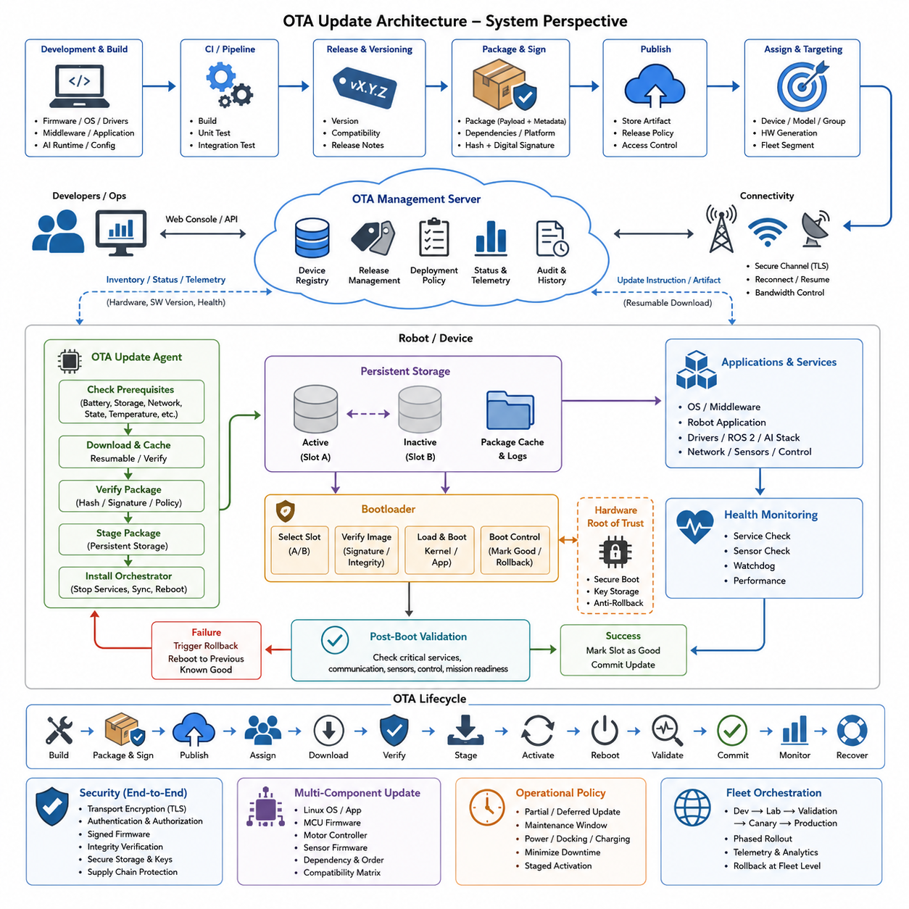
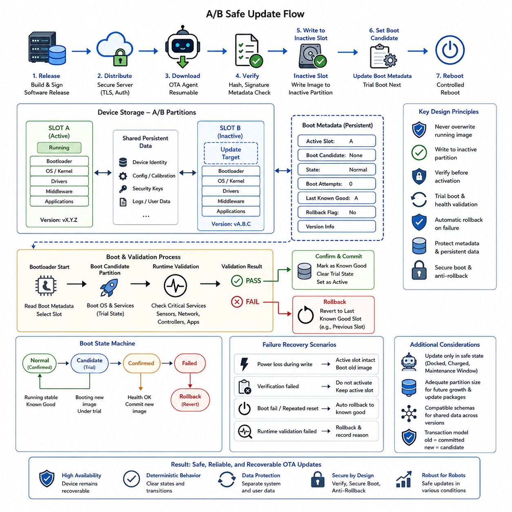
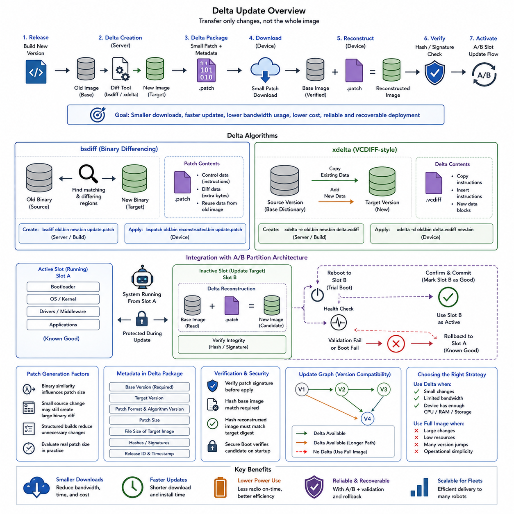
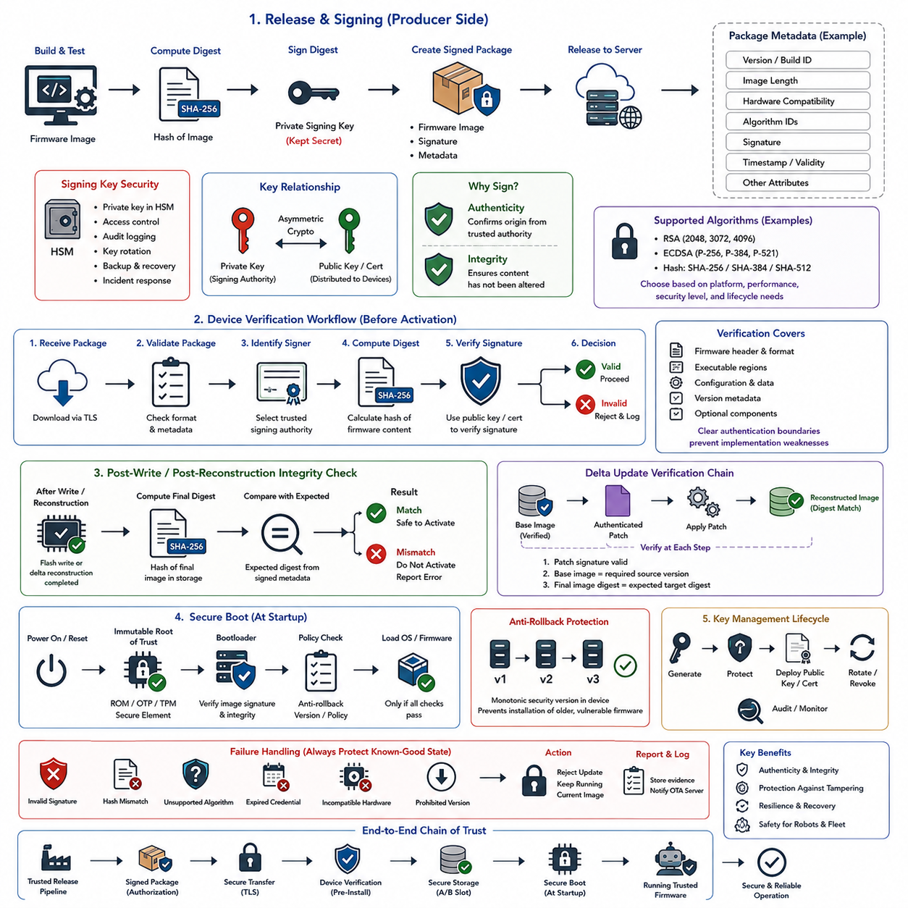
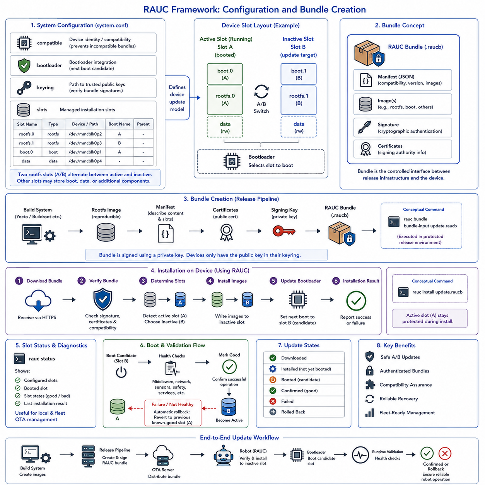
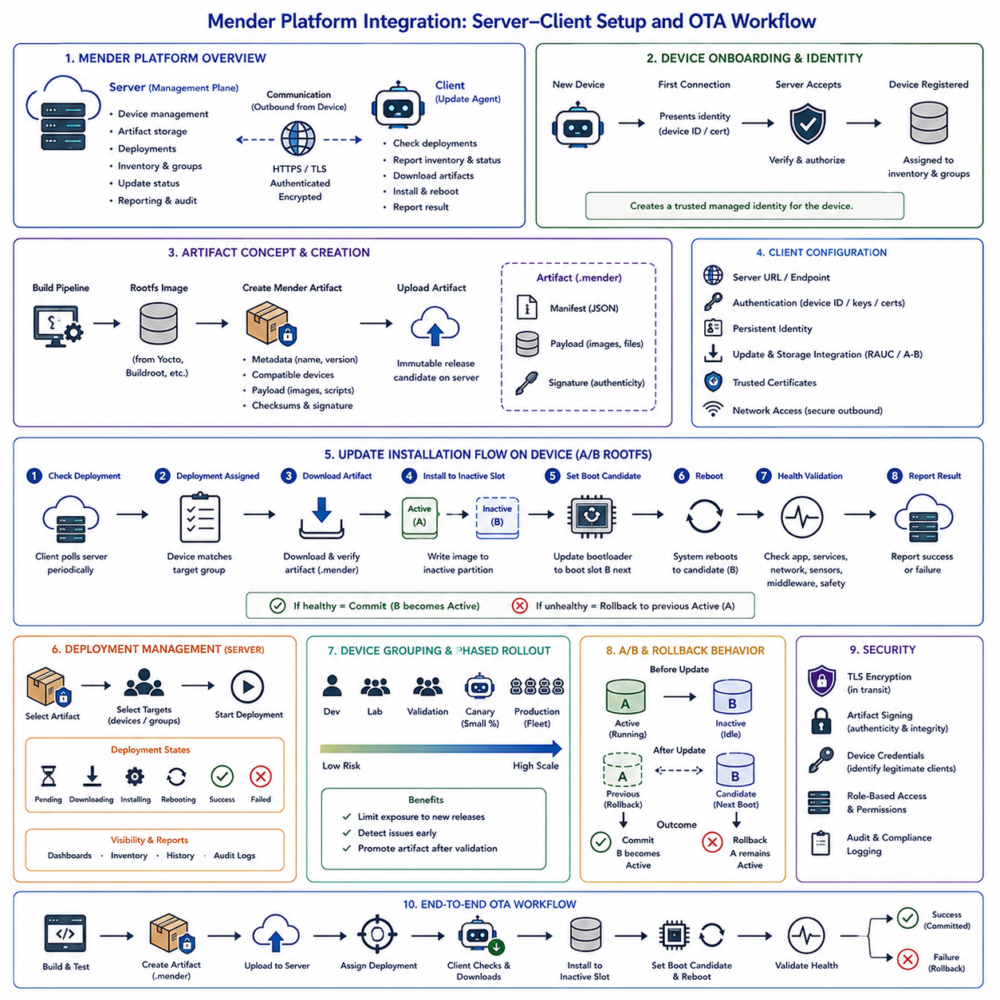
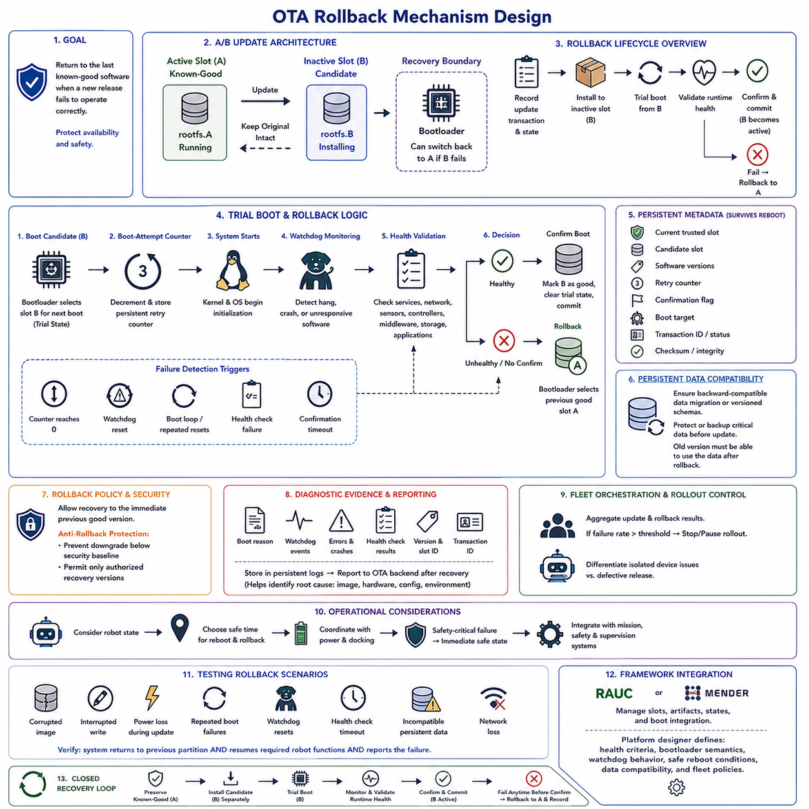
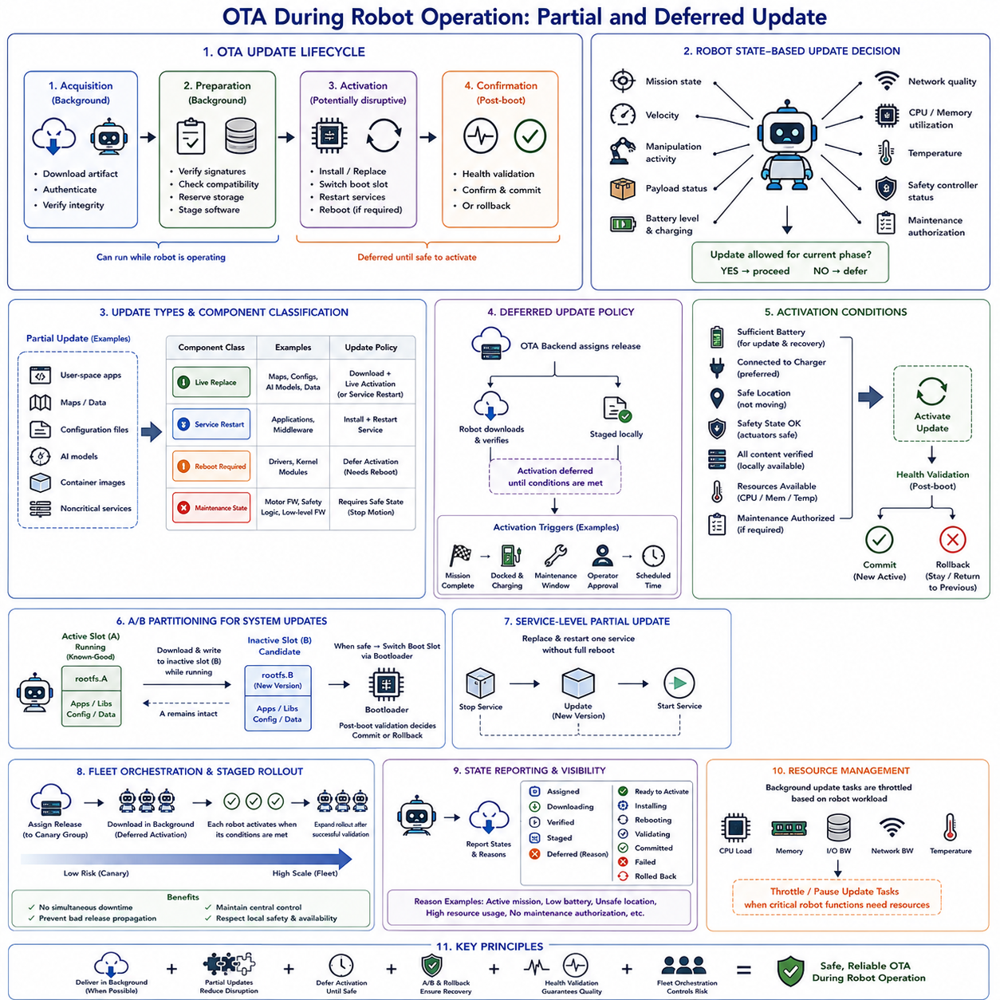
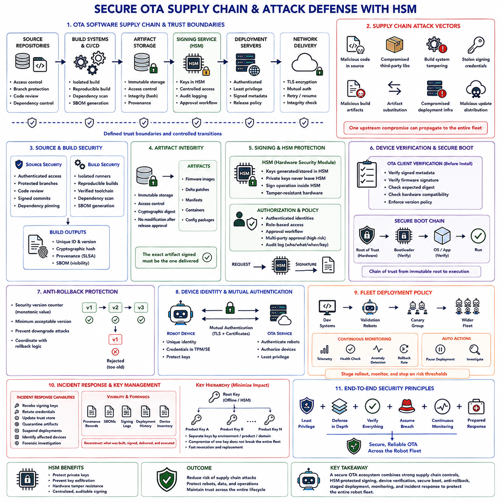
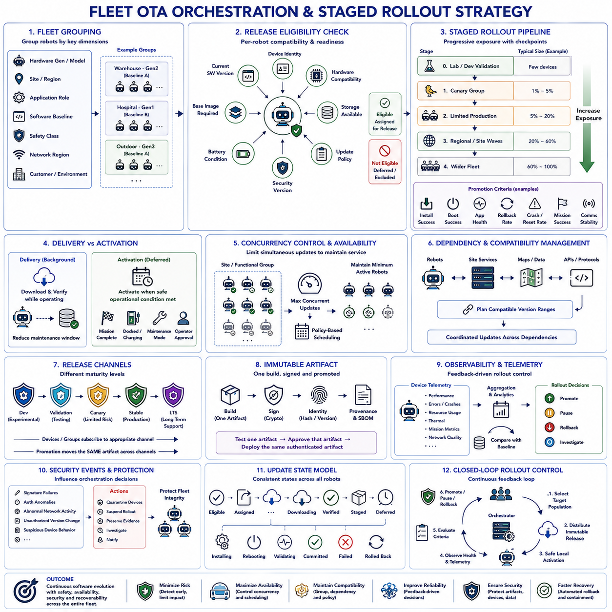

**Volume 02 Embedded Software Engineering**

# 10. OTA Firmware Update

## 10.01 OTA Update Architecture Overview: System Perspective

{width="7.268055555555556in" height="7.268055555555556in"}

An over-the-air update architecture for embedded robotic systems is not simply a mechanism for transferring a new firmware image to a device. It is a coordinated system that connects software development, release management, update infrastructure, communication networks, embedded update agents, bootloaders, persistent storage, runtime supervision, and recovery mechanisms. The architecture must preserve system availability and safety while allowing software to evolve throughout the operational life of the robot.

From a system perspective, the OTA lifecycle begins in the development and release environment. Firmware, operating-system components, device drivers, configuration data, middleware, application software, and sometimes AI-related runtime packages are built through controlled pipelines. Each release receives explicit version information and compatibility metadata so that the infrastructure can determine which hardware revisions, bootloader versions, operating environments, and dependent components are permitted to install it.

Before deployment, an update artifact should be transformed into a trusted release package rather than distributed as an arbitrary binary file. The package normally contains the payload together with metadata describing its version, target platform, dependencies, required storage, installation procedure, and compatibility constraints. Cryptographic hashes and digital signatures establish integrity and authenticity, allowing the robot to reject packages that are corrupted, modified, unsigned, or issued by an unauthorized release authority.

The server side forms the management plane of the OTA architecture. It maintains software artifacts, device identities, release policies, deployment status, and update history. Robots periodically communicate their hardware identity, installed software versions, operational state, and update capabilities. The management system compares this inventory with deployment policies and determines whether a particular release is applicable, enabling updates to be controlled by robot model, hardware generation, software baseline, operational group, or fleet segment.

Communication between the update infrastructure and the robot must be treated as an unreliable distributed-system boundary. Wireless connectivity may disappear while a robot is moving, packets may be delayed, and a large image may require several sessions to download. Consequently, robust OTA implementations support resumable transfer, local caching, integrity checks, retry policies, bandwidth control, and timeout handling. Download failure must remain fundamentally different from installation failure so that interrupted communication does not unnecessarily affect the running system.

Inside the robot, an OTA update agent provides the primary interface between remote management and local embedded software. The agent receives deployment instructions, evaluates prerequisites, downloads the artifact, verifies metadata and signatures, and stages the package in persistent storage. It should also examine battery level, available disk space, network condition, current mission state, temperature, and other platform-specific constraints before permitting installation. This separates update policy from the low-level mechanisms that actually replace software.

Installation must be isolated from normal execution as far as practical. Updating an executable image while it is actively controlling motors, sensors, communication buses, or safety-related functions can produce undefined behavior. The OTA architecture therefore coordinates application shutdown, service transitions, storage synchronization, and reboot sequencing. For robots, the update manager may additionally require docking, charging, mission completion, or entry into a maintenance state before modification of critical firmware is allowed.

A/B partitioning provides an important architectural pattern for high-reliability updates and is explicitly separated as the next detailed topic in the chapter structure. The currently active software executes from one partition while a new image is written to the inactive partition. The original image remains untouched during installation. After verification, the boot configuration selects the candidate partition for the next startup, creating a transactional boundary between the known working software and the proposed replacement.

The bootloader is therefore part of the OTA trust and recovery chain rather than merely an initialization component. Earlier chapters establish secure boot, dual-partition boot design, and bootloader-based recovery as related architectural foundations. At startup, the boot process identifies the selected image, validates required security properties, loads the candidate software, and participates in determining whether the new version has successfully reached an acceptable operational state.

Successful booting alone should not automatically mean that an update succeeded. A newly installed image may initialize the kernel but fail to communicate with motor controllers, load configuration data, start ROS 2 services, access sensors, or establish required network interfaces. A health-monitoring mechanism should therefore evaluate post-update readiness. Only after essential services and platform functions satisfy defined acceptance criteria should the candidate image be committed as the new known-good software baseline.

If post-update validation fails, the recovery architecture must restore a previously verified configuration. Rollback may be triggered by repeated boot failures, watchdog resets, application crashes, health-check failures, or expiration of a confirmation timer. The detailed rollback mechanism is treated separately later in the chapter, but at the architectural level it closes the OTA transaction: deployment is incomplete until the system can either confirm the new software or reliably return to a recoverable state.

Security must span the complete update chain. Transport encryption protects communication, but secure transport alone cannot establish that firmware itself is trustworthy. Release credentials, signing keys, update servers, device identities, boot verification, and local storage form a chain of trust. The chapter structure consequently extends OTA into firmware signing, integrity verification, supply-chain attack defense, and hardware security mechanisms, showing that update security is a lifecycle property rather than a single cryptographic check.

OTA architecture must also account for heterogeneous software boundaries. A robot may contain an embedded Linux computer, GPU edge processor, safety MCU, motor controllers, sensor firmware, and peripheral microcontrollers, each with different update mechanisms. Updating these components independently can create incompatible intermediate states. A system-level updater therefore needs dependency rules, compatibility matrices, ordered installation, and coordinated reboot behavior so that the complete robot reaches a validated software configuration rather than merely a collection of individually updated devices.

Operational policy becomes especially important when the robot cannot immediately stop working. The chapter structure explicitly distinguishes partial and deferred updates during robot operation. Noncritical packages may sometimes be downloaded or staged while missions continue, whereas safety-related firmware can require a controlled maintenance window. Separating download, verification, staging, activation, and confirmation allows the architecture to minimize downtime without sacrificing deterministic transition into a known software state.

At fleet scale, OTA becomes an orchestration problem rather than a device-level installation problem. The release should normally progress through controlled populations such as development units, laboratory robots, validation fleets, canary devices, and progressively larger production groups. Telemetry from each stage provides evidence about boot success, crashes, resource consumption, communication stability, and mission behavior. The chapter therefore concludes the OTA sequence with fleet orchestration and staged rollout strategy as a distinct system-level concern.

A complete OTA architecture can consequently be understood as a closed lifecycle: build, package, sign, publish, assign, download, verify, stage, activate, reboot, validate, commit, monitor, and recover when necessary. Its primary objective is not simply remote software delivery, but controlled transformation from one known system configuration to another. In robotics, where embedded software interacts directly with physical motion and safety mechanisms, that distinction makes OTA an integral element of reliability, security, maintainability, and lifecycle engineering.

## 10.02 Safe Update Design with A/B Partition

{width="7.268055555555556in" height="7.268055555555556in"}

A/B partitioning is a fault-tolerant update architecture designed to prevent a failed software installation from making an embedded system permanently unavailable. Instead of replacing the currently running system image, storage is divided into two bootable slots, commonly called Slot A and Slot B. One slot remains active while the other becomes the update target, preserving a known-good software environment throughout most of the OTA process.

During normal operation, the bootloader selects one partition as the active slot and the operating system, middleware, drivers, and robot applications execute from that image. The inactive slot is not required for current operation and can therefore receive a new software release without modifying the running image. This separation transforms an OTA update from an in-place overwrite into a controlled transition between two independently bootable system states.

A typical update begins when the OTA agent receives an authorized release and determines that the device satisfies installation prerequisites. After download and cryptographic verification, the new image is written to the inactive partition. If Slot A is currently active, Slot B becomes the installation destination, and vice versa. The active partition should remain unchanged so that interruption during writing does not destroy the software configuration currently responsible for operating the robot.

The inactive image must be completely validated before it becomes a boot candidate. Validation may include checking package metadata, image size, cryptographic hashes, digital signatures, filesystem consistency, version compatibility, and hardware compatibility. The updater should also confirm that all required blocks were written successfully. Only after these checks pass should boot metadata be modified to request startup from the newly installed slot during the next controlled reboot.

Boot metadata is a critical element of the design because it records which slot should start, which image is known to be good, and whether a candidate image is still undergoing validation. Implementations may additionally maintain boot-attempt counters, update states, rollback flags, and version information. These records must themselves be protected against corruption because incorrect boot metadata can prevent recovery even when both partition images remain physically intact.

The transition to the new partition should normally use a trial-boot state rather than immediately declaring the update successful. After installation into the inactive slot, the bootloader marks that slot as the next candidate and reboots the device. The candidate image then starts under probation. Until runtime validation confirms acceptable behavior, the previous active partition remains the known-good image and provides the recovery path if the candidate fails.

A robust bootloader therefore distinguishes between bootable, candidate, confirmed, and failed software states. When starting a candidate partition, it may decrement an allowed boot-attempt counter or start a confirmation mechanism. If the system repeatedly resets before successful confirmation, the bootloader interprets this behavior as evidence of update failure. It can then select the previous known-good partition automatically instead of repeatedly attempting to boot defective software.

Post-boot validation extends the safety mechanism beyond simple kernel startup. The candidate system should demonstrate that critical services initialize correctly and that required hardware interfaces remain available. In a robot, validation may examine communication with motor controllers, safety controllers, sensors, network interfaces, storage, middleware, and essential applications. The update is confirmed only when predefined health criteria indicate that the robot has reached a stable operational state.

The confirmation operation represents the commit point of the A/B update transaction. Once the candidate image passes required checks, the system records the new partition as known-good and clears temporary trial information. The former active slot can then remain available as a backup until a later update cycle replaces it. Consequently, the two slots alternate roles over successive releases, with the active image protected while its counterpart receives the next candidate version.

Failure handling must be deterministic. If power disappears while the inactive slot is being written, the existing active slot should still be bootable. If verification fails, activation should not occur. If the candidate fails during boot or runtime validation, boot control should return to the previous known-good image. These behaviors are the central reason for using A/B partitioning: failure at different update stages should lead to a defined recovery state rather than an unusable device.

Power-loss resilience also requires careful handling of metadata and persistent configuration. Updating the image and changing the boot-selection state must not be treated as one uncontrolled operation. Critical metadata should be written using atomic or otherwise recoverable techniques so that unexpected reset cannot leave ambiguous slot selection. The design should always provide enough persistent information for the bootloader to determine which image is trusted and what recovery action should be taken.

Not every form of persistent data should be duplicated together with the system partitions. Device identity, calibration parameters, security credentials, robot configuration, operational logs, and user-generated data may need dedicated persistent partitions that survive switching between Slot A and Slot B. Their schemas must remain compatible with both the old and candidate releases during the transition, because an automatic rollback is ineffective if the new software irreversibly modifies shared data required by the previous version.

Partition sizing must account for the complete update lifecycle rather than only the current image size. Both slots require enough capacity for future operating-system and application growth, while additional storage may be required for downloaded packages, temporary files, logs, and recovery information. Embedded platforms with limited flash therefore face a tradeoff between the strong recovery properties of complete A/B images and the storage overhead created by maintaining two bootable software environments.

Security controls remain active throughout the slot transition. A bootloader should not boot an image merely because it resides in the selected partition. The candidate must satisfy the platform\'s secure-boot and signature-verification requirements, while rollback protection may prevent unauthorized installation of vulnerable historical versions. The boot-selection mechanism, version metadata, signing keys, and recovery logic therefore belong to the same chain of trust as the firmware image itself.

In robotic systems, partition switching should also be coordinated with physical operating state. Activation may be prohibited while the robot is navigating, manipulating an object, controlling safety-critical equipment, or operating with insufficient battery capacity. The image can be downloaded and prepared beforehand, but reboot and slot transition can be deferred until the robot reaches a safe maintenance condition, such as mission completion, docking, charging, or an explicitly authorized service window.

A/B partitioning ultimately provides a transactional model for embedded software evolution. The old image represents the committed state, the inactive partition receives the candidate state, trial boot performs controlled execution, health validation determines acceptance, and confirmation commits the new state. If any critical stage fails, rollback restores the previous configuration. This architecture provides the foundation for reliable OTA deployment where recoverability is more important than simply installing software as quickly as possible.

## 10.03 Delta Update Algorithms: bsdiff / xdelta [w/Code]

{width="7.268055555555556in" height="7.268055555555556in"}

Delta updating reduces OTA transmission size by distributing only the information required to transform an installed software image into a newer version. Instead of downloading a complete firmware or filesystem image for every release, the update system compares an old version with a new version and generates a compact delta package. On the target device, this package is applied to the verified base image to reconstruct the exact new software image before activation.

The basic delta-update workflow contains two computationally different stages. During release preparation, a server-side tool receives the old image and the new image and calculates their differences. The resulting patch contains instructions and changed data rather than a complete duplicate of the target image. During installation, the embedded device combines the original image with the downloaded patch, producing a reconstructed candidate image that can subsequently enter the normal OTA verification and activation process.

Delta updating is particularly valuable when communication bandwidth, download time, or data cost is constrained. A small firmware modification may change only a limited portion of the logical program, while a full-image update would transmit hundreds of megabytes or several gigabytes. When an efficient differencing algorithm identifies reusable content from the previous release, the transferred artifact can become substantially smaller, reducing network utilization and shortening the package acquisition phase of an OTA deployment.

The effectiveness of delta generation depends strongly on how software images change between builds. Small source-code modifications do not always produce small binary differences because compiler output, link addresses, compressed filesystems, timestamps, metadata, or reordered blocks can propagate changes across a binary image. Consequently, OTA engineering should evaluate actual generated patch sizes rather than assuming that a minor source change automatically creates a correspondingly small delta package.

bsdiff is a binary differencing approach designed to construct compact patches by finding relationships between an old binary and a new binary. Conceptually, it analyzes matching and differing regions, then encodes how bytes from the old file can be reused or adjusted to reproduce the new file. The generated patch separates transformation information from additional data, allowing substantial portions of an existing image to contribute to reconstruction instead of being retransmitted.

A typical bsdiff workflow can be represented conceptually as \`bsdiff old.bin new.bin update.patch\`, followed on the target side by \`bspatch old.bin reconstructed.bin update.patch\`. The first operation is normally performed in the build or OTA backend, where computational resources are comparatively abundant. The second operation reconstructs the target image on the embedded platform. Production implementations should wrap these operations with version checks, signature verification, storage protection, and failure handling rather than treating patch application as an isolated command.

bsdiff can achieve attractive patch sizes for binaries with significant similarity, but its resource requirements must be considered when targeting constrained embedded devices. Patch creation can require substantial processing and memory, while reconstruction also needs sufficient workspace and storage for the base data, patch, and resulting image. For this reason, delta efficiency cannot be evaluated only by network savings; RAM consumption, flash capacity, execution time, power-loss behavior, and target hardware capability must also be included.

xdelta represents another practical family of binary delta techniques and is commonly associated with VCDIFF-style encoding. Rather than requiring the entire target software to be transmitted, it encodes instructions describing how portions of source data can be copied and how new data should be inserted. This copy-and-add model is well suited to general binary content and provides a useful foundation for distributing differences between related software artifacts while preserving exact reconstruction of the target version.

Conceptually, an xdelta workflow uses an existing release as the source dictionary and generates a delta against the new release. The device later decodes that delta using exactly the expected source version. This dependency is fundamental: a patch produced for version A to version B should not normally be applied to version C. The OTA metadata must therefore identify the required base version, target version, patch format, algorithm version, and integrity information before reconstruction is attempted.

Choosing between bsdiff, xdelta, and a complete-image update should be based on system constraints rather than patch size alone. bsdiff may be attractive when minimizing binary difference size is important, whereas xdelta-style approaches can provide practical streaming-oriented behavior and controlled resource usage depending on implementation. A full image remains valuable when versions differ substantially, when reconstruction resources are limited, or when maintaining many version-specific delta paths becomes operationally inefficient.

A production OTA backend may therefore generate several artifacts for the same release. For example, devices running the immediately previous version may receive a small delta, while older installations receive another compatible delta or fall back to the complete image. The deployment service selects an artifact according to reported device state. This requires an explicit update graph in which software versions are nodes and valid delta transformations are directed edges connecting supported source and destination versions.

The target must verify its base image before applying a delta. If the installed source differs from the exact image assumed during patch generation, reconstruction can fail or produce incorrect output. The updater should compare trusted version metadata and preferably a cryptographic digest of the source image. After reconstruction, the complete candidate image must also be hashed and verified against the expected target digest, ensuring that delta processing produced exactly the release generated by the build system.

Cryptographic signing should protect the delta package and its metadata in the same way that a complete OTA artifact is protected. A small patch is still executable software transformation data and therefore belongs inside the software supply-chain trust boundary. Authentication should occur before patch application, while final-image integrity verification should occur after reconstruction. Secure boot can then independently verify the resulting candidate during startup, maintaining trust across download, reconstruction, storage, and execution.

Delta reconstruction integrates naturally with A/B partition architecture. The robot can continue operating from the active slot while the updater reads the required base content and constructs the new image in the inactive slot. The active known-good image remains protected during the transformation. Once reconstruction and integrity verification succeed, the inactive slot becomes a boot candidate and follows the trial boot, health validation, confirmation, and rollback process used for safe A/B updates.

Power interruption must be assumed during patch application. The updater should never leave the only bootable image dependent on a partially applied transformation. Temporary output, transactional metadata, checkpoints where appropriate, and inactive-slot reconstruction can prevent interrupted patching from damaging the known-good state. After restart, the update agent should be able to determine whether reconstruction can safely resume, must restart, or should discard incomplete output and continue operating from the existing release.

Delta updates also introduce lifecycle complexity because every supported source version can potentially require a different patch. Maintaining deltas from all historical releases quickly becomes expensive in storage, testing, and deployment logic. Practical systems often support deltas only across a limited number of recent versions and use a full-image fallback for older or unexpected installations. This keeps the update graph manageable while preserving bandwidth savings for the majority of regularly maintained devices.

For robotic fleets, the strongest design combines delta algorithms with release orchestration rather than treating them as standalone compression techniques. The backend determines the correct source-to-target path, the robot validates its current state, the delta reconstructs an exact candidate image, and A/B protection preserves recoverability. bsdiff and xdelta therefore optimize the transfer stage of OTA, while signing, integrity verification, partition safety, rollback, and fleet policy provide the larger architecture required for dependable embedded deployment.

## 10.04 Firmware Signing and Integrity Verification [w/Code]

{width="7.268055555555556in" height="7.268055555555556in"}

Firmware signing establishes a cryptographic trust relationship between the organization that produces embedded software and the device that executes it. An OTA system should never assume that a firmware image is trustworthy merely because it arrived from an expected server. The device must independently verify that the software was authorized by a trusted release authority and that its contents have not changed since the approved package was created.

Integrity verification and authenticity verification address different security questions. A cryptographic hash such as SHA-256 can detect whether firmware bytes have changed, but an attacker who replaces the firmware may also replace an unprotected hash. A digital signature binds the expected digest to a trusted private signing key. Verification with the corresponding public key therefore determines both whether the image is intact and whether it originated from an authorized signing process.

The signing process normally occurs after a firmware image has passed the required build, integration, and release tests. A cryptographic digest is calculated over the defined firmware content, and the digest or a structured representation containing it is signed using a protected private key. The resulting signature, version information, hardware compatibility data, image length, algorithm identifiers, and other release attributes can then be stored in authenticated firmware metadata accompanying the update artifact.

Public-key cryptography enables signing authority to remain separated from deployed devices. The private key used to authorize production firmware should remain inside controlled signing infrastructure and should never be distributed to robots. Devices require only the corresponding public key or a trusted certificate chain for verification. Compromise of a robot therefore does not automatically provide the attacker with the capability to generate firmware that other robots will accept as authentic.

Algorithms such as RSA and elliptic-curve digital signature schemes can be used for embedded firmware signing, with the exact choice determined by platform requirements, cryptographic libraries, hardware acceleration, certification constraints, and lifecycle expectations. The security architecture should explicitly identify supported algorithms, key sizes, signature formats, and hash algorithms. Algorithm selection must also consider long-lived devices that may require secure software maintenance for many years.

The private signing key is one of the most security-sensitive assets in the OTA supply chain. Storing it as an ordinary file on a developer workstation or CI server creates an unnecessary compromise path. Production systems should isolate signing operations using tightly controlled infrastructure and, where appropriate, a hardware security module. Access control, audit logging, separation of duties, key backup, rotation, revocation, and incident-response procedures should be defined as part of key lifecycle management.

Firmware verification begins before installation. After the OTA agent receives a package, it should validate package structure and authenticated metadata, identify the expected signing authority, calculate the required cryptographic digest, and verify the digital signature. If any check fails, the update must be rejected before it modifies the bootable software state. Download completion therefore represents only acquisition of an artifact, not authorization to execute or activate that artifact.

Verification should cover exactly the content whose integrity is required. Ambiguity about which bytes are signed can create serious implementation weaknesses. Firmware format, header fields, executable regions, configuration elements, version metadata, and optional components must have clearly defined authentication boundaries. Canonical metadata encoding is useful because both the signing environment and embedded verifier must calculate the signature over precisely the same logical representation.

A second integrity check is important after the firmware has been written or reconstructed. Flash programming errors, interrupted writes, storage corruption, or defects during delta reconstruction can produce an image different from the signed target even when the downloaded package itself was valid. Calculating and comparing the final image digest before activation confirms that the candidate stored in the target partition is exactly the software release expected by the deployment system.

Delta updates require particularly careful integrity handling because the downloaded patch and the final executable image are different artifacts. The patch should be authenticated before application, the installed base image should match the required source version, and the reconstructed image should match the expected target digest. This creates a verification chain from trusted base image through authenticated transformation to the exact target image rather than assuming successful patch execution implies correct firmware.

A/B partition architecture provides a natural location for secure verification. The active slot continues running as the known-good system while the authenticated update is written to the inactive slot. Signature and integrity checks are completed before that slot becomes a boot candidate. If verification fails, the boot configuration remains unchanged. This preserves the currently trusted software while preventing an invalid candidate from crossing the activation boundary.

Secure boot extends firmware authentication into the startup sequence. OTA verification confirms an update before activation, while the bootloader independently verifies executable software when the device starts. The root public key or a hash of trusted key material may be anchored in protected hardware, immutable boot ROM, one-time-programmable memory, TPM, or another root-of-trust mechanism. This prevents an attacker from bypassing the OTA agent and directly installing unauthorized executable content.

Version control must also participate in firmware authentication because a correctly signed image may still be unsafe if it contains an old vulnerability. Anti-rollback protection associates trusted firmware with a monotonic security version or comparable policy. The bootloader or secure update mechanism rejects images below the permitted security level even when their signatures are mathematically valid, preventing legitimate historical firmware from being abused as a downgrade attack.

Key rotation is essential for long-lived embedded products. A signing key may expire, be replaced according to policy, or require emergency revocation after suspected compromise. Devices therefore need a controlled mechanism for updating trusted verification keys without allowing arbitrary trust changes. A root key can authorize intermediate release keys, allowing operational keys to rotate while a more strongly protected root of trust remains stable across the device lifecycle.

Certificate-based architectures can extend this hierarchy by allowing firmware signatures to be validated through a chain of trust. A device may trust a manufacturer root while individual products, environments, or release organizations use subordinate certificates. Such separation reduces the impact of a single operational key compromise and supports distinct development, testing, and production authorities. Trust policies must nevertheless remain simple enough for reliable implementation in constrained embedded software.

Failure behavior should always default toward preservation of the known-good state. Invalid signatures, mismatched hashes, unsupported algorithms, malformed metadata, expired credentials, incompatible hardware identifiers, or prohibited versions should stop activation and generate diagnostic evidence. The robot may continue operating with its current trusted image while reporting the failure to the OTA management system, avoiding unnecessary service interruption caused by rejection of an untrusted update.

For robotic fleets, signing and integrity verification ultimately form the security gate between software delivery and physical execution. Release pipelines establish what software is authorized, cryptographic signatures preserve that authorization across untrusted networks and storage, embedded verification checks it before installation, and secure boot enforces it again at startup. Combined with A/B partitions, rollback control, protected keys, and audited release processes, this creates a continuous chain of trust from firmware creation to robot operation.

## 10.05 RAUC Framework Configuration and Bundle Creation [w/Code]

{width="7.268055555555556in" height="7.268055555555556in"}

RAUC is an embedded Linux update framework designed to install authenticated software bundles while preserving a recoverable system state. Rather than treating an OTA update as a simple file replacement, RAUC models the device as a set of managed installation slots and applies a signed bundle according to a predefined system configuration. This makes it especially suitable for robots and industrial devices that require controlled A/B updates, bootloader coordination, and deterministic recovery behavior.

A typical RAUC deployment separates the currently running root filesystem from an inactive update target. Two root filesystem slots, commonly represented as rootfs.0 and rootfs.1, alternate between active and inactive roles across successive releases. Additional slots can represent boot partitions, application data, or other updateable components. RAUC understands these relationships through its system configuration and uses them to determine where bundle images should be installed.

The central RAUC configuration is normally defined in \`system.conf\`. This file describes the compatible device identity, bootloader integration, keyring location, and available slots. Each slot definition identifies properties such as device path, slot type, boot name, and parent relationships where applicable. The configuration therefore translates the physical storage layout of an embedded target into a logical update model that RAUC can safely manage during installation.

The \`compatible\` value provides an important compatibility boundary between update bundles and target hardware. A bundle declares the system compatibility for which it was produced, while the target configuration declares its own compatible identity. RAUC compares these values before installation. This prevents a correctly signed but technically incompatible bundle intended for another board, product generation, or robot controller from being installed accidentally.

Bootloader integration allows RAUC to connect software installation with the actual boot decision. Depending on the platform, RAUC can cooperate with supported boot mechanisms so that a newly written slot becomes the next boot candidate. The bootloader still performs the startup transition, while RAUC maintains information about slot state and update results. This separation enables installation logic and low-level boot control to participate in a common A/B recovery strategy.

Slot definitions must correspond accurately to the target\'s real partition layout. For example, rootfs.0 may reference one block device partition while rootfs.1 references another partition of equal or sufficient capacity. Incorrect device mappings can overwrite the wrong storage area and defeat the safety properties of A/B updating. Partition tables, bootloader configuration, filesystem generation, and RAUC configuration should therefore be designed and validated as one integrated storage architecture.

RAUC distributes update content using bundles. A bundle is a structured update artifact containing one or more software images together with a manifest and cryptographic authentication information. Instead of independently transferring an arbitrary root filesystem image and metadata, the release pipeline packages them into a unit that RAUC understands. The bundle becomes the controlled interface between software production infrastructure and the update mechanism running on the embedded target.

The bundle manifest describes what the package contains and where its images logically belong. It can identify bundle compatibility, version information, descriptive metadata, and image entries corresponding to configured slot classes. An image intended for the root filesystem, for example, is associated with the appropriate rootfs slot class rather than a hard-coded active partition. RAUC then resolves the correct inactive installation target according to the device\'s current slot state.

Bundle creation begins with reproducible software artifacts generated by the embedded Linux build process. A root filesystem image may originate from Yocto, Buildroot, or another controlled image-generation pipeline. The release process places the required image and manifest into a bundle input directory and then invokes the RAUC bundle-generation mechanism. The resulting \`.raucb\` artifact packages the release into a form suitable for authenticated deployment to compatible devices.

A simplified release environment can conceptually execute \`rauc bundle bundle-input update.raucb\` after the manifest, filesystem image, certificate, and signing-key configuration have been prepared. In production, the signing key should not be treated as an ordinary development asset. Bundle creation should be integrated with a protected release pipeline in which signing authority, access permissions, audit records, and key-management procedures are explicitly controlled.

RAUC uses cryptographic signing to ensure that a bundle originates from an accepted release authority and has not been modified after signing. The target device is configured with trusted verification material through its keyring, while the private signing key remains in the release environment. When an installation is requested, RAUC verifies the bundle before writing its contents into managed slots. An untrusted or corrupted bundle is therefore rejected before it crosses the installation boundary.

Installation can be initiated conceptually with a command such as \`rauc install update.raucb\`. RAUC first examines the bundle, checks compatibility and authentication, determines the current booted slot, selects an appropriate inactive target, and installs the associated image. The active root filesystem remains protected during this process. Successful writing alone does not necessarily mean that the new software has been permanently accepted, because activation and post-boot confirmation remain separate lifecycle stages.

Slot status provides the operational view required to understand the device\'s update state. Commands such as \`rauc status\` can expose information about configured slots, the currently booted system, and relevant slot conditions. This information is valuable for local diagnostics and remote OTA management because the fleet backend needs to distinguish devices that merely downloaded an update from those that installed, booted, confirmed, failed, or rolled back a release.

After installation, the bootloader can start the newly selected slot as a candidate system. The updated software should then perform application-specific health checks before being considered reliable. A robot may verify middleware startup, network connectivity, motor-controller communication, safety interfaces, sensor availability, and required services. Once these checks succeed, the update process can mark the candidate as good according to the boot and RAUC integration strategy used by the platform.

If the candidate repeatedly fails to boot or cannot satisfy the required health criteria, the system should preserve or return to the previous known-good slot. RAUC does not eliminate the need for carefully designed bootloader recovery semantics; instead, it participates in a broader architecture containing A/B partitions, boot-attempt control, watchdog supervision, application health validation, and rollback policy. Reliable OTA behavior therefore depends on the complete platform integration rather than the update framework alone.

For robotic products, RAUC is most effective when incorporated into the build and deployment lifecycle rather than added only as a device-side utility. The build system creates deterministic images, the release pipeline constructs and signs bundles, the OTA service distributes them, RAUC verifies and installs them into controlled slots, and the bootloader performs the transition. Runtime validation then determines whether the new software is committed or the previous system is restored.

A well-designed RAUC implementation consequently connects storage architecture, release packaging, cryptographic trust, boot control, and operational recovery into one update workflow. Its bundle model provides a repeatable deployment unit, while slot management protects the running system from direct replacement. Combined with A/B partitioning, secure signing, compatibility checks, health monitoring, and rollback logic, RAUC provides a practical foundation for maintainable and recoverable embedded Linux OTA updates.

## 10.06 Mender Platform Integration: Server/Client Setup [w/Code]

{width="7.268055555555556in" height="7.268055555555556in"}

Mender is an OTA software update platform designed to coordinate artifact creation, device management, deployment control, and reliable installation across embedded Linux systems. Its architecture separates server-side fleet orchestration from client-side update execution. This separation allows a central service to manage software releases across many robots while each embedded device independently performs authentication, download, installation, reboot, and update-state reporting.

The server side acts as the management plane for the OTA lifecycle. It maintains device identities, software artifacts, deployment definitions, inventory information, and update status. Operators upload approved software releases and select which devices or groups should receive them. The server then coordinates deployment while collecting progress information from clients, providing centralized visibility into heterogeneous robots operating with different software versions and update histories.

A Mender client runs on each managed embedded Linux device and communicates with the server through authenticated network connections. The client periodically checks whether a deployment applies to the device, reports inventory and software state, downloads assigned artifacts, and executes the corresponding installation workflow. Because the device initiates normal update communication, the architecture works well for robots located behind firewalls or network address translation where inbound management connections may be undesirable.

Device onboarding establishes the trust relationship between a new client and the management service. When the client first contacts the server, it presents identity information that allows the device to be recognized and authorized according to the configured deployment model. After acceptance, the server can associate the device with inventory attributes and deployment groups. This creates a managed identity that connects the physical robot with its software state and OTA lifecycle records.

A Mender Artifact is the controlled software delivery unit used by the platform. Rather than distributing an arbitrary filesystem image, the release pipeline packages update content together with metadata describing artifact identity, compatible device types, and payload information. The artifact format allows the server and client to reason about whether a release belongs to a particular class of devices before installation, reducing the risk of deploying technically incompatible software to the wrong hardware.

Artifact creation should be integrated with the embedded Linux build and release pipeline. Root filesystem images can be generated by controlled build environments and packaged into Mender Artifacts as part of release automation. Each artifact should carry a meaningful software identity that maps back to a tested build. The resulting file is uploaded to the server, where it becomes an immutable release candidate that can be assigned to development, validation, or production device groups.

Client configuration defines how the embedded target reaches and trusts the Mender service. The device needs the appropriate server endpoint, authentication configuration, persistent identity information, and update integration required by the target platform. Network access should be available through a secure transport path, while trusted certificates and device credentials must be protected. Configuration should remain consistent with the production environment rather than relying on temporary development settings.

For robust operating-system updates, Mender can be integrated with an A/B root filesystem architecture. The currently active root filesystem continues running while the client installs the new image into the inactive partition. The active system is therefore not overwritten during normal update installation. After the image has been written successfully, the boot configuration is changed so that the inactive partition becomes the candidate system during the next controlled reboot.

Bootloader integration is essential to complete the A/B transaction. The client can prepare a new candidate image, but the bootloader determines which root filesystem actually starts after reset. The platform must therefore maintain consistent partition definitions, boot variables, and update state. A mismatch between storage layout and boot configuration can defeat rollback behavior even if artifact download and installation succeed, making boot integration a fundamental part of the client setup.

After reboot, the newly installed software enters a validation stage before it should be considered permanently accepted. The embedded system can evaluate whether required services, networking, middleware, sensors, controllers, and application processes operate correctly. For a robot, reaching the Linux login state alone is insufficient evidence of update success. Operational health checks should determine whether the complete robotic software stack has returned to a safe and usable condition.

When the candidate software satisfies the required health criteria, the update can be committed as the accepted system state. If startup fails or application-level validation identifies a critical problem, the platform should preserve the ability to return to the previous known-good partition. This commit-or-rollback behavior transforms the update into a controlled transaction and prevents an unsuccessful release from permanently replacing the last operational software image.

Server-side deployments provide the orchestration layer above individual update transactions. An operator selects an artifact, defines the target device population, and starts a deployment. The service records whether devices are pending, downloading, installing, rebooting, successful, or failed according to the available update state. These records allow fleet administrators to distinguish network problems, device-specific failures, and release-wide defects rather than treating OTA as an unobservable remote copy operation.

Device grouping is particularly important for robotic fleets containing multiple hardware revisions, application roles, customer environments, or operational sites. Inventory attributes can support grouping according to product type, hardware generation, software baseline, or other deployment-relevant characteristics. Releases can then be introduced progressively instead of being sent to every robot simultaneously, reducing the operational impact of an unexpected software defect.

A practical rollout strategy begins with development and laboratory devices before progressing to validation robots and small production groups. The same artifact can be promoted through increasingly larger populations after update success and operational telemetry have been reviewed. Canary deployment limits the number of robots exposed to a new release during the highest-risk stage. Fleet-wide deployment becomes a controlled promotion process rather than a single irreversible event.

Security must cover both communication and software authorization. Transport encryption protects client-server exchanges, while artifact authentication and controlled release processes protect software content. Device credentials should identify legitimate clients, and signing material should remain within protected release infrastructure. The OTA platform should be considered part of the software supply chain, meaning server access, artifact creation, deployment permissions, credentials, and audit information all require explicit security controls.

Network interruption must not automatically compromise an update. Robots may move between access points, lose connectivity, enter weak wireless coverage, or remain offline for extended periods. The client-server architecture should tolerate delayed update checks and interrupted communication while maintaining a well-defined local state. Installation should begin only after the required artifact has been obtained and validated, separating unreliable network transfer from safety-critical software activation.

Operational integration should also prevent disruptive updates at unsafe times. A robot may download an artifact while performing normal work, but installation or reboot can be deferred until mission completion, docking, charging, or entry into a maintenance window. The OTA service determines what software should be deployed, while robot-side policy determines when the physical system is in an acceptable state to perform the disruptive portion of the update.

Mender integration therefore connects release engineering, centralized fleet management, secure device communication, embedded installation, A/B storage, boot control, validation, and rollback into a unified OTA workflow. The server provides visibility and orchestration, while the client protects the local update transaction. When combined with staged deployment and robot-aware activation policies, this architecture provides a scalable foundation for maintaining embedded Linux software across operational robotic fleets.

## 10.07 OTA Rollback Mechanism Design

{width="7.268055555555556in" height="7.268055555555556in"}

An OTA rollback mechanism is the recovery path that returns an embedded system to a previously verified software state when a newly installed release cannot operate correctly. Rollback must be designed before deployment rather than added after failures occur. In robotic systems, this mechanism protects availability and physical safety by ensuring that an unsuccessful firmware update does not permanently replace the last known-good configuration.

Rollback is most reliable when the update architecture preserves both the current software and the candidate release simultaneously. In an A/B partition design, the active slot contains the known-good image while the inactive slot receives the update. The original image remains unchanged until the candidate has completed installation, booting, and runtime validation. This separation creates a recovery boundary that allows the bootloader to return to the previous slot without reinstalling software remotely.

The rollback lifecycle begins before the new image is activated. The updater records which slot is currently trusted, which slot contains the candidate, the expected software versions, and the state of the update transaction. Persistent metadata must survive reboot and unexpected power loss. Without reliable state information, the bootloader may be unable to distinguish a valid candidate from an incomplete installation or determine which partition should be selected for recovery.

After installation, the candidate partition should enter a trial state rather than immediately becoming permanently accepted. The bootloader selects the new slot for the next startup but retains the previous slot as the known-good fallback. A trial boot provides a controlled observation period during which the system can determine whether the new firmware initializes correctly. Only explicit confirmation should convert the candidate into the committed software state.

Boot-attempt counting provides a fundamental mechanism for detecting releases that cannot complete startup. Before booting an unconfirmed image, the bootloader records or decrements a persistent retry counter. If the operating system reaches the required healthy state, it confirms the boot and clears the trial condition. If repeated resets occur before confirmation, the counter eventually reaches its failure threshold and the bootloader automatically selects the previous known-good partition.

A watchdog complements boot-attempt logic by detecting software that starts but becomes unresponsive. The new image may load the kernel successfully yet deadlock during service initialization, repeatedly crash, or fail to maintain critical control tasks. A hardware or software watchdog can reset the platform when expected supervision signals disappear. Repeated watchdog resets during the trial period can then be interpreted as evidence that rollback should be initiated.

Rollback decisions should not depend only on whether Linux or the operating system has booted. A robot may reach user space while essential functions remain unavailable. Post-update health validation should therefore examine application services, middleware, sensor interfaces, motor controllers, safety controllers, networking, storage, and other required subsystems. The candidate should be confirmed only after the complete operational stack satisfies predefined health criteria for an appropriate validation interval.

The application layer can participate directly in the confirmation protocol. After startup, a health manager evaluates required components and reports whether the candidate has reached an acceptable operational state. If validation succeeds, the system writes a persistent confirmation indicating that the current slot is good. If validation fails or confirmation never occurs within the permitted timeout, the next boot can treat the candidate as unsuccessful and return to the fallback slot.

Rollback metadata must be protected against partial writes and corruption. Slot state, retry counters, confirmation flags, and selected boot targets may be updated immediately before resets, when power interruption is possible. Atomic storage techniques, redundant metadata, checksums, or bootloader-specific transactional mechanisms can be used to maintain consistent state. Recovery logic should always be able to determine a safe boot choice even when the previous update operation ended unexpectedly.

Shared persistent data creates an additional rollback challenge. Although the previous system image may remain intact, the candidate software might modify databases, configuration schemas, calibration structures, or application data in ways that the older release cannot understand. A robust design therefore requires backward-compatible data migration, versioned schemas, reversible transformations, or protected copies of critical data. Software rollback is incomplete if persistent data makes the previous version unusable.

Rollback policy must also distinguish functional rollback from security downgrade. Returning to the immediately previous known-good release after a failed update is normally desirable, but allowing arbitrary installation of historical firmware can reintroduce known vulnerabilities. The system should therefore combine recovery rules with anti-rollback security policy. Authorized recovery versions can be permitted while images below an approved security baseline remain prohibited even if they carry valid historical signatures.

The rollback process should preserve diagnostic evidence before abandoning a failed candidate whenever possible. Boot reason, watchdog events, kernel errors, service failures, health-check results, software version, slot identity, and update transaction identifiers can be stored in persistent logs. After the previous image resumes operation, these records can be reported to the OTA backend, enabling engineers to determine whether the failure originated from the image, hardware compatibility, configuration, or local device conditions.

At fleet scale, automatic rollback must be connected to deployment orchestration. A single robot rollback may indicate an isolated hardware or storage problem, while repeated failures across a canary group may indicate a defective release. The management system should aggregate update and rollback results and stop or pause further rollout when failure thresholds are exceeded. This prevents a faulty candidate from propagating across the fleet while investigation is still in progress.

Operational state should influence when rollback and reboot actions occur. A robot experiencing a noncritical application problem may still need to reach a safe location before restarting, whereas failure of a safety-critical component may require an immediate transition to a safe state. The rollback controller should therefore coordinate with mission management, power management, docking logic, and safety supervision rather than treating reboot as an isolated software operation.

Rollback itself must be tested as aggressively as installation. Validation should include corrupted candidate images, interrupted writes, power loss during metadata updates, repeated boot failures, watchdog resets, health-check timeouts, incompatible persistent data, and network loss. Testing should verify not merely that the system can return to the old partition, but that it can resume required robotic functions and correctly report the failed update after recovery.

Frameworks such as RAUC or Mender can participate in this architecture by managing update states, slots, artifacts, and integration with boot mechanisms, but the framework alone cannot define robot-specific recovery correctness. The platform designer must establish the health criteria, safe reboot conditions, persistent-data compatibility, bootloader semantics, watchdog behavior, and fleet policies that determine when a release is genuinely acceptable or must be rejected.

A dependable rollback design therefore forms a closed recovery loop: preserve the known-good image, install the candidate separately, perform a trial boot, supervise startup, validate runtime health, and explicitly commit only after success. Any critical failure before confirmation returns control to the trusted slot and records the reason. This approach turns OTA deployment from an irreversible replacement operation into a recoverable transaction suitable for long-lived embedded robotic systems.

## 10.08 OTA During Robot Operation: Partial and Deferred Update

{width="7.268055555555556in" height="7.268055555555556in"}

Performing OTA updates while a robot remains operational requires a clear separation between activities that are safe during mission execution and activities that can disrupt control. Downloading, authentication, integrity checking, and staging can often occur in the background, while installation, reboot, boot-slot switching, or replacement of safety-critical software may need to be deferred. This separation minimizes downtime without allowing software maintenance to interfere with physical operation.

The update lifecycle can therefore be divided into acquisition, preparation, activation, and confirmation phases. Acquisition transfers the update artifact to the robot, while preparation verifies signatures, checks compatibility, reserves storage, and stages software. These phases may execute while the robot is working if sufficient computing and communication resources remain available. Activation is treated separately because it can modify executable components or require restart of critical services.

A robot-side update manager should continuously evaluate whether the platform is in an acceptable state for each update phase. Relevant conditions can include mission state, velocity, manipulation activity, payload status, battery level, charging state, network quality, CPU and memory utilization, thermal condition, and safety-controller status. Update permission is therefore determined not only by software policy but also by the current physical and operational context of the robot.

Partial updating allows selected components to be updated independently when their architecture and dependencies permit isolation. User-space applications, maps, configuration files, AI models, container images, or noncritical services may sometimes be replaced without updating the complete operating-system image. The update system must nevertheless understand dependencies so that a new component is not activated against incompatible libraries, interfaces, firmware, or communication protocols.

Component classification is important because not every software element should receive the same update policy. A navigation map or diagnostic package may tolerate dynamic replacement, while motor-control firmware, safety logic, kernel modules, or low-level device drivers can require a controlled maintenance state. Each component can therefore be assigned an update class describing whether background download, live activation, service restart, system reboot, or complete robot shutdown is required.

Deferred updating separates the decision to deliver software from the decision to activate it. The OTA backend may assign a release and the robot may download and verify it immediately, but activation remains pending until defined conditions are satisfied. This is useful for mobile robots that cannot interrupt a transport, inspection, cleaning, manipulation, or autonomous navigation mission simply because a new software version has become available.

A deferred update policy can define activation windows based on operational events rather than only clock time. Appropriate triggers may include mission completion, return to a docking station, charging connection, entry into a maintenance area, operator approval, or the beginning of a scheduled service period. Event-based activation aligns software maintenance with the robot lifecycle and reduces the probability that an update creates an unsafe or economically disruptive interruption.

Battery state is a particularly important activation condition. Downloading may be acceptable at moderate charge levels, while firmware installation and reboot should require enough energy to survive the complete update and possible recovery sequence. A robot already connected to its charger provides a preferable environment because power is stable and the platform is usually stationary. The policy should also reserve sufficient energy for rollback or controlled shutdown if activation fails.

Network conditions affect acquisition but should have limited influence once disruptive installation begins. Large artifacts can be downloaded incrementally while connectivity is available, using retries and resumable transfer when communication is interrupted. Before activation, the robot should confirm that all required content is stored locally and has passed integrity verification. This prevents a rebooted system from depending on an unreliable wireless connection to complete a partially acquired software transition.

Resource management is necessary when background update tasks share processors, storage, and network interfaces with autonomous functions. Hash calculation, decompression, delta reconstruction, and flash writing can consume significant CPU, memory, I/O bandwidth, and thermal capacity. The update manager can throttle or pause these operations when navigation, perception, planning, or control workloads require resources, ensuring that OTA preparation remains subordinate to real-time robotic operation.

Partial updates should use explicit dependency and compatibility metadata. If an AI perception model requires a particular inference runtime, or a navigation component requires a specific middleware interface, the updater must validate those relationships before activation. Groups of tightly coupled components may need to be treated as a single transactional update set. This avoids mixed-version states in which every individual package is valid but the combined robot software configuration is not.

Some components can support service-level restart instead of complete system reboot. A noncritical application may be stopped, replaced, validated, and restarted while other robot services remain active. However, live replacement must not be assumed to be inherently safe. The architecture should evaluate communication dependencies, shared memory, device ownership, process supervision, and state restoration so that restarting one service does not unexpectedly destabilize the wider robotic system.

A/B partitioning remains valuable when deferred activation eventually requires a complete operating-system update. The new image can be downloaded and written to the inactive slot while the robot operates from the known-good active slot. Once the robot reaches an approved maintenance condition, the bootloader switches to the candidate partition. Post-boot health validation then determines whether the candidate is committed or the system returns to the previous slot.

Safety-critical updates require stronger coordination with the robot state machine. Before activation, motion should be stopped, actuators placed into an appropriate safe condition, payloads secured, and autonomous mission execution suspended. Safety supervision should verify that the physical platform is ready for software transition. If these prerequisites cannot be satisfied, the update remains deferred rather than forcing a reboot merely to satisfy a remote deployment schedule.

The OTA backend and robot should share clear state information throughout this process. Useful states include assigned, downloading, verified, staged, deferred, ready for activation, installing, rebooting, validating, committed, failed, and rolled back. Reporting the reason for deferral is also valuable, such as active mission, insufficient battery, unsafe location, high resource utilization, or unavailable maintenance authorization. This gives fleet operators visibility without overriding local safety decisions.

Fleet orchestration can combine deferred updating with staged rollout. A release may first be assigned to a small canary population, downloaded in the background, and activated only when each robot independently reaches an acceptable operational window. Successful health validation allows deployment to expand gradually. This approach prevents both simultaneous fleet downtime and rapid propagation of a defective release while preserving centralized control over software versions.

A well-designed operational OTA strategy therefore treats software delivery and software activation as separate control problems. Safe background activities proceed whenever resources permit, partial updates reduce unnecessary disruption, and potentially dangerous transitions remain deferred until robot-specific conditions are satisfied. By combining local state awareness, dependency management, A/B recovery, health validation, and fleet orchestration, OTA maintenance can coexist with continuous robotic operation without sacrificing safety or recoverability.

## 10.09 OTA Security: Supply Chain Attack Defense / HSM

{width="7.268055555555556in" height="7.268055555555556in"}

OTA security must protect more than the communication channel between a server and a robot. The complete software supply chain includes source repositories, dependencies, build systems, CI/CD pipelines, artifact storage, signing services, deployment servers, network delivery, bootloaders, and target devices. A compromise at any stage can introduce malicious firmware that appears operationally legitimate unless trust is independently verified throughout the lifecycle.

A supply-chain attack attempts to compromise software before or during delivery rather than attacking the deployed robot directly. An adversary may modify source code, replace third-party libraries, manipulate build tools, steal signing credentials, substitute update artifacts, or compromise deployment infrastructure. Because OTA systems distribute software automatically across fleets, one successful upstream compromise can potentially propagate malicious code to many robots through normal update mechanisms.

Defense begins by establishing explicit trust boundaries between development, build, release, signing, deployment, and execution environments. Software should not become deployable simply because a build completed successfully. Each transition should require authenticated identities, controlled permissions, traceable artifacts, and verifiable evidence. Separating responsibilities limits the ability of a compromised developer account, CI worker, or deployment administrator to independently create and distribute unauthorized production firmware.

Source integrity is the first layer of the chain. Repositories should enforce authenticated access, protected branches, reviewed changes, and controlled merge policies. Critical update and security components deserve stronger review because modifications to bootloaders, signature verification, rollback logic, or update agents can undermine later protections. Dependency versions should also be controlled so that unexpected changes in external packages cannot silently alter the firmware produced by an otherwise unchanged source tree.

The build environment must be treated as security-sensitive infrastructure. A trusted source repository cannot guarantee trustworthy firmware if the compiler, build container, scripts, dependency cache, or CI runner has been compromised. Reproducible and isolated builds reduce this risk by making software production more deterministic and independently verifiable. Build outputs should receive unique identities, cryptographic hashes, version information, and traceable provenance before entering the release process.

Software bills of materials, or SBOMs, provide visibility into the components included in a firmware release. An SBOM can identify libraries, packages, versions, and dependencies that may later become associated with disclosed vulnerabilities. It does not itself prevent compromise, but it improves traceability and incident response. When a vulnerable dependency is discovered, fleet operators can determine which firmware releases and robot populations contain the affected component.

Artifact repositories form another important trust boundary. Firmware images, delta patches, manifests, containers, and configuration packages should be protected against unauthorized modification after the build. Cryptographic digests can identify unexpected changes, while access controls and immutable storage policies reduce opportunities for replacement. The artifact selected for signing should be exactly the artifact later delivered, preventing unverified modifications between release approval and OTA distribution.

Digital signing establishes authorization for executable software, but the protection depends critically on the private signing key. If an attacker steals a production signing key, malicious firmware may pass normal signature verification. Signing credentials should therefore be isolated from ordinary developer systems and CI workers. Production release processes should invoke a controlled signing service rather than distributing private keys to machines that perform compilation, packaging, or deployment.

A hardware security module, or HSM, provides a hardened environment for protecting cryptographic keys and performing sensitive cryptographic operations. Instead of exporting a private signing key into application memory or filesystem storage, an HSM can generate or import the key and keep it within a protected boundary. Authorized systems submit signing requests, while the cryptographic operation occurs internally. This significantly reduces direct exposure of high-value production keys.

HSM integration should be combined with strong authorization policy rather than viewed as a complete solution by itself. Access to signing operations can require authenticated service identities, restricted roles, approval workflows, or multiple authorized participants for high-risk releases. Audit records should capture which identity requested a signature, which artifact digest was signed, when the operation occurred, and which key was used. This creates accountability around the most powerful authorization step in the OTA pipeline.

Key hierarchy can reduce the consequences of operational key compromise. A strongly protected root key may authorize intermediate or product-specific signing keys, while routine releases use subordinate keys with narrower scope. Separate keys can be assigned to development, testing, production, product families, or security domains. If one operational key is compromised, it can be revoked and replaced without necessarily replacing the entire root of trust embedded across the deployed fleet.

The robot must independently verify every update rather than relying solely on server-side security. Before installation, the OTA client should authenticate the signed metadata, verify the firmware signature, check the expected digest, confirm hardware compatibility, and enforce version policy. A compromised distribution server should therefore be unable to make a robot execute arbitrary firmware unless the attacker also defeats the cryptographic authorization mechanism trusted by the device.

Secure boot extends this verification chain beyond OTA installation. A hardware-anchored root of trust validates the bootloader or early executable stage, which then verifies subsequent software before execution. This creates a chain of trust from immutable or protected key material through the boot sequence to the operating system. OTA signing and secure boot should use compatible trust policies so that software accepted during deployment remains subject to authentication when the robot actually starts.

Anti-rollback protection prevents attackers from bypassing current security by installing an older but legitimately signed release containing known vulnerabilities. Security version counters, protected monotonic values, or equivalent policies can establish the minimum acceptable software generation. Recovery logic must be coordinated with this mechanism so that automatic rollback after a failed OTA remains possible only to an authorized known-good image that satisfies the required security baseline.

Device identity and server authentication protect the management relationship surrounding firmware delivery. Each robot should possess credentials that allow the OTA service to distinguish legitimate devices, while the robot should authenticate the service it communicates with. Mutual authentication can reduce impersonation risks, and device credentials can be protected by TPMs, secure elements, or other hardware-backed mechanisms where appropriate. Compromise of one robot should not expose fleet-wide credentials.

Fleet deployment policy provides an additional containment layer when cryptographic controls alone cannot detect functional malicious behavior. New releases can first reach development systems, validation robots, and small canary groups before wider deployment. Runtime telemetry, health checks, unexpected network activity, process behavior, and rollback rates can reveal abnormal behavior. Deployment should pause automatically when predefined security or reliability thresholds are exceeded.

Incident response must assume that keys, infrastructure, or artifacts can eventually be compromised. The architecture should support signing-key revocation, trust-store updates, credential rotation, artifact quarantine, deployment suspension, and identification of affected devices. Provenance records, SBOMs, signing logs, deployment history, and device inventory enable investigators to reconstruct what was built, authorized, delivered, and executed during a suspected supply-chain incident.

A secure robotic OTA architecture therefore forms a continuous chain of verifiable trust from source code to physical execution. Repository controls protect development, isolated builds protect software production, provenance and SBOMs provide traceability, artifact controls preserve release integrity, HSM-backed signing protects authorization keys, and device verification plus secure boot enforce trust locally. Combined with anti-rollback, staged deployment, monitoring, and incident response, these layers limit both the probability and fleet-scale impact of software supply-chain attacks.

## 10.10 Fleet OTA Orchestration: Staged Rollout Strategy

{width="7.268055555555556in" height="7.268055555555556in"}

Fleet OTA orchestration coordinates software deployment across many robots while preventing a single defective release from disrupting the entire operational population. Unlike an individual-device update, fleet OTA must manage different hardware revisions, software baselines, mission states, network conditions, and operational priorities simultaneously. The orchestration layer therefore controls not only which software is distributed, but also which robots receive it, when activation occurs, and when deployment should stop.

A fleet should first be divided into deployment groups that reflect meaningful operational and technical differences. Groups may represent hardware generation, robot model, site, customer environment, application role, software baseline, safety classification, or network region. Accurate grouping prevents an artifact validated for one configuration from being unintentionally deployed to incompatible systems and provides the structure required for controlled staged rollout.

Before deployment begins, the orchestration service should evaluate release eligibility for each target robot. Eligibility checks can include device identity, current firmware version, hardware compatibility, required base image, available storage, battery condition, update policy, and security version. Devices that fail these checks remain excluded or deferred rather than being forced into an unsupported transition. This creates a controlled boundary between release assignment and actual installation.

A staged rollout introduces a release to progressively larger populations instead of updating the entire fleet simultaneously. The first stage normally contains laboratory systems, development devices, or dedicated validation robots. These systems provide an environment in which installation behavior, boot transitions, application compatibility, telemetry, and rollback mechanisms can be observed before operational robots are exposed to the new release.

After laboratory validation, a small canary group can receive the candidate release. Canary robots should represent realistic production configurations while limiting the consequences of unexpected failure. Selection should cover important hardware revisions, workloads, sites, and environmental conditions rather than simply choosing arbitrary devices. The purpose of the canary stage is to expose problems that controlled laboratory testing may not reproduce.

Promotion from one rollout stage to the next should depend on measurable release health rather than elapsed time alone. The orchestration system can evaluate installation success, boot success, application health, rollback frequency, crash rate, watchdog resets, communication stability, mission completion, and other operational telemetry. A release advances only when predefined acceptance thresholds remain satisfied throughout the observation period.

Deployment waves provide the next level of controlled expansion. After successful canary operation, the fleet can be updated in progressively larger percentages or predefined groups. A rollout might conceptually progress from validation devices to a small canary population, then to limited production groups, regional populations, and finally the wider fleet. The exact percentages are less important than maintaining observable checkpoints between each expansion step.

Automatic pause conditions are essential because human operators may not recognize fleet-wide failure patterns quickly enough. If rollback rate, failed boots, application crashes, safety faults, or other critical indicators exceed configured thresholds, the orchestration system should stop assigning or activating the release on additional robots. Devices already running the candidate can continue to be monitored while engineers investigate the emerging failure pattern.

Rollback information should feed directly into rollout decisions. A single rollback may result from local storage corruption, damaged hardware, or unusual configuration, whereas repeated rollback across unrelated devices strongly suggests a release-level problem. The orchestration service should aggregate these events by software version, hardware type, site, and deployment stage so that local failures can be distinguished from systematic defects before further promotion.

Fleet OTA should separate artifact delivery from activation whenever possible. Robots can download and verify a release in advance while continuing normal missions, reducing the time required during the actual maintenance window. Activation can then occur when the robot reaches an acceptable operational condition such as mission completion, docking, charging, maintenance mode, or operator approval. This prevents centralized deployment schedules from overriding local physical safety requirements.

Concurrency control prevents too many robots from becoming unavailable simultaneously. A warehouse, factory, hospital, or outdoor fleet may require a minimum number of active robots to maintain service. The orchestration system can therefore limit how many devices within a site or functional group may install or reboot at the same time. Update scheduling becomes part of fleet availability management rather than merely a software distribution problem.

Dependencies between robots and infrastructure must also be considered. A fleet may depend on site servers, maps, APIs, communication protocols, traffic managers, or shared coordination services. Updating one side of an interface without compatibility planning can create failures even when every individual component is technically healthy. Deployment planning should therefore define compatible version ranges and coordinate updates across dependent system components where necessary.

Release channels provide a useful mechanism for managing different levels of software maturity. Development, validation, canary, stable, and long-term support channels can represent progressively stronger confidence in a release. Devices or groups subscribe to an appropriate channel according to their role. Promotion then moves an approved artifact between channels without rebuilding it, ensuring that the exact software tested during earlier stages becomes the software deployed to production.

The artifact itself should remain immutable throughout staged rollout. Rebuilding a release after canary testing creates a different binary even if the source code appears unchanged and invalidates part of the accumulated evidence. Cryptographic hashes, signatures, version identifiers, build provenance, and SBOM information should identify the exact release being promoted. The principle is simple: test one artifact, approve that artifact, and deploy that same authenticated artifact.

Operational telemetry transforms staged deployment into a feedback-controlled process. OTA status alone indicates whether installation succeeded, but robotic telemetry can reveal subtler regressions such as increased localization failures, perception latency, CPU utilization, thermal load, navigation aborts, or mission duration. Comparing candidate behavior with an established baseline allows the rollout controller to detect releases that install correctly but degrade real-world performance.

Security events should also influence orchestration. Unexpected signature failures, authentication anomalies, abnormal network activity, unauthorized version transitions, or suspicious device behavior may indicate a compromised artifact, credential, device, or infrastructure component. The deployment system should be capable of quarantining affected devices or artifacts, suspending rollout, and preserving evidence rather than continuing distribution solely because functional health checks appear successful.

Fleet observability requires a consistent update state model. Each robot can report states such as eligible, assigned, downloading, verified, staged, deferred, installing, rebooting, validating, committed, failed, or rolled back. The backend aggregates these states into deployment-level metrics and dashboards. Operators can then determine where a rollout is progressing normally, where devices are waiting, and whether failures are concentrated in a particular configuration or environment.

A complete staged rollout strategy therefore behaves as a closed control loop rather than a one-way broadcast. The orchestrator selects a limited population, distributes an immutable signed release, waits for safe local activation, observes update and operational health, compares results with promotion criteria, and then expands, pauses, or rolls back deployment. This feedback-driven approach allows fleet software to evolve continuously while preserving safety, availability, security, and recoverability across large robotic populations.
