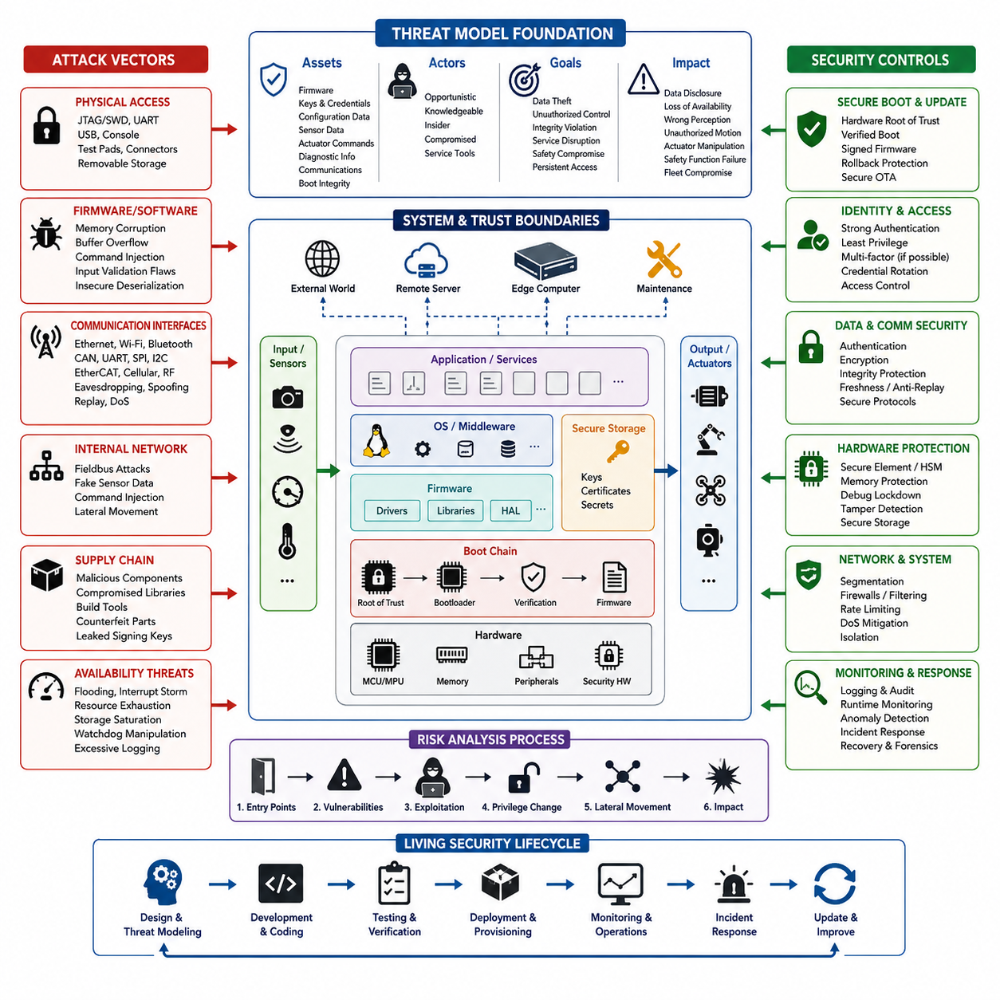
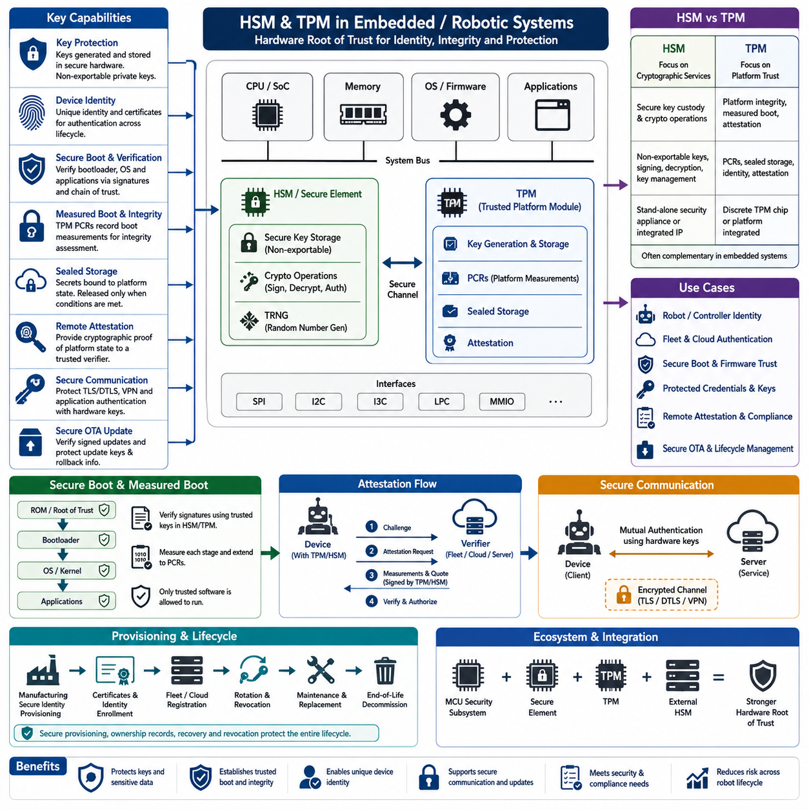
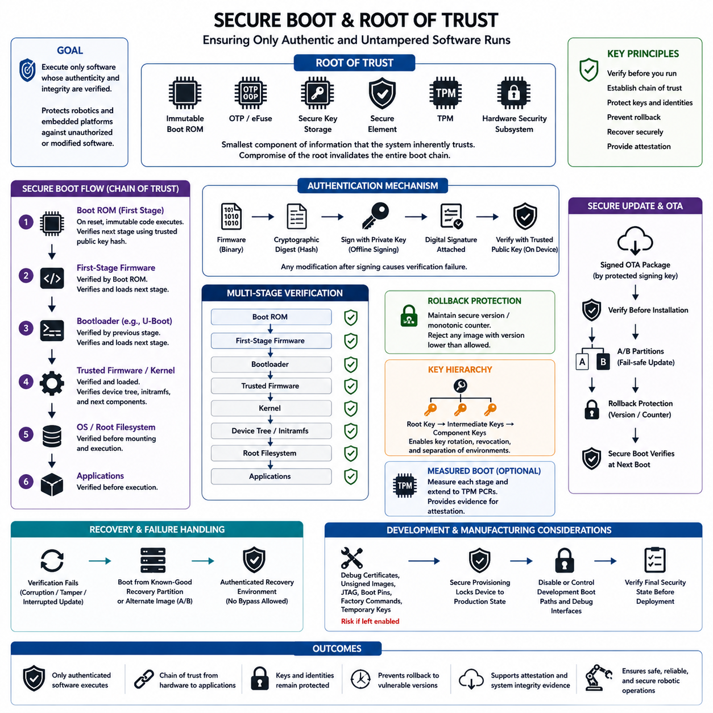
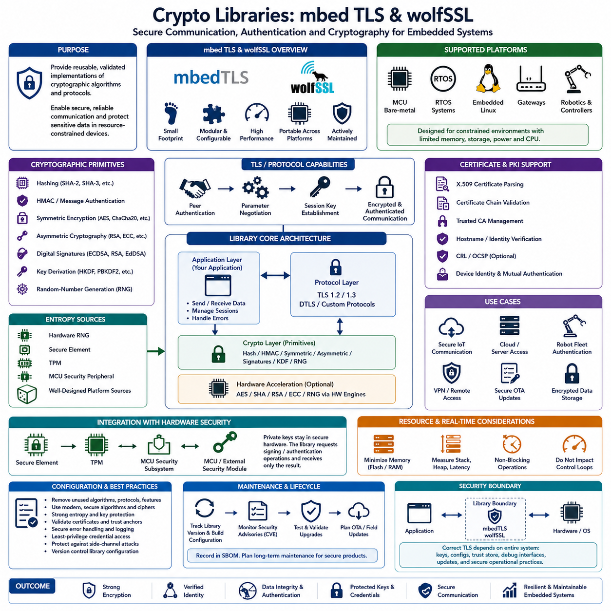
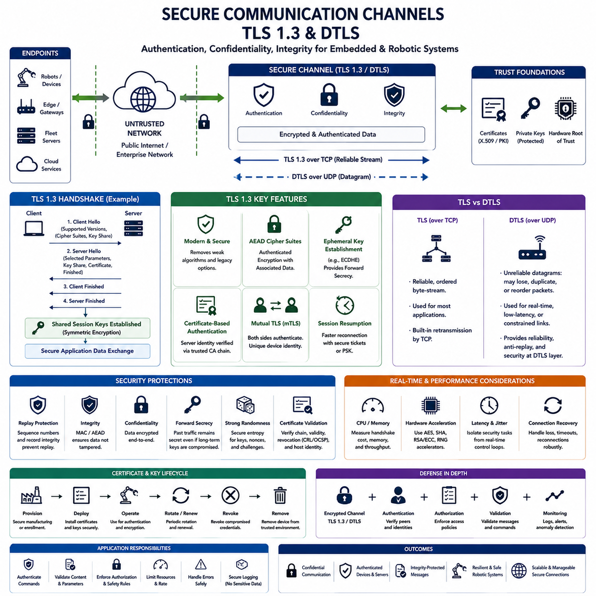
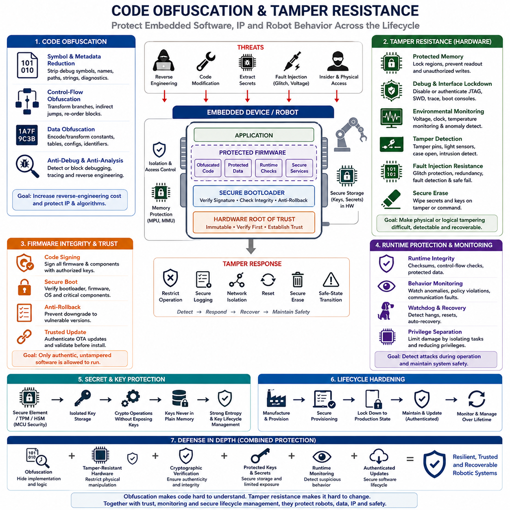
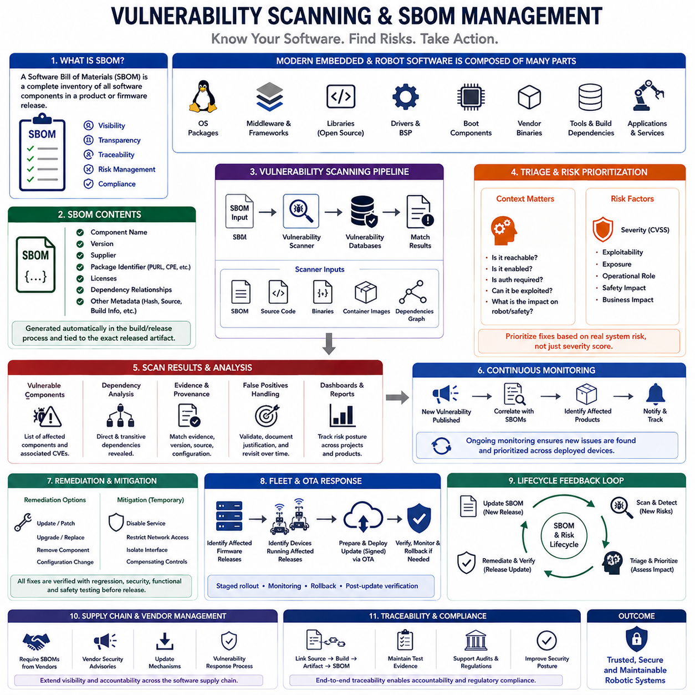
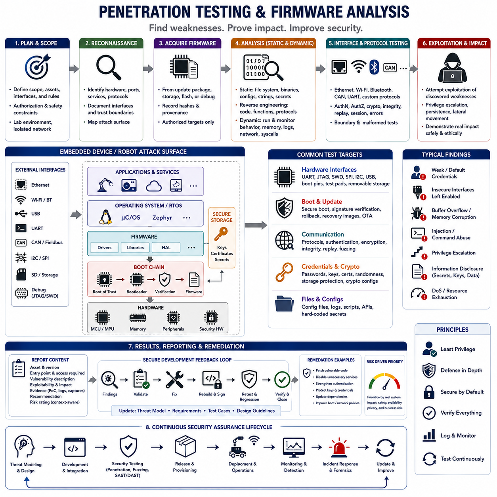
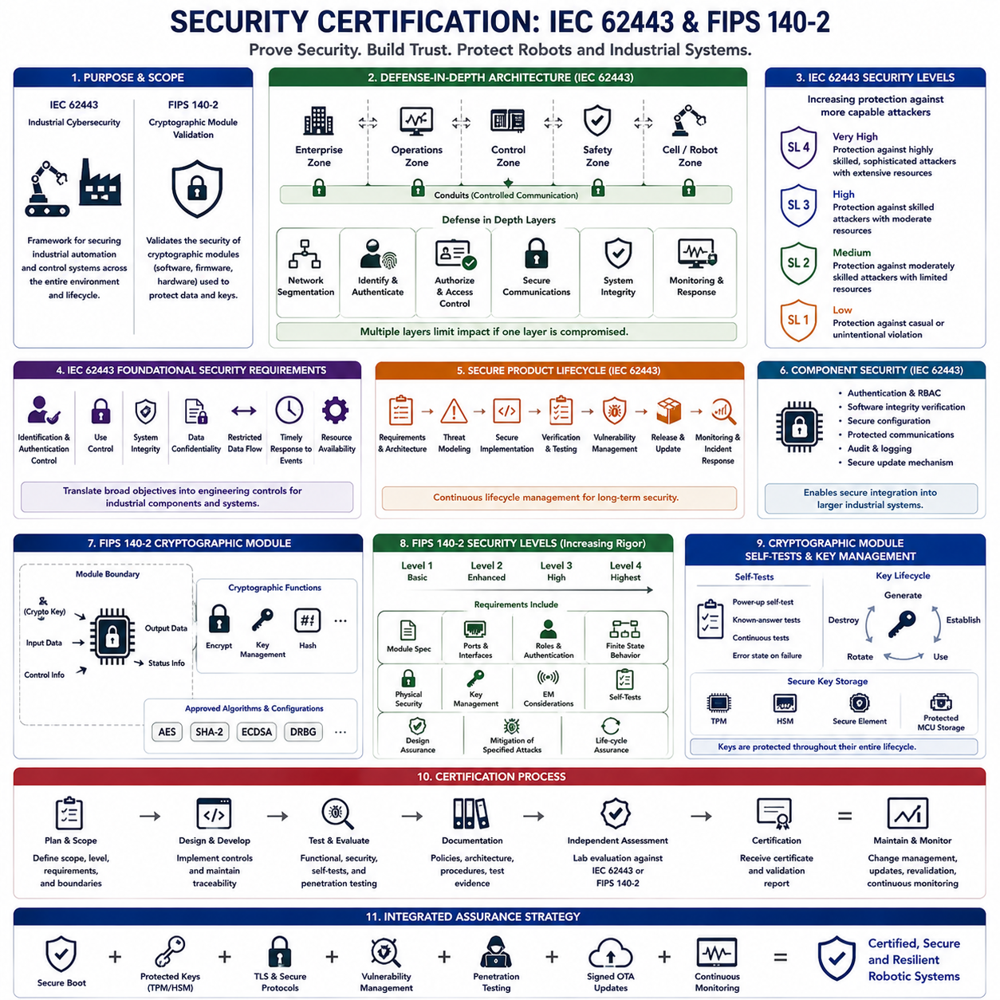
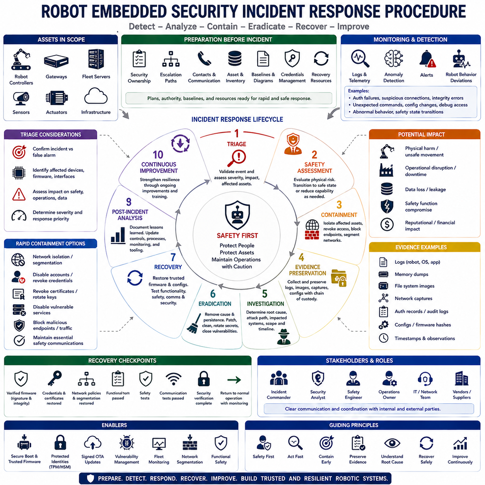

**Volume 02 Embedded Software Engineering**

# 11. Embedded Security

## 11.01 Embedded Security Threat Model and Attack Vectors

{width="7.268055555555556in" height="7.268055555555556in"}

Embedded security begins with a threat model that describes what must be protected, who may attack the system, how an attacker can reach it, and what consequences could follow. In a robot or embedded controller, protected assets include firmware, cryptographic keys, configuration data, sensor measurements, actuator commands, diagnostic information, communication credentials, and the integrity of the boot process.

Unlike conventional information systems, embedded devices interact directly with physical processes. A successful attack may therefore affect not only confidentiality and data integrity but also motion, power control, sensing, braking, manipulation, or emergency functions. Security analysis should consequently consider cyber and physical consequences together, especially when embedded controllers operate motors, batteries, safety interfaces, or autonomous robotic functions.

A practical threat model starts by defining trust boundaries. The MCU, secure storage, bootloader, operating system, application firmware, external sensors, communication buses, maintenance interfaces, edge computers, and remote servers may belong to different trust domains. Every transition between these domains creates an attack surface where data, commands, executable code, identities, or credentials must be authenticated and validated before they are trusted.

Physical access is one of the most important embedded attack vectors because deployed equipment is often accessible outside a protected data center. Debug interfaces such as JTAG and SWD, UART consoles, removable storage, exposed test pads, USB ports, and programming connectors can provide privileged access. An attacker who reaches these interfaces may attempt firmware extraction, memory inspection, configuration modification, credential recovery, or unauthorized reflashing.

The firmware itself represents another major attack surface. Memory corruption, buffer overflows, integer errors, unsafe pointer operations, command injection, insecure deserialization, insufficient input validation, and improper privilege handling can convert malformed input into unintended execution. Embedded software should therefore assume that externally supplied packets, sensor messages, files, configuration values, and maintenance commands may be intentionally malicious rather than merely incorrect.

Communication interfaces expand the threat model beyond physical access. Ethernet, Wi-Fi, Bluetooth, CAN, UART, SPI, I2C, EtherCAT, cellular links, and proprietary radio channels may expose different combinations of confidentiality, integrity, authentication, and availability risks. Attackers may attempt eavesdropping, spoofing, replay, message modification, session hijacking, unauthorized command injection, or denial-of-service against interfaces that were originally designed for trusted environments.

Robot internal networks require particular attention because legacy field buses frequently provide limited native security. If an attacker reaches a trusted network segment, forged sensor values or actuator commands may appear structurally valid to receiving controllers. Security architecture should therefore avoid assuming that network location proves identity. Message authenticity, freshness checking, sequence validation, authorization, segmentation, and behavioral plausibility checks provide additional defensive layers.

The boot and update chains are high-value targets because compromise at these stages can persist below normal application-level defenses. Modified bootloaders, unsigned firmware, rollback to vulnerable releases, malicious recovery images, or compromised OTA packages can establish long-term control of a device. A threat model should trace the complete chain from immutable or hardware-protected trust anchors through boot verification, firmware loading, update installation, rollback, and recovery.

Cryptographic protection can also fail when key management is weak. Hard-coded passwords, shared fleet credentials, exposed private keys, predictable random numbers, unprotected certificates, insecure key provisioning, and credentials stored directly in readable flash can undermine otherwise strong algorithms. Attack analysis must therefore examine the entire credential lifecycle, including manufacturing, provisioning, storage, use, rotation, revocation, replacement, service operations, and end-of-life disposal.

Supply-chain threats extend security analysis beyond the deployed device. Compromised third-party libraries, malicious build tools, vulnerable dependencies, altered firmware packages, counterfeit components, leaked signing credentials, and unauthorized modifications during manufacturing can introduce weaknesses before deployment. Maintaining software provenance, controlled build environments, signed artifacts, dependency inventories, SBOM information, and traceable release processes reduces the opportunity for hidden compromise.

Availability attacks are especially significant for real-time embedded systems. Network flooding, interrupt storms, malformed packet loops, resource exhaustion, storage saturation, watchdog manipulation, excessive logging, and computationally expensive requests may prevent critical tasks from meeting timing requirements. Security controls must therefore be designed so that defensive mechanisms themselves do not introduce unacceptable latency, priority inversion, memory pressure, or loss of deterministic control behavior.

Threat modeling should also consider attackers with different capabilities and objectives. Opportunistic attackers may exploit exposed services, while knowledgeable adversaries may understand the hardware, firmware architecture, communication protocols, and maintenance procedures. Insiders or compromised service tools may already possess legitimate access. Separating attacker capability, required access, attack complexity, detectability, persistence, and potential physical impact helps prioritize realistic threats.

Risk evaluation connects each attack path to assets and system consequences. A useful analysis traces an entry point through vulnerabilities, privilege changes, lateral movement, and affected functions until the resulting impact becomes clear. For robotics, the final consequence may include data disclosure, loss of availability, incorrect perception, unauthorized movement, degraded localization, manipulated actuator behavior, disabled safety functions, or persistent fleet compromise.

Security controls should follow defense-in-depth rather than depend on a single mechanism. Hardware roots of trust, secure boot, memory protection, least privilege, authenticated communication, secure key storage, signed updates, network segmentation, input validation, runtime monitoring, rate limiting, logging, and controlled debug access protect different stages of an attack. The objective is to prevent compromise where possible while limiting propagation and preserving evidence when prevention fails.

The threat model must remain a living engineering artifact rather than a document produced only during initial design. New firmware, interfaces, sensors, communication protocols, third-party packages, OTA mechanisms, and service procedures can introduce new trust boundaries and attack paths. Security assumptions should therefore be reviewed whenever the architecture changes, vulnerabilities are discovered, or operational experience reveals unexpected behavior, linking threat modeling continuously with development, testing, deployment, monitoring, and incident response.

## 11.02 Hardware Security Module (HSM) and TPM Usage

{width="7.268055555555556in" height="7.268055555555556in"}

Hardware security modules and trusted platform modules provide protected environments for cryptographic operations and key management that ordinary application software cannot reliably provide. In embedded and robotic systems, they establish hardware-backed trust for device identity, secure boot, encrypted communication, firmware verification, credential protection, and system attestation. Their central purpose is to keep critical secrets isolated even if higher software layers are compromised.

An HSM, or Hardware Security Module, is a dedicated security component designed to generate, store, and use cryptographic keys inside a protected hardware boundary. Private keys can remain non-exportable, meaning applications request signing, decryption, or authentication operations without receiving the key itself. This architecture significantly reduces exposure compared with storing sensitive keys as ordinary files, configuration data, or readable flash contents.

A TPM, or Trusted Platform Module, provides standardized hardware-backed security functions closely associated with platform integrity. TPMs commonly support protected key generation, cryptographic operations, random-number generation, platform measurements, sealed storage, and attestation. Embedded Linux computers, industrial PCs, edge AI systems, and robot main computers can use a discrete TPM or platform-integrated implementation to establish a measurable and verifiable system identity.

The distinction between an HSM and TPM is primarily related to their intended role rather than simply their cryptographic capabilities. An HSM focuses strongly on secure key custody and cryptographic services, while a TPM emphasizes platform trust, measured boot, protected credentials, and attestation. Depending on system architecture, an embedded device may use a secure element, TPM, MCU security subsystem, or external HSM rather than treating these technologies as mutually exclusive alternatives.

Key generation should occur inside protected hardware whenever practical. If a private key is generated externally and later copied into secure hardware, additional provisioning processes become part of the attack surface. Hardware-generated device keys can instead remain permanently protected while their corresponding public keys or certificates are registered with manufacturing, fleet, OTA, or cloud infrastructure. This enables each robot or controller to receive a unique cryptographic identity.

Protected keys can support device authentication throughout the operational lifecycle. When a robot connects to an on-premise server, fleet management system, maintenance station, or cloud service, it can prove possession of its private key by performing a cryptographic operation within secure hardware. The remote system verifies the corresponding certificate or public key, reducing dependence on shared passwords and preventing extraction of reusable credentials from normal application storage.

Hardware-backed trust is particularly valuable for secure boot and firmware verification. A bootloader can verify firmware signatures using trusted public keys or key hashes anchored in protected hardware or immutable storage. The resulting chain of trust connects the hardware root of trust to boot firmware, operating-system components, and applications. Unauthorized or modified software should fail verification before it receives control of security-sensitive system resources.

TPM-based measured boot complements signature verification by recording measurements of components that participate in the boot process. Platform Configuration Registers, commonly called PCRs, accumulate cryptographic measurements representing boot stages and system configuration. Rather than merely determining whether software is permitted to execute, measured boot provides evidence describing what actually executed, allowing later integrity evaluation and remote attestation.

Sealed storage binds protected information to selected platform conditions. A TPM can protect credentials so they become usable only when specified PCR values or authorization conditions are satisfied. For example, a robot communication credential could be released only when the device boots through an approved software configuration. If critical boot components are modified, the measurement changes and the protected secret can remain inaccessible even when an attacker obtains storage media.

Remote attestation extends hardware trust beyond the local device. An embedded computer can provide cryptographically protected evidence about its measured platform state to an authorized verifier. A fleet management or security service may use this evidence to determine whether a robot is running an expected software configuration before granting network access, accepting operational commands, or distributing sensitive data. Attestation therefore connects device integrity with system-level authorization decisions.

HSM and TPM functions are also useful in OTA firmware update systems. Update packages can be signed by protected organizational signing keys, while devices verify signatures using trusted verification material. Device-side secure hardware can protect update credentials, rollback information, or authentication keys. Production signing keys should be separated from development credentials and protected through controlled cryptographic infrastructure because compromise of a signing key can affect an entire deployed fleet.

Embedded communication security can similarly use hardware-protected credentials for TLS, DTLS, VPN, or application-level authentication. Instead of loading a private key into application memory, cryptographic operations can be delegated to the secure component when supported by the platform and software stack. This reduces key exposure during normal operation, although secure hardware does not eliminate vulnerabilities in protocol implementations, certificate validation, access control, or application logic.

Integration requires careful attention to performance and real-time behavior. Hardware cryptographic operations may introduce communication overhead and execution latency, particularly when a security device is connected through SPI, I2C, or another peripheral interface. Designers should identify which operations require hardware protection and which can safely execute in software. High-frequency control loops should not unexpectedly depend on slow security transactions that could violate deterministic timing requirements.

Provisioning is as important as the security hardware itself. Manufacturing must securely establish device identities, ownership information, certificates, authorization policies, and recovery mechanisms without exposing secrets through factory tools or logs. Provisioning records should associate cryptographic identities with specific devices, while credential rotation and revocation mechanisms must support maintenance, ownership changes, compromised devices, hardware replacement, and eventual end-of-life decommissioning.

HSM and TPM deployment should ultimately be treated as part of a broader hardware root-of-trust architecture rather than as an isolated security feature. Secure boot, measured boot, protected keys, attestation, encrypted communication, signed OTA updates, access control, monitoring, and recovery mechanisms reinforce one another. When these functions are integrated across the embedded lifecycle, hardware-backed security provides a durable foundation for establishing whether a robot is authentic, its software is trustworthy, and its critical credentials remain protected.

## 11.03 Secure Boot and Root of Trust

{width="7.268055555555556in" height="7.268055555555556in"}

Secure boot is a security mechanism that allows an embedded system to execute only software whose authenticity and integrity can be verified. Instead of trusting firmware merely because it exists in flash or storage, each executable stage is cryptographically checked before control is transferred to it. In robotic systems, this protects controllers, embedded Linux computers, edge AI platforms, and safety-related processors against unauthorized or modified software.

The foundation of secure boot is the root of trust, which represents the smallest component or set of information that the system must inherently trust. It is typically implemented using immutable boot ROM, one-time programmable memory, eFuses, protected key storage, a secure element, TPM, or hardware security subsystem. Because every later verification decision ultimately depends on this foundation, compromise of the root of trust can invalidate the security of the entire boot chain.

A typical secure boot sequence begins when the processor leaves reset and executes immutable code stored in internal boot ROM. This first-stage code contains or references trusted cryptographic material, such as a public-key hash. It authenticates the next boot component before execution. The verified component then authenticates the following stage, producing a chain of trust that can extend through the bootloader, firmware, operating-system kernel, device configuration, and applications.

Digital signatures provide the central authenticity mechanism in this chain. During the software release process, an authorized signing system calculates a cryptographic digest of the firmware and signs it using a protected private key. The target device verifies the signature using the corresponding trusted public key. If firmware content is modified after signing, verification fails because the calculated digest no longer corresponds to the authenticated signature.

Integrity and authenticity should be distinguished when designing secure boot. A checksum or ordinary hash can detect accidental modification, but an attacker capable of replacing firmware may also replace an unprotected reference hash. A digital signature binds software integrity to an authorized signer. Secure boot therefore requires both cryptographic integrity checking and a trusted mechanism for determining which signing identities are authorized to introduce executable software.

The verification key itself must be anchored securely. Storing an unrestricted public key in the same writable flash region as firmware allows an attacker to replace both the firmware and verification key. Systems commonly store a hash of the authorized root public key in ROM, OTP memory, eFuse, or another hardware-protected region. The boot ROM then verifies that the key used for signature validation corresponds to this immutable trust anchor.

Secure boot commonly forms multiple verification stages because modern embedded platforms rarely execute a single firmware image. A processor may load first-stage firmware, a secondary bootloader such as U-Boot, trusted execution firmware, an operating-system kernel, device tree, initramfs, root filesystem, and application components. Security architects must identify which stages contain executable or security-sensitive information and ensure that no unverified path can bypass the intended chain.

Rollback protection is necessary because correctly signed software is not necessarily safe forever. An attacker may intentionally install an older, legitimately signed firmware version containing a known vulnerability. Anti-rollback mechanisms maintain a protected security version, monotonic counter, or equivalent state and reject images below the permitted version. This allows secure boot to enforce both authenticity and an acceptable minimum security generation.

Key hierarchy design reduces the consequences of individual credential compromise. Rather than permanently embedding a release key directly into hardware, the root of trust can authorize intermediate keys that subsequently verify production firmware. Separate keys may be assigned to boot components, applications, recovery images, development environments, and product generations. Carefully designed key hierarchies also make controlled key rotation and revocation possible during a long device lifecycle.

Recovery must be incorporated into the secure boot architecture rather than treated as an exception to it. If verification fails because of corruption or an interrupted OTA update, the device may boot from a known-good recovery partition or alternate A/B image. Recovery software must itself be authenticated by the same or an equivalent trusted chain. Otherwise, an unrestricted recovery interface can become a deliberate bypass around secure boot protections.

Secure boot and OTA security are closely connected. An OTA system determines how new software reaches the device, while secure boot determines whether installed software is permitted to execute. Update packages should therefore be authenticated before installation and verified again during subsequent boot. Combining signed OTA packages, A/B partitions, rollback control, protected signing keys, and secure boot prevents a compromised distribution channel from automatically becoming persistent executable compromise.

Measured boot provides a complementary mechanism to secure boot. Secure boot enforces a policy by refusing unauthorized software, whereas measured boot records cryptographic measurements of components that participate in startup. TPM Platform Configuration Registers can accumulate these measurements and later support attestation. A system may therefore both prevent unacceptable software from executing and provide evidence describing the software state that actually participated in the boot sequence.

Development and manufacturing modes require particular attention because security controls are frequently relaxed during engineering. Debug certificates, unsigned development images, JTAG access, boot configuration pins, factory programming commands, and temporary keys can become permanent vulnerabilities if left enabled in production. Production provisioning should deliberately transition the device into its final security state and verify that unauthorized development boot paths and debug mechanisms are disabled or tightly controlled.

Failure handling should favor a defined safe and recoverable state rather than uncontrolled execution. When authentication fails, the system may stop the boot process, select a verified alternate image, enter a restricted recovery environment, or report a diagnostic condition. For robots, designers must also consider the physical state of actuators and safety functions while the main computer cannot boot, ensuring that cybersecurity failure does not create uncontrolled physical behavior.

Secure boot ultimately establishes the first trustworthy transition from powered hardware to executable software. When immutable trust anchors, protected verification keys, digital signatures, staged verification, anti-rollback controls, secure recovery, controlled provisioning, and signed updates are integrated correctly, every software layer inherits trust from the layer below it. This chain of trust becomes a fundamental security boundary for embedded controllers, robotic computers, edge AI devices, and long-lived connected machines.

## 11.04 Crypto Libraries: mbedTLS / wolfSSL [w/Code]

{width="7.268055555555556in" height="7.268055555555556in"}

Cryptographic libraries provide reusable implementations of security algorithms and protocols required by embedded systems without forcing developers to implement complex cryptography from scratch. Libraries such as mbed TLS and wolfSSL are designed for constrained and embedded environments where memory, storage, processing power, and energy may be limited. They support secure communication, authentication, encryption, certificate handling, key management, and cryptographic verification within firmware and embedded applications.

mbed TLS provides a modular cryptographic and TLS software stack that can be configured for microcontrollers, RTOS platforms, embedded Linux devices, gateways, and connected controllers. Its architecture allows developers to include only the algorithms and protocol features required by a product. This configurability is important because a small MCU may require a minimal cryptographic footprint, while an embedded Linux robot computer can support a more complete TLS and certificate infrastructure.

wolfSSL is similarly optimized for embedded and resource-constrained systems and provides TLS functionality together with cryptographic primitives and platform integration capabilities. It can be incorporated into bare-metal firmware, RTOS applications, embedded Linux systems, and network-enabled devices. Its embedded focus makes it useful when designers must balance security functionality with memory consumption, execution performance, portability, hardware acceleration, and deterministic system behavior.

Both libraries conceptually separate cryptographic primitives from higher-level secure communication protocols. Primitive operations include hashing, message authentication, symmetric encryption, asymmetric cryptography, digital signatures, key derivation, and random-number generation. TLS and related protocol layers combine these mechanisms to authenticate communication peers, negotiate cryptographic parameters, establish session keys, and protect application data against interception or unauthorized modification.

Symmetric encryption algorithms protect data efficiently after communicating devices establish shared session keys. Asymmetric cryptography supports operations such as identity verification, digital signatures, and secure key establishment. Hash functions create fixed-size representations used for integrity verification, while message authentication codes provide integrity and authenticity when parties share secret material. Embedded applications should use these mechanisms through established library APIs rather than constructing custom combinations of cryptographic algorithms.

Random-number generation is a fundamental dependency because cryptographic keys, nonces, initialization values, and protocol challenges require unpredictable values. A strong library configuration therefore needs a trustworthy entropy source from the target platform. Embedded systems may obtain entropy from hardware random-number generators, secure elements, TPMs, MCU security peripherals, or carefully designed platform sources. Weak or predictable randomness can compromise otherwise correctly implemented cryptographic algorithms.

Certificate processing enables embedded devices to participate in public key infrastructure. A robot or controller may store a device certificate representing its identity and validate certificates presented by servers or peer devices. The cryptographic library parses certificate chains, verifies signatures, evaluates trusted certificate authorities, and supports authentication during TLS establishment. Correct certificate validation is essential because encrypted communication provides little protection if an attacker can successfully impersonate the intended endpoint.

TLS integration typically begins with selecting protocol versions, cipher suites, authentication methods, trust anchors, entropy sources, and certificate policies appropriate for the product. The application then creates a secure session over an underlying transport such as TCP. During the handshake, peers authenticate as required and derive session keys. Once negotiation succeeds, application messages are encrypted and integrity protected without requiring application developers to implement individual cryptographic operations manually.

Embedded integration differs from desktop integration because resource limits must be considered explicitly. Unnecessary algorithms, legacy protocol versions, unused certificate formats, and debugging functions increase flash and RAM requirements as well as attack surface. Configuration should therefore remove features that the product does not require while retaining secure contemporary algorithms. The resulting library configuration should be version controlled and treated as part of the product\'s security architecture rather than as an incidental build option.

Hardware acceleration can reduce CPU load and protect sensitive key operations. Many MCUs and embedded processors include AES engines, hash accelerators, public-key accelerators, hardware random-number generators, secure elements, or isolated security subsystems. Cryptographic libraries can be integrated with platform-specific hardware interfaces so selected operations execute in hardware. This can improve performance and reduce key exposure, although hardware drivers and their integration boundaries must themselves be carefully validated.

HSM, TPM, and secure-element integration further strengthens key protection. Instead of storing a private key directly in application-accessible memory, the library or platform abstraction can request signing or authentication operations from protected hardware. The private key remains within the secure boundary while the cryptographic result is returned to the application. This model combines software protocol flexibility with hardware-backed credential protection and is particularly valuable for device identity and fleet authentication.

Memory management and concurrency require special consideration in real-time embedded software. TLS handshakes, certificate parsing, and asymmetric cryptographic operations can require substantially more memory and execution time than normal application messages. Developers should measure stack usage, heap consumption, worst-case latency, and scheduling effects under realistic conditions. Security processing should not unexpectedly interfere with motor-control loops, safety tasks, watchdog servicing, or other time-critical functions.

Library security depends on maintenance as much as initial configuration. Cryptographic libraries can contain implementation vulnerabilities, protocol defects, parsing errors, or side-channel weaknesses that are discovered after product deployment. The exact library version and configuration should therefore be recorded in the software bill of materials, monitored for security advisories, tested during upgrades, and incorporated into OTA maintenance planning. Long-lived robots require a practical mechanism for updating cryptographic components without replacing the complete platform.

Secure implementation also requires protecting the application boundaries surrounding the library. Correct TLS cannot compensate for exposed private keys, disabled certificate verification, hard-coded shared credentials, insecure debug interfaces, incorrect trust stores, or unsafe error handling. Sensitive buffers should be minimized, credentials should follow least-privilege access, and authentication failures should fail securely. Logging must also avoid exposing keys, passwords, session material, certificates with sensitive metadata, or decrypted application information.

mbed TLS and wolfSSL should therefore be viewed as security building blocks within a larger embedded trust architecture rather than complete security solutions by themselves. When correctly configured and combined with strong entropy, protected keys, secure boot, hardware roots of trust, authenticated OTA updates, certificate lifecycle management, and disciplined software maintenance, cryptographic libraries provide the protocol and algorithm foundation needed for secure communication and trustworthy connected robotic systems.

## 11.05 Secure Communication Channels: TLS 1.3 / DTLS [w/Code]

{width="7.268055555555556in" height="7.268055555555556in"}

Secure communication channels protect data exchanged between embedded devices, robots, edge computers, fleet servers, and cloud services across networks that cannot be assumed trustworthy. Transport Layer Security, particularly TLS 1.3, provides authentication, confidentiality, and integrity for reliable transport connections, while Datagram Transport Layer Security applies similar security principles to datagram-oriented communication where UDP-style transport behavior is required.

TLS operates above the transport layer and below application protocols, allowing applications to exchange protected information without implementing encryption individually for every message. An embedded application establishes a TLS session over TCP and then sends normal application data through the protected channel. The TLS layer encrypts outgoing information, authenticates received records, manages cryptographic state, and rejects messages whose integrity verification fails.

TLS 1.3 simplifies and strengthens earlier TLS designs by removing obsolete cryptographic options and reducing unnecessary handshake complexity. Modern cipher suites use authenticated encryption with associated data, combining confidentiality and integrity protection within a coordinated construction. Key establishment relies on secure ephemeral mechanisms, while authentication commonly uses certificates and digital signatures. This architecture reduces opportunities for insecure negotiation and legacy configuration errors.

The TLS handshake establishes the cryptographic context required for protected communication. A client begins communication by presenting supported protocol parameters and key-establishment information. The server selects compatible parameters, provides its authentication information, and both sides derive shared session secrets. After successful verification, subsequent application traffic is protected using symmetric session keys because symmetric cryptography is substantially more efficient for continuous data exchange.

Server authentication is commonly based on X.509 certificates and a trusted public key infrastructure. The embedded client verifies that the certificate belongs to the intended server, is signed through an acceptable trust chain, satisfies validity requirements, and matches the expected identity. Merely enabling TLS is insufficient if certificate verification is disabled or incorrectly implemented, because an attacker may otherwise impersonate the remote endpoint while maintaining an encrypted connection.

Mutual TLS extends authentication to both communication participants. In addition to verifying the server, the server requests and validates a client certificate representing the embedded device or robot. Each robot can therefore possess a unique cryptographic identity rather than relying on fleet-wide shared passwords. When private keys are protected by a TPM, HSM, secure element, or MCU security subsystem, mutual TLS can provide strong hardware-backed device authentication.

Forward secrecy is an important property of modern TLS key establishment. Ephemeral session secrets are created so that later compromise of a long-term private authentication key does not automatically reveal previously captured session traffic. This is particularly valuable for robots and industrial systems that may operate for many years because historical network recordings should not become decryptable simply because a device credential is compromised at a later date.

DTLS provides security for datagram communication where applications cannot rely on the ordered and reliable byte stream provided by TCP. UDP-based systems may lose, duplicate, or reorder packets, so DTLS must accommodate these properties while still providing authentication, encryption, integrity protection, and replay resistance. This makes DTLS suitable for embedded applications where low communication overhead, datagram semantics, or latency characteristics make UDP preferable.

The difference between TLS and DTLS therefore reflects the underlying transport model rather than fundamentally different security goals. TLS normally protects reliable stream-oriented communication, while DTLS protects unreliable datagram-oriented communication. Designers should select the protocol according to application behavior rather than assuming that UDP and DTLS are automatically faster or that TCP and TLS are always more secure. End-to-end system timing and reliability must be measured.

Replay protection is particularly significant for command-oriented robotic communication. An attacker may capture a legitimate packet and transmit it again later without decrypting or modifying its contents. Secure channel protocols use sequence information, authenticated records, and protocol state to identify unacceptable repetitions. Applications may require additional freshness mechanisms for safety-critical commands when semantic validity depends on timestamps, operational modes, mission states, or rapidly changing robot conditions.

Session resumption can reduce the cost of repeatedly establishing secure connections. Full public-key handshakes may consume CPU time, memory, bandwidth, and energy that constrained embedded devices cannot afford for every short interaction. TLS mechanisms can securely derive new sessions from previously established state when appropriate. However, resumption credentials must be protected and lifecycle policies should prevent old or compromised session material from remaining usable indefinitely.

Cryptographic libraries such as mbed TLS and wolfSSL provide practical TLS and DTLS implementations for embedded systems. Their configuration determines supported protocol versions, cipher suites, certificate handling, entropy sources, memory requirements, and hardware acceleration interfaces. Products should disable obsolete protocols and unnecessary algorithms, maintain explicit trust stores, and test the exact production configuration rather than assuming that a library\'s default configuration automatically satisfies system security requirements.

Performance must be evaluated together with security, especially in real-time robotic platforms. Handshakes and certificate verification can introduce significant computational bursts, while encrypted records add processing and communication overhead during operation. Security traffic should be isolated appropriately from hard real-time control loops. Hardware cryptographic accelerators can reduce CPU utilization, but worst-case latency, memory usage, connection recovery, and network congestion still require system-level testing.

Secure channels also depend on correct key and certificate lifecycle management. Device identities must be provisioned securely during manufacturing or deployment, and certificates require renewal, rotation, revocation, and replacement procedures. Compromised robots should be removable from the trusted communication environment without replacing credentials across the entire fleet. Automated certificate management becomes increasingly important as deployments grow from individual devices to hundreds or thousands of connected machines.

Network security should not end when TLS or DTLS is established. Applications must still authenticate commands, enforce authorization policies, validate message content, limit resource consumption, and respond safely to connection failures. Network segmentation, rate limiting, monitoring, secure logging, credential protection, and intrusion detection complement encrypted channels. TLS protects communication in transit, but it cannot correct compromised endpoints or unsafe application behavior.

TLS 1.3 and DTLS should therefore be considered foundational components of a layered embedded communication architecture. Combined with hardware-protected device identities, trusted certificates, strong entropy, secure boot, cryptographic libraries, authenticated OTA updates, network segmentation, and continuous credential management, they establish trustworthy channels between robots and surrounding infrastructure. The result is communication that remains confidential, authenticated, integrity-protected, and resilient across untrusted networks.

## 11.06 Code Obfuscation and Tamper Resistance

{width="7.268055555555556in" height="7.268055555555556in"}

Code obfuscation and tamper resistance protect embedded software against unauthorized analysis, modification, extraction, and manipulation after deployment. They are particularly important for robots and connected controllers because attackers may obtain physical access to devices, extract firmware images, inspect binaries, or modify stored code. These techniques increase the effort required to understand or alter protected software rather than assuming deployed firmware will remain inaccessible.

Obfuscation transforms software into a representation that preserves required execution behavior while making its internal logic more difficult to understand. Symbol names, control structures, data representations, and program organization can be transformed so reverse engineering requires greater effort. Obfuscation does not provide cryptographic confidentiality by itself, but it can increase the cost of discovering proprietary algorithms, security checks, protocol logic, or valuable intellectual property.

Symbol and metadata reduction is one of the simplest protection techniques. Production binaries should avoid unnecessary debug symbols, descriptive function names, source paths, development strings, and diagnostic information that reveal internal architecture. Stripping these artifacts reduces information available to reverse engineers. However, organizations should securely retain corresponding symbol and debugging information internally because it remains necessary for controlled diagnostics, crash analysis, maintenance, and incident investigation.

Control-flow obfuscation makes the logical execution structure of a program more difficult to reconstruct. Transformations may reorganize branches, introduce indirect control transfers, split operations, or otherwise obscure relationships between basic blocks while preserving functional behavior. These techniques can frustrate static analysis, but aggressive transformation may increase code size, execution time, or verification complexity, which is especially important for memory-constrained and real-time embedded systems.

Data obfuscation similarly attempts to make sensitive constants, tables, configuration structures, protocol identifiers, or proprietary parameters less obvious inside a binary image. Encoding or transforming static data can prevent simple string searches from immediately revealing implementation details. It should not, however, be confused with secure key storage. Cryptographic private keys, passwords, and long-term secrets require hardware-backed or cryptographically protected storage rather than reversible software obfuscation.

Anti-debugging and anti-analysis mechanisms can detect or restrict unauthorized observation of software execution. Production systems may disable or authenticate JTAG, SWD, trace ports, bootloader consoles, and diagnostic interfaces that were necessary during development. Hardware security mechanisms can permanently restrict debug access or require authenticated maintenance sessions. Leaving unrestricted engineering interfaces enabled after deployment can undermine sophisticated software protection by giving attackers direct visibility into memory and processor state.

Tamper resistance extends protection beyond software transformation by making unauthorized physical or logical modification difficult, detectable, or recoverable. Hardware mechanisms may include protected flash regions, memory access controls, secure elements, debug lockdown, voltage and clock monitoring, tamper sensors, glitch protection, fault detection, and secure erase capabilities. These controls are particularly relevant when embedded equipment operates in physically accessible or potentially hostile environments.

Firmware integrity verification provides a stronger defense against modification than obfuscation alone. Code signing and secure boot allow the device to verify that executable software originates from an authorized source and has not been altered. A hardware root of trust can authenticate the bootloader, which verifies subsequent firmware and operating-system components. Obfuscation may slow reverse engineering, whereas cryptographic verification directly determines whether modified software is permitted to execute.

Runtime integrity mechanisms can detect manipulation that occurs after the boot process. Memory protection, privilege separation, checksums, protected control data, watchdogs, and runtime monitoring can identify unexpected changes or abnormal execution conditions. Security monitoring may observe memory violations, authentication failures, boot failures, communication anomalies, or physical tamper events and then initiate logging, isolation, reset, lockdown, secure erasure, or a safe-state transition when required.

Fault-injection resistance addresses attacks that intentionally disturb hardware operation rather than directly modifying firmware. Voltage glitches, clock manipulation, electromagnetic disturbances, or other fault techniques may attempt to skip instructions, corrupt comparisons, bypass authentication, or alter security state transitions. Defensive hardware can monitor abnormal voltage and clock conditions, use redundant checks, detect faults, and ensure that security-critical decisions fail safely instead of granting access after unexpected execution.

Secrets require stronger protection than ordinary program logic. Encryption keys, device identities, signing credentials, and authentication secrets should be isolated in secure storage, secure elements, TPMs, HSM-backed infrastructure, or MCU security hardware whenever available. The application should ideally request cryptographic operations without exposing private keys in normal memory. Obfuscating a key embedded directly in executable code only hides its representation and should not be treated as equivalent to secure key custody.

Tamper response must be designed according to the operational role of the embedded system. Detection of suspicious physical access or integrity failure may trigger restricted operation, credential invalidation, secure logging, network isolation, reset, or secure erasure of selected secrets. In robotic systems, these responses must also respect functional safety requirements. A security mechanism should never abruptly create hazardous actuator behavior merely because tampering has been detected.

Protection should also cover the development-to-production transition. Engineering devices often permit unrestricted debugging, flexible boot modes, temporary credentials, and unsigned software, whereas deployed products require a hardened configuration. Secure provisioning should move the device into its production security state, protect production secrets, enable secure boot and readout protection where appropriate, and prevent rollback into less secure lifecycle states.

Obfuscation introduces engineering tradeoffs that must be evaluated rather than applied indiscriminately. Transformations may increase binary size, CPU consumption, startup time, debugging difficulty, and test complexity. They can also interfere with static analysis, code coverage, safety certification, crash diagnostics, or deterministic timing assumptions. Safety-critical and real-time components therefore require careful validation after transformation to demonstrate that security hardening has not changed required functional or temporal behavior.

No obfuscation technique should be considered permanently resistant to a sufficiently capable attacker who controls the target device. Its purpose is to raise reverse-engineering cost and protect selected implementation knowledge, while stronger controls enforce authenticity, confidentiality, access restrictions, and integrity. Effective embedded protection therefore combines obfuscation with secure boot, code signing, protected keys, debug lockdown, memory protection, tamper detection, authenticated updates, runtime monitoring, and disciplined lifecycle management.

Code obfuscation and tamper resistance are ultimately complementary layers within defense in depth. Obfuscation makes software interpretation and exploitation harder, tamper-resistant hardware restricts physical manipulation, cryptographic verification prevents unauthorized firmware execution, and monitoring detects suspicious behavior during operation. Together these mechanisms help protect firmware, intellectual property, credentials, and robot behavior while preserving trusted and recoverable operation throughout the embedded product lifecycle.

## 11.07 Vulnerability Scanning: Embedded SW SBOM Management

{width="7.268055555555556in" height="7.268055555555556in"}

Vulnerability scanning and Software Bill of Materials management provide continuous visibility into the software components and known security weaknesses contained within an embedded product. Modern robot firmware rarely consists only of internally developed code; it may include operating-system packages, middleware, communication libraries, drivers, boot components, open-source libraries, vendor binaries, and development dependencies. An SBOM creates the inventory needed to understand this software supply chain.

An SBOM is a structured record describing the software components included in a product or firmware release. Useful entries identify component names, versions, suppliers, package identifiers, licenses, dependency relationships, and other provenance information. Rather than attempting to reconstruct composition after a vulnerability is announced, engineering teams can query the SBOM to determine which products, firmware versions, robot models, or deployed devices may contain the affected component.

SBOM generation should be integrated into the software build and release process rather than maintained manually as an independent spreadsheet. Build systems, package managers, source repositories, container images, and binary analysis tools can contribute component information. The generated SBOM should correspond to the exact released artifact so that developers can trace a deployed firmware image back to the dependency set from which it was produced.

Common SBOM representations such as SPDX and CycloneDX provide machine-readable formats for exchanging component information between engineering organizations, suppliers, customers, and security tools. Standardized identifiers make automated analysis easier because vulnerability scanners can correlate software packages with vulnerability databases. The selected format is less important than ensuring that component identity, version information, dependency relationships, and release traceability remain accurate throughout the lifecycle.

Vulnerability scanning compares known components and software versions against published vulnerability information. A scanner may identify associations with Common Vulnerabilities and Exposures records, security advisories, vendor notices, or other vulnerability intelligence. Source-code and binary analysis can complement dependency scanning by identifying implementation weaknesses that are not represented simply by package versions. These approaches provide different forms of evidence and should not be treated as interchangeable.

A vulnerability match does not automatically mean that an embedded product is exploitable. A vulnerable library may contain functionality that is not compiled, reachable, enabled, or exposed through the deployed configuration. Conversely, a vulnerability with a moderate generic severity may become critical when it controls robot communication, firmware updates, authentication, or safety-relevant behavior. Triage therefore requires product context in addition to vulnerability database information.

Risk prioritization should combine technical severity with exploitability, exposure, operational role, and physical consequence. Useful questions include whether an attacker can reach the vulnerable interface, whether authentication is required, whether exploitation enables code execution or privilege escalation, and whether compromise can affect actuators or safety functions. Embedded security teams should prioritize remediation according to realistic system impact rather than simply sorting vulnerabilities by numerical severity.

False positives and incomplete component identification are practical challenges in vulnerability management. Package names may differ across distributions, vendors may backport security fixes without changing upstream version patterns, and proprietary binaries may provide limited metadata. Every automated match therefore needs enough provenance and configuration information to support engineering review. Suppression of a finding should also be documented with evidence and revisited when software or deployment conditions change.

The dependency graph is especially important because vulnerable software may enter a product indirectly. An application can depend on middleware that depends on another library, creating transitive dependencies that developers did not select explicitly. An effective SBOM should expose these relationships where possible so teams can identify why a component exists, which higher-level function requires it, and what could be affected if the component is upgraded, replaced, or removed.

Embedded Linux platforms often contain substantially larger software inventories than MCU firmware. Kernel components, system libraries, network services, package-manager content, containers, drivers, cryptographic libraries, robotics middleware, and application packages may all require tracking. MCU systems may have fewer components but still depend on RTOS kernels, vendor SDKs, protocol stacks, bootloaders, cryptographic libraries, and precompiled hardware abstraction layers whose vulnerabilities can affect deployed products.

Vulnerability management should begin before release. Continuous integration pipelines can scan dependencies, source code, container images, and generated firmware artifacts while software is being developed. Policies can prevent releases containing vulnerabilities that exceed defined risk thresholds unless an approved exception exists. This shift-left approach reduces the cost of remediation because vulnerable dependencies can be replaced before they become embedded in signed firmware and deployed across a robot fleet.

The process must continue after deployment because new vulnerabilities are discovered long after software has been released. A previously acceptable firmware image can become a security concern when a new weakness is disclosed in one of its components. Organizations therefore need continuous vulnerability monitoring that correlates new intelligence with stored SBOMs and identifies affected products, software releases, deployment populations, and operational environments.

Remediation does not always mean immediately installing the newest package. Embedded products may have strict compatibility, memory, timing, certification, or hardware constraints. A security patch can affect communication timing, driver behavior, CPU load, or real-time scheduling. Updates should therefore pass regression, security, functional, and safety testing before fleet deployment. Temporary mitigations such as disabling services, restricting network access, or isolating interfaces may be required while a validated patch is prepared.

SBOM management should connect directly with OTA and fleet configuration management. When a vulnerable component is identified, the organization should be able to determine which firmware releases contain it, which devices are running those releases, what replacement version resolves the problem, and how the update will be deployed. Staged rollout, monitoring, rollback, and post-update verification convert vulnerability intelligence into controlled operational remediation rather than a disconnected security report.

Supply-chain management extends the same visibility to external software suppliers. Vendors should provide accurate component information, security advisories, update mechanisms, and vulnerability-response processes for delivered libraries, SDKs, drivers, and binary modules. Internally, provenance records should connect source components, build environments, signed artifacts, SBOMs, test evidence, and released firmware so that software composition and security decisions remain traceable.

Vulnerability scanning and SBOM management ultimately form a continuous lifecycle loop: identify software composition, detect newly known weaknesses, evaluate their real system impact, remediate or mitigate them, verify the corrected software, and update deployment records. Integrated with secure development, signed OTA updates, configuration management, monitoring, and incident response, this process provides the visibility required to maintain trustworthy embedded and robotic systems throughout long operational lifetimes.

## 11.08 Penetration Testing: Embedded Firmware Analysis

{width="7.268055555555556in" height="7.268055555555556in"}

Penetration testing for embedded systems is a controlled security assessment that attempts to identify weaknesses by examining the product from an attacker's perspective. Unlike ordinary software testing, it considers firmware, hardware interfaces, boot mechanisms, communication channels, credentials, and physical access together. For robots, testing must also account for possible effects on motion, actuators, sensing, safety functions, and operational availability.

An effective penetration test begins with explicit scope and authorization. Engineers define the target hardware revision, firmware version, interfaces, network environment, test accounts, permitted techniques, and safety restrictions before testing starts. Production robots should not be subjected to uncontrolled experiments that could damage hardware or create hazardous movement. Dedicated laboratory devices, isolated networks, simulation, and controlled test fixtures provide safer environments for aggressive security testing.

Reconnaissance establishes an initial map of the embedded attack surface. Testers identify processors, memory devices, communication controllers, external connectors, removable storage, wireless interfaces, network services, boot modes, and maintenance paths. Documentation, firmware metadata, exposed ports, service banners, update packages, and hardware inspection can reveal how the system is organized and where trust boundaries exist. This information guides deeper firmware and interface analysis.

Firmware acquisition is a fundamental step because the firmware image often exposes the internal software architecture of the device. Images may be obtained from official update packages, development artifacts, removable storage, accessible flash devices, or authorized debug interfaces. The tester records hashes and provenance so that analysis remains reproducible. Firmware extraction should be performed only on authorized targets because bypassing protection mechanisms can expose proprietary code and sensitive credentials.

Static firmware analysis examines an image without executing it. Analysts identify file formats, processor architecture, boot components, partition layouts, filesystems, libraries, configuration files, certificates, scripts, and executable binaries. Embedded Linux firmware may reveal kernel images, device trees, root filesystems, services, and package information, while MCU firmware may require examination of raw binary regions, vector tables, constants, strings, and memory mappings.

Binary reverse engineering provides deeper visibility when source code is unavailable. Disassemblers and decompilers can reconstruct portions of machine code into representations that help analysts understand functions, control flow, data references, protocol handlers, and security checks. Useful targets include authentication routines, update verification, command parsers, debug functions, credential handling, and privileged operations. Reverse engineering is most effective when combined with knowledge of the processor and firmware architecture.

String and configuration analysis can quickly expose security-relevant information before deeper reverse engineering begins. Firmware may contain URLs, IP addresses, usernames, certificates, filesystem paths, diagnostic commands, API endpoints, development messages, or references to cryptographic functions. Hard-coded passwords, private keys, shared credentials, or undocumented maintenance commands are particularly serious findings because extracting the firmware could immediately expose reusable access mechanisms.

Dynamic analysis complements static examination by observing firmware while it executes. Testers monitor processes, memory behavior, files, network connections, system calls, logs, and protocol interactions under controlled conditions. Embedded Linux systems may support instrumentation directly, while MCU firmware may require target hardware, emulation, debugging, or hardware-in-the-loop environments. Dynamic testing can reveal behaviors that are difficult to infer reliably from static binaries alone.

Hardware interfaces are critical penetration-testing targets because embedded devices frequently expose capabilities unavailable through normal network access. UART consoles, JTAG, SWD, SPI, I2C, USB, boot configuration pins, test pads, and removable storage may provide diagnostic or programming access. Testing determines whether these interfaces remain enabled in production, whether authentication is required, and whether they allow memory reading, firmware modification, privileged consoles, or security configuration changes.

Boot security testing verifies whether the device enforces its intended chain of trust. Testers examine whether modified or unsigned firmware is rejected, whether verification covers every executable boot stage, whether recovery images are authenticated, and whether older vulnerable releases can be installed. Attempts to bypass secure boot should remain controlled and authorized. The objective is to demonstrate whether the security architecture prevents unauthorized software from becoming persistent executable code.

Communication testing evaluates interfaces such as Ethernet, Wi-Fi, Bluetooth, CAN, UART, and application-specific protocols. Analysts examine authentication, encryption, certificate validation, message integrity, replay resistance, authorization, malformed-message handling, and resource limits. Internal robot networks deserve particular attention because trusted field buses may accept structurally valid commands without strong sender authentication, potentially allowing compromised nodes to influence sensors, actuators, or other controllers.

Fuzz testing systematically provides malformed, unexpected, boundary, or randomized inputs to parsers and communication interfaces. Protocol decoders, update handlers, file parsers, diagnostic services, and command processors are valuable targets because input-processing errors can lead to crashes, memory corruption, denial of service, or unintended execution paths. Effective fuzzing records the exact input that caused abnormal behavior so developers can reproduce, diagnose, correct, and regression-test the defect.

Credential and cryptographic testing examines how secrets are generated, stored, accessed, and used. Testers look for shared fleet credentials, weak passwords, exposed keys, predictable randomness, incorrect certificate validation, obsolete cryptographic configurations, and secrets stored in ordinary flash or filesystems. When TPMs, secure elements, or hardware security modules are present, testing should verify that private keys remain protected and that applications cannot bypass intended hardware-backed security boundaries.

Runtime exploitation testing evaluates whether discovered vulnerabilities can cross meaningful security boundaries. A defect may initially provide only application-level access but become more serious if it enables privilege escalation, persistent firmware modification, credential extraction, or lateral movement to other robot components. Testing should focus on demonstrating realistic impact with the minimum necessary exploitation, particularly where uncontrolled proof-of-concept behavior could affect physical equipment or safety functions.

Results must distinguish observations, vulnerabilities, exploitability, and demonstrated impact. Each finding should identify the affected hardware and firmware versions, entry point, required attacker access, reproduction conditions, security consequence, supporting evidence, and recommended mitigation. Severity should reflect actual embedded-system context rather than only generic scoring, because a weakness that changes actuator commands or disables safety functions may have consequences beyond conventional information-security loss.

Penetration testing should feed directly into remediation and regression testing. Developers correct vulnerable code, disable unnecessary interfaces, strengthen authentication, protect credentials, update dependencies, or modify boot and network policies. The corrected firmware is then rebuilt, signed, and retested to verify that the vulnerability is closed without introducing functional, timing, or safety regressions. Findings should also update threat models, security requirements, test cases, and future design guidelines.

Embedded penetration testing and firmware analysis are therefore continuous assurance activities rather than one-time attacks performed before release. Reassessment is needed when hardware revisions, firmware, communication protocols, OTA mechanisms, third-party components, or deployment environments change. Combined with threat modeling, secure boot, vulnerability scanning, SBOM management, runtime monitoring, and incident response, penetration testing provides practical evidence that layered security controls resist realistic attack paths throughout the robot lifecycle.

## 11.09 Security Certification: IEC 62443 / FIPS 140-2

{width="7.268055555555556in" height="7.268055555555556in"}

Security certification provides structured evidence that embedded and industrial systems have been designed, implemented, and evaluated according to defined cybersecurity requirements. Standards and validation programs help organizations move beyond informal security claims by establishing repeatable engineering processes, technical controls, documentation, and independent assessment. For robotic platforms, certification must connect cybersecurity controls with hardware, firmware, networks, update mechanisms, and operational lifecycle management.

IEC 62443 is a family of cybersecurity standards developed for industrial automation and control systems. Its scope extends beyond individual devices because industrial security depends on interactions among asset owners, system integrators, product suppliers, networks, controllers, and operational processes. Embedded controllers and robotic systems deployed in factories, logistics facilities, infrastructure, and other operational technology environments can therefore be considered within a broader industrial cybersecurity architecture.

A central IEC 62443 concept is defense in depth, where multiple security controls protect different layers of the system instead of relying on a single boundary. Network segmentation, authentication, authorization, secure communication, system integrity, restricted interfaces, monitoring, and incident response provide complementary protection. If one layer is compromised, additional controls should limit propagation and prevent an attacker from gaining unrestricted access to the complete robotic or industrial environment.

Zones and conduits provide an architectural method for organizing industrial systems according to security requirements and communication relationships. Components with similar security needs can be grouped into zones, while controlled communication paths between zones are represented as conduits. A robot controller, fleet server, engineering workstation, safety controller, and enterprise network may therefore occupy different security zones with explicitly controlled communication between them.

IEC 62443 defines foundational security requirements that address identification and authentication control, use control, system integrity, data confidentiality, restricted data flow, timely response to events, and resource availability. These requirements translate broad cybersecurity objectives into engineering concerns that can be applied to industrial components and systems. Embedded product designers should map relevant technical mechanisms to these objectives rather than treating compliance as documentation performed only after development.

Security levels provide a framework for expressing the degree of protection expected against different classes of threats. Higher security expectations require stronger resistance against increasingly capable and motivated attackers. The appropriate target depends on system risk, exposure, operational consequences, and deployment environment. A robot operating inside an isolated laboratory may therefore require a different security posture from a connected autonomous machine operating in critical industrial infrastructure.

IEC 62443 also emphasizes secure product development lifecycle practices. Security requirements should be defined during architecture and design, followed by threat modeling, secure implementation, verification, vulnerability management, update planning, and controlled release. Security defects discovered after deployment require documented handling and remediation processes. This lifecycle approach is especially important for robots whose firmware, operating systems, middleware, and communication software may remain deployed for many years.

Component-level security assessment considers whether embedded products provide capabilities required for secure integration into larger systems. Authentication, role-based access control, software integrity verification, protected communication, secure configuration, audit capability, and update mechanisms may contribute to the component security architecture. Product certification does not automatically make the complete deployment secure because system configuration, network architecture, integration choices, and operational procedures remain important.

FIPS 140-2 addresses a narrower but important security domain: validation of cryptographic modules. Rather than certifying the cybersecurity of an entire robot or industrial system, it specifies security requirements for modules that implement cryptographic functions. A cryptographic module may be implemented in software, firmware, hardware, or a combination of these forms. Validation provides evidence that the defined module satisfies applicable requirements under its specified operational conditions.

Cryptographic module boundaries are therefore fundamental when considering FIPS 140-2. Designers must identify which software and hardware belong to the validated cryptographic module and which interfaces cross its boundary. Keys, cryptographic parameters, input data, output data, control information, and status information must be handled according to the defined architecture. Security claims apply to the validated module and configuration rather than automatically extending to every application that uses it.

FIPS 140-2 defines multiple security levels with progressively stronger requirements across aspects of cryptographic module security. Depending on the level and implementation, requirements can address module specification, ports and interfaces, roles and authentication, finite-state behavior, physical security, cryptographic key management, electromagnetic considerations, self-tests, design assurance, and mitigation of specified attacks. The selected level should reflect procurement requirements and the intended security environment.

Approved cryptographic algorithms are another important consideration. A system seeking applicable FIPS validation cannot simply use any encryption or hashing algorithm because it is technically strong. The cryptographic implementation must use algorithms and operational configurations accepted within the relevant validation framework. Algorithm implementation, key sizes, modes of operation, random-number generation, key establishment, and module configuration must therefore be managed as part of the validated security boundary.

Self-tests help establish confidence that cryptographic functions operate correctly when the module initializes or performs defined operations. A module may perform integrity checks, known-answer tests, or other required diagnostic procedures and enter an error state if critical tests fail. Embedded designers must account for these behaviors during boot, recovery, watchdog handling, and system initialization so that cryptographic failure does not silently result in insecure operation.

Key management connects cryptographic certification with the broader embedded security architecture. Keys require secure generation, establishment, storage, use, rotation, and destruction throughout their lifecycle. TPMs, HSMs, secure elements, protected MCU storage, or validated cryptographic modules can help isolate sensitive material. However, the surrounding application must still enforce authorization, certificate policies, secure provisioning, and operational procedures that prevent valid cryptographic mechanisms from being misused.

Certification planning should begin during architecture development because late changes can be expensive. Hardware selection, cryptographic libraries, operating-system configuration, debug interfaces, key storage, update mechanisms, network architecture, and development processes can all influence assessment scope. Maintaining requirements traceability and test evidence throughout development reduces the effort required to demonstrate that implemented security controls correspond to the intended certification requirements.

IEC 62443 and FIPS 140-2 therefore address different but complementary aspects of embedded security. IEC 62443 provides a broader industrial cybersecurity framework covering systems, components, architecture, development processes, and lifecycle security, while FIPS 140-2 focuses specifically on cryptographic module security and validation. When combined with secure boot, protected keys, TLS, vulnerability management, penetration testing, signed OTA updates, and continuous monitoring, certification becomes part of an integrated assurance strategy rather than an isolated compliance exercise.

## 11.10 Robot Embedded Security Incident Response Procedure

{width="7.268055555555556in" height="7.268055555555556in"}

A robot embedded security incident response procedure defines how an organization detects, evaluates, contains, removes, and recovers from cybersecurity events affecting robotic controllers, firmware, communication networks, sensors, actuators, and supporting infrastructure. Unlike conventional IT incidents, a compromised robot can create physical consequences, so cybersecurity response must remain coordinated with functional safety, operational continuity, and human protection throughout the incident lifecycle.

Incident preparation begins before an attack occurs. Each robotic platform should have defined security ownership, escalation paths, emergency contacts, asset inventories, firmware baselines, network diagrams, device identities, logging policies, recovery images, and credential-management procedures. Teams should also establish secure communication channels and predefined response authority so that critical containment decisions can be executed rapidly without uncertainty during an active event.

Security monitoring provides the evidence needed to recognize suspicious behavior. Robot controllers, gateways, fleet servers, wireless networks, authentication services, and update systems should generate useful security telemetry. Indicators may include repeated authentication failures, unexpected network connections, firmware integrity errors, abnormal privilege changes, unusual command sequences, unauthorized configuration changes, debug-interface activity, unexplained resets, or deviations from established operational behavior.

Detection mechanisms should combine cybersecurity indicators with robot-specific operational signals. Unexpected actuator commands, inconsistent sensor data, unexplained route changes, abnormal communication timing, repeated safety-state transitions, or commands originating from unauthorized nodes may indicate compromise. Correlating security logs with robot state and physical behavior helps distinguish ordinary equipment faults from cyber incidents and provides a more complete understanding of potentially malicious activity.

Once an event is detected, initial triage determines whether it represents a confirmed incident, suspected compromise, software defect, hardware failure, or benign anomaly. Analysts identify affected devices, firmware versions, network interfaces, credentials, observed indicators, and operational consequences. Severity should consider not only confidentiality or data loss but also whether the event could influence motion, actuators, navigation, safety functions, production processes, or nearby personnel.

Safety takes priority when cyber compromise could produce hazardous physical behavior. Affected robots may need to transition into a predefined safe state, stop selected autonomous functions, reduce operating capability, or transfer control to an authorized fallback mechanism. Security containment must be coordinated with safety engineering because abruptly disconnecting power, communications, or controllers can itself create hazards in mobile robots, manipulators, industrial machinery, or coordinated fleets.

Containment limits the attacker's ability to continue operating or spread across the system. Depending on the incident, teams may isolate a robot from fleet networks, disable compromised accounts, revoke certificates, block suspicious endpoints, restrict remote access, disable vulnerable services, or segment affected network zones. Containment should preserve essential safety communication whenever possible while preventing compromised components from influencing trusted robots or infrastructure.

Fleet environments require particular attention because a credential or software weakness may affect many robots simultaneously. Incident responders should determine whether the problem is isolated to one device, a specific firmware release, a hardware revision, a site, or the entire deployed population. Asset inventories, fleet configuration databases, and SBOM information can rapidly identify systems sharing vulnerable components, certificates, software versions, or exposed services.

Evidence preservation should occur before destructive remediation whenever safety and operational conditions permit. Relevant evidence can include firmware hashes, memory captures, filesystem images, security logs, network traces, authentication records, update histories, configuration states, timestamps, and physical observations. Maintaining evidence provenance and an appropriate chain of custody supports root-cause analysis, regulatory investigation, supplier coordination, and later verification of the incident timeline.

Investigation attempts to reconstruct how the incident occurred and what the attacker achieved. Analysts determine the initial access path, exploited vulnerability, compromised credential, affected privilege level, persistence mechanism, lateral movement, and impacted assets. Firmware analysis, network analysis, vulnerability scanning, penetration-testing techniques, and comparison against known-good software baselines can help determine whether executable code, boot components, configurations, or stored secrets were modified.

Eradication removes the cause and persistence of the compromise rather than merely disconnecting the affected robot. Actions may include replacing vulnerable software, removing unauthorized code, rebuilding firmware from trusted sources, rotating credentials, revoking certificates, disabling unnecessary interfaces, correcting insecure configurations, and closing exploited network paths. If trust in the device state cannot be established, recovery from a verified clean image may be safer than attempting incremental repair.

Credential compromise requires coordinated response because embedded devices often maintain long-lived identities. Device certificates, API credentials, fleet authentication keys, maintenance accounts, and service tokens associated with the incident should be evaluated and rotated when necessary. Hardware-protected private keys may remain trustworthy if evidence confirms they were never extractable, but surrounding certificates, authorization policies, or server-side trust relationships may still require revocation or re-provisioning.

Recovery returns the robotic system to controlled operation using verified software and configuration. Firmware should be authenticated, integrity-checked, and installed through the trusted update mechanism. Network policies, credentials, certificates, and security settings should be restored to approved baselines. Functional tests, safety tests, communication tests, and security verification should be completed before the robot resumes unrestricted operation, particularly when actuators or autonomous behavior could have been affected.

Fleet recovery should normally use staged deployment rather than immediately updating every device. Corrected firmware can first be deployed to laboratory systems or a limited operational group, followed by monitoring for unexpected behavior before expansion to the remaining fleet. Rollback capability should be available where technically appropriate, while anti-rollback security must prevent restoration of known vulnerable versions. Deployment status should remain traceable for every affected robot.

Post-incident analysis converts the event into improvements for the overall security architecture. The organization should document root causes, response effectiveness, detection gaps, containment delays, affected assets, recovery results, and lessons learned. Threat models, security requirements, monitoring rules, penetration tests, SBOM records, vulnerability-management policies, provisioning procedures, and development practices should then be updated so that the same attack path becomes harder to exploit again.

A mature robot embedded security incident response procedure therefore forms a continuous cycle of preparation, detection, triage, safety assessment, containment, evidence preservation, investigation, eradication, recovery, and improvement. Integrated with secure boot, protected identities, signed OTA updates, vulnerability management, fleet monitoring, network segmentation, and functional safety, incident response enables robotic systems to contain compromise, restore trustworthy operation, and strengthen resilience throughout their operational lifecycle.
