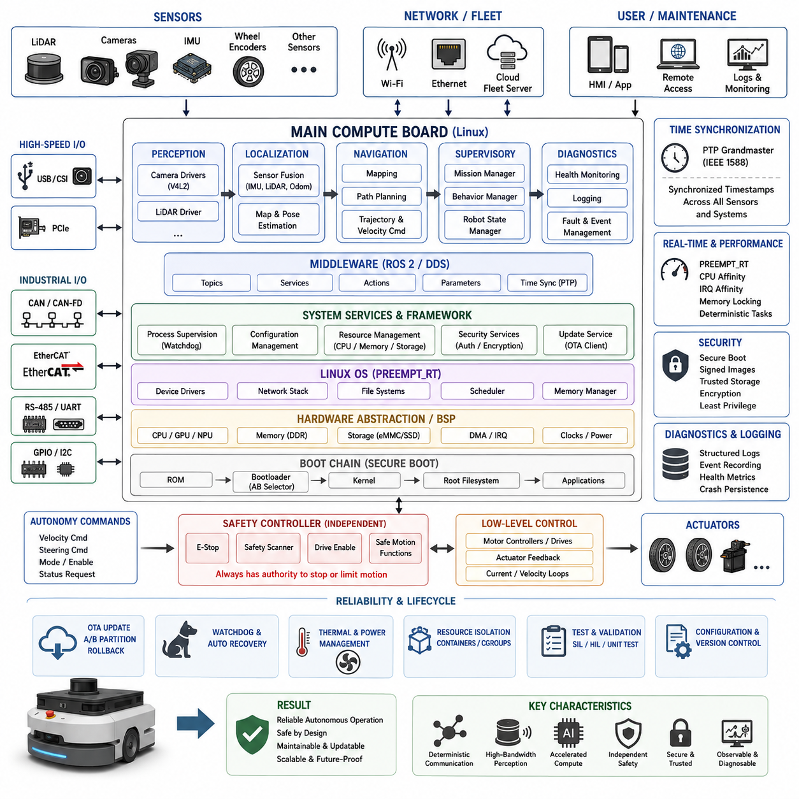
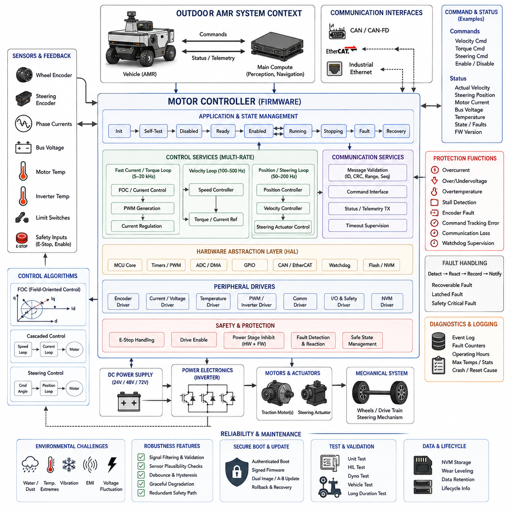
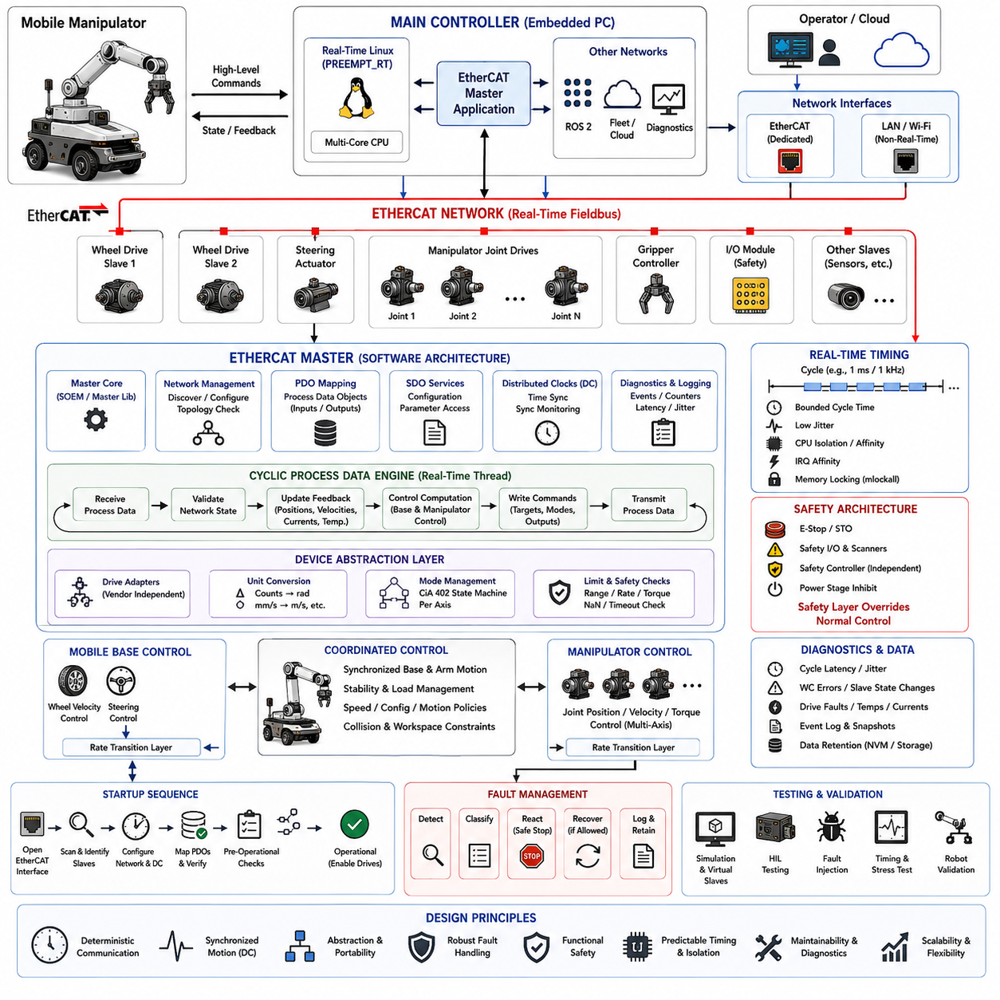
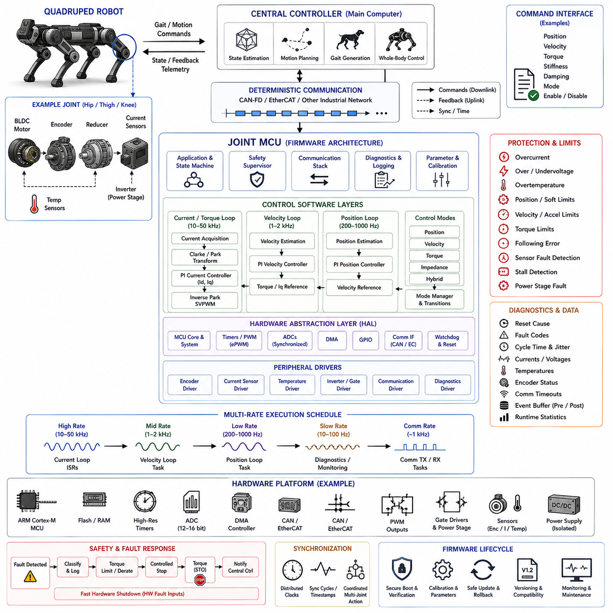
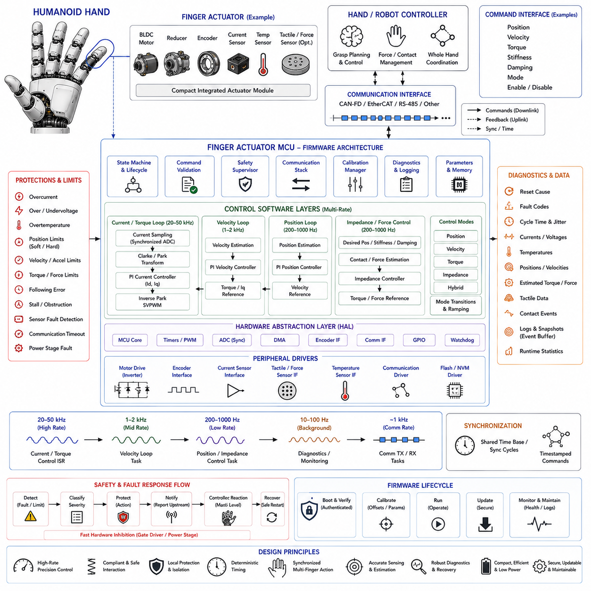
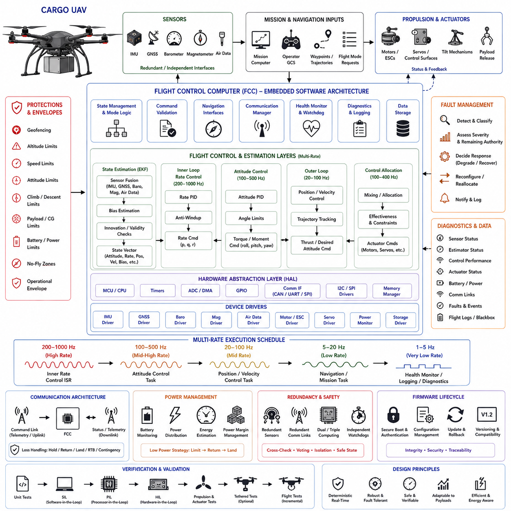
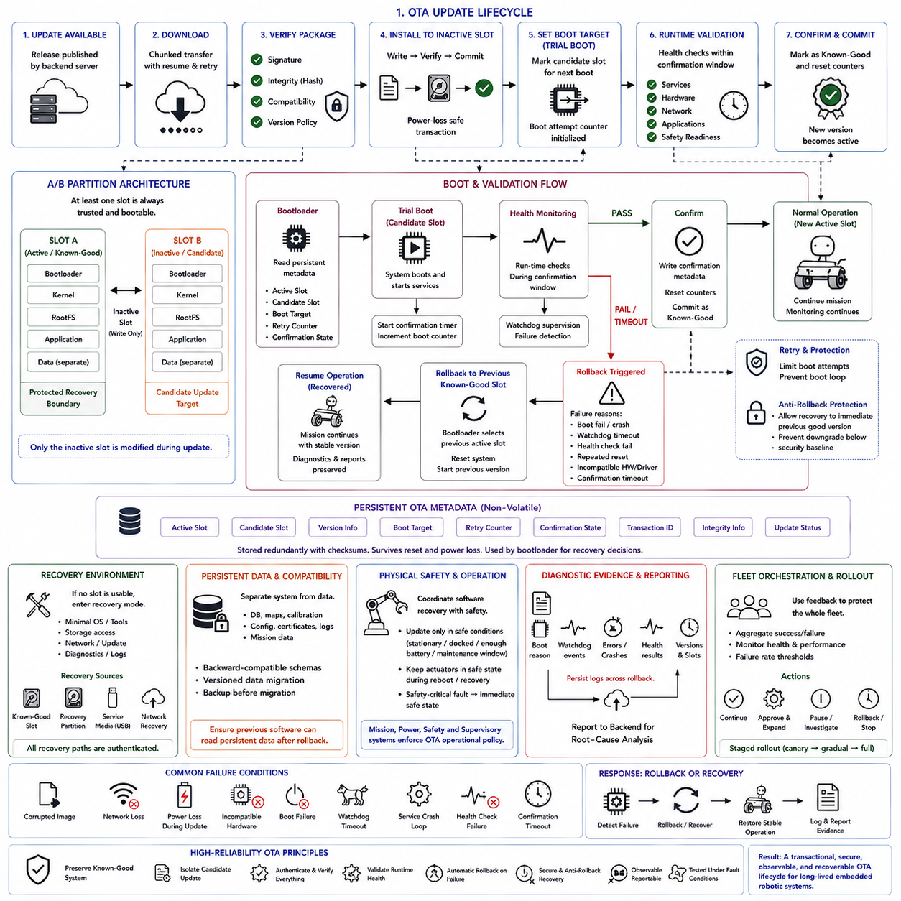
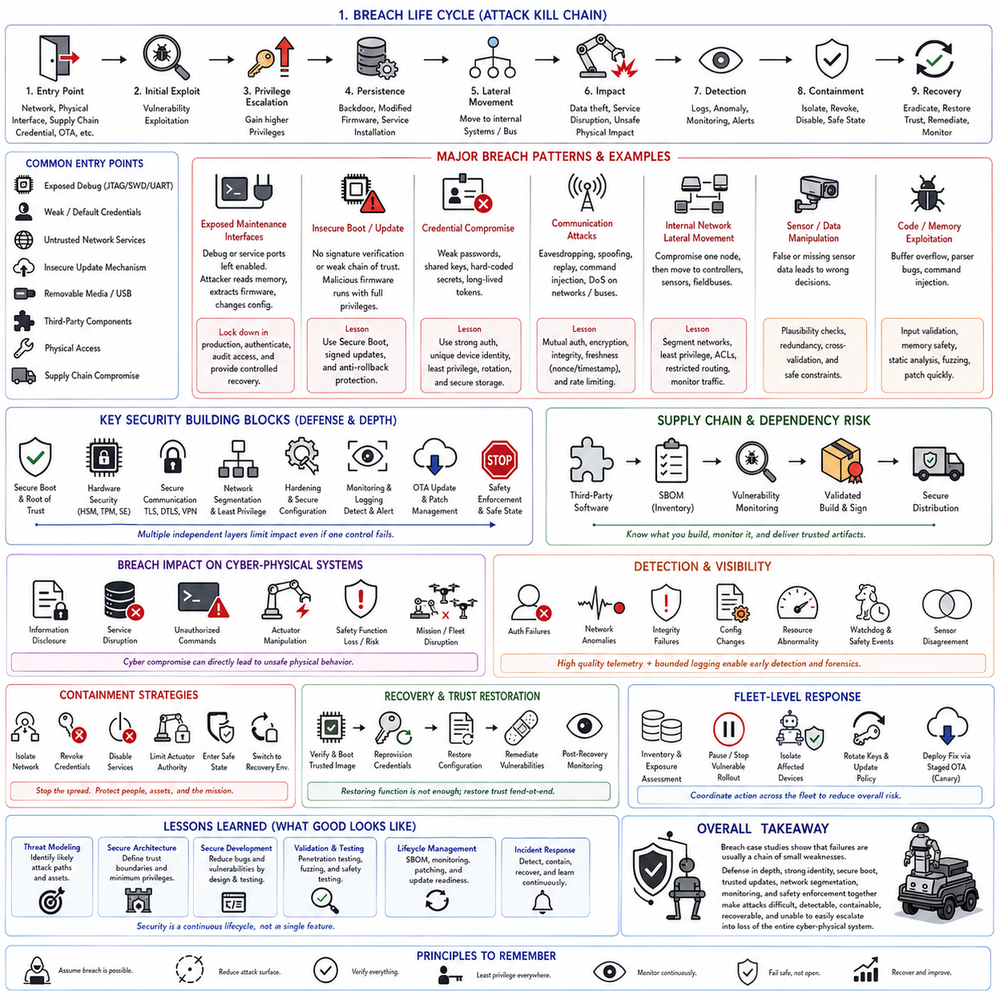
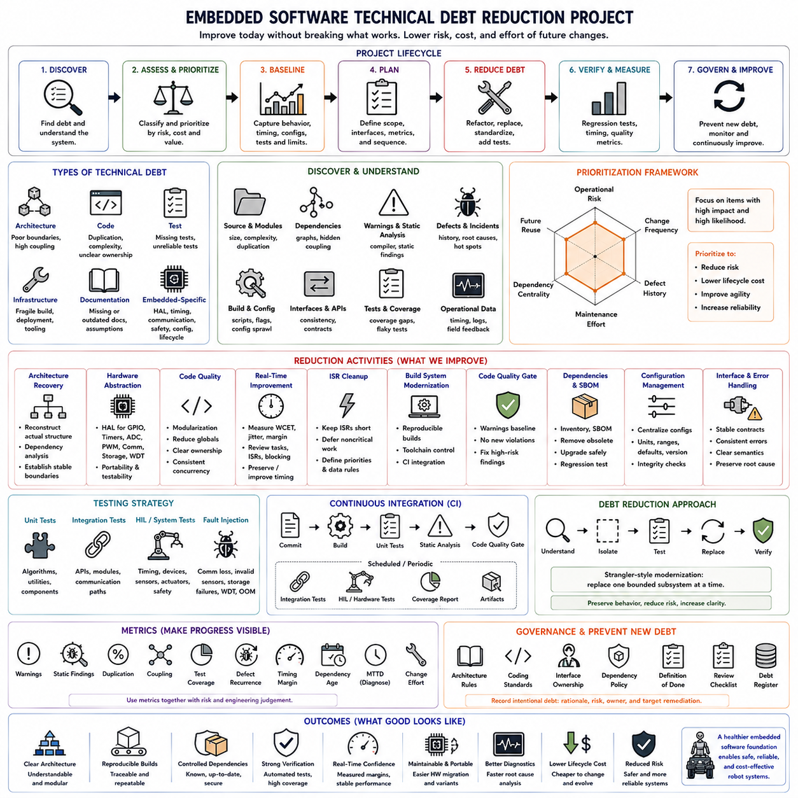
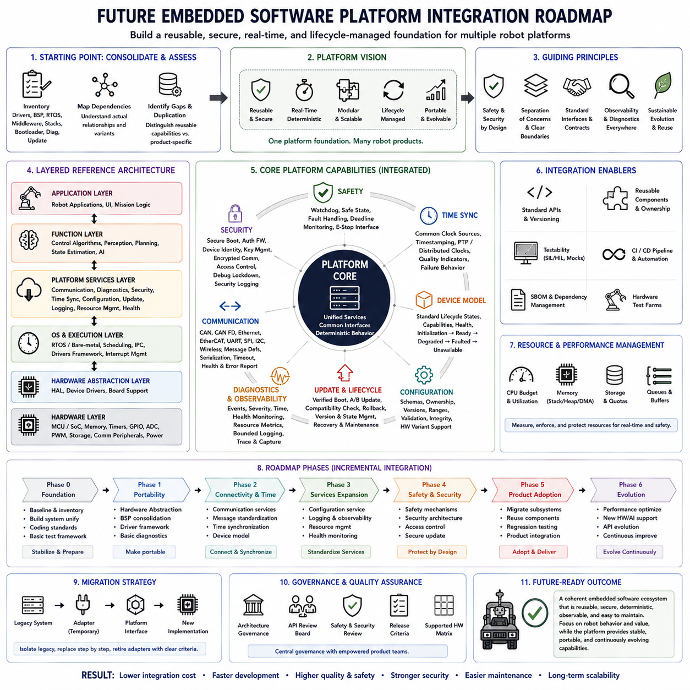

**Volume 02 Embedded Software Engineering**


# 12. Embedded Case Studies

##  

## 12.01 Indoor AMR Main Compute Board Embedded SW Design

{width="7.268055555555556in" height="7.268055555555556in"}

An indoor Autonomous Mobile Robot (AMR) main compute board serves as the embedded computing center that connects perception, localization, navigation, communication, diagnostics, and supervisory control. Unlike a simple motor controller, it must coordinate heterogeneous workloads while maintaining predictable interfaces with safety controllers and low-level actuators. Its software architecture therefore emphasizes clear responsibility boundaries, deterministic data paths, fault containment, and maintainability throughout the robot lifecycle.

A practical main compute platform commonly combines a multicore CPU with hardware acceleration for vision or neural-network inference, high-speed memory, nonvolatile storage, and multiple industrial communication interfaces. Ethernet connects LiDAR, cameras, fleet infrastructure, and service equipment, while CAN, CAN-FD, RS-485, or EtherCAT may connect motor drives and distributed controllers. USB, PCIe, GPIO, UART, and I2C provide additional interfaces for sensors, expansion modules, and board-level management devices.

The embedded software stack should separate hardware-dependent functions from robot applications. Boot firmware initializes the processor, memory, storage, security mechanisms, and essential peripherals before transferring control to the operating system. Linux then provides device management, networking, process isolation, memory management, and system services. Board-support packages and device drivers expose hardware through stable interfaces so that localization, navigation, and perception software remain largely independent of specific board revisions.

Boot behavior is particularly important because an AMR must reach an operational state predictably after power-on, brownout recovery, or watchdog reset. The bootloader should validate software images, identify the active system partition, and support recovery when an update fails. System services should start according to explicit dependencies rather than arbitrary timing assumptions. Hardware initialization, network availability, sensor discovery, middleware startup, localization, navigation, and mission readiness can consequently progress through controlled system states.

Device drivers form the boundary between physical devices and higher-level robot software. Camera drivers may use V4L2, CAN devices can use SocketCAN, and Ethernet sensors generally communicate through vendor protocols or standardized network interfaces. Driver design should avoid unnecessary copies and blocking operations in high-rate paths. DMA, interrupt moderation, asynchronous I/O, bounded queues, and timestamp preservation become important when several cameras, LiDAR streams, encoders, and control messages operate simultaneously.

Time synchronization must be treated as a system-level requirement rather than a sensor-specific feature. Localization and sensor fusion depend on consistent timestamps across LiDAR, cameras, IMUs, wheel encoders, and external positioning sources. The compute board should maintain a clearly defined time domain and distribute or receive synchronization through mechanisms such as PTP when required. Software components should preserve acquisition timestamps instead of replacing them with arbitrary processing times later in the pipeline.

Real-time requirements on the main computer differ from those of dedicated motor-control MCUs. High-frequency current or velocity loops are normally executed closer to the actuator, while the main computer handles localization, trajectory generation, velocity commands, and supervisory logic at lower frequencies. PREEMPT_RT, CPU affinity, IRQ affinity, memory locking, and priority-controlled threads can nevertheless reduce scheduling jitter for critical communication and motion-related processes without forcing every application into a hard real-time model.

The architecture should explicitly separate safety-critical control from computationally intensive autonomy. Emergency-stop circuits, safety scanners, drive-enable signals, and safety-rated motion functions should not depend solely on a complex Linux application remaining healthy. The main computer can request motion and monitor safety status, but independent safety hardware or controllers should retain authority to inhibit hazardous movement. This separation prevents a navigation crash, GPU failure, or operating-system fault from becoming the only barrier against unsafe motion.

Perception workloads place different demands on the board. Camera decoding, object detection, semantic processing, and other AI functions may execute on a GPU, NPU, or dedicated accelerator, while CPU resources remain available for localization, navigation, middleware, networking, and diagnostics. Memory bandwidth must be considered alongside raw compute performance because copying large image tensors between processes can become a bottleneck. Shared memory, zero-copy transport, hardware decoding, and accelerator-aware buffers can substantially reduce unnecessary data movement.

Localization and navigation software require carefully controlled communication with sensors and actuators. LiDAR scans, IMU measurements, wheel odometry, and map information flow toward localization and environmental representation, while planned trajectories and velocity references flow toward drive controllers. Interfaces should define message units, coordinate frames, timestamp semantics, valid ranges, sequence behavior, and timeout handling. These contracts make failures observable and prevent ambiguous assumptions from spreading between software modules.

Process supervision is essential because an indoor AMR may operate continuously without an engineer nearby. Critical services should expose health information including execution state, update rate, communication latency, queue utilization, temperature, memory consumption, and error counters. A supervisory component can detect stalled processes, missing sensor streams, corrupted communication, or excessive resource consumption. Restart policies should distinguish recoverable application faults from conditions requiring controlled robot shutdown or complete system reboot.

Resource isolation prevents one workload from destabilizing the entire robot. CPU affinity and scheduling policies can reserve execution capacity for motion-related tasks, while perception and logging workloads use separate cores where practical. Memory limits, container boundaries, cgroups, and service-level restrictions can prevent runaway applications from exhausting system resources. Storage partitions should similarly separate the operating system, application software, maps, logs, temporary data, and update images so that excessive logging cannot make the root filesystem unusable.

Thermal and power management must be integrated with software because compute performance changes with temperature and available electrical power. Board sensors should monitor processor temperature, accelerator temperature, supply voltage, storage health, and fan operation. Rather than waiting for uncontrolled thermal throttling, the system can reduce noncritical AI workloads, camera processing rates, or background tasks when thermal margins shrink. Persistent abnormal conditions should be reported to robot diagnostics and reflected in operational readiness decisions.

The main compute board should also implement a structured diagnostic framework. Logs need consistent timestamps, severity levels, component identifiers, and fault codes so that failures can be reconstructed after deployment. High-volume sensor data should not be logged indiscriminately; instead, event-triggered recording and bounded ring buffers can preserve data surrounding collisions, localization loss, emergency stops, or unexpected resets. Persistent crash information should survive reboot and remain available for maintenance analysis.

Security begins before normal applications execute. Secure boot can establish trust from immutable hardware or firmware through the bootloader, kernel, and application environment. Signed software packages, protected credentials, restricted administrative interfaces, authenticated communication, and least-privilege services reduce the attack surface. Network interfaces intended for maintenance should not automatically provide unrestricted access to robot control functions, and security credentials should be managed independently from application source code.

OTA capability should be designed into the storage and boot architecture rather than added after deployment. An A/B system layout allows a new image to be written to an inactive partition while the robot continues using the known-good version. After verification, the bootloader can attempt the new system and automatically roll back if health checks fail. Application compatibility, configuration migration, firmware dependencies, and communication protocol versions must also be managed because updating only the Linux image does not guarantee system-level compatibility.

Hardware watchdogs provide another layer of recovery when software supervision itself becomes unavailable. A watchdog should be serviced only when essential system health conditions are satisfied, rather than blindly refreshed by an independent timer thread. If critical execution stops, the watchdog can reset the compute board while the safety controller maintains the robot in a nonhazardous condition. Reset causes, boot counters, and preceding diagnostic information should be retained whenever possible to distinguish software hangs from power or hardware failures.

Development and validation should reproduce the hardware interfaces without requiring a complete robot for every test. Mock drivers, recorded sensor streams, software-in-the-loop environments, and hardware-in-the-loop benches allow navigation and supervisory components to be exercised systematically. Driver-level tests can verify timeout behavior, corrupted frames, disconnections, and high-load conditions, while long-duration tests expose memory leaks, storage growth, thermal problems, race conditions, and timing degradation that short functional tests often miss.

Configuration management becomes increasingly important when one compute-board design supports several AMR variants. Hardware revision, sensor configuration, calibration, network topology, robot identity, and feature options should be represented explicitly rather than embedded as scattered constants. Versioned configuration schemas allow software to detect incompatible parameters during startup. Factory defaults, deployment-specific settings, calibration data, and runtime state should remain logically separated so that software updates do not unintentionally overwrite robot-specific information.

The resulting embedded design is therefore not merely a Linux computer installed inside an AMR. It is a managed execution platform connecting high-bandwidth perception, deterministic robot communication, accelerated computation, safety supervision, diagnostics, security, and lifecycle services. By combining layered hardware abstraction, bounded real-time paths, independent safety authority, resource isolation, secure boot, watchdog recovery, and rollback-capable OTA, the main compute board can support reliable indoor autonomous operation while remaining maintainable as sensors, algorithms, and hardware evolve.

실내 자율이동로봇(Autonomous Mobile Robot, AMR)의 메인 컴퓨팅 보드(Main Compute Board)는 인지(Perception), 위치추정(Localization), 내비게이션(Navigation), 통신(Communication), 진단(Diagnostics), 상위 제어(Supervisory Control)를 연결하는 임베디드 컴퓨팅(Embedded Computing)의 중심 역할을 한다. 단순한 모터 제어기(Motor Controller)와 달리 다양한 특성의 워크로드(Workload)를 조정하면서 안전 제어기(Safety Controller) 및 하위 액추에이터(Actuator)와 예측 가능한 인터페이스를 유지해야 한다. 따라서 소프트웨어 아키텍처(Software Architecture)는 명확한 책임 분리, 결정론적 데이터 경로(Deterministic Data Path), 고장 격리(Fault Containment), 로봇 전체 수명주기에 걸친 유지보수성을 중시한다.

실용적인 메인 컴퓨팅 플랫폼(Main Computing Platform)은 일반적으로 멀티코어 CPU(Multicore CPU), 비전(Vision) 또는 신경망 추론(Neural-Network Inference)을 위한 하드웨어 가속기(Hardware Accelerator), 고속 메모리, 비휘발성 저장장치(Nonvolatile Storage), 다양한 산업용 통신 인터페이스를 결합한다. 이더넷(Ethernet)은 라이다(LiDAR), 카메라, 플릿(Fleet) 인프라, 서비스 장비를 연결하며, CAN, CAN-FD, RS-485 또는 EtherCAT은 모터 드라이브와 분산 제어기를 연결할 수 있다. USB, PCIe, GPIO, UART, I2C는 센서, 확장 모듈 및 보드 수준 관리 장치를 위한 추가 인터페이스를 제공한다.

임베디드 소프트웨어 스택(Embedded Software Stack)은 하드웨어 종속 기능과 로봇 애플리케이션(Robot Application)을 분리해야 한다. 부트 펌웨어(Boot Firmware)는 운영체제에 제어권을 전달하기 전에 프로세서, 메모리, 저장장치, 보안 메커니즘과 핵심 주변장치를 초기화한다. 이후 리눅스(Linux)는 장치 관리, 네트워킹, 프로세스 격리, 메모리 관리와 시스템 서비스를 제공한다. 보드 지원 패키지(Board Support Package, BSP)와 장치 드라이버(Device Driver)는 안정적인 인터페이스를 통해 하드웨어를 노출하여 위치추정, 내비게이션 및 인지 소프트웨어가 특정 보드 개정판(Board Revision)에 크게 의존하지 않도록 한다.

부팅 동작(Boot Behavior)은 AMR이 전원 투입, 저전압 복구(Brownout Recovery), 워치독 리셋(Watchdog Reset) 이후 예측 가능한 방식으로 운용 상태에 도달해야 한다는 점에서 특히 중요하다. 부트로더(Bootloader)는 소프트웨어 이미지를 검증하고 활성 시스템 파티션을 식별하며 업데이트 실패 시 복구를 지원해야 한다. 시스템 서비스는 임의의 시간 지연에 의존하지 않고 명시적인 의존관계에 따라 시작되어야 한다. 이에 따라 하드웨어 초기화, 네트워크 가용성, 센서 탐색, 미들웨어(Middleware) 시작, 위치추정, 내비게이션, 임무 준비 상태가 통제된 시스템 상태를 따라 진행될 수 있다.

장치 드라이버(Device Driver)는 물리적 장치와 상위 로봇 소프트웨어 사이의 경계를 형성한다. 카메라 드라이버는 V4L2를 사용할 수 있고 CAN 장치는 SocketCAN을 활용할 수 있으며, 이더넷 센서는 일반적으로 제조사 프로토콜 또는 표준화된 네트워크 인터페이스를 통해 통신한다. 드라이버 설계에서는 고속 데이터 경로에서 불필요한 복사와 블로킹 동작(Blocking Operation)을 피해야 한다. 여러 카메라, 라이다 스트림, 엔코더(Encoder), 제어 메시지가 동시에 동작할 때 DMA, 인터럽트 조절(Interrupt Moderation), 비동기 입출력(Asynchronous I/O), 제한된 큐(Bounded Queue), 타임스탬프 보존이 중요해진다.

시간 동기화(Time Synchronization)는 특정 센서만의 기능이 아니라 시스템 수준 요구사항(System-Level Requirement)으로 다루어야 한다. 위치추정과 센서 융합(Sensor Fusion)은 라이다, 카메라, IMU, 휠 엔코더(Wheel Encoder), 외부 위치 정보원 사이의 일관된 타임스탬프에 의존한다. 컴퓨팅 보드는 명확하게 정의된 시간 도메인(Time Domain)을 유지해야 하며 필요할 경우 PTP(Precision Time Protocol)와 같은 메커니즘을 통해 동기화를 배포하거나 수신해야 한다. 소프트웨어 구성요소는 데이터 파이프라인 후단에서 임의의 처리 시간으로 대체하지 않고 실제 획득 타임스탬프(Acquisition Timestamp)를 보존해야 한다.

메인 컴퓨터(Main Computer)의 실시간 요구사항(Real-Time Requirement)은 전용 모터 제어 MCU(Microcontroller Unit)의 요구사항과 다르다. 고주파 전류 또는 속도 제어 루프는 일반적으로 액추에이터에 가까운 제어기에서 수행되며, 메인 컴퓨터는 상대적으로 낮은 주기로 위치추정, 궤적 생성(Trajectory Generation), 속도 명령 및 상위 제어 로직을 처리한다. 그럼에도 PREEMPT_RT, CPU 친화도(CPU Affinity), IRQ 친화도(IRQ Affinity), 메모리 잠금(Memory Locking), 우선순위 제어 스레드(Priority-Controlled Thread)를 사용하면 모든 애플리케이션을 하드 실시간(Hard Real-Time)으로 만들지 않고도 중요한 통신과 모션 관련 프로세스의 스케줄링 지터(Scheduling Jitter)를 줄일 수 있다.

아키텍처는 안전 필수 제어(Safety-Critical Control)와 계산 집약적인 자율주행 기능을 명시적으로 분리해야 한다. 비상 정지(Emergency Stop), 안전 스캐너(Safety Scanner), 드라이브 활성화 신호(Drive-Enable Signal), 안전 등급 모션 기능은 복잡한 리눅스 애플리케이션의 정상 동작에만 의존해서는 안 된다. 메인 컴퓨터는 움직임을 요청하고 안전 상태를 감시할 수 있지만, 독립된 안전 하드웨어 또는 안전 제어기가 위험한 움직임을 차단할 권한을 유지해야 한다. 이러한 분리는 내비게이션 장애, GPU 고장 또는 운영체제 오류가 안전하지 않은 움직임을 방지하는 유일한 방어선에 영향을 주는 것을 방지한다.

인지 워크로드(Perception Workload)는 컴퓨팅 보드에 서로 다른 자원 요구사항을 부과한다. 카메라 디코딩(Camera Decoding), 객체 탐지(Object Detection), 의미 처리(Semantic Processing), 기타 AI 기능은 GPU, NPU 또는 전용 가속기에서 실행할 수 있으며 CPU 자원은 위치추정, 내비게이션, 미들웨어, 네트워킹 및 진단에 사용할 수 있다. 대형 이미지 텐서(Image Tensor)를 프로세스 사이에서 반복적으로 복사하면 병목현상이 발생할 수 있으므로 순수 연산 성능뿐 아니라 메모리 대역폭(Memory Bandwidth)도 고려해야 한다. 공유 메모리(Shared Memory), 제로 카피 전송(Zero-Copy Transport), 하드웨어 디코딩, 가속기 인식 버퍼(Accelerator-Aware Buffer)는 불필요한 데이터 이동을 크게 줄일 수 있다.

위치추정 및 내비게이션 소프트웨어는 센서와 액추에이터 사이의 통신을 세심하게 관리해야 한다. 라이다 스캔, IMU 측정값, 휠 오도메트리(Wheel Odometry), 지도 정보는 위치추정과 환경 표현(Environment Representation) 방향으로 전달되며, 계획된 궤적과 속도 기준값은 구동 제어기 방향으로 전달된다. 인터페이스는 메시지 단위, 좌표계(Coordinate Frame), 타임스탬프 의미, 유효 범위, 시퀀스 동작 및 타임아웃 처리 방식을 정의해야 한다. 이러한 계약(Contract)은 장애를 관찰 가능하게 만들고 소프트웨어 모듈 사이에 모호한 가정이 확산되는 것을 방지한다.

프로세스 감독(Process Supervision)은 실내 AMR이 엔지니어의 직접적인 관리 없이 장시간 운용될 수 있기 때문에 필수적이다. 중요 서비스는 실행 상태, 업데이트 주기, 통신 지연시간, 큐 사용률, 온도, 메모리 사용량, 오류 카운터 등의 상태 정보를 제공해야 한다. 감독 구성요소(Supervisory Component)는 정지된 프로세스, 누락된 센서 스트림, 손상된 통신 또는 과도한 자원 소비를 탐지할 수 있다. 재시작 정책(Restart Policy)은 복구 가능한 애플리케이션 오류와 로봇의 제어된 정지 또는 전체 시스템 재부팅이 필요한 상태를 구분해야 한다.

자원 격리(Resource Isolation)는 하나의 워크로드가 전체 로봇을 불안정하게 만드는 것을 방지한다. CPU 친화도와 스케줄링 정책을 이용해 모션 관련 작업에 실행 자원을 예약하고, 가능한 경우 인지 및 로깅 워크로드를 별도의 코어에서 실행할 수 있다. 메모리 제한, 컨테이너 경계(Container Boundary), cgroups 및 서비스 수준 제한을 이용하면 비정상 애플리케이션이 시스템 자원을 고갈시키는 것을 방지할 수 있다. 저장장치 파티션 역시 운영체제, 애플리케이션 소프트웨어, 지도, 로그, 임시 데이터, 업데이트 이미지를 분리하여 과도한 로그 기록으로 루트 파일시스템(Root Filesystem)이 사용할 수 없는 상태가 되는 것을 방지해야 한다.

열 관리(Thermal Management)와 전력 관리(Power Management)는 컴퓨팅 성능이 온도와 가용 전력에 따라 달라지기 때문에 소프트웨어와 통합되어야 한다. 보드 센서는 프로세서 온도, 가속기 온도, 공급 전압, 저장장치 상태, 팬 동작을 감시해야 한다. 시스템은 제어되지 않은 열 스로틀링(Thermal Throttling)을 기다리는 대신 열적 여유가 감소할 경우 중요도가 낮은 AI 워크로드, 카메라 처리 속도 또는 백그라운드 작업을 줄일 수 있다. 비정상 상태가 지속되면 로봇 진단 시스템에 보고하고 운용 준비 상태 판단에도 반영해야 한다.

메인 컴퓨팅 보드는 구조화된 진단 프레임워크(Diagnostic Framework)도 구현해야 한다. 장애 발생 이후 상황을 재구성할 수 있도록 로그에는 일관된 타임스탬프, 심각도 수준(Severity Level), 구성요소 식별자, 고장 코드가 포함되어야 한다. 대용량 센서 데이터를 무분별하게 기록해서는 안 되며, 대신 이벤트 기반 기록(Event-Triggered Recording)과 제한된 링 버퍼(Bounded Ring Buffer)를 이용하여 충돌, 위치추정 손실, 비상 정지 또는 예상하지 못한 리셋 전후의 데이터를 보존할 수 있다. 지속성 충돌 정보(Persistent Crash Information)는 재부팅 이후에도 유지되어 정비 분석에 활용할 수 있어야 한다.

보안(Security)은 정상 애플리케이션이 실행되기 전부터 시작된다. 보안 부팅(Secure Boot)은 변경 불가능한 하드웨어 또는 펌웨어에서 시작하여 부트로더, 커널, 애플리케이션 환경까지 신뢰 체인(Chain of Trust)을 구축할 수 있다. 서명된 소프트웨어 패키지, 보호된 자격증명(Credential), 제한된 관리자 인터페이스, 인증된 통신, 최소 권한 서비스(Least-Privilege Service)를 적용하면 공격 표면(Attack Surface)을 줄일 수 있다. 유지보수용 네트워크 인터페이스가 로봇 제어 기능에 무제한 접근을 자동으로 허용해서는 안 되며, 보안 자격증명은 애플리케이션 소스 코드와 독립적으로 관리해야 한다.

무선 업데이트(Over-the-Air Update, OTA) 기능은 배포 이후 추가하는 것이 아니라 저장장치와 부트 아키텍처 설계 단계부터 포함해야 한다. A/B 시스템 구성은 로봇이 검증된 버전을 계속 사용하는 동안 새로운 이미지를 비활성 파티션에 기록할 수 있도록 한다. 검증 후 부트로더는 새로운 시스템의 부팅을 시도하고 상태 검사(Health Check)에 실패하면 자동 롤백(Rollback)할 수 있다. 리눅스 이미지만 업데이트한다고 전체 시스템 호환성이 보장되는 것은 아니므로 애플리케이션 호환성, 설정 마이그레이션(Configuration Migration), 펌웨어 의존성, 통신 프로토콜 버전도 함께 관리해야 한다.

하드웨어 워치독(Hardware Watchdog)은 소프트웨어 감독 기능 자체가 동작하지 않을 때 추가적인 복구 계층을 제공한다. 워치독은 독립된 타이머 스레드가 무조건 갱신하는 방식이 아니라 필수 시스템 상태가 정상일 때만 갱신되어야 한다. 중요한 실행이 중단되면 워치독이 컴퓨팅 보드를 리셋할 수 있으며, 이 과정에서도 안전 제어기는 로봇을 비위험 상태(Nonhazardous Condition)로 유지해야 한다. 가능한 경우 리셋 원인, 부팅 횟수, 직전 진단 정보를 보존하여 소프트웨어 정지와 전원 또는 하드웨어 고장을 구분할 수 있어야 한다.

개발 및 검증(Development and Validation) 환경에서는 모든 테스트마다 완전한 로봇을 요구하지 않도록 하드웨어 인터페이스를 재현할 수 있어야 한다. 모의 드라이버(Mock Driver), 기록된 센서 스트림, 소프트웨어 인더 루프(Software-in-the-Loop, SIL), 하드웨어 인더 루프(Hardware-in-the-Loop, HIL) 환경을 활용하면 내비게이션 및 상위 감독 구성요소를 체계적으로 시험할 수 있다. 드라이버 수준 테스트에서는 타임아웃, 손상된 프레임, 연결 해제, 고부하 상태를 검증할 수 있으며, 장시간 테스트는 짧은 기능 시험에서 발견하기 어려운 메모리 누수, 저장공간 증가, 열 문제, 경쟁 상태(Race Condition), 타이밍 성능 저하를 찾아낼 수 있다.

하나의 컴퓨팅 보드 설계가 여러 AMR 파생 모델을 지원할 경우 설정 관리(Configuration Management)의 중요성은 더욱 커진다. 하드웨어 개정판, 센서 구성, 보정(Calibration), 네트워크 토폴로지(Network Topology), 로봇 식별 정보, 기능 옵션은 여러 위치에 흩어진 상수로 포함시키지 않고 명시적으로 표현해야 한다. 버전 관리되는 설정 스키마(Configuration Schema)를 사용하면 소프트웨어가 시작 과정에서 호환되지 않는 파라미터를 탐지할 수 있다. 공장 기본값, 배포 환경별 설정, 보정 데이터 및 런타임 상태(Runtime State)는 논리적으로 분리하여 소프트웨어 업데이트가 로봇 고유 정보를 의도치 않게 덮어쓰지 않도록 해야 한다.

따라서 최종적인 임베디드 설계(Embedded Design)는 단순히 AMR 내부에 설치된 리눅스 컴퓨터가 아니다. 이는 고대역폭 인지(High-Bandwidth Perception), 결정론적 로봇 통신, 가속 컴퓨팅(Accelerated Computing), 안전 감독, 진단, 보안 및 수명주기 서비스를 연결하는 관리형 실행 플랫폼(Managed Execution Platform)이다. 계층화된 하드웨어 추상화(Hardware Abstraction), 제한된 실시간 경로, 독립적인 안전 권한, 자원 격리, 보안 부팅, 워치독 복구, 롤백 가능한 OTA를 결합함으로써 메인 컴퓨팅 보드는 안정적인 실내 자율운용을 지원하는 동시에 센서, 알고리즘 및 하드웨어의 발전에 따라 지속적으로 유지보수하고 확장할 수 있다.

##  

## 12.02 Outdoor AMR Motor Controller Firmware Case

{width="7.268055555555556in" height="7.268055555555556in"}

An outdoor Autonomous Mobile Robot (AMR) motor controller is a dedicated embedded subsystem responsible for converting high-level motion commands into deterministic electrical control of traction and steering actuators. Unlike the main compute board, which performs perception and navigation, the motor controller operates close to the physical drivetrain. Its firmware must therefore prioritize predictable timing, rapid fault response, actuator protection, communication integrity, and safe behavior under harsh outdoor operating conditions.

A representative outdoor AMR may use independent traction motors, differential drive, Ackermann steering, or combinations of propulsion and steering actuators depending on vehicle size and mobility requirements. Each motor controller receives velocity, torque, steering, or enable commands from the supervisory computer and converts them into PWM signals or commands for power electronics. Encoder, current, voltage, temperature, and position feedback continuously close the control loops around the physical drivetrain.

The firmware architecture is commonly divided into hardware abstraction, peripheral drivers, control services, communication services, safety supervision, diagnostics, and application-level state management. Hardware-dependent register operations should remain isolated within a Hardware Abstraction Layer (HAL), allowing control algorithms to remain portable across MCU variants. This separation also simplifies unit testing and makes future replacement of gate drivers, encoders, current sensors, or communication transceivers less disruptive.

A high-performance microcontroller such as an ARM Cortex-M class device can provide timers, ADC channels, DMA engines, communication peripherals, watchdogs, and sufficient computational performance for motor control. Hardware timers generate precise PWM waveforms, while synchronized ADC triggering samples motor currents and supply voltages at controlled positions within switching cycles. DMA can transfer repetitive measurements with minimal CPU intervention, reducing interrupt overhead and improving control-loop timing consistency.

Firmware execution should be organized around clearly defined timing domains. Fast current or torque loops may operate at several kilohertz or higher, while velocity control executes at a lower rate and vehicle-level command processing operates more slowly. Diagnostics, temperature monitoring, logging, and communication management can run in background tasks. Separating these rates prevents noncritical activities from introducing excessive jitter into control loops whose timing directly affects motor stability and response.

Interrupt design is consequently central to the implementation. High-priority timer and ADC interrupts should perform only bounded operations required by the control loop, avoiding blocking communication, dynamic memory allocation, or lengthy diagnostic processing. Lower-priority interrupts and scheduled tasks can process CAN messages, update telemetry, and store diagnostic information. Execution-time measurements should confirm that worst-case interrupt latency remains safely below the control-period deadline under maximum system load.

The control pipeline begins with sensor acquisition and signal conditioning. Encoder counts are converted into wheel velocity or steering position, while ADC measurements provide phase current, DC bus voltage, motor temperature, and other electrical quantities. Raw measurements may require calibration, offset correction, scaling, filtering, and plausibility checks before entering the controller. Invalid or physically impossible measurements should be detected explicitly rather than propagated into torque or velocity calculations.

For traction control, the firmware can implement cascaded control loops in which an outer velocity controller generates a torque or current reference and an inner controller regulates actuator current. Depending on the motor and drive architecture, Field-Oriented Control (FOC) may transform measured phase currents into rotating reference coordinates and regulate torque-producing and flux-producing components independently. PWM generation then converts the controller output into switching commands for the inverter power stage.

Steering control requires similar attention to mechanical limits and feedback validity. A steering actuator may use encoder position feedback with position and velocity loops, while firmware enforces maximum steering angle, steering rate, motor current, and mechanical travel boundaries. Limit switches or independent position references can provide additional protection. When commanded and measured steering positions diverge beyond an allowable tolerance, the controller should report a fault rather than continuously increasing actuator effort.

Communication with the main compute system commonly uses CAN, CAN-FD, EtherCAT, or industrial Ethernet depending on vehicle architecture. Command messages should contain clearly defined units, ranges, sequence information, and timeout behavior. The controller must never assume that the last valid command remains safe indefinitely. If new motion commands stop arriving within the configured supervision interval, firmware should transition toward a defined controlled-stop or disabled state according to the system safety concept.

A robust communication layer validates message identifiers, payload lengths, checksums where applicable, command ranges, sequence counters, and communication freshness. Received values should pass through an interface layer before reaching control algorithms so malformed network data cannot directly manipulate hardware. Transmitted status frames can include actual velocity, steering position, motor current, bus voltage, temperature, operating state, fault bits, warning bits, and controller software version for supervisory monitoring.

The controller state machine provides a deterministic framework for managing startup and operation. Typical logical states include initialization, self-test, disabled, ready, enabled, running, controlled stopping, fault, and recovery. Transitions should occur only when explicit conditions are satisfied. For example, motor output must remain disabled until sensor validity, supply voltage, communication status, safety inputs, and internal diagnostics confirm that activation is permissible.

Safety-related inputs require a path that remains effective even when normal application processing fails. Emergency-stop status, drive-enable signals, external safety-controller outputs, and power-stage fault inputs should be monitored using appropriate hardware and firmware mechanisms. Where the safety architecture requires it, power-stage inhibition must not depend exclusively on software. Firmware participates by recognizing the event immediately, suppressing torque commands, recording the cause, and reporting the resulting safe state.

Electrical protection is particularly important for outdoor AMRs because terrain, payload, slopes, wheel obstruction, and impacts can produce severe transient loads. Firmware should supervise overcurrent, overvoltage, undervoltage, motor temperature, inverter temperature, encoder failure, stalled rotor conditions, and excessive command tracking error. Thresholds may include warning and shutdown levels so that performance can be reduced before a condition becomes severe enough to require immediate actuator disablement.

Outdoor environments introduce additional disturbances that should influence firmware design. Wheel slip, vibration, water exposure, large temperature variations, electromagnetic interference, and supply-voltage fluctuations can create noisy measurements or intermittent communication. Filtering must reduce noise without introducing excessive control delay. Sensor plausibility logic should distinguish short disturbances from persistent faults, while repeated abnormal events should accumulate diagnostic evidence that can be examined during maintenance.

Fault handling should distinguish recoverable, latched, and safety-critical conditions. A temporary communication disturbance might allow controlled recovery after valid messages return, whereas severe overcurrent or gate-driver faults may require output shutdown and an explicit reset procedure. Automatic recovery should never create repeated uncontrolled enable-disable cycles. Each fault should therefore define its detection criterion, immediate reaction, persistence behavior, recovery condition, and diagnostic record.

Watchdog supervision provides protection against firmware deadlock or runaway execution. A hardware watchdog should be refreshed only after critical tasks demonstrate successful execution within their expected periods. If the main control loop, communication supervision, or safety monitoring stops progressing, the watchdog eventually resets the MCU. After reset, outputs must remain inactive until initialization and safety checks complete, preventing an uncontrolled restart from immediately producing motor torque.

Nonvolatile diagnostic storage can preserve reset causes, accumulated operating hours, critical fault counters, maximum observed temperatures, overcurrent events, and selected lifecycle information. Flash writes should be controlled to prevent excessive wear, especially when faults occur repeatedly. Important event records can be buffered in RAM and committed only when necessary, while wear-leveling or dedicated storage regions can extend service life for long-running industrial robots.

Bootloader and firmware update design must preserve drivetrain safety during maintenance. Firmware images should be authenticated before execution, and interrupted updates must not leave the controller in an uncontrolled state. Dual-image or recovery-capable boot strategies can preserve a known-good version. Compatibility between motor-controller firmware and the main computer should also be checked because changes in command scaling, message definitions, or state-machine behavior can otherwise produce hazardous integration errors.

Testing should extend beyond nominal motor operation. Unit tests can verify conversion functions, state transitions, saturation logic, fault handling, and communication parsing, while Hardware-in-the-Loop (HIL) testing can emulate encoders, currents, voltages, communication loss, and power-stage faults. Dynamometer and vehicle testing can then evaluate acceleration, braking, steering response, thermal behavior, slope operation, wheel obstruction, emergency stopping, and long-duration reliability under realistic mechanical loads.

The resulting outdoor AMR motor-controller firmware acts as the deterministic bridge between autonomous decision software and physical motion. Its quality depends not only on the control algorithm but also on timing architecture, sensor validation, communication supervision, state management, protection logic, watchdog recovery, secure updating, and systematic diagnostics. When these mechanisms are designed together, the controller can deliver responsive motion while ensuring that communication failures, environmental disturbances, software faults, and electrical abnormalities lead to controlled and diagnosable behavior.

실외 자율이동로봇(Autonomous Mobile Robot, AMR)의 모터 제어기(Motor Controller)는 상위 수준의 모션 명령(Motion Command)을 구동 및 조향 액추에이터(Traction and Steering Actuator)의 결정론적 전기 제어(Deterministic Electrical Control)로 변환하는 전용 임베디드 서브시스템(Embedded Subsystem)이다. 인지와 내비게이션을 수행하는 메인 컴퓨팅 보드(Main Compute Board)와 달리 모터 제어기는 실제 구동계(Drivetrain)와 가까운 위치에서 동작한다. 따라서 펌웨어(Firmware)는 예측 가능한 타이밍, 신속한 고장 대응, 액추에이터 보호, 통신 무결성, 열악한 실외 환경에서의 안전 동작을 우선적으로 고려해야 한다.

대표적인 실외 AMR은 차량의 크기와 이동성 요구사항에 따라 독립 구동 모터(Independent Traction Motor), 차동 구동(Differential Drive), 애커먼 조향(Ackermann Steering), 또는 추진 및 조향 액추에이터의 조합을 사용할 수 있다. 각 모터 제어기는 상위 컴퓨터(Supervisory Computer)로부터 속도, 토크, 조향 또는 활성화 명령을 수신하고 이를 PWM 신호 또는 전력전자장치(Power Electronics)의 제어 명령으로 변환한다. 엔코더(Encoder), 전류, 전압, 온도 및 위치 피드백은 실제 구동계를 중심으로 제어 루프(Control Loop)를 지속적으로 폐루프화한다.

펌웨어 아키텍처(Firmware Architecture)는 일반적으로 하드웨어 추상화(Hardware Abstraction), 주변장치 드라이버(Peripheral Driver), 제어 서비스(Control Service), 통신 서비스(Communication Service), 안전 감독(Safety Supervision), 진단(Diagnostics), 애플리케이션 수준 상태 관리(Application-Level State Management)로 구분된다. 하드웨어 종속적인 레지스터 연산은 하드웨어 추상화 계층(Hardware Abstraction Layer, HAL) 내부에 격리하여 제어 알고리즘이 MCU 변경에도 이식성을 유지하도록 해야 한다. 이러한 분리는 단위 테스트(Unit Testing)를 단순화하고 향후 게이트 드라이버(Gate Driver), 엔코더, 전류 센서 또는 통신 트랜시버(Communication Transceiver)를 교체할 때 발생하는 영향을 줄인다.

ARM Cortex-M 계열과 같은 고성능 마이크로컨트롤러(Microcontroller)는 모터 제어에 필요한 타이머, ADC 채널, DMA 엔진, 통신 주변장치, 워치독(Watchdog) 및 충분한 연산 성능을 제공할 수 있다. 하드웨어 타이머(Hardware Timer)는 정밀한 PWM 파형을 생성하며, 동기화된 ADC 트리거링(Synchronized ADC Triggering)은 스위칭 주기의 제어된 시점에서 모터 전류와 공급 전압을 샘플링한다. DMA는 반복적인 측정값을 CPU 개입을 최소화하면서 전송하여 인터럽트 부하를 줄이고 제어 루프의 타이밍 일관성을 향상시킨다.

펌웨어 실행은 명확하게 정의된 타이밍 도메인(Timing Domain)을 중심으로 구성해야 한다. 빠른 전류 또는 토크 제어 루프는 수 kHz 이상의 주파수로 동작할 수 있으며, 속도 제어는 이보다 낮은 주기로 실행되고 차량 수준의 명령 처리는 더욱 느린 주기로 수행된다. 진단, 온도 감시, 로깅(Logging), 통신 관리는 백그라운드 태스크(Background Task)에서 실행할 수 있다. 이러한 실행 주기의 분리는 중요도가 낮은 작업이 모터 안정성과 응답성에 직접 영향을 주는 제어 루프에 과도한 지터(Jitter)를 발생시키는 것을 방지한다.

따라서 인터럽트 설계(Interrupt Design)는 구현의 핵심 요소가 된다. 높은 우선순위의 타이머 및 ADC 인터럽트는 제어 루프에 필요한 제한된 연산만 수행하고 블로킹 통신(Blocking Communication), 동적 메모리 할당(Dynamic Memory Allocation), 장시간의 진단 처리를 피해야 한다. 낮은 우선순위의 인터럽트와 스케줄링된 태스크는 CAN 메시지 처리, 텔레메트리(Telemetry) 업데이트 및 진단 정보 저장을 담당할 수 있다. 실행시간 측정을 통해 최대 시스템 부하에서도 최악 조건의 인터럽트 지연시간(Worst-Case Interrupt Latency)이 제어 주기의 데드라인보다 충분히 짧은지 확인해야 한다.

제어 파이프라인(Control Pipeline)은 센서 데이터 획득과 신호 조정(Signal Conditioning)에서 시작한다. 엔코더 카운트는 휠 속도 또는 조향 위치로 변환되고, ADC 측정값은 상전류(Phase Current), DC 버스 전압, 모터 온도 및 기타 전기적 상태를 제공한다. 원시 측정값은 제어기에 입력되기 전에 보정(Calibration), 오프셋 수정(Offset Correction), 스케일링(Scaling), 필터링(Filtering), 타당성 검사(Plausibility Check)가 필요할 수 있다. 유효하지 않거나 물리적으로 불가능한 측정값은 토크 또는 속도 계산으로 전달하지 않고 명시적으로 탐지해야 한다.

구동 제어(Traction Control)를 위해 펌웨어는 외부 속도 제어기가 토크 또는 전류 기준값을 생성하고 내부 제어기가 액추에이터 전류를 조절하는 캐스케이드 제어 루프(Cascaded Control Loop)를 구현할 수 있다. 모터와 구동 아키텍처에 따라 자속 기준 제어(Field-Oriented Control, FOC)는 측정된 상전류를 회전 좌표계(Rotating Reference Frame)로 변환하고 토크 생성 성분과 자속 생성 성분을 독립적으로 제어할 수 있다. 이후 PWM 생성기는 제어기의 출력을 인버터 전력단(Inverter Power Stage)의 스위칭 명령으로 변환한다.

조향 제어(Steering Control)에서도 기계적 한계와 피드백 유효성을 세심하게 관리해야 한다. 조향 액추에이터는 엔코더 위치 피드백과 위치 및 속도 제어 루프를 사용할 수 있으며, 펌웨어는 최대 조향각, 조향 속도, 모터 전류 및 기계적 이동 범위를 제한한다. 리미트 스위치(Limit Switch) 또는 독립적인 위치 기준을 추가적인 보호 수단으로 사용할 수 있다. 명령된 조향 위치와 측정된 조향 위치 사이의 차이가 허용 범위를 초과하면 액추에이터 출력을 계속 증가시키는 대신 고장을 보고해야 한다.

메인 컴퓨팅 시스템(Main Computing System)과의 통신에는 차량 아키텍처에 따라 CAN, CAN-FD, EtherCAT 또는 산업용 이더넷(Industrial Ethernet)을 사용할 수 있다. 명령 메시지는 명확한 단위, 범위, 시퀀스 정보(Sequence Information), 타임아웃 동작을 정의해야 한다. 제어기는 마지막으로 수신한 유효 명령이 무기한 안전하다고 가정해서는 안 된다. 설정된 감시 시간 내에 새로운 모션 명령이 도착하지 않으면 시스템 안전 개념에 따라 제어 정지(Controlled Stop) 또는 비활성 상태(Disabled State)로 전환해야 한다.

견고한 통신 계층(Communication Layer)은 메시지 식별자, 페이로드 길이, 필요한 경우 체크섬(Checksum), 명령 범위, 시퀀스 카운터(Sequence Counter), 통신 최신성(Communication Freshness)을 검증한다. 수신된 값은 제어 알고리즘에 도달하기 전에 인터페이스 계층(Interface Layer)을 통과해야 하며, 이를 통해 비정상적인 네트워크 데이터가 하드웨어를 직접 제어하지 못하도록 한다. 송신 상태 프레임에는 실제 속도, 조향 위치, 모터 전류, 버스 전압, 온도, 운용 상태, 고장 비트, 경고 비트 및 제어기 소프트웨어 버전을 포함하여 상위 시스템이 상태를 감시할 수 있다.

제어기 상태 머신(State Machine)은 시작과 운용 과정을 결정론적으로 관리하기 위한 프레임워크를 제공한다. 일반적인 논리 상태에는 초기화(Initialization), 자체 진단(Self-Test), 비활성(Disabled), 준비(Ready), 활성(Enabled), 실행(Running), 제어 정지(Controlled Stopping), 고장(Fault), 복구(Recovery)가 포함될 수 있다. 상태 전이는 명시적인 조건이 충족된 경우에만 발생해야 한다. 예를 들어 센서 유효성, 공급 전압, 통신 상태, 안전 입력 및 내부 진단 결과가 활성화를 허용한다고 확인하기 전까지 모터 출력을 비활성 상태로 유지해야 한다.

안전 관련 입력(Safety-Related Input)은 정상 애플리케이션 처리가 실패하더라도 유효하게 동작하는 경로를 가져야 한다. 비상 정지(Emergency Stop), 드라이브 활성화 신호(Drive-Enable Signal), 외부 안전 제어기 출력, 전력단 고장 입력은 적절한 하드웨어와 펌웨어 메커니즘을 통해 감시해야 한다. 안전 아키텍처가 요구하는 경우 전력단 차단(Power-Stage Inhibition)은 소프트웨어에만 의존해서는 안 된다. 펌웨어는 이벤트를 즉시 인식하고 토크 명령을 억제하며 원인을 기록하고 결과적인 안전 상태(Safe State)를 보고해야 한다.

실외 AMR에서는 지형, 적재 하중, 경사면, 휠 구속 및 충격이 심각한 과도 부하(Transient Load)를 발생시킬 수 있으므로 전기적 보호(Electrical Protection)가 특히 중요하다. 펌웨어는 과전류(Overcurrent), 과전압(Overvoltage), 저전압(Undervoltage), 모터 온도, 인버터 온도, 엔코더 고장, 회전자 구속(Stalled Rotor), 과도한 명령 추종 오차(Command Tracking Error)를 감시해야 한다. 임계값은 경고와 차단 수준으로 구분하여 즉각적인 액추에이터 비활성화가 필요한 상황에 도달하기 전에 성능을 제한할 수 있다.

실외 환경은 펌웨어 설계에서 고려해야 하는 추가적인 외란(Disturbance)을 발생시킨다. 휠 슬립(Wheel Slip), 진동, 수분 노출, 큰 온도 변화, 전자기 간섭(Electromagnetic Interference), 공급 전압 변동은 노이즈가 포함된 측정값이나 간헐적인 통신 장애를 만들 수 있다. 필터링은 과도한 제어 지연을 발생시키지 않으면서 노이즈를 감소시켜야 한다. 센서 타당성 로직(Sensor Plausibility Logic)은 순간적인 외란과 지속적인 고장을 구분해야 하며, 반복되는 비정상 이벤트는 유지보수 과정에서 분석할 수 있도록 진단 정보로 축적해야 한다.

고장 처리(Fault Handling)는 복구 가능한 고장, 래치 고장(Latched Fault), 안전 필수 고장(Safety-Critical Fault)을 구분해야 한다. 일시적인 통신 장애는 유효한 메시지가 다시 수신되면 제어된 복구를 허용할 수 있지만 심각한 과전류 또는 게이트 드라이버 고장은 출력 차단과 명시적인 리셋 절차가 필요할 수 있다. 자동 복구가 반복적인 비정상 활성화와 비활성화를 발생시켜서는 안 된다. 따라서 각각의 고장은 탐지 조건, 즉각적인 대응, 지속 동작, 복구 조건 및 진단 기록을 명확히 정의해야 한다.

워치독 감독(Watchdog Supervision)은 펌웨어 교착상태(Deadlock) 또는 비정상 실행에 대한 보호 기능을 제공한다. 하드웨어 워치독(Hardware Watchdog)은 단순히 주기적으로 갱신하는 것이 아니라 핵심 태스크가 예상 주기 내에 정상적으로 실행되었음을 확인한 이후에만 갱신되어야 한다. 메인 제어 루프, 통신 감시 또는 안전 감시 기능이 진행되지 않으면 워치독이 MCU를 리셋한다. 리셋 이후에는 초기화와 안전 검사가 완료될 때까지 출력을 비활성 상태로 유지하여 제어되지 않은 재시작이 즉시 모터 토크를 발생시키는 것을 방지해야 한다.

비휘발성 진단 저장장치(Nonvolatile Diagnostic Storage)는 리셋 원인, 누적 운용 시간, 주요 고장 횟수, 최대 관측 온도, 과전류 이벤트 및 선택된 수명주기 정보를 보존할 수 있다. 특히 고장이 반복적으로 발생하는 경우 과도한 플래시 쓰기(Flash Write)를 방지하도록 관리해야 한다. 중요한 이벤트 기록은 RAM에 버퍼링한 후 필요한 경우에만 저장할 수 있으며, 웨어 레벨링(Wear Leveling) 또는 전용 저장 영역을 이용하면 장시간 운용되는 산업용 로봇의 저장장치 수명을 연장할 수 있다.

부트로더(Bootloader)와 펌웨어 업데이트 설계는 유지보수 과정에서도 구동계의 안전성을 보장해야 한다. 펌웨어 이미지는 실행 전에 인증되어야 하며 업데이트가 중단되어도 제어기가 통제되지 않는 상태가 되어서는 안 된다. 듀얼 이미지(Dual-Image) 또는 복구 가능한 부팅 전략을 이용하면 검증된 정상 버전을 유지할 수 있다. 명령 스케일링, 메시지 정의 또는 상태 머신 동작의 변경은 위험한 통합 오류를 발생시킬 수 있으므로 모터 제어기 펌웨어와 메인 컴퓨터 사이의 호환성도 확인해야 한다.

테스트는 정상적인 모터 동작 검증을 넘어 확장되어야 한다. 단위 테스트(Unit Test)는 변환 함수, 상태 전이, 포화 로직(Saturation Logic), 고장 처리, 통신 파싱을 검증할 수 있으며, 하드웨어 인더 루프(Hardware-in-the-Loop, HIL) 테스트는 엔코더, 전류, 전압, 통신 손실 및 전력단 고장을 모사할 수 있다. 이후 다이나모미터(Dynamometer) 및 실제 차량 시험을 통해 가속, 제동, 조향 응답, 열적 동작, 경사 주행, 휠 구속, 비상 정지 및 실제 기계적 부하에서의 장시간 신뢰성을 평가할 수 있다.

결과적으로 실외 AMR 모터 제어기 펌웨어는 자율 의사결정 소프트웨어(Autonomous Decision Software)와 물리적 움직임(Physical Motion)을 연결하는 결정론적 연결 계층(Deterministic Bridge)으로 동작한다. 그 품질은 제어 알고리즘뿐만 아니라 타이밍 아키텍처, 센서 검증, 통신 감시, 상태 관리, 보호 로직, 워치독 복구, 보안 업데이트 및 체계적인 진단에 의해 결정된다. 이러한 메커니즘을 통합하여 설계하면 통신 장애, 환경 외란, 소프트웨어 고장 및 전기적 이상이 발생하더라도 제어되고 진단 가능한 동작을 유지하면서 신속하고 안정적인 로봇 움직임을 제공할 수 있다.

##  

## 12.03 Mobile Manipulator EtherCAT Master Embedded Design

{width="7.268055555555556in" height="7.268055555555556in"}

A mobile manipulator combines an autonomous mobile base with a multi-axis robotic arm, creating an embedded control problem that requires coordinated mobility and manipulation. The EtherCAT master becomes the deterministic communication backbone between the main controller and distributed servo drives, I/O modules, grippers, and sensing devices. Its design must provide bounded cycle time, synchronized motion, reliable fault handling, and clear separation between real-time control and higher-level robot intelligence.

The embedded computing platform typically runs Linux with real-time extensions such as PREEMPT_RT on a multicore processor. One or more dedicated Ethernet interfaces are assigned exclusively to the EtherCAT network, while separate interfaces handle ROS 2, fleet communication, diagnostics, and external services. CPU resources, interrupt routing, memory behavior, and network ownership must be planned together because deterministic EtherCAT execution depends on the entire host architecture rather than the protocol stack alone.

A representative EtherCAT topology connects the master to wheel drives, steering actuators, manipulator servo drives, gripper controllers, safety-aware I/O devices, and additional distributed modules in a logical line or branched arrangement. EtherCAT processes frames while they pass through each slave, enabling efficient cyclic exchange across many devices. The resulting architecture allows the mobile base and manipulator to share a synchronized industrial communication domain without requiring independent point-to-point control links for every actuator.

The software architecture should separate the EtherCAT master stack, network configuration, cyclic process-data engine, device abstraction, control interfaces, diagnostics, and application integration. A master library such as SOEM can provide low-level protocol functions, while the surrounding embedded software manages lifecycle, timing, configuration, and fault policy. This separation prevents robot applications from manipulating raw EtherCAT frames and provides stable actuator interfaces even when individual slave devices change.

Startup begins by establishing exclusive ownership of the EtherCAT network interface and discovering the connected slaves. The master identifies each device, checks vendor and product information, configures communication parameters, maps process data, and verifies the expected network topology. Startup should fail safely if required drives are missing, devices appear in unexpected positions, or configuration information differs from the validated machine definition, rather than attempting motion with an uncertain hardware configuration.

Process Data Objects (PDOs) carry cyclic information between the master and slaves. Output PDOs may contain control words, target positions, velocities, torque references, operating modes, and digital outputs, while input PDOs return status words, actual positions, velocities, currents, temperatures, and fault information. PDO layouts should be defined as version-controlled interface contracts because incorrect offsets, sizes, signedness, or scaling can translate directly into incorrect physical actuator commands.

Service Data Objects (SDOs) complement cyclic PDO communication by supporting configuration and parameter access outside the primary real-time data path. SDO operations can configure drive parameters, retrieve device information, or support maintenance functions, but potentially slow mailbox transactions should not interfere with the deterministic cyclic thread. The architecture therefore separates configuration traffic from time-critical process-data exchange and restricts nonessential operations while coordinated motion is active.

The real-time EtherCAT cycle is implemented as a periodic execution loop with a defined period, for example 1 ms for a 1 kHz supervisory servo interface when appropriate for the robot design. During each cycle, the master receives process data, validates network state, updates actuator feedback, executes or exchanges control calculations, writes new commands, and transmits the next frame. Worst-case execution time and jitter must remain comfortably within the selected cycle deadline.

CPU isolation is useful for protecting this periodic loop from unrelated Linux workloads. A dedicated processor core can execute the EtherCAT thread while CPU affinity and IRQ affinity route relevant network interrupts predictably. Memory locking with mlockall prevents page faults after initialization, and real-time scheduling policies give the cyclic thread priority over ordinary applications. Dynamic memory allocation, filesystem access, blocking logging, and unpredictable system calls should be excluded from the critical loop.

Distributed Clocks (DC) provide a key mechanism for synchronizing multiple EtherCAT slaves. Instead of allowing every servo drive to operate from an independent oscillator, distributed clock synchronization establishes a common time reference with tightly controlled phase relationships. This is particularly important for manipulators because coordinated multi-axis motion depends on joints sampling feedback and applying commands at consistent instants. Synchronization quality should therefore be continuously monitored rather than assumed after startup.

The mobile base and manipulator may have different control bandwidths while sharing the same EtherCAT cycle. Wheel velocity or steering commands can be updated according to base-control requirements, while manipulator joints exchange position, velocity, and torque-related data at rates appropriate for servo coordination. A rate-transition layer can connect these actuator domains to higher-level navigation and manipulation software without forcing every algorithm to execute at the EtherCAT network frequency.

Device abstraction prevents higher-level software from depending on vendor-specific register layouts. Each drive adapter can translate standardized robot commands into device-specific PDO representations and convert returned values into consistent engineering units. For example, encoder counts become radians, drive velocity units become radians per second, and current measurements become amperes. This layer can also normalize control modes, fault codes, homing behavior, and enable sequences across heterogeneous servo products.

For manipulator drives using CiA 402-compatible behavior, the embedded software must coordinate the drive state machine carefully. Control words and status words govern transitions through states such as switch-on disabled, ready to switch on, switched on, operation enabled, quick stop, and fault. Motion commands must not be issued simply because network communication exists. Each axis should demonstrate the required operational state before coordinated manipulator motion is permitted.

Command generation must also enforce physical and software limits. Joint position, velocity, acceleration, torque, and following-error limits protect the manipulator from invalid references, while mobile-base commands require equivalent limits for wheel velocity and steering behavior. The EtherCAT layer should reject nonfinite values, impossible ranges, stale commands, and inconsistent operating modes before they reach servo drives. Higher-level software errors should therefore degrade into bounded behavior rather than unrestricted actuator requests.

Communication supervision detects failures that could otherwise propagate rapidly through the robot. The master should monitor working counters, slave states, cycle timing, link status, synchronization error, and command freshness. A mismatch in the expected working counter can indicate that one or more slaves failed to process a frame correctly. Persistent communication anomalies should trigger predefined degradation or stopping behavior instead of allowing the control system to continue with incomplete feedback.

Fault management should distinguish individual-axis faults from failures affecting coordinated motion. A gripper fault may permit the mobile base to remain stationary while diagnostics are performed, whereas loss of a critical arm joint during manipulation may require the complete manipulator to stop. Loss of a wheel drive can require the mobile platform to enter a controlled safe state. Fault policy must therefore reflect mechanical dependencies and system-level hazards rather than treating every EtherCAT error identically.

Safety functions should remain architecturally independent from ordinary EtherCAT motion control where required by the risk assessment. Emergency-stop circuits, Safe Torque Off (STO), safety scanners, protective stops, and safety-rated controllers should retain authority to remove or limit actuator energy even if the EtherCAT master or Linux host fails. The standard EtherCAT master can observe safety status and coordinate application behavior, but normal software communication should not become the sole mechanism protecting people from hazardous motion.

A mobile manipulator introduces an additional coordination challenge because arm movement changes the physical state of the mobile platform. Manipulator extension can shift the center of mass, alter stability margins, enlarge the collision envelope, and change allowable base acceleration. The embedded interface should therefore expose synchronized base and arm states to supervisory control. Motion policies can then restrict base velocity, arm configuration, or simultaneous movement when mechanical stability or operational safety requires it.

Diagnostics should record cycle latency, jitter, missed deadlines, working-counter errors, slave-state transitions, synchronization deviation, drive faults, and communication recovery events. High-frequency data should use bounded buffers rather than synchronous disk writes from the real-time thread. Event-triggered snapshots can preserve process data surrounding a fault, allowing engineers to reconstruct whether the initiating condition originated in a drive, communication network, control algorithm, timing violation, or external safety event.

Recovery behavior must be deterministic. If a slave temporarily leaves its expected operational state, the master may attempt controlled reconfiguration when system policy permits, but automatic recovery must never unexpectedly restore actuator torque. Re-enabling motion should require confirmation of network integrity, valid feedback, appropriate safety state, and compatible application state. Severe or repeated communication failures should transition the robot toward a known safe condition and preserve diagnostic evidence for maintenance.

Testing should combine software simulation, loopback or virtual-slave testing, Hardware-in-the-Loop (HIL), and complete robot validation. Fault injection can deliberately disconnect slaves, delay frames, corrupt configuration, create working-counter mismatches, or force drives into fault states. Timing tests should measure latency distributions and worst-case jitter under CPU, storage, network, and perception workloads, demonstrating that deterministic control remains valid when the mobile manipulator experiences realistic computational stress.

The resulting EtherCAT master is more than an industrial network driver. It forms the deterministic embedded coordination layer between autonomous software and distributed physical actuators, integrating synchronized communication, real-time scheduling, device abstraction, drive state management, fault supervision, and diagnostics. When combined with independent safety mechanisms and carefully defined recovery policies, this architecture enables the mobile base and manipulator to operate as one coordinated robotic system while preserving predictable timing, maintainability, and fault containment.

모바일 매니퓰레이터(Mobile Manipulator)는 자율이동 베이스(Autonomous Mobile Base)와 다축 로봇 암(Multi-Axis Robotic Arm)을 결합한 시스템으로, 이동성과 조작 기능을 통합적으로 조정해야 하는 임베디드 제어 문제를 형성한다. EtherCAT 마스터(EtherCAT Master)는 메인 제어기와 분산 서보 드라이브(Distributed Servo Drive), 입출력 모듈(I/O Module), 그리퍼(Gripper), 센싱 장치 사이를 연결하는 결정론적 통신 백본(Deterministic Communication Backbone)이 된다. 따라서 설계에서는 제한된 주기 시간(Bounded Cycle Time), 동기화된 모션, 신뢰성 높은 고장 처리, 실시간 제어와 상위 로봇 지능의 명확한 분리가 요구된다.

임베디드 컴퓨팅 플랫폼(Embedded Computing Platform)은 일반적으로 멀티코어 프로세서에서 PREEMPT_RT와 같은 실시간 확장(Real-Time Extension)이 적용된 리눅스(Linux)를 실행한다. 하나 이상의 전용 이더넷 인터페이스는 EtherCAT 네트워크에 독점적으로 할당하고, 별도의 인터페이스는 ROS 2, 플릿 통신(Fleet Communication), 진단 및 외부 서비스를 처리한다. 결정론적인 EtherCAT 실행은 프로토콜 스택만이 아니라 전체 호스트 아키텍처에 의존하므로 CPU 자원, 인터럽트 라우팅, 메모리 동작 및 네트워크 소유권을 함께 설계해야 한다.

대표적인 EtherCAT 토폴로지(Topology)는 마스터를 휠 드라이브(Wheel Drive), 조향 액추에이터(Steering Actuator), 매니퓰레이터 서보 드라이브, 그리퍼 제어기, 안전 관련 입출력 장치 및 추가적인 분산 모듈과 논리적인 라인 또는 분기 구조로 연결한다. EtherCAT은 프레임이 각 슬레이브(Slave)를 통과하는 동안 데이터를 처리하여 다수의 장치와 효율적인 주기적 데이터 교환을 수행한다. 이를 통해 모바일 베이스와 매니퓰레이터는 각 액추에이터에 독립적인 점대점 제어 링크를 구성하지 않고도 하나의 동기화된 산업용 통신 도메인(Industrial Communication Domain)을 공유할 수 있다.

소프트웨어 아키텍처(Software Architecture)는 EtherCAT 마스터 스택, 네트워크 설정, 주기적 프로세스 데이터 엔진(Cyclic Process-Data Engine), 장치 추상화(Device Abstraction), 제어 인터페이스, 진단 및 애플리케이션 통합을 분리해야 한다. SOEM과 같은 마스터 라이브러리(Master Library)는 저수준 프로토콜 기능을 제공할 수 있으며, 주변 임베디드 소프트웨어는 수명주기, 타이밍, 설정 및 고장 정책을 관리한다. 이러한 분리를 통해 로봇 애플리케이션이 원시 EtherCAT 프레임을 직접 조작하지 않도록 하고 개별 슬레이브 장치가 변경되어도 안정적인 액추에이터 인터페이스를 유지할 수 있다.

시작 과정은 EtherCAT 네트워크 인터페이스의 독점적인 소유권을 확보하고 연결된 슬레이브를 탐색하는 것으로 시작한다. 마스터는 각 장치를 식별하고 제조사 및 제품 정보를 확인하며 통신 파라미터를 설정하고 프로세스 데이터를 매핑한 후 예상된 네트워크 토폴로지를 검증한다. 필수 드라이브가 누락되거나 장치가 예상하지 않은 위치에 나타나거나 설정 정보가 검증된 장비 정의와 다르면 불확실한 하드웨어 구성에서 모션을 시도하는 대신 안전하게 시작 과정에 실패하도록 설계해야 한다.

프로세스 데이터 객체(Process Data Object, PDO)는 마스터와 슬레이브 사이에서 주기적 정보를 전달한다. 출력 PDO는 제어 워드(Control Word), 목표 위치, 속도, 토크 기준값, 운전 모드 및 디지털 출력을 포함할 수 있으며, 입력 PDO는 상태 워드(Status Word), 실제 위치, 속도, 전류, 온도 및 고장 정보를 반환한다. 잘못된 오프셋, 크기, 부호 처리 또는 스케일링이 실제 액추에이터의 잘못된 명령으로 직접 이어질 수 있으므로 PDO 레이아웃은 버전 관리되는 인터페이스 계약(Interface Contract)으로 정의해야 한다.

서비스 데이터 객체(Service Data Object, SDO)는 주요 실시간 데이터 경로 외부에서 설정 및 파라미터 접근을 지원하여 주기적인 PDO 통신을 보완한다. SDO 연산은 드라이브 파라미터 설정, 장치 정보 조회 또는 유지보수 기능에 사용할 수 있지만 상대적으로 느린 메일박스 트랜잭션(Mailbox Transaction)이 결정론적 주기 스레드(Cyclic Thread)를 방해해서는 안 된다. 따라서 아키텍처는 설정 트래픽과 시간 필수 프로세스 데이터 교환을 분리하고 협조 모션(Coordinated Motion)이 활성화된 동안에는 불필요한 연산을 제한해야 한다.

실시간 EtherCAT 주기(Real-Time EtherCAT Cycle)는 정의된 주기를 갖는 주기적 실행 루프(Periodic Execution Loop)로 구현된다. 예를 들어 로봇 설계에 적합하다면 1 kHz 상위 서보 인터페이스를 위해 1 ms 주기를 사용할 수 있다. 각 주기에서 마스터는 프로세스 데이터를 수신하고 네트워크 상태를 검증하며 액추에이터 피드백을 갱신하고 제어 계산을 수행하거나 교환한 뒤 새로운 명령을 기록하고 다음 프레임을 전송한다. 최악 실행시간(Worst-Case Execution Time)과 지터(Jitter)는 선택한 주기 데드라인보다 충분히 작은 범위에서 유지되어야 한다.

CPU 격리(CPU Isolation)는 이러한 주기적 루프를 관련 없는 리눅스 워크로드로부터 보호하는 데 유용하다. 전용 프로세서 코어에서 EtherCAT 스레드를 실행하고 CPU 친화도(CPU Affinity)와 IRQ 친화도(IRQ Affinity)를 이용하여 관련 네트워크 인터럽트를 예측 가능하게 라우팅할 수 있다. mlockall을 이용한 메모리 잠금(Memory Locking)은 초기화 이후 페이지 폴트(Page Fault)를 방지하며, 실시간 스케줄링 정책은 일반 애플리케이션보다 주기 스레드에 높은 우선순위를 부여한다. 동적 메모리 할당, 파일시스템 접근, 블로킹 로깅(Blocking Logging), 예측하기 어려운 시스템 호출은 중요 실시간 루프에서 제외해야 한다.

분산 클록(Distributed Clocks, DC)은 여러 EtherCAT 슬레이브를 동기화하는 핵심 메커니즘을 제공한다. 각각의 서보 드라이브가 독립적인 발진기(Oscillator)를 기준으로 동작하도록 두는 대신 분산 클록 동기화를 통해 위상 관계가 정밀하게 제어된 공통 시간 기준(Common Time Reference)을 설정한다. 이는 여러 관절이 일관된 시점에 피드백을 샘플링하고 명령을 적용해야 하는 매니퓰레이터의 협조 다축 모션(Coordinated Multi-Axis Motion)에서 특히 중요하다. 따라서 동기화 품질은 시작 시점에만 확인하는 것이 아니라 지속적으로 감시해야 한다.

모바일 베이스와 매니퓰레이터는 동일한 EtherCAT 주기를 공유하면서 서로 다른 제어 대역폭(Control Bandwidth)을 가질 수 있다. 휠 속도 또는 조향 명령은 베이스 제어 요구사항에 따라 갱신할 수 있으며, 매니퓰레이터 관절은 서보 협조에 적합한 주기로 위치, 속도 및 토크 관련 데이터를 교환한다. 레이트 전환 계층(Rate-Transition Layer)은 모든 알고리즘을 EtherCAT 네트워크 주파수에서 실행하도록 강제하지 않고 이러한 액추에이터 도메인을 상위 내비게이션 및 조작 소프트웨어와 연결할 수 있다.

장치 추상화(Device Abstraction)는 상위 소프트웨어가 제조사별 레지스터 구조에 의존하지 않도록 한다. 각 드라이브 어댑터(Drive Adapter)는 표준화된 로봇 명령을 장치별 PDO 표현으로 변환하고 반환된 값을 일관된 공학 단위(Engineering Unit)로 변환할 수 있다. 예를 들어 엔코더 카운트는 라디안(Radian), 드라이브 속도 단위는 초당 라디안(Radian per Second), 전류 측정값은 암페어(Ampere)로 변환한다. 또한 이 계층은 서로 다른 서보 제품 사이의 제어 모드, 고장 코드, 호밍(Homing) 동작 및 활성화 시퀀스를 표준화할 수 있다.

CiA 402 호환 동작을 사용하는 매니퓰레이터 드라이브에서는 임베디드 소프트웨어가 드라이브 상태 머신(Drive State Machine)을 세심하게 조정해야 한다. 제어 워드와 상태 워드는 스위치 온 비활성(Switch-On Disabled), 스위치 온 준비(Ready to Switch On), 스위치 온(Switched On), 운전 활성(Operation Enabled), 퀵 스톱(Quick Stop), 고장(Fault) 등의 상태 전이를 제어한다. 단순히 네트워크 통신이 존재한다는 이유만으로 모션 명령을 출력해서는 안 되며, 모든 축이 필요한 운전 상태를 확인한 이후에만 협조 매니퓰레이터 모션을 허용해야 한다.

명령 생성(Command Generation) 과정에서도 물리적 제한과 소프트웨어 제한을 적용해야 한다. 관절 위치, 속도, 가속도, 토크 및 추종 오차(Following Error) 제한은 잘못된 기준값으로부터 매니퓰레이터를 보호하며, 모바일 베이스 명령에도 휠 속도와 조향 동작에 대한 동일한 개념의 제한이 필요하다. EtherCAT 계층은 유한하지 않은 값(Nonfinite Value), 불가능한 범위, 오래된 명령(Stale Command), 일관되지 않은 운전 모드를 서보 드라이브에 전달하기 전에 거부해야 한다. 이를 통해 상위 소프트웨어의 오류가 무제한적인 액추에이터 명령이 아니라 제한된 동작으로 전환되도록 해야 한다.

통신 감독(Communication Supervision)은 로봇 전체로 빠르게 전파될 수 있는 장애를 탐지한다. 마스터는 워킹 카운터(Working Counter), 슬레이브 상태, 주기 타이밍, 링크 상태, 동기화 오차 및 명령 최신성을 감시해야 한다. 예상 워킹 카운터와 실제 값의 불일치는 하나 이상의 슬레이브가 프레임을 정상적으로 처리하지 못했음을 의미할 수 있다. 지속적인 통신 이상이 발생하면 불완전한 피드백 상태에서 제어를 계속하는 대신 미리 정의된 성능 저하 또는 정지 동작으로 전환해야 한다.

고장 관리(Fault Management)는 개별 축 고장과 협조 모션 전체에 영향을 주는 고장을 구분해야 한다. 그리퍼 고장은 진단이 수행되는 동안 모바일 베이스를 정지 상태로 유지하는 것으로 처리할 수 있지만, 조작 과정에서 핵심 로봇 암 관절을 상실하면 전체 매니퓰레이터를 정지시켜야 할 수 있다. 휠 드라이브의 상실은 모바일 플랫폼을 제어된 안전 상태(Safe State)로 전환해야 할 수 있다. 따라서 고장 정책은 모든 EtherCAT 오류를 동일하게 처리하는 대신 기계적 의존성과 시스템 수준 위험을 반영해야 한다.

위험 분석(Risk Assessment)에서 요구하는 경우 안전 기능(Safety Function)은 일반 EtherCAT 모션 제어와 아키텍처적으로 독립되어야 한다. 비상 정지(Emergency Stop), 안전 토크 차단(Safe Torque Off, STO), 안전 스캐너(Safety Scanner), 보호 정지(Protective Stop), 안전 등급 제어기(Safety-Rated Controller)는 EtherCAT 마스터 또는 리눅스 호스트가 고장 나더라도 액추에이터 에너지를 제거하거나 제한할 권한을 유지해야 한다. 표준 EtherCAT 마스터는 안전 상태를 관찰하고 애플리케이션 동작을 조정할 수 있지만 일반 소프트웨어 통신이 사람을 위험한 움직임으로부터 보호하는 유일한 수단이 되어서는 안 된다.

모바일 매니퓰레이터는 로봇 암의 움직임이 모바일 플랫폼의 물리적 상태를 변화시키기 때문에 추가적인 협조 제어 문제를 가진다. 매니퓰레이터가 확장되면 무게중심(Center of Mass)이 이동하고 안정성 여유(Stability Margin)가 변화하며 충돌 영역(Collision Envelope)이 확대되고 허용 가능한 베이스 가속도가 달라질 수 있다. 따라서 임베디드 인터페이스는 동기화된 베이스와 로봇 암 상태를 상위 제어에 제공해야 한다. 이를 통해 기계적 안정성 또는 운용 안전성이 요구하는 경우 베이스 속도, 로봇 암 자세 또는 동시 움직임을 제한할 수 있다.

진단(Diagnostics)은 주기 지연시간(Cycle Latency), 지터, 데드라인 미스(Missed Deadline), 워킹 카운터 오류, 슬레이브 상태 전이, 동기화 편차, 드라이브 고장 및 통신 복구 이벤트를 기록해야 한다. 고주파 데이터는 실시간 스레드에서 동기식 디스크 쓰기를 수행하는 대신 제한된 버퍼(Bounded Buffer)를 사용해야 한다. 이벤트 기반 스냅샷(Event-Triggered Snapshot)은 고장 전후의 프로세스 데이터를 보존하여 엔지니어가 최초 원인이 드라이브, 통신 네트워크, 제어 알고리즘, 타이밍 위반 또는 외부 안전 이벤트 중 어디에서 발생했는지를 재구성할 수 있도록 한다.

복구 동작(Recovery Behavior)은 결정론적이어야 한다. 슬레이브가 일시적으로 예상 운전 상태를 벗어난 경우 시스템 정책이 허용하면 마스터가 제어된 재설정(Controlled Reconfiguration)을 시도할 수 있지만 자동 복구가 액추에이터 토크를 예상하지 못하게 다시 활성화해서는 안 된다. 모션 재활성화는 네트워크 무결성, 유효한 피드백, 적절한 안전 상태 및 호환 가능한 애플리케이션 상태가 확인된 이후에만 수행해야 한다. 심각하거나 반복되는 통신 장애는 로봇을 알려진 안전 상태로 전환하고 유지보수를 위한 진단 정보를 보존해야 한다.

테스트는 소프트웨어 시뮬레이션(Software Simulation), 루프백(Loopback) 또는 가상 슬레이브(Virtual Slave) 시험, 하드웨어 인더 루프(Hardware-in-the-Loop, HIL), 완성된 로봇 검증을 결합해야 한다. 고장 주입(Fault Injection)을 통해 슬레이브 연결 해제, 프레임 지연, 설정 손상, 워킹 카운터 불일치 또는 드라이브 고장 상태를 의도적으로 발생시킬 수 있다. 타이밍 시험은 CPU, 저장장치, 네트워크 및 인지 워크로드가 동시에 부하를 발생시키는 조건에서 지연시간 분포와 최악 조건 지터를 측정하여 실제 모바일 매니퓰레이터의 계산 부하에서도 결정론적 제어가 유지되는지를 입증해야 한다.

결과적으로 EtherCAT 마스터는 단순한 산업용 네트워크 드라이버(Industrial Network Driver) 이상의 역할을 수행한다. 이는 자율 소프트웨어와 분산된 물리적 액추에이터 사이에서 동기화 통신, 실시간 스케줄링, 장치 추상화, 드라이브 상태 관리, 고장 감독 및 진단을 통합하는 결정론적 임베디드 협조 계층(Deterministic Embedded Coordination Layer)이다. 독립적인 안전 메커니즘과 명확하게 정의된 복구 정책을 결합하면 모바일 베이스와 매니퓰레이터가 하나의 협조된 로봇 시스템으로 동작하면서도 예측 가능한 타이밍, 유지보수성 및 고장 격리(Fault Containment)를 유지할 수 있다.

##  

## 12.04 Quadruped Joint MCU Firmware Architecture Case

{width="7.268055555555556in" height="7.268055555555556in"}

A quadruped robot joint MCU is the lowest embedded control layer that converts coordinated locomotion commands into precise electrical actuation at each leg joint. While the main computer estimates terrain, plans motion, and generates gait targets, the joint controller must execute deterministic servo functions with minimal latency. Its firmware architecture therefore emphasizes high-rate motor control, synchronized sensing, bounded execution time, local protection, robust communication, and predictable transition to safe states.

A typical quadruped contains twelve or more actuated joints distributed across hip, thigh, and knee mechanisms. Each joint may use a brushless permanent-magnet motor, inverter, position encoder, current sensors, temperature sensing, and reduction mechanism. A dedicated MCU may control one actuator or several nearby joints. Distributed controllers reduce wiring complexity and computational load on the main processor while allowing electrical protection and fast servo loops to remain physically close to each motor.

The firmware can be organized into hardware abstraction, peripheral drivers, sensing, motor control, communication, safety supervision, diagnostics, and application state management. Hardware-specific register access belongs inside the Hardware Abstraction Layer (HAL), while control algorithms operate through stable interfaces. This organization makes it possible to change MCU variants, encoder devices, gate drivers, or current-sensing circuits without redesigning the complete joint-control software.

A high-performance ARM Cortex-M MCU can provide advanced timers, synchronized ADCs, DMA, communication peripherals, floating-point processing, watchdogs, and hardware protection resources. PWM timers drive the inverter switching sequence, while ADC conversions are synchronized with PWM timing so phase currents are sampled at electrically meaningful points. DMA transfers repetitive measurements efficiently, allowing the processor to reserve deterministic execution time for current estimation and control calculations.

Joint firmware normally operates through multiple timing domains. The innermost current or torque-control loop may execute at tens of kilohertz, while velocity and position loops operate at lower frequencies. Communication with the robot-level controller may occur around a kilohertz depending on system architecture, whereas diagnostics and thermal monitoring can execute much more slowly. Explicit rate separation prevents maintenance and communication tasks from disturbing the motor-control deadlines.

The interrupt architecture should give the highest priority to time-critical motor-control events. PWM or ADC interrupts trigger current acquisition and control computation, while communication and diagnostic processing execute at lower priorities. Interrupt service routines should avoid blocking operations, filesystem access, dynamic memory allocation, and unpredictable computation. Worst-case execution time must remain below the available control period even when communication traffic and diagnostic activity reach their maximum expected load.

Sensor acquisition begins with rotor position and motor-current measurements. Absolute or incremental encoders provide mechanical position, while current sensors measure phase or inverter current required for torque regulation. Measurements require scaling, offset compensation, calibration, filtering, and validity checking. Position discontinuities, impossible velocity changes, current-sensor saturation, or inconsistent encoder states should be detected before corrupted measurements enter the servo-control calculations.

Field-Oriented Control (FOC) is commonly suitable for high-performance quadruped joints because it enables precise torque production from brushless motors. Rotor electrical angle and phase currents are transformed into rotating reference coordinates, where current components can be regulated independently. Controller outputs are transformed back into voltage commands and converted into PWM duty cycles. The resulting inner loop provides the fast torque response required for dynamic locomotion and disturbance rejection.

Above the current loop, velocity and position controllers translate robot-level joint references into torque-producing commands. The controller may support position, velocity, torque, impedance, or hybrid operating modes depending on locomotion strategy. Impedance control is particularly useful for legged robots because commanded stiffness and damping can regulate how the joint responds to terrain contact. Mode transitions must be explicitly managed to prevent discontinuous torque when locomotion software changes control strategies.

Command interfaces should define position, velocity, torque, stiffness, damping, enable state, and control mode using consistent physical units. Before applying a received command, firmware should check numeric validity, range limits, timestamps or sequence information, and communication freshness. NaN values, excessive torque requests, impossible positions, stale commands, or unsupported operating modes must be rejected locally rather than being transmitted directly to the inverter.

Joint limits provide another layer of protection independent of the higher-level locomotion planner. Firmware can enforce allowable position, velocity, current, torque, temperature, and acceleration boundaries. Soft position limits progressively restrict commands before the mechanical stop is reached, while hard limits trigger stronger protective reactions. These local constraints remain important because a corrupted gait command or software fault on the main computer can otherwise propagate rapidly into physical leg motion.

Communication between joint controllers and the central computer may use CAN-FD, EtherCAT, or another deterministic industrial network. Command packets flow toward the joints while position, velocity, torque, temperature, voltage, operating state, and fault information return to the central controller. The protocol should define scaling, byte order, message identifiers, update rates, sequence behavior, timeout limits, and compatibility versions so every joint interprets commands identically.

Synchronization is critical because locomotion depends on coordinated action across all legs. Joint controllers should share a sufficiently consistent time base or execute commands according to synchronized communication cycles. Without synchronization, small phase differences between joints can distort foot trajectories, contact timing, and force distribution. Timestamped commands, synchronized network cycles, or distributed clock mechanisms can therefore become part of the control architecture for high-performance quadrupeds.

The firmware state machine governs actuator lifecycle behavior. Typical states include boot, initialization, self-test, calibration, disabled, ready, enabled, running, fault, and recovery. Torque output remains inhibited until power conditions, sensor validity, communication status, calibration information, and safety conditions are acceptable. A controller returning from reset should never resume the previous torque command automatically because the mechanical state of the leg may have changed during the interruption.

Quadruped joints experience severe transient loads during foot impact, jumping, slipping, recovery motions, and uneven-terrain traversal. Firmware should continuously supervise overcurrent, bus overvoltage and undervoltage, motor and inverter temperature, encoder failure, excessive velocity, following error, and stalled actuator conditions. Protection thresholds may distinguish warnings, temporary derating, controlled stopping, and immediate power-stage inhibition according to the severity of the detected condition.

Thermal management is especially important because compact joint modules combine motors, reduction mechanisms, electronics, and power stages in limited space. Temperature models can supplement direct sensors to estimate winding or semiconductor heating that is difficult to measure instantaneously. As thermal margins decrease, firmware can reduce allowable continuous torque while preserving short-duration peak capability where safe. This provides graceful performance degradation rather than abrupt thermal shutdown during sustained locomotion.

Fault handling should classify events according to their effect on local and whole-body stability. Some sensor warnings may permit continued operation with reduced capability, while encoder loss or severe inverter faults may require immediate torque removal. Because disabling one leg joint can destabilize the entire robot, the controller should report faults to the central locomotion system with minimal delay. System-level recovery can then coordinate posture stabilization, controlled collapse, or emergency stopping.

A hardware watchdog protects against firmware deadlock, but it should be refreshed only after essential control activities complete successfully. Independent hardware fault inputs from the gate driver or power stage can disable PWM faster than ordinary application software. On reset or severe fault, PWM outputs should enter a predefined inactive condition. Combining MCU supervision with hardware-level shutdown prevents a software failure from leaving uncontrolled switching commands applied to the motor inverter.

Diagnostics should capture information useful for reconstructing difficult locomotion failures. Relevant data include reset cause, fault code, peak current, minimum bus voltage, maximum temperature, encoder anomalies, communication timeouts, and timing overruns. A bounded high-speed event buffer can preserve several control cycles surrounding a critical event. This is valuable when diagnosing intermittent failures that occur only during impacts, high-torque maneuvers, or specific gait transitions.

Nonvolatile memory can store calibration constants, joint identity, hardware revision, firmware version, encoder offsets, protection parameters, and selected lifecycle statistics. Configuration data should include integrity checks and explicit version information so incompatible structures are not silently accepted after firmware changes. Flash writes must be rate-limited because high-frequency diagnostic events can otherwise exhaust endurance long before the mechanical joint reaches its expected service life.

Firmware updates require the same attention to safety as normal motor operation. A bootloader can verify digitally signed images before execution and preserve a recovery image if an update is interrupted. During update mode, motor outputs should remain disabled. Compatibility between joint firmware, communication protocol, and central locomotion software must be controlled because differences in torque scaling, control-mode definitions, or message layouts could create dangerous behavior even when each component operates correctly by itself.

Verification should progress from unit testing and motor simulation to Hardware-in-the-Loop (HIL), actuator dynamometer testing, and complete quadruped experiments. Tests should include sensor faults, communication loss, command saturation, encoder discontinuities, overcurrent events, watchdog resets, thermal derating, and timing overload. Whole-robot testing should then evaluate standing, walking, trotting, impacts, slips, terrain transitions, and emergency conditions while monitoring synchronization and joint-level protection behavior.

The resulting joint MCU firmware is therefore more than a local motor driver. It forms a distributed real-time actuation layer that transforms whole-body locomotion intent into synchronized joint torque while protecting each electromechanical actuator. High-rate FOC, multi-rate servo control, synchronized communication, local command validation, thermal protection, deterministic state management, watchdog supervision, diagnostics, and secure lifecycle mechanisms together provide the foundation for responsive, stable, and fault-aware quadruped locomotion.

4족 보행 로봇(Quadruped Robot)의 관절 MCU(Joint MCU)는 협조된 보행 명령(Coordinated Locomotion Command)을 각 다리 관절의 정밀한 전기적 구동으로 변환하는 최하위 임베디드 제어 계층(Embedded Control Layer)이다. 메인 컴퓨터(Main Computer)가 지형을 추정하고 움직임을 계획하며 보행 목표를 생성하는 동안 관절 제어기는 최소 지연시간으로 결정론적 서보 기능(Deterministic Servo Function)을 수행해야 한다. 따라서 펌웨어 아키텍처(Firmware Architecture)는 고속 모터 제어, 동기화 센싱, 제한된 실행시간, 로컬 보호, 견고한 통신 및 예측 가능한 안전 상태 전환을 중점적으로 고려한다.

일반적인 4족 보행 로봇은 고관절(Hip), 대퇴 관절(Thigh), 무릎 관절(Knee)에 분산된 12개 이상의 구동 관절을 갖는다. 각 관절에는 브러시리스 영구자석 모터(Brushless Permanent-Magnet Motor), 인버터(Inverter), 위치 엔코더(Position Encoder), 전류 센서, 온도 센서 및 감속기(Reduction Mechanism)가 사용될 수 있다. 전용 MCU는 하나 또는 여러 개의 인접 관절을 제어할 수 있으며, 분산 제어기는 배선 복잡성과 메인 프로세서의 연산 부하를 줄이면서 전기적 보호와 고속 서보 루프를 모터 가까이에 배치할 수 있도록 한다.

펌웨어는 하드웨어 추상화(Hardware Abstraction), 주변장치 드라이버(Peripheral Driver), 센싱(Sensing), 모터 제어(Motor Control), 통신, 안전 감독(Safety Supervision), 진단(Diagnostics), 애플리케이션 상태 관리(Application State Management)로 구성할 수 있다. 하드웨어별 레지스터 접근은 하드웨어 추상화 계층(Hardware Abstraction Layer, HAL) 내부에 배치하고 제어 알고리즘은 안정적인 인터페이스를 통해 동작하도록 한다. 이를 통해 MCU, 엔코더, 게이트 드라이버 또는 전류 센싱 회로가 변경되어도 전체 관절 제어 소프트웨어를 다시 설계하지 않고 대응할 수 있다.

고성능 ARM Cortex-M MCU는 고급 타이머, 동기화 ADC, DMA, 통신 주변장치, 부동소수점 연산, 워치독(Watchdog) 및 하드웨어 보호 자원을 제공할 수 있다. PWM 타이머는 인버터의 스위칭 시퀀스를 구동하며 ADC 변환은 PWM 타이밍과 동기화하여 전기적으로 적절한 시점에서 상전류(Phase Current)를 샘플링한다. DMA는 반복적인 측정 데이터를 효율적으로 전송하여 프로세서가 전류 추정과 제어 계산을 위한 결정론적 실행시간을 확보하도록 한다.

관절 펌웨어는 일반적으로 여러 타이밍 도메인(Timing Domain)에서 동작한다. 가장 내부의 전류 또는 토크 제어 루프는 수십 kHz로 실행될 수 있으며 속도와 위치 제어 루프는 이보다 낮은 주파수로 동작한다. 시스템 아키텍처에 따라 로봇 상위 제어기와의 통신은 약 1 kHz 수준에서 수행될 수 있으며 진단과 열 감시는 훨씬 낮은 주기로 실행할 수 있다. 명확한 주기 분리는 유지보수 및 통신 작업이 모터 제어 데드라인(Control Deadline)을 방해하는 것을 방지한다.

인터럽트 아키텍처(Interrupt Architecture)는 시간 필수 모터 제어 이벤트에 가장 높은 우선순위를 부여해야 한다. PWM 또는 ADC 인터럽트가 전류 획득과 제어 계산을 시작하고 통신 및 진단 처리는 더 낮은 우선순위에서 실행한다. 인터럽트 서비스 루틴(Interrupt Service Routine)은 블로킹 연산, 파일시스템 접근, 동적 메모리 할당 및 예측하기 어려운 계산을 피해야 한다. 통신 트래픽과 진단 활동이 최대 예상 부하에 도달하더라도 최악 실행시간(Worst-Case Execution Time)은 사용 가능한 제어 주기보다 짧아야 한다.

센서 데이터 획득은 회전자 위치(Rotor Position)와 모터 전류 측정에서 시작된다. 절대형 또는 증분형 엔코더(Absolute or Incremental Encoder)는 기계적 위치를 제공하고 전류 센서는 토크 제어에 필요한 상전류 또는 인버터 전류를 측정한다. 측정값에는 스케일링, 오프셋 보상, 보정(Calibration), 필터링 및 유효성 검사가 필요하다. 위치 불연속, 물리적으로 불가능한 속도 변화, 전류 센서 포화 또는 일관되지 않은 엔코더 상태는 손상된 측정값이 서보 제어 계산으로 전달되기 전에 탐지해야 한다.

자속 기준 제어(Field-Oriented Control, FOC)는 브러시리스 모터에서 정밀한 토크를 생성할 수 있기 때문에 고성능 4족 보행 로봇 관절에 적합하다. 회전자의 전기각(Electrical Angle)과 상전류를 회전 기준 좌표계(Rotating Reference Frame)로 변환하여 각각의 전류 성분을 독립적으로 제어할 수 있다. 제어기 출력은 다시 전압 명령으로 변환된 후 PWM 듀티비(PWM Duty Cycle)로 변환된다. 이러한 내부 제어 루프는 동적 보행과 외란 억제(Disturbance Rejection)에 필요한 빠른 토크 응답을 제공한다.

전류 제어 루프의 상위에는 속도 및 위치 제어기가 배치되어 로봇 수준의 관절 기준값을 토크 생성 명령으로 변환한다. 제어기는 보행 전략에 따라 위치, 속도, 토크, 임피던스(Impedance) 또는 하이브리드 운전 모드(Hybrid Operating Mode)를 지원할 수 있다. 임피던스 제어(Impedance Control)는 명령된 강성(Stiffness)과 감쇠(Damping)를 이용하여 지면 접촉에 대한 관절의 반응을 조절할 수 있기 때문에 다족 로봇에서 특히 유용하다. 제어 모드가 변경될 때 불연속적인 토크가 발생하지 않도록 모드 전환을 명시적으로 관리해야 한다.

명령 인터페이스(Command Interface)는 위치, 속도, 토크, 강성, 감쇠, 활성화 상태 및 제어 모드를 일관된 물리 단위로 정의해야 한다. 수신된 명령을 적용하기 전에 펌웨어는 수치적 유효성, 범위 제한, 타임스탬프 또는 시퀀스 정보와 통신 최신성(Communication Freshness)을 확인해야 한다. NaN 값, 과도한 토크 요청, 불가능한 위치, 오래된 명령(Stale Command) 또는 지원하지 않는 운전 모드는 인버터에 직접 전달하지 않고 로컬 수준에서 거부해야 한다.

관절 제한(Joint Limit)은 상위 보행 계획기(Locomotion Planner)와 독립적인 추가 보호 계층을 제공한다. 펌웨어는 허용 가능한 위치, 속도, 전류, 토크, 온도 및 가속도 범위를 강제할 수 있다. 소프트 위치 제한(Soft Position Limit)은 기계적 끝단에 도달하기 전에 명령을 점진적으로 제한하며 하드 제한(Hard Limit)은 보다 강력한 보호 동작을 실행한다. 메인 컴퓨터에서 손상된 보행 명령이나 소프트웨어 고장이 발생할 경우 빠르게 실제 다리 움직임으로 전파될 수 있기 때문에 이러한 로컬 제약은 매우 중요하다.

관절 제어기와 중앙 컴퓨터 사이의 통신에는 CAN-FD, EtherCAT 또는 다른 결정론적 산업용 네트워크(Deterministic Industrial Network)를 사용할 수 있다. 명령 패킷은 관절 방향으로 전달되고 위치, 속도, 토크, 온도, 전압, 운전 상태 및 고장 정보는 중앙 제어기로 반환된다. 모든 관절이 동일한 방식으로 명령을 해석하도록 프로토콜에는 스케일링, 바이트 순서(Byte Order), 메시지 식별자, 업데이트 주기, 시퀀스 동작, 타임아웃 제한 및 호환성 버전을 정의해야 한다.

보행은 모든 다리의 협조된 동작에 의존하기 때문에 동기화(Synchronization)가 매우 중요하다. 관절 제어기는 충분히 일관된 시간 기준(Time Base)을 공유하거나 동기화된 통신 주기에 따라 명령을 실행해야 한다. 동기화되지 않으면 관절 사이의 작은 위상 차이도 발 궤적(Foot Trajectory), 접촉 타이밍(Contact Timing), 힘 분배(Force Distribution)를 왜곡할 수 있다. 따라서 고성능 4족 보행 로봇에서는 타임스탬프 기반 명령, 동기화 네트워크 주기 또는 분산 클록(Distributed Clock) 메커니즘을 제어 아키텍처에 포함할 수 있다.

펌웨어 상태 머신(Firmware State Machine)은 액추에이터의 수명주기 동작을 관리한다. 일반적인 상태에는 부팅(Boot), 초기화(Initialization), 자체 진단(Self-Test), 보정(Calibration), 비활성(Disabled), 준비(Ready), 활성(Enabled), 실행(Running), 고장(Fault), 복구(Recovery)가 포함된다. 전원 상태, 센서 유효성, 통신 상태, 보정 정보 및 안전 조건이 정상임을 확인하기 전까지 토크 출력을 억제해야 한다. 리셋 이후 다리의 기계적 상태가 변경되었을 수 있으므로 이전 토크 명령을 자동으로 다시 적용해서는 안 된다.

4족 보행 로봇의 관절은 발 충격(Foot Impact), 점프, 미끄러짐, 자세 복구 동작 및 불규칙 지형 이동 과정에서 심각한 과도 부하(Transient Load)를 경험한다. 펌웨어는 과전류, 버스 과전압 및 저전압, 모터 및 인버터 온도, 엔코더 고장, 과도한 속도, 추종 오차(Following Error), 액추에이터 구속(Stalled Actuator)을 지속적으로 감시해야 한다. 보호 임계값은 상태의 심각도에 따라 경고, 일시적인 출력 저감(Derating), 제어 정지 및 즉각적인 전력단 차단으로 구분할 수 있다.

열 관리(Thermal Management)는 소형 관절 모듈 내부에 모터, 감속기, 전자회로 및 전력단이 제한된 공간에 통합되기 때문에 특히 중요하다. 온도 모델(Thermal Model)은 직접 측정하기 어려운 권선이나 반도체의 온도 상승을 추정하기 위해 물리 센서를 보완할 수 있다. 열적 여유(Thermal Margin)가 감소하면 펌웨어가 허용 가능한 연속 토크를 낮추면서 안전한 범위에서 단시간 최대 토크 성능을 유지할 수 있다. 이를 통해 장시간 보행 중 갑작스러운 열 차단 대신 점진적인 성능 저하(Graceful Performance Degradation)를 구현할 수 있다.

고장 처리(Fault Handling)는 이벤트가 로컬 관절과 전신 안정성(Whole-Body Stability)에 미치는 영향에 따라 분류해야 한다. 일부 센서 경고는 제한된 성능으로 계속 동작할 수 있지만 엔코더 상실이나 심각한 인버터 고장은 즉각적인 토크 제거가 필요할 수 있다. 하나의 관절을 비활성화하는 것만으로도 전체 로봇이 불안정해질 수 있으므로 제어기는 고장 정보를 중앙 보행 시스템에 최소 지연으로 전달해야 한다. 이후 시스템 수준의 복구 과정에서 자세 안정화, 제어된 쓰러짐(Controlled Collapse) 또는 비상 정지를 조정할 수 있다.

하드웨어 워치독(Hardware Watchdog)은 펌웨어 교착상태(Deadlock)를 방지하지만 필수적인 제어 작업이 정상적으로 완료된 이후에만 갱신되어야 한다. 게이트 드라이버 또는 전력단에서 제공되는 독립적인 하드웨어 고장 입력은 일반 애플리케이션 소프트웨어보다 빠르게 PWM을 차단할 수 있다. 리셋 또는 심각한 고장 발생 시 PWM 출력은 미리 정의된 비활성 상태로 전환되어야 한다. MCU 감독과 하드웨어 수준 차단을 결합하면 소프트웨어 고장이 모터 인버터에 통제되지 않은 스위칭 명령을 남기는 것을 방지할 수 있다.

진단(Diagnostics)은 복잡한 보행 장애의 원인을 재구성하는 데 필요한 정보를 기록해야 한다. 관련 데이터에는 리셋 원인, 고장 코드, 최대 전류, 최소 버스 전압, 최대 온도, 엔코더 이상, 통신 타임아웃 및 타이밍 초과(Timing Overrun)가 포함된다. 제한된 고속 이벤트 버퍼(Bounded High-Speed Event Buffer)는 중요한 이벤트 전후의 여러 제어 주기 데이터를 보존할 수 있다. 이는 충격, 고토크 동작 또는 특정 보행 전환 과정에서만 발생하는 간헐적인 고장을 진단하는 데 특히 유용하다.

비휘발성 메모리(Nonvolatile Memory)는 보정 상수, 관절 식별 정보, 하드웨어 개정판, 펌웨어 버전, 엔코더 오프셋, 보호 파라미터 및 선택된 수명주기 통계를 저장할 수 있다. 설정 데이터에는 무결성 검사(Integrity Check)와 명시적인 버전 정보를 포함하여 펌웨어 변경 이후 호환되지 않는 데이터 구조가 자동으로 사용되는 것을 방지해야 한다. 고주파 진단 이벤트가 기계적 관절의 예상 수명보다 훨씬 빠르게 플래시 내구성을 소진하지 않도록 플래시 쓰기 횟수도 제한해야 한다.

펌웨어 업데이트(Firmware Update)는 정상적인 모터 운전과 동일한 수준으로 안전성을 고려해야 한다. 부트로더(Bootloader)는 실행 전에 디지털 서명된 이미지(Digitally Signed Image)를 검증하고 업데이트가 중단될 경우 복구 이미지를 유지할 수 있다. 업데이트 모드에서는 모터 출력을 비활성 상태로 유지해야 한다. 토크 스케일링, 제어 모드 정의 또는 메시지 레이아웃의 차이는 각 구성요소가 개별적으로 정상 동작하더라도 위험한 시스템 동작을 발생시킬 수 있으므로 관절 펌웨어, 통신 프로토콜 및 중앙 보행 소프트웨어 사이의 호환성을 관리해야 한다.

검증(Verification)은 단위 테스트(Unit Testing)와 모터 시뮬레이션에서 시작하여 하드웨어 인더 루프(Hardware-in-the-Loop, HIL), 액추에이터 다이나모미터(Actuator Dynamometer) 시험 및 완성된 4족 보행 로봇 시험으로 확장해야 한다. 시험에는 센서 고장, 통신 손실, 명령 포화, 엔코더 불연속, 과전류 이벤트, 워치독 리셋, 열 출력 저감 및 타이밍 과부하를 포함해야 한다. 이후 전체 로봇 시험에서는 기립, 보행, 트로팅(Trotting), 충격, 미끄러짐, 지형 전환 및 비상 상황에서 동기화와 관절 수준 보호 동작을 함께 평가해야 한다.

결과적으로 관절 MCU 펌웨어는 단순한 로컬 모터 드라이버(Local Motor Driver)가 아니다. 이는 전신 보행 의도(Whole-Body Locomotion Intent)를 동기화된 관절 토크로 변환하면서 각각의 전기기계식 액추에이터를 보호하는 분산 실시간 구동 계층(Distributed Real-Time Actuation Layer)을 형성한다. 고속 자속 기준 제어(FOC), 다중 주기 서보 제어, 동기화 통신, 로컬 명령 검증, 열 보호, 결정론적 상태 관리, 워치독 감독, 진단 및 보안 수명주기 메커니즘이 결합되어 반응성이 높고 안정적이며 고장을 인지할 수 있는 4족 보행(Quadruped Locomotion)의 기반을 제공한다.

##  

## 12.05 Humanoid Finger Actuator Firmware Case

{width="7.268055555555556in" height="7.268055555555556in"}

A humanoid finger actuator is a compact embedded mechatronic subsystem that converts hand-level grasp commands into precise joint motion and contact force. Unlike large robot joints, finger actuators operate within severe constraints on volume, mass, heat dissipation, wiring, and available electrical power. Their firmware must therefore combine deterministic motor control, high-resolution sensing, compliant interaction, local protection, communication, calibration, and diagnostics within a tightly integrated control architecture.

A humanoid hand may contain multiple independently controlled fingers with several active or mechanically coupled degrees of freedom. Each actuator can include a miniature BLDC motor, reduction mechanism, position encoder, current sensing, temperature sensing, and compact inverter. Depending on the mechanical architecture, one MCU may control a single joint, several joints within one finger, or a group of actuators distributed throughout the hand while maintaining synchronized command and feedback exchange.

The firmware architecture should separate hardware abstraction, peripheral drivers, sensor acquisition, servo control, communication, safety supervision, calibration, diagnostics, and actuator state management. Hardware-dependent register access remains inside the Hardware Abstraction Layer (HAL), while control algorithms operate through stable interfaces. This separation allows motor, encoder, gate-driver, or MCU revisions to evolve without forcing extensive changes to higher-level grasp and manipulation software.

A suitable MCU provides high-resolution PWM timers, synchronized ADC channels, DMA, encoder interfaces, communication peripherals, watchdogs, and sufficient numerical performance for real-time servo control. PWM timing controls the miniature inverter, while ADC sampling is synchronized to switching events to obtain stable current measurements. DMA transfers repetitive sensor data with low processor overhead, preserving computational time for estimation, control, protection, and communication tasks.

Finger control uses multiple execution rates because electrical and mechanical dynamics occur at different time scales. The current or torque loop may execute at tens of kilohertz, while velocity, position, or impedance loops operate more slowly. Hand-level command communication may run near the kilohertz range, whereas temperature monitoring and noncritical diagnostics execute at lower rates. Explicit scheduling prevents communication or logging activity from disturbing time-critical actuator regulation.

Sensor processing is particularly important because manipulation quality depends on small motion and force variations. Position encoders provide joint or motor angle, current sensors estimate actuator torque, and optional tactile or force sensors provide contact information. Raw measurements require calibration, scaling, filtering, offset compensation, and plausibility checks. Encoder discontinuities, current saturation, implausible velocities, and disconnected sensors must be detected before their values influence control outputs.

Field-Oriented Control (FOC) can provide efficient and smooth torque generation for miniature BLDC actuators. Rotor electrical position and measured phase currents are transformed into rotating reference coordinates, allowing torque-producing current to be regulated accurately. The resulting voltage commands are converted into PWM duty cycles for the inverter. Low torque ripple is especially valuable in humanoid fingers because small oscillations can disturb delicate contact, precision grasping, and tactile interpretation.

Above the current loop, position, velocity, torque, and impedance controllers translate hand-level commands into actuator behavior. Position control supports precise finger configuration, torque control regulates interaction force, and impedance control creates compliant mechanical behavior by combining desired position, stiffness, and damping. Hybrid modes can change these relationships during approach, initial contact, grasp stabilization, object manipulation, and release without requiring the central controller to close every fast servo loop.

Mode transitions must be carefully managed because abrupt changes between position and torque control can produce unexpected finger forces. Firmware should preserve appropriate internal states, limit reference discontinuities, and apply controlled ramping when switching modes. Integrator states may require initialization or reset according to transition direction. The objective is bumpless transfer so that changing the control strategy does not create a sudden actuator impulse at the fingertip.

Command validation provides a local boundary between higher-level manipulation intelligence and physical actuation. Incoming commands can include target position, velocity, torque, stiffness, damping, operating mode, and enable state. Firmware should reject nonfinite values, stale packets, invalid mode combinations, excessive torque, and commands outside calibrated joint limits. Local validation remains necessary even when the hand planner normally generates valid trajectories because communication or software faults can occur upstream.

Mechanical protection must account for the small and relatively fragile structure of humanoid fingers. Firmware can enforce soft position limits before mechanical end stops, restrict velocity and acceleration near joint boundaries, and limit motor current according to actuator capability. Excessive following error may indicate obstruction, linkage damage, or an unexpected object. Rather than continuing to increase motor effort indefinitely, the controller should transition to a bounded force or fault response.

Contact with objects changes the control problem from free-space motion to constrained interaction. A rapid rise in estimated torque, motor current, tactile pressure, or following error can indicate initial contact. Firmware can use this information to reduce closing velocity or transition from position control toward compliant or force-limited behavior. Such local reactions reduce dependence on communication latency and help prevent excessive squeezing before the central manipulation system processes the contact event.

Grip-force regulation requires careful interpretation because motor current is not always identical to fingertip force. Gear friction, tendon transmission, joint geometry, compliance, and mechanical hysteresis can change the relationship between actuator torque and contact force. Calibration models or local estimators can translate electrical measurements into more useful force estimates. When tactile sensors are available, they can supplement actuator-side sensing and improve contact detection and grasp stabilization.

Communication between finger controllers and the hand or robot controller may use CAN-FD, EtherCAT, RS-485, or another deterministic embedded network. Commands flow toward the actuators while position, velocity, estimated torque, current, temperature, tactile information, operating state, and faults return upstream. Protocol definitions should specify physical units, scaling, byte order, update rates, timestamps or sequence counters, timeout behavior, and firmware compatibility to ensure consistent interpretation across all fingers.

Synchronization becomes important when several fingers cooperate during grasping. The thumb and opposing fingers may need to begin closing at coordinated times, while multi-finger manipulation can require synchronized changes in position and force. Controllers should therefore share a consistent time reference or process commands according to synchronized communication cycles. Timestamped references can further ensure that commands generated together are applied coherently across distributed actuator nodes.

The actuator state machine controls startup and lifecycle behavior through states such as boot, initialization, self-test, calibration, disabled, ready, enabled, running, fault, and recovery. Motor torque remains disabled until sensor validity, power conditions, communication status, and calibration information are confirmed. After reset, the actuator should not automatically restore its previous force command because the finger may now be touching a person, object, fixture, or another part of the robot.

Calibration is a fundamental firmware function because compact mechanisms accumulate manufacturing and assembly variations. Encoder zero position, joint range, current-sensor offset, motor electrical alignment, transmission parameters, and force-estimation coefficients may require calibration. Calibration data should be stored with integrity checking and version information in nonvolatile memory. Procedures must also prevent calibration motion from exceeding safe mechanical limits or applying excessive force to an unknown environment.

Thermal protection is challenging because miniature motors and electronics have limited thermal mass and cooling capability. Firmware should monitor motor, inverter, and board temperature while also considering current history when direct winding temperature measurement is unavailable. A thermal estimator can predict internal heating and gradually reduce allowable continuous torque as thermal margins shrink. Short peak forces may remain available within validated limits while sustained grasp force is derated to protect the actuator.

Electrical and mechanical faults require explicit classification and reaction policies. Overcurrent, overvoltage, undervoltage, encoder loss, inverter faults, communication timeout, excessive temperature, stalled motion, and persistent following error should produce defined responses. Some warnings permit reduced operation, whereas severe electrical faults require immediate PWM inhibition. Fault reporting should identify both the initiating condition and the actuator state so the hand controller can coordinate an appropriate whole-hand response.

A hardware watchdog protects against firmware deadlock, while independent gate-driver protection can disable the inverter when electrical faults occur faster than software can react. The watchdog should be refreshed only after critical control and supervision tasks have completed successfully. Following reset, PWM outputs remain inactive until initialization is complete. This prevents a corrupted control task from leaving uncontrolled motor switching or unexpectedly restoring grasp force.

Diagnostics should preserve information needed to understand intermittent manipulation failures. Useful records include reset cause, peak current, maximum temperature, encoder anomalies, communication timeouts, control saturation, following errors, and contact-related events. A bounded high-rate event buffer can capture several control cycles before and after a fault or unexpected contact. Engineers can then distinguish electrical problems from mechanical obstruction, control instability, communication delay, or sensor abnormalities.

Secure firmware lifecycle management is required when many distributed actuators exist inside a humanoid robot. A bootloader can authenticate firmware before execution and maintain a recovery mechanism for interrupted updates. Firmware version, hardware revision, calibration schema, and communication protocol version should be checked for compatibility. Updating one actuator with incompatible scaling or control semantics could otherwise cause asymmetric finger behavior that is difficult to diagnose at the hand level.

Verification should progress from unit tests and motor simulation to Hardware-in-the-Loop (HIL), actuator benches, instrumented finger mechanisms, and complete hand experiments. Tests should cover free motion, contact detection, force limiting, object grasping, mode transitions, sensor faults, communication loss, thermal derating, watchdog recovery, and command saturation. Multi-finger testing should additionally verify synchronized grasping, load sharing, object release, and safe response when one actuator becomes unavailable.

The resulting finger-actuator firmware is not merely a miniature motor driver. It forms a distributed compliant manipulation layer between high-level hand intelligence and physical contact with the environment. High-rate torque control, multi-mode servo behavior, synchronized communication, local contact response, calibration, mechanical and thermal protection, diagnostics, watchdog supervision, and secure firmware management together enable precise yet compliant humanoid grasping while containing faults close to the actuator where they can be detected and controlled most rapidly.

휴머노이드 손가락 액추에이터(Humanoid Finger Actuator)는 손 수준의 파지 명령(Hand-Level Grasp Command)을 정밀한 관절 움직임과 접촉력(Contact Force)으로 변환하는 소형 임베디드 메카트로닉 서브시스템(Embedded Mechatronic Subsystem)이다. 대형 로봇 관절과 달리 손가락 액추에이터는 부피, 질량, 방열, 배선 및 가용 전력에 매우 엄격한 제약을 받는다. 따라서 펌웨어(Firmware)는 결정론적 모터 제어, 고해상도 센싱, 순응형 상호작용(Compliant Interaction), 로컬 보호, 통신, 보정 및 진단 기능을 고도로 통합된 제어 아키텍처 안에서 결합해야 한다.

휴머노이드 손(Humanoid Hand)은 여러 개의 독립적으로 제어되는 손가락으로 구성될 수 있으며, 각각의 손가락은 여러 개의 능동 또는 기계적으로 결합된 자유도(Degree of Freedom)를 가질 수 있다. 각 액추에이터에는 소형 BLDC 모터, 감속기(Reduction Mechanism), 위치 엔코더(Position Encoder), 전류 센서, 온도 센서 및 소형 인버터(Inverter)가 포함될 수 있다. 기계적 아키텍처에 따라 하나의 MCU가 단일 관절, 하나의 손가락 내부의 여러 관절 또는 손 전체에 분산된 액추에이터 그룹을 제어하면서 동기화된 명령과 피드백을 교환할 수 있다.

펌웨어 아키텍처(Firmware Architecture)는 하드웨어 추상화(Hardware Abstraction), 주변장치 드라이버(Peripheral Driver), 센서 데이터 획득, 서보 제어(Servo Control), 통신, 안전 감독(Safety Supervision), 보정(Calibration), 진단(Diagnostics), 액추에이터 상태 관리(Actuator State Management)를 분리해야 한다. 하드웨어 종속적인 레지스터 접근은 하드웨어 추상화 계층(Hardware Abstraction Layer, HAL) 내부에 유지하고 제어 알고리즘은 안정적인 인터페이스를 통해 동작하도록 한다. 이러한 분리를 통해 모터, 엔코더, 게이트 드라이버 또는 MCU가 변경되어도 상위 파지 및 조작 소프트웨어를 광범위하게 수정하지 않고 대응할 수 있다.

적합한 MCU는 고해상도 PWM 타이머, 동기화 ADC 채널, DMA, 엔코더 인터페이스, 통신 주변장치, 워치독(Watchdog) 및 실시간 서보 제어에 충분한 연산 성능을 제공한다. PWM 타이밍은 소형 인버터를 제어하며 ADC 샘플링은 안정적인 전류 측정값을 얻기 위해 스위칭 이벤트와 동기화된다. DMA는 반복적인 센서 데이터를 낮은 프로세서 부하로 전송하여 추정, 제어, 보호 및 통신 작업을 위한 연산시간을 확보한다.

손가락 제어는 전기적 및 기계적 동역학이 서로 다른 시간 척도에서 발생하기 때문에 여러 실행 주기(Multiple Execution Rate)를 사용한다. 전류 또는 토크 제어 루프는 수십 kHz에서 실행될 수 있으며 속도, 위치 또는 임피던스 제어 루프(Impedance Control Loop)는 이보다 느린 주기로 동작한다. 손 수준의 명령 통신은 약 kHz 범위에서 수행될 수 있으며 온도 감시와 중요도가 낮은 진단은 더 낮은 주기로 실행된다. 명시적인 스케줄링을 통해 통신 또는 로깅 작업이 시간 필수 액추에이터 제어를 방해하지 않도록 해야 한다.

센서 처리(Sensor Processing)는 조작 품질이 작은 움직임과 힘의 변화에 의존하기 때문에 특히 중요하다. 위치 엔코더는 관절 또는 모터 각도를 제공하고 전류 센서는 액추에이터 토크를 추정하며 선택적인 촉각 또는 힘 센서(Tactile or Force Sensor)는 접촉 정보를 제공한다. 원시 측정값에는 보정, 스케일링, 필터링, 오프셋 보상 및 타당성 검사(Plausibility Check)가 필요하다. 엔코더 불연속, 전류 포화, 물리적으로 불가능한 속도 및 센서 연결 해제는 해당 값이 제어 출력에 영향을 미치기 전에 탐지해야 한다.

자속 기준 제어(Field-Oriented Control, FOC)는 소형 BLDC 액추에이터에서 효율적이고 부드러운 토크 생성을 제공할 수 있다. 회전자의 전기적 위치와 측정된 상전류(Phase Current)를 회전 기준 좌표계(Rotating Reference Frame)로 변환하여 토크를 생성하는 전류 성분을 정밀하게 제어한다. 생성된 전압 명령은 인버터를 위한 PWM 듀티비(PWM Duty Cycle)로 변환된다. 낮은 토크 리플(Torque Ripple)은 작은 진동이 섬세한 접촉, 정밀 파지 및 촉각 정보 해석을 방해할 수 있는 휴머노이드 손가락에서 특히 중요하다.

전류 제어 루프의 상위에는 위치, 속도, 토크 및 임피던스 제어기가 배치되어 손 수준의 명령을 액추에이터 동작으로 변환한다. 위치 제어는 정밀한 손가락 자세를 지원하고 토크 제어는 상호작용 힘을 조절하며 임피던스 제어는 목표 위치, 강성(Stiffness), 감쇠(Damping)를 결합하여 순응적인 기계적 동작을 생성한다. 하이브리드 모드(Hybrid Mode)를 이용하면 중앙 제어기가 모든 고속 서보 루프를 직접 폐루프 제어하지 않더라도 접근, 초기 접촉, 파지 안정화, 물체 조작 및 해제 단계에 따라 이러한 관계를 변경할 수 있다.

위치 제어와 토크 제어 사이의 갑작스러운 변경은 예상하지 못한 손가락 힘을 발생시킬 수 있으므로 모드 전환(Mode Transition)을 세심하게 관리해야 한다. 펌웨어는 적절한 내부 상태를 유지하고 기준값의 불연속성을 제한하며 제어 모드 전환 과정에서 제어된 램핑(Controlled Ramping)을 적용해야 한다. 전환 방향에 따라 적분기 상태(Integrator State)를 초기화하거나 리셋해야 할 수 있다. 목표는 제어 전략이 변경될 때 손끝에 갑작스러운 액추에이터 충격이 발생하지 않는 무충격 전환(Bumpless Transfer)을 구현하는 것이다.

명령 검증(Command Validation)은 상위 조작 지능과 물리적 구동 사이에 로컬 경계를 제공한다. 입력 명령에는 목표 위치, 속도, 토크, 강성, 감쇠, 운전 모드 및 활성화 상태가 포함될 수 있다. 펌웨어는 유한하지 않은 값(Nonfinite Value), 오래된 패킷(Stale Packet), 잘못된 모드 조합, 과도한 토크 및 보정된 관절 범위를 벗어난 명령을 거부해야 한다. 손 조작 계획기가 일반적으로 올바른 궤적을 생성하더라도 상위 통신 또는 소프트웨어에서 고장이 발생할 수 있으므로 로컬 검증이 필요하다.

기계적 보호(Mechanical Protection)는 작고 상대적으로 취약한 휴머노이드 손가락 구조를 고려해야 한다. 펌웨어는 기계적 끝단에 도달하기 전에 소프트 위치 제한(Soft Position Limit)을 적용하고 관절 경계 부근에서 속도와 가속도를 제한하며 액추에이터 성능에 따라 모터 전류를 제한할 수 있다. 과도한 추종 오차(Following Error)는 장애물, 링크 손상 또는 예상하지 못한 물체를 의미할 수 있다. 따라서 모터 출력을 계속 증가시키는 대신 제어기는 제한된 힘 또는 고장 대응 상태로 전환해야 한다.

물체와의 접촉은 제어 문제를 자유 공간 움직임(Free-Space Motion)에서 구속된 상호작용(Constrained Interaction)으로 변화시킨다. 추정 토크, 모터 전류, 촉각 압력 또는 추종 오차가 급격하게 증가하면 초기 접촉을 의미할 수 있다. 펌웨어는 이러한 정보를 이용하여 손가락의 닫힘 속도를 감소시키거나 위치 제어에서 순응 또는 힘 제한 동작으로 전환할 수 있다. 이러한 로컬 반응은 통신 지연에 대한 의존성을 줄이고 중앙 조작 시스템이 접촉 이벤트를 처리하기 전에 과도한 압착력이 발생하는 것을 방지하는 데 도움이 된다.

파지력 조절(Grip-Force Regulation)은 모터 전류가 항상 손끝 힘(Fingertip Force)과 동일하지 않기 때문에 세심한 해석이 필요하다. 기어 마찰, 텐던 전달(Tendon Transmission), 관절 기하학, 순응성(Compliance), 기계적 히스테리시스(Mechanical Hysteresis)는 액추에이터 토크와 접촉력 사이의 관계를 변화시킬 수 있다. 보정 모델 또는 로컬 추정기(Local Estimator)를 이용하면 전기적 측정값을 보다 유용한 힘 추정값으로 변환할 수 있다. 촉각 센서를 사용할 수 있는 경우 액추에이터 측 센싱을 보완하여 접촉 감지와 파지 안정화를 향상시킬 수 있다.

손가락 제어기와 손 또는 로봇 제어기 사이의 통신에는 CAN-FD, EtherCAT, RS-485 또는 다른 결정론적 임베디드 네트워크(Deterministic Embedded Network)를 사용할 수 있다. 명령은 액추에이터 방향으로 전달되고 위치, 속도, 추정 토크, 전류, 온도, 촉각 정보, 운전 상태 및 고장 정보는 상위 시스템으로 반환된다. 프로토콜은 모든 손가락이 정보를 일관되게 해석하도록 물리 단위, 스케일링, 바이트 순서(Byte Order), 업데이트 주기, 타임스탬프 또는 시퀀스 카운터, 타임아웃 동작 및 펌웨어 호환성을 정의해야 한다.

여러 손가락이 협력하여 물체를 파지할 때 동기화(Synchronization)가 중요해진다. 엄지와 대향 손가락은 조정된 시점에 닫힘 동작을 시작해야 할 수 있으며 다중 손가락 조작(Multi-Finger Manipulation)에서는 위치와 힘의 동기화된 변화가 필요할 수 있다. 따라서 제어기들은 일관된 시간 기준(Time Reference)을 공유하거나 동기화된 통신 주기에 따라 명령을 처리해야 한다. 타임스탬프가 포함된 기준 명령을 이용하면 동시에 생성된 명령이 분산된 액추에이터 노드에서 일관되게 적용되도록 할 수 있다.

액추에이터 상태 머신(Actuator State Machine)은 부팅(Boot), 초기화(Initialization), 자체 진단(Self-Test), 보정, 비활성(Disabled), 준비(Ready), 활성(Enabled), 실행(Running), 고장(Fault), 복구(Recovery) 등의 상태를 통해 시작 및 수명주기 동작을 제어한다. 센서 유효성, 전원 상태, 통신 상태 및 보정 정보가 확인될 때까지 모터 토크는 비활성 상태로 유지해야 한다. 리셋 이후에는 손가락이 사람, 물체, 설비 또는 로봇의 다른 부분과 접촉하고 있을 수 있으므로 이전 힘 명령을 자동으로 복원해서는 안 된다.

보정(Calibration)은 소형 기구에서 발생하는 제조 및 조립 편차를 보상하기 위한 핵심 펌웨어 기능이다. 엔코더 영점, 관절 범위, 전류 센서 오프셋, 모터 전기각 정렬(Motor Electrical Alignment), 전달계 파라미터 및 힘 추정 계수는 보정이 필요할 수 있다. 보정 데이터는 무결성 검사(Integrity Check)와 버전 정보와 함께 비휘발성 메모리(Nonvolatile Memory)에 저장해야 한다. 또한 보정 과정에서 안전한 기계적 범위를 벗어나거나 알려지지 않은 환경에 과도한 힘을 가하지 않도록 해야 한다.

열 보호(Thermal Protection)는 소형 모터와 전자장치의 열용량과 냉각 능력이 제한적이기 때문에 중요한 문제이다. 펌웨어는 모터, 인버터 및 보드 온도를 감시하고 권선 온도를 직접 측정할 수 없는 경우 전류 이력(Current History)도 고려해야 한다. 열 추정기(Thermal Estimator)는 내부 온도 상승을 예측하고 열적 여유가 감소함에 따라 허용 가능한 연속 토크를 점진적으로 낮출 수 있다. 검증된 범위에서는 단시간 최대 힘을 유지하면서 지속적인 파지력은 출력 저감(Derating)하여 액추에이터를 보호할 수 있다.

전기적 및 기계적 고장에는 명확한 분류와 대응 정책이 필요하다. 과전류, 과전압, 저전압, 엔코더 상실, 인버터 고장, 통신 타임아웃, 과도한 온도, 구속된 움직임(Stalled Motion), 지속적인 추종 오차는 정의된 대응 동작을 발생시켜야 한다. 일부 경고 상태에서는 제한된 운전을 허용할 수 있지만 심각한 전기적 고장은 즉각적인 PWM 차단(PWM Inhibition)이 필요하다. 고장 보고에는 최초 발생 조건과 액추에이터 상태를 모두 포함하여 손 제어기가 적절한 전체 손 수준 대응을 조정할 수 있도록 해야 한다.

하드웨어 워치독(Hardware Watchdog)은 펌웨어 교착상태(Deadlock)를 방지하고 독립적인 게이트 드라이버 보호 기능은 소프트웨어보다 빠르게 대응해야 하는 전기적 고장에서 인버터를 차단할 수 있다. 워치독은 중요한 제어 및 감독 작업이 정상적으로 완료된 이후에만 갱신해야 한다. 리셋 이후 PWM 출력은 초기화가 완료될 때까지 비활성 상태로 유지된다. 이를 통해 손상된 제어 태스크가 통제되지 않은 모터 스위칭을 유지하거나 파지력을 예상하지 못하게 다시 발생시키는 것을 방지한다.

진단(Diagnostics)은 간헐적으로 발생하는 조작 장애를 분석하는 데 필요한 정보를 보존해야 한다. 유용한 기록에는 리셋 원인, 최대 전류, 최대 온도, 엔코더 이상, 통신 타임아웃, 제어 포화(Control Saturation), 추종 오차 및 접촉 관련 이벤트가 포함된다. 제한된 고속 이벤트 버퍼(Bounded High-Rate Event Buffer)는 고장이나 예상하지 못한 접촉 전후의 여러 제어 주기를 저장할 수 있다. 이를 통해 엔지니어는 전기적 문제와 기계적 장애, 제어 불안정, 통신 지연 또는 센서 이상을 구분할 수 있다.

다수의 분산 액추에이터가 휴머노이드 로봇 내부에 존재하므로 안전한 펌웨어 수명주기 관리(Secure Firmware Lifecycle Management)가 필요하다. 부트로더(Bootloader)는 실행 전에 펌웨어를 인증하고 업데이트가 중단될 경우를 위한 복구 메커니즘을 유지할 수 있다. 펌웨어 버전, 하드웨어 개정판, 보정 스키마(Calibration Schema), 통신 프로토콜 버전 사이의 호환성도 확인해야 한다. 하나의 액추에이터만 호환되지 않는 스케일링이나 제어 의미를 사용하더라도 손 전체 수준에서 진단하기 어려운 비대칭 손가락 동작이 발생할 수 있다.

검증(Verification)은 단위 테스트(Unit Test)와 모터 시뮬레이션에서 시작하여 하드웨어 인더 루프(Hardware-in-the-Loop, HIL), 액추에이터 시험 장치, 계측된 손가락 메커니즘 및 완성된 손 시험으로 확장해야 한다. 시험에는 자유 공간 움직임, 접촉 감지, 힘 제한, 물체 파지, 모드 전환, 센서 고장, 통신 손실, 열 출력 저감, 워치독 복구 및 명령 포화를 포함해야 한다. 다중 손가락 시험에서는 동기화된 파지, 하중 분담(Load Sharing), 물체 해제 및 하나의 액추에이터가 사용 불가능해졌을 때의 안전 대응도 추가로 검증해야 한다.

결과적으로 손가락 액추에이터 펌웨어(Finger-Actuator Firmware)는 단순한 소형 모터 드라이버가 아니다. 이는 상위 손 지능(Hand Intelligence)과 환경과의 물리적 접촉 사이에 위치하는 분산 순응형 조작 계층(Distributed Compliant Manipulation Layer)을 형성한다. 고속 토크 제어, 다중 모드 서보 동작, 동기화 통신, 로컬 접촉 대응, 보정, 기계적·열적 보호, 진단, 워치독 감독 및 안전한 펌웨어 관리가 결합되어 정밀하면서도 순응적인 휴머노이드 파지를 구현하고, 고장을 가장 빠르게 탐지하고 제어할 수 있는 액추에이터 가까운 위치에서 문제의 확산을 제한한다.

##  

## 12.06 Cargo UAV Flight Control Computer Embedded SW Case

{width="7.268055555555556in" height="7.268055555555556in"}

A cargo UAV Flight Control Computer (FCC) is the deterministic embedded core responsible for converting navigation and mission-level objectives into stable aircraft motion. Unlike payload computers that perform perception, mapping, or logistics functions, the FCC directly closes flight-control loops and supervises propulsion and control actuators. Its embedded software must therefore prioritize deterministic timing, sensor integrity, fault containment, actuator authority management, and predictable behavior during abnormal conditions.

Cargo UAVs introduce demanding control requirements because aircraft mass, center of gravity, inertia, aerodynamic response, and propulsion loading can vary substantially with payload configuration. The FCC must maintain stable flight across empty, partially loaded, and maximum-payload conditions while accommodating disturbances such as wind gusts and turbulence. Control parameters, operational envelopes, and protection limits should therefore reflect validated aircraft configurations rather than assuming one fixed dynamic model.

The embedded software architecture can be separated into hardware abstraction, device drivers, sensor acquisition, state estimation, flight control, actuator management, navigation interfaces, health monitoring, diagnostics, and system state management. Hardware-specific functions remain below stable interfaces so flight algorithms are isolated from processor and peripheral details. This modular structure improves verification and allows sensors, communication devices, or computing hardware to evolve without redesigning the complete flight-control application.

An FCC typically integrates a high-performance MCU or safety-oriented processor with timers, ADCs, DMA, communication peripherals, watchdogs, and hardware fault-monitoring resources. Interfaces may connect inertial measurement units, GNSS receivers, barometers, magnetometers, air-data sensors, propulsion controllers, servos, and power-management devices. Critical sensors can use independent communication channels or redundant interfaces so a single peripheral failure does not immediately eliminate essential flight-state information.

Execution is organized into multiple timing domains according to control criticality. Inner angular-rate loops may execute at hundreds of hertz or higher, attitude control operates at a related but potentially lower rate, and position or trajectory control runs more slowly. Navigation, mission communication, health monitoring, and logging can execute at lower rates. Explicit scheduling prevents noncritical functions from delaying flight-control calculations whose timing directly influences aircraft stability.

Sensor acquisition must preserve both timing accuracy and measurement validity. IMU accelerometer and gyroscope samples require precise timestamps, calibration, scaling, bias compensation, filtering, and consistency checking. GNSS, barometer, magnetometer, and optional air-data measurements arrive with different rates and latency characteristics. The FCC should maintain measurement timing explicitly so state estimation combines observations according to when physical measurements occurred rather than merely when software received them.

State estimation fuses heterogeneous sensor information into quantities required by flight control. An Extended Kalman Filter (EKF) or comparable estimator can determine attitude, angular velocity, position, velocity, sensor biases, and other navigation states. Innovation tests and plausibility checks help identify measurements inconsistent with the predicted vehicle state. The estimator should degrade gracefully when individual aiding sources become unreliable instead of immediately allowing corrupted measurements to destabilize control.

The flight-control hierarchy commonly progresses from angular-rate regulation to attitude control and then to velocity, position, or trajectory control. Outer loops generate references for faster inner loops, allowing disturbances to be rejected near the actuator level while navigation objectives evolve more slowly. Saturation and anti-windup mechanisms are important because cargo aircraft may encounter conditions where requested thrust, torque, bank angle, climb rate, or actuator motion exceeds physically available capability.

Multirotor cargo UAVs can use control allocation to convert desired total thrust and body moments into individual motor commands. Other cargo aircraft may combine propulsion motors, control surfaces, tilting mechanisms, or distributed actuators. The allocation layer should understand actuator limits, directionality, effectiveness, and failure conditions. Commands must remain bounded so a high-level controller cannot request physically impossible combinations that create persistent saturation or unstable interactions between control axes.

Actuator interfaces require continuous supervision because propulsion failures can rapidly become flight-critical. The FCC can monitor commanded and measured motor speed, current, voltage, temperature, servo position, and electronic speed controller status where available. Excessive tracking error or missing feedback may indicate a degraded actuator. Fault information should propagate immediately into control allocation and vehicle-level decision logic so remaining control authority can be assessed before selecting a recovery strategy.

Cargo handling changes aircraft dynamics and must be represented explicitly in system operation. Payload mass, mounting position, structural flexibility, and center-of-gravity displacement influence required thrust and control authority. Where payload configuration information is available, the FCC can select validated parameter sets or operational envelopes. Unexpected dynamic behavior can also be detected through estimator residuals or control-performance monitoring, allowing the aircraft to restrict aggressive maneuvering when actual response differs from expected behavior.

Flight modes should be governed by a deterministic state machine rather than scattered application logic. Typical states may include boot, initialization, preflight, standby, armed, takeoff, mission flight, landing, disarmed, degraded operation, and emergency response. Transitions require explicit conditions involving sensor health, navigation validity, power status, actuator readiness, communication state, and safety interlocks. Arming should never occur solely because a remote command requests motor activation.

Command interfaces between mission software and the FCC should define position, velocity, trajectory, heading, flight mode, and mission-related references using controlled units and ranges. Every command requires validation for numeric integrity, freshness, sequence, permitted operating state, and configured flight envelope. Invalid or stale commands must not propagate directly into flight-control loops. The FCC retains final authority to reject commands that violate aircraft-level safety constraints.

Communication loss requires predefined behavior because cargo UAVs may operate beyond continuous high-quality radio coverage. The FCC should distinguish command-link loss from navigation or internal-network failures and apply an appropriate contingency policy. Depending on aircraft capability and mission configuration, responses may include holding position, following a predefined route, returning to a recovery location, performing a controlled landing, or entering another validated contingency mode rather than continuing indefinitely with stale commands.

Geofencing and operational-envelope supervision provide additional boundaries around autonomous navigation. The FCC can enforce altitude, speed, attitude, climb-rate, descent-rate, and geographic restrictions independently of mission-planning software. Envelope protection should be implemented with clear priority relationships so safety constraints can override mission objectives when required. For cargo aircraft, payload-dependent limits may further restrict acceleration, bank angle, or maneuver aggressiveness during heavy-load operations.

Power-system monitoring is essential because propulsion capability depends directly on battery or energy-system condition. The FCC can supervise pack voltage, current, remaining energy estimates, temperature, power-distribution status, and propulsion margin. Energy decisions should consider the power required for safe recovery rather than only the estimated remaining percentage. Low-energy thresholds can progressively restrict mission continuation and eventually trigger return, diversion, or controlled landing according to validated policy.

Fault management should classify failures by severity, persistence, and remaining aircraft capability. A temporary sensor anomaly may permit continued operation using redundant information, whereas loss of essential attitude estimation may require immediate emergency action. Propulsion degradation requires assessment of whether stable flight remains physically achievable. Fault responses should therefore be linked to control authority and navigation confidence rather than using identical reactions for every detected failure.

Redundancy can be applied to sensors, power supplies, communication channels, processors, or complete flight-control lanes depending on aircraft criticality. Redundant information alone does not guarantee safety; the software must detect disagreement, determine which information remains trustworthy, and prevent a faulty channel from contaminating healthy control paths. Cross-monitoring, voting, reasonableness checks, and independent watchdog mechanisms can support fault detection and controlled reconfiguration.

Watchdog supervision protects against deadlock, timing failure, or corrupted execution. Hardware watchdogs should be refreshed only when essential flight-control and monitoring tasks demonstrate correct progress. A separate health supervisor can monitor execution deadlines, stack usage, memory integrity, sensor update rates, and communication activity. Reset behavior must be carefully designed because restarting a controller during flight can be more hazardous than maintaining a degraded but stable control configuration.

Diagnostics and flight logging should capture information required to reconstruct abnormal events without disturbing deterministic execution. Useful data include estimator states, sensor innovations, control references, actuator commands, timing statistics, power measurements, communication status, and fault transitions. High-rate records can use bounded memory buffers and prioritized logging so storage delays never block flight-control tasks. Event-triggered snapshots are especially valuable for investigating short transient failures.

Firmware lifecycle management must preserve both cybersecurity and flight integrity. The boot process can authenticate executable images, verify configuration compatibility, and reject corrupted software before flight operation. Update mechanisms should support rollback or recovery when installation fails. Firmware version, aircraft configuration, sensor calibration, actuator mapping, and control parameters should be treated as a compatible configuration set because an individually valid but mismatched component can compromise vehicle behavior.

Verification should progress from unit and software-in-the-loop testing to processor-in-the-loop, Hardware-in-the-Loop (HIL), propulsion testing, tethered operation where appropriate, and progressively expanded flight envelopes. Fault injection should examine sensor dropout, GNSS degradation, actuator failure, communication loss, processor overload, power anomalies, and estimator divergence. Payload variations, center-of-gravity shifts, wind disturbances, and maximum-load conditions should also be included because they directly affect cargo UAV control margins.

The resulting FCC embedded software forms the trusted real-time boundary between autonomous mission intelligence and the physical aircraft. Sensor fusion, hierarchical flight control, actuator allocation, payload-aware envelope management, deterministic scheduling, redundancy, fault supervision, watchdog protection, secure startup, and systematic verification must operate as one integrated architecture. This allows a cargo UAV to pursue autonomous transport objectives while ensuring that aircraft stability and recoverability remain dominant whenever mission demands conflict with physical or safety constraints.

화물 무인항공기(Cargo UAV)의 비행 제어 컴퓨터(Flight Control Computer, FCC)는 내비게이션(Navigation) 및 임무 수준 목표(Mission-Level Objective)를 안정적인 항공기 움직임으로 변환하는 결정론적 임베디드 핵심 시스템(Deterministic Embedded Core)이다. 인지, 매핑 또는 물류 기능을 수행하는 페이로드 컴퓨터(Payload Computer)와 달리 FCC는 비행 제어 루프(Flight-Control Loop)를 직접 폐루프 제어하고 추진 시스템과 제어 액추에이터를 감독한다. 따라서 임베디드 소프트웨어는 결정론적 타이밍, 센서 무결성, 고장 격리(Fault Containment), 액추에이터 제어 권한 관리 및 비정상 상황에서의 예측 가능한 동작을 우선해야 한다.

화물 UAV는 페이로드 구성(Payload Configuration)에 따라 항공기의 질량, 무게중심(Center of Gravity), 관성(Inertia), 공기역학적 응답 및 추진 부하가 크게 달라질 수 있기 때문에 까다로운 제어 요구사항을 가진다. FCC는 무적재, 부분 적재 및 최대 적재 조건에서 안정적인 비행을 유지하면서 돌풍(Wind Gust)과 난류(Turbulence) 등의 외란에도 대응해야 한다. 따라서 제어 파라미터, 운용 영역(Operational Envelope) 및 보호 제한은 하나의 고정된 동역학 모델을 가정하는 대신 검증된 항공기 구성별 특성을 반영해야 한다.

임베디드 소프트웨어 아키텍처(Embedded Software Architecture)는 하드웨어 추상화(Hardware Abstraction), 장치 드라이버(Device Driver), 센서 데이터 획득, 상태 추정(State Estimation), 비행 제어, 액추에이터 관리, 내비게이션 인터페이스, 상태 감시(Health Monitoring), 진단(Diagnostics), 시스템 상태 관리(System State Management)로 분리할 수 있다. 하드웨어 종속 기능은 안정적인 인터페이스 아래에 유지하여 비행 알고리즘을 프로세서 및 주변장치의 세부사항으로부터 격리한다. 이러한 모듈형 구조는 검증을 용이하게 하고 전체 비행 제어 애플리케이션을 재설계하지 않고도 센서, 통신 장치 또는 컴퓨팅 하드웨어를 변경할 수 있도록 한다.

FCC는 일반적으로 고성능 MCU 또는 안전 지향 프로세서(Safety-Oriented Processor)를 타이머, ADC, DMA, 통신 주변장치, 워치독(Watchdog), 하드웨어 고장 감시 자원과 통합한다. 인터페이스는 관성측정장치(Inertial Measurement Unit, IMU), GNSS 수신기, 기압계(Barometer), 자력계(Magnetometer), 대기 데이터 센서(Air-Data Sensor), 추진 제어기, 서보 및 전력 관리 장치와 연결될 수 있다. 중요 센서는 독립적인 통신 채널 또는 중복 인터페이스를 사용하여 하나의 주변장치 고장이 필수적인 비행 상태 정보를 즉시 상실시키지 않도록 할 수 있다.

실행 구조는 제어 중요도에 따라 여러 타이밍 도메인(Timing Domain)으로 구성된다. 내부 각속도 제어 루프(Angular-Rate Loop)는 수백 Hz 이상의 주파수에서 실행될 수 있으며 자세 제어(Attitude Control)는 이와 연관되지만 상대적으로 낮은 주기로 동작할 수 있고, 위치 또는 궤적 제어는 더 낮은 주기로 실행된다. 내비게이션, 임무 통신, 상태 감시 및 로깅은 더욱 낮은 주기로 수행할 수 있다. 명확한 스케줄링을 통해 중요도가 낮은 기능이 항공기 안정성에 직접 영향을 주는 비행 제어 계산을 지연시키지 않도록 해야 한다.

센서 데이터 획득(Sensor Acquisition)은 타이밍 정확성과 측정값 유효성을 모두 보존해야 한다. IMU 가속도계와 자이로스코프 샘플에는 정밀한 타임스탬프, 보정(Calibration), 스케일링, 바이어스 보상(Bias Compensation), 필터링 및 일관성 검사가 필요하다. GNSS, 기압계, 자력계 및 선택적인 대기 데이터 측정값은 서로 다른 주기와 지연 특성을 가진다. FCC는 소프트웨어가 데이터를 수신한 시점이 아니라 실제 물리적 측정이 이루어진 시점에 따라 상태 추정 과정에서 관측값을 결합할 수 있도록 측정 타이밍을 명시적으로 관리해야 한다.

상태 추정(State Estimation)은 서로 다른 센서 정보를 융합하여 비행 제어에 필요한 상태값을 생성한다. 확장 칼만 필터(Extended Kalman Filter, EKF) 또는 유사한 추정기를 이용하여 자세, 각속도, 위치, 속도, 센서 바이어스 및 기타 내비게이션 상태를 추정할 수 있다. 이노베이션 검사(Innovation Test)와 타당성 검사(Plausibility Check)는 예측된 기체 상태와 일치하지 않는 측정값을 식별하는 데 도움을 준다. 개별 보조 센서가 신뢰할 수 없는 상태가 되더라도 손상된 측정값이 즉시 제어 시스템을 불안정하게 만드는 대신 상태 추정기가 점진적인 성능 저하(Graceful Degradation)를 지원해야 한다.

비행 제어 계층(Flight-Control Hierarchy)은 일반적으로 각속도 제어에서 자세 제어로, 다시 속도, 위치 또는 궤적 제어로 확장된다. 외부 제어 루프(Outer Loop)는 더 빠른 내부 제어 루프(Inner Loop)에 기준값을 생성하여 액추에이터에 가까운 수준에서 외란을 억제하면서 내비게이션 목표는 상대적으로 느리게 변화하도록 한다. 화물 항공기는 요구된 추력, 토크, 뱅크각(Bank Angle), 상승률 또는 액추에이터 움직임이 실제 가용 능력을 초과할 수 있으므로 포화(Saturation) 및 적분기 포화 방지(Anti-Windup) 메커니즘이 중요하다.

멀티로터 화물 UAV(Multirotor Cargo UAV)는 제어 할당(Control Allocation)을 사용하여 요구되는 전체 추력과 기체 모멘트(Body Moment)를 개별 모터 명령으로 변환할 수 있다. 다른 형태의 화물 항공기는 추진 모터, 조종면(Control Surface), 틸팅 메커니즘(Tilting Mechanism) 또는 분산 액추에이터를 조합할 수 있다. 제어 할당 계층은 액추에이터의 제한, 작동 방향, 제어 효과(Effectiveness), 고장 상태를 이해해야 한다. 상위 제어기가 물리적으로 불가능한 명령 조합을 요구하여 지속적인 포화 또는 제어축 사이의 불안정한 상호작용을 발생시키지 않도록 명령을 제한해야 한다.

추진 시스템의 고장은 빠르게 비행 필수 상황(Flight-Critical Condition)으로 발전할 수 있으므로 액추에이터 인터페이스(Actuator Interface)를 지속적으로 감독해야 한다. FCC는 가능한 경우 명령 및 측정된 모터 속도, 전류, 전압, 온도, 서보 위치 및 전자식 속도 제어기(Electronic Speed Controller, ESC) 상태를 감시할 수 있다. 과도한 추종 오차 또는 피드백 손실은 액추에이터 성능 저하를 의미할 수 있다. 남아 있는 제어 권한(Control Authority)을 평가한 후 복구 전략을 선택할 수 있도록 고장 정보는 즉시 제어 할당 및 기체 수준 의사결정 로직에 전달되어야 한다.

화물 적재(Cargo Handling)는 항공기 동역학을 변화시키므로 시스템 운용에 명시적으로 반영해야 한다. 페이로드 질량, 장착 위치, 구조적 유연성(Structural Flexibility), 무게중심 이동은 필요한 추력과 제어 권한에 영향을 준다. 페이로드 구성 정보를 사용할 수 있는 경우 FCC는 검증된 파라미터 세트 또는 운용 영역을 선택할 수 있다. 예상하지 못한 동역학적 동작도 추정기 잔차(Estimator Residual) 또는 제어 성능 감시를 통해 탐지할 수 있으며, 실제 응답이 예상과 다를 경우 공격적인 기동을 제한할 수 있다.

비행 모드(Flight Mode)는 분산된 애플리케이션 로직이 아니라 결정론적 상태 머신(Deterministic State Machine)을 통해 관리해야 한다. 일반적인 상태에는 부팅(Boot), 초기화(Initialization), 비행 전 점검(Preflight), 대기(Standby), 시동 준비(Armed), 이륙(Takeoff), 임무 비행(Mission Flight), 착륙(Landing), 시동 해제(Disarmed), 성능 저하 운용(Degraded Operation), 비상 대응(Emergency Response)이 포함될 수 있다. 상태 전이는 센서 상태, 내비게이션 유효성, 전원 상태, 액추에이터 준비 상태, 통신 상태 및 안전 인터록(Safety Interlock)에 관한 명시적인 조건을 충족해야 하며, 단순히 원격 명령이 모터 활성화를 요청했다는 이유만으로 시동 준비 상태로 전환해서는 안 된다.

임무 소프트웨어와 FCC 사이의 명령 인터페이스(Command Interface)는 위치, 속도, 궤적, 방위각(Heading), 비행 모드 및 임무 관련 기준값을 통제된 단위와 범위로 정의해야 한다. 모든 명령은 수치적 무결성, 최신성(Freshness), 시퀀스, 허용된 운용 상태 및 설정된 비행 영역에 대한 검증이 필요하다. 유효하지 않거나 오래된 명령은 비행 제어 루프로 직접 전달해서는 안 된다. FCC는 항공기 수준의 안전 제약을 위반하는 명령을 거부할 최종 권한을 유지한다.

화물 UAV는 지속적으로 양호한 무선 통신 범위 안에서만 운용된다고 보장할 수 없으므로 통신 손실(Communication Loss)에 대한 동작을 사전에 정의해야 한다. FCC는 명령 링크(Command Link) 손실과 내비게이션 또는 내부 네트워크 고장을 구분하고 적절한 비상 정책(Contingency Policy)을 적용해야 한다. 항공기의 기능과 임무 구성에 따라 위치 유지, 사전 정의 경로 추종, 복구 위치로의 귀환, 제어된 착륙 또는 다른 검증된 비상 모드로 전환할 수 있으며 오래된 명령을 기반으로 무기한 비행을 계속해서는 안 된다.

지오펜싱(Geofencing)과 운용 영역 감독(Operational-Envelope Supervision)은 자율 내비게이션에 추가적인 경계를 제공한다. FCC는 임무 계획 소프트웨어와 독립적으로 고도, 속도, 자세, 상승률, 하강률 및 지리적 제한을 적용할 수 있다. 안전 제약이 필요한 경우 임무 목표보다 우선할 수 있도록 운용 영역 보호에는 명확한 우선순위 관계가 정의되어야 한다. 화물 항공기에서는 페이로드에 따른 제한을 추가하여 중량 적재 운용 중 가속도, 뱅크각 또는 기동의 공격성을 제한할 수 있다.

추진 능력은 배터리 또는 에너지 시스템 상태에 직접 의존하므로 전력 시스템 감시(Power-System Monitoring)가 필수적이다. FCC는 배터리 팩 전압, 전류, 잔여 에너지 추정값, 온도, 전력 분배 상태 및 추진 여유(Propulsion Margin)를 감시할 수 있다. 에너지 관련 의사결정은 단순한 잔여 백분율뿐 아니라 안전한 복귀에 필요한 전력을 고려해야 한다. 저에너지 임계값에 따라 임무 지속을 단계적으로 제한하고 최종적으로 검증된 정책에 따라 귀환, 우회 또는 제어된 착륙을 수행할 수 있다.

고장 관리(Fault Management)는 고장의 심각도, 지속성 및 남아 있는 항공기 기능에 따라 장애를 분류해야 한다. 일시적인 센서 이상은 중복 정보를 이용하여 운용을 지속할 수 있지만 필수 자세 추정 기능의 상실은 즉각적인 비상 대응을 요구할 수 있다. 추진 시스템 성능 저하가 발생하면 안정적인 비행을 물리적으로 계속할 수 있는지 평가해야 한다. 따라서 모든 고장에 동일한 반응을 적용하기보다 남아 있는 제어 권한과 내비게이션 신뢰도(Navigation Confidence)에 따라 고장 대응을 결정해야 한다.

항공기의 중요도에 따라 센서, 전원 공급장치, 통신 채널, 프로세서 또는 전체 비행 제어 채널(Flight-Control Lane)에 중복성(Redundancy)을 적용할 수 있다. 그러나 단순히 중복된 정보를 제공하는 것만으로 안전성이 보장되는 것은 아니다. 소프트웨어는 채널 사이의 불일치를 탐지하고 어떤 정보가 여전히 신뢰할 수 있는지 판단하며 고장난 채널이 정상적인 제어 경로를 오염시키지 않도록 해야 한다. 교차 감시(Cross-Monitoring), 투표(Voting), 합리성 검사(Reasonableness Check), 독립적인 워치독 메커니즘을 이용하여 고장 탐지와 제어된 재구성을 지원할 수 있다.

워치독 감독(Watchdog Supervision)은 교착상태(Deadlock), 타이밍 장애 또는 손상된 실행 상태로부터 시스템을 보호한다. 하드웨어 워치독은 필수 비행 제어 및 감시 태스크가 정상적으로 진행되고 있음을 확인한 경우에만 갱신해야 한다. 별도의 상태 감독기(Health Supervisor)는 실행 데드라인, 스택 사용량, 메모리 무결성, 센서 업데이트 주기 및 통신 활동을 감시할 수 있다. 비행 중 제어기를 재시작하는 것이 성능이 저하되었지만 안정적인 제어 상태를 유지하는 것보다 더 위험할 수 있으므로 리셋 동작은 세심하게 설계해야 한다.

진단 및 비행 로깅(Flight Logging)은 결정론적인 실행을 방해하지 않으면서 비정상 이벤트를 재구성하는 데 필요한 정보를 기록해야 한다. 유용한 데이터에는 추정기 상태, 센서 이노베이션(Sensor Innovation), 제어 기준값, 액추에이터 명령, 타이밍 통계, 전력 측정값, 통신 상태 및 고장 상태 전이가 포함된다. 고속 데이터 기록에는 제한된 메모리 버퍼와 우선순위 기반 로깅을 사용하여 저장장치 지연이 비행 제어 태스크를 차단하지 않도록 해야 한다. 이벤트 기반 스냅샷(Event-Triggered Snapshot)은 짧은 과도 고장을 조사하는 데 특히 유용하다.

펌웨어 수명주기 관리(Firmware Lifecycle Management)는 사이버보안(Cybersecurity)과 비행 무결성(Flight Integrity)을 모두 보장해야 한다. 부팅 과정에서 실행 이미지를 인증하고 설정 호환성을 검증하며 손상된 소프트웨어가 비행 운용 전에 실행되는 것을 차단할 수 있다. 업데이트 메커니즘은 설치 실패 시 롤백(Rollback) 또는 복구 기능을 지원해야 한다. 개별 구성요소가 각각 유효하더라도 서로 일치하지 않으면 기체 동작을 손상시킬 수 있으므로 펌웨어 버전, 항공기 구성, 센서 보정, 액추에이터 매핑 및 제어 파라미터를 하나의 호환 가능한 구성 집합(Configuration Set)으로 관리해야 한다.

검증(Verification)은 단위 테스트(Unit Test)와 소프트웨어 인더 루프(Software-in-the-Loop, SIL) 시험에서 시작하여 프로세서 인더 루프(Processor-in-the-Loop, PIL), 하드웨어 인더 루프(Hardware-in-the-Loop, HIL), 추진 시스템 시험, 필요한 경우 계류 시험(Tethered Operation), 그리고 점진적으로 확장되는 비행 영역 시험으로 진행해야 한다. 고장 주입(Fault Injection)을 통해 센서 손실, GNSS 성능 저하, 액추에이터 고장, 통신 손실, 프로세서 과부하, 전원 이상 및 추정기 발산을 검증해야 한다. 화물 UAV의 제어 여유에 직접 영향을 주는 페이로드 변화, 무게중심 이동, 바람 외란 및 최대 적재 조건도 시험에 포함해야 한다.

결과적으로 FCC 임베디드 소프트웨어(FCC Embedded Software)는 자율 임무 지능(Autonomous Mission Intelligence)과 실제 항공기 사이에 위치하는 신뢰 가능한 실시간 경계(Trusted Real-Time Boundary)를 형성한다. 센서 융합, 계층형 비행 제어(Hierarchical Flight Control), 액추에이터 할당, 페이로드 인식 운용 영역 관리(Payload-Aware Envelope Management), 결정론적 스케줄링, 중복성, 고장 감독, 워치독 보호, 보안 부팅 및 체계적인 검증이 하나의 통합 아키텍처로 동작해야 한다. 이를 통해 화물 UAV는 자율 운송 임무를 수행하면서도 임무 요구사항이 물리적 또는 안전 제약과 충돌할 경우 항공기의 안정성(Stability)과 복구 가능성(Recoverability)을 최우선으로 유지할 수 있다.

##  

## 12.07 High-Reliability OTA Operations: Failure and Recovery

{width="7.268055555555556in" height="7.268055555555556in"}

High-reliability Over-the-Air (OTA) operation should be designed as a recoverable transaction rather than a simple remote software installation. The central objective is to preserve at least one trusted, bootable system while a candidate release is downloaded, verified, installed, activated, and validated. If any stage fails, the device must return deterministically to a known-good state without depending on the partially installed software for recovery.

An A/B partition architecture provides the fundamental isolation required for this model. When Slot A is the confirmed active system, a new release is written to inactive Slot B without modifying the running image. Only after installation and integrity verification does the bootloader select Slot B as a candidate for the next boot. Slot A remains protected as the recovery boundary until the candidate has successfully completed runtime validation and is explicitly committed as known-good.

The update lifecycle begins before any flash write occurs. The device receives an update artifact and verifies its digital signature, integrity hash, compatibility metadata, hardware applicability, and permitted software version. An invalid signature, corrupted package, incompatible hardware target, or prohibited version should cause immediate rejection while the current system continues operating. This prevents an untrusted or incompatible artifact from entering the activation path.

Reliable transfer is also important because robotic systems may use intermittent Wi-Fi, LTE, or site networks. Downloads can be chunked, resumed, retried, and validated before installation so temporary network loss does not damage the currently running system. The downloaded artifact should remain separate from the active software until its completeness and integrity have been established. Connectivity failure therefore becomes a delayed update rather than an operational failure of the robot.

Installation should follow a write, verify, and commit discipline. The update agent selects the inactive slot, writes the new system image, verifies the stored content, and only then modifies protected boot metadata to request a trial boot. Power loss during installation must leave the original active slot intact. Redundant metadata, checksums, sequence information, and power-failure-tolerant storage semantics are required so the bootloader can reconstruct the correct state after an interrupted transaction.

Persistent OTA metadata provides continuity across resets and power cycles. Important information includes the current trusted slot, candidate slot, software versions, boot target, retry counter, confirmation state, transaction identifier, integrity information, and update status. This metadata should be compact, protected, checksummed, and stored redundantly where appropriate. Recovery logic must not depend on volatile RAM state because the most important decisions often occur after an unexpected reboot.

Candidate activation begins as a trial rather than an immediate permanent switch. The bootloader selects the new slot, records that the system is under evaluation, and starts or decrements a persistent boot-attempt counter. The operating system and applications must then demonstrate acceptable runtime health within a bounded confirmation interval. Until that confirmation occurs, the previous slot remains the last committed system and retains its role as the automatic rollback destination.

Runtime validation must evaluate actual operational readiness rather than merely successful kernel startup. Health checks can include filesystem mounts, network availability, required services, hardware detection, sensors, middleware, robot applications, localization, controllers, and safety-related readiness. The candidate should be confirmed only when the functions required for the product\'s validated operating state are available. Boot completion alone is therefore insufficient evidence that an OTA release is healthy.

Watchdog supervision strengthens this validation boundary. During candidate operation, a watchdog can detect hangs, crashes, or unresponsive software while the persistent retry counter tracks repeated unsuccessful boots. Failure to confirm health within the allowed attempts or time interval causes the bootloader to stop retrying the candidate. This prevents an indefinitely repeating boot loop and converts repeated startup failures into a deterministic transition toward rollback or recovery.

Rollback can be triggered by several independent conditions, including boot failure, repeated reset, watchdog expiration, health-check failure, service crash loops, missing hardware, incompatible drivers, or confirmation timeout. When rollback is selected, the bootloader returns to the previous confirmed slot rather than attempting to repair the candidate in place. The candidate can remain marked failed for diagnosis while the robot restores the last software configuration known to have operated successfully.

Persistent application data requires separate treatment because reverting executable software does not automatically revert databases, maps, calibration, configuration, certificates, logs, or mission information. System images should therefore be separated from persistent data, and schema changes must be backward compatible or explicitly versioned. Critical data may require backup before migration so the previous software can still interpret the persistent state after rollback.

Rollback security must balance recoverability with downgrade protection. The system may permit return to an authorized immediate previous known-good version while preventing arbitrary downgrade below the established security baseline. Recovery images and fallback versions must remain authenticated members of the chain of trust. A rollback mechanism that bypasses secure boot or accepts unsigned recovery software would restore availability at the cost of undermining the security architecture.

If neither normal A/B slot can provide a usable system, a dedicated recovery environment can provide a second recovery boundary. This minimal environment may support storage access, networking, image verification, update installation, logging, hardware information, and diagnostics without loading the full application stack. Recovery sources can include a known-good slot, dedicated recovery partition, authenticated service media, network recovery, or controlled service tooling, but all paths must preserve authentication requirements.

Robotic OTA operations must additionally coordinate software recovery with physical safety. Updates, reboots, and rollbacks should consider whether the robot is stationary, docked, sufficiently charged, or within an appropriate maintenance window. Actuators should remain in a safe state during boot and recovery, and safety-critical failure should trigger the required safe condition rather than waiting for software repair. Mission, power, safety, and supervisory systems therefore participate in OTA operational policy.

Failure evidence should survive the recovery process. Persistent diagnostics can record boot reason, watchdog events, errors, crashes, health-check results, software version, active and candidate slot identifiers, and transaction ID. After the device returns to service, this evidence can be reported to the OTA backend for root-cause analysis. Preserving evidence helps distinguish defective software from hardware faults, configuration incompatibility, environmental problems, or isolated device-specific failures.

At fleet scale, recovery information becomes an input to deployment control. The orchestration system can aggregate installation results, boot confirmations, health failures, and rollback rates across devices. If the failure rate exceeds a defined threshold, the rollout should be paused or stopped before additional robots receive the candidate release. Comparing failures across hardware versions, sites, configurations, and device groups helps determine whether the problem is isolated or associated with the release itself.

Staged rollout reduces the operational consequences of defects that escaped laboratory validation. A release can first be deployed to a small canary group, observed under real operating conditions, and expanded only when health and performance remain acceptable. Monitoring may include service health, latency, resource usage, task outcomes, intervention rate, safety indicators, and operational regressions. Deployment policy can then accept and advance, require approval, pause, or roll back according to observed behavior.

Recovery mechanisms themselves require systematic fault-injection testing. Validation should include corrupted images, interrupted writes, power loss during update, repeated boot failures, watchdog resets, health-check timeout, incompatible persistent data, and network loss. A successful test does not merely demonstrate that the previous partition boots; it verifies that required robot functions return, safety conditions remain valid, and the original failure is recorded and reported for later investigation.

Frameworks such as RAUC or Mender can manage artifacts, slots, update states, and bootloader integration, but they do not define the complete reliability policy automatically. The platform designer must still specify health criteria, bootloader semantics, watchdog behavior, safe reboot conditions, persistent-data compatibility, security policy, and fleet-level rollout rules. The OTA framework implements mechanisms, while the product architecture determines what constitutes safe and successful recovery.

The complete high-reliability OTA process therefore forms a closed recovery loop: preserve the known-good system, install the candidate separately, authenticate and verify it, trial boot it, monitor runtime health, and commit it only after successful validation. Any failure before confirmation returns execution to the previous trusted state while retaining diagnostic evidence. This transactional approach transforms OTA from an irreversible software replacement into a controlled, observable, secure, and recoverable lifecycle operation for long-lived embedded robotic systems.

고신뢰성 무선 업데이트(High-Reliability Over-the-Air, OTA) 운용은 단순한 원격 소프트웨어 설치가 아니라 복구 가능한 트랜잭션(Recoverable Transaction)으로 설계해야 한다. 핵심 목표는 후보 릴리스(Candidate Release)를 다운로드하고 검증하며 설치, 활성화 및 검증하는 동안 최소 하나의 신뢰할 수 있고 부팅 가능한 시스템(Trusted, Bootable System)을 보존하는 것이다. 어느 단계에서든 실패가 발생하면 장치는 부분적으로 설치된 소프트웨어에 복구를 의존하지 않고 결정론적으로 알려진 정상 상태(Known-Good State)로 복귀할 수 있어야 한다.

A/B 파티션 아키텍처(A/B Partition Architecture)는 이러한 모델에 필요한 기본적인 격리(Isolation)를 제공한다. 슬롯 A(Slot A)가 확인된 활성 시스템이라면 새로운 릴리스는 현재 실행 중인 이미지를 변경하지 않고 비활성 슬롯 B(Inactive Slot B)에 기록된다. 설치 및 무결성 검증이 완료된 이후에만 부트로더(Bootloader)가 다음 부팅을 위한 후보로 슬롯 B를 선택한다. 후보 시스템이 런타임 검증(Runtime Validation)을 성공적으로 완료하고 정상 버전(Known-Good)으로 명시적으로 확정될 때까지 슬롯 A는 복구 경계(Recovery Boundary)로 보호된다.

업데이트 수명주기(Update Lifecycle)는 플래시 쓰기가 수행되기 전에 시작된다. 장치는 업데이트 아티팩트(Update Artifact)를 수신하고 디지털 서명(Digital Signature), 무결성 해시(Integrity Hash), 호환성 메타데이터(Compatibility Metadata), 하드웨어 적용 가능성 및 허용된 소프트웨어 버전을 검증한다. 유효하지 않은 서명, 손상된 패키지, 호환되지 않는 하드웨어 대상 또는 금지된 버전이 발견되면 현재 시스템의 운용을 유지하면서 즉시 업데이트를 거부해야 한다. 이를 통해 신뢰할 수 없거나 호환되지 않는 아티팩트가 활성화 경로(Activation Path)에 진입하는 것을 방지한다.

로봇 시스템은 불안정한 Wi-Fi, LTE 또는 현장 네트워크를 사용할 수 있으므로 신뢰성 높은 전송(Reliable Transfer)도 중요하다. 다운로드를 청크(Chunk) 단위로 수행하고 재개, 재시도 및 설치 전 검증이 가능하도록 하면 일시적인 네트워크 손실이 현재 실행 중인 시스템을 손상시키지 않는다. 다운로드된 아티팩트는 완전성과 무결성이 확인될 때까지 활성 소프트웨어와 분리된 상태로 유지해야 한다. 따라서 연결 장애는 로봇의 운용 장애가 아니라 업데이트 지연(Delayed Update)으로 처리될 수 있다.

설치는 쓰기, 검증, 확정(Write, Verify, Commit) 원칙을 따라야 한다. 업데이트 에이전트(Update Agent)는 비활성 슬롯을 선택하여 새로운 시스템 이미지를 기록하고 저장된 내용을 검증한 이후에만 보호된 부트 메타데이터(Boot Metadata)를 수정하여 시험 부팅(Trial Boot)을 요청한다. 설치 중 전원 손실이 발생하더라도 기존 활성 슬롯은 손상되지 않아야 한다. 중단된 트랜잭션 이후 부트로더가 올바른 상태를 복원할 수 있도록 중복 메타데이터, 체크섬(Checksum), 시퀀스 정보 및 전원 장애 내성 저장 의미론(Power-Failure-Tolerant Storage Semantics)이 필요하다.

영구 OTA 메타데이터(Persistent OTA Metadata)는 리셋과 전원 재인가 사이에서도 업데이트 상태의 연속성을 제공한다. 중요한 정보에는 현재 신뢰 슬롯, 후보 슬롯, 소프트웨어 버전, 부팅 대상, 재시도 카운터(Retry Counter), 확인 상태(Confirmation State), 트랜잭션 식별자(Transaction Identifier), 무결성 정보 및 업데이트 상태가 포함된다. 이러한 메타데이터는 작고 보호되어야 하며 체크섬을 적용하고 필요한 경우 중복 저장해야 한다. 가장 중요한 복구 판단은 예상하지 못한 재부팅 이후 이루어지는 경우가 많으므로 복구 로직은 휘발성 RAM 상태에 의존해서는 안 된다.

후보 시스템 활성화(Candidate Activation)는 즉시 영구 전환하는 방식이 아니라 시험 운용(Trial)으로 시작된다. 부트로더는 새로운 슬롯을 선택하고 시스템이 평가 중임을 기록하며 영구적인 부팅 시도 카운터(Boot-Attempt Counter)를 시작하거나 감소시킨다. 이후 운영체제와 애플리케이션은 제한된 확인 시간(Confirmation Interval) 내에 허용 가능한 런타임 상태를 입증해야 한다. 이러한 확인이 완료되기 전까지 이전 슬롯은 마지막으로 확정된 시스템으로 유지되며 자동 롤백(Automatic Rollback)의 대상이 된다.

런타임 검증(Runtime Validation)은 단순히 커널이 정상적으로 시작되었는지가 아니라 실제 운용 준비 상태(Operational Readiness)를 평가해야 한다. 상태 검사(Health Check)에는 파일시스템 마운트, 네트워크 가용성, 필수 서비스, 하드웨어 탐지, 센서, 미들웨어(Middleware), 로봇 애플리케이션, 위치추정(Localization), 제어기 및 안전 관련 준비 상태가 포함될 수 있다. 제품이 검증된 운용 상태에 필요한 기능을 사용할 수 있을 때만 후보 시스템을 정상 버전으로 확정해야 한다. 따라서 부팅 완료만으로 OTA 릴리스가 정상이라는 것을 입증할 수는 없다.

워치독 감독(Watchdog Supervision)은 이러한 검증 경계를 강화한다. 후보 시스템이 동작하는 동안 워치독은 정지(Hang), 충돌(Crash) 또는 응답하지 않는 소프트웨어를 탐지하고, 영구적인 재시도 카운터는 반복적으로 실패하는 부팅을 추적한다. 허용된 시도 횟수 또는 시간 내에 정상 상태가 확인되지 않으면 부트로더는 후보 시스템의 재시도를 중단한다. 이를 통해 무한히 반복되는 부팅 루프(Boot Loop)를 방지하고 반복적인 시작 실패를 롤백 또는 복구로 향하는 결정론적 상태 전환으로 변환한다.

롤백(Rollback)은 부팅 실패, 반복적인 리셋, 워치독 만료, 상태 검사 실패, 서비스 충돌 반복(Service Crash Loop), 하드웨어 누락, 호환되지 않는 드라이버 또는 확인 시간 초과 등 여러 독립적인 조건에 의해 실행될 수 있다. 롤백이 선택되면 부트로더는 후보 시스템을 그 자리에서 복구하려 하지 않고 이전에 확인된 슬롯으로 복귀한다. 후보 시스템은 진단을 위해 실패 상태로 표시하여 유지할 수 있으며, 로봇은 이전에 성공적으로 운용된 것으로 확인된 마지막 소프트웨어 구성으로 복원된다.

영구 애플리케이션 데이터(Persistent Application Data)는 별도로 처리해야 한다. 실행 소프트웨어를 이전 버전으로 되돌린다고 해서 데이터베이스, 지도, 보정(Calibration), 설정, 인증서, 로그 또는 임무 정보가 자동으로 이전 상태로 돌아가는 것은 아니다. 따라서 시스템 이미지와 영구 데이터를 분리하고 스키마 변경(Schema Change)은 하위 호환성(Backward Compatibility)을 유지하거나 명시적으로 버전 관리해야 한다. 중요한 데이터는 마이그레이션 전에 백업하여 롤백 이후에도 이전 소프트웨어가 영구 상태를 정상적으로 해석할 수 있도록 해야 할 수 있다.

롤백 보안(Rollback Security)은 복구 가능성과 다운그레이드 방지(Downgrade Protection) 사이에서 균형을 유지해야 한다. 시스템은 승인된 직전 정상 버전으로의 복귀를 허용하면서도 설정된 보안 기준(Security Baseline) 이하로 임의로 다운그레이드하는 것은 방지할 수 있다. 복구 이미지와 대체 버전도 신뢰 체인(Chain of Trust)에 포함된 인증된 소프트웨어로 유지해야 한다. 보안 부팅(Secure Boot)을 우회하거나 서명되지 않은 복구 소프트웨어를 허용하는 롤백 메커니즘은 가용성을 복원할 수 있지만 전체 보안 아키텍처를 약화시키게 된다.

정상적인 A/B 슬롯 중 어느 것도 사용할 수 없는 경우 전용 복구 환경(Dedicated Recovery Environment)이 두 번째 복구 경계를 제공할 수 있다. 이러한 최소 환경은 전체 애플리케이션 스택을 실행하지 않고 저장장치 접근, 네트워킹, 이미지 검증, 업데이트 설치, 로깅, 하드웨어 정보 및 진단 기능을 지원할 수 있다. 복구 소스에는 정상 슬롯, 전용 복구 파티션, 인증된 서비스 미디어, 네트워크 복구 또는 통제된 서비스 도구가 포함될 수 있지만 모든 경로에서 인증 요구사항을 유지해야 한다.

로봇 OTA 운용에서는 소프트웨어 복구와 물리적 안전(Physical Safety)을 함께 조정해야 한다. 업데이트, 재부팅 및 롤백을 수행할 때 로봇이 정지 상태인지, 도킹(Docked) 상태인지, 충분한 배터리를 보유하는지 또는 적절한 유지보수 시간대인지 고려해야 한다. 부팅 및 복구 중에는 액추에이터를 안전 상태(Safe State)로 유지해야 하며, 안전 필수 고장이 발생하면 소프트웨어 복구를 기다리는 대신 요구되는 안전 상태로 즉시 전환해야 한다. 따라서 임무, 전력, 안전 및 상위 감독 시스템이 OTA 운용 정책에 함께 참여한다.

고장 증거(Failure Evidence)는 복구 과정 이후에도 보존되어야 한다. 영구 진단 정보에는 부팅 원인, 워치독 이벤트, 오류, 충돌, 상태 검사 결과, 소프트웨어 버전, 활성 및 후보 슬롯 식별자와 트랜잭션 ID를 기록할 수 있다. 장치가 다시 서비스 상태로 복귀한 이후 이러한 증거를 OTA 백엔드(OTA Backend)에 보고하여 근본 원인 분석(Root-Cause Analysis)에 활용할 수 있다. 이를 통해 결함 소프트웨어와 하드웨어 고장, 설정 비호환성, 환경 문제 또는 특정 장치에 한정된 장애를 구분할 수 있다.

플릿 규모(Fleet Scale)에서는 복구 정보가 배포 제어(Deployment Control)의 입력으로 사용된다. 오케스트레이션 시스템(Orchestration System)은 여러 장치의 설치 결과, 부팅 확인, 상태 검사 실패 및 롤백 비율을 집계할 수 있다. 실패율이 정의된 임계값을 초과하면 추가 로봇이 후보 릴리스를 받기 전에 롤아웃(Rollout)을 일시 중지하거나 중단해야 한다. 하드웨어 버전, 현장, 구성 및 장치 그룹별 장애를 비교하면 문제가 특정 장치에 국한된 것인지 릴리스 자체와 연관된 것인지 판단하는 데 도움이 된다.

단계적 롤아웃(Staged Rollout)은 실험실 검증 과정에서 발견되지 않은 결함의 운용 영향을 줄인다. 릴리스를 먼저 소규모 카나리아 그룹(Canary Group)에 배포하고 실제 운용 환경에서 관찰한 후 상태와 성능이 허용 가능한 경우에만 배포 범위를 확대할 수 있다. 모니터링 항목에는 서비스 상태, 지연시간, 자원 사용량, 작업 결과, 개입률(Intervention Rate), 안전 지표 및 운용 성능 저하가 포함될 수 있다. 배포 정책은 관측된 동작에 따라 승인 및 확대, 추가 승인 요구, 일시 중지 또는 롤백을 결정할 수 있다.

복구 메커니즘 자체도 체계적인 고장 주입 시험(Fault-Injection Testing)을 통해 검증해야 한다. 시험에는 손상된 이미지, 중단된 쓰기, 업데이트 중 전원 손실, 반복적인 부팅 실패, 워치독 리셋, 상태 검사 시간 초과, 호환되지 않는 영구 데이터 및 네트워크 손실이 포함되어야 한다. 성공적인 시험은 단순히 이전 파티션이 다시 부팅되는 것만을 의미하지 않는다. 필요한 로봇 기능이 복원되고 안전 조건이 유지되며 최초 고장 정보가 이후 조사를 위해 기록되고 보고되는 것까지 검증해야 한다.

RAUC 또는 Mender와 같은 프레임워크는 아티팩트, 슬롯, 업데이트 상태 및 부트로더 통합을 관리할 수 있지만 전체 신뢰성 정책(Reliability Policy)을 자동으로 정의하지는 않는다. 플랫폼 설계자는 상태 판단 기준, 부트로더 동작 의미, 워치독 동작, 안전한 재부팅 조건, 영구 데이터 호환성, 보안 정책 및 플릿 수준 롤아웃 규칙을 별도로 정의해야 한다. OTA 프레임워크가 메커니즘을 구현한다면 제품 아키텍처(Product Architecture)는 무엇이 안전하고 성공적인 복구인지를 결정한다.

따라서 전체 고신뢰성 OTA 프로세스는 하나의 폐루프 복구 과정(Closed Recovery Loop)을 형성한다. 정상 시스템을 보존하고 후보 시스템을 별도로 설치하며 인증 및 검증한 후 시험 부팅하고 런타임 상태를 감시하며 성공적인 검증 이후에만 정상 버전으로 확정한다. 확인 이전에 어떠한 실패가 발생하더라도 실행 환경은 진단 증거를 보존하면서 이전의 신뢰 상태로 복귀한다. 이러한 트랜잭션 기반 접근(Transactional Approach)은 OTA를 되돌릴 수 없는 단순한 소프트웨어 교체가 아니라 장기간 운용되는 임베디드 로봇 시스템을 위한 통제 가능하고 관찰 가능하며 안전하고 복구 가능한 수명주기 운용으로 전환한다.

##  

## 12.08 Embedded Security Breach Case Studies and Lessons

{width="7.268055555555556in" height="7.268055555555556in"}

Embedded security breaches are rarely caused by one dramatic cryptographic failure. They usually emerge from combinations of weak credentials, exposed debug interfaces, outdated components, insufficient input validation, insecure update paths, excessive privileges, and poor network isolation. In cyber-physical products, these weaknesses are particularly serious because compromise can progress from information disclosure to unauthorized commands, actuator manipulation, service disruption, or loss of safety-related functions.

A useful breach case study begins with the attack path rather than only the final vulnerability. The sequence can be modeled as entry point, initial exploitation, privilege expansion, persistence, lateral movement, physical or information impact, detection, containment, and recovery. Reconstructing this chain reveals which security boundaries failed and which controls could have interrupted the attack earlier, providing lessons that are more transferable than simply documenting the exploited software defect.

One recurring case involves exposed maintenance interfaces such as JTAG, SWD, UART, USB, consoles, test pads, or removable storage. Development access that remains enabled in production can allow an attacker with physical access to inspect memory, extract firmware, modify configuration, or bypass normal application authentication. The primary lesson is that manufacturing and service interfaces must be treated as security boundaries with explicit production lockdown, authorization, auditability, and controlled recovery procedures.

Firmware extraction can expose additional weaknesses that were previously hidden behind physical packaging. Reverse engineering may reveal hard-coded passwords, API tokens, cryptographic material, undocumented commands, protocol structures, or vulnerable third-party libraries. Obfuscation can increase analysis cost but does not replace key protection. Secrets should therefore be stored in protected hardware or secure storage, while firmware confidentiality should never be assumed to compensate for weak authentication or authorization.

A second breach pattern originates in insecure boot or update mechanisms. If firmware authenticity is not cryptographically verified before execution, modified software can become persistent across resets and may execute with the same authority as legitimate firmware. Secure boot establishes a chain from a hardware Root of Trust through the bootloader to verified firmware, while signed updates and rollback protection extend that trust across the operational lifecycle. Breaking any link weakens the integrity of the complete platform.

OTA compromise illustrates why transport encryption alone is insufficient. Even when an update is downloaded through an encrypted channel, the device must independently authenticate the artifact before installation. Update metadata, target hardware, version policy, and integrity also require validation. A compromised server, stolen credential, replayed package, or corrupted transfer should therefore fail at the device trust boundary rather than automatically becoming executable software.

Credential compromise represents another common breach class. Shared passwords, factory-default credentials, embedded private keys, long-lived tokens, and credentials copied across an entire product fleet create high-impact failure modes. Compromise of one device can become compromise of many if identity is not device-specific. Strong authentication, least privilege, credential rotation, protected key storage, and separation between device, service, operator, and administrative identities reduce this blast radius.

Hardware-backed key protection changes the attacker\'s objective from simply reading a file to defeating a dedicated trust boundary. A Secure Element, TPM, HSM, or MCU security subsystem can retain private keys internally and perform signing or authentication operations without exposing the key material to normal application memory. This does not eliminate software vulnerabilities, but it can prevent a compromised application from trivially extracting credentials that would otherwise enable impersonation of additional devices.

Communication breaches often exploit missing authentication, encryption, integrity protection, or freshness checking. An attacker able to observe or inject traffic may attempt eavesdropping, spoofing, replay, command modification, or denial of service across Ethernet, Wi-Fi, Bluetooth, cellular links, CAN, UART, EtherCAT, or other interfaces. Secure communication must therefore establish not only confidentiality but also authenticated peers, message integrity, freshness, and appropriate behavior when trust cannot be established.

Replay attacks demonstrate the importance of context beyond encryption. A previously valid actuator, unlock, configuration, or mission command can remain dangerous if the receiver cannot distinguish an old message from a new one. Sequence counters, nonces, timestamps, authenticated session state, and bounded command freshness can make captured traffic unusable later. For physical systems, stale-command rejection should also be integrated with safe-state behavior because simply dropping communication may itself affect robot operation.

Internal robot networks create another important breach pathway. Once an attacker compromises an externally reachable computer, insufficient segmentation can permit lateral movement toward controllers, sensors, fieldbuses, or maintenance services. Fake sensor data or injected actuator commands may then cross from an information-security incident into a physical-control problem. Network segmentation, explicit trust boundaries, authenticated communication, restricted routing, and least-privilege services reduce the ability of one compromised node to control the entire machine.

Sensor manipulation is especially significant for autonomous robots because trustworthy software can still make unsafe decisions when its observations are corrupted. False or missing perception can influence localization, obstacle detection, navigation, manipulation, or flight-state estimation. Security architecture should therefore complement communication protection with plausibility checks, sensor disagreement detection, redundancy where justified, temporal consistency monitoring, and safety constraints that limit physical consequences when perception confidence degrades.

Command injection and memory-corruption vulnerabilities illustrate why secure architecture cannot compensate completely for unsafe implementation. Malformed external input can exploit parsers, protocol handlers, drivers, or application interfaces and potentially alter control flow or data. Defensive implementation requires strict input validation, bounded parsing, memory-safe techniques where feasible, compiler and platform protections, privilege separation, fuzz testing, static analysis, and prompt remediation of known vulnerable dependencies.

Third-party software introduces a supply-chain dimension to embedded breaches. Products may contain operating-system packages, communication stacks, cryptographic libraries, device drivers, middleware, and vendor binary components maintained outside the organization. A vulnerability in one dependency can remain deployed for years if its presence is unknown. Software Bill of Materials (SBOM) management, version tracking, vulnerability monitoring, controlled builds, signed artifacts, and validated update procedures are therefore part of operational security rather than administrative documentation.

Cryptographic libraries provide another instructive lesson: secure primitives do not automatically produce a secure system. Correct TLS depends on key storage, entropy, certificate validation, trust anchors, configuration, debug exposure, update policy, and application error handling. Unused algorithms and protocols should be removed, modern configurations selected, credentials protected with least privilege, and library versions monitored for vulnerabilities. Security emerges from correct integration of the library into the complete platform.

Availability attacks may be less sophisticated than code execution but can still disable an embedded robot. Flooding, interrupt storms, resource exhaustion, storage saturation, excessive logging, or manipulation of watchdog-related behavior can prevent essential software from meeting deadlines. Resource quotas, bounded queues, rate limiting, watchdog supervision, priority separation, storage limits, and graceful degradation help ensure that untrusted traffic cannot consume resources required for deterministic control or safety functions.

A breach affecting a robot must be analyzed differently from compromise of a conventional information system because cyber consequences can propagate into physical behavior. Altered commands may create unsafe motion, communication disruption can break coordination, modified software can change control policy, and manipulated sensors can generate incorrect decisions. Security controls should therefore be combined with runtime safety limits and fail-safe mechanisms so successful cyber exploitation does not automatically imply unrestricted physical authority.

Incident detection requires visibility into behavior that is normally hidden inside embedded devices. Authentication failures, network anomalies, abnormal commands, sensor disagreement, unusual resource consumption, configuration changes, integrity failures, watchdog events, and safety events can provide indicators of compromise. Logs must preserve sufficient timing, identity, version, and event context for reconstruction while remaining bounded so an attacker cannot turn diagnostic logging itself into a resource-exhaustion mechanism.

Containment should prioritize limiting propagation and physical consequences before attempting detailed repair. A compromised robot may need to isolate external communication, revoke credentials, disable affected services, restrict actuator authority, enter a controlled safe state, or switch to a trusted recovery environment. Fleet systems should also determine whether identical credentials, firmware versions, hardware configurations, or vulnerable components exist elsewhere so one detected breach can trigger protective action across potentially exposed devices.

Recovery requires restoration of trust, not merely restoration of functionality. Rebooting a compromised device is insufficient if malicious firmware, stolen credentials, altered configuration, or persistence mechanisms remain. Recovery may require verified boot from trusted software, credential revocation and reprovisioning, configuration restoration, integrity checks, vulnerability remediation, and post-recovery monitoring. Evidence should be preserved whenever possible so the organization can understand the initial access path and prevent recurrence.

Fleet-scale response extends the lesson from individual devices to population risk. Device identity, firmware inventory, SBOM information, security telemetry, update status, and hardware revision allow operators to determine exposure rapidly. A vulnerable release can be paused, affected devices isolated, credentials rotated, and a corrected image deployed through staged OTA procedures. Canary deployment and health monitoring reduce the chance that emergency remediation introduces a second fleet-wide operational failure.

Post-incident analysis should avoid stopping at statements such as "the password was weak" or "the library was vulnerable." The deeper questions concern why the weakness reached production, why another security layer did not block exploitation, why monitoring did not detect it earlier, and why compromise was able to propagate. Effective lessons therefore produce changes in architecture, development processes, testing, credential management, update capability, monitoring, supplier governance, and operational response rather than only a local software patch.

The recurring lesson across embedded security breaches is defense in depth: assume that individual controls can fail and design the system so another boundary limits the consequence. Secure boot protects software integrity, hardware security protects keys, authenticated communication protects interfaces, segmentation limits lateral movement, hardening reduces attack surface, monitoring improves detection, OTA enables remediation, and independent safety enforcement constrains physical impact. No single mechanism should represent the entire security argument.

A mature embedded security program therefore treats breach case studies as feedback into the complete engineering lifecycle. Threat modeling identifies likely paths, secure architecture creates trust boundaries, implementation practices reduce exploitable defects, penetration testing challenges assumptions, SBOM and vulnerability management track evolving exposure, incident response limits damage, and secure update mechanisms deliver remediation. The objective is not to claim that compromise is impossible, but to make attacks difficult, detectable, contained, recoverable, and unable to escalate easily from one weakness into loss of the entire cyber-physical system.

임베디드 보안 침해(Embedded Security Breach)는 하나의 극적인 암호화 실패로 인해 발생하는 경우가 드물다. 일반적으로 취약한 자격증명(Weak Credential), 노출된 디버그 인터페이스(Debug Interface), 오래된 구성요소, 불충분한 입력 검증(Input Validation), 안전하지 않은 업데이트 경로, 과도한 권한 및 부족한 네트워크 격리(Network Isolation)가 복합적으로 작용하여 발생한다. 사이버-물리 제품(Cyber-Physical Product)에서는 이러한 취약점이 정보 유출에서 비인가 명령, 액추에이터 조작, 서비스 중단 또는 안전 관련 기능 상실로 발전할 수 있기 때문에 특히 심각하다.

유용한 보안 침해 사례 연구(Breach Case Study)는 최종적으로 발견된 취약점만 분석하는 것이 아니라 공격 경로(Attack Path)에서 시작해야 한다. 공격 과정은 진입점(Entry Point), 초기 침해(Initial Exploitation), 권한 확대(Privilege Expansion), 지속성 확보(Persistence), 측면 이동(Lateral Movement), 물리적 또는 정보적 영향, 탐지, 격리(Containment), 복구 단계로 모델링할 수 있다. 이러한 공격 체인을 재구성하면 어떤 보안 경계(Security Boundary)가 실패했고 어떤 통제가 공격을 더 일찍 차단할 수 있었는지를 파악할 수 있어 단순한 소프트웨어 결함 기록보다 일반화 가능한 교훈을 얻을 수 있다.

반복적으로 나타나는 사례 중 하나는 JTAG, SWD, UART, USB, 콘솔(Console), 테스트 패드(Test Pad) 또는 이동식 저장장치와 같은 유지보수 인터페이스(Maintenance Interface)가 노출되는 것이다. 개발 단계에서 사용하던 접근 기능이 양산 제품에 활성화된 상태로 남으면 물리적 접근 권한을 가진 공격자가 메모리를 검사하고 펌웨어를 추출하며 설정을 변경하거나 정상적인 애플리케이션 인증을 우회할 수 있다. 핵심 교훈은 제조 및 서비스 인터페이스를 명시적인 양산 잠금(Production Lockdown), 인증, 감사 가능성(Auditability), 통제된 복구 절차가 필요한 보안 경계로 취급해야 한다는 것이다.

펌웨어 추출(Firmware Extraction)은 물리적 패키징 뒤에 숨겨져 있던 추가적인 취약점을 노출할 수 있다. 역공학(Reverse Engineering)을 통해 하드코딩된 비밀번호, API 토큰, 암호화 자료(Cryptographic Material), 문서화되지 않은 명령, 프로토콜 구조 또는 취약한 서드파티 라이브러리(Third-Party Library)가 발견될 수 있다. 난독화(Obfuscation)는 분석 비용을 증가시킬 수 있지만 키 보호(Key Protection)를 대신하지는 못한다. 따라서 비밀정보는 보호된 하드웨어 또는 보안 저장소(Secure Storage)에 저장해야 하며, 취약한 인증이나 권한 부여를 보완하기 위해 펌웨어 기밀성에 의존해서는 안 된다.

두 번째 보안 침해 패턴은 안전하지 않은 부팅 또는 업데이트 메커니즘에서 시작된다. 펌웨어 실행 전에 진위성(Authenticity)을 암호학적으로 검증하지 않으면 변조된 소프트웨어가 리셋 이후에도 지속적으로 남아 정상 펌웨어와 동일한 권한으로 실행될 수 있다. 보안 부팅(Secure Boot)은 하드웨어 신뢰점(Root of Trust)에서 부트로더를 거쳐 검증된 펌웨어까지 이어지는 신뢰 체인(Chain of Trust)을 형성하며, 서명된 업데이트(Signed Update)와 롤백 방지(Rollback Protection)는 이러한 신뢰를 전체 운용 수명주기로 확장한다. 어느 하나의 연결 고리라도 손상되면 전체 플랫폼의 무결성이 약화된다.

OTA 침해(OTA Compromise)는 전송 암호화만으로 충분하지 않은 이유를 보여준다. 업데이트가 암호화된 채널을 통해 다운로드되더라도 장치는 설치 전에 업데이트 아티팩트(Update Artifact)를 독립적으로 인증해야 한다. 업데이트 메타데이터, 대상 하드웨어, 버전 정책 및 무결성도 함께 검증해야 한다. 따라서 서버 침해, 자격증명 탈취, 패키지 재생(Replay) 또는 전송 데이터 손상이 발생하더라도 자동으로 실행 가능한 소프트웨어가 되는 것이 아니라 장치의 신뢰 경계(Device Trust Boundary)에서 차단되어야 한다.

자격증명 침해(Credential Compromise)는 또 다른 일반적인 보안 침해 유형이다. 공유 비밀번호, 공장 기본 자격증명(Factory-Default Credential), 내장된 개인 키(Private Key), 장기간 유지되는 토큰 및 전체 제품 플릿(Fleet)에 복제된 자격증명은 매우 큰 영향을 발생시킬 수 있다. 장치별 신원(Device-Specific Identity)이 적용되지 않으면 하나의 장치 침해가 다수 장치의 침해로 확대될 수 있다. 강력한 인증, 최소 권한(Least Privilege), 자격증명 교체(Credential Rotation), 보호된 키 저장 및 장치·서비스·운영자·관리자 신원의 분리는 이러한 피해 범위(Blast Radius)를 줄인다.

하드웨어 기반 키 보호(Hardware-Backed Key Protection)는 공격자의 목표를 단순한 파일 읽기에서 전용 신뢰 경계 자체를 공격하는 문제로 변화시킨다. 보안 요소(Secure Element), 신뢰 플랫폼 모듈(Trusted Platform Module, TPM), 하드웨어 보안 모듈(Hardware Security Module, HSM) 또는 MCU 보안 서브시스템은 개인 키를 내부에 유지하면서 키 자료를 일반 애플리케이션 메모리에 노출하지 않고 서명 또는 인증 연산을 수행할 수 있다. 이것이 소프트웨어 취약점을 제거하는 것은 아니지만 침해된 애플리케이션이 다른 장치를 가장하는 데 사용할 수 있는 자격증명을 손쉽게 추출하는 것을 방지할 수 있다.

통신 보안 침해(Communication Breach)는 인증, 암호화, 무결성 보호 또는 최신성 검사(Freshness Check)가 부족한 환경을 자주 악용한다. 트래픽을 관찰하거나 주입할 수 있는 공격자는 이더넷, Wi-Fi, Bluetooth, 셀룰러 링크, CAN, UART, EtherCAT 또는 기타 인터페이스를 통해 도청(Eavesdropping), 스푸핑(Spoofing), 재생 공격(Replay Attack), 명령 변조 또는 서비스 거부(Denial of Service)를 시도할 수 있다. 따라서 안전한 통신은 기밀성뿐만 아니라 상대방 인증, 메시지 무결성, 최신성 및 신뢰를 확립할 수 없을 때의 적절한 대응 동작까지 제공해야 한다.

재생 공격은 암호화 이외의 상황 정보(Context)가 중요한 이유를 보여준다. 이전에 유효했던 액추에이터, 잠금 해제, 설정 또는 임무 명령도 수신자가 과거 메시지와 새로운 메시지를 구분하지 못하면 여전히 위험할 수 있다. 시퀀스 카운터(Sequence Counter), 논스(Nonce), 타임스탬프, 인증된 세션 상태 및 제한된 명령 최신성을 사용하면 캡처된 트래픽이 나중에 다시 사용되는 것을 방지할 수 있다. 물리 시스템에서는 단순히 통신을 차단하는 것 자체가 로봇 운용에 영향을 줄 수 있으므로 오래된 명령 거부(Stale-Command Rejection)를 안전 상태 동작과 통합해야 한다.

로봇 내부 네트워크(Internal Robot Network)는 또 다른 중요한 침해 경로를 제공한다. 공격자가 외부에서 접근 가능한 컴퓨터를 침해한 이후 네트워크 분할(Network Segmentation)이 충분하지 않으면 제어기, 센서, 필드버스(Fieldbus) 또는 유지보수 서비스 방향으로 측면 이동할 수 있다. 이후 가짜 센서 데이터 또는 주입된 액추에이터 명령으로 인해 정보보안 사고가 물리적 제어 문제로 전환될 수 있다. 네트워크 분할, 명확한 신뢰 경계, 인증된 통신, 제한된 라우팅 및 최소 권한 서비스는 하나의 침해된 노드가 전체 장비를 제어하는 능력을 제한한다.

센서 조작(Sensor Manipulation)은 신뢰할 수 있는 소프트웨어도 손상된 관측 정보를 입력받으면 위험한 판단을 내릴 수 있기 때문에 자율 로봇에서 특히 중요하다. 잘못되거나 누락된 인지 정보는 위치추정, 장애물 탐지, 내비게이션, 조작 또는 비행 상태 추정에 영향을 줄 수 있다. 따라서 보안 아키텍처는 통신 보호뿐만 아니라 타당성 검사(Plausibility Check), 센서 불일치 탐지, 필요한 경우 중복성(Redundancy), 시간적 일관성 감시(Temporal Consistency Monitoring), 인지 신뢰도가 감소할 때 물리적 결과를 제한하는 안전 제약을 함께 적용해야 한다.

명령 주입(Command Injection)과 메모리 손상(Memory Corruption) 취약점은 안전한 아키텍처만으로 안전하지 않은 구현을 완전히 보완할 수 없다는 점을 보여준다. 비정상적인 외부 입력은 파서(Parser), 프로토콜 처리기, 드라이버 또는 애플리케이션 인터페이스의 취약점을 악용하여 제어 흐름이나 데이터를 변경할 수 있다. 방어적인 구현에는 엄격한 입력 검증, 제한된 파싱(Bounded Parsing), 가능한 경우 메모리 안전 기법, 컴파일러 및 플랫폼 보호 기능, 권한 분리, 퍼징 테스트(Fuzz Testing), 정적 분석(Static Analysis), 알려진 취약 종속성에 대한 신속한 수정이 필요하다.

서드파티 소프트웨어(Third-Party Software)는 임베디드 보안 침해에 공급망(Supply Chain) 차원의 위험을 추가한다. 제품에는 운영체제 패키지, 통신 스택, 암호화 라이브러리, 장치 드라이버, 미들웨어 및 외부 조직이 유지보수하는 벤더 바이너리 구성요소가 포함될 수 있다. 특정 종속성의 존재를 파악하지 못하면 하나의 취약점이 수년간 제품에 배포된 상태로 유지될 수 있다. 따라서 소프트웨어 자재 명세서(Software Bill of Materials, SBOM) 관리, 버전 추적, 취약점 모니터링, 통제된 빌드, 서명된 아티팩트 및 검증된 업데이트 절차는 단순한 관리 문서가 아니라 운용 보안의 일부이다.

암호화 라이브러리(Cryptographic Library)는 안전한 암호화 기본 요소를 사용하는 것만으로 전체 시스템이 안전해지는 것은 아니라는 중요한 교훈을 제공한다. 올바른 TLS 구현은 키 저장, 엔트로피(Entropy), 인증서 검증, 신뢰 앵커(Trust Anchor), 설정, 디버그 인터페이스 노출, 업데이트 정책 및 애플리케이션 오류 처리에 의존한다. 사용하지 않는 알고리즘과 프로토콜은 제거하고 현대적인 설정을 선택하며 최소 권한으로 자격증명을 보호하고 라이브러리 버전의 취약점을 지속적으로 감시해야 한다. 보안은 라이브러리를 전체 플랫폼에 올바르게 통합할 때 형성된다.

가용성 공격(Availability Attack)은 코드 실행 공격보다 단순할 수 있지만 임베디드 로봇을 정지시킬 수 있다. 트래픽 플러딩(Flooding), 인터럽트 폭주(Interrupt Storm), 자원 고갈(Resource Exhaustion), 저장공간 포화, 과도한 로깅 또는 워치독 관련 동작 조작은 필수 소프트웨어가 데드라인을 만족하지 못하도록 만들 수 있다. 자원 할당량(Resource Quota), 제한된 큐(Bounded Queue), 속도 제한(Rate Limiting), 워치독 감독, 우선순위 분리, 저장공간 제한 및 점진적 성능 저하(Graceful Degradation)를 통해 신뢰할 수 없는 트래픽이 결정론적 제어나 안전 기능에 필요한 자원을 소비하지 못하도록 해야 한다.

로봇의 보안 침해는 사이버상의 결과가 물리적 동작으로 전파될 수 있기 때문에 일반적인 정보 시스템 침해와 다르게 분석해야 한다. 변조된 명령은 위험한 움직임을 발생시킬 수 있고 통신 중단은 협조 제어를 방해하며 변경된 소프트웨어는 제어 정책을 변형하고 조작된 센서는 잘못된 의사결정을 발생시킬 수 있다. 따라서 보안 통제는 런타임 안전 제한(Runtime Safety Limit) 및 고장 안전 메커니즘(Fail-Safe Mechanism)과 결합하여 사이버 공격이 성공하더라도 무제한적인 물리적 제어 권한으로 직접 이어지지 않도록 해야 한다.

사고 탐지(Incident Detection)를 위해서는 일반적으로 임베디드 장치 내부에 숨겨져 있는 동작을 관찰할 수 있어야 한다. 인증 실패, 네트워크 이상, 비정상적인 명령, 센서 불일치, 비정상적인 자원 사용량, 설정 변경, 무결성 검사 실패, 워치독 이벤트 및 안전 이벤트는 침해 지표(Indicator of Compromise)를 제공할 수 있다. 로그는 재구성에 필요한 충분한 시간, 신원, 버전 및 이벤트 정보를 보존하면서도 공격자가 진단 로깅 자체를 자원 고갈 공격으로 이용하지 못하도록 제한된 크기로 관리해야 한다.

격리(Containment)는 상세한 복구를 시도하기 전에 공격 확산과 물리적 영향을 제한하는 것을 우선해야 한다. 침해된 로봇은 외부 통신 격리, 자격증명 폐기, 영향을 받은 서비스 비활성화, 액추에이터 제어 권한 제한, 제어된 안전 상태 진입 또는 신뢰할 수 있는 복구 환경으로의 전환이 필요할 수 있다. 플릿 시스템은 동일한 자격증명, 펌웨어 버전, 하드웨어 구성 또는 취약 구성요소가 다른 장치에도 존재하는지 판단하여 하나의 침해 탐지가 잠재적으로 노출된 전체 장치에 대한 보호 조치로 이어지도록 해야 한다.

복구(Recovery)는 단순한 기능 복원이 아니라 신뢰의 복원(Restoration of Trust)을 의미해야 한다. 악성 펌웨어, 탈취된 자격증명, 변조된 설정 또는 지속성 메커니즘이 남아 있다면 침해된 장치를 단순히 재부팅하는 것만으로는 충분하지 않다. 복구에는 신뢰된 소프트웨어를 이용한 검증된 부팅, 자격증명 폐기 및 재프로비저닝(Reprovisioning), 설정 복원, 무결성 검사, 취약점 수정 및 복구 이후 모니터링이 필요할 수 있다. 가능하면 공격의 최초 접근 경로를 이해하고 재발을 방지할 수 있도록 증거를 보존해야 한다.

플릿 규모 대응(Fleet-Scale Response)은 개별 장치에서 얻은 교훈을 전체 장치 집단의 위험 관리로 확장한다. 장치 신원, 펌웨어 인벤토리, SBOM 정보, 보안 텔레메트리(Security Telemetry), 업데이트 상태 및 하드웨어 개정 정보를 이용하면 운영자가 노출 범위를 빠르게 판단할 수 있다. 취약한 릴리스의 배포를 중단하고 영향을 받은 장치를 격리하며 자격증명을 교체하고 수정된 이미지를 단계적 OTA 절차를 통해 배포할 수 있다. 카나리아 배포(Canary Deployment)와 상태 모니터링은 긴급 수정 과정에서 두 번째 플릿 전체 운용 장애가 발생할 가능성을 줄인다.

사고 후 분석(Post-Incident Analysis)은 단순히 "비밀번호가 취약했다" 또는 "라이브러리에 취약점이 있었다"는 결론에서 멈춰서는 안 된다. 더 중요한 질문은 왜 해당 취약점이 양산 단계까지 도달했는지, 왜 다른 보안 계층이 공격을 차단하지 못했는지, 왜 모니터링 시스템이 더 일찍 이를 탐지하지 못했는지, 그리고 왜 침해가 다른 영역으로 확산될 수 있었는지에 관한 것이다. 효과적인 교훈은 단순한 국소적 소프트웨어 패치가 아니라 아키텍처, 개발 프로세스, 시험, 자격증명 관리, 업데이트 능력, 모니터링, 공급업체 관리 및 운용 대응 방식의 개선으로 이어져야 한다.

임베디드 보안 침해에서 반복적으로 나타나는 핵심 교훈은 심층 방어(Defense in Depth)이다. 개별 보안 통제가 실패할 수 있다고 가정하고 다른 보안 경계가 그 결과를 제한하도록 시스템을 설계해야 한다. 보안 부팅은 소프트웨어 무결성을 보호하고 하드웨어 보안은 키를 보호하며 인증된 통신은 인터페이스를 보호한다. 네트워크 분할은 측면 이동을 제한하고 시스템 강화(Hardening)는 공격 표면을 축소하며 모니터링은 탐지 능력을 높이고 OTA는 수정 배포를 가능하게 하며 독립적인 안전 집행(Independent Safety Enforcement)은 물리적 영향을 제한한다. 단일 메커니즘이 전체 보안 논거(Security Argument)를 대표해서는 안 된다.

성숙한 임베디드 보안 프로그램(Embedded Security Program)은 보안 침해 사례 연구를 전체 엔지니어링 수명주기에 대한 피드백으로 활용한다. 위협 모델링(Threat Modeling)은 가능한 공격 경로를 식별하고 보안 아키텍처는 신뢰 경계를 형성하며 안전한 구현 관행은 악용 가능한 결함을 줄인다. 침투 테스트(Penetration Testing)는 설계 가정을 검증하고 SBOM 및 취약점 관리는 변화하는 노출 상태를 추적하며 사고 대응은 피해를 제한하고 보안 업데이트 메커니즘은 수정 사항을 배포한다. 목표는 침해가 절대 불가능하다고 주장하는 것이 아니라 공격을 어렵게 만들고, 탐지 가능하며, 격리 및 복구할 수 있도록 하며, 하나의 취약점이 전체 사이버-물리 시스템(Cyber-Physical System)의 상실로 쉽게 확대되지 않도록 만드는 것이다.

##  

## 12.09 Embedded SW Technical Debt Reduction Project

{width="7.268055555555556in" height="7.268055555555556in"}

Technical debt in embedded software is the accumulated engineering cost created when short-term implementation choices make future modification, verification, integration, or maintenance increasingly difficult. In robotics and other cyber-physical systems, this debt extends beyond source-code quality because firmware is tightly coupled to hardware, timing, communication, safety, diagnostics, and deployment processes. A reduction project must therefore improve the system without destabilizing validated behavior.

The first phase is technical-debt discovery rather than immediate refactoring. Engineers examine source modules, build scripts, configuration files, drivers, interfaces, tests, warnings, defect history, and operational incidents to identify recurring maintenance problems. Typical evidence includes duplicated code, oversized modules, undocumented dependencies, obsolete APIs, global state, hardware-specific logic scattered across applications, disabled compiler warnings, and fixes repeatedly applied to the same subsystem.

Debt should be classified according to its engineering impact. Architecture debt concerns poor module boundaries and excessive coupling, while code debt includes duplication, complexity, and unclear ownership. Test debt reflects missing or unreliable verification, infrastructure debt includes fragile build and deployment tooling, and documentation debt obscures interfaces or assumptions. Embedded projects additionally accumulate hardware abstraction, timing, communication, safety, configuration, and lifecycle debt.

Not every undesirable implementation should be repaired immediately. A useful prioritization method evaluates operational risk, change frequency, defect history, maintenance effort, dependency centrality, and expected future reuse. Code that is difficult but stable and rarely modified may deserve lower priority than a moderately complex communication module changed every release. Technical debt reduction should therefore optimize engineering risk and lifecycle cost rather than pursue abstract code cleanliness.

Before changing high-risk firmware, the team should establish a behavioral baseline. Existing binaries, hardware revisions, compiler versions, configuration parameters, timing measurements, communication traces, test results, and known limitations should be captured. This creates a reference against which refactored software can be compared. Without such a baseline, engineers may improve internal structure while unknowingly changing externally observable behavior or real-time characteristics.

Characterization testing is particularly useful when legacy code has insufficient unit tests. Instead of initially asserting how the software should behave, these tests record how the existing implementation actually behaves for representative inputs and hardware conditions. The resulting tests become regression barriers during restructuring. Once behavior is understood, requirements can be clarified and tests gradually converted from legacy characterization toward intentional specification-based verification.

Architecture recovery may be necessary when documentation no longer reflects the implementation. Engineers reconstruct actual dependencies among application logic, control algorithms, communication stacks, device drivers, hardware abstraction, operating-system services, and board-specific components. Dependency graphs and interface analysis reveal hidden coupling and circular relationships. The objective is to identify stable boundaries through which legacy modules can be isolated and progressively replaced.

Hardware abstraction is often a high-value target because direct register access and board-specific assumptions frequently spread through mature firmware. Peripheral operations can be moved behind explicit interfaces for GPIO, timers, ADC, PWM, communication, storage, and watchdog functions. Application and control modules then depend on contracts rather than particular devices. This reduces the cost of MCU migration, board revision, simulation, automated testing, and future hardware variants.

Global variables and implicit shared state create another common source of embedded technical debt. They make execution dependencies difficult to understand and can produce race conditions when interrupts, RTOS tasks, and background processing access the same data. Refactoring can introduce explicit ownership, structured state objects, message passing, synchronization rules, and controlled APIs. The goal is not merely fewer globals but predictable data flow and clearly defined concurrency behavior.

Large functions and monolithic tasks should be decomposed according to responsibility while preserving real-time behavior. Sensor acquisition, validation, estimation, control, communication, diagnostics, and state transitions should not become inseparable inside one cyclic routine. Smaller cohesive modules improve testability and reviewability, but decomposition must consider call overhead, memory layout, synchronization, and execution deadlines. Embedded refactoring cannot assume that desktop software restructuring is timing-neutral.

Real-time debt becomes visible when execution timing is based on historical assumptions rather than measured guarantees. The project should identify task periods, interrupt priorities, blocking operations, shared resources, timeout dependencies, and worst-case execution paths. Instrumentation can measure execution time, jitter, deadline margin, queue depth, and CPU utilization. Refactoring should preserve or improve these margins so structural improvement does not introduce subtle timing regressions.

Interrupt service routines frequently accumulate technical debt because functionality is added incrementally to convenient interrupt paths. Excessive computation, logging, protocol parsing, blocking access, or application logic inside interrupts increases latency and complicates scheduling analysis. A reduction project can limit interrupt work to time-critical acquisition and signaling while deferring noncritical processing to scheduled tasks. Interrupt priorities and shared-data rules should then be documented and verified.

Build-system debt can make otherwise maintainable source code difficult to reproduce. Manual library copying, undocumented compiler flags, machine-specific paths, inconsistent toolchains, and uncontrolled generated files create hidden dependencies. The project should move toward reproducible builds with explicit compiler versions, dependency definitions, configuration management, and automated build scripts. A released binary should be traceable to source revision, configuration, toolchain, and build parameters.

Compiler warnings and static-analysis findings provide measurable debt indicators. Rather than accepting thousands of historical warnings, the team can establish a known baseline and prevent new violations while progressively reducing existing ones. High-risk findings involving memory access, integer conversion, uninitialized data, concurrency, undefined behavior, and unchecked return values should receive priority. The long-term objective is to make warnings actionable engineering signals rather than background noise routinely ignored by developers.

Dependency debt requires an inventory of operating-system components, middleware, protocol libraries, cryptographic packages, vendor SDKs, and binary modules. Obsolete dependencies may contain known vulnerabilities or prevent compiler and platform upgrades. Software Bill of Materials (SBOM) information helps identify versions and ownership. Upgrades should be staged and regression-tested because replacing a deeply integrated dependency can alter timing, memory consumption, APIs, or communication behavior.

Configuration debt appears when calibration values, feature flags, communication parameters, safety thresholds, and hardware options are scattered through source files or duplicated across modules. These values should be moved into controlled configuration structures with defined units, ranges, defaults, versions, and integrity checks. Configuration ownership should be explicit so developers can determine which parameters are compile-time constants, manufacturing data, service settings, or runtime-adjustable values.

Interface cleanup is another major reduction activity. Mature embedded systems often contain inconsistent units, ambiguous return codes, undocumented timeout semantics, duplicated message definitions, and APIs exposing internal data structures. Stable interfaces should define ownership, units, valid ranges, error behavior, timing assumptions, and version compatibility. Improving these contracts reduces accidental coupling and allows modules to evolve independently without forcing coordinated modifications throughout the entire firmware.

Error handling should be standardized because legacy systems frequently mix ignored return values, assertions, resets, retries, silent fallback, and global fault flags. The reduction project can define error categories and propagation rules that distinguish recoverable errors, degraded operation, subsystem faults, and safety-critical failures. Diagnostic information should preserve the initiating cause rather than replacing it with generic downstream errors, making field failures easier to reconstruct and correct.

Testing infrastructure is central to sustainable debt reduction. Unit tests can validate algorithms and utility modules, integration tests can exercise interfaces, and Hardware-in-the-Loop (HIL) environments can verify timing and device interactions. Fault injection should test communication loss, invalid sensors, storage failures, watchdog events, and resource exhaustion. Automated regression execution transforms refactoring from a high-risk manual activity into a controlled process with continuously measurable evidence.

Continuous Integration (CI) can enforce the engineering rules established by the project. Each change can trigger compilation, unit tests, static analysis, formatting checks, dependency checks, and selected integration tests. More expensive HIL or hardware regression suites can run at controlled intervals. The objective is not automation for its own sake, but preventing newly introduced debt from replacing the debt being removed while providing rapid feedback when architectural boundaries are violated.

Technical debt should be reduced incrementally rather than through an uncontrolled full rewrite. Large rewrites discard accumulated operational knowledge and often reproduce undocumented behavior only after expensive rediscovery. A safer strategy places interfaces around legacy components, adds tests, replaces one bounded subsystem, validates equivalence, and then proceeds to the next area. This strangler-style modernization preserves working behavior while progressively increasing architectural clarity.

Metrics make progress visible and prevent the project from becoming an indefinite cleanup effort. Useful measures include compiler warnings, static-analysis findings, duplicated code, module coupling, test coverage, build reproducibility, defect recurrence, execution-time margin, dependency age, mean time to diagnose failures, and effort required for common changes. No single metric represents technical debt, so several indicators should be interpreted together with operational risk and engineering experience.

Governance is required after the initial reduction campaign. Architectural rules, coding standards, interface ownership, dependency policies, definition-of-done criteria, review checklists, and debt registers can prevent gradual regression. New shortcuts may still be justified under schedule pressure, but they should be recorded with rationale, risk, owner, and intended remediation point. Explicit debt is manageable; invisible debt silently compounds until routine product changes become expensive and dangerous.

The completed technical-debt reduction project should leave more than cleaner source code. It should produce clearer architecture, reproducible builds, controlled dependencies, measurable timing margins, stronger automated verification, explicit configuration, consistent error handling, improved diagnostics, and documented technical boundaries. The ultimate measure of success is that embedded software becomes safer and cheaper to modify, easier to verify, more portable across hardware generations, and less likely to accumulate hidden risk with every future release.

임베디드 소프트웨어(Embedded Software)의 기술 부채(Technical Debt)는 단기적인 구현 선택으로 인해 향후 수정, 검증, 통합 또는 유지보수가 점점 더 어려워지면서 누적되는 엔지니어링 비용이다. 로보틱스(Robotics)와 기타 사이버-물리 시스템(Cyber-Physical System)에서는 펌웨어가 하드웨어, 타이밍, 통신, 안전, 진단 및 배포 프로세스와 긴밀하게 결합되어 있기 때문에 이러한 부채는 단순한 소스 코드 품질 문제를 넘어선다. 따라서 기술 부채 감소 프로젝트는 이미 검증된 동작을 불안정하게 만들지 않으면서 시스템을 개선해야 한다.

첫 번째 단계는 즉각적인 리팩터링(Refactoring)이 아니라 기술 부채 발견(Technical-Debt Discovery)이다. 엔지니어는 소스 모듈, 빌드 스크립트, 설정 파일, 드라이버, 인터페이스, 테스트, 경고, 결함 이력 및 운용 사고를 조사하여 반복적으로 발생하는 유지보수 문제를 식별한다. 대표적인 증거에는 중복 코드, 과도하게 큰 모듈, 문서화되지 않은 종속성, 오래된 API, 전역 상태(Global State), 애플리케이션 전반에 분산된 하드웨어 종속 로직, 비활성화된 컴파일러 경고 및 동일한 서브시스템에 반복적으로 적용되는 수정 사항이 포함된다.

기술 부채는 엔지니어링 영향에 따라 분류해야 한다. 아키텍처 부채(Architecture Debt)는 불명확한 모듈 경계와 과도한 결합(Coupling)에 관련되고, 코드 부채(Code Debt)는 중복, 복잡성 및 불분명한 소유권을 포함한다. 테스트 부채(Test Debt)는 누락되거나 신뢰할 수 없는 검증을 의미하며, 인프라 부채(Infrastructure Debt)는 취약한 빌드 및 배포 도구를 포함하고, 문서화 부채(Documentation Debt)는 인터페이스나 설계 가정을 불명확하게 만든다. 임베디드 프로젝트에서는 추가적으로 하드웨어 추상화, 타이밍, 통신, 안전, 설정 및 수명주기 부채가 누적된다.

바람직하지 않은 모든 구현을 즉시 수정해야 하는 것은 아니다. 효과적인 우선순위 결정 방법은 운용 위험, 변경 빈도, 결함 이력, 유지보수 노력, 종속성 중심성(Dependency Centrality) 및 향후 예상 재사용성을 평가한다. 복잡하지만 안정적이고 거의 수정되지 않는 코드보다 매 릴리스마다 변경되는 중간 수준의 복잡성을 가진 통신 모듈이 더 높은 우선순위를 가질 수 있다. 따라서 기술 부채 감소는 추상적인 코드 정리보다 엔지니어링 위험과 수명주기 비용을 최적화하는 방향으로 진행해야 한다.

고위험 펌웨어를 변경하기 전에 팀은 동작 기준선(Behavioral Baseline)을 설정해야 한다. 기존 바이너리, 하드웨어 개정판, 컴파일러 버전, 설정 파라미터, 타이밍 측정값, 통신 트레이스(Communication Trace), 테스트 결과 및 알려진 제한사항을 기록해야 한다. 이를 통해 리팩터링된 소프트웨어를 비교할 수 있는 기준을 확보한다. 이러한 기준선이 없으면 엔지니어가 내부 구조를 개선하면서 외부에서 관찰 가능한 동작이나 실시간 특성을 의도하지 않게 변경할 수 있다.

특성화 테스트(Characterization Testing)는 기존 코드에 충분한 단위 테스트(Unit Test)가 없는 경우 특히 유용하다. 처음부터 소프트웨어가 어떻게 동작해야 하는지를 규정하는 대신 대표적인 입력과 하드웨어 조건에서 기존 구현이 실제로 어떻게 동작하는지를 기록한다. 이렇게 생성된 테스트는 구조를 변경하는 동안 회귀 방지 장벽(Regression Barrier)이 된다. 동작을 충분히 이해한 이후 요구사항을 명확하게 정의하고 테스트를 기존 동작 특성화에서 의도적인 사양 기반 검증(Specification-Based Verification)으로 점진적으로 전환할 수 있다.

문서가 실제 구현을 더 이상 반영하지 않는 경우 아키텍처 복원(Architecture Recovery)이 필요할 수 있다. 엔지니어는 애플리케이션 로직, 제어 알고리즘, 통신 스택, 장치 드라이버, 하드웨어 추상화, 운영체제 서비스 및 보드별 구성요소 사이의 실제 종속 관계를 재구성한다. 종속성 그래프(Dependency Graph)와 인터페이스 분석을 통해 숨겨진 결합과 순환 관계(Circular Relationship)를 발견할 수 있다. 목표는 기존 모듈을 격리하고 점진적으로 교체할 수 있는 안정적인 경계를 식별하는 것이다.

하드웨어 추상화(Hardware Abstraction)는 직접적인 레지스터 접근과 보드별 가정이 성숙한 펌웨어 전체에 분산되는 경우가 많기 때문에 높은 가치를 제공하는 개선 대상이다. GPIO, 타이머, ADC, PWM, 통신, 저장장치 및 워치독(Watchdog)과 같은 주변장치 동작을 명확한 인터페이스 뒤로 이동할 수 있다. 이후 애플리케이션과 제어 모듈은 특정 장치가 아니라 인터페이스 계약(Interface Contract)에 의존하게 된다. 이는 MCU 마이그레이션, 보드 개정, 시뮬레이션, 자동화 테스트 및 향후 하드웨어 변형에 필요한 비용을 줄인다.

전역 변수(Global Variable)와 암묵적인 공유 상태(Implicit Shared State)는 임베디드 기술 부채의 또 다른 일반적인 원인이다. 인터럽트, RTOS 태스크 및 백그라운드 처리가 동일한 데이터에 접근할 경우 실행 종속성을 이해하기 어렵게 만들고 경쟁 상태(Race Condition)를 발생시킬 수 있다. 리팩터링을 통해 명시적인 소유권, 구조화된 상태 객체, 메시지 전달(Message Passing), 동기화 규칙 및 통제된 API를 도입할 수 있다. 목표는 단순히 전역 변수의 개수를 줄이는 것이 아니라 예측 가능한 데이터 흐름과 명확하게 정의된 동시성 동작(Concurrency Behavior)을 구현하는 것이다.

대형 함수와 모놀리식 태스크(Monolithic Task)는 실시간 동작을 유지하면서 책임에 따라 분해해야 한다. 센서 데이터 획득, 검증, 추정, 제어, 통신, 진단 및 상태 전이가 하나의 순환 루틴 내부에서 분리할 수 없는 형태로 결합되어서는 안 된다. 작고 응집력 있는 모듈은 테스트 가능성과 검토 가능성을 향상시키지만 분해 과정에서는 함수 호출 오버헤드, 메모리 배치, 동기화 및 실행 데드라인을 고려해야 한다. 임베디드 리팩터링에서는 데스크톱 소프트웨어와 달리 구조 변경이 타이밍에 아무런 영향을 주지 않는다고 가정해서는 안 된다.

실시간 부채(Real-Time Debt)는 실행 타이밍이 측정된 보장이 아니라 과거의 경험적 가정에 기반할 때 나타난다. 프로젝트에서는 태스크 주기, 인터럽트 우선순위, 블로킹 연산(Blocking Operation), 공유 자원, 타임아웃 종속성 및 최악 실행 경로(Worst-Case Execution Path)를 식별해야 한다. 계측(Instrumentation)을 통해 실행시간, 지터(Jitter), 데드라인 여유(Deadline Margin), 큐 깊이 및 CPU 사용률을 측정할 수 있다. 구조적 개선으로 미묘한 타이밍 회귀가 발생하지 않도록 리팩터링 과정에서 이러한 여유를 유지하거나 개선해야 한다.

인터럽트 서비스 루틴(Interrupt Service Routine, ISR)은 편리한 인터럽트 경로에 기능이 점진적으로 추가되면서 기술 부채가 자주 누적된다. 인터럽트 내부의 과도한 계산, 로깅, 프로토콜 파싱, 블로킹 접근 또는 애플리케이션 로직은 지연시간을 증가시키고 스케줄링 분석을 어렵게 만든다. 기술 부채 감소 프로젝트에서는 인터럽트 작업을 시간 필수 데이터 획득과 신호 전달로 제한하고 중요하지 않은 처리는 스케줄링된 태스크로 넘길 수 있다. 이후 인터럽트 우선순위와 공유 데이터 규칙을 문서화하고 검증해야 한다.

빌드 시스템 부채(Build-System Debt)는 소스 코드 자체가 유지보수 가능한 상태이더라도 동일한 결과를 재현하기 어렵게 만들 수 있다. 수동 라이브러리 복사, 문서화되지 않은 컴파일러 플래그, 특정 컴퓨터에 종속된 경로, 일관되지 않은 툴체인(Toolchain), 통제되지 않은 생성 파일은 숨겨진 종속성을 만든다. 프로젝트는 명확한 컴파일러 버전, 종속성 정의, 설정 관리 및 자동화된 빌드 스크립트를 기반으로 재현 가능한 빌드(Reproducible Build)를 구축해야 한다. 릴리스된 바이너리는 소스 리비전, 설정, 툴체인 및 빌드 파라미터까지 추적할 수 있어야 한다.

컴파일러 경고와 정적 분석(Static Analysis) 결과는 측정 가능한 기술 부채 지표를 제공한다. 수천 개의 기존 경고를 그대로 허용하는 대신 팀은 현재 기준선을 설정하고 새로운 위반 사항의 추가를 방지하면서 기존 문제를 점진적으로 감소시킬 수 있다. 메모리 접근, 정수 변환, 초기화되지 않은 데이터, 동시성, 정의되지 않은 동작(Undefined Behavior), 확인되지 않은 반환값과 관련된 고위험 항목을 우선 처리해야 한다. 장기적인 목표는 경고가 개발자가 일상적으로 무시하는 배경 잡음이 아니라 실제 조치가 필요한 엔지니어링 신호가 되도록 하는 것이다.

종속성 부채(Dependency Debt)를 관리하려면 운영체제 구성요소, 미들웨어, 프로토콜 라이브러리, 암호화 패키지, 벤더 SDK 및 바이너리 모듈의 인벤토리가 필요하다. 오래된 종속성에는 알려진 취약점이 포함되어 있거나 컴파일러와 플랫폼 업그레이드를 방해할 수 있다. 소프트웨어 자재 명세서(Software Bill of Materials, SBOM)는 버전과 소유권을 식별하는 데 도움이 된다. 깊게 통합된 종속성을 교체하면 타이밍, 메모리 사용량, API 또는 통신 동작이 달라질 수 있으므로 업그레이드는 단계적으로 수행하고 회귀 테스트(Regression Test)를 실시해야 한다.

설정 부채(Configuration Debt)는 보정값, 기능 플래그(Feature Flag), 통신 파라미터, 안전 임계값 및 하드웨어 옵션이 여러 소스 파일에 분산되거나 여러 모듈에 중복될 때 발생한다. 이러한 값은 정의된 단위, 범위, 기본값, 버전 및 무결성 검사를 갖는 통제된 설정 구조(Configuration Structure)로 이동해야 한다. 개발자가 어떤 파라미터가 컴파일 타임 상수인지, 제조 데이터인지, 서비스 설정인지 또는 런타임 조정 가능한 값인지 판단할 수 있도록 설정의 소유권을 명확하게 정의해야 한다.

인터페이스 정리(Interface Cleanup) 역시 중요한 기술 부채 감소 활동이다. 성숙한 임베디드 시스템에는 일관되지 않은 단위, 모호한 반환 코드, 문서화되지 않은 타임아웃 의미, 중복된 메시지 정의 및 내부 데이터 구조를 직접 노출하는 API가 존재하는 경우가 많다. 안정적인 인터페이스는 소유권, 단위, 유효 범위, 오류 동작, 타이밍 가정 및 버전 호환성을 명확하게 정의해야 한다. 이러한 계약을 개선하면 우발적인 결합을 줄이고 전체 펌웨어를 동시에 수정하지 않고도 각 모듈을 독립적으로 발전시킬 수 있다.

오류 처리(Error Handling)는 레거시 시스템(Legacy System)에서 무시된 반환값, 어설션(Assertion), 리셋, 재시도, 조용한 대체 동작(Silent Fallback) 및 전역 고장 플래그가 혼재하는 경우가 많기 때문에 표준화해야 한다. 기술 부채 감소 프로젝트에서는 복구 가능한 오류, 성능 저하 운용(Degraded Operation), 서브시스템 고장 및 안전 필수 고장(Safety-Critical Failure)을 구분하는 오류 범주와 전파 규칙을 정의할 수 있다. 진단 정보는 일반적인 후속 오류로 최초 원인을 덮어쓰지 않고 최초 발생 원인(Initiating Cause)을 보존하여 현장 장애를 보다 쉽게 재구성하고 수정할 수 있도록 해야 한다.

테스트 인프라(Test Infrastructure)는 지속 가능한 기술 부채 감소의 핵심이다. 단위 테스트는 알고리즘과 유틸리티 모듈을 검증하고 통합 테스트(Integration Test)는 인터페이스를 시험하며 하드웨어 인더 루프(Hardware-in-the-Loop, HIL) 환경은 타이밍과 장치 상호작용을 검증할 수 있다. 고장 주입(Fault Injection)을 통해 통신 손실, 잘못된 센서 입력, 저장장치 장애, 워치독 이벤트 및 자원 고갈을 시험해야 한다. 자동화된 회귀 테스트는 리팩터링을 고위험 수동 작업에서 지속적으로 측정 가능한 증거를 갖는 통제된 프로세스로 전환한다.

지속적 통합(Continuous Integration, CI)은 프로젝트에서 수립한 엔지니어링 규칙을 지속적으로 적용할 수 있다. 각 변경 사항은 컴파일, 단위 테스트, 정적 분석, 포맷 검사, 종속성 검사 및 선택된 통합 테스트를 자동으로 실행할 수 있다. 비용이 높은 HIL 또는 하드웨어 회귀 테스트 세트는 정해진 주기에 따라 수행할 수 있다. 목표는 자동화 자체가 아니라 제거하고 있는 기술 부채가 새로운 기술 부채로 다시 대체되는 것을 방지하고 아키텍처 경계가 위반될 경우 신속한 피드백을 제공하는 것이다.

기술 부채는 통제되지 않은 전면 재작성(Full Rewrite)이 아니라 점진적으로 감소시켜야 한다. 대규모 재작성은 축적된 운용 지식을 버리고 문서화되지 않은 동작을 많은 비용을 들여 다시 발견하는 과정을 반복할 가능성이 있다. 보다 안전한 전략은 기존 구성요소 주변에 인터페이스를 배치하고 테스트를 추가한 후 경계가 명확한 하나의 서브시스템을 교체하고 동작 동등성(Behavioral Equivalence)을 검증한 다음 다음 영역으로 진행하는 것이다. 이러한 스트랭글러 방식 현대화(Strangler-Style Modernization)는 정상 동작을 보존하면서 아키텍처 명확성을 점진적으로 향상시킨다.

메트릭(Metrics)은 진행 상황을 가시화하고 프로젝트가 종료 시점이 없는 정리 작업으로 변하는 것을 방지한다. 유용한 측정값에는 컴파일러 경고, 정적 분석 결과, 중복 코드, 모듈 결합도, 테스트 커버리지(Test Coverage), 빌드 재현성, 결함 재발률, 실행시간 여유, 종속성 노후도, 장애 진단 평균시간(Mean Time to Diagnose) 및 일반적인 변경에 필요한 작업량이 포함된다. 하나의 메트릭만으로 기술 부채 전체를 나타낼 수 없으므로 여러 지표를 운용 위험 및 엔지니어링 경험과 함께 해석해야 한다.

초기 기술 부채 감소 활동이 완료된 이후에는 거버넌스(Governance)가 필요하다. 아키텍처 규칙, 코딩 표준, 인터페이스 소유권, 종속성 정책, 완료 정의(Definition of Done), 검토 체크리스트 및 기술 부채 등록부(Debt Register)를 통해 점진적인 회귀를 방지할 수 있다. 일정 압박으로 인해 새로운 단기적 우회 방법이 필요할 수 있지만 그 근거, 위험, 담당자 및 예정된 수정 시점을 기록해야 한다. 명시적으로 관리되는 기술 부채는 통제할 수 있지만 보이지 않는 기술 부채는 일상적인 제품 변경조차 비용이 많이 들고 위험해질 때까지 계속 누적된다.

완료된 기술 부채 감소 프로젝트(Technical-Debt Reduction Project)는 단순히 더 깨끗한 소스 코드만을 남겨서는 안 된다. 보다 명확한 아키텍처, 재현 가능한 빌드, 통제된 종속성, 측정 가능한 타이밍 여유, 강화된 자동화 검증, 명시적인 설정, 일관된 오류 처리, 향상된 진단 및 문서화된 기술적 경계를 구축해야 한다. 궁극적인 성공 기준은 임베디드 소프트웨어를 더욱 안전하고 저렴하게 수정할 수 있고, 검증하기 쉬우며, 하드웨어 세대 변화에 더 쉽게 이식할 수 있고, 향후 릴리스가 반복될 때마다 숨겨진 위험이 누적될 가능성이 낮은 시스템으로 만드는 것이다.

##  

## 12.10 Future Embedded SW Platform Integration Roadmap

{width="7.268055555555556in" height="7.268055555555556in"}

A future embedded software platform should evolve from product-specific firmware into a reusable, layered, and lifecycle-managed foundation that supports multiple robotic platforms without sacrificing deterministic behavior. The roadmap should unify hardware abstraction, real-time execution, communication, safety, security, diagnostics, update management, and application interfaces while preserving clear boundaries between reusable platform services and robot-specific functions.

The starting point is consolidation of the existing embedded software baseline. Legacy drivers, board-support packages, RTOS configurations, middleware, communication stacks, bootloaders, diagnostic modules, and update mechanisms should be inventoried and mapped to their actual dependencies. Duplicate implementations and product-specific variations should be identified so the organization can distinguish genuinely reusable capabilities from hardware constraints and historical implementation differences.

A layered reference architecture provides the structural foundation for integration. At the lowest level, processor, memory, timers, GPIO, ADC, PWM, storage, watchdog, and communication peripherals are represented through controlled hardware interfaces. Above them, operating-system services, device management, communication, diagnostics, security, and lifecycle services form a common platform layer, while control algorithms and robot applications remain separated from hardware-specific implementation details.

Hardware abstraction should gradually become a stable portability boundary rather than a collection of thin wrappers. Interfaces for sensors, actuators, communication devices, storage, timing, power management, and watchdog supervision should define capabilities, ownership, error semantics, and timing expectations. This enables new MCU, SoC, board, or peripheral generations to be integrated by adapting the platform layer instead of repeatedly modifying application and control software.

Real-time execution must remain a first-class architectural property throughout platform modernization. Common scheduling patterns should define periodic control tasks, event-driven processing, interrupt handling, background services, and communication workloads. Task periods, priorities, execution budgets, jitter limits, and synchronization rules should be measurable platform contracts. Integration is successful only when reusable software services preserve the timing guarantees required by physical control functions.

The operating-system strategy should support multiple embedded computing classes while maintaining consistent architectural concepts. Small actuator and sensor controllers may use bare-metal execution or a compact RTOS, while high-performance controllers may require richer real-time operating environments. Rather than forcing every processor onto one operating system, the platform should standardize service interfaces, timing models, communication semantics, diagnostics, and lifecycle behavior across different execution environments.

Communication integration should replace fragmented product-specific protocols with managed interface services. CAN, CAN FD, EtherCAT, Ethernet, UART, SPI, I2C, and wireless links can remain hardware-specific transports while message definitions, serialization, addressing, timeout behavior, health monitoring, and error reporting become standardized. A controlled communication layer reduces duplicated protocol logic and allows robot subsystems to interact through explicit contracts instead of undocumented dependencies.

Time synchronization becomes increasingly important as embedded platforms integrate distributed sensors, actuators, controllers, and high-level computers. The roadmap should establish common clock sources, timestamp semantics, synchronization quality indicators, and failure behavior. Whether the implementation uses hardware timers, PTP, distributed clocks, or another mechanism, software components should interpret time consistently so sensor fusion, control, logging, and distributed diagnostics can reconstruct events correctly.

A common device model can further simplify platform integration. Sensors, actuators, power devices, communication interfaces, and storage resources can expose standardized lifecycle states such as initialization, ready, degraded, faulted, and unavailable. Capability information and health status can be queried through common interfaces. This allows supervisory software to reason about heterogeneous hardware without embedding device-specific fault logic throughout the application architecture.

Configuration management should become a platform service rather than remain distributed across source files. Hardware variants, calibration parameters, communication settings, control limits, feature options, safety thresholds, and manufacturing information require defined schemas, ownership, versions, ranges, and integrity protection. Configuration compatibility should be checked during startup and software updates so an otherwise valid binary cannot operate with an incompatible hardware or parameter set.

Safety integration requires separation between functional software and mechanisms responsible for enforcing critical limits. Platform services can provide watchdog supervision, health monitoring, safe-state interfaces, fault reporting, deadline monitoring, and controlled actuator shutdown. Product-specific safety concepts still determine the required reaction, but common mechanisms reduce duplicated implementation. Safety-related boundaries should remain explicit so application integration cannot silently bypass essential protection functions.

Security should similarly become a platform-wide capability rather than a feature added separately to individual products. Secure boot, authenticated firmware, protected device identity, key storage, encrypted communication, access control, debug lockdown, security logging, and vulnerability management can form a common security architecture. Hardware Roots of Trust and security peripherals should be abstracted through controlled services so applications do not directly manage sensitive cryptographic material.

Boot and firmware lifecycle functions should converge into a standardized platform architecture. Bootloaders should verify software integrity and compatibility, expose consistent recovery semantics, and support controlled A/B or equivalent update strategies where required. The platform should maintain software version, hardware compatibility, update state, rollback information, and diagnostic evidence across resets. This creates a predictable lifecycle from manufacturing provisioning through field updates and long-term maintenance.

Diagnostics and observability should be designed as shared infrastructure. Every subsystem should use consistent event identifiers, severity levels, timestamps, fault states, and diagnostic metadata. Runtime information can include task timing, memory consumption, communication statistics, sensor health, actuator status, resets, watchdog events, and update history. Bounded logging and event-triggered capture should preserve useful evidence without allowing diagnostic activity to interfere with deterministic execution.

Memory and resource management require explicit platform policies because integration tends to increase software size and background processing. Static allocation may remain appropriate for deterministic control components, while controlled dynamic allocation may be acceptable in less critical services. Stack budgets, heap usage, DMA buffers, queue sizes, storage quotas, and CPU budgets should be measured. Platform integration must not allow shared services to consume resources needed by safety- or control-critical functions.

Testing architecture should evolve together with the production architecture. Hardware interfaces that are explicitly abstracted can support mocks, simulators, Software-in-the-Loop environments, and automated unit testing. Communication services can be exercised with virtual peers, while Hardware-in-the-Loop testing validates timing and physical interfaces. Common test APIs and fault-injection mechanisms allow the same platform behaviors to be verified repeatedly across multiple products and hardware variants.

Continuous Integration and Continuous Delivery practices should provide reproducible evidence for every platform change. Automated pipelines can compile supported targets, execute unit and integration tests, run static analysis, generate Software Bill of Materials information, verify configuration schemas, and package signed artifacts. Hardware test farms can extend validation to representative boards. A platform release should therefore represent a verified combination of source, toolchain, dependencies, configuration rules, and test evidence.

Platform APIs require deliberate compatibility management because multiple product teams may depend on them. Interfaces should use explicit versioning and documented deprecation policies rather than changing whenever one product requires a new feature. Backward-compatible extensions should be preferred where practical, while incompatible changes should follow controlled migration plans. Stable interfaces allow hardware, middleware, and applications to evolve at different speeds without creating synchronized redesign across every robot product.

Component reuse should progress from source-code copying toward governed software components. Each reusable module should have an owner, documented interface, supported configurations, dependency definition, verification evidence, version history, and release policy. Consumers should integrate released components rather than private forks whenever possible. This turns reuse into a managed platform capability and prevents common software from fragmenting into incompatible product-specific variants.

The roadmap should introduce platform integration incrementally rather than attempting a single organization-wide rewrite. A practical sequence begins with shared build infrastructure and hardware abstraction, then expands into communication, configuration, diagnostics, security, update services, and common lifecycle management. Existing products can adopt these capabilities subsystem by subsystem while regression testing verifies preserved behavior. Successful patterns can then become mandatory platform standards for new developments.

Migration should distinguish legacy compatibility from permanent architecture. Adapters may temporarily connect old drivers, protocols, configuration formats, or diagnostic systems to the new platform interfaces. These compatibility layers reduce immediate migration risk but should have explicit retirement criteria. Otherwise temporary adapters become another generation of technical debt. Each migration step should therefore define the legacy component being isolated, its replacement path, and the evidence required before removal.

Platform governance becomes increasingly important as reuse expands. Architecture ownership, API review, coding standards, dependency policies, security requirements, safety rules, release criteria, and supported hardware matrices should be managed centrally enough to preserve consistency while allowing product teams to innovate above stable boundaries. Exceptions may be necessary, but they should be documented with technical rationale and a clear decision on whether the variation becomes a supported platform capability.

Long-term evolution should prepare the embedded platform for increasingly distributed and intelligent robotic systems. Edge AI accelerators, heterogeneous processors, advanced sensors, smart actuators, and distributed controllers will increase software interaction across computing domains. The embedded platform should provide deterministic interfaces through which higher-level autonomy, perception, planning, and learning systems can exchange commands and state without directly controlling hardware resources or bypassing real-time and safety constraints.

The final target is not a universal firmware image but a coherent embedded software ecosystem. Common architecture, portable hardware services, deterministic execution, standardized communication, synchronized time, integrated safety and security, controlled configuration, observable runtime behavior, reliable OTA, reusable components, and automated verification should form one platform foundation. Product differentiation can then concentrate on robot behavior and application value while fundamental embedded capabilities remain stable, reusable, secure, and continuously maintainable.

미래의 임베디드 소프트웨어 플랫폼(Future Embedded Software Platform)은 제품별 전용 펌웨어(Product-Specific Firmware)에서 여러 로봇 플랫폼을 지원할 수 있는 재사용 가능하고 계층화되며 수명주기 기반으로 관리되는 기반 시스템으로 발전해야 하며, 동시에 결정론적 동작(Deterministic Behavior)을 유지해야 한다. 로드맵(Roadmap)은 하드웨어 추상화(Hardware Abstraction), 실시간 실행(Real-Time Execution), 통신, 안전, 보안, 진단, 업데이트 관리 및 애플리케이션 인터페이스를 통합하면서 재사용 가능한 플랫폼 서비스와 로봇별 기능 사이의 명확한 경계를 유지해야 한다.

출발점은 기존 임베디드 소프트웨어 기준선(Embedded Software Baseline)을 통합하는 것이다. 레거시 드라이버(Legacy Driver), 보드 지원 패키지(Board-Support Package), RTOS 설정, 미들웨어(Middleware), 통신 스택, 부트로더(Bootloader), 진단 모듈 및 업데이트 메커니즘을 목록화하고 실제 종속 관계에 따라 매핑해야 한다. 중복 구현과 제품별 변형을 식별하여 조직이 실제로 재사용 가능한 기능과 하드웨어 제약 또는 과거 구현 차이에서 발생한 기능을 구분할 수 있도록 해야 한다.

계층형 참조 아키텍처(Layered Reference Architecture)는 통합을 위한 구조적 기반을 제공한다. 가장 낮은 계층에서는 프로세서, 메모리, 타이머, GPIO, ADC, PWM, 저장장치, 워치독(Watchdog) 및 통신 주변장치를 통제된 하드웨어 인터페이스를 통해 표현한다. 그 위에는 운영체제 서비스, 장치 관리, 통신, 진단, 보안 및 수명주기 서비스가 공통 플랫폼 계층(Common Platform Layer)을 형성하고, 제어 알고리즘과 로봇 애플리케이션은 하드웨어별 구현 세부사항으로부터 분리된 상태를 유지한다.

하드웨어 추상화는 단순한 얇은 래퍼(Thin Wrapper)의 집합이 아니라 점진적으로 안정적인 이식성 경계(Portability Boundary)로 발전해야 한다. 센서, 액추에이터, 통신 장치, 저장장치, 타이밍, 전력 관리 및 워치독 감독을 위한 인터페이스는 기능, 소유권, 오류 의미(Error Semantics) 및 타이밍 요구사항을 정의해야 한다. 이를 통해 새로운 MCU, SoC, 보드 또는 주변장치 세대를 도입할 때 애플리케이션과 제어 소프트웨어를 반복적으로 수정하는 대신 플랫폼 계층을 조정하여 통합할 수 있다.

실시간 실행은 플랫폼 현대화(Platform Modernization) 전체 과정에서 핵심 아키텍처 특성으로 유지되어야 한다. 공통 스케줄링 패턴(Common Scheduling Pattern)은 주기적 제어 태스크, 이벤트 기반 처리, 인터럽트 처리, 백그라운드 서비스 및 통신 워크로드를 정의해야 한다. 태스크 주기, 우선순위, 실행 예산(Execution Budget), 지터 제한(Jitter Limit) 및 동기화 규칙은 측정 가능한 플랫폼 계약(Platform Contract)으로 관리해야 한다. 재사용 가능한 소프트웨어 서비스가 물리적 제어 기능에 필요한 타이밍 보장을 유지할 때만 플랫폼 통합이 성공했다고 볼 수 있다.

운영체제 전략(Operating-System Strategy)은 서로 다른 임베디드 컴퓨팅 등급을 지원하면서도 일관된 아키텍처 개념을 유지해야 한다. 소형 액추에이터 및 센서 제어기는 베어메탈(Bare-Metal) 실행 또는 소형 RTOS를 사용할 수 있으며 고성능 제어기는 보다 풍부한 실시간 운영 환경을 필요로 할 수 있다. 모든 프로세서에 하나의 운영체제를 강제하는 대신 서로 다른 실행 환경에서 서비스 인터페이스, 타이밍 모델, 통신 의미론(Communication Semantics), 진단 및 수명주기 동작을 표준화해야 한다.

통신 통합(Communication Integration)은 분산된 제품별 프로토콜을 관리 가능한 인터페이스 서비스로 전환해야 한다. CAN, CAN FD, EtherCAT, Ethernet, UART, SPI, I2C 및 무선 링크는 하드웨어별 전송 방식으로 유지할 수 있지만 메시지 정의, 직렬화(Serialization), 주소 지정, 타임아웃 동작, 상태 감시 및 오류 보고는 표준화할 수 있다. 통제된 통신 계층은 중복된 프로토콜 로직을 줄이고 로봇 서브시스템이 문서화되지 않은 종속성 대신 명확한 계약을 통해 상호작용할 수 있도록 한다.

임베디드 플랫폼이 분산 센서, 액추에이터, 제어기 및 상위 컴퓨터를 통합할수록 시간 동기화(Time Synchronization)의 중요성이 증가한다. 로드맵은 공통 클록 소스(Common Clock Source), 타임스탬프 의미론, 동기화 품질 지표 및 장애 발생 시 동작을 정의해야 한다. 하드웨어 타이머, 정밀 시간 프로토콜(Precision Time Protocol, PTP), 분산 클록(Distributed Clock) 또는 다른 메커니즘을 사용하더라도 소프트웨어 구성요소가 시간을 일관되게 해석하여 센서 융합, 제어, 로깅 및 분산 진단에서 이벤트를 정확하게 재구성할 수 있도록 해야 한다.

공통 장치 모델(Common Device Model)은 플랫폼 통합을 더욱 단순화할 수 있다. 센서, 액추에이터, 전력 장치, 통신 인터페이스 및 저장장치는 초기화(Initialization), 준비(Ready), 성능 저하(Degraded), 고장(Faulted), 사용 불가(Unavailable)와 같은 표준화된 수명주기 상태를 제공할 수 있다. 기능 정보와 상태 정보를 공통 인터페이스를 통해 조회할 수 있도록 하면 감독 소프트웨어가 애플리케이션 아키텍처 전체에 장치별 고장 로직을 포함하지 않고도 이기종 하드웨어를 관리할 수 있다.

설정 관리(Configuration Management)는 여러 소스 파일에 분산된 기능이 아니라 플랫폼 서비스로 발전해야 한다. 하드웨어 변형, 보정 파라미터, 통신 설정, 제어 제한, 기능 옵션, 안전 임계값 및 제조 정보에는 정의된 스키마(Schema), 소유권, 버전, 범위 및 무결성 보호가 필요하다. 시작 및 소프트웨어 업데이트 과정에서 설정 호환성을 확인하여 바이너리 자체는 유효하더라도 호환되지 않는 하드웨어 또는 파라미터 집합과 함께 동작하는 것을 방지해야 한다.

안전 통합(Safety Integration)은 기능 소프트웨어와 필수적인 제한을 집행하는 메커니즘을 분리해야 한다. 플랫폼 서비스는 워치독 감독, 상태 감시(Health Monitoring), 안전 상태 인터페이스(Safe-State Interface), 고장 보고, 데드라인 감시 및 통제된 액추에이터 정지 기능을 제공할 수 있다. 제품별 안전 개념이 필요한 대응 방식을 결정하지만 공통 메커니즘을 사용하면 중복 구현을 줄일 수 있다. 애플리케이션 통합 과정에서 필수 보호 기능이 암묵적으로 우회되지 않도록 안전 관련 경계를 명확하게 유지해야 한다.

보안(Security) 역시 개별 제품에 별도로 추가하는 기능이 아니라 플랫폼 전체의 공통 기능으로 발전해야 한다. 보안 부팅(Secure Boot), 인증된 펌웨어(Authenticated Firmware), 보호된 장치 신원(Device Identity), 키 저장, 암호화 통신, 접근 제어, 디버그 잠금(Debug Lockdown), 보안 로깅 및 취약점 관리가 공통 보안 아키텍처를 구성할 수 있다. 하드웨어 신뢰점(Hardware Root of Trust)과 보안 주변장치는 통제된 서비스를 통해 추상화하여 애플리케이션이 민감한 암호화 자료를 직접 관리하지 않도록 해야 한다.

부팅 및 펌웨어 수명주기 기능(Boot and Firmware Lifecycle Function)은 표준화된 플랫폼 아키텍처로 통합되어야 한다. 부트로더는 소프트웨어 무결성과 호환성을 검증하고 일관된 복구 의미론(Recovery Semantics)을 제공하며 필요한 경우 통제된 A/B 또는 이에 상응하는 업데이트 전략을 지원해야 한다. 플랫폼은 리셋 이후에도 소프트웨어 버전, 하드웨어 호환성, 업데이트 상태, 롤백 정보 및 진단 증거를 유지해야 한다. 이를 통해 제조 프로비저닝(Manufacturing Provisioning)에서 현장 업데이트와 장기 유지보수까지 예측 가능한 수명주기를 구축할 수 있다.

진단 및 관찰 가능성(Diagnostics and Observability)은 공유 인프라(Shared Infrastructure)로 설계해야 한다. 모든 서브시스템은 일관된 이벤트 식별자, 심각도 수준, 타임스탬프, 고장 상태 및 진단 메타데이터를 사용해야 한다. 런타임 정보에는 태스크 타이밍, 메모리 사용량, 통신 통계, 센서 상태, 액추에이터 상태, 리셋, 워치독 이벤트 및 업데이트 이력이 포함될 수 있다. 제한된 로깅(Bounded Logging)과 이벤트 기반 캡처(Event-Triggered Capture)를 통해 진단 활동이 결정론적 실행을 방해하지 않으면서 유용한 증거를 보존해야 한다.

플랫폼 통합은 소프트웨어 크기와 백그라운드 처리량을 증가시키는 경향이 있으므로 메모리 및 자원 관리(Memory and Resource Management)에 명확한 플랫폼 정책이 필요하다. 결정론적 제어 구성요소에는 정적 할당(Static Allocation)이 적합할 수 있으며 중요도가 낮은 서비스에서는 통제된 동적 할당(Dynamic Allocation)을 허용할 수 있다. 스택 예산, 힙 사용량, DMA 버퍼, 큐 크기, 저장공간 할당량 및 CPU 예산을 측정해야 한다. 공유 서비스가 안전 또는 제어 필수 기능에 필요한 자원을 소비하도록 허용해서는 안 된다.

테스트 아키텍처(Test Architecture)는 실제 제품 아키텍처와 함께 발전해야 한다. 명확하게 추상화된 하드웨어 인터페이스는 목(Mock), 시뮬레이터, 소프트웨어 인더 루프(Software-in-the-Loop, SIL) 환경 및 자동화된 단위 테스트를 지원할 수 있다. 통신 서비스는 가상 피어(Virtual Peer)를 이용하여 시험할 수 있으며 하드웨어 인더 루프(Hardware-in-the-Loop, HIL) 테스트는 타이밍과 물리적 인터페이스를 검증한다. 공통 테스트 API와 고장 주입(Fault Injection) 메커니즘을 통해 여러 제품과 하드웨어 변형에서 동일한 플랫폼 동작을 반복적으로 검증할 수 있다.

지속적 통합 및 지속적 전달(Continuous Integration and Continuous Delivery, CI/CD)은 모든 플랫폼 변경에 대해 재현 가능한 검증 증거를 제공해야 한다. 자동화 파이프라인은 지원 대상의 컴파일, 단위 및 통합 테스트 실행, 정적 분석, 소프트웨어 자재 명세서(Software Bill of Materials, SBOM) 생성, 설정 스키마 검증 및 서명된 아티팩트 패키징을 수행할 수 있다. 하드웨어 테스트 팜(Hardware Test Farm)을 통해 대표적인 보드까지 검증 범위를 확장할 수 있다. 따라서 플랫폼 릴리스는 소스, 툴체인, 종속성, 설정 규칙 및 테스트 증거가 검증된 하나의 조합을 의미해야 한다.

여러 제품 팀이 플랫폼 API에 의존할 수 있기 때문에 플랫폼 API에는 의도적인 호환성 관리(Compatibility Management)가 필요하다. 하나의 제품에서 새로운 기능이 필요할 때마다 인터페이스를 변경하는 대신 명시적인 버전 관리와 문서화된 사용 중단 정책(Deprecation Policy)을 적용해야 한다. 가능한 경우 하위 호환 확장(Backward-Compatible Extension)을 우선하고 호환되지 않는 변경은 통제된 마이그레이션 계획을 따라야 한다. 안정적인 인터페이스를 통해 하드웨어, 미들웨어 및 애플리케이션이 서로 다른 속도로 발전하면서도 모든 로봇 제품을 동시에 재설계하는 상황을 방지할 수 있다.

구성요소 재사용(Component Reuse)은 단순한 소스 코드 복사에서 관리되는 소프트웨어 구성요소(Governed Software Component) 방식으로 발전해야 한다. 각 재사용 모듈에는 담당자, 문서화된 인터페이스, 지원 설정, 종속성 정의, 검증 증거, 버전 이력 및 릴리스 정책이 있어야 한다. 가능하면 각 제품은 개별적인 비공개 포크(Private Fork)를 만드는 대신 정식으로 릴리스된 구성요소를 통합해야 한다. 이를 통해 재사용을 관리 가능한 플랫폼 기능으로 전환하고 공통 소프트웨어가 서로 호환되지 않는 제품별 변형으로 분열되는 것을 방지한다.

로드맵은 조직 전체를 대상으로 한 단일 대규모 재작성(Single Organization-Wide Rewrite)을 시도하는 대신 플랫폼 통합을 점진적으로 도입해야 한다. 실용적인 순서는 공유 빌드 인프라와 하드웨어 추상화에서 시작하여 통신, 설정, 진단, 보안, 업데이트 서비스 및 공통 수명주기 관리로 확장하는 것이다. 기존 제품은 서브시스템 단위로 이러한 기능을 도입하고 회귀 테스트를 통해 기존 동작이 유지되는지 검증할 수 있다. 성공적으로 검증된 패턴은 이후 신규 개발을 위한 필수 플랫폼 표준으로 발전시킬 수 있다.

마이그레이션(Migration) 과정에서는 레거시 호환성(Legacy Compatibility)과 영구적인 아키텍처를 구분해야 한다. 어댑터(Adapter)를 이용하여 기존 드라이버, 프로토콜, 설정 형식 또는 진단 시스템을 새로운 플랫폼 인터페이스에 임시로 연결할 수 있다. 이러한 호환 계층은 즉각적인 마이그레이션 위험을 줄이지만 명확한 제거 기준(Retirement Criteria)을 가져야 한다. 그렇지 않으면 임시 어댑터 자체가 새로운 세대의 기술 부채(Technical Debt)가 된다. 따라서 각 마이그레이션 단계에서는 격리되는 레거시 구성요소, 대체 경로 및 제거 전에 필요한 검증 증거를 정의해야 한다.

재사용 범위가 확대될수록 플랫폼 거버넌스(Platform Governance)의 중요성이 증가한다. 아키텍처 소유권, API 검토, 코딩 표준, 종속성 정책, 보안 요구사항, 안전 규칙, 릴리스 기준 및 지원 하드웨어 매트릭스(Supported Hardware Matrix)를 충분히 중앙에서 관리하여 일관성을 유지하는 동시에 제품 팀이 안정적인 경계 위에서 혁신할 수 있도록 해야 한다. 예외가 필요한 경우에는 기술적 근거와 함께 문서화하고 해당 변형을 향후 정식 플랫폼 기능으로 지원할 것인지 명확하게 결정해야 한다.

장기적인 발전(Long-Term Evolution)은 점점 더 분산되고 지능화되는 로봇 시스템에 대응할 수 있도록 임베디드 플랫폼을 준비해야 한다. 엣지 AI 가속기(Edge AI Accelerator), 이기종 프로세서(Heterogeneous Processor), 고급 센서, 스마트 액추에이터 및 분산 제어기는 컴퓨팅 도메인 사이의 소프트웨어 상호작용을 증가시킬 것이다. 임베디드 플랫폼은 상위 자율성(Autonomy), 인지(Perception), 계획(Planning) 및 학습 시스템이 하드웨어 자원을 직접 제어하거나 실시간 및 안전 제약을 우회하지 않으면서 명령과 상태를 교환할 수 있는 결정론적 인터페이스를 제공해야 한다.

최종 목표는 하나의 범용 펌웨어 이미지(Universal Firmware Image)를 만드는 것이 아니라 일관된 임베디드 소프트웨어 생태계(Coherent Embedded Software Ecosystem)를 구축하는 것이다. 공통 아키텍처, 이식 가능한 하드웨어 서비스, 결정론적 실행, 표준화된 통신, 동기화된 시간, 통합된 안전 및 보안, 통제된 설정, 관찰 가능한 런타임 동작, 신뢰성 높은 OTA, 재사용 가능한 구성요소 및 자동화된 검증이 하나의 플랫폼 기반을 형성해야 한다. 이를 통해 제품 차별화는 로봇의 동작과 애플리케이션 가치에 집중할 수 있으며, 기본적인 임베디드 기능은 안정적이고 재사용 가능하며 안전하고 지속적으로 유지보수 가능한 형태로 유지할 수 있다.
